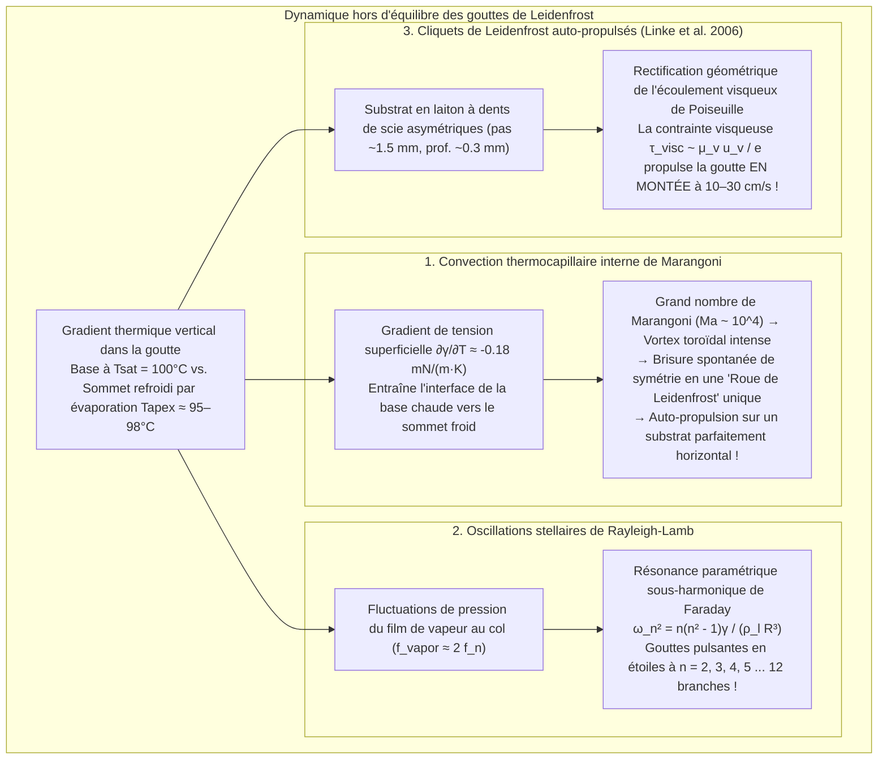

Quiconque a déjà vérifié la température d'une poêle en fonte ou en acier inoxydable en y projetant quelques gouttes d'eau a été témoin de l'un des paradoxes les plus fascinants de la physique thermique. Lorsque la surface de la poêle dépasse à peine le point d'ébullition de l'eau — vers $110^\circ\text{C}$ à $130^\circ\text{C}$ —, la goutte s'étale instantanément au contact du métal, produit un sifflement violent et s'évapore totalement en moins d'une seconde.

Pourtant, si l'on chauffe davantage cette même poêle jusqu'à $200^\circ\text{C}$ ou $300^\circ\text{C}$, le phénomène s'inverse radicalement. Au lieu de se volatiliser, la goutte d'eau se ramasse en une bille étincelante semblable à du mercure. Elle ne mouille plus du tout le métal, ne fait aucun bruit et <strong>se met à glisser et à rebondir dans toutes les directions avec une friction quasi nulle</strong>, survivant ainsi pendant <strong>plusieurs minutes</strong> — soit jusqu'à cent fois plus longtemps qu'à $120^\circ\text{C}$ !

Ce phénomène contre-intuitif est l'<strong>effet Leidenfrost</strong>. Au-delà d'un seuil critique appelé <strong>température de Leidenfrost ($T_L$)</strong>, la base de la goutte se vaporise si vite à l'approche du substrat brûlant qu'elle génère un <strong>coussin de vapeur (film de vapeur)</strong> continu de $10$ à $100\,\mu\text{m}$ d'épaisseur. Cette fine couche de gaz agit à la fois comme un aéroglisseur hydrodynamique qui maintient la goutte en lévitation sans contact solide-liquide, et comme un bouclier thermique exceptionnel, la conductivité thermique de la vapeur d'eau ($\kappa_v \approx 0.03\,\text{W/(m}\cdot\text{K)}$) étant plus de vingt fois inférieure à celle de l'eau liquide ($\kappa_l \approx 0.68\,\text{W/(m}\cdot\text{K)}$).

Dans cet article, nous développons la physique complète de l'effet Leidenfrost à partir des premiers principes : du <strong>traité historique de Johann Gottlob Leidenfrost (1756)</strong> à la <strong>courbe d'ébullition de Shiro Nukiyama (1934)</strong>, en passant par la <strong>limite hydrodynamique du flux thermique critique (CHF) de Novak Zuber</strong>, le <strong>flux minimal de Paul Berenson (MHF)</strong>, la <strong>loi d'échelle de lubrification d'Anne-Laure Biance, Christophe Clanet et David Quéré (2003)</strong>, les <strong>vortex thermocapillaires internes de Marangoni (« roues de Leidenfrost »)</strong>, les <strong>oscillations polygonales en étoile de Rayleigh-Lamb</strong>, les <strong>cliquets auto-propulsés de Heiner Linke (2006)</strong> et le problème crucial de la trempe du cœur lors d'un <strong>accident de perte de réfrigérant primaire (APRP / LOCA) dans un réacteur nucléaire</strong>.

---

## 1. Le « globe de cristal » sur une cuillère rougie au feu : la découverte de Leidenfrost (1756)

Si le médecin et chimiste néerlandais Herman Boerhaave mentionna brièvement en 1732 le comportement singulier de l'alcool sur du fer rouge, la première étude expérimentale et théorique rigoureuse fut publiée en 1756 par le médecin et philosophe naturel allemand <strong>Johann Gottlob Leidenfrost (1715–1794)</strong>, professeur à l'université de Duisbourg.

Dans son traité en latin *De Aquae Communis Nonnullis Qualitatibus Tractatus* (*Traité sur quelques qualités de l'eau commune*), Leidenfrost décrit avec une précision remarquable ce qui se produit lorsqu'on dépose une goutte d'eau pure dans une cuillère en fer chauffée au rouge :

> « Dans cette cuillère incandescente, déposez une seule goutte d'eau commune pure... L'eau n'adhère point au fer et ne s'étale pas ; au contraire, à l'instant même du contact, elle se contracte en un globule sphérique, brillant et transparent comme un <strong>globe de cristal</strong> (*globulus crystallinus*). Elle tourne rapidement et danse sans effort au fond de la cuillère sans bruit ni vapeur visible. Loin de disparaître aussitôt, elle diminue imperceptiblement pendant trente ou quarante secondes — voire une minute entière — jusqu'à ce qu'enfin une particule infime s'évanouisse avec un léger craquement. »

En mesurant au pendule la durée de vie des gouttes au fur et à mesure que la cuillère refroidissait, Leidenfrost démontra que la vitesse d'évaporation chute brutalement au-dessus d'une température critique grâce à une mince couche de vapeur (*vaporis strato*). Au XIXe siècle, le physicien français Pierre Hippolyte Boutigny (1842) popularisa ce phénomène sous le nom d'<strong>« état sphéroïdal »</strong>, réussissant même à congeler de l'eau en glace à l'intérieur d'un creuset en platine chauffé à blanc grâce au dioxyde de soufre liquide en caléfaction !

---

## 2. La courbe d'ébullition de Shiro Nukiyama (1934) et les quatre régimes d'ébullition en piscine

```mermaid
flowchart TD
    subgraph BoilingCurve["Courbe d'ébullition de Shiro Nukiyama (q'' vs. Surchauffe ΔTe = Tw - Tsat)"]
        R1["Régime I : Convection naturelle<br/>ΔTe < 5°C (Tw < 105°C)<br/>Pas de nucléation de bulles ; convection monophasique<br/>q'' ∝ ΔTe^(5/4)"]
        R2["Régime II : Ébullition nucléée (Nucleate Boiling)<br/>5°C ≤ ΔTe ≤ 30°C (Tw = 105–130°C)<br/>Nucléation intense sur micro-cavités & évaporation de micro-couche<br/>q'' ∝ ΔTe^3 (Efficacité thermique maximale)"]
        CHF["Maximum : Flux Thermique Critique (CHF / DNB)<br/>ΔTe ≈ 30°C, q''_max ≈ 1.1–1.26 MW/m²<br/>Limite hydrodynamique de Zuber (effondrement des colonnes de vapeur)"]
        R3["Régime III : Ébullition de transition<br/>30°C < ΔTe < 100–120°C<br/>Film de vapeur partiel instable & mouillage intermittent<br/>Le flux thermique CHUTE quand la température augmente ! (∂q''/∂ΔTe < 0)"]
        LP["Minimum : Point de Leidenfrost (MHF)<br/>ΔTe,L ≈ 93–120°C (Tw ≈ 193–220°C)<br/>q''_min ≈ 18–25 kW/m² (50 fois inférieur au CHF !)"]
        R4["Régime IV : Ébullition en film stable (Caléfaction)<br/>ΔTe ≥ ΔTe,L (Tw > 200°C)<br/>Coussin de vapeur isolant continu (κ_v ≈ 0.03 W/m·K)<br/>Le rayonnement thermique (∝ Tw^4) s'ajoute à Tw > 500°C"]
    end

    R1 -->|"Début d'ébullition nucléée (ONB)"| R2
    R2 -->|"Coalescence & crise hydrodynamique"| CHF
    CHF -->|"Trajectoire à température contrôlée"| R3
    R3 -->|"Stabilisation complète du film"| LP
    LP -->|"Régime de caléfaction"| R4
    CHF -.->|"Saut d'échauffement critique / Burnout à flux imposé (ΔTw > +800°C)"| R4
```

Pour comprendre quantitativement ce paradoxe, examinons l'évolution du <strong>flux thermique surfacique</strong> $q''$ $[\text{W/m}^2]$ transféré d'une paroi à la température $T_w$ vers un liquide saturé à $T_{\text{sat}}$ ($100^\circ\text{C}$ pour l'eau à $1\,\text{atm}$) en fonction de la <strong>surchauffe pariétale</strong> $\Delta T_e \equiv T_w - T_{\text{sat}}$. Cette <strong>courbe d'ébullition</strong> universelle fut établie pour la première fois en 1934 par <strong>Shiro Nukiyama</strong> à l'université impériale du Tōhoku (Sendai, Japon).

1. <strong>Régime I : Convection naturelle ($\Delta T_e < 5^\circ\text{C}$)</strong> : À cause de la pression de Laplace $\Delta P = 2\gamma / r_c$, les germes de vapeur logés dans les micro-cavités de rayon $r_c$ ne peuvent croître tant que $\Delta T_e < \Delta T_{\text{ONB}} \approx \frac{2\gamma T_{\text{sat}}}{\rho_v L_{lv} r_c}$. Le transfert s'effectue par convection naturelle monophasique ($q'' \propto \Delta T_e^{5/4}$).
2. <strong>Régime II : Ébullition nucléée ($5^\circ\text{C} \le \Delta T_e \le 30^\circ\text{C}$) et Flux Thermique Critique (CHF) de Zuber</strong> : Au-delà du seuil ONB, l'évaporation de la micro-couche liquide sous les bulles et l'agitation micro-convective font croître le flux selon la loi de Rohsenow : $q'' \propto \Delta T_e^3$. À $\Delta T_e \approx 30^\circ\text{C}$ ($T_w \approx 130^\circ\text{C}$), les bulles coalescent en colonnes de vapeur. En 1958, <strong>Novak Zuber</strong> démontra en couplant l'<strong>instabilité de Rayleigh-Taylor</strong> ($\lambda_{RT} = 2\pi\sqrt{3\gamma/[g(\rho_l - \rho_v)]}$) et l'<strong>instabilité de Kelvin-Helmholtz</strong> des jets de vapeur que le <strong>Flux Thermique Critique (CHF)</strong> vaut :
   $$q''_{\max} = \frac{\pi}{24} \rho_v L_{lv} \left[ \frac{\gamma g (\rho_l - \rho_v)}{\rho_v^2} \right]^{1/4} \approx 0.131 \rho_v L_{lv} \left[ \frac{\gamma g (\rho_l - \rho_v)}{\rho_v^2} \right]^{1/4} \approx 1.1\text{–}1.26\,\text{MW/m}^2$$
   Lors du chauffage électrique d'un fil de platine (flux imposé), atteindre $q''_{\max}$ provoque un saut brutal de $130^\circ\text{C}$ à plus de $1100^\circ\text{C}$ (<strong>crise d'ébullition / burnout</strong>).
3. <strong>Régime III : Ébullition de transition ($30^\circ\text{C} < \Delta T_e < 100\text{–}120^\circ\text{C}$)</strong> : La paroi est partiellement couverte d'une couche de vapeur instable. Plus $T_w$ augmente, plus la fraction sèche isolante grandit, si bien que <strong>le flux thermique diminue lorsque la température augmente</strong> ($\partial q'' / \partial \Delta T_e < 0$).
4. <strong>Régime IV : Ébullition en film stable (caléfaction) et Point de Leidenfrost (MHF de Berenson)</strong> : Au <strong>point de Leidenfrost ($T_L \approx 193^\circ\text{C}\text{–}220^\circ\text{C}$)</strong>, le contact solide-liquide disparaît totalement. En 1961, <strong>Paul J. Berenson</strong> établit l'expression du flux thermique minimal (MHF) :
   $$q''_{\min} = 0.09 \rho_v L_{lv} \left[ \frac{\gamma g (\rho_l - \rho_v)}{(\rho_l + \rho_v)^2} \right]^{1/4} \approx 18\text{–}25\,\text{kW/m}^2$$
   Ce flux est <strong>50 fois plus faible</strong> qu'au pic de l'ébullition nucléée !

| Régime d'ébullition | Surchauffe $\Delta T_e = T_w - T_{\text{sat}}$ (Eau, $1\,\text{atm}$) | Flux thermique typique $q''$ $[\text{W/m}^2]$ | Mécanisme physique dominant | Comportement & durée de vie $\tau$ de la goutte sur la poêle |
| :--- | :--- | :--- | :--- | :--- |
| <strong>I. Convection naturelle</strong> | $\Delta T_e < 5^\circ\text{C}$ ($T_w < 105^\circ\text{C}$) | $10^3 \text{–} 10^4$ | Cavités inactives ; convection monophasique ($q'' \propto \Delta T_e^{5/4}$). | S'étale et s'évapore silencieusement sans bulles en $30\text{–}120\,\text{s}$. |
| <strong>II. Ébullition nucléée</strong> | $5^\circ\text{C} \le \Delta T_e \le 30^\circ\text{C}$ ($T_w = 105\text{–}130^\circ\text{C}$) | $10^4 \text{–} 1.26 \times 10^6$ (Pic au CHF) | Nucléation intense et évaporation de micro-couche ($q'' \propto \Delta T_e^3$) ; limite de Zuber. | Siffle violemment, s'étale et disparaît en <strong>$0.3\text{–}1.5\,\text{s}$</strong>. |
| <strong>III. Ébullition de transition</strong> | $30^\circ\text{C} < \Delta T_e < 100^\circ\text{C}$ ($T_w = 130\text{–}200^\circ\text{C}$) | $1.2 \times 10^6 \to 2 \times 10^4$ ($\partial q''/\partial \Delta T_e < 0$) | Alternance chaotique entre couverture de vapeur et contacts explosifs. | Crépite, bondit et projette des micro-gouttelettes ; survit $2\text{–}15\,\text{s}$. |
| <strong>IV. Caléfaction / Film stable (État Leidenfrost)</strong> | $\Delta T_e \ge \Delta T_L \approx 93\text{–}120^\circ\text{C}$ ($T_w \ge 193\text{–}220^\circ\text{C}$) | $2 \times 10^4 \to 10^5$ (Minimum au MHF) | Lévitation complète sur coussin de vapeur ($10\text{–}100\,\mu\text{m}$) ; conduction gazeuse lente. | Bille ou crêpe liquide sans friction ni bruit ; survit <strong>$60\text{–}300\,\text{s}$</strong>. |

---

## 3. Statique capillaire et loi d'échelle hydrodynamique du coussin de vapeur (Biance, Clanet, & Quéré 2003)

### 3.1 Longueur capillaire $\ell_c$ et morphologie des gouttes en lévitation

En l'absence de contact solide-liquide (angle de contact apparent $\theta_c = 180^\circ$), la forme de la goutte résulte de la compétition entre la pression capillaire de Laplace ($\sim \gamma / R$) et la pression hydrostatique ($\sim \rho_l g R$), caractérisée par la <strong>longueur capillaire</strong> $\ell_c$ :

$$\ell_c = \sqrt{\frac{\gamma}{\rho_l g}} \approx 2.50\,\text{mm} \quad (\text{eau à } 100^\circ\text{C})$$

Selon le nombre de Bond $\text{Bo} = (R/\ell_c)^2$, on distingue trois régimes :
1. <strong>Gouttes quasi-sphériques ($R < \ell_c \approx 2.5\,\text{mm}$)</strong> : La goutte est une sphère de rayon $R$ légèrement aplatie à sa base sur un disque de rayon $r_c = \sqrt{\frac{2}{3}}\frac{R^2}{\ell_c}$.
2. <strong>Flaques / Crêpes de Leidenfrost ($\ell_c < R < 4\ell_c$)</strong> : La gravité aplatit la goutte en une galette d'épaisseur universelle $h_p = 2\ell_c \sin(180^\circ/2) = 2\ell_c \approx 5.0\,\text{mm}$. L'interférométrie laser révèle que la face inférieure présente une poche centrale concave (*dimple*) entourée d'un col annulaire (*neck*) où l'épaisseur de vapeur est minimale.
3. <strong>Cheminées de vapeur de Rayleigh-Taylor ($R > R_{\max} \approx 3.83\ell_c \approx 9.6\,\text{mm}$)</strong> : Au-delà de $R \approx 1\,\text{cm}$, la poche de vapeur sous l'eau lourde devient instable au sens de Rayleigh-Taylor et des bulles géantes percent périodiquement le centre de la flaque (*vapor chimneys*).

### 3.2 Dérivation exacte de l'épaisseur du film $e$ et du temps de vie $\tau$

Dans leur article fondateur publié en 2003 dans *Physics of Fluids*, <strong>Anne-Laure Biance, Christophe Clanet et David Quéré</strong> (Collège de France & École Polytechnique) ont établi la loi d'échelle du coussin de vapeur pour une flaque de rayon $R > \ell_c$ :

1. <strong>Conduction thermique de Fourier à travers le film d'épaisseur $e$</strong> :
   La puissance conduite $Q = \kappa_v \frac{\Delta T}{e} \pi R^2$ produit par chaleur latente $L_{lv}$ un débit massique d'évaporation :
   $$\dot{m} = \frac{\kappa_v \Delta T}{L_{lv} e} \pi R^2 \qquad \cdots (1)$$
2. <strong>Théorie de la lubrification visqueuse (écoulement radial de Poiseuille)</strong> :
   Dans le mince interstice $e \ll R$, l'équation de Stokes $\mu_v \frac{\partial^2 u_r}{\partial z^2} = \frac{dP}{dr}$ donne le profil parabolique $u_r(r,z) = \frac{1}{2\mu_v}\left(-\frac{dP}{dr}\right)z(e-z)$. Le débit volumique radial vaut $Q_v(r) = \frac{\pi r e^3}{6\mu_v}\left(-\frac{dP}{dr}\right) = \frac{\dot{m}}{\rho_v}\frac{r^2}{R^2}$, d'où la surpression moyenne de lubrification :
   $$\Delta P_{\text{cushion}} = \frac{3 \mu_v \dot{m}}{2 \pi \rho_v e^3} \qquad \cdots (2)$$
3. <strong>Équilibre hydrostatique et loi en $R^{1/2}$</strong> :
   En égalant $\Delta P_{\text{cushion}}$ au poids hydrostatique de la flaque $\Delta P_{\text{weight}} = 2\rho_l g \ell_c$ et en substituant (1) dans (2), on obtient la célèbre <strong>loi de Biance-Clanet-Quéré</strong> :
   $$e = \left(\frac{3}{4}\right)^{1/4} \left( \frac{\kappa_v \mu_v \Delta T}{\rho_v \rho_l g L_{lv} \ell_c} \right)^{1/4} R^{1/2} \approx 10\text{–}100\,\mu\text{m} \qquad \cdots (3)$$
   Pour $R = 5\,\text{mm}$ et $\Delta T = 200\,\text{K}$, on trouve $e \approx 54\,\mu\text{m}$ (pour les petites gouttes $R < \ell_c$, $e_{\text{small}} \propto \Delta T^{1/4} R^{5/4}$). L'intégration de $-\frac{dM}{dt} = \dot{m} \propto R^{3/2}$ conduit à $R(t) = R_0(1 - t/\tau)^2$ et à une durée de vie $\tau \propto \Delta T^{-3/4} R_0^{3/2}$ (ou $\tau \propto R_0^{5/4}$ à $R_0^2$ selon le régime).

---

## 4. Vortex thermocapillaires de Marangoni, étoiles de Rayleigh-Lamb et cliquets de Leidenfrost

### 4.1 Convection thermocapillaire de Marangoni et « roues de Leidenfrost »

La différence de température entre la base à $100^\circ\text{C}$ et le sommet refroidi à $95\text{–}98^\circ\text{C}$ engendre, via $\frac{\partial \gamma}{\partial T} \approx -0.18\,\text{mN/(m}\cdot\text{K)}$, une contrainte tangentielle de <strong>Marangoni</strong> $\tau_s = \frac{\partial \gamma}{\partial T}\nabla_s T$ ($\text{Ma} = \frac{|\partial \gamma/\partial T|\Delta T_{\text{int}} R}{\mu_l \alpha_l} \sim 2 \times 10^4 \gg \text{Ma}_c$). Ce brassage supprime totalement l'<strong>effet tache de café (*coffee-ring effect*)</strong> et permet d'assembler des supraparticules nanoporeuses 3D. De plus, <strong>Bouillant, Quéré et al. (2018, *Nature Physics*)</strong> ont découvert que dans les petites gouttes ($R \lesssim 1.5\,\text{mm}$), le rouleau toroïdal brise spontanément sa symétrie pour former une cellule unique en rotation : cette <strong>« roue de Leidenfrost »</strong> incline le film de vapeur et propulse la goutte toute seule sur un plan horizontal !

### 4.2 Oscillations polygonales en étoile de Rayleigh-Lamb

Les grandes flaques ($R \sim 5\text{–}15\,\text{mm}$) présentent de spectaculaires modes propres azimutaux en forme d'étoiles régulières à $n$ branches gouvernés par la <strong>relation de dispersion de Rayleigh-Lamb</strong> :

$$\omega_n^2 = \frac{n(n^2 - 1)\gamma}{\rho_l R^3} \qquad (n = 2, 3, 4, \dots, 12)$$

Ces modes sont excités par <strong>résonance paramétrique sous-harmonique de Faraday ($f_n = \frac{\omega_n}{2\pi} \approx \frac{1}{2} f_{\text{vapor}}$)</strong> induite par la pulsation hydrodynamique du coussin de vapeur.

### 4.3 Cliquets auto-propulsés de Heiner Linke (2006)

En 2006, <strong>Heiner Linke et al.</strong> (*Phys. Rev. Lett.*) ont montré que sur une plaque chaude gravée de dents de scie asymétriques (période $\sim 1.5\,\text{mm}$, profondeur $\sim 0.3\,\text{mm}$), les gouttes de Leidenfrost s'auto-propulsent à $10\text{–}30\,\text{cm/s}$ en gravissant les marches abruptes du cliquet : le ménisque inférieur obstrue la paroi verticale et rectifie l'écoulement de Poiseuille le long de la pente douce vers l'arrière, exerçant par réaction une poussée visqueuse $F_{\text{ratchet}} \sim \frac{\mu_v u_{\text{vapor}}}{e}\pi R^2 \sim 30\,\mu\text{N}$.

---

## 5. Applications industrielles : Sûreté nucléaire (APRP / LOCA), trempe métallurgique et azote liquide

1. <strong>Renoyage des réacteurs nucléaires lors d'un accident de perte de réfrigérant (LOCA)</strong> :
   Lorsqu'une gaine de combustible en Zircaloy dépasse le flux critique CHF, elle bascule en caléfaction (Régime IV) et sa température dépasse $1000^\circ\text{C}$ en quelques secondes. Lorsque le système d'injection de sécurité (ECCS) tente de renoyer le cœur, l'eau est repoussée par l'effet Leidenfrost ($T_w \gg T_L$) ; le front deremouillage (*quench front*) ne progresse que par conduction axiale dans la gaine métallique (modèle de Yamanouchi : $u_q \propto (T_L - T_{\text{sat}})/(T_{\text{init}} - T_L)$).
2. <strong>Trempe métallurgique des aciers</strong> :
   Lors de la trempe d'un acier austénitique à $850^\circ\text{C}$, le stade initial de caléfaction ralentit le refroidissement avant la transition brutale vers l'ébullition nucléée qui forme la martensite. Une rupture inhomogène du film de vapeur provoque déformations et <strong>tapures de trempe</strong>.
3. <strong>Doigt mouillé dans le plomb fondu et azote liquide sur la peau</strong> :
   Un doigt mouillé plongé une fraction de seconde dans du plomb fondu à $400^\circ\text{C}$ (<strong>extrêmement dangereux, ne jamais tenter !</strong>) est protégé par la vaporisation instantanée de l'eau en film de Leidenfrost ; de même, l'<strong>azote liquide ($T_{\text{sat}} = 77\,\text{K} = -196^\circ\text{C}$)</strong> voit la peau humaine ($307\,\text{K}$, soit $\Delta T_e = 230\,\text{K}$) comme une plaque brûlante et rebondit sur un coussin d'azote gazeux.

---

## Références

1. <strong>Leidenfrost, J. G.</strong> (1756). *De Aquae Communis Nonnullis Qualitatibus Tractatus*. Duisburg.
2. <strong>Nukiyama, S.</strong> (1934). "The Maximum and Minimum Values of the Heat Transmitted from Metal to Boiling Water under Atmospheric Pressure". *J. Jpn. Soc. Mech. Eng.*, 37(206), 367–374.
3. <strong>Zuber, N.</strong> (1958). "On the stability of boiling heat transfer". *Trans. ASME*, 80(3), 711–720.
4. <strong>Berenson, P. J.</strong> (1961). "Film-boiling heat transfer from a horizontal surface". *J. Heat Transf.*, 83(3), 351–356.
5. <strong>Biance, A.-L., Clanet, C., & Quéré, D.</strong> (2003). "Leidenfrost drops". *Physics of Fluids*, 15(6), 1632–1637.
6. <strong>Linke, H., et al.</strong> (2006). "Self-Propelled Leidenfrost Droplets". *Physical Review Letters*, 96(15), 154502.
7. <strong>Quéré, D.</strong> (2013). "Leidenfrost Dynamics". *Annual Review of Fluid Mechanics*, 45, 197–215.
8. <strong>Bouillant, A., et al.</strong> (2018). "Leidenfrost wheels". *Nature Physics*, 14(12), 1188–1192.
