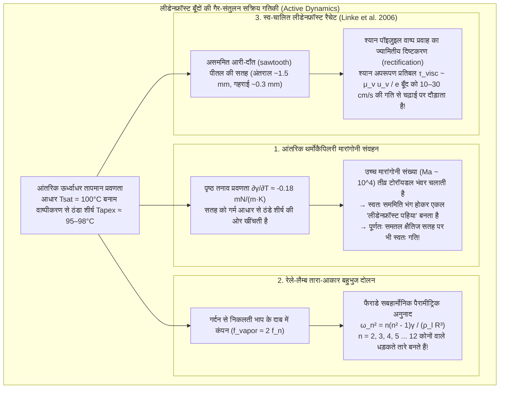

रसोई में खाना बनाते समय जब हम लोहे या स्टेनलेस स्टील के गर्म तवे (skillet) का तापमान जाँचने के लिए उस पर पानी की कुछ बूँदें छिड़कते हैं, तो हमें ऊष्मागतिकी (thermodynamics) का एक अत्यंत आश्चर्यजनक विरोधाभास दिखाई देता है। जब तवे की सतह का तापमान पानी के क्वथनांक ($100^\circ\text{C}$) से थोड़ा ही अधिक — लगभग $110^\circ\text{C}$ से $130^\circ\text{C}$ के बीच — होता है, तो पानी की बूँद गिरते ही तुरंत फैल जाती है, तीव्र "छन्न!" की आवाज़ करती है और एक सेकंड से भी कम समय में पूरी तरह भाप बनकर उड़ जाती है।

किंतु यदि उसी तवे को और अधिक गर्म किया जाए जब तक कि उसका तापमान $200^\circ\text{C}$ से $300^\circ\text{C}$ के पार न पहुँच जाए, तो पानी का व्यवहार पूरी तरह पलट जाता है। तुरंत भाप बनने के बजाय, पानी की बूँद पारे (mercury) या चमकीले काँच के गोले की तरह गोल सिमट जाती है। अब वह कोई आवाज़ नहीं करती, धातु की सतह को बिल्कुल भी गीला नहीं करती, और <strong>लगभग शून्य घर्षण के साथ तवे पर चारों ओर तेजी से फिसलने और नाचने लगती है</strong>। सबसे चौंकाने वाली बात यह है कि तवा कहीं अधिक गर्म होने के बावजूद यह बूँद <strong>कई मिनटों तक</strong> जीवित रहती है — यानी $120^\circ\text{C}$ की तुलना में सौ गुना अधिक समय तक!

सहज ज्ञान के विपरीत इस परिघटना को <strong>लीडेनफ्रॉस्ट प्रभाव (Leidenfrost effect)</strong> कहा जाता है। एक क्रांतिक तापमान सीमा — जिसे <strong>लीडेनफ्रॉस्ट तापमान ($T_L$)</strong> कहते हैं — के ऊपर, गर्म सतह के पास पहुँचते ही बूँद का निचला हिस्सा इतनी तेजी से वाष्पित होता है कि वह ठोस सतह और बूँद के बीच केवल $10$ से $100\,\mu\text{m}$ मोटी एक सतत <strong>वाष्प कुशन (वाष्प परत / vapor cushion)</strong> बना लेता है। भाप की यह सूक्ष्म परत एक साथ दोहरी भूमिका निभाती है: तरल यांत्रिकी के स्तर पर यह एक होवरक्राफ्ट (hovercraft) की तरह श्यान स्नेहन दाब (viscous lubrication pressure) के बल पर बूँद के भार को बिना किसी ठोस-द्रव संपर्क के हवा में उठाए रखती है, और ऊष्मा अंतरण के स्तर पर यह एक शक्तिशाली ऊष्मारोधी (thermal insulator) का काम करती है क्योंकि जलवाष्प की ऊष्मीय चालकता ($\kappa_v \approx 0.03\,\text{W/(m}\cdot\text{K)}$) द्रव जल ($\kappa_l \approx 0.68\,\text{W/(m}\cdot\text{K)}$) की तुलना में बीस गुना से भी अधिक कम होती है।

इस लेख में हम प्रथम सिद्धांतों (first principles) से लीडेनफ्रॉस्ट प्रभाव के संपूर्ण भौतिकी और गणित का विश्लेषण करेंगे: <strong>1756 में जोहान गॉटलोब लीडेनफ्रॉस्ट के ऐतिहासिक शोध प्रबंध</strong> और <strong>1934 में शिरो नुकियामा के क्वथन वक्र (Boiling Curve)</strong> से शुरू करके, <strong>नोवाक ज़ुबेर की क्रांतिक ऊष्मा प्रवाह (CHF) सीमा</strong>, <strong>पॉल बेरेनसन के न्यूनतम ऊष्मा प्रवाह (MHF)</strong>, <strong>बियान्स, क्लानेट और क्वेरे (2003) के वाष्प कुशन स्नेहन समीकरण और स्केलिंग नियम ($e \propto \Delta T^{1/4} R^{1/2}$)</strong> की व्युत्पत्ति करेंगे; और अंत में बूँद के भीतर घूमने वाले <strong>थर्मोकैपिलरी मारांगोनी भंवर ("लीडेनफ्रॉस्ट पहिए")</strong>, <strong>रेले-लैम्ब के तारा-आकार (star-shaped) बहुभुज दोलनों</strong>, <strong>हाइनर लिंके के स्व-चालित लीडेनफ्रॉस्ट रैचेट (2006)</strong> तथा <strong>परमाणु रिएक्टर में शीतलक हानि दुर्घटना (LOCA) के दौरान कोर शमन (quenching)</strong> जैसे महत्वपूर्ण औद्योगिक अनुप्रयोगों को समझेंगे।

---

## 1. लाल-तप्त लोहे के चम्मच पर "क्रिस्टल ग्लोब": 1756 में लीडेनफ्रॉस्ट की खोज

यद्यपि डच चिकित्सक और रसायनज्ञ हरमन बूरहावे ने 1732 में लाल-तप्त लोहे पर अल्कोहल के व्यवहार का संक्षिप्त उल्लेख किया था, किंतु इस परिघटना का पहला व्यवस्थित और मात्रात्मक प्रायोगिक अध्ययन 1756 में जर्मनी के डुइसबर्ग विश्वविद्यालय के चिकित्सक और प्राकृतिक दार्शनिक <strong>जोहान गॉटलोब लीडेनफ्रॉस्ट (Johann Gottlob Leidenfrost, 1715–1794)</strong> द्वारा प्रकाशित किया गया था।

अपनी लैटिन पुस्तक *De Aquae Communis Nonnullis Qualitatibus Tractatus* (*साधारण जल के कुछ गुणों पर एक प्रबंध*) में लीडेनफ्रॉस्ट ने दहकते कोयले पर लाल होने तक गर्म किए गए लोहे के चम्मच पर शुद्ध पानी की एक बूँद गिराने के प्रयोग का वर्णन इस प्रकार किया:

> "इस दहकते हुए चम्मच में शुद्ध साधारण जल की एक बूँद डालें... पानी लोहे से चिपकता नहीं है और न ही फैलता है; इसके विपरीत, स्पर्श के उसी क्षण वह तुरंत सिकुड़कर एक गोलाकार बूँद बन जाता है, जो किसी <strong>क्रिस्टल ग्लोब</strong> (*globulus crystallinus*) की भाँति उज्ज्वल और पारदर्शी होती है। यह बिना किसी शोर या दृश्य भाप के चम्मच की तली में तेजी से घूमती और सहजता से नाचती है। तुरंत गायब होने के बजाय, यह तीस या चालीस सेकंड — या पूरे एक मिनट — तक अत्यंत धीरे-धीरे छोटी होती जाती है, जब तक कि अंत में एक सूक्ष्म कण हल्की-सी 'चट' की आवाज़ के साथ लुप्त नहीं हो जाता।"

चम्मच के ठंडा होने के साथ लोलक (pendulum) की सहायता से बूँद के जीवनकाल को मापकर लीडेनफ्रॉस्ट ने सिद्ध किया कि एक क्रांतिक तापमान के ऊपर भाप की एक पतली परत (*vaporis strato*) के कारण वाष्पीकरण की दर अचानक गिर जाती है। 1842 में फ्रांसीसी भौतिक विज्ञानी पियरे हिप्पोलाइट बुटिग्नी ने इसे पदार्थ की "गोलाभ अवस्था (spheroidal state)" नाम दिया और लीडेनफ्रॉस्ट अवस्था में द्रव सल्फर डाइऑक्साइड का उपयोग करके लाल-तप्त प्लैटिनम क्रूसिबल के भीतर पानी को बर्फ में जमाकर दिखाया!

---

## 2. शिरो नुकियामा का क्वथन वक्र (1934) और पूल क्वथन (Pool Boiling) की चार अवस्थाएँ

```mermaid
flowchart TD
    subgraph BoilingCurve["शिरो नुकियामा का क्वथन वक्र (q'' बनाम दीवार अतितापन ΔTe = Tw - Tsat)"]
        R1["क्षेत्र I: प्राकृतिक संवहन क्वथन<br/>ΔTe < 5°C (Tw < 105°C)<br/>बुलबुले नहीं बनते; एकल-चरण उत्प्लावन संवहन<br/>q'' ∝ ΔTe^(5/4)"]
        R2["क्षेत्र II: नाभिकीय क्वथन (Nucleate Boiling)<br/>5°C ≤ ΔTe ≤ 30°C (Tw = 105–130°C)<br/>सूक्ष्म गुहिकाओं से तीव्र बुलबुला निर्माण और माइक्रोलेयर वाष्पीकरण<br/>q'' ∝ ΔTe^3 (अधिकतम शीतलन दक्षता)"]
        CHF["शिखर: क्रांतिक ऊष्मा प्रवाह (CHF / DNB)<br/>ΔTe ≈ 30°C, q''_max ≈ 1.1–1.26 MW/m²<br/>ज़ुबेर की द्रव-गतिकीय सीमा (वाष्प स्तंभों का पतन)"]
        R3["क्षेत्र III: संक्रमण क्वथन (Transition Boiling)<br/>30°C < ΔTe < 100–120°C<br/>अस्थिर आंशिक वाष्प आवरण और रुक-रुक कर ठोस-द्रव संपर्क<br/>तापमान बढ़ने पर ऊष्मा प्रवाह गिरता है! (∂q''/∂ΔTe < 0)"]
        LP["न्यूनतम बिंदु: लीडेनफ्रॉस्ट बिंदु (MHF)<br/>ΔTe,L ≈ 93–120°C (Tw ≈ 193–220°C)<br/>q''_min ≈ 18–25 kW/m² (CHF से 50 गुना कम!)"]
        R4["क्षेत्र IV: स्थिर फिल्म क्वथन (Stable Film Boiling)<br/>ΔTe ≥ ΔTe,L (Tw > 200°C)<br/>सतत ऊष्मारोधी वाष्प कुशन (κ_v ≈ 0.03 W/m·K)<br/>Tw > 500°C पर तापीय विकिरण (∝ Tw^4) जुड़ता है"]
    end

    R1 -->|"नाभिकीय क्वथन का प्रारंभ (ONB)"| R2
    R2 -->|"बुलबुलों का विलय और प्रति-प्रवाह संकट"| CHF
    CHF -->|"तापमान-नियंत्रित पथ"| R3
    R3 -->|"पूर्ण वाष्प फिल्म स्थिरीकरण"| LP
    LP -->|"फिल्म क्वथन क्षेत्र"| R4
    CHF -.->|"ऊष्मा-प्रवाह नियंत्रित बर्नआउट छलांग (ΔTw > +800°C)"| R4
```

यह समझने के लिए कि पानी की बूँद $250^\circ\text{C}$ पर मिनटों तक क्यों टिकती है जबकि $125^\circ\text{C}$ पर एक सेकंड से भी कम समय में उड़ जाती है, हमें <strong>सतही ऊष्मा प्रवाह (Heat flux)</strong> $q''$ $[\text{W/m}^2]$ और <strong>दीवार के अतितापन (Wall superheat)</strong> $\Delta T_e \equiv T_w - T_{\text{sat}}$ ($1\,\text{atm}$ पर जल के लिए $T_{\text{sat}} = 100^\circ\text{C}$) के बीच के संबंध को देखना होगा। इस सार्वभौमिक <strong>क्वथन वक्र (Boiling Curve)</strong> को सर्वप्रथम 1934 में जापान के तोहोकू इम्पीरियल विश्वविद्यालय के प्रोफेसर <strong>शिरो नुकियामा (Shiro Nukiyama)</strong> ने प्लैटिनम तार के ऐतिहासिक प्रयोग द्वारा निर्मित किया था।

1. <strong>क्षेत्र I: प्राकृतिक संवहन क्वथन ($\Delta T_e < 5^\circ\text{C}$)</strong>: लाप्लास दाब $\Delta P = 2\gamma / r_c$ के कारण सतह की सूक्ष्म गुहिकाओं (त्रिज्या $r_c$) में फँसे वाष्प भ्रूण तब तक नहीं बढ़ सकते जब तक अतितापन $\Delta T_{\text{ONB}} \approx \frac{2\gamma T_{\text{sat}}}{\rho_v L_{lv} r_c}$ से अधिक न हो जाए। इससे नीचे ऊष्मा का प्रवाह एकल-चरण प्राकृतिक संवहन ($q'' \propto \Delta T_e^{5/4}$) द्वारा होता है।
2. <strong>क्षेत्र II: नाभिकीय क्वथन ($5^\circ\text{C} \le \Delta T_e \le 30^\circ\text{C}$) और ज़ुबेर का क्रांतिक ऊष्मा प्रवाह (CHF)</strong>: बुलबुलों के नीचे सूक्ष्म द्रव परत (microlayer) के तीव्र वाष्पीकरण और सूक्ष्म-संवहन हलचल के कारण ऊष्मा प्रवाह अतितापन के घन के समानुपाती बढ़ता है (रोहसेनौ संबंध: $q'' \propto \Delta T_e^3$)। $\Delta T_e \approx 30^\circ\text{C}$ ($T_w \approx 130^\circ\text{C}$) पर बुलबुले मिलकर सतत वाष्प स्तंभ (vapor columns) बना लेते हैं। 1958 में <strong>नोवाक ज़ुबेर (Novak Zuber)</strong> ने <strong>रेले-टेलर अस्थिरता</strong> ($\lambda_{RT} = 2\pi\sqrt{3\gamma/[g(\rho_l - \rho_v)]}$) और <strong>केल्विन-हेल्महोल्ट्ज़ अस्थिरता</strong> को जोड़कर <strong>क्रांतिक ऊष्मा प्रवाह (CHF)</strong> का प्रसिद्ध सूत्र व्युत्पन्न किया:
   $$q''_{\max} = \frac{\pi}{24} \rho_v L_{lv} \left[ \frac{\gamma g (\rho_l - \rho_v)}{\rho_v^2} \right]^{1/4} \approx 0.131 \rho_v L_{lv} \left[ \frac{\gamma g (\rho_l - \rho_v)}{\rho_v^2} \right]^{1/4} \approx 1.1\text{–}1.26\,\text{MW/m}^2$$
   विद्युत तापन (नियंत्रित ऊष्मा प्रवाह) में $q''_{\max}$ पर पहुँचते ही तार का तापमान $130^\circ\text{C}$ से सीधे $1100^\circ\text{C}$ के पार छलांग लगा देता है जिसे <strong>बर्नआउट (burnout)</strong> कहते हैं।
3. <strong>क्षेत्र III: संक्रमण क्वथन ($30^\circ\text{C} < \Delta T_e < 100\text{–}120^\circ\text{C}$)</strong>: अस्थिर वाष्प परत दीवार को आंशिक रूप से ढक लेती है; जैसे-जैसे $T_w$ बढ़ता है, शुष्क वाष्प से ढका क्षेत्रफल बढ़ता है जिससे <strong>तापमान बढ़ने पर ऊष्मा प्रवाह घटने लगता है</strong> ($\partial q'' / \partial \Delta T_e < 0$)।
4. <strong>क्षेत्र IV: स्थिर फिल्म क्वथन और लीडेनफ्रॉस्ट बिंदु (बेरेनसन का MHF)</strong>: <strong>लीडेनफ्रॉस्ट बिंदु ($T_L \approx 193^\circ\text{C}\text{–}220^\circ\text{C}$)</strong> पर ठोस और द्रव का संपर्क पूर्णतः समाप्त हो जाता है। 1961 में <strong>पॉल जे. बेरेनसन (P. J. Berenson)</strong> ने न्यूनतम ऊष्मा प्रवाह (MHF) का सूत्र दिया:
   $$q''_{\min} = 0.09 \rho_v L_{lv} \left[ \frac{\gamma g (\rho_l - \rho_v)}{(\rho_l + \rho_v)^2} \right]^{1/4} \approx 18\text{–}25\,\text{kW/m}^2$$
   यह मान नाभिकीय क्वथन के शिखर (CHF) से <strong>लगभग 50 गुना कम</strong> है!

| क्वथन क्षेत्र | दीवार अतितापन $\Delta T_e = T_w - T_{\text{sat}}$ (जल, $1\,\text{atm}$) | विशिष्ट ऊष्मा प्रवाह $q''$ $[\text{W/m}^2]$ | प्रमुख भौतिक तंत्र | तवे पर पानी की बूँद का व्यवहार और जीवनकाल $\tau$ |
| :--- | :--- | :--- | :--- | :--- |
| <strong>I. प्राकृतिक संवहन</strong> | $\Delta T_e < 5^\circ\text{C}$ ($T_w < 105^\circ\text{C}$) | $10^3 \text{–} 10^4$ | गुहिकाएँ निष्क्रिय; एकल-चरण संवहन ($q'' \propto \Delta T_e^{5/4}$)। | सतह पर फैलती है और बिना बुलबुलों के $30\text{–}120\,\text{s}$ में शांत रूप से सूखती है। |
| <strong>II. नाभिकीय क्वथन</strong> | $5^\circ\text{C} \le \Delta T_e \le 30^\circ\text{C}$ ($T_w = 105\text{–}130^\circ\text{C}$) | $10^4 \text{–} 1.26 \times 10^6$ (CHF शिखर) | तीव्र बुलबुला निर्माण व माइक्रोलेयर वाष्पीकरण ($q'' \propto \Delta T_e^3$); ज़ुबेर सीमा। | तीव्र "छन्न" की आवाज़ के साथ फैलती है और <strong>$0.3\text{–}1.5\,\text{s}$</strong> में गायब हो जाती है। |
| <strong>III. संक्रमण क्वथन</strong> | $30^\circ\text{C} < \Delta T_e < 100^\circ\text{C}$ ($T_w = 130\text{–}200^\circ\text{C}$) | $1.2 \times 10^6 \to 2 \times 10^4$ ($\partial q''/\partial \Delta T_e < 0$) | आंशिक वाष्प आवरण और विस्फोटक संपर्क के बीच अराजक दोलन। | चटखती है, उछलती है और सूक्ष्म बूँदें बिखेरती है; $2\text{–}15\,\text{s}$ तक जीवित रहती है। |
| <strong>IV. स्थिर फिल्म क्वथन (लीडेनफ्रॉस्ट अवस्था)</strong> | $\Delta T_e \ge \Delta T_L \approx 93\text{–}120^\circ\text{C}$ ($T_w \ge 193\text{–}220^\circ\text{C}$) | $2 \times 10^4 \to 10^5$ (MHF न्यूनतम) | $10\text{–}100\,\mu\text{m}$ वाष्प कुशन पर पूर्ण उत्थापन; धीमा गैस चालन। | बिना घर्षण और बिना आवाज़ के मोती या पैनकेक की तरह घूमती है; <strong>$60\text{–}300\,\text{s}$</strong> तक जीवित। |

---

## 3. केशिका स्थैतिकी (Capillary Statics) और वाष्प कुशन का स्नेहन स्केलिंग नियम (Biance, Clanet, & Quéré 2003)

### 3.1 केशिका लंबाई $\ell_c$ और बूँद की तीन ज्यामितीय अवस्थाएँ

आभासी संपर्क कोण $\theta_c = 180^\circ$ होने के कारण लाप्लास दाब ($\sim \gamma / R$) और द्रवस्थैतिक दाब ($\sim \rho_l g R$) के बीच का संतुलन <strong>केशिका लंबाई (Capillary length)</strong> $\ell_c$ को परिभाषित करता है:

$$\ell_c = \sqrt{\frac{\gamma}{\rho_l g}} \approx 2.50\,\text{mm} \quad (100^\circ\text{C}\text{ पर जल})$$

बॉन्ड संख्या $\text{Bo} = (R/\ell_c)^2$ के आधार पर तीन आकार बनते हैं:
1. <strong>अर्ध-गोलाकार बूँदें ($R < \ell_c \approx 2.5\,\text{mm}$)</strong>: त्रिज्या $R$ का गोला जिसके निचले भाग में त्रिज्या $r_c = \sqrt{\frac{2}{3}}\frac{R^2}{\ell_c}$ का एक छोटा समतल संपर्क क्षेत्र बनता है।
2. <strong>लीडेनफ्रॉस्ट पैनकेक / पोखर ($\ell_c < R < 4\ell_c$)</strong>: गुरुत्वाकर्षण बूँद को एक सार्वभौमिक मोटाई $h_p = 2\ell_c \sin(180^\circ/2) = 2\ell_c \approx 5.0\,\text{mm}$ की चपटी डिस्क में बदल देता है, जिसके नीचे मध्य में अवतल वाष्प पॉकेट (*dimple*) और किनारे के पास संकीर्ण वलयाकार गर्दन (*neck*) होती है।
3. <strong>रेले-टेलर वाष्प चिमनी ($R > R_{\max} \approx 3.83\ell_c \approx 9.6\,\text{mm}$)</strong>: जब $R \gtrsim 1\,\text{cm}$ होता है, तो भारी पानी के नीचे की हल्की भाप रेले-टेलर अस्थिरता का शिकार हो जाती है और बूँद के केंद्र को भेदकर भाप के बड़े बुलबुले (*vapor chimneys*) ऊपर फूटने लगते हैं।

### 3.2 वाष्प फिल्म की मोटाई $e$ और जीवनकाल $\tau$ की गणितीय व्युत्पत्ति

2003 के अपने प्रसिद्ध शोधपत्र (*Physics of Fluids*) में <strong>ऐन-लॉर बियान्स, क्रिस्टोफ क्लानेट और डेविड क्वेरे</strong> ने त्रिज्या $R > \ell_c$ के पैनकेक के लिए फूरियर ऊष्मा चालन को श्यान स्नेहन सिद्धांत के साथ युग्मित किया:

1. <strong>मोटाई $e$ की वाष्प परत के पार फूरियर ऊष्मा चालन</strong>:
   $$Q = \kappa_v \frac{\Delta T}{e} \pi R^2 = \dot{m} L_{lv} \quad \Longrightarrow \quad \dot{m} = \frac{\kappa_v \Delta T}{L_{lv} e} \pi R^2 \qquad \cdots (1)$$
2. <strong>श्यान स्नेहन सिद्धांत (त्रिज्यीय पॉइज़ुइल प्रवाह)</strong>:
   स्नेहन समीकरण $\mu_v \frac{\partial^2 u_r}{\partial z^2} = \frac{dP}{dr}$ से परवलयिक वेग प्रोफ़ाइल $u_r(r,z) = \frac{1}{2\mu_v}\left(-\frac{dP}{dr}\right)z(e-z)$ और आयतन प्रवाह दर $Q_v(r) = \frac{\pi r e^3}{6\mu_v}\left(-\frac{dP}{dr}\right) = \frac{\dot{m}}{\rho_v}\frac{r^2}{R^2}$ प्राप्त होती है। दाब का समाकलन करने पर वाष्प कुशन का औसत अतिरिक्त दाब मिलता है:
   $$\Delta P_{\text{cushion}} = \frac{3 \mu_v \dot{m}}{2 \pi \rho_v e^3} \qquad \cdots (2)$$
3. <strong>द्रवस्थैतिक संतुलन और $e \propto R^{1/2}$ स्केलिंग नियम</strong>:
   $\Delta P_{\text{cushion}}$ को पैनकेक के द्रवस्थैतिक दाब $\Delta P_{\text{weight}} = 2\rho_l g \ell_c$ के बराबर रखने और (1) को (2) में प्रतिस्थापित करने पर <strong>बियान्स-क्लानेट-क्वेरे नियम</strong> प्राप्त होता है:
   $$e = \left(\frac{3}{4}\right)^{1/4} \left( \frac{\kappa_v \mu_v \Delta T}{\rho_v \rho_l g L_{lv} \ell_c} \right)^{1/4} R^{1/2} \approx 10\text{–}100\,\mu\text{m} \qquad \cdots (3)$$
   $R = 5\,\text{mm}$ और $\Delta T = 200\,\text{K}$ के लिए $e \approx 54\,\mu\text{m}$ प्राप्त होता है (जबकि छोटी बूँदों $R < \ell_c$ के लिए $e_{\text{small}} \propto \Delta T^{1/4} R^{5/4}$ होता है)। द्रव्यमान ह्रास $-\frac{dM}{dt} = \dot{m} \propto R^{3/2}$ का समाकलन करने पर $R(t) = R_0(1 - t/\tau)^2$ और कुल जीवनकाल $\tau \propto \Delta T^{-3/4} R_0^{3/2}$ (या $\tau \propto R_0^{5/4}$ से $R_0^2$) मिलता है।

---

## 4. थर्मोकैपिलरी मारांगोनी भंवर, रेले-लैम्ब तारा दोलन और लीडेनफ्रॉस्ट रैचेट

### 4.1 थर्मोकैपिलरी मारांगोनी संवहन और "लीडेनफ्रॉस्ट पहिए"

आधार ($100^\circ\text{C}$) और शीर्ष ($95\text{–}98^\circ\text{C}$) के बीच का तापांतर $\frac{\partial \gamma}{\partial T} \approx -0.18\,\text{mN/(m}\cdot\text{K)}$ के माध्यम से स्पर्शरेखीय <strong>मारांगोनी अपरूपण प्रतिबल</strong> $\tau_s = \frac{\partial \gamma}{\partial T}\nabla_s T$ ($\text{Ma} = \frac{|\partial \gamma/\partial T|\Delta T_{\text{int}} R}{\mu_l \alpha_l} \sim 2 \times 10^4 \gg \text{Ma}_c$) उत्पन्न करता है, जो नैनोकणों के सूखने पर बनने वाले <strong>कॉफी-रिंग प्रभाव (*coffee-ring effect*)</strong> को समाप्त कर देता है। इसके अलावा, <strong>Bouillant, Quéré et al. (2018, *Nature Physics*)</strong> ने पाया कि $R \lesssim 1.5\,\text{mm}$ होने पर टोरॉयडल भंवर की सममिति स्वतः टूट जाती है और वह एक एकल घूमते हुए रोल (<strong>"लीडेनफ्रॉस्ट पहिया"</strong>) में बदल जाता है जो समतल सतह पर भी बूँद को अपने आप लुढ़का ले जाता है!

### 4.2 रेले-लैम्ब तारा-आकार बहुभुज दोलन

बड़े लीडेनफ्रॉस्ट पैनकेक ($R \sim 5\text{–}15\,\text{mm}$) में तारा-आकार की अप्रगामी तरंगें (standing waves) बनती हैं जो <strong>रेले-लैम्ब परिक्षेपण संबंध</strong> का पालन करती हैं:

$$\omega_n^2 = \frac{n(n^2 - 1)\gamma}{\rho_l R^3} \qquad (n = 2, 3, 4, \dots, 12)$$

ये मोड वाष्प परत के दाब कंपनों ($f_{\text{vapor}}$) द्वारा <strong>फैराडे सबहार्मोनिक पैरामीट्रिक अनुनाद ($f_n = \frac{\omega_n}{2\pi} \approx \frac{1}{2} f_{\text{vapor}}$)</strong> के माध्यम से उत्तेजित होते हैं।

### 4.3 हाइनर लिंके के स्व-चालित लीडेनफ्रॉस्ट रैचेट (2006)

2006 में <strong>हाइनर लिंके और सहयोगियों (Heiner Linke et al., *Phys. Rev. Lett.*)</strong> ने दिखाया कि असममित आरी-दाँत (sawtooth) खाँचों (अंतराल $\sim 1.5\,\text{mm}$, गहराई $\sim 0.3\,\text{mm}$) वाली गर्म पीतल की प्लेट पर लीडेनफ्रॉस्ट बूँदें बिना किसी बाहरी बल के खड़ी सीढ़ियों की दिशा में $10\text{–}30\,\text{cm/s}$ की गति से दौड़ती हैं: बूँद की निचली सतह खड़ी सीढ़ी के मार्ग को रोक देती है जिससे भाप प्रत्येक दाँत की ढलान के अनुदिश पीछे की ओर प्रवाहित होती है और प्रतिक्रिया स्वरूप श्यान प्रणोद बल $F_{\text{ratchet}} \sim \frac{\mu_v u_{\text{vapor}}}{e}\pi R^2 \sim 30\,\mu\text{N}$ बूँद को आगे धकेलता है।

---

## 5. औद्योगिक अनुप्रयोग: परमाणु रिएक्टर सुरक्षा (LOCA), इस्पात शमन और द्रव नाइट्रोजन

1. <strong>परमाणु रिएक्टर शीतलक हानि दुर्घटना (LOCA) और पुनर्जलीकरण शमन (Quenching)</strong>:
   यदि ज़िरकालॉय ईंधन क्लैडिंग पर ऊष्मा प्रवाह CHF को पार कर जाता है, तो रिएक्टर तुरंत लीडेनफ्रॉस्ट फिल्म क्वथन (क्षेत्र IV) में पहुँच जाता है और तापमान कुछ ही सेकंड में $1000^\circ\text{C}$ से ऊपर चला जाता है। जब आपातकालीन कोर शीतलन प्रणाली (ECCS) पानी डालती है, तो वाष्प परत पानी को दूर धकेल देती है ($T_w \gg T_L$) और शमन अग्रभाग (*quench front*) केवल धातु आवरण के अक्षीय ऊष्मा चालन के सहारे ही आगे बढ़ पाता है (यामानौची मॉडल: $u_q \propto (T_L - T_{\text{sat}})/(T_{\text{init}} - T_L)$)।
2. <strong>इस्पात का धातुकर्म शमन (Quenching of Steel)</strong>:
   $850^\circ\text{C}$ के ऑस्टेनाइट इस्पात को पानी में डुबोने पर प्रारंभिक लीडेनफ्रॉस्ट वाष्प आवरण शीतलन को धीमा रखता है जब तक कि तापमान $T_L$ से नीचे नहीं आ जाता, जहाँ तीव्र नाभिकीय क्वथन मार्टेंसाइट का निर्माण करता है। वाष्प परत के असमान पतन से विरूपण और <strong>शमन दरारें (quench cracking)</strong> पैदा होती हैं।
3. <strong>पिघले सीसे में गीली उँगली और त्वचा पर द्रव नाइट्रोजन</strong>:
   पानी से भीगी उँगली को $400^\circ\text{C}$ के पिघले सीसे में क्षण भर के लिए डुबोने पर (<strong>अत्यंत खतरनाक, कभी प्रयास न करें!</strong>) त्वचा की नमी तुरंत लीडेनफ्रॉस्ट वाष्प कुशन बनाकर हाथ को जलने से बचा लेती है; इसी प्रकार <strong>द्रव नाइट्रोजन ($T_{\text{sat}} = 77\,\text{K} = -196^\circ\text{C}$)</strong> के लिए मानव त्वचा ($307\,\text{K}$, $\Delta T_e = 230\,\text{K}$) एक दहकते तवे के समान है, इसलिए द्रव नाइट्रोजन की बूँदें नाइट्रोजन गैस कुशन पर तैरते हुए बिना नुकसान पहुँचाए फिसल जाती हैं।

---

## संदर्भ

1. <strong>Leidenfrost, J. G.</strong> (1756). *De Aquae Communis Nonnullis Qualitatibus Tractatus*. Duisburg.
2. <strong>Nukiyama, S.</strong> (1934). "The Maximum and Minimum Values of the Heat Transmitted from Metal to Boiling Water under Atmospheric Pressure". *J. Jpn. Soc. Mech. Eng.*, 37(206), 367–374.
3. <strong>Zuber, N.</strong> (1958). "On the stability of boiling heat transfer". *Trans. ASME*, 80(3), 711–720.
4. <strong>Berenson, P. J.</strong> (1961). "Film-boiling heat transfer from a horizontal surface". *J. Heat Transf.*, 83(3), 351–356.
5. <strong>Biance, A.-L., Clanet, C., & Quéré, D.</strong> (2003). "Leidenfrost drops". *Physics of Fluids*, 15(6), 1632–1637.
6. <strong>Linke, H., et al.</strong> (2006). "Self-Propelled Leidenfrost Droplets". *Physical Review Letters*, 96(15), 154502.
7. <strong>Quéré, D.</strong> (2013). "Leidenfrost Dynamics". *Annual Review of Fluid Mechanics*, 45, 197–215.
8. <strong>Bouillant, A., et al.</strong> (2018). "Leidenfrost wheels". *Nature Physics*, 14(12), 1188–1192.
