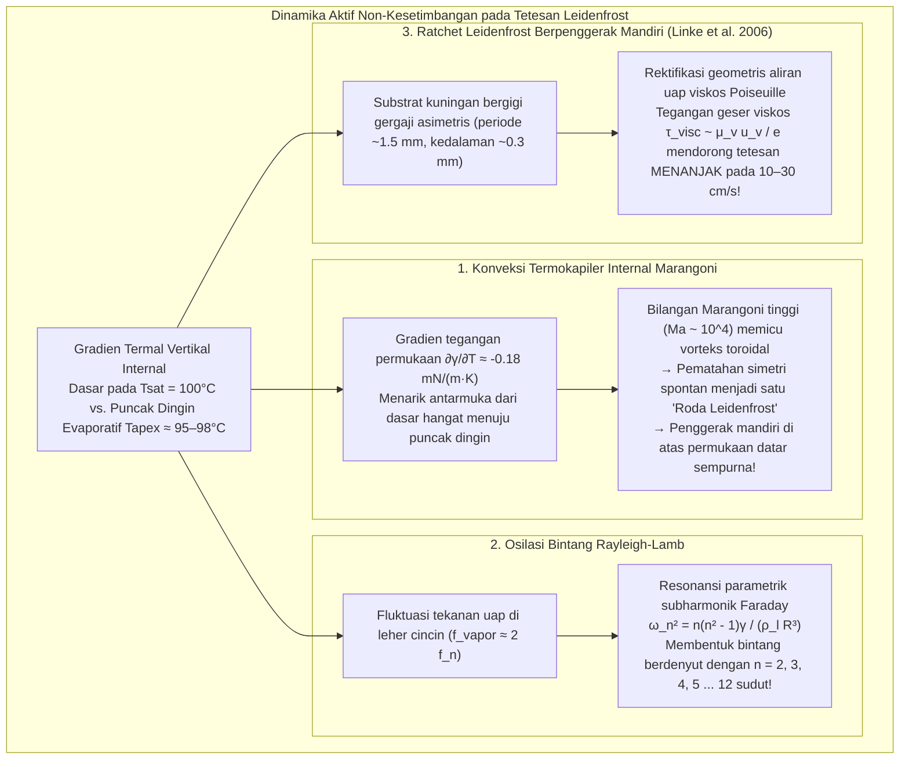

Siapa pun yang pernah menguji suhu wajan besi cor atau baja tahan karat dengan memercikkan beberapa tetes air ke permukaannya pasti pernah menyaksikan salah satu paradoks paling menakjubkan dalam fisika termal. Ketika suhu permukaan wajan hanya sedikit di atas titik didih air — sekitar $110^\circ\text{C}$ hingga $130^\circ\text{C}$ — tetesan air yang jatuh langsung menyebar, mendesis keras, dan menguap habis dalam waktu kurang dari satu detik.

Namun, jika wajan yang sama terus dipanaskan hingga melampaui $200^\circ\text{C}$ atau $300^\circ\text{C}$, perilaku air berbalik secara drastis. Alih-alih langsung lenyap menjadi uap, tetesan air justru menggumpal menjadi bulatan berkilau bagaikan bola merkuri. Tetesan itu tidak lagi mendesis, sama sekali tidak membasahi logam, melainkan <strong>meluncur dan memantul ke segala arah di atas wajan dengan gesekan hampir nol</strong>, serta bertahan hidup selama <strong>beberapa menit</strong> — hingga seratus kali lebih lama dibandingkan pada suhu $120^\circ\text{C}$!

Fenomena yang melawan intuisi ini dikenal sebagai <strong>efek Leidenfrost (Leidenfrost effect)</strong>. Di atas ambang suhu kritis yang disebut <strong>suhu Leidenfrost ($T_L$)</strong>, bagian bawah tetesan air menguap begitu cepat saat mendekati substrat panas sehingga membentuk <strong>bantalan uap (lapisan uap / vapor cushion)</strong> kontinu setebal $10$ hingga $100\,\mu\text{m}$. Lapisan uap mikroskopis ini bekerja ganda: secara hidrodinamis sebagai *hovercraft* yang menopang berat tetesan melalui tekanan pelumasan viskos tanpa kontak padat-cair, dan secara termal sebagai isolator ulung karena konduktivitas termal uap air ($\kappa_v \approx 0.03\,\text{W/(m}\cdot\text{K)}$) lebih dari dua puluh kali lebih rendah daripada air cair ($\kappa_l \approx 0.68\,\text{W/(m}\cdot\text{K)}$).

Dalam artikel ini, kita menurunkan fisika efek Leidenfrost secara sistematis dari prinsip pertama: mulai dari <strong>risalah bersejarah Johann Gottlob Leidenfrost (1756)</strong> dan <strong>kurva pendidihan Shiro Nukiyama (1934)</strong>, melewati <strong>batas hidrodinamis Fluks Panas Kritis (CHF) Novak Zuber</strong> dan <strong>Fluks Panas Minimum (MHF) Paul Berenson</strong>, hingga penurunan matematis <strong>hukum penskalaan pelumasan Biance, Clanet, dan Quéré (2003)</strong>, <strong>vorteks termokapiler internal Marangoni ("roda Leidenfrost")</strong>, <strong>osilasi poligon bintang Rayleigh-Lamb</strong>, <strong>ratchet berpenggerak mandiri Heiner Linke (2006)</strong>, serta aplikasi kritis pada <strong>pendinginan darurat kecelakaan kehilangan pendingin (LOCA) di reaktor nuklir</strong>.

---

## 1. "Bola Kristal" di Atas Sendok Besi Membara: Penemuan Leidenfrost (1756)

Meskipun dokter dan kimiawan Belanda Herman Boerhaave sempat mencatat perilaku alkohol di atas besi membara pada tahun 1732, studi eksperimental kuantitatif pertama diterbitkan pada tahun 1756 oleh dokter dan filsuf alam Jerman <strong>Johann Gottlob Leidenfrost (1715–1794)</strong> di Universitas Duisburg.

Dalam monograf bahasa Latinnya *De Aquae Communis Nonnullis Qualitatibus Tractatus* (*Risalah tentang Beberapa Sifat Air Biasa*), Leidenfrost mendeskripsikan eksperimennya menggunakan sendok besi yang dipanaskan di atas bara api hingga berpijar merah:

> "Ke dalam sendok yang berpijar ini, teteskan satu tetes air biasa yang murni... Air tersebut tidak menempel pada besi dan tidak pula menyebar; sebaliknya, tepat pada saat bersentuhan, ia mengerut menjadi bulatan sferis yang terang dan transparan layaknya sebuah <strong>bola kristal</strong> (*globulus crystallinus*). Ia berputar cepat dan menari dengan ringan di dasar sendok tanpa mengeluarkan suara maupun uap yang tampak. Jauh dari langsung menghilang, ukurannya menyusut perlahan selama tiga puluh atau empat puluh detik — bahkan satu menit penuh — hingga akhirnya sebutir partikel amat kecil lenyap dengan bunyi letupan halus."

Dengan mengukur waktu hidup tetesan menggunakan bandul seiring mendinginnya sendok, Leidenfrost membuktikan bahwa laju penguapan turun drastis di atas suhu kritis akibat adanya lapisan tipis uap (*vaporis strato*). Pada tahun 1842, fisikawan Prancis Pierre Hippolyte Boutigny menamai kondisi ini "keadaan sferoidal" dan bahkan mendemonstrasikan pembekuan air menjadi es di dalam cawan platina yang membara menggunakan sulfur dioksida cair dalam keadaan Leidenfrost.

---

## 2. Kurva Pendidihan Shiro Nukiyama (1934) dan Empat Rezim Pendidihan Kolam

```mermaid
flowchart TD
    subgraph BoilingCurve["Kurva Pendidihan Shiro Nukiyama (q'' vs. Superheat Dinding ΔTe = Tw - Tsat)"]
        R1["Rezim I: Konveksi Alami<br/>ΔTe < 5°C (Tw < 105°C)<br/>Tanpa nukleasi gelembung; konveksi satu fasa<br/>q'' ∝ ΔTe^(5/4)"]
        R2["Rezim II: Pendidihan Inti (Nucleate Boiling)<br/>5°C ≤ ΔTe ≤ 30°C (Tw = 105–130°C)<br/>Nukleasi gelembung hebat di rongga mikro & penguapan lapisan mikro<br/>q'' ∝ ΔTe^3 (Efisiensi pendinginan maksimum)"]
        CHF["Puncak: Fluks Panas Kritis (CHF / DNB)<br/>ΔTe ≈ 30°C, q''_max ≈ 1.1–1.26 MW/m²<br/>Batas Hidrodinamis Zuber (runtuhnya kolom uap)"]
        R3["Rezim III: Pendidihan Transisi<br/>30°C < ΔTe < 100–120°C<br/>Selimut uap parsial tidak stabil & pembasahan intermiten<br/>Fluks panas TURUN saat suhu naik! (∂q''/∂ΔTe < 0)"]
        LP["Minimum: Titik Leidenfrost (MHF)<br/>ΔTe,L ≈ 93–120°C (Tw ≈ 193–220°C)<br/>q''_min ≈ 18–25 kW/m² (50 kali lebih rendah dari CHF!)"]
        R4["Rezim IV: Pendidihan Film Stabil<br/>ΔTe ≥ ΔTe,L (Tw > 200°C)<br/>Bantalan uap isolator kontinu (κ_v ≈ 0.03 W/m·K)<br/>Radiasi termal (∝ Tw^4) dominan pada Tw > 500°C"]
    end

    R1 -->|"Awal Pendidihan Inti (ONB)"| R2
    R2 -->|"Penggabungan gelembung & krisis arus lawan"| CHF
    CHF -->|"Jalur suhu terkontrol"| R3
    R3 -->|"Stabilisasi penuh lapisan uap"| LP
    LP -->|"Rezim pendidihan film"| R4
    CHF -.->|"Lompatan Burnout pada fluks panas terkontrol (ΔTw > +800°C)"| R4
```

Untuk memahami secara kuantitatif mengapa tetesan bertahan bermenit-menit pada $250^\circ\text{C}$ tetapi lenyap kurang dari satu detik pada $125^\circ\text{C}$, kita meninjau hubungan antara <strong>fluks panas permukaan</strong> $q''$ $[\text{W/m}^2]$ dan <strong>kelebihan suhu dinding (wall superheat)</strong> $\Delta T_e \equiv T_w - T_{\text{sat}}$ (dengan $T_{\text{sat}} = 100^\circ\text{C}$ untuk air pada $1\,\text{atm}$), yang pertama kali dipetakan secara utuh pada tahun 1934 oleh <strong>Shiro Nukiyama</strong> di Universitas Kekaisaran Tōhoku.

1. <strong>Rezim I: Konveksi Alami ($\Delta T_e < 5^\circ\text{C}$)</strong>: Akibat tekanan Laplace $\Delta P = 2\gamma / r_c$, embrio uap di dalam celah mikro berjari-jari $r_c$ memerlukan $\Delta T_e > \Delta T_{\text{ONB}} \approx \frac{2\gamma T_{\text{sat}}}{\rho_v L_{lv} r_c}$ untuk tumbuh. Di bawah nilai ini, perpindahan panas berlangsung melalui konveksi alami satu fasa ($q'' \propto \Delta T_e^{5/4}$).
2. <strong>Rezim II: Pendidihan Inti ($5^\circ\text{C} \le \Delta T_e \le 30^\circ\text{C}$) dan Fluks Panas Kritis (CHF) Zuber</strong>: Penguapan lapisan mikro di bawah gelembung dan agitasi mikro-konvektif meningkatkan fluks panas sebanding dengan pangkat tiga superheat (korelasi Rohsenow: $q'' \propto \Delta T_e^3$). Pada $\Delta T_e \approx 30^\circ\text{C}$ ($T_w \approx 130^\circ\text{C}$), gelembung bergabung membentuk kolom uap kontinu. Pada tahun 1958, <strong>Novak Zuber</strong> menggabungkan <strong>ketidakstabilan Rayleigh-Taylor</strong> ($\lambda_{RT} = 2\pi\sqrt{3\gamma/[g(\rho_l - \rho_v)]}$) dengan <strong>ketidakstabilan Kelvin-Helmholtz</strong> untuk membuktikan rumus <strong>Fluks Panas Kritis (CHF)</strong>:
   $$q''_{\max} = \frac{\pi}{24} \rho_v L_{lv} \left[ \frac{\gamma g (\rho_l - \rho_v)}{\rho_v^2} \right]^{1/4} \approx 0.131 \rho_v L_{lv} \left[ \frac{\gamma g (\rho_l - \rho_v)}{\rho_v^2} \right]^{1/4} \approx 1.1\text{–}1.26\,\text{MW/m}^2$$
   Pada pemanasan listrik kawat platina, mencapai $q''_{\max}$ memicu lonjakan suhu seketika dari $130^\circ\text{C}$ ke atas $1100^\circ\text{C}$ (<strong>krisis pendidihan / burnout</strong>).
3. <strong>Rezim III: Pendidihan Transisi ($30^\circ\text{C} < \Delta T_e < 100\text{–}120^\circ\text{C}$)</strong>: Lapisan uap parsial yang tidak stabil menyelimuti dinding; semakin tinggi $T_w$, semakin besar fraksi uap kering isolator sehingga <strong>fluks panas justru menurun saat suhu naik</strong> ($\partial q'' / \partial \Delta T_e < 0$).
4. <strong>Rezim IV: Pendidihan Film Stabil dan Titik Leidenfrost (MHF Berenson)</strong>: Pada <strong>titik Leidenfrost ($T_L \approx 193^\circ\text{C}\text{–}220^\circ\text{C}$)</strong> kontak padat-cair hilang sepenuhnya. Pada tahun 1961, <strong>Paul J. Berenson</strong> menurunkan rumus Fluks Panas Minimum (MHF):
   $$q''_{\min} = 0.09 \rho_v L_{lv} \left[ \frac{\gamma g (\rho_l - \rho_v)}{(\rho_l + \rho_v)^2} \right]^{1/4} \approx 18\text{–}25\,\text{kW/m}^2$$
   Nilai ini <strong>50 kali lebih kecil</strong> dibandingkan puncak pendidihan inti!

| Rezim Pendidihan | Superheat Dinding $\Delta T_e = T_w - T_{\text{sat}}$ (Air, $1\,\text{atm}$) | Fluks Panas Tipikal $q''$ $[\text{W/m}^2]$ | Mekanisme Fisika Dominan | Perilaku & Waktu Hidup $\tau$ Tetesan di Atas Wajan |
| :--- | :--- | :--- | :--- | :--- |
| <strong>I. Konveksi Alami</strong> | $\Delta T_e < 5^\circ\text{C}$ ($T_w < 105^\circ\text{C}$) | $10^3 \text{–} 10^4$ | Rongga belum aktif; konveksi satu fasa ($q'' \propto \Delta T_e^{5/4}$). | Membasahi permukaan dan menguap tenang tanpa gelembung dalam $30\text{–}120\,\text{s}$. |
| <strong>II. Pendidihan Inti</strong> | $5^\circ\text{C} \le \Delta T_e \le 30^\circ\text{C}$ ($T_w = 105\text{–}130^\circ\text{C}$) | $10^4 \text{–} 1.26 \times 10^6$ (Puncak CHF) | Nukleasi gelembung hebat & penguapan lapisan mikro ($q'' \propto \Delta T_e^3$); batas Zuber. | Mendesis keras, menyebar, dan lenyap dalam <strong>$0.3\text{–}1.5\,\text{s}$</strong>. |
| <strong>III. Pendidihan Transisi</strong> | $30^\circ\text{C} < \Delta T_e < 100^\circ\text{C}$ ($T_w = 130\text{–}200^\circ\text{C}$) | $1.2 \times 10^6 \to 2 \times 10^4$ ($\partial q''/\partial \Delta T_e < 0$) | Osilasi kacau antara selimut uap dan kontak eksplosif. | Meletup-letup, melompat, dan memercikkan tetesan mikro; bertahan $2\text{–}15\,\text{s}$. |
| <strong>IV. Pendidihan Film (Keadaan Leidenfrost)</strong> | $\Delta T_e \ge \Delta T_L \approx 93\text{–}120^\circ\text{C}$ ($T_w \ge 193\text{–}220^\circ\text{C}$) | $2 \times 10^4 \to 10^5$ (Minimum MHF) | Levitasi penuh di atas bantalan uap ($10\text{–}100\,\mu\text{m}$); konduksi gas lambat. | Bola atau panekuk cair tanpa gesekan dan tanpa suara; hidup <strong>$60\text{–}300\,\text{s}$</strong>. |

---

## 3. Statika Kapiler dan Hukum Penskalaan Hidrodinamis Bantalan Uap (Biance, Clanet, & Quéré 2003)

### 3.1 Panjang Kapiler $\ell_c$ dan Morfologi Tetesan Levitasi

Dengan sudut kontak semu $\theta_c = 180^\circ$, keseimbangan antara tekanan kapiler Laplace ($\sim \gamma / R$) dan tekanan hidrostatik ($\sim \rho_l g R$) mendefinisikan <strong>panjang kapiler</strong> $\ell_c$:

$$\ell_c = \sqrt{\frac{\gamma}{\rho_l g}} \approx 2.50\,\text{mm} \quad (\text{air pada } 100^\circ\text{C})$$

Berdasarkan bilangan Bond $\text{Bo} = (R/\ell_c)^2$, terdapat tiga rezim bentuk:
1. <strong>Tetesan Kuasi-Sferis ($R < \ell_c \approx 2.5\,\text{mm}$)</strong>: Berbentuk bola berjari-jari $R$ dengan bidang kontak datar kecil di bagian bawah berjari-jari $r_c = \sqrt{\frac{2}{3}}\frac{R^2}{\ell_c}$.
2. <strong>Genangan / Panekuk Leidenfrost ($\ell_c < R < 4\ell_c$)</strong>: Gravitasi memipihkan tetesan menjadi cakram dengan ketebalan universal konstan $h_p = 2\ell_c \sin(180^\circ/2) = 2\ell_c \approx 5.0\,\text{mm}$, memiliki kantong uap cekung di tengah (*dimple*) yang dikelilingi leher cincin sempit (*neck*).
3. <strong>Cerobong Uap Rayleigh-Taylor ($R > R_{\max} \approx 3.83\ell_c \approx 9.6\,\text{mm}$)</strong>: Untuk $R \gtrsim 1\,\text{cm}$, antarmuka uap-air mengalami ketidakstabilan Rayleigh-Taylor sehingga gelembung uap besar meletus secara periodik menembus bagian tengah genangan (*vapor chimneys*).

### 3.2 Penurunan Ketebalan Lapisan Uap $e$ dan Waktu Hidup $\tau$

Dalam makalah klasik tahun 2003 (*Physics of Fluids*), <strong>Anne-Laure Biance, Christophe Clanet, dan David Quéré</strong> menggabungkan konduksi Fourier dengan pelumasan viskos untuk genangan berjari-jari $R > \ell_c$:

1. <strong>Konduksi Panas Fourier Melintasi Ketebalan $e$</strong>:
   $$Q = \kappa_v \frac{\Delta T}{e} \pi R^2 = \dot{m} L_{lv} \quad \Longrightarrow \quad \dot{m} = \frac{\kappa_v \Delta T}{L_{lv} e} \pi R^2 \qquad \cdots (1)$$
2. <strong>Teori Pelumasan Viskos (Aliran Radial Poiseuille)</strong>:
   Persamaan pelumasan $\mu_v \frac{\partial^2 u_r}{\partial z^2} = \frac{dP}{dr}$ menghasilkan profil kecepatan parabolik $u_r(r,z) = \frac{1}{2\mu_v}\left(-\frac{dP}{dr}\right)z(e-z)$ dan laju aliran volumetrik $Q_v(r) = \frac{\pi r e^3}{6\mu_v}\left(-\frac{dP}{dr}\right) = \frac{\dot{m}}{\rho_v}\frac{r^2}{R^2}$. Integrasi tekanan memberikan tekanan berlebih rata-rata bantalan uap:
   $$\Delta P_{\text{cushion}} = \frac{3 \mu_v \dot{m}}{2 \pi \rho_v e^3} \qquad \cdots (2)$$
3. <strong>Keseimbangan Hidrostatik dan Hukum Penskalaan $e \propto R^{1/2}$</strong>:
   Menyamakan $\Delta P_{\text{cushion}}$ dengan tekanan hidrostatik genangan $\Delta P_{\text{weight}} = 2\rho_l g \ell_c$ dan mensubstitusikan (1) ke (2) menghasilkan <strong>hukum Biance-Clanet-Quéré</strong>:
   $$e = \left(\frac{3}{4}\right)^{1/4} \left( \frac{\kappa_v \mu_v \Delta T}{\rho_v \rho_l g L_{lv} \ell_c} \right)^{1/4} R^{1/2} \approx 10\text{–}100\,\mu\text{m} \qquad \cdots (3)$$
   Untuk $R = 5\,\text{mm}$ dan $\Delta T = 200\,\text{K}$, diperoleh $e \approx 54\,\mu\text{m}$ (sedangkan untuk tetesan kecil $R < \ell_c$ berlaku $e_{\text{small}} \propto \Delta T^{1/4} R^{5/4}$). Mengintegrasikan $-\frac{dM}{dt} = \dot{m} \propto R^{3/2}$ menghasilkan $R(t) = R_0(1 - t/\tau)^2$ dan total waktu hidup $\tau \propto \Delta T^{-3/4} R_0^{3/2}$ (atau $\tau \propto R_0^{5/4}$ hingga $R_0^2$).

---

## 4. Vorteks Termokapiler Marangoni, Bintang Rayleigh-Lamb, dan Ratchet Leidenfrost

### 4.1 Konveksi Termokapiler Marangoni dan "Roda Leidenfrost"

Perbedaan suhu antara dasar ($100^\circ\text{C}$) dan puncak ($95\text{–}98^\circ\text{C}$) menghasilkan, melalui $\frac{\partial \gamma}{\partial T} \approx -0.18\,\text{mN/(m}\cdot\text{K)}$, tegangan geser <strong>Marangoni</strong> $\tau_s = \frac{\partial \gamma}{\partial T}\nabla_s T$ ($\text{Ma} = \frac{|\partial \gamma/\partial T|\Delta T_{\text{int}} R}{\mu_l \alpha_l} \sim 2 \times 10^4 \gg \text{Ma}_c$) yang menghilangkan <strong>efek cincin kopi (*coffee-ring effect*)</strong>. Selain itu, <strong>Bouillant, Quéré et al. (2018, *Nature Physics*)</strong> menemukan bahwa untuk $R \lesssim 1.5\,\text{mm}$ vorteks toroidal secara spontan mematahkan simetrinya menjadi satu sel berputar (<strong>"roda Leidenfrost"</strong>) yang memiringkan bantalan uap dan menggelindingkan tetesan secara mandiri di atas bidang horizontal.

### 4.2 Osilasi Poligon Bintang Rayleigh-Lamb

Genangan besar ($R \sim 5\text{–}15\,\text{mm}$) membentuk gelombang berdiri azimut berbentuk poligon bintang yang diatur oleh <strong>relasi dispersi Rayleigh-Lamb</strong>:

$$\omega_n^2 = \frac{n(n^2 - 1)\gamma}{\rho_l R^3} \qquad (n = 2, 3, 4, \dots, 12)$$

yang dieksitasi melalui <strong>resonansi parametrik subharmonik Faraday ($f_n = \frac{\omega_n}{2\pi} \approx \frac{1}{2} f_{\text{vapor}}$)</strong> oleh fluktuasi tekanan aliran uap di leher.

### 4.3 Ratchet Berpenggerak Mandiri Heiner Linke (2006)

Pada tahun 2006, <strong>Heiner Linke et al.</strong> (*Phys. Rev. Lett.*) mendemonstrasikan bahwa di atas pelat panas dengan alur gigi gergaji asimetris (periode $\sim 1.5\,\text{mm}$, kedalaman $\sim 0.3\,\text{mm}$), tetesan Leidenfrost bergerak mandiri dengan kecepatan $10\text{–}30\,\text{cm/s}$ menaiki anak tangga curam: meniskus dasar menutup celah vertikal dan mengarahkan aliran uap Poiseuille ke belakang sepanjang lereng landai, menghasilkan gaya dorong geser viskos $F_{\text{ratchet}} \sim \frac{\mu_v u_{\text{vapor}}}{e}\pi R^2 \sim 30\,\mu\text{N}$.

---

## 5. Aplikasi Industri: Keselamatan Reaktor Nuklir (LOCA), Quenching Baja, dan Nitrogen Cair

1. <strong>Pendinginan Darurat Reaktor Nuklir Saat Kecelakaan Kehilangan Pendingin (LOCA)</strong>:
   Jika fluks panas pada kelongsong bahan bakar Zircaloy melampaui CHF, sistem melompat ke rezim pendidihan film Leidenfrost (Rezim IV) dan suhu kelongsong melonjak di atas $1000^\circ\text{C}$ dalam hitungan detik. Saat sistem pendingin darurat (ECCS) menyemprotkan air, bantalan uap menolak cairan ($T_w \gg T_L$) dan garis depan pembasahan (*quench front*) hanya dapat maju melalui konduksi aksial di dalam logam kelongsong (model Yamanouchi: $u_q \propto (T_L - T_{\text{sat}})/(T_{\text{init}} - T_L)$).
2. <strong>Quenching Metalurgi Baja</strong>:
   Saat mencelupkan baja austenit $850^\circ\text{C}$, selimut uap Leidenfrost awal memperlambat pendinginan hingga suhu turun di bawah $T_L$, di mana pendidihan inti membentuk martensit. Runtuhnya lapisan uap yang tidak merata memicu distorsi dan <strong>retak quenching</strong>.
3. <strong>Jari Basah di Timbal Cair dan Nitrogen Cair di Kulit</strong>:
   Jari basah yang dicelupkan sepersekian detik ke dalam timbal cair $400^\circ\text{C}$ (<strong>sangat berbahaya, jangan pernah dicoba!</strong>) terlindungi oleh bantalan uap air instan; serupa dengan itu, <strong>nitrogen cair ($T_{\text{sat}} = 77\,\text{K} = -196^\circ\text{C}$)</strong> merasakan kulit manusia ($307\,\text{K}$, $\Delta T_e = 230\,\text{K}$) sebagai wajan membara dan langsung melayang di atas bantalan gas nitrogen.

---

## Referensi

1. <strong>Leidenfrost, J. G.</strong> (1756). *De Aquae Communis Nonnullis Qualitatibus Tractatus*. Duisburg.
2. <strong>Nukiyama, S.</strong> (1934). "The Maximum and Minimum Values of the Heat Transmitted from Metal to Boiling Water under Atmospheric Pressure". *J. Jpn. Soc. Mech. Eng.*, 37(206), 367–374.
3. <strong>Zuber, N.</strong> (1958). "On the stability of boiling heat transfer". *Trans. ASME*, 80(3), 711–720.
4. <strong>Berenson, P. J.</strong> (1961). "Film-boiling heat transfer from a horizontal surface". *J. Heat Transf.*, 83(3), 351–356.
5. <strong>Biance, A.-L., Clanet, C., & Quéré, D.</strong> (2003). "Leidenfrost drops". *Physics of Fluids*, 15(6), 1632–1637.
6. <strong>Linke, H., et al.</strong> (2006). "Self-Propelled Leidenfrost Droplets". *Physical Review Letters*, 96(15), 154502.
7. <strong>Quéré, D.</strong> (2013). "Leidenfrost Dynamics". *Annual Review of Fluid Mechanics*, 45, 197–215.
8. <strong>Bouillant, A., et al.</strong> (2018). "Leidenfrost wheels". *Nature Physics*, 14(12), 1188–1192.
