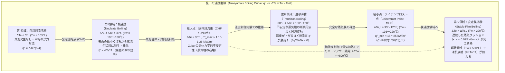
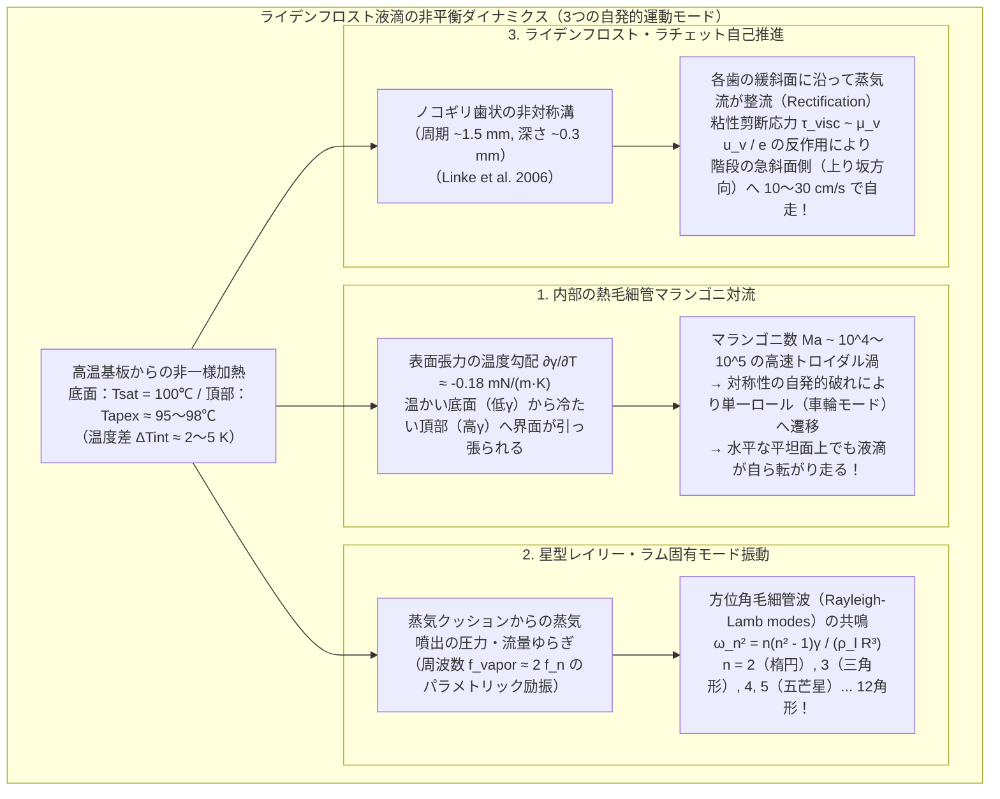

料理の最中、十分に予熱された鉄やステンレスのフライパンに水を数滴垂らして温度を確かめた経験は誰にでもあるだろう。フライパンの表面温度が水の沸点（$100^\circ\text{C}$）をわずかに超える $110^\circ\text{C}$〜$130^\circ\text{C}$ 程度のとき、落ちた水滴は「ジュッ！」という激しい沸騰音とともに一瞬で広がり、$1$ 秒も経たないうちに跡形もなく蒸発してしまう。

ところが、フライパンをさらに強く熱して表面温度が $200^\circ\text{C}$〜$300^\circ\text{C}$ に達すると、直感に反する劇的な変化が起きる。垂らされた水滴はもはや激しい音を立てて蒸発しない。それどころか、まるで水銀の玉か磨かれた水晶の球のように丸くまとまり、フライパンの表面を<strong>まったく濡らすことなく、摩擦ゼロのスケーターのようにスルスルと縦横無尽に走り回り始める</strong>のである。さらに驚くべきことに、より高温であるにもかかわらず、水滴が完全に消滅するまでの寿命は $110^\circ\text{C}$ のときの数十倍〜百倍以上、すなわち<strong>数分間</strong>にも及ぶ。

「温度が高いほど水は速く蒸発するはずだ」という日常の素朴な熱力学の直感を真っ向から裏切るこの現象こそ、<strong>ライデンフロスト効果（Leidenfrost effect）</strong>である。高温の固体表面と液滴のあいだに、厚さわずか数十マイクロメートル（$10\text{–}100\,\mu\text{m}$）の<strong>蒸気クッション（蒸気膜：vapor cushion / vapor film）</strong>が自己形成され、この薄い気体の層が「液滴の重さを支える流体力学的なホバークラフト」と「高温面からの熱移動を遮断する強力な断熱材」という二重の役割を同時に果たしているのである。

本稿では、1756年のヨハン・ゴットロープ・ライデンフロストによる古典的観察から出発し、日本の熱工学の先駆者・抜山四郎が1934年に打ち立てた<strong>沸騰曲線（Boiling Curve）</strong>と限界熱流束（CHF）の流体力学的不安定性理論、ビアンセ（A.-L. Biance）・クラネ（C. Clanet）・ケレ（D. Quéré）らによって2000年代以降に定式化された<strong>蒸気クッションの潤滑方程式（Lubrication theory）と膜厚のスケーリング則</strong>、液滴内部で渦巻く<strong>熱毛細管マランゴニ対流（Thermocapillary Marangoni convection）</strong>、液滴が自発的に多角形の星型へと変形して脈動する<strong>レイリー・ラム固有モード振動（Star-shaped oscillations）</strong>、さらには微細なノコギリ歯状の溝を自ら駆け上がる<strong>ライデンフロスト・ラチェット（自己推進現象）</strong>や<strong>原子炉の冷却材喪失事故（LOCA）における再冠水クエンチ問題</strong>に至るまで、小さな水滴の下に秘められた豊穣な非平衡熱流体力学の世界を体系的に解き明かす。

---

## 1. 赤熱した鉄のスプーンの上の「水晶の地球儀」：1756年ライデンフロストの発見

この現象が科学史において最初に体系的に記述されたのは、今から270年前の1756年のことである（なお、1732年にオランダの医化学者ヘルマン・ブールハーヴェがアルコールや水を赤熱した鉄板に落とした際の奇妙な挙動に言及しているが、定量的な実験と物理的考察を行ったのはライデンフロストが最初であった）。

ドイツの医師であり神学者・自然哲学者でもあった<strong>ヨハン・ゴットロープ・ライデンフロスト（Johann Gottlob Leidenfrost, 1715–1794）</strong>は、デュイスブルク大学教授時代に著したラテン語の論文『普通の水のいくつかの性質に関する論考（*De Aquae Communis Nonnullis Qualitatibus Tractatus*）』の中で、真っ赤に焼けた鉄のスプーンの上に清浄な水滴を1滴落としたときの驚くべき観察結果を次のように記している。

> 「赤熱して光を放つほど高温に熱せられた鉄のスプーンの上に、清らかな普通の水を1滴落とす。すると水滴は鉄に付着せず、ただちに完璧な球体へと凝集し、まるで<strong>透明な水晶の地球儀（crystal globe）</strong>のように明るく輝きながら、スプーンの底を軽やかに回転し、滑り回る。この水滴はすぐには蒸発せず、30秒、あるいは1分近くに渡って徐々に小さくなりながら生き続け、最後に極めて微細な粒子となって『パチン』というかすかな音とともに消え去る。」

ライデンフロストは当時の実験で、鉄のスプーンの温度を少しずつ下げながら水滴の寿命を測定した。そして、スプーンが赤熱状態を脱してある程度冷めた特定の温度領域に入った瞬間、水滴が突然スプーンの表面に接触して激しく沸騰し、わずか1秒足らずで蒸発してしまうことを見出した。つまり、<strong>蒸発速度は温度の単調増加関数ではなく、ある臨界温度を境にして不連続的に激減する</strong>という事実を、温度計すら十分に普及していなかった18世紀半ばに極めて正確に捉えていたのである。

19世紀に入ると、フランスの物理学者ピエール・イポリット・ブティニー（Pierre Hippolyte Boutigny, 1842）がこの状態を固相・液相・気相に次ぐ「物質の第四の状態」とみなして<strong>「球状状態（spheroidal state）」</strong>と名付け、水だけでなく液体二酸化硫黄やジエチルエーテル、さらには過熱された白金るつぼの中で氷が溶けずに保たれる現象などを次々と実演してヨーロッパ中の科学アカデミーを驚かせた。しかし、なぜ高温になるほど熱流束（単位面積・単位時間あたりに固体から液体へ移動する熱エネルギー）が逆に低下するのか、その熱力学・流体力学的な全貌が定量的に解明されるには、20世紀の日本の工学者による歴史的な実験を待たねばならなかった。

---

## 2. 抜山四郎の沸騰曲線（1934年）とプール沸騰の4つのレジーム

固体加熱面から液体への熱移動が、表面温度の上昇に伴ってどのように変化するかを世界で初めて全領域にわたって描き出したのは、東北帝国大学教授であった<strong>抜山四郎（Shiro Nukiyama, 1896–1983）</strong>が1934年（昭和9年）に日本機械学会誌に発表した記念碑的論文『極大値並に極小値をとる水の沸騰曲線（The Maximum and Minimum Values of the Heat Transmitted from Metal to Boiling Water under Atmospheric Pressure）』である。

### 2.1 壁面過熱度 $\Delta T_e$ と熱流束 $q''$ の非線形関係

大気圧下（$P = 1\,\text{atm} = 101.325\,\text{kPa}$）におかれた飽和温度 $T_{\text{sat}} = 100^\circ\text{C}$ の水中に加熱面があるとき、加熱面の表面温度を $T_w$ とすると、沸点からの温度超過分は<strong>壁面過熱度（Wall superheat）</strong> $\Delta T_e$ として定義される。

$$\Delta T_e \equiv T_w - T_{\text{sat}}$$

加熱面から単位面積・単位時間あたりに液体へ伝達される熱量（<strong>熱流束：Heat flux</strong>）を $q''$ $[\text{W/m}^2]$、熱伝達率を $h \equiv q'' / \Delta T_e$ $[\text{W/(m}^2\cdot\text{K)}]$ とする。通常の単相流の熱伝達（ニュートンの冷却法則）であれば、$q''$ は $\Delta T_e$ にほぼ比例して単調に増加する。しかし相変化（沸騰）を伴う場合、$\log_{10} q''$ を縦軸、$\log_{10} \Delta T_e$ を横軸にとったグラフ——すなわち<strong>抜山の沸騰曲線（Nukiyama's boiling curve）</strong>——は、劇的な極大値と極小値を持つ<strong>N字型（S字型）の多価曲線</strong>を描く。

抜山が発見したプール沸騰の4つのレジーム（領域）を、そのミクロな物理機構とともに順に見ていこう。

### 2.2 第I領域：自然対流沸騰（Natural Convection Boiling, $\Delta T_e < 5^\circ\text{C}$）

壁面過熱度 $\Delta T_e$ が約 $5^\circ\text{C}$ 未満（$T_w < 105^\circ\text{C}$）の領域では、加熱面近傍の水は沸点 $100^\circ\text{C}$ をわずかに超えた過熱液体（superheated liquid）となっているにもかかわらず、加熱面上にはまだ蒸気泡が発生しない。なぜなら、半径 $r_b$ の微小な蒸気泡が液体中で膨張するためには、表面張力 $\gamma$ による<strong>ラプラス圧（Laplace pressure）</strong> $\Delta P = 2\gamma / r_b$ に打ち勝つだけの蒸気圧の上昇が必要であり、クラウジウス・クラペイロンの式（Clausius-Clapeyron relation）から導かれる最小過熱度：

$$\Delta T_{\text{min}} \approx \frac{2 \gamma T_{\text{sat}}}{\rho_v L_{lv} r_c}$$

（ここで $\rho_v$ は蒸気密度、$L_{lv}$ は蒸発潜熱、$r_c$ は壁面のミクロな傷・キャビティの開口半径）を超えなければ気泡核が成長できないからである。この領域では、加熱面で温められた水が浮力によって液面へと上昇し、液面からの静かな蒸発だけが起こる。熱流束は単相の乱流自然対流則に従い、ヌセルト数 $\text{Nu} \propto \text{Ra}^{1/3}$（あるいは層流では $\text{Ra}^{1/4}$）より $q'' \propto \Delta T_e^{5/4} \sim \Delta T_e^{4/3}$ で緩やかに増加する。

### 2.3 第II領域：核沸騰（Nucleate Boiling, $5^\circ\text{C} \le \Delta T_e \le 30^\circ\text{C}$）と限界熱流束（CHF）

$\Delta T_e$ が約 $5^\circ\text{C}$ を超えると、加熱面上の無数のミクロな凹み（キャビティ）にトラップされていた気体核が活性化し、一斉に蒸気泡が発生し始める。これを<strong>発泡開始点（ONB: Onset of Nucleate Boiling）</strong>と呼ぶ。

$\Delta T_e$ が $5^\circ\text{C}$ から $30^\circ\text{C}$（$T_w = 105^\circ\text{C}\text{–}130^\circ\text{C}$）へと上昇する<strong>核沸騰領域</strong>では、活性キャビティの密度 $n_a$ が劇的に増加し、気泡が猛烈な頻度で生成・成長・離脱を繰り返す。気泡が壁面から離脱する際、周囲の冷たいバルク液体が壁面直近の熱境界層へと激しく引き込まれる（ミクロ対流撹拌効果）とともに、気泡の根元に形成される極めて薄い液膜（ミクロレイヤー：microlayer）が直接蒸発することで、驚異的な熱伝達率が達成される。ローゼナウ（W. M. Rohsenow, 1952）の古典的相関式によれば、核沸騰領域の熱流束は過熱度の<strong>3乗</strong>に比例して急増する。

$$q''_{\text{nucleate}} = \mu_l L_{lv} \left[ \frac{g(\rho_l - \rho_v)}{\gamma} \right]^{1/2} \left( \frac{c_{p,l} \Delta T_e}{C_{sf} L_{lv} \text{Pr}_l^n} \right)^3 \propto \Delta T_e^3$$

ここで $\mu_l, c_{p,l}, \text{Pr}_l$ はそれぞれ液体の粘性係数、定圧比熱、プラントル数であり、$C_{sf} \approx 0.006\text{–}0.013$ は加熱面と液体の組み合わせで決まる表面係数である。フライパンの温度が $120^\circ\text{C}$〜$130^\circ\text{C}$ のときに水滴が「ジュッ！」と音を立てて1秒以内に消滅するのは、まさにこの<strong>核沸騰の最強の熱伝達領域</strong>にあるためである。

しかし、この熱流束の急増は無制限には続かない。$\Delta T_e \approx 30^\circ\text{C}$（$T_w \approx 130^\circ\text{C}$）に達すると、壁面から立ち昇る無数の気泡が互いに合体して連続的な<strong>蒸気柱（vapor columns / jets）</strong>を形成する。蒸気が上向きに噴出する速度が極限まで高まると、その隙間を通って壁面へと供給されようとする下向きの液体の流れが、蒸気柱との界面で激しい剪断不安定性を引き起こして押し戻されてしまう。この熱流束の極大値を<strong>限界熱流束（CHF: Critical Heat Flux）</strong>、あるいは<strong>核沸騰離脱点（DNB: Departure from Nucleate Boiling）</strong>と呼ぶ。

1958年、ノヴァク・ズーバー（Novak Zuber）は、このCHFが加熱面の材質や表面粗さではなく、純粋に気液界面の<strong>流体力学的不安定性（Hydrodynamic instability）</strong>によって決定されることを鮮やかに証明した。重い液体（密度 $\rho_l$）が軽い蒸気（密度 $\rho_v$）の上に載っている配置は<strong>レイリー・テイラー不安定性（Rayleigh-Taylor instability）</strong>を発生させ、その最も成長しやすい波長 $\lambda_{RT} = 2\pi \sqrt{3\gamma / [g(\rho_l - \rho_v)]}$ の間隔で蒸気柱が配列する。さらに、この蒸気柱の側面を上向きに流れる蒸気速度 $u_v$ が、<strong>ケルビン・ヘルムホルツ不安定性（Kelvin-Helmholtz instability）</strong>の臨界速度 $u_{v,\text{crit}} \sim \left[ \frac{\gamma g (\rho_l - \rho_v)}{\rho_v^2} \right]^{1/4}$ を超えると、蒸気柱が崩壊して壁面への液体供給が完全に遮断される。この質量・エネルギー収支から導かれる<strong>ズーバーの限界熱流束の式</strong>は次式で与えられる。

$$q''_{\max} = C_{\text{Zuber}} \rho_v L_{lv} \left[ \frac{\gamma g (\rho_l - \rho_v)}{\rho_v^2} \right]^{1/4}, \qquad C_{\text{Zuber}} = \frac{\pi}{24} \approx 0.131$$

大気圧下の水（$\rho_l = 958\,\text{kg/m}^3$, $\rho_v = 0.598\,\text{kg/m}^3$, $L_{lv} = 2.257 \times 10^6\,\text{J/kg}$, $\gamma = 0.0589\,\text{N/m}$, $g = 9.81\,\text{m/s}^2$）の物性値を代入すると、

$$q''_{\max} \approx 0.131 \times 0.598 \times (2.257 \times 10^6) \times \left[ \frac{0.0589 \times 9.81 \times 957.4}{(0.598)^2} \right]^{1/4} \approx 1.10\text{–}1.26\,\text{MW/m}^2$$

となり、実験値と驚くべき精度で一致する。$1\,\text{m}^2$ あたり $1000\,\text{kW}$ 以上という途方もない熱流束こそが、核沸騰が達成できる限界なのである。

抜山が1934年の実験で直面した劇的なドラマもここにあった。彼は水中に張った白金線に電流を流してジュール加熱（熱流束 $q''$ を独立変数として制御する実験）を行っていたが、熱流束を徐々に上げて $q''_{\max}$ に達した瞬間、白金線の温度 $T_w$ が $130^\circ\text{C}$ から一気に $1000^\circ\text{C}$ 以上へと不連続にジャンプし、白金線が赤熱して焼き切れてしまったのである（<strong>バーンアウト現象：Burnout</strong>）。抜山はこの謎の空白領域（第III領域）を測るため、熱流束制御ではなく加熱面の温度 $T_w$ を独立に制御する巧みな実験系を考案し、ついに沸騰曲線の全貌を繋ぎ合わせることに成功した。

### 2.4 第III領域：遷移沸騰（Transition Boiling, $30^\circ\text{C} < \Delta T_e < 100\text{–}120^\circ\text{C}$）

壁面過熱度が $30^\circ\text{C}$ を超えて約 $100^\circ\text{C}\text{–}120^\circ\text{C}$（$T_w \approx 130^\circ\text{C}\text{–}220^\circ\text{C}$）に至る領域は<strong>遷移沸騰（Transition boiling）</strong>または不安定膜沸騰と呼ばれる。

この領域では、加熱面の一部が合体した蒸気ブランケット（蒸気膜）で覆われる一方、その蒸気膜はまだ液体全体を安定に支えるだけの圧力と流量を持っておらず、局所的に激しく崩壊しては液体が突発的に高温壁面に接触し、爆発的な蒸発を起こして再び弾き飛ばされるというカオス的な振動を繰り返す。

物理的に最も注目すべき特徴は、<strong>壁面温度 $T_w$ が上昇するにつれて、乾燥した蒸気被覆面積の割合（乾き度分率）が増大するため、平均熱流束 $q''$ が逆に減少していく</strong>ことである。すなわち、微分熱コンダクタンスが<strong>負</strong>となる。

$$\frac{\partial q''}{\partial \Delta T_e} < 0 \quad (\text{遷移沸騰領域})$$

電気回路における負性抵抗（エサキダイオードなど）と全く同じ数学的構造を持つため、熱流束 $q''$ を固定して加熱する系ではこの領域は力学的に不安定（サドル点）となり、系は第II領域から第IV領域へと一気に跳躍（ヒステリシス・ジャンプ）するのである。

### 2.5 第IV領域：安定膜沸騰（Stable Film Boiling）とライデンフロスト点（Leidenfrost Point）

壁面過熱度がさらに上昇し、ある臨界温度 $T_L$（<strong>ライデンフロスト温度：Leidenfrost temperature</strong>）に達すると、突発的な固液接触が完全に消失し、加熱面全体が連続的で安定した薄い蒸気膜（vapor cushion）によって隙間なく覆われる。沸騰曲線において熱流束 $q''$ が極小値 $q''_{\min}$（<strong>極小熱流束点：MHF, Minimum Heat Flux</strong>）をとるこの変曲点こそが<strong>ライデンフロスト点（Leidenfrost point）</strong>である。

1961年、ポール・ベレンソン（P. J. Berenson）は、ズーバーの流体力学的不安定性理論を逆方向（蒸気膜が崩壊せずに維持される最小の蒸気発生速度）へと拡張し、テイラー不安定性波長の間隔で蒸気泡が規則的に離脱できる最小熱流束 $q''_{\min}$ を次のように理論的に導出した。

$$q''_{\min} = C_{\text{Berenson}} \rho_v L_{lv} \left[ \frac{\gamma g (\rho_l - \rho_v)}{(\rho_l + \rho_v)^2} \right]^{1/4}, \qquad C_{\text{Berenson}} \approx 0.09$$

大気圧下の水に対してこの式を計算すると、$q''_{\min} \approx 18\text{–}25\,\text{kW/m}^2$ となる。限界熱流束 $q''_{\max} \approx 1.2\,\text{MW/m}^2$ と比較すると、<strong>ライデンフロスト点における熱流束は核沸騰のピーク時の実に約 $1/50$（$2\%$ 程度）にまで激減している</strong>ことがわかる！

なぜこれほど劇的に熱移動が遮断されるのか。その理由は、液体の水と水蒸気の<strong>熱伝導率（Thermal conductivity）</strong>の圧倒的な差にある。
- $100^\circ\text{C}$ の液体の水の熱伝導率：$\kappa_l \approx 0.68\,\text{W/(m}\cdot\text{K)}$
- $100^\circ\text{C}$〜$200^\circ\text{C}$ の水蒸気の熱伝導率：$\kappa_v \approx 0.025\text{–}0.032\,\text{W/(m}\cdot\text{K)}$

気体である水蒸気の熱伝導率は、液体の水よりも<strong>約20倍以上も低い</strong>。しかも固液接触が完全に失われているため、核沸騰のようなミクロレイヤー蒸発や激しい固液界面撹拌が一切働かず、熱は厚さ $e \sim 10\text{–}100\,\mu\text{m}$ の気体層を<strong>フーリエの熱伝導（Fourier conduction）</strong>によってじわじわと通過するしかなくなるのである（さらに壁面温度が $500^\circ\text{C}$〜$1000^\circ\text{C}$ を超える超高温域に入ると、伝導に加えてシュテファン・ボルツマンの法則 $q''_{\text{rad}} = \varepsilon_{\text{eff}} \sigma_{SB} (T_w^4 - T_{\text{sat}}^4)$ に従う熱放射が支配的になり、熱流束は再び上昇に転じる）。

ここで、プール沸騰の4つのレジームの物理的特性を一覧表にまとめておこう。

| 沸騰レジーム | 壁面過熱度 $\Delta T_e = T_w - T_{\text{sat}}$ （水・1気圧） | 代表的な熱流束 $q''$ $[\text{W/m}^2]$ | 支配的な熱伝達・流体力学メカニズム | フライパン上の水滴の挙動と寿命 $\tau$ |
| :--- | :--- | :--- | :--- | :--- |
| <strong>第I領域：自然対流沸騰</strong> | $\Delta T_e < 5^\circ\text{C}$ ($T_w < 105^\circ\text{C}$) | $10^3 \text{–} 10^4$ | 気泡核の未活性化。単相の浮力自然対流（$q'' \propto \Delta T_e^{5/4}$）と自由表面からの静かな蒸発。 | 表面に濡れ広がり、気泡を出さずに数十秒〜数分かけて静かに蒸発する。 |
| <strong>第II領域：核沸騰</strong> | $5^\circ\text{C} \le \Delta T_e \le 30^\circ\text{C}$ ($T_w = 105\text{–}130^\circ\text{C}$) | $10^4 \text{–} 1.26 \times 10^6$ （極大点 CHF） | キャビティからの猛烈な気泡生成・離脱とミクロレイヤー蒸発（$q'' \propto \Delta T_e^3$）。CHFで蒸気柱の流体力学的崩壊（Zuber限界）。 | 「ジュッ！」という激しい沸騰音とともに広がり、<strong>$0.5\text{–}2$ 秒以内</strong>に瞬時に消滅する。 |
| <strong>第III領域：遷移沸騰</strong> | $30^\circ\text{C} < \Delta T_e < 100^\circ\text{C}$ ($T_w = 130\text{–}200^\circ\text{C}$) | $1.2 \times 10^6 \to 2 \times 10^4$ （$\partial q''/\partial \Delta T_e < 0$） | 不安定な部分蒸気ブランケットの形成と断続的な固液接触・爆発的沸騰の反復。 | バチバチと激しく跳ね回り、細かい飛沫（スパッタリング）を散らしながら数秒〜十数秒で蒸発。 |
| <strong>第IV領域：安定膜沸騰（ライデンフロスト状態）</strong> | $\Delta T_e \ge \Delta T_L \approx 93\text{–}120^\circ\text{C}$ ($T_w \ge 193\text{–}220^\circ\text{C}$) | $2 \times 10^4 \to 10^5$ （極小点 MHF から再上昇） | 連続した蒸気クッション（厚さ $10\text{–}100\,\mu\text{m}$）による完全非接触浮遊と気体熱伝導（＋高温では熱放射）。 | 球状またはパンケーキ状にまとまり、無音・摩擦ゼロで滑り回りながら<strong>$60\text{–}200$ 秒以上</strong>生存する。 |

なお、水滴のライデンフロスト温度 $T_L$ は純粋な流体の物性値だけで決まる定数ではなく、固体基板の<strong>熱浸透率（Thermal effusivity）</strong> $\mathcal{E}_s = \sqrt{\kappa_s \rho_s c_{p,s}}$ や表面粗さ、濡れ性に強く依存する。よく磨かれたアルミニウムや銅、真鍮のような高熱伝導・平滑金属面では $T_L \approx 190^\circ\text{C}\text{–}210^\circ\text{C}$ であるが、ガラスやセラミックスのように熱浸透率が低い基板では、液滴が近づいた瞬間に基板表面が局所的に冷やされてしまうため、より高い初期温度（$T_L \approx 260^\circ\text{C}\text{–}320^\circ\text{C}$）が必要となる。逆に、超撥水ナノ構造表面では $T_L$ が $110^\circ\text{C}$ 近くまで劇的に低下することも近年の研究で明らかになっている。

---

## 3. 非接触浮遊液滴の毛細管静力学（Capillary Statics）：球体からパンケーキ、そして蒸気煙突へ

フライパンの上でライデンフロスト状態に入った水滴を横からじっくり観察すると、水滴の「大きさ（体積 $V$ または半径 $R$）」によってその形がまったく異なることに気づく。小さな水滴は真ん丸な真球に近い形をしているのに対し、ピペットで水を継ぎ足して大きな水滴を作ると、上部が平らに潰れた「パンケーキ（水たまり：puddle）」のような形になり、さらに大きくすると突然、水滴の真ん中からボコボコと蒸気の泡が噴き出し始めるのである。

この形態遷移を支配しているのは、液滴を丸く保とうとする<strong>表面張力（ラプラス圧）</strong>と、液滴を平らに押し潰そうとする<strong>重力（静水圧）</strong>のせめぎ合いである。

### 3.1 毛細管長 $\ell_c$ とボンド数 $\text{Bo}$

蒸気クッションの上に浮かぶライデンフロスト液滴は、固体表面と一切接触していないため、見かけの接触角（apparent contact angle）が $\theta_c = 180^\circ$ の<strong>完全非濡れ（perfectly non-wetting）</strong>の液滴と力学的に等価である。

液滴の曲率半径を $R$ とすると、表面張力 $\gamma$ によって液滴内部に生じるラプラス圧は $\Delta P_{\text{Laplace}} \sim \gamma / R$ である。一方、高さ $R$ の液柱が自身の重力によって底面に及ぼす静水圧は $\Delta P_{\text{hydro}} \sim \rho_l g R$ である。この2つの圧力がちょうど釣り合う臨界の長さスケールを<strong>毛細管長（Capillary length）</strong> $\ell_c$ と呼ぶ。

$$\frac{\gamma}{\ell_c} = \rho_l g \ell_c \quad \Longrightarrow \quad \ell_c = \sqrt{\frac{\gamma}{\rho_l g}}$$

沸点 $100^\circ\text{C}$ にあるライデンフロスト水滴の物性値（$\gamma = 58.9\,\text{mN/m}$, $\rho_l = 958\,\text{kg/m}^3$, $g = 9.81\,\text{m/s}^2$）を代入すると、水の毛細管長は

$$\ell_c = \sqrt{\frac{0.0589}{958 \times 9.81}} \approx 2.50 \times 10^{-3}\,\text{m} = 2.50\,\text{mm}$$

となる（室温 $20^\circ\text{C}$ の水では $\gamma = 72.8\,\text{mN/m}$ なので $\ell_c \approx 2.73\,\text{mm}$ である）。そして、液滴の半径 $R$ と毛細管長 $\ell_c$ の比の2乗は、重力と表面張力の比を表す無次元数である<strong>ボンド数（Bond number）</strong> $\text{Bo}$ にほかならない。

$$\text{Bo} \equiv \frac{\rho_l g R^2}{\gamma} = \left( \frac{R}{\ell_c} \right)^2$$

この毛細管長 $\ell_c \approx 2.5\,\text{mm}$ を基準として、ライデンフロスト液滴の幾何学形状は明確な3つのレジームに分類される。

### 3.2 レジーム1：準球形液滴（Quasi-spherical droplets, $R < \ell_c, \text{Bo} < 1$）

液滴の半径 $R$ が毛細管長 $\ell_c \approx 2.5\,\text{mm}$ よりも小さいとき（$\text{Bo} < 1$）、表面張力が重力に圧倒的に打ち勝つため、液滴はほぼ完全な<strong>球体（半径 $R$）</strong>の形状を保つ。

ただし、重力によって底面のごく一部だけがわずかに平らに押し潰され、半径 $r_c$ の円形の平坦な接触パッチ（蒸気クッションと向き合う底面）を形成する。この底面パッチの半径 $r_c$ は、液滴の自重 $M g = \frac{4}{3}\pi R^3 \rho_l g$ と、球内部のラプラス圧 $\Delta P = \frac{2\gamma}{R}$ が面積 $\pi r_c^2$ に及ぼす支持力の釣り合いから直ちに求まる。

$$\pi r_c^2 \left( \frac{2\gamma}{R} \right) = \frac{4}{3}\pi R^3 \rho_l g \quad \Longrightarrow \quad r_c = \sqrt{\frac{2}{3}} \frac{R^2}{\ell_c} \approx 0.816 \frac{R^2}{\ell_c}$$

すなわち、小さなライデンフロスト水滴（$R < 2.5\,\text{mm}$）が蒸気クッションと接している実効底面半径 $r_c$ は、$R$ ではなく <strong>$R^2 / \ell_c$ に比例して極めて小さくなる</strong>。例えば $R = 1\,\text{mm}$ の水滴では、底面の平坦部の半径はわずか $r_c \approx 0.33\,\text{mm}$ に過ぎない。

### 3.3 レジーム2：重力パンケーキ（Leidenfrost puddles, $\ell_c < R < 4\ell_c$）

液滴の半径 $R$ が毛細管長 $\ell_c \approx 2.5\,\text{mm}$ を超えると（$\text{Bo} > 1$）、重力が表面張力を凌駕し、液滴は自身の重みで横に広がって平坦な円盤状、すなわち<strong>「重力パンケーキ（水たまり：puddle）」</strong>となる。

このとき、パンケーキの厚み $h_p$ はいくらになるだろうか？ 興味深いことに、水をどれだけ追加してもパンケーキの厚みは増えず、横に広がるだけで<strong>常に一定の普遍的な厚み $h_p = 2\ell_c$</strong> を保つ。これはヤング・ラプラス方程式をパンケーキの端部断面について積分する（あるいは水平方向の静水圧 $\int_0^{h_p} \rho_l g z\,dz = \frac{1}{2}\rho_l g h_p^2$ と、上面および下面の表面張力の水平成分 $\gamma (1 - \cos\theta_c) = 2\gamma$ の力の釣り合いをとる）ことで厳密に導かれる。

$$\frac{1}{2} \rho_l g h_p^2 = \gamma (1 - \cos\theta_c) \Big|_{\theta_c = 180^\circ} = 2\gamma \quad \Longrightarrow \quad h_p = 2\sqrt{\frac{\gamma}{\rho_l g}} = 2\ell_c \approx 5.0\,\text{mm}$$

つまり、熱したフライパンの上に大きな水たまりを作ると、その厚みは世界中どこで実験しても（大気圧・地球重力下であれば）必ず<strong>約 $5\,\text{mm}$</strong> になるのである。

さらにレーザー干渉計や高速X線イメージングを用いて、このパンケーキの「裏側（蒸気クッションとの界面）」の形状を精密に計測すると、底面は単純な平面ではないことがわかる。蒸気クッションの圧力によって液滴の底面中央部は上向きに凹んだ<strong>「蒸気ポケット（central dimple）」</strong>を形成しており、外周の縁（リム）のすぐ内側に、蒸気膜の厚みが最小となる環状のくびれ——<strong>「ネック（annular neck）」</strong>——が存在する。ちょうど hovercraft のゴムスカートのように、中央のドーム状の凹みに高温蒸気を溜め込み、外周の狭いネックから蒸気を噴出させることで浮上しているのである。

### 3.4 レジーム3：レイリー・テイラー蒸気煙突の噴火（Vapor chimneys, $R > R_{\max} \approx 4\ell_c$）

では、パンケーキにさらに水を注ぎ足して半径 $R$ をどんどん大きくしていくとどうなるか？ 半径 $R$ が約 $1\,\text{cm}$（より正確には毛細管長の約4倍：$R_{\max} \approx 3.84\ell_c \approx 9.6\,\text{mm}$）を超えた瞬間、静かだったパンケーキの中央部が突然ボコッと盛り上がり、下層の蒸気クッションから<strong>巨大な蒸気泡（蒸気煙突：vapor chimney）が液滴を突き破って上向きに噴火する</strong>。

この現象は、前節で解説した<strong>レイリー・テイラー不安定性</strong>の最も美しい視覚化である。パンケーキの下にある密度の小さい水蒸気（$\rho_v \approx 0.6\,\text{kg/m}^3$）の上に、密度が約1600倍も大きい液体の水（$\rho_l \approx 958\,\text{kg/m}^3$）が載っているため、重力的には逆転した不安定配置にある。パンケーキの半径 $R$ が小さいうちは、気液界面の表面張力 $\gamma$ が界面の波立ちを抑え込んで安定化しているが、パンケーキの直径 $2R$ がレイリー・テイラー不安定性の臨界波長（円筒座標系における1次のベッセル関数 $J_0(k R) = 0$ の最初の零点 $k_c R_{\max} \approx 3.8317$ によって定まる波長）：

$$R_{\max} \approx 3.8317 \sqrt{\frac{\gamma}{(\rho_l - \rho_v) g}} \approx 3.83\,\ell_c \approx 9.6\,\text{mm}$$

を超えると、表面張力による復元力が重力の不安定化作用を抑えきれなくなる。その結果、パンケーキの中央の蒸気ポケットが上向きに成長して液滴の上面と合体し、まるで火山の火口のような「煙突」が開通して蒸気が上方へ逃げるようになるのである。

---

## 4. 蒸気クッションの流体力学とスケーリング則（Biance, Clanet, & Quéré 2003）

さて、ここからが本稿の数理的な核心である。水滴を空中に浮かせている蒸気クッションの厚み $e$ は一体何マイクロメートルなのか？ そしてその厚み $e$ と水滴の寿命 $\tau$ は、基板の温度差 $\Delta T = T_w - T_{\text{sat}}$ や水滴の半径 $R$ に対してどのような物理法則（スケーリング則）に従うのか？

この問いに対して、コレージュ・ド・フランスおよびエコール・ポリテクニークの<strong>アンヌ＝ロール・ビアンセ（Anne-Laure Biance）、クリストフ・クラネ（Christophe Clanet）、ダヴィド・ケレ（David Quéré）</strong>らの研究グループは、2003年の『Physics of Fluids』誌に発表した記念碑的論文 *Leidenfrost drops* において、極めてエレガントな<strong>熱伝導と粘性潤滑流の連成モデル（Thermohydrodynamic lubrication model）</strong>を導出した。その導出過程を、第一原理からステップ・バイ・ステップで追ってみよう。

### 4.1 ステップ1：蒸気膜を横切るフーリエの熱伝導と蒸発質量流量 $\dot{m}$

半径 $R$（ここではまず $\ell_c < R < 4\ell_c$ のパンケーキ領域を考える。底面積は $A = \pi R^2$）の液滴が、一様な代表厚み $e$（$e \ll R$）の蒸気クッションを介して温度 $T_w$ の高温基板の上に浮いているとする。液滴の下面は沸騰状態にあるため、その界面温度は飽和温度 $T_{\text{sat}} = 100^\circ\text{C}$ に固定されている。

蒸気膜の厚み $e$ は数十マイクロメートルと極めて薄いため、蒸気層内部での自然対流は無視でき（レイリー数が極めて小さい）、基板から液滴底面への熱移動は純粋な<strong>フーリエの熱伝導（Fourier's law of heat conduction）</strong>によって支配される（$T_w \lesssim 400^\circ\text{C}$ では放射熱伝達も熱伝導の $5\%$ 以下であり無視できる）。したがって、単位時間あたりに蒸気膜を通過して液滴の底面に流入する全熱量（熱伝達率） $Q$ $[\text{W}]$ は次式で表される。

$$Q = \kappa_v \frac{T_w - T_{\text{sat}}}{e} \pi R^2 = \kappa_v \frac{\Delta T}{e} \pi R^2$$

ここで $\kappa_v$ は蒸気膜の平均温度 $T_m = (T_w + T_{\text{sat}})/2$ における水蒸気の熱伝導率である。

液滴本体はすでに飽和温度 $T_{\text{sat}}$ に達しているため、底面に流入した熱量 $Q$ はすべて液滴の底面を蒸発させる<strong>蒸発潜熱 $L_{lv}$</strong> $[\text{J/kg}]$ として消費される。したがって、単位時間あたりに液滴から蒸発して蒸気クッションへと新たに供給される蒸気の質量流量 $\dot{m} = -\frac{dM}{dt}$ $[\text{kg/s}]$ は、エネルギー保存則 $Q = \dot{m} L_{lv}$ より次のように求まる。

$$\dot{m} = \frac{\kappa_v \Delta T}{L_{lv} e} \pi R^2 \qquad \cdots (1)$$

式(1)は極めて重要な物理的直観を与えてくれる。すなわち、<strong>蒸気膜 $e$ が薄くなればなるほど熱伝導が急増して蒸発速度 $\dot{m}$ が増え（クッションを押し広げる蒸気が大量に作られ）、逆に蒸気膜 $e$ が厚くなればなるほど断熱効果が高まって蒸発速度 $\dot{m}$ が減る</strong>という負のフィードバック（自己安定化機構）が働いているのである。

### 4.2 ステップ2：蒸気クッション内の粘性潤滑流（ポアズイユ流れ）と圧力分布

次に、底面で絶えず生成される質量流量 $\dot{m}$ の蒸気が、どのようにして厚さ $e$ の狭い隙間から液滴の外周（$r = R$）へと排出されるのかを流体力学的に記述しよう。

隙間 $e \sim 50\,\mu\text{m}$ に対して半径 $R \sim 5\,\text{mm}$ であるため、アスペクト比は $e / R \sim 10^{-2} \ll 1$ であり、かつ蒸気流のレイノルズ数 $\text{Re}_v = \rho_v u_r e / \mu_v \sim 1$ 以下であるため、ナビエ・ストークス方程式は<strong>潤滑近似（Lubrication approximation / Reynolds equation）</strong>へと簡略化される。円筒座標系 $(r, z)$ において、基板を $z = 0$、液滴底面を $z = e$ とすると、半径方向の運動方程式は圧力勾配 $\frac{dP}{dr}$ と粘性剪断応力のバランスに帰着する。

$$\mu_v \frac{\partial^2 u_r}{\partial z^2} = \frac{dP}{dr}$$

ここで $\mu_v$ は水蒸気の粘性係数（$\mu_v \approx 1.5 \times 10^{-5}\,\text{Pa}\cdot\text{s}$）である。境界条件として、固体基板上（$z=0$）および液滴底面（$z=e$、液体の粘性 $\mu_l \gg \mu_v$ より気液界面の滑り速度は蒸気速度に比べて小さいと近似するノンスリップ条件）で $u_r = 0$ を課すと、放物線型の<strong>ハーゲン・ポアズイユ速度分布（Poiseuille velocity profile）</strong>が得られる。

$$u_r(r, z) = \frac{1}{2\mu_v} \left( -\frac{dP}{dr} \right) z (e - z)$$

半径 $r$ の円筒断面（周長 $2\pi r$、高さ $e$）を単位時間あたりに通過して外向きに流出する蒸気の体積流量 $Q_v(r)$ $[\text{m}^3/\text{s}]$ は、この速度分布を $z = 0$ から $z = e$ まで積分することで厳密に求まる。

$$Q_v(r) = 2\pi r \int_0^e u_r(r, z)\,dz = 2\pi r \frac{1}{2\mu_v}\left(-\frac{dP}{dr}\right) \left[ \frac{e z^2}{2} - \frac{z^3}{3} \right]_0^e = \frac{\pi r e^3}{6\mu_v} \left( -\frac{dP}{dr} \right)$$

一方、単位面積あたりの蒸発速度が一様であれば、半径 $r$ の内側の円盤（面積 $\pi r^2$）で生成される蒸気の質量流量は $\dot{m}(r) = \dot{m} \frac{r^2}{R^2}$ であるから、体積流量は $Q_v(r) = \frac{\dot{m}}{\rho_v} \frac{r^2}{R^2}$ と書ける。これらを等置して圧力勾配 $\frac{dP}{dr}$ を求めよう。

$$\frac{\pi r e^3}{6\mu_v} \left( -\frac{dP}{dr} \right) = \frac{\dot{m}}{\rho_v} \frac{r^2}{R^2} \quad \Longrightarrow \quad -\frac{dP}{dr} = \frac{6\mu_v \dot{m}}{\pi \rho_v R^2 e^3} r$$

外周 $r = R$ で大気圧 $P(R) = P_0$ となる境界条件のもとで $r$ から $R$ まで積分すると、蒸気クッション内部の圧力分布 $P(r)$ が放物線分布として得られる。

$$P(r) - P_0 = \frac{3\mu_v \dot{m}}{\pi \rho_v R^2 e^3} (R^2 - r^2)$$

そして、この過剰圧力 $P(r) - P_0$ を底面全体（$0 \le r \le R$）にわたって積分したものが、蒸気クッションが液滴を押し上げる<strong>全揚力（Lubrication lift force）</strong> $F_{\text{lift}}$ となる。

$$F_{\text{lift}} = \int_0^R \big( P(r) - P_0 \big) 2\pi r\,dr = \frac{3\mu_v \dot{m}}{2 \rho_v e^3} R^2 \qquad \cdots (2)$$

したがって、蒸気クッションの平均過剰圧力 $\Delta P_{\text{cushion}} \equiv F_{\text{lift}} / (\pi R^2)$ は、膜厚 $e$ の<strong>逆3乗（$e^{-3}$）</strong>に比例するという潤滑理論の強力な法則に従う。

$$\Delta P_{\text{cushion}} = \frac{3 \mu_v \dot{m}}{2 \pi \rho_v e^3} \qquad \cdots (2')$$

### 4.3 ステップ3：液滴の重量バランスと蒸気膜厚 $e$ のスケーリング則の導出

液滴が静止して浮遊している定常状態では、蒸気クッションの平均過剰圧力 $\Delta P_{\text{cushion}}$ は、液滴の自重が底面におよぼす静水圧 $\Delta P_{\text{weight}}$ と厳密に釣り合わなければならない。

厚み $h_p = 2\ell_c$ のパンケーキ液滴（$R > \ell_c$）の場合、底面にかかる静水圧は

$$\Delta P_{\text{weight}} = \rho_l g h_p = 2 \rho_l g \ell_c$$

である。これと式(2')を等置し、さらに式(1)の蒸発質量流量 $\dot{m} = \frac{\kappa_v \Delta T}{L_{lv} e} \pi R^2$ を代入すると、未知数である蒸気膜厚 $e$ だけを含む代数方程式が一気に得られる！

$$\frac{3 \mu_v}{2 \pi \rho_v e^3} \left( \frac{\kappa_v \Delta T}{L_{lv} e} \pi R^2 \right) = 2 \rho_l g \ell_c$$

$$\Longrightarrow \quad e^4 = \frac{3}{4} \left( \frac{\kappa_v \mu_v \Delta T}{\rho_v \rho_l g L_{lv} \ell_c} \right) R^2$$

両辺の4乗根をとることで、ビアンセ・クラネ・ケレ（2003）による<strong>ライデンフロスト蒸気クッション厚みの基本スケーリング則</strong>が導かれる。

$$e = \left( \frac{3}{4} \right)^{1/4} \left( \frac{\kappa_v \mu_v \Delta T}{\rho_v \rho_l g L_{lv} \ell_c} \right)^{1/4} R^{1/2} \sim \left( \frac{\kappa_v \mu_v \Delta T}{\rho_v \rho_l g L_{lv} \ell_c} \right)^{1/4} R^{1/2} \qquad \cdots (3)$$

この式(3)が物語る物理的帰結は実に興味深い。
1. <strong>温度差 $\Delta T$ に対する $1/4$ 乗則（$e \propto \Delta T^{1/4}$）</strong>：フライパンの温度を上げて過熱度 $\Delta T$ をたとえ $2$ 倍にしても、蒸気膜の厚み $e$ は $2^{1/4} \approx 1.19$ 倍（約 $19\%$ 増）にしか増えない。これは、膜厚 $e$ がわずかに広がるだけでポアズイユ流のコンダクタンス（$\propto e^3$）が急増し、蒸気が容易に逃げてしまうためである。
2. <strong>液滴半径 $R$ に対する $1/2$ 乗則（$e \propto R^{1/2}$）</strong>：大きな水滴ほど、中央で発生した蒸気が外周まで脱出する距離 $R$ が長くなり、粘性抵抗が増えるため、より厚い蒸気クッションが形成される。

実際に具体的な数値を代入して、フライパン上の水滴の蒸気膜厚 $e$ を計算してみよう。基板温度 $T_w = 300^\circ\text{C}$（$\Delta T = 200\,\text{K}$）、平均蒸気温度 $T_m = 200^\circ\text{C}$ における水蒸気の物性値（$\kappa_v \approx 0.033\,\text{W/(m}\cdot\text{K)}$, $\mu_v \approx 1.62 \times 10^{-5}\,\text{Pa}\cdot\text{s}$, $\rho_v \approx 0.46\,\text{kg/m}^3$）および沸騰水の物性値（$\rho_l = 958\,\text{kg/m}^3$, $L_{lv} = 2.257 \times 10^6\,\text{J/kg}$, $\ell_c = 2.50 \times 10^{-3}\,\text{m}$, $g = 9.81\,\text{m/s}^2$）を用いると、長さスケール係数は

$$\Lambda \equiv \left( \frac{3}{4} \frac{\kappa_v \mu_v \Delta T}{\rho_v \rho_l g L_{lv} \ell_c} \right)^{1/4} \approx \left( \frac{0.75 \times 0.033 \times 1.62 \times 10^{-5} \times 200}{0.46 \times 958 \times 9.81 \times 2.257 \times 10^6 \times 2.50 \times 10^{-3}} \right)^{1/4} \approx 7.6 \times 10^{-4}\,\text{m}^{1/2}$$

となる。したがって、半径 $R = 5\,\text{mm} = 5 \times 10^{-3}\,\text{m}$ のパンケーキ水滴の下にある蒸気クッションの厚みは、

$$e = \Lambda R^{1/2} \approx (7.6 \times 10^{-4}) \times \sqrt{5 \times 10^{-3}} \approx 5.4 \times 10^{-5}\,\text{m} = 54\,\mu\text{m}$$

と求まる。<strong>人間の髪の毛1本の太さ（約 $70\text{–}80\,\mu\text{m}$）よりもわずかに薄い、約 $50\,\mu\text{m}$ の水蒸気の層</strong>が、水滴を高温の鉄板から完全に浮かび上がらせているのである！

なお、半径が毛細管長よりも小さい<strong>準球形液滴（$R < \ell_c$）</strong>の場合には、前節3.2で導いたように、蒸気と向き合う平坦な底面パッチの半径が $r_c \sim R^2 / \ell_c$ となり、底面の圧力はラプラス圧 $\Delta P = 2\gamma / R$ となる。したがって式(3)において $R \to r_c \sim R^2/\ell_c$、かつ $\rho_l g \ell_c \to \gamma / R$ と置き換えることで、小液滴領域における膜厚スケーリング則が直ちに導かれる。

$$e_{\text{small}} \sim \left( \frac{\kappa_v \mu_v \Delta T}{\rho_v \gamma L_{lv}} \right)^{1/4} \ell_c^{-1/2} R^{5/4} \propto R^{5/4} \qquad (R < \ell_c) \qquad \cdots (4)$$

液滴が小さくなると、蒸気膜の厚み $e$ は $R^{5/4}$ に比例して急速に薄くなり（例えば $R = 0.5\,\text{mm}$ では $e \sim 5\text{–}10\,\mu\text{m}$）、蒸発の最終段階で基板のミクロな表面粗さ（アスペリティ）に接触した瞬間に「パチン」という微かな音を立てて消滅する。1756年にライデンフロストが観察した「最後に微細な粒子となってパチンと消える」という記述は、この式(4)の薄膜極限を見事に捉えていたのである。

### 4.4 ステップ4：水滴の蒸発速度と寿命 $\tau$ の微分方程式

蒸気膜の厚み $e(R)$ が求まれば、水滴が完全に蒸発するまでの寿命（Lifetime） $\tau$ を解析的に積分することができる。

パンケーキ領域（$R > \ell_c$）では、液滴の質量は $M = \rho_l (\pi R^2) (2\ell_c) = 2\pi \rho_l \ell_c R^2$ である。一方、式(1)に式(3)の $e = \Lambda R^{1/2}$ を代入すると、質量減少速度は $R^{3/2}$ に比例する。

$$-\frac{dM}{dt} = -4\pi \rho_l \ell_c R \frac{dR}{dt} = \frac{\kappa_v \Delta T}{L_{lv} \Lambda} \pi R^{3/2}$$

両辺を整理すると、半径 $R(t)$ の時間発展を表す変数分離型の微分方程式が得られる。

$$R^{-1/2} \frac{dR}{dt} = -\frac{\kappa_v \Delta T}{4 \rho_l \ell_c L_{lv} \Lambda}$$

初期半径 $R(0) = R_0$ から $R(\tau) = 0$ まで積分すると、パンケーキ液滴の半径の時間変化および全寿命 $\tau$ は次のように導かれる。

$$R(t) = R_0 \left( 1 - \frac{t}{\tau} \right)^2, \qquad \tau_{\text{puddle}} \sim \left( \frac{\rho_l L_{lv} \ell_c}{\kappa_v \Delta T} \right)^{3/4} \left( \frac{\mu_v}{\rho_v g} \right)^{1/4} R_0^{3/2} \propto \Delta T^{-3/4} R_0^{3/2}$$

一方、準球形液滴（$R < \ell_c$）の領域では、液滴の質量は $M = \frac{4}{3}\pi \rho_l R^3$ であり、底面パッチ面積は $\pi r_c^2 \propto R^4 / \ell_c^2$、膜厚は $e \propto R^{5/4}$ であるから、蒸発速度は $-\frac{dM}{dt} \propto \frac{r_c^2}{e} \propto R^{11/4}$ となる。したがって $-R^2 \frac{dR}{dt} \propto R^{11/4} \implies R^{-3/4}\frac{dR}{dt} = \text{const.}$ を積分することで、小液滴の寿命スケーリング則が得られる。

$$R(t) = R_0 \left( 1 - \frac{t}{\tau_{\text{small}}} \right)^4, \qquad \tau_{\text{small}} \propto \Delta T^{-3/4} R_0^{1/4} \quad (\text{底面伝導のみ考慮時})$$

（実際には球形液滴の側面を取り巻く周囲気体への拡散・放射蒸発も寄与するため、実験的には小液滴から中液滴にかけて $\tau \propto R_0^{5/4} \sim R_0^2$ のスケーリングが観測される）。いずれの領域においても、寿命 $\tau$ は $\Delta T^{-3/4}$ に従い、$100\,\text{s}$〜$300\,\text{s}$ という驚異的な長寿命を実現するのである。

---

## 5. 内部の熱マランゴニ対流・星型固有モード振動・ラチェット自己推進

ライデンフロスト液滴は単に「蒸気の上に静かに浮いているだけの水玉」ではない。実はその液滴の内部では猛烈な熱対流の渦が巻き起こり、液滴の輪郭は大振幅の多角形（星型）へと変形して脈動し、さらに基板にわずかな非対称性があれば自らの力で高速走行を始めるという、典型的な<strong>散逸構造（Dissipative structure）およびアクティブ・マター（Active matter）</strong>としての振る舞いを見せる。

### 5.1 内部の熱毛細管マランゴニ対流（Thermocapillary Marangoni Convection）と自発的車輪モード

ライデンフロスト液滴の底面は蒸気膜と接しており $T_{\text{base}} = T_{\text{sat}} = 100^\circ\text{C}$ に保たれている。一方、液滴の上面（頂部：apex）は周囲の室温空気と接して蒸発冷却されるため、底面よりも数度低い $T_{\text{apex}} \approx 95^\circ\text{C}\text{–}98^\circ\text{C}$ となっている（内部温度差 $\Delta T_{\text{int}} = T_{\text{base}} - T_{\text{apex}} \approx 2\text{–}5\,\text{K}$）。

普通の液体（水を含む）の表面張力 $\gamma(T)$ は、温度が上がるほど分子間力のコヒージョンが弱まるため単調に減少する。水の場合、$100^\circ\text{C}$ 付近での表面張力の温度係数は負の値をとる。

$$\frac{\partial \gamma}{\partial T} \approx -0.18\,\text{mN/(m}\cdot\text{K)}$$

したがって、液滴の気液界面に沿って、<strong>温かい底面（表面張力 $\gamma$ が小さい）から冷たい頂部（表面張力 $\gamma$ が大きい）へと向かう正の表面張力勾配 $\nabla_s \gamma$</strong> が常時発生する。流体力学において、気液界面の表面張力勾配はそのまま界面接線方向の剪断応力（<strong>マランゴニ応力：Marangoni stress</strong>）として液体を引きずる駆動力となる。

$$\tau_s = \nabla_s \gamma = \left( \frac{\partial \gamma}{\partial T} \right) \nabla_s T$$

この熱毛細管駆動力と粘性拡散・熱拡散の比を表す無次元数である<strong>マランゴニ数（Marangoni number）</strong> $\text{Ma}$ を評価してみよう。

$$\text{Ma} \equiv \frac{|\partial \gamma / \partial T| \Delta T_{\text{int}} R}{\mu_l \alpha_l}$$

沸点付近の水の物性値（$\mu_l \approx 2.8 \times 10^{-4}\,\text{Pa}\cdot\text{s}$、熱拡散率 $\alpha_l = \kappa_l / (\rho_l c_{p,l}) \approx 1.68 \times 10^{-7}\,\text{m}^2/\text{s}$）および $R = 2\,\text{mm}$, $\Delta T_{\text{int}} = 3\,\text{K}$ を代入すると、

$$\text{Ma} \approx \frac{(1.8 \times 10^{-4}) \times 3 \times (2 \times 10^{-3})}{(2.8 \times 10^{-4}) \times (1.68 \times 10^{-7})} \approx 2.3 \times 10^4 \gg \text{Ma}_c \approx 80$$

となり、臨界マランゴニ数を3桁近く上回る！ その結果、液滴の表面では底面から頂部へと駆け上がり、液滴の中心軸を通って頂部から底面へと下降する流速数 $\text{cm/s}$ もの激しい<strong>トロイダル（ドーナツ型）対流ロール</strong>が駆動される（さらに下から温められ上から冷やされるため、浮力によるレイリー・ベナール対流も同じ向きに加勢する）。

2018年、アマブル・ブイヤン（A. Bouillant）、ダヴィド・ケレらの研究チームは『Nature Physics』誌において、この内部対流が驚くべき<strong>「対称性の自発的破れ（Spontaneous symmetry breaking）」</strong>を引き起こすことを発見した。液滴の半径が比較的小さいとき（$R \lesssim 1.5\,\text{mm}$）、軸対称なドーナツ型の対流ロールは流体力学的に不安定となり、<strong>液滴全体が1つの巨大な渦として回転する単一ロール（車輪モード：rolling wheel mode）</strong>へと自発的に遷移するのである！

液滴の内部が車輪のように一方向に回転すると、液滴の底面を流れる液体が下の蒸気クッションを一方の側へと引きずり、蒸気膜の厚みに前後の非対称性（傾き）を生み出す。すると、水平で完全に平らなガラスや金属のフライパンの上であるにもかかわらず、<strong>水滴は自らが作り出した内部渦の反作用によって一方向へと自発的に走り出し、フライパンの壁にぶつかってはビリヤードの球のように反射しながら永遠に走り回り続ける</strong>のである。私たちがフライパンの上で目撃する「水滴が勝手に走り回る」現象の根本原因は、摩擦がほぼゼロであること（重力によるわずかな傾きの加速）に加えて、この<strong>内部熱流体渦による自己推進機構</strong>にあったのだ。

さらにこの猛烈な内部マランゴニ対流は、ナノテクノロジーや材料科学においても極めて重要な応用を生んでいる。通常の基板の上にナノ粒子懸濁液（コロイド溶液）を垂らして蒸発させると、液滴の縁（接触線）がピン止めされるため、内部の液体が外周へと流れて粒子が縁に集中し、ドーナツ状のシミができる——いわゆる<strong>「コーヒーリング効果（Coffee-ring effect）」</strong>が生じる。しかしライデンフロスト状態では接触線が一切存在せず、内部の高速マランゴニ渦がナノ粒子を液滴内部に均一に閉じ込めながら球状に収縮していくため、蒸発が完了した瞬間に、<strong>完全な球形の3次元ナノポーラス構造体（Supraballs / 自己組織化マイクロカプセル）</strong>を1ステップで合成することができるのである。

### 5.2 星型に脈動する固有モード振動（Rayleigh-Lamb Star-Shaped Oscillations）

直径 $1\text{–}3\,\text{cm}$ 程度の比較的大きなライデンフロスト水たまり（puddle）を上から観察していると、円形だったはずの水滴の輪郭が突如として<strong>三角形、四角形、五芒星（ペンタグラム）、六芒星、さらには10角形以上の美しい星型（多角形）</strong>へと変形し、目にも留まらぬ速さで頂点と谷を交互に入れ替えながら定在波として振動し始めることがある。

この<strong>「ライデンフロストの星（Leidenfrost stars）」</strong>は、1952年にホッターとスミスによって最初に報告され、後に日本の高木周やフランスのクラネ、オランダのスヌイヤー（J. H. Snoeijer）らによってその流体力学的機構が解明された。

摩擦のない水平面上に置かれた半径 $R$ の非粘性液滴が、表面張力 $\gamma$ を復元力として方位角方向（角度 $\theta$）に $r(\theta, t) = R + \zeta_n \cos(n\theta) \cos(\omega_n t)$ と変形して振動するとき、その固有角振動数 $\omega_n = 2\pi f_n$ は1879年にロード・レイリー（Lord Rayleigh）およびホレース・ラム（Horace Lamb）によって導かれた<strong>毛細管固有モードの分散関係式（Rayleigh-Lamb dispersion relation）</strong>に従う。

$$\omega_n^2 = \frac{n(n^2 - 1)\gamma}{\rho_l R^3} \qquad (n = 2, 3, 4, \dots) \qquad \cdots (5)$$

（ここで $n = 0$ は体積変化を伴うため非圧縮性流体では存在せず、$n = 1$ は液滴全体の並進移動に対応するため $\omega_1 = 0$ となり、変形を伴う最低次のモードは $n = 2$ の楕円振動から始まる。なお、厚み $h_p = 2\ell_c$ の扁平なパンケーキ液滴の場合には幾何学補正因子が加わるが、本質的なスケーリング $\omega_n \propto [n(n^2-1)]^{1/2} R^{-3/2}$ は同一である）。

外周に形成される星型の波長 $\lambda_n = \frac{2\pi R}{n}$ を用いると、式(5)は $n \gg 1$ において毛細管波の標準的な分散関係 $\omega_n^2 \approx \frac{\gamma}{\rho_l} k_n^3$（波数 $k_n = n / R = 2\pi / \lambda_n$）に一致する。

では、なぜ定常的に加熱されているはずのライデンフロスト液滴で、特定のモード数 $n$ の星型振動が自発的に励起されるのだろうか？ その犯人は、液滴の下の<strong>蒸気クッションから噴出する蒸気流の流体力学的・音響的振動</strong>である。

蒸気クッションの厚み $e$ と圧力 $\Delta P$ は、外周のネック（くびれ部）から蒸気が排出される際のボルテックス・シェディング（渦放出）や毛細管波との連成によって、固有の周波数 $f_{\text{vapor}}$（水の場合 $f_{\text{vapor}} \approx 20\text{–}60\,\text{Hz}$ 程度）で周期的に上下に脈動している。液滴の底面を支える圧力が周期的に変動するということは、液滴の周縁部における実効的な重力加速度または曲率が周期的に変調されることを意味する。すると、古典力学のブランコや流体力学の<strong>ファラデー波（Faraday waves：鉛直加振された液面に生じるパラメトリック共鳴波）</strong>と全く同じ数学的メカニズム——<strong>マシュー方程式（Mathieu equation）による分数調波パラメトリック共鳴（Subharmonic parametric resonance）</strong>——が作動し、蒸気クッションの脈動周波数のちょうど<strong>半分</strong>の固有振動数を持つ毛細管モード：

$$f_n = \frac{\omega_n}{2\pi} \approx \frac{1}{2} f_{\text{vapor}}$$

が選択的に大振幅へと増幅されるのである！

興味深い実験事実として、星型の角の数（モード数 $n$）が変わっても、外周の1つの角から隣の角までの波長 $\lambda_n = 2\pi R / n$ は液滴のサイズによらずほぼ一定（水では $\lambda_n \approx 6\text{–}8\,\text{mm}$、すなわち毛細管長 $\ell_c$ の約 $2.5\text{–}3$ 倍）に保たれる。そのため、大きな液滴から始めて蒸発によって半径 $R$ が徐々に小さくなっていくのを観察していると、$n = 10 \to 9 \to 8 \to \dots \to 5 \to 4 \to 3 \to 2$ と、<strong>液滴が縮むにつれて星型の角の数が1つずつ順番に減っていく（モード・カスケード現象）</strong>様子を肉眼で見ることができる。

代表的なモード数 $n$ と対応するライデンフロスト水滴のサイズ・振動数の関係を整理しておこう。

| モード数 $n$ | 星型多角形の形状 | 対応する水滴半径 $R$ $[\text{mm}]$ | 固有振動数 $f_n = \omega_n / (2\pi)$ $[\text{Hz}]$ | 物理的特徴と観察される挙動 |
| :--- | :--- | :--- | :--- | :--- |
| <strong>$n = 2$</strong> | <strong>楕円モード（ピーナッツ型）</strong> | $3.5 \text{–} 5.0$ | $14 \text{–} 22$ | 最小の変形モード。縦長の楕円と横長の楕円を交互に繰り返す四重極振動。 |
| <strong>$n = 3$</strong> | <strong>正三角形モード</strong> | $5.0 \text{–} 6.8$ | $15 \text{–} 20$ | 3つの角が周期的に突き出す。蒸発が進むパンケーキの終盤で最も安定に出現。 |
| <strong>$n = 4$</strong> | <strong>正方形・十字星モード</strong> | $6.8 \text{–} 8.5$ | $14 \text{–} 18$ | 4つのローブ（花弁）が直交方向に入れ替わる。 |
| <strong>$n = 5$</strong> | <strong>五芒星（ペンタグラム）モード</strong> | $8.5 \text{–} 10.2$ | $13 \text{–} 17$ | 回転対称性が結晶格子と整合しない美しい五角形星型振動。 |
| <strong>$n = 6 \text{–} 8$</strong> | <strong>六芒星〜八芒星モード</strong> | $10.2 \text{–} 14.0$ | $12 \text{–} 16$ | 中央で蒸気煙突（chimney）の発生と競合しながら外周が激しく波打つ。 |
| <strong>$n = 9 \text{–} 12$</strong> | <strong>高次ギア（歯車）モード</strong> | $14.0 \text{–} 20.0$ | $11 \text{–} 15$ | 急激に水を注いだ直後の大径液滴や、液体窒素液滴などで観察される多角形歯車状の定在波。 |

### 5.3 ライデンフロスト・ラチェット（Linke et al. 2006）：溝を自ら駆け上がる水滴

もし高温の金属板の表面が平らではなく、ミクロな<strong>ノコギリ歯状の非対称な周期溝（ラチェット：Ratchet）</strong>が彫られていたらどうなるだろうか？

2006年、オレゴン大学の<strong>ハイナー・リンケ（Heiner Linke）</strong>らの研究グループが『Physical Review Letters』誌に発表した論文 *Self-Propelled Leidenfrost Droplets* は、世界中の物理学者に強烈な衝撃を与えた。周期 $\lambda_{\text{tooth}} \approx 1.5\,\text{mm}$、深さ $d \approx 0.2\text{–}0.3\,\text{mm}$ の非対称なノコギリ歯（緩やかなスロープと垂直な段差の繰り返し）を加工した真鍮ブロックを $250^\circ\text{C}$ 以上に熱し、その上に水滴（あるいは液体窒素、エタノール、アセトンなどのあらゆるライデンフロスト液滴）を置くと、<strong>水滴は外部から一切の力を加えなくても、ノコギリ歯の急な段差を「登る」方向へと毎秒 $10\text{–}30\,\text{cm}$ の猛スピードで一斉に自走し始めた</strong>のである！ しかもラチェット板を傾けても、水滴は<strong>重力に逆らって上り坂をグングン駆け上がっていく</strong>ことができる。

なぜ水滴はノコギリ歯の上で一方向に加速されるのか？ その推進メカニズムは、<strong>粘性蒸気流の幾何学的整流作用（Viscous vapor flow rectification）</strong>によって明快に説明される。

1. <strong>液滴底面の局所的変形</strong>：ラチェットの上に浮かぶ液滴は、ノコギリ歯の頂点（山）の上では蒸気膜が薄く、谷の部分では深くなっている。液滴の底面は表面張力を持ちながらも、各ノコギリ歯の谷間へとわずかに垂れ下がる（局所的なメニスカスを形成する）。
2. <strong>ポアズイユ蒸気流の非対称な誘導（整流）</strong>：液滴の底面で絶えず発生する水蒸気は、高圧部から低圧部へと逃げようとする。このとき、ノコギリ歯の「垂直な段差（急斜面）」の側は液滴の垂れ下がりによって隙間が狭く塞がれている（流体抵抗が極めて大きい）のに対し、「緩やかな下りスロープ（緩斜面）」の側は滑らかな楔形の流路となっている。そのため、各歯の上で発生した蒸気は、<strong>緩斜面に沿って特定の方向（急斜面から緩斜面へと下る方向、すなわち後ろ向き）へと優先的に流れる</strong>ように整流される。
3. <strong>粘性剪断応力（Viscous drag）と運動量反作用による推進</strong>：後ろ向きに整流された高速の蒸気流（流速 $u_{\text{vapor}} \sim 1\text{–}5\,\text{m/s}$）は、粘性によって上にある液滴の底面を後ろ向きに擦るのではなく、実際には液滴底面とラチェット斜面との間の狭い楔形空間で圧力勾配と粘性剪断応力 $\tau_{\text{visc}} \sim \mu_v \frac{u_{\text{vapor}}}{e}$ を発生させ、ちょうど<strong>ロケットが後ろ向きにガスを噴射して前へ進む（あるいはパドルで水を後ろへ掻いてボートが前へ進む）のと同じ運動量保存の反作用</strong>によって、液滴本体を<strong>前向き（ノコギリ歯の急な階段を登る向き）</strong>へと強く押し出すのである！

この1つの液滴に働く正味のラチェット推進力 $F_{\text{ratchet}}$ の大きさを見積もってみよう。底面積 $A \sim \pi R^2$（$R \sim 3\,\text{mm}$）に対して、整流された蒸気流の速度を $u_{\text{vapor}} \sim 2\,\text{m/s}$、実効蒸気膜厚を $e \sim 30\,\mu\text{m}$、蒸気粘性を $\mu_v \approx 1.6 \times 10^{-5}\,\text{Pa}\cdot\text{s}$ とすると、

$$F_{\text{ratchet}} \sim \tau_{\text{visc}} A \sim \frac{\mu_v u_{\text{vapor}}}{e} \pi R^2 \approx \frac{(1.6 \times 10^{-5}) \times 2}{3 \times 10^{-5}} \times \pi (3 \times 10^{-3})^2 \approx 30\,\mu\text{N}$$

となる。一見すると $30\,\mu\text{N}$（約 $3\,\text{mg}$ 重）という力は微弱に思えるかもしれない。しかし、ライデンフロスト液滴には<strong>固液接触による静止摩擦（ピン止め力）が完全にゼロ</strong>である！ 液滴を減速させる抵抗力は、周囲の空気から受ける空力抵抗 $F_{\text{air}} \sim \frac{1}{2} C_D \rho_{\text{air}} v^2 A_{\text{front}}$ と蒸気膜のシアー抵抗のみであるため、わずか数十マイクロニュートンの推進力であっても、液滴を秒速 $10\text{–}30\,\text{cm}$ という高速へと容易に加速し、傾斜角 $\alpha \sim 5^\circ\text{–}10^\circ$ の坂道を登らせることができるのである。

このライデンフロスト・ラチェットは、<strong>「外部電源もポンプも可動部品も一切必要とせず、廃熱（温度差）だけを直接運動エネルギーに変換して液体を輸送する熱機関（Sub-millimeter thermal pump）」</strong>として応用研究が進められている。例えば、マイクロチップ（CPU/GPU）の高発熱部に向かって冷却液滴が自発的に集まるようにラチェット溝を配置したパッシブ冷却回路や、高温反応炉内で微小試薬液滴を非接触のまま混合・分岐させるデジタル・マイクロ流体デバイス、さらには2015年にイギリスのノーザンブリア大学のグループが実証した「昇華するドライアイス（固体 $\text{CO}_2$）の円盤をラチェットタービン上で高速回転させる<strong>ライデンフロスト熱機関（Leidenfrost heat engine）</strong>」（火星にはドライアイスが豊富に存在するため、火星探査基地の発電機構として提案されている）など、その応用は工学の最前線へと広がっている。

---

## 6. 産業と極限物理への応用：原子炉の炉心冷却（LOCA）、鋼の焼入れ、そして溶融鉛に手を入れる実験

ここまで見てきたライデンフロスト効果と沸騰曲線の物理学は、台所のフライパンの上だけの好奇心の対象にとどまらない。実は、現代の重工業やエネルギー安全保障において、<strong>「いかにライデンフロスト状態の発生を防ぐか、あるいは発生した蒸気膜をいかに速やかに崩壊（クエンチ）させるか」</strong>は、国家プロジェクト級の死活問題となっている。

### 6.1 原子炉の冷却材喪失事故（LOCA）とバーンアウト・再冠水クエンチ問題

加圧水型原子炉（PWR）や沸騰水型原子炉（BWR）の炉心では、核分裂反応によって莫大な熱を発生する核燃料ペレット（二酸化ウラン $\text{UO}_2$）が、ジルコニウム合金（ジルカロイ）製の燃料被覆管（Fuel cladding）の中に封入され、周囲を流れる冷却水によって常時冷却されている。

通常運転時、燃料被覆管の表面は第2節で解説した<strong>第II領域（核沸騰）または強制対流領域</strong>に維持されており、被覆管表面の熱流束 $q''$ が限界熱流束 $q''_{\max}$（CHF / DNB）に対して十分な安全余裕（<strong>最小限界熱流束比：MDNBR / MCPR</strong> $> 1.3$）を持つように厳格に設計されている。

しかし万が一、配管破断などによって<strong>冷却材喪失事故（LOCA: Loss-of-Coolant Accident）</strong>が発生したり、出力が異常上昇して熱流束が CHF を超えたりすると、何が起きるだろうか？
第2節の抜山の沸騰曲線（図1の破線矢印）で見たとおり、熱流束制御系である核燃料棒の表面でいったん CHF（核沸騰離脱：DNB）を超えると、燃料棒の表面は一瞬にして<strong>第IV領域（安定膜沸騰＝ライデンフロスト状態）</strong>へとジャンプする。すると、燃料被覆管の周囲が熱伝導率の極めて低い水蒸気の断熱ブランケットで覆われてしまうため、核燃料の崩壊熱が水へ逃げることができなくなり、<strong>被覆管の温度 $T_w$ はわずか数秒〜数十秒のうちに $300^\circ\text{C}$ から $1000^\circ\text{C}$ 以上へと暴走的に急上昇（バーンアウト）する</strong>。ジルカロイ被覆管が $1200^\circ\text{C}$ を超えると、水蒸気との高温発熱酸化反応（$\text{Zr} + 2\text{H}_2\text{O} \to \text{ZrO}_2 + 2\text{H}_2 + \text{Heat}$）が加速して大量の水素ガスが発生し、炉心溶融（メルトダウン）へと直結する。

そのため原子炉には、LOCA 発生時に大量の冷却水を炉心に注入する<strong>非常用炉心冷却系（ECCS: Emergency Core Cooling System）</strong>が備えられている。しかし、すでに $800^\circ\text{C}$〜$1000^\circ\text{C}$ に達してしまった高温の燃料棒に上から水をかけたり下から水を満たしたり（再冠水：Reflooding）しても、燃料棒の温度がライデンフロスト温度 $T_L$ をはるかに超えているため、<strong>注入された冷却水は燃料棒の表面でライデンフロスト効果を起こして蒸気膜に弾かれ、すぐには燃料棒を濡らすことができない</strong>のである！

このとき、燃料棒の下端（または上端）のすでに冷えて濡れている領域（核沸騰領域）と、まだ高温で蒸気膜に覆われている領域（膜沸騰領域）の境界線——これを<strong>クエンチ・フロント（Quench front / Wetting front）</strong>と呼ぶ——が、燃料棒の軸方向に沿ってじわじわと進行していく。1968年に日本の山内（A. Yamanouchi）が定式化した古典的な1次元熱伝導モデルによれば、クエンチ・フロントの進行速度 $u_q$ は、濡れた領域の強力な核沸騰が金属被覆管の内部の<strong>軸方向熱伝導</strong>を通じて前方の高温領域の温度をライデンフロスト温度 $T_L$ 以下に引き下げる速度によって律速される。

$$u_q \sim \frac{1}{\rho_s c_{p,s}} \sqrt{\frac{\kappa_s h_{\text{wet}}}{\delta_s}} \left( \frac{T_L - T_{\text{sat}}}{T_{\text{init}} - T_L} \right)$$

（ここで $\rho_s, c_{p,s}, \kappa_s, \delta_s$ はそれぞれ被覆管金属の密度、比熱、熱伝導率、肉厚であり、$h_{\text{wet}}$ は核沸騰領域の熱伝達率、$T_{\text{init}}$ は高温側の初期温度である）。この式から明らかなように、<strong>ライデンフロスト温度 $T_L$ を高め、かつ限界熱流束 CHF を引き上げること</strong>ができれば、緊急時の炉心再冠水（クエンチ）速度 $u_q$ を劇的に速め、原子炉の安全性を飛躍的に向上させることができる。現在、MITをはじめとする世界中の原子力工学研究機関で、燃料被覆管の表面に親水性のマイクロ・ナノ多孔質酸化物層をコーティングし、毛細管ウィッキング（吸い上げ）作用によって蒸気膜の形成を阻害して CHF と $T_L$ を大幅に向上させる研究が精力的に進められているのはこのためである。

### 6.2 冶金学における鋼の焼入れ（Quenching of Steel）と蒸気膜段階の制御

日本刀の鍛造から現代の自動車用ギア・ベアリングの熱処理に至るまで、約 $850^\circ\text{C}$ のオーステナイト状態に熱した鋼（スチール）を水や油の中に一気に浸漬して急冷し、極めて硬い<strong>マルテンサイト組織（Martensite）</strong>を得る工程を<strong>焼入れ（Quenching）</strong>と呼ぶ。

実はこの焼入れ工程における鋼材の冷却曲線も、抜山の沸騰曲線そのものである。$850^\circ\text{C}$ の赤熱した鋼材を水中に沈めた直後（<strong>第1段階：蒸気膜段階 / Vapor blanket stage</strong>）、鋼材の表面温度はライデンフロスト温度 $T_L$ を大きく超えているため、鋼材全体が薄い水蒸気の膜にすっぽりと包まれる。この段階では蒸気膜の断熱効果により、意外にも冷却速度は比較的遅い（熱伝達率 $h \sim 300\text{–}600\,\text{W/(m}^2\cdot\text{K)}$）。

やがて鋼材の表面温度が $T_L$ まで下がると、蒸気膜が破れて<strong>第2段階：沸騰段階（Nucleate boiling stage）</strong>へと突入し、猛烈な気泡発生とともに冷却速度が最大（$h \sim 10,000\text{–}30,000\,\text{W/(m}^2\cdot\text{K)}$）となって一気に温度が急降下し、最後に沸点以下の<strong>第3段階：対流段階（Convection stage）</strong>へと至る。

冶金技術者が最も恐れるのは、第1段階のライデンフロスト蒸気膜が鋼材の場所によって<strong>不均一なタイミングで崩壊すること</strong>である。複雑な形状の部品において、角の部分では蒸気膜が早く破れて核沸騰による急冷が始まりマルテンサイト変態（体積膨張を伴う）が起きる一方、凹部ではいつまでもライデンフロスト蒸気膜が居座って冷却が遅れると、鋼材内部に巨大な熱応力と変態応力の不均衡が生じ、部品が歪んだり致命的な<strong>「焼き割れ（Quench cracking）」</strong>を起こしたりする。

古来の刀匠や鍛冶職人が、焼入れの水を激しく撹拌したり、真水ではなく食塩水（塩水は析出する塩の微結晶が蒸気膜を不安定化させて即座に第2段階の核沸騰へ遷移させる）や粘土の薄化粧（焼刃土：場所ごとに熱伝達と蒸気膜の安定性を精密に制御する機能性コーティング！）を用いたりしたのは、まさに<strong>ライデンフロスト蒸気クッションの流体力学的不安定性を経験的に制御する高度な熱流体工学</strong>だったのである。

### 6.3 溶融した鉛に濡れた指を入れる実験と液体窒素のトリック

最後に、科学実験ショーや海外の科学番組（『MythBusters（怪しい伝説）』など）でたびたび実演される、背筋が凍るような2つの極限デモンストレーションの物理を解き明かしておこう。

1つ目は、<strong>「$400^\circ\text{C}$ に溶けた鉛（融点 $327.5^\circ\text{C}$）の鍋の中に、水で濡らした指を一瞬だけ突っ込んで引き抜いても火傷しない」</strong>という実験である（<strong>※極めて危険であり、温度管理や時間のわずかな誤りで重度の火傷を負うため絶対に真似をしてはならない</strong>）。
なぜ $400^\circ\text{C}$ の液体金属に触れて皮膚が焼けないのか？ 指の表面があらかじめ水で十分に濡れていると、高温の溶融鉛に触れた瞬間に表面の水分がライデンフロスト状態（膜沸騰）に入り、指の皮膚と溶融鉛のあいだに厚さ数十マイクロメートルの<strong>水蒸気クッションのバリア</strong>が瞬時に形成される。この水蒸気層の低い熱伝導率（$\kappa_v \approx 0.03\,\text{W/(m}\cdot\text{K)}$）と水の大きな蒸発潜熱（$L_{lv} = 2257\,\text{kJ/kg}$）が、零点数秒の間だけ熱流束を $q''_{\min}$ レベルに抑え込み、指の表面温度を $100^\circ\text{C}$ 以下にピン止めして守るのである。もし乾いた指を入れれば蒸気膜は作られず、一瞬で壊滅的な火傷を負う。

2つ目は、温度の大小関係が完全に逆転した<strong>液体窒素（$\text{LN}_2$）</strong>の現象である。液体窒素の大気圧における沸点は $T_{\text{sat}} = 77\,\text{K}$（$-196^\circ\text{C}$）である。これに対して、人間の手の皮膚の温度は $T_{\text{hand}} \approx 307\,\text{K}$（$34^\circ\text{C}$）である。
つまり、<strong>液体窒素の視点から見れば、常温の人間の手や実験室の床（$\approx 300\,\text{K}$）は、沸点よりも $\Delta T_e = 307 - 77 = 230\,\text{K}$ も高温に熱せられた「灼熱のフライパン」そのもの</strong>なのである！

液体窒素のライデンフロスト過熱度は $\Delta T_L \approx 30\text{–}40\,\text{K}$ 程度に過ぎないため、$\Delta T_e = 230\,\text{K}$ の床や素肌にこぼれた液体窒素の滴は、即座に完全なライデンフロスト状態（第IV領域：安定膜沸騰）に入る。床にこぼれた液体窒素が猛スピードで部屋の隅々まで転がり回り、素手に少量の液体窒素が一瞬かかっても窒素ガスのクッションに弾かれて凍傷にならないのはこのためである。逆に、もし軍手や衣服を着た手に液体窒素がかかると、布の繊維の中に液体窒素が毛細管現象で閉じ込められて蒸気クッションによる脱出ができなくなり、液体窒素が蒸発しきるまで皮膚を冷却し続けて深刻な凍傷を引き起こす。安全教育において「液体窒素を扱うときは布製の手袋を絶対に使ってはならない（液体が染み込まない専用の革・極低温手袋を緩めに着けるか、少量なら素手の方がまだ弾かれる）」と教えられるのは、まさにこのライデンフロスト効果の流体力学に基づいているのである。

---

## 7. まとめ：一滴の水玉に凝縮された非平衡物理学の小宇宙

熱したフライパンの上で、水滴が蒸発せずに水晶の玉のように走り回る——私たちが日常の台所で何気なく目にするこの小さな現象の背後には、驚くほど深く美しい物理学の階層構造が隠されていた。

1. <strong>抜山の沸騰曲線と相転移の非線形性</strong>：温度差 $\Delta T_e$ が増えるにつれて、自然対流から最強の核沸騰（ズーバーの流体力学的限界熱流束 CHF $\approx 1.2\,\text{MW/m}^2$）へと至り、そこから不安定な遷移沸騰（負の微分熱コンダクタンス $\partial q''/\partial \Delta T_e < 0$）を経て、熱流束が約 $1/50$ に激減するライデンフロスト点（ベレンソンの極小熱流束 MHF）へと到達する。
2. <strong>毛細管静力学と形態遷移</strong>：毛細管長 $\ell_c = \sqrt{\gamma/(\rho_l g)} \approx 2.5\,\text{mm}$ を境にして、液滴は準球形（$R < \ell_c$）から厚み $2\ell_c \approx 5\,\text{mm}$ の重力パンケーキ（$\ell_c < R < 4\ell_c$）へと姿を変え、さらに $R > 4\ell_c \approx 1\,\text{cm}$ を超えるとレイリー・テイラー不安定性によって中央から蒸気煙突が噴火する。
3. <strong>熱伝導と粘性潤滑流の連成スケーリング則</strong>：フーリエの熱伝導（$\dot{m} \propto \Delta T R^2 / e$）とポアズイユ粘性流出（$\Delta P \propto \mu_v \dot{m} / (\rho_v e^3)$）のバランスから、蒸気クッションの厚み $e \propto \Delta T^{1/4} R^{1/2} \approx 10\text{–}100\,\mu\text{m}$ という普遍的な $1/4$ 乗・$1/2$ 乗スケーリング則が厳密に導かれる。
4. <strong>非平衡の自己組織化とアクティブ・マター</strong>：内部の温度差が駆動する熱毛細管マランゴニ対流ロールの対称性の破れ（車輪モードによる自走）、蒸気膜の脈動とパラメトリック共鳴する星型レイリー・ラム固有モード振動（$\omega_n^2 = n(n^2-1)\gamma/(\rho_l R^3)$）、そしてノコギリ歯状のラチェット溝の上で粘性蒸気流を整流して坂道を駆け上がる自己推進現象。

次にキッチンでフライパンを温めるとき、ぜひ水を1滴落としてみてほしい。そこには、18世紀のライデンフロストから20世紀の抜山四郎、そして21世紀の非平衡流体力学と原子炉安全工学へと連なる、270年間の物理学の結晶が生き生きと躍動しているはずである。

---

## 参考文献・主要論文

1. <strong>Leidenfrost, J. G.</strong> (1756). *De Aquae Communis Nonnullis Qualitatibus Tractatus*. Duisburg. (英訳: Carolyn Wares (1966), "On the fixation of water in diverse fire", *International Journal of Heat and Mass Transfer*, 9(11), 1153–1166.)
2. <strong>Nukiyama, S. (抜山四郎)</strong> (1934). "The Maximum and Minimum Values of the Heat Transmitted from Metal to Boiling Water under Atmospheric Pressure (極大値並に極小値をとる水の沸騰曲線)". *Journal of the Japan Society of Mechanical Engineers (日本機械学会誌)*, 37(206), 367–374.
3. <strong>Zuber, N.</strong> (1958). "On the stability of boiling heat transfer". *Transactions of the ASME*, 80(3), 711–720.
4. <strong>Berenson, P. J.</strong> (1961). "Film-boiling heat transfer from a horizontal surface". *Journal of Heat Transfer*, 83(3), 351–356.
5. <strong>Biance, A.-L., Clanet, C., & Quéré, D.</strong> (2003). "Leidenfrost drops". *Physics of Fluids*, 15(6), 1632–1637.
6. <strong>Linke, H., Alemán, B. J., Melling, L. D., Taormina, M. J., Francis, M. J., Dow-Hygelund, C. C., Narayanan, V., Taylor, R. P., & Stout, A.</strong> (2006). "Self-Propelled Leidenfrost Droplets". *Physical Review Letters*, 96(15), 154502.
7. <strong>Quéré, D.</strong> (2013). "Leidenfrost Dynamics". *Annual Review of Fluid Mechanics*, 45, 197–215.
8. <strong>Bouillant, A., Mouterde, T., Bourrianne, P., Lagubeau, A., Clanet, C., & Quéré, D.</strong> (2018). "Leidenfrost wheels". *Nature Physics*, 14(12), 1188–1192.
9. <strong>Ma, X., Liétor-Santos, J.-J., & Burton, J. C.</strong> (2017). "Star-shaped oscillations of Leidenfrost drops". *Physical Review Fluids*, 2(3), 031602(R).
10. <strong>Yamanouchi, A.</strong> (1968). "Effect of core spray cooling in transient state after loss of coolant accident". *Journal of Nuclear Science and Technology*, 5(11), 547–558.
