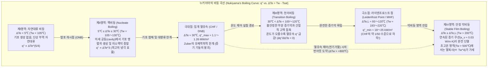
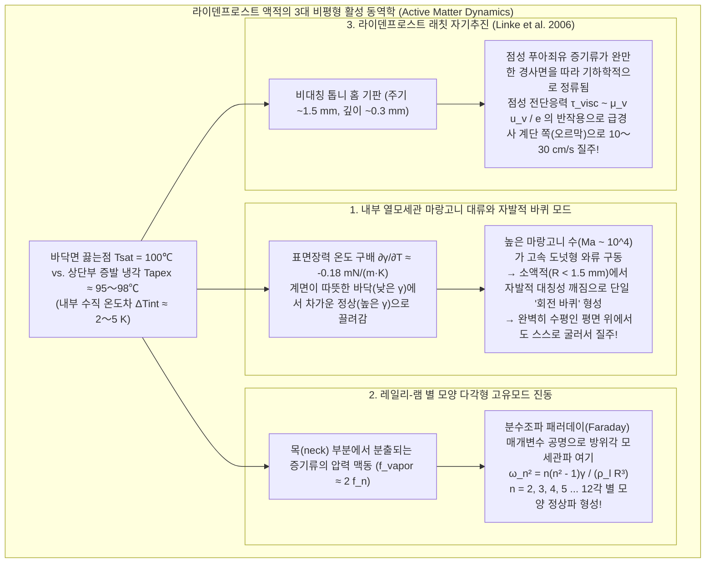

요리를 할 때 충분히 예열된 무쇠나 스테인리스 프라이팬에 물 몇 방울을 떨어뜨려 온도를 확인해 본 경험은 누구나 있을 것이다. 프라이팬의 표면 온도가 물의 끓는점($100^\circ\text{C}$)을 살짝 웃도는 $110^\circ\text{C}$〜$130^\circ\text{C}$ 정도일 때, 떨어진 물방울은 "치익!" 하는 격렬한 비등음과 함께 순식간에 퍼지며 $1$초도 되지 않아 흔적도 없이 증발해 버린다.

그런데 프라이팬을 더욱 강하게 가열하여 표면 온도가 $200^\circ\text{C}$〜$300^\circ\text{C}$에 도달하면 직관에 정면으로 반하는 극적인 변화가 일어난다. 떨어진 물방울은 더 이상 요란한 소리를 내며 증발하지 않는다. 오히려 마치 수은 구슬이나 잘 연마된 수정 구슬처럼 둥글게 뭉쳐, 프라이팬 표면을 <strong>전혀 적시지 않은 채 마찰이 없는 에어하키 퍽처럼 미끄러지며 사방으로 뛰어다니기 시작</strong>한다. 더욱 놀라운 점은 온도가 훨씬 높음에도 불구하고 물방울이 완전히 사라질 때까지의 수명이 $120^\circ\text{C}$일 때보다 수십 배에서 백 배 이상 길어져 <strong>수 분 동안이나 생존</strong>한다는 사실이다.

"온도가 높을수록 물이 더 빨리 증발할 것이다"라는 일상의 소박한 열역학적 직관을 배반하는 이 현상이 바로 <strong>라이덴프로스트 효과(Leidenfrost effect)</strong>이다. 고온의 고체 표면과 액적 사이에 두께가 불과 수십 마이크로미터($10\text{–}100\,\mu\text{m}$)에 지나지 않는 <strong>증기 쿠션(증기막: vapor cushion / vapor film)</strong>이 자기형성(self-formation)되며, 이 얇은 기체 층이 '액적의 무게를 지탱하는 유체역학적 호버크라프트'와 '고온 표면으로부터의 열전달을 차단하는 강력한 단열재'라는 이중 역할을 동시에 수행하기 때문이다.

본고에서는 1756년 요한 고틀로프 라이덴프로스트의 고전적 관찰에서 출발하여, 1934년 일본의 열공학자 누키야마 시로(抜山四郎)가 확립한 <strong>비등 곡선(Boiling Curve)</strong>과 노바크 주버(N. Zuber)의 <strong>임계 열유속(CHF) 유체역학적 불안정성 이론</strong>, 폴 베렌슨(P. J. Berenson)의 <strong>최소 열유속(MHF)</strong>을 살펴보고, 2003년 프랑스의 A.-L. Biance, C. Clanet, D. Quéré 연구진이 정식화한 <strong>증기 쿠션의 윤활 방정식(Lubrication theory)과 막 두께 스케일링 법칙($e \propto \Delta T^{1/4} R^{1/2}$)</strong>을 제1원리로부터 유도한다. 나아가 액적 내부에서 소용돌이치는 <strong>열모세관 마랑고니 대류(Thermocapillary Marangoni convection)와 자발적 대칭성 깨짐</strong>, 액적이 별 모양 다각형으로 맥동하는 <strong>레일리-램 고유모드 진동(Rayleigh-Lamb star oscillations)</strong>, 비대칭 톱니 홈을 스스로 기어오르는 <strong>라이덴프로스트 래칫(Linke et al. 2006)</strong>, 그리고 <strong>원자로 냉각재 상실 사고(LOCA)에서의 노심 재관수 급랭(Quenching) 문제</strong>까지 작은 물방울 아래 숨겨진 비평형 열유체역학의 세계를 체계적으로 규명한다.

---

## 1. 벌겋게 달아오른 쇠숟가락 위의 '수정 지구본': 1756년 라이덴프로스트의 발견

이 현상을 과학사에서 최초로 체계적이고 정량적으로 기술한 인물은 독일 뒤스부르크 대학교의 의학자이자 자연철학자였던 <strong>요한 고틀로프 라이덴프로스트(Johann Gottlob Leidenfrost, 1715–1794)</strong>였다(1732년 네덜란드의 헤르만 부르하버가 간략히 언급한 바 있으나 본격적인 물리적 탐구는 라이덴프로스트가 최초였다).

그는 1756년 출간한 라틴어 논문 《보통 물의 몇 가지 성질에 관한 논고(*De Aquae Communis Nonnullis Qualitatibus Tractatus*)》에서 시뻘겋게 달아오른 쇠숟가락 위에 깨끗한 물 한 방울을 떨어뜨렸을 때의 경이로운 관찰을 다음과 같이 기록했다.

> "벌겋게 달아올라 빛을 발하는 쇠숟가락 위에 맑은 보통 물 한 방울을 떨어뜨린다. 그러면 물방울은 철 표면에 달라붙거나 퍼지지 않고, 닿는 그 순간 즉각 완벽한 구형으로 응집하여 마치 <strong>투명한 수정 지구본(crystal globe / globulus crystallinus)</strong>처럼 밝게 빛나며 숟가락 바닥을 가볍게 회전하고 미끄러져 다닌다. 이 물방울은 곧바로 증발하지 않으며, 30초 혹은 1분 가까이 서서히 작아지면서 살아남다가 마침내 극히 미세한 입자가 되어 '탁' 하는 희미한 소리와 함께 사라진다."

라이덴프로스트는 진자 시계를 이용해 쇠숟가락이 식어감에 따라 물방울의 생존 시간을 측정했고, 숟가락이 적열 상태를 벗어나 특정 온도 이하로 내려가는 순간 물방울이 갑자기 표면을 적시며 격렬하게 끓어올라 1초도 안 되어 사라진다는 사실을 발견했다. 즉, <strong>증발 속도는 온도의 단조증가 함수가 아니라 특정 임계 온도를 경계로 불연속적으로 급감한다</strong>는 사실을 18세기 중반에 정확히 포착한 것이다. 이후 1842년 프랑스의 피에르 부티니(P. H. Boutigny)는 이를 '구상 상태(spheroidal state)'라 명명하고 백금도가니 속에서 액체 이산화황을 이용해 물을 얼음으로 얼리는 극적인 시연을 선보였다.

---

## 2. 누키야마 시로의 비등 곡선(1934)과 풀 비등(Pool Boiling)의 4가지 영역

고체 가열면의 온도 $T_w$와 액체의 포화 비등 온도 $T_{\text{sat}}$(대기압 물의 경우 $100^\circ\text{C}$)의 차이를 <strong>벽면 과열도(Wall superheat)</strong> $\Delta T_e \equiv T_w - T_{\text{sat}}$라 정의하자. 단위 면적·단위 시간당 전달되는 열량인 <strong>열유속(Heat flux)</strong> $q''$ $[\text{W/m}^2]$가 $\Delta T_e$에 따라 어떻게 변화하는지를 전 영역에 걸쳐 최초로 밝혀낸 것이 바로 1934년 일본 도호쿠 제국대학의 <strong>누키야마 시로(Shiro Nukiyama)</strong>가 발표한 기념비적 논문이다.

### 2.1 제I영역: 자연대류 비등($\Delta T_e < 5^\circ\text{C}$)

과열도가 약 $5^\circ\text{C}$ 미만일 때는 표면의 미세한 흠집(개구 반경 $r_c$)에 갇힌 기포핵이 표면장력 $\gamma$에 의한 라플라스 압력 $\Delta P = 2\gamma / r_c$를 이기지 못해 성장하지 못한다(클라우지우스-클라페이롱 식에 의한 최소 과열도 $\Delta T_{\text{ONB}} \approx \frac{2\gamma T_{\text{sat}}}{\rho_v L_{lv} r_c}$ 미달). 따라서 기포 없이 단상 부력 대류만 일어나며 $q'' \propto \Delta T_e^{5/4}$를 따른다.

### 2.2 제II영역: 핵비등($5^\circ\text{C} \le \Delta T_e \le 30^\circ\text{C}$)과 Zuber의 임계 열유속(CHF)

$\Delta T_e \ge 5^\circ\text{C}$가 되면 무수한 미세 공동에서 기포가 일제히 발생·이탈하며, 기포 바닥의 <strong>미소액막(microlayer) 증발</strong>과 <strong>미소 대류 교반</strong>에 의해 열유속이 과열도의 <strong>3제곱</strong>에 비례해 폭증한다(Rohsenow 상관식: $q'' \propto \Delta T_e^3$). $120^\circ\text{C}$의 프라이팬에서 물방울이 1초 만에 증발하는 것은 바로 이 핵비등 영역에 해당하기 때문이다.

그러나 $\Delta T_e \approx 30^\circ\text{C}$($T_w \approx 130^\circ\text{C}$)에 이르면 상승하는 기포들이 합쳐져 연속적인 <strong>증기 기둥(vapor columns)</strong>을 형성한다. 1958년 <strong>노바크 주버(Novak Zuber)</strong>는 무거운 액체($\rho_l$)가 가벼운 증기($\rho_v$) 위에 놓여 발생하는 <strong>레일리-테일러 불안정성(파장 $\lambda_{RT} = 2\pi\sqrt{3\gamma/[g(\rho_l - \rho_v)]}$)</strong>과, 상승하는 증기 제트가 주변 액체와의 계면에서 일으키는 <strong>켈빈-헬름홀츠 불안정성(임계 속도 $u_{v,\text{crit}} \sim [\gamma g(\rho_l - \rho_v)/\rho_v^2]^{1/4}$)</strong>을 결합하여 핵비등이 도달할 수 있는 최대 열유속인 <strong>임계 열유속(CHF: Critical Heat Flux)</strong>을 이론적으로 유도했다.

$$q''_{\max} = C_{\text{Zuber}} \rho_v L_{lv} \left[ \frac{\gamma g (\rho_l - \rho_v)}{\rho_v^2} \right]^{1/4}, \qquad C_{\text{Zuber}} = \frac{\pi}{24} \approx 0.131$$

대기압 하의 물의 물성치를 대입하면 $q''_{\max} \approx 1.10\text{–}1.26\,\text{MW/m}^2$라는 거대한 값이 도출된다. 누키야마의 1934년 백금선 전기가열 실험에서 열유속이 $q''_{\max}$에 도달한 순간 백금선 온도가 $130^\circ\text{C}$에서 $1000^\circ\text{C}$ 이상으로 단숨에 도약하며 끊어진 현상이 바로 <strong>번아웃(Burnout / 비등 위기)</strong>이다.

### 2.3 제III영역: 천이비등($30^\circ\text{C} < \Delta T_e < 100\text{–}120^\circ\text{C}$)

CHF를 넘어서면 불안정한 증기 블랭킷이 표면을 부분적으로 덮는 천이비등 영역에 진입한다. 이 영역에서는 <strong>벽면 온도 $T_w$가 높아질수록 건조 증기가 덮는 면적 비율이 증가하여 평균 열유속 $q''$가 오히려 감소</strong>한다($\partial q'' / \partial \Delta T_e < 0$, 음의 미분 열컨덕턴스).

### 2.4 제IV영역: 안정 막비등과 라이덴프로스트 점(Berenson의 최소 열유속)

과열도가 <strong>라이덴프로스트 온도 $T_L$</strong>(연마된 금속 위 물방울의 경우 $T_L \approx 193^\circ\text{C}\text{–}220^\circ\text{C}$)에 도달하면 고액 접촉이 완전히 사라지고 연속된 증기막이 형성된다. 비등 곡선의 극소점인 <strong>라이덴프로스트 점(최소 열유속 MHF)</strong>은 1961년 <strong>폴 베렌슨(P. J. Berenson)</strong>에 의해 유도되었다.

$$q''_{\min} = 0.09 \rho_v L_{lv} \left[ \frac{\gamma g (\rho_l - \rho_v)}{(\rho_l + \rho_v)^2} \right]^{1/4} \approx 18\text{–}25\,\text{kW/m}^2$$

이는 CHF($\approx 1.2\,\text{MW/m}^2$)의 약 <strong>$1/50$($2\%$)</strong>에 불과하다! 수증기의 열전도율($\kappa_v \approx 0.03\,\text{W/(m}\cdot\text{K)}$)은 액체 물($\kappa_l \approx 0.68\,\text{W/(m}\cdot\text{K)}$)보다 20배 이상 낮기 때문에, 증기 쿠션이 강력한 단열재로 작용하여 물방울을 수 분 동안 지켜주는 것이다.

| 비등 영역 | 벽면 과열도 $\Delta T_e = T_w - T_{\text{sat}}$ (물, 1 atm) | 대표 열유속 $q''$ $[\text{W/m}^2]$ | 지배적 열전달 및 유체역학 메커니즘 | 프라이팬 위 물방울의 거동 및 수명 $\tau$ |
| :--- | :--- | :--- | :--- | :--- |
| <strong>I. 자연대류 비등</strong> | $\Delta T_e < 5^\circ\text{C}$ ($T_w < 105^\circ\text{C}$) | $10^3 \text{–} 10^4$ | 기포핵 미활성화; 단상 부력 자연대류($q'' \propto \Delta T_e^{5/4}$) 및 조용한 표면 증발. | 표면에 얇게 퍼져 기포 없이 $30\text{–}120\,\text{s}$에 걸쳐 조용히 증발. |
| <strong>II. 핵비등</strong> | $5^\circ\text{C} \le \Delta T_e \le 30^\circ\text{C}$ ($T_w = 105\text{–}130^\circ\text{C}$) | $10^4 \text{–} 1.26 \times 10^6$ (극대점 CHF) | 미세 공동 기포 생성·이탈 및 미소액막 증발($q'' \propto \Delta T_e^3$). CHF에서 증기 기둥 붕괴. | "치익!" 소리와 함께 퍼지며 <strong>$0.3\text{–}1.5\,\text{s}$</strong> 이내에 순식간에 소멸. |
| <strong>III. 천이비등</strong> | $30^\circ\text{C} < \Delta T_e < 100^\circ\text{C}$ ($T_w = 130\text{–}200^\circ\text{C}$) | $1.2 \times 10^6 \to 2 \times 10^4$ ($\partial q''/\partial \Delta T_e < 0$) | 불안정한 부분 증기막과 간헐적 고액 접촉·폭발적 비등의 반복. | 타닥거리며 격렬히 튀어 오르고 미세 비말을 흩뿌리며 $2\text{–}15\,\text{s}$ 생존. |
| <strong>IV. 안정 막비등 (라이덴프로스트 상태)</strong> | $\Delta T_e \ge \Delta T_L \approx 93\text{–}120^\circ\text{C}$ ($T_w \ge 193\text{–}220^\circ\text{C}$) | $2 \times 10^4 \to 10^5$ (극소점 MHF) | $10\text{–}100\,\mu\text{m}$ 연속 증기 쿠션에 의한 완전 비접촉 부유 및 기체 열전도. | 구형 또는 팬케이크 형태로 뭉쳐 무음·무마찰로 활주하며 <strong>$60\text{–}300\,\text{s}$</strong> 생존. |

---

## 3. 부유 액적의 모세관 정역학과 증기 쿠션의 윤활 스케일링 법칙 (Biance, Clanet, & Quéré 2003)

### 3.1 모세관 길이 $\ell_c$와 액적의 3가지 형태학적 영역

완전 비습윤($\theta_c = 180^\circ$) 상태인 라이덴프로스트 액적의 형상은 표면장력에 의한 라플라스 압력($\sim \gamma/R$)과 중력에 의한 정수압($\sim \rho_l g R$)의 균형 길이인 <strong>모세관 길이(Capillary length)</strong> $\ell_c$에 의해 결정된다.

$$\ell_c = \sqrt{\frac{\gamma}{\rho_l g}} \approx 2.50\,\text{mm} \quad (100^\circ\text{C}\text{ 물: }\gamma = 58.9\,\text{mN/m}, \rho_l = 958\,\text{kg/m}^3)$$

본드 수 $\text{Bo} = (R/\ell_c)^2$에 따라 액적은 세 가지 형태를 띤다:
1. <strong>준구형 액적($R < \ell_c \approx 2.5\,\text{mm}$)</strong>: 표면장력이 지배하여 거의 완벽한 구형을 유지하며, 바닥면만 반경 $r_c = \sqrt{\frac{2}{3}}\frac{R^2}{\ell_c}$의 작은 원형 평탄 패치로 눌린다.
2. <strong>중력 팬케이크 / 물웅덩이(Leidenfrost puddle, $\ell_c < R < 4\ell_c$)</strong>: 중력이 지배하여 납작한 원반 모양이 되며, 그 두께는 정수압과 표면장력의 균형에 의해 항상 일정한 보편적 값 $h_p = 2\ell_c \approx 5.0\,\text{mm}$를 유지한다. 바닥 중앙은 증기압에 의해 오목하게 들어간 '증기 포켓(dimple)'을 이루고 가장자리 근처에 막 두께가 최소가 되는 환형 '목(neck)'이 형성된다.
3. <strong>레일리-테일러 증기 굴뚝 분화($R > R_{\max} \approx 3.83\ell_c \approx 9.6\,\text{mm}$)</strong>: 반경이 약 $1\,\text{cm}$를 넘으면 표면장력이 하층 증기의 부력 불안정성을 억제하지 못해 액적 한가운데서 거대한 증기 기포(<strong>증기 굴뚝: vapor chimney</strong>)가 솟구쳐 오른다.

### 3.2 증기막 두께 $e$와 액적 수명 $\tau$의 수학적 유도

2003년 프랑스의 <strong>A.-L. Biance, C. Clanet, D. Quéré</strong>는 <strong>푸리에 열전도 법칙</strong>과 <strong>점성 윤활 이론(푸아죄유 방사상 유출)</strong>을 결합하여 증기막 두께 $e$를 정확히 유도했다.

반경 $R$($R > \ell_c$), 두께 $2\ell_c$인 팬케이크 액적에 대하여:
1. <strong>증기막을 가로지르는 푸리에 열전도와 증발 질량 유량 $\dot{m}$</strong>:
   두께 $e$인 증기막을 통과하는 전도열 $Q$는 모두 잠열 $L_{lv}$로 소비되어 새로운 증기를 생성한다:
   $$Q = \kappa_v \frac{\Delta T}{e} \pi R^2 = \dot{m} L_{lv} \quad \Longrightarrow \quad \dot{m} = \frac{\kappa_v \Delta T}{L_{lv} e} \pi R^2 \qquad \cdots (1)$$
2. <strong>점성 윤활 이론(방사상 푸아죄유 유동)</strong>:
   좁은 틈새($e \ll R$)를 통해 빠져나가는 증기 유동은 윤활 방정식 $\mu_v \frac{\partial^2 u_r}{\partial z^2} = \frac{dP}{dr}$를 따르며, 포물선형 속도 분포 $u_r(r,z) = \frac{1}{2\mu_v}\left(-\frac{dP}{dr}\right)z(e-z)$를 갖는다. 체적 유량 보존 $Q_v(r) = \frac{\pi r e^3}{6\mu_v}\left(-\frac{dP}{dr}\right) = \frac{\dot{m}}{\rho_v}\frac{r^2}{R^2}$을 적분하면 증기 쿠션의 평균 과잉 압력을 얻는다:
   $$\Delta P_{\text{cushion}} = \frac{3 \mu_v \dot{m}}{2 \pi \rho_v e^3} \qquad \cdots (2)$$
3. <strong>정수압 균형과 $e \propto R^{1/2}$ 스케일링 법칙</strong>:
   $\Delta P_{\text{cushion}}$이 액적의 정수압 $\Delta P_{\text{weight}} = 2\rho_l g \ell_c$와 평형을 이루므로, 식 (1)을 식 (2)에 대입하여 정리하면 <strong>Biance-Clanet-Quéré 증기막 두께 스케일링 법칙</strong>이 도출된다:
   $$e = \left(\frac{3}{4}\right)^{1/4} \left( \frac{\kappa_v \mu_v \Delta T}{\rho_v \rho_l g L_{lv} \ell_c} \right)^{1/4} R^{1/2} \approx 10\text{–}100\,\mu\text{m} \qquad \cdots (3)$$
   $T_w = 300^\circ\text{C}$($\Delta T = 200\,\text{K}$), $R = 5\,\text{mm}$일 때 $e \approx 54\,\mu\text{m}$가 되어 머리카락 한 올 두께의 수증기 층이 물방울을 띄우고 있음을 알 수 있다(준구형 소액적 $R < \ell_c$에서는 $e_{\text{small}} \propto \Delta T^{1/4} R^{5/4}$).
4. <strong>액적 수명 스케일링</strong>:
   질량 감소율 $-\frac{dM}{dt} = -4\pi \rho_l \ell_c R \frac{dR}{dt} = \dot{m} \propto R^{3/2}$를 적분하면 $R(t) = R_0(1 - t/\tau)^2$ 및 총 수명 $\tau \propto \Delta T^{-3/4} R_0^{3/2}$(소액적 및 중간 영역에서는 $\tau \propto R_0^{5/4} \sim R_0^2$)를 얻는다.

---

## 4. 내부 열 마랑고니 대류, 별 모양 고유모드 진동 및 래칫 자기추진

### 4.1 내부 열모세관 마랑고니 대류와 '라이덴프로스트 바퀴'

액적 바닥($100^\circ\text{C}$)과 증발 냉각되는 꼭대기($95\text{–}98^\circ\text{C}$) 사이의 온도차는 표면장력 구배($\frac{\partial \gamma}{\partial T} \approx -0.18\,\text{mN/(m}\cdot\text{K)}$)를 통해 접선 방향 <strong>마랑고니 전단응력</strong> $\tau_s = \frac{\partial \gamma}{\partial T}\nabla_s T$를 발생시킨다. 마랑고니 수가 $\text{Ma} \sim 2 \times 10^4 \gg \text{Ma}_c$에 달해 강력한 내부 와류가 형성되며, 이는 나노입자 건조 시 <strong>커피링 효과(Coffee-ring effect)</strong>를 억제하여 3차원 다공성 구형 입자(Supraballs)를 합성할 수 있게 해준다.

2018년 <strong>A. Bouillant와 D. Quéré 연구진</strong>(*Nature Physics*)은 $R \lesssim 1.5\,\text{mm}$인 액적에서 도넛형 대류 롤이 <strong>자발적 대칭성 깨짐</strong>을 일으켜 단일 회전 와류 셀(<strong>'라이덴프로스트 바퀴: Leidenfrost wheel'</strong>)로 전이하며, 이 내부 회전이 바닥 증기막을 기울여 수평면 위에서도 액적을 스스로 굴러가게 만든다는 사실을 입증했다!

### 4.2 레일리-램(Rayleigh-Lamb) 별 모양 다각형 진동

큰 라이덴프로스트 액적($R \sim 5\text{–}15\,\text{mm}$)의 둘레가 삼각형, 사각형, 오각별 등 정다각형 별 모양으로 맥동하는 현상은 비점성 액적의 <strong>레일리-램 방위각 모세관 고유모드</strong>에 해당한다.

$$\omega_n^2 = \frac{n(n^2 - 1)\gamma}{\rho_l R^3} \qquad (n = 2, 3, 4, \dots, 12)$$

바닥 증기막에서 분출되는 증기류의 압력 진동($f_{\text{vapor}}$)이 마티외 방정식(Mathieu equation)에 따른 <strong>분수조파 패러데이 매개변수 공명($f_n = \frac{\omega_n}{2\pi} \approx \frac{1}{2} f_{\text{vapor}}$)</strong>을 일으켜 특정 별 모드를 증폭시킨다.

### 4.3 하이너 링케(Heiner Linke, 2006)의 라이덴프로스트 래칫 자기추진

2006년 오리건 대학교의 <strong>Heiner Linke</strong> 연구팀(*Phys. Rev. Lett.*)은 비대칭 톱니 홈(주기 $\sim 1.5\,\text{mm}$, 깊이 $\sim 0.3\,\text{mm}$)이 파인 고온 황동판 위에서 라이덴프로스트 액적이 아무런 외력 없이도 톱니의 급경사 계단을 오르는 방향으로 초속 $10\text{–}30\,\text{cm}$로 스스로 질주하며 오르막길까지 올라간다는 사실을 발견했다. 액적 바닥이 톱니 골짜기로 살짝 처지면서 급경사면 쪽 통로를 막기 때문에, 증발한 수증기가 각 톱니의 완만한 경사면을 따라 뒤쪽으로 <strong>정류(rectification)</strong>되어 분출되고, 그 점성 전단 반작용력 $F_{\text{ratchet}} \sim \frac{\mu_v u_{\text{vapor}}}{e}\pi R^2 \sim 30\,\mu\text{N}$이 마찰 없는 액적을 앞으로 밀어내는 것이다.

---

## 5. 산업 및 극한 물리 응용: 원자로 LOCA 급랭, 강철의 담금질, 그리고 용융 납과 액체질소

1. <strong>원자로 냉각재 상실 사고(LOCA)와 재관수 급랭(Quenching)</strong>:
   경수로(PWR/BWR) 노심의 지르칼로이 연료 피복관은 정상 운전 시 핵비등 영역(제II영역)에서 운전된다. 만약 LOCA 등이 발생하여 열유속이 CHF를 넘으면 피복관 표면이 즉시 라이덴프로스트 막비등 상태(제IV영역)로 도약하여 증기 단열막에 갇히고, 온도가 수 초 내에 $1000^\circ\text{C}$ 이상으로 폭주(번아웃)한다. 비상노심냉각계통(ECCS)이 냉각수를 주입하더라도 피복관 온도가 $T_L$보다 훨씬 높아 물이 라이덴프로스트 효과로 튕겨 나가며, 오직 피복관의 축방향 열전도를 통해 전진하는 <strong>급랭 전선(Quench front, Yamanouchi 모델)</strong>을 따라서만 냉각이 진행된다. 따라서 친수성 마이크로/나노 다공성 코팅으로 CHF와 $T_L$을 높이는 연구가 현대 원자로 안전공학의 핵심 과제로 수행되고 있다.
2. <strong>야금학에서의 강철 담금질(Quenching of Steel)</strong>:
   $850^\circ\text{C}$의 강철을 물에 담글 때 초기에는 라이덴프로스트 <strong>증기막 단계(느린 냉각)</strong>가 형성되고, $T_L$ 이하로 식으면 증기막이 터지면서 <strong>핵비등 단계(급속 냉각 및 마르텐사이트 변태)</strong>로 진입한다. 증기막이 불균일하게 붕괴하면 열응력으로 인해 강철이 휘거나 깨지는 <strong>담금질 균열(Quench cracking)</strong>이 발생하므로 소금물이나 교반을 통해 증기막을 즉시 파괴해야 한다.
3. <strong>용융 납에 젖은 손가락 넣기와 액체질소의 물리</strong>:
   물에 적신 손가락을 $400^\circ\text{C}$의 녹은 납에 찰나의 순간 넣었다 빼도 화상을 입지 않는 실험(<strong>절대 따라 해서는 안 되는 극도로 위험한 실험</strong>)이나, 끓는점이 $-196^\circ\text{C}$($77\,\text{K}$)인 <strong>액체질소($\text{LN}_2$)</strong>가 $34^\circ\text{C}$($307\,\text{K}$, 과열도 $\Delta T_e = 230\,\text{K}$)의 맨살에 튀었을 때 질소 기체 쿠션 위에서 구슬처럼 굴러떨어져 동상을 입지 않는 현상 모두 라이덴프로스트 증기 배리어 덕분이다.

---

## 참고문헌

1. <strong>Leidenfrost, J. G.</strong> (1756). *De Aquae Communis Nonnullis Qualitatibus Tractatus*. Duisburg.
2. <strong>Nukiyama, S.</strong> (1934). "The Maximum and Minimum Values of the Heat Transmitted from Metal to Boiling Water under Atmospheric Pressure". *J. Jpn. Soc. Mech. Eng.*, 37(206), 367–374.
3. <strong>Zuber, N.</strong> (1958). "On the stability of boiling heat transfer". *Trans. ASME*, 80(3), 711–720.
4. <strong>Berenson, P. J.</strong> (1961). "Film-boiling heat transfer from a horizontal surface". *J. Heat Transf.*, 83(3), 351–356.
5. <strong>Biance, A.-L., Clanet, C., & Quéré, D.</strong> (2003). "Leidenfrost drops". *Physics of Fluids*, 15(6), 1632–1637.
6. <strong>Linke, H., et al.</strong> (2006). "Self-Propelled Leidenfrost Droplets". *Physical Review Letters*, 96(15), 154502.
7. <strong>Quéré, D.</strong> (2013). "Leidenfrost Dynamics". *Annual Review of Fluid Mechanics*, 45, 197–215.
8. <strong>Bouillant, A., et al.</strong> (2018). "Leidenfrost wheels". *Nature Physics*, 14(12), 1188–1192.
