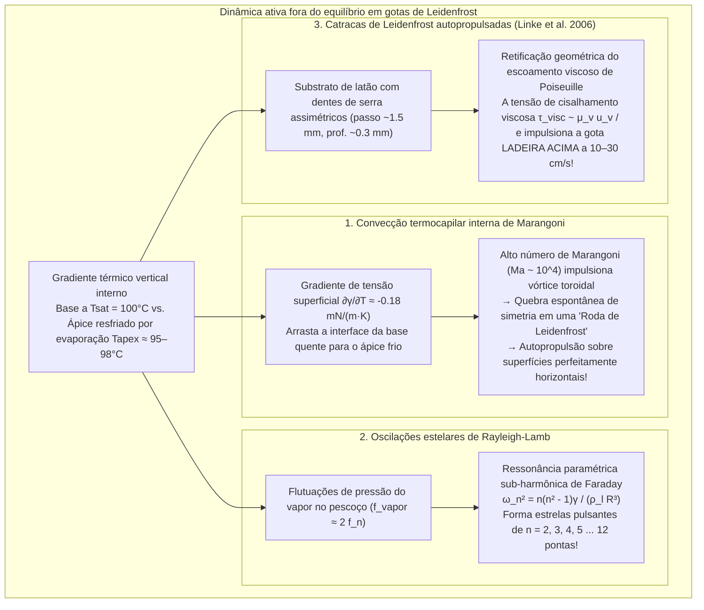

Qualquer pessoa que já tenha testado a temperatura de uma frigideira de ferro ou aço inoxidável respingando algumas gotas de água sobre sua superfície já testemunhou um dos paradoxos mais fascinantes da física térmica. Quando a temperatura da frigideira está apenas ligeiramente acima do ponto de ebulição da água — entre $110^\circ\text{C}$ e $130^\circ\text{C}$ —, a gota se espalha instantaneamente no impacto, chia violentamente e evapora por completo em menos de um segundo.

No entanto, se aquecermos essa mesma frigideira acima de $200^\circ\text{C}$ a $300^\circ\text{C}$, o comportamento da água se inverte radicalmente. Em vez de vaporizar instantaneamente, a gota se contrai formando uma esfera brilhante semelhante ao mercúrio. Ela não emite som algum, não molha o metal de forma alguma e <strong>passa a deslizar e ricochetear por toda a frigideira com atrito praticamente nulo</strong>, sobrevivendo por <strong>vários minutos</strong> — até cem vezes mais tempo do que a $120^\circ\text{C}$!

Esse fenômeno contraintuitivo é o <strong>efeito Leidenfrost</strong>. Acima de um limiar crítico conhecido como <strong>temperatura de Leidenfrost ($T_L$)</strong>, a base da gota vaporiza tão rapidamente ao se aproximar do substrato superaquecido que gera um <strong>colchão de vapor (filme de vapor)</strong> contínuo e autossustentado de apenas $10$ a $100\,\mu\text{m}$ de espessura. Essa camada microscópica de gás atua simultaneamente como um hovercraft hidrodinâmico — sustentando o peso da gota por pressão de lubrificação viscosa sem qualquer contato sólido-líquido — e como um poderoso isolante térmico cuja condutividade térmica ($\kappa_v \approx 0.03\,\text{W/(m}\cdot\text{K)}$) é mais de vinte vezes menor que a da água líquida ($\kappa_l \approx 0.68\,\text{W/(m}\cdot\text{K)}$).

Neste artigo, deduzimos rigorosamente a física do efeito Leidenfrost a partir dos primeiros princípios: do <strong>tratado histórico de Johann Gottlob Leidenfrost (1756)</strong> e da <strong>curva de ebulição de Shiro Nukiyama (1934)</strong>, passando pelo <strong>limite hidrodinâmico do Fluxo Crítico de Calor (CHF) de Novak Zuber</strong> e pelo <strong>Fluxo Mínimo de Calor (MHF) de Paul Berenson</strong>, até a derivação matemática da <strong>lei de escala de lubrificação de Biance, Clanet e Quéré (2003)</strong>, os <strong>vórtices termocapilares internos de Marangoni ("rodas de Leidenfrost")</strong>, as <strong>oscilações poligonais em estrela de Rayleigh-Lamb</strong>, as <strong>catracas autopropulsadas de Heiner Linke (2006)</strong> e o resfriamento de emergência em um <strong>acidente de perda de refrigerante (LOCA) em reatores nucleares</strong>.

---

## 1. O "globo de cristal" sobre uma colher em brasa: a descoberta de Leidenfrost (1756)

Embora o médico e químico holandês Herman Boerhaave tenha mencionado brevemente em 1732 o comportamento do álcool sobre ferro em brasa, o primeiro estudo experimental quantitativo foi publicado em 1756 pelo médico e filósofo natural alemão <strong>Johann Gottlob Leidenfrost (1715–1794)</strong> na Universidade de Duisburg.

Em seu tratado em latim *De Aquae Communis Nonnullis Qualitatibus Tractatus* (*Tratado sobre algumas qualidades da água comum*), Leidenfrost descreveu seu famoso experimento com uma colher de ferro aquecida até brilhar em brasa:

> "Nesta colher incandescente, deposite-se uma única gota de água comum pura... A água não adere ao ferro nem se espalha; pelo contrário, no exato instante do contato, contrai-se em um glóbulo esférico, brilhante e transparente como um <strong>globo de cristal</strong> (*globulus crystallinus*). Ela gira rapidamente e dança sem esforço pelo fundo da colher, sem fazer ruído nem soltar vapor visível. Longe de desaparecer imediatamente, diminui imperceptivelmente durante trinta ou quarenta segundos — ou mesmo um minuto inteiro — até que, por fim, uma partícula diminuta se desvanece com um leve estalo."

Cronometrando com um pêndulo a vida útil das gotas conforme a colher esfriava, Leidenfrost demonstrou que a taxa de evaporação cai drasticamente acima de uma temperatura crítica graças a uma fina camada de vapor (*vaporis strato*). Em 1842, Pierre Hippolyte Boutigny batizou esse regime de "estado esferoidal" e chegou a congelar água dentro de um cadinho de platina em brasa usando dióxido de enxofre líquido em estado de Leidenfrost.

---

## 2. A curva de ebulição de Shiro Nukiyama (1934) e os quatro regimes de ebulição em piscina

```mermaid
flowchart TD
    subgraph BoilingCurve["Curva de ebulição de Shiro Nukiyama (q'' vs. Superaquecimento ΔTe = Tw - Tsat)"]
        R1["Regime I: Convecção natural<br/>ΔTe < 5°C (Tw < 105°C)<br/>Sem nucleação de bolhas; convecção monofásica<br/>q'' ∝ ΔTe^(5/4)"]
        R2["Regime II: Ebulição nucleada (Nucleate Boiling)<br/>5°C ≤ ΔTe ≤ 30°C (Tw = 105–130°C)<br/>Nucleação intensa em microcavidades e evaporação de microcamada<br/>q'' ∝ ΔTe^3 (Máxima eficiência de resfriamento)"]
        CHF["Pico: Fluxo Crítico de Calor (CHF / DNB)<br/>ΔTe ≈ 30°C, q''_max ≈ 1.1–1.26 MW/m²<br/>Limite hidrodinâmico de Zuber (colapso das colunas de vapor)"]
        R3["Regime III: Ebulição de transição<br/>30°C < ΔTe < 100–120°C<br/>Manto de vapor parcial instável e molhamento intermitente<br/>O fluxo de calor CAI quando a temperatura sobe! (∂q''/∂ΔTe < 0)"]
        LP["Mínimo: Ponto de Leidenfrost (MHF)<br/>ΔTe,L ≈ 93–120°C (Tw ≈ 193–220°C)<br/>q''_min ≈ 18–25 kW/m² (50 vezes menor que o CHF!)"]
        R4["Regime IV: Ebulição em filme estável<br/>ΔTe ≥ ΔTe,L (Tw > 200°C)<br/>Colchão de vapor isolante contínuo (κ_v ≈ 0.03 W/m·K)<br/>A radiação térmica (∝ Tw^4) soma-se a Tw > 500°C"]
    end

    R1 -->|"Início da ebulição nucleada (ONB)"| R2
    R2 -->|"Coalescência e crise hidrodinâmica"| CHF
    CHF -->|"Rota de temperatura controlada"| R3
    R3 -->|"Estabilização completa do filme"| LP
    LP -->|"Regime de filme estável"| R4
    CHF -.->|"Salto de queima / Burnout sob fluxo imposto (ΔTw > +800°C)"| R4
```

Para compreender por que uma gota sobrevive minutos a $250^\circ\text{C}$ mas desaparece em menos de um segundo a $125^\circ\text{C}$, analisamos o <strong>fluxo de calor superficial</strong> $q''$ $[\text{W/m}^2]$ em função do <strong>superaquecimento da parede</strong> $\Delta T_e \equiv T_w - T_{\text{sat}}$ (onde $T_{\text{sat}} = 100^\circ\text{C}$ para a água a $1\,\text{atm}$), mapeado pela primeira vez em 1934 por <strong>Shiro Nukiyama</strong> na Universidade Imperial de Tōhoku.

1. <strong>Regime I: Convecção natural ($\Delta T_e < 5^\circ\text{C}$)</strong>: Devido à pressão de Laplace $\Delta P = 2\gamma / r_c$, os embriões de vapor em microcavidades de raio $r_c$ exigem $\Delta T_e > \Delta T_{\text{ONB}} \approx \frac{2\gamma T_{\text{sat}}}{\rho_v L_{lv} r_c}$ para crescer. Abaixo disso, o calor é transferido por convecção monofásica ($q'' \propto \Delta T_e^{5/4}$).
2. <strong>Regime II: Ebulição nucleada ($5^\circ\text{C} \le \Delta T_e \le 30^\circ\text{C}$) e o Fluxo Crítico de Calor (CHF) de Zuber</strong>: A evaporação da microcamada sob as bolhas e a agitação microconvectiva elevam o fluxo segundo a correlação de Rohsenow: $q'' \propto \Delta T_e^3$. Em $\Delta T_e \approx 30^\circ\text{C}$ ($T_w \approx 130^\circ\text{C}$), as bolhas coalescem em colunas de vapor. Em 1958, <strong>Novak Zuber</strong> acoplou a <strong>instabilidade de Rayleigh-Taylor</strong> ($\lambda_{RT} = 2\pi\sqrt{3\gamma/[g(\rho_l - \rho_v)]}$) com a <strong>instabilidade de Kelvin-Helmholtz</strong> para provar que o <strong>Fluxo Crítico de Calor (CHF)</strong> é:
   $$q''_{\max} = \frac{\pi}{24} \rho_v L_{lv} \left[ \frac{\gamma g (\rho_l - \rho_v)}{\rho_v^2} \right]^{1/4} \approx 0.131 \rho_v L_{lv} \left[ \frac{\gamma g (\rho_l - \rho_v)}{\rho_v^2} \right]^{1/4} \approx 1.1\text{–}1.26\,\text{MW/m}^2$$
   Sob aquecimento elétrico (fluxo imposto), atingir $q''_{\max}$ dispara a temperatura da parede de $130^\circ\text{C}$ para mais de $1100^\circ\text{C}$ (<strong>burnout</strong>).
3. <strong>Regime III: Ebulição de transição ($30^\circ\text{C} < \Delta T_e < 100\text{–}120^\circ\text{C}$)</strong>: Um filme parcial e instável cobre a parede; quanto maior $T_w$, maior a fração seca isolante e <strong>menor o fluxo de calor</strong> ($\partial q'' / \partial \Delta T_e < 0$).
4. <strong>Regime IV: Ebulição em filme estável e Ponto de Leidenfrost (MHF de Berenson)</strong>: No <strong>ponto de Leidenfrost ($T_L \approx 193^\circ\text{C}\text{–}220^\circ\text{C}$)</strong> cessa todo contato sólido-líquido. Em 1961, <strong>Paul J. Berenson</strong> deduziu o Fluxo Mínimo de Calor (MHF):
   $$q''_{\min} = 0.09 \rho_v L_{lv} \left[ \frac{\gamma g (\rho_l - \rho_v)}{(\rho_l + \rho_v)^2} \right]^{1/4} \approx 18\text{–}25\,\text{kW/m}^2$$
   Um valor 50 vezes menor que no pico da ebulição nucleada!

| Regime de ebulição | Superaquecimento $\Delta T_e = T_w - T_{\text{sat}}$ (Água, $1\,\text{atm}$) | Fluxo de calor típico $q''$ $[\text{W/m}^2]$ | Mecanismo físico dominante | Comportamento e vida $\tau$ da gota na frigideira |
| :--- | :--- | :--- | :--- | :--- |
| <strong>I. Convecção natural</strong> | $\Delta T_e < 5^\circ\text{C}$ ($T_w < 105^\circ\text{C}$) | $10^3 \text{–} 10^4$ | Cavidades inativas; convecção monofásica ($q'' \propto \Delta T_e^{5/4}$). | Molha a superfície e evapora sem bolhas em $30\text{–}120\,\text{s}$. |
| <strong>II. Ebulição nucleada</strong> | $5^\circ\text{C} \le \Delta T_e \le 30^\circ\text{C}$ ($T_w = 105\text{–}130^\circ\text{C}$) | $10^4 \text{–} 1.26 \times 10^6$ (Pico no CHF) | Nucleação intensa e evaporação de microcamada ($q'' \propto \Delta T_e^3$); limite de Zuber. | Chia violentamente e desaparece em <strong>$0.3\text{–}1.5\,\text{s}$</strong>. |
| <strong>III. Ebulição de transição</strong> | $30^\circ\text{C} < \Delta T_e < 100^\circ\text{C}$ ($T_w = 130\text{–}200^\circ\text{C}$) | $1.2 \times 10^6 \to 2 \times 10^4$ ($\partial q''/\partial \Delta T_e < 0$) | Oscilação caótica entre manto de vapor e contato explosivo. | Crepita, salta e ejeta microgotas; sobrevive $2\text{–}15\,\text{s}$. |
| <strong>IV. Filme estável (Estado de Leidenfrost)</strong> | $\Delta T_e \ge \Delta T_L \approx 93\text{–}120^\circ\text{C}$ ($T_w \ge 193\text{–}220^\circ\text{C}$) | $2 \times 10^4 \to 10^5$ (Mínimo no MHF) | Levitação total sobre colchão de vapor ($10\text{–}100\,\mu\text{m}$); condução lenta no gás. | Esfera ou panqueca líquida sem atrito nem ruído; vive <strong>$60\text{–}300\,\text{s}$</strong>. |

---

## 3. Estática capilar e lei de escala hidrodinâmica do colchão de vapor (Biance, Clanet, & Quéré 2003)

### 3.1 Comprimento capilar $\ell_c$ e morfologia das gotas levitadas

Com um ângulo de contato aparente $\theta_c = 180^\circ$, o equilíbrio entre a pressão capilar de Laplace ($\sim \gamma / R$) e a pressão hidrostática ($\sim \rho_l g R$) define o <strong>comprimento capilar</strong> $\ell_c$:

$$\ell_c = \sqrt{\frac{\gamma}{\rho_l g}} \approx 2.50\,\text{mm} \quad (\text{água a } 100^\circ\text{C})$$

Dependendo do número de Bond $\text{Bo} = (R/\ell_c)^2$, existem três regimes:
1. <strong>Gotas quase esféricas ($R < \ell_c \approx 2.5\,\text{mm}$)</strong>: Esferas de raio $R$ com uma pequena área plana basal de raio $r_c = \sqrt{\frac{2}{3}}\frac{R^2}{\ell_c}$.
2. <strong>Poças / Panquecas de Leidenfrost ($\ell_c < R < 4\ell_c$)</strong>: A gravidade achata a gota até uma espessura universal constante $h_p = 2\ell_c \sin(180^\circ/2) = 2\ell_c \approx 5.0\,\text{mm}$, com uma bolsa côncava central de vapor (*dimple*) cercada por um pescoço anular estreito (*neck*).
3. <strong>Chaminés de vapor de Rayleigh-Taylor ($R > R_{\max} \approx 3.83\ell_c \approx 9.6\,\text{mm}$)</strong>: Para $R \gtrsim 1\,\text{cm}$, a interface vapor-líquido sofre a instabilidade de Rayleigh-Taylor e grandes bolhas de vapor emergem periodicamente pelo centro da poça (*vapor chimneys*).

### 3.2 Derivação da espessura do filme $e$ e do tempo de vida $\tau$

Em seu artigo clássico de 2003 (*Physics of Fluids*), <strong>Anne-Laure Biance, Christophe Clanet e David Quéré</strong> acoplaram a condução de Fourier com a lubrificação viscosa para uma poça de raio $R > \ell_c$:

1. <strong>Condução de calor de Fourier através da espessura $e$</strong>:
   $$Q = \kappa_v \frac{\Delta T}{e} \pi R^2 = \dot{m} L_{lv} \quad \Longrightarrow \quad \dot{m} = \frac{\kappa_v \Delta T}{L_{lv} e} \pi R^2 \qquad \cdots (1)$$
2. <strong>Teoria da lubrificação viscosa (escoamento radial de Poiseuille)</strong>:
   A equação de lubrificação $\mu_v \frac{\partial^2 u_r}{\partial z^2} = \frac{dP}{dr}$ produz o perfil parabólico $u_r(r,z) = \frac{1}{2\mu_v}\left(-\frac{dP}{dr}\right)z(e-z)$ e a vazão volumétrica $Q_v(r) = \frac{\pi r e^3}{6\mu_v}\left(-\frac{dP}{dr}\right) = \frac{\dot{m}}{\rho_v}\frac{r^2}{R^2}$. Integrando a pressão obtém-se a sobrepressão média do colchão:
   $$\Delta P_{\text{cushion}} = \frac{3 \mu_v \dot{m}}{2 \pi \rho_v e^3} \qquad \cdots (2)$$
3. <strong>Equilíbrio hidrostático e lei de escala $e \propto R^{1/2}$</strong>:
   Igualando $\Delta P_{\text{cushion}}$ à pressão hidrostática da poça $\Delta P_{\text{weight}} = 2\rho_l g \ell_c$ e substituindo (1) em (2), obtém-se a <strong>lei de Biance-Clanet-Quéré</strong>:
   $$e = \left(\frac{3}{4}\right)^{1/4} \left( \frac{\kappa_v \mu_v \Delta T}{\rho_v \rho_l g L_{lv} \ell_c} \right)^{1/4} R^{1/2} \approx 10\text{–}100\,\mu\text{m} \qquad \cdots (3)$$
   Para $R = 5\,\text{mm}$ e $\Delta T = 200\,\text{K}$, resulta $e \approx 54\,\mu\text{m}$ (enquanto para gotas pequenas $R < \ell_c$ vale $e_{\text{small}} \propto \Delta T^{1/4} R^{5/4}$). Integrando $-\frac{dM}{dt} = \dot{m} \propto R^{3/2}$ obtém-se $R(t) = R_0(1 - t/\tau)^2$ e uma vida total $\tau \propto \Delta T^{-3/4} R_0^{3/2}$ (ou $\tau \propto R_0^{5/4}$ a $R_0^2$).

---

## 4. Vórtices termocapilares de Marangoni, estrelas de Rayleigh-Lamb e catracas de Leidenfrost

### 4.1 Convecção termocapilar de Marangoni e "rodas de Leidenfrost"

O gradiente térmico entre a base ($100^\circ\text{C}$) e o ápice ($95\text{–}98^\circ\text{C}$) gera, via $\frac{\partial \gamma}{\partial T} \approx -0.18\,\text{mN/(m}\cdot\text{K)}$, uma tensão cisalhante de <strong>Marangoni</strong> $\tau_s = \frac{\partial \gamma}{\partial T}\nabla_s T$ ($\text{Ma} = \frac{|\partial \gamma/\partial T|\Delta T_{\text{int}} R}{\mu_l \alpha_l} \sim 2 \times 10^4 \gg \text{Ma}_c$) que suprime o <strong>efeito anel de café (*coffee-ring effect*)</strong>. Além disso, <strong>Bouillant, Quéré et al. (2018, *Nature Physics*)</strong> descobriram que para $R \lesssim 1.5\,\text{mm}$ o vórtice toroidal quebra espontaneamente sua simetria formando uma única célula rolante (<strong>"roda de Leidenfrost"</strong>) que inclina o colchão de vapor e autopropulsiona a gota sobre um plano horizontal.

### 4.2 Oscilações poligonais em estrela de Rayleigh-Lamb

As poças grandes ($R \sim 5\text{–}15\,\text{mm}$) desenvolvem ondas estacionárias azimutais em forma de polígonos estrelados regidas pela <strong>relação de dispersão de Rayleigh-Lamb</strong>:

$$\omega_n^2 = \frac{n(n^2 - 1)\gamma}{\rho_l R^3} \qquad (n = 2, 3, 4, \dots, 12)$$

excitadas mediante <strong>ressonância paramétrica sub-harmônica de Faraday ($f_n = \frac{\omega_n}{2\pi} \approx \frac{1}{2} f_{\text{vapor}}$)</strong> pelas flutuações de pressão do fluxo de vapor no pescoço.

### 4.3 Catracas autopropulsadas de Heiner Linke (2006)

Em 2006, <strong>Heiner Linke et al.</strong> (*Phys. Rev. Lett.*) demonstraram que sobre uma placa quente usinada com dentes de serra assimétricos (passo $\sim 1.5\,\text{mm}$, profundidade $\sim 0.3\,\text{mm}$), as gotas de Leidenfrost se autopropulsionam a $10\text{–}30\,\text{cm/s}$ subindo os degraus verticais: o menisco basal obstrui o degrau vertical e retifica o escoamento de Poiseuille para trás ao longo da rampa suave, gerando por reação uma força de arrasto viscoso $F_{\text{ratchet}} \sim \frac{\mu_v u_{\text{vapor}}}{e}\pi R^2 \sim 30\,\mu\text{N}$.

---

## 5. Aplicações industriais: Segurança de reatores nucleares (LOCA), têmpera do aço e nitrogênio líquido

1. <strong>Resfriamento de emergência de reatores nucleares em acidente de perda de refrigerante (LOCA)</strong>:
   Se o fluxo de calor nos revestimentos de Zircaloy ultrapassar o CHF, o reator salta para o regime de filme de Leidenfrost (Regime IV) e a temperatura supera $1000^\circ\text{C}$ em segundos. Quando o sistema de emergência (ECCS) injeta água, o vapor repele o líquido ($T_w \gg T_L$) e a frente de remolhamento (*quench front*) só avança por condução axial no metal (modelo de Yamanouchi: $u_q \propto (T_L - T_{\text{sat}})/(T_{\text{init}} - T_L)$).
2. <strong>Têmpera metalúrgica do aço</strong>:
   Ao mergulhar aço austenítico a $850^\circ\text{C}$, o manto inicial de vapor de Leidenfrost retarda o resfriamento até cair abaixo de $T_L$, onde a ebulição nucleada forma martensita. Um colapso desigual do filme de vapor produz deformações e <strong>trincas de têmpera</strong>.
3. <strong>Dedos molhados em chumbo derretido e nitrogênio líquido sobre a pele</strong>:
   Um dedo molhado mergulhado por uma fração de segundo em chumbo derretido a $400^\circ\text{C}$ (<strong>extremamente perigoso, jamais tente isso!</strong>) fica protegido pelo colchão instantâneo de vapor de água; analogamente, o <strong>nitrogênio líquido ($T_{\text{sat}} = 77\,\text{K} = -196^\circ\text{C}$)</strong> enxerga a pele humana ($307\,\text{K}$, $\Delta T_e = 230\,\text{K}$) como uma frigideira escaldante e levita sobre um colchão de gás nitrogênio.

---

## Referências

1. <strong>Leidenfrost, J. G.</strong> (1756). *De Aquae Communis Nonnullis Qualitatibus Tractatus*. Duisburg.
2. <strong>Nukiyama, S.</strong> (1934). "The Maximum and Minimum Values of the Heat Transmitted from Metal to Boiling Water under Atmospheric Pressure". *J. Jpn. Soc. Mech. Eng.*, 37(206), 367–374.
3. <strong>Zuber, N.</strong> (1958). "On the stability of boiling heat transfer". *Trans. ASME*, 80(3), 711–720.
4. <strong>Berenson, P. J.</strong> (1961). "Film-boiling heat transfer from a horizontal surface". *J. Heat Transf.*, 83(3), 351–356.
5. <strong>Biance, A.-L., Clanet, C., & Quéré, D.</strong> (2003). "Leidenfrost drops". *Physics of Fluids*, 15(6), 1632–1637.
6. <strong>Linke, H., et al.</strong> (2006). "Self-Propelled Leidenfrost Droplets". *Physical Review Letters*, 96(15), 154502.
7. <strong>Quéré, D.</strong> (2013). "Leidenfrost Dynamics". *Annual Review of Fluid Mechanics*, 45, 197–215.
8. <strong>Bouillant, A., et al.</strong> (2018). "Leidenfrost wheels". *Nature Physics*, 14(12), 1188–1192.
