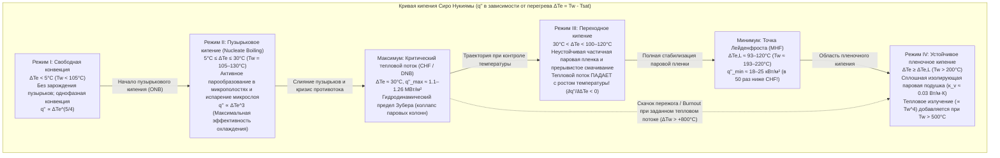
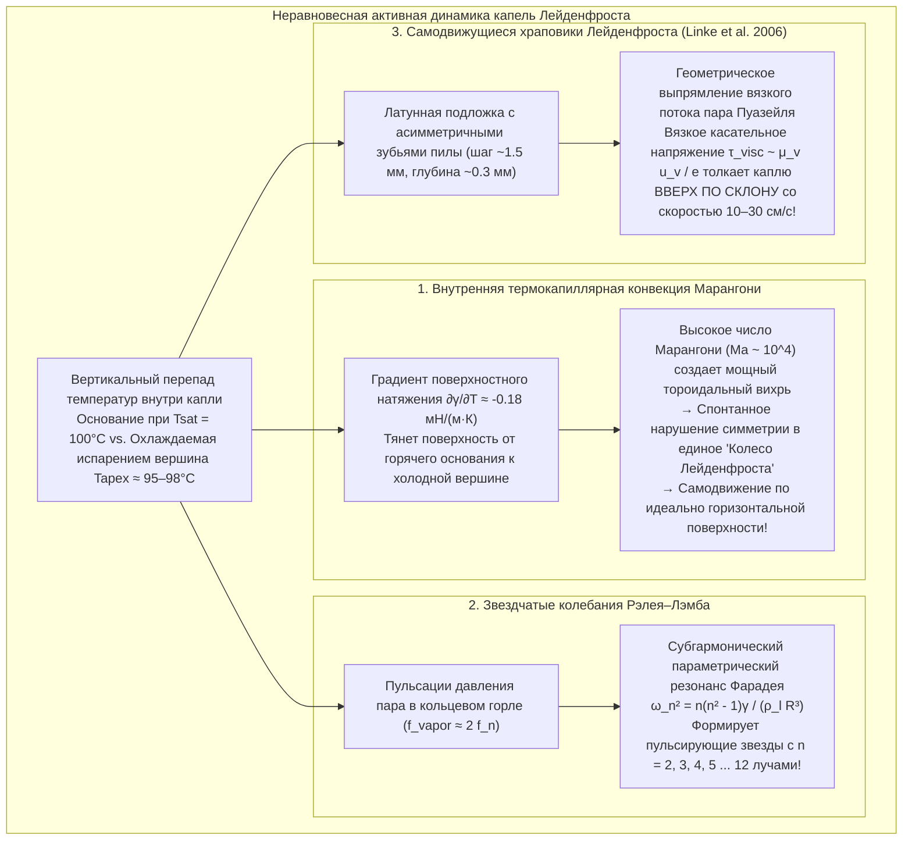

Каждый, кто хотя бы раз проверял температуру чугунной или стальной сковороды, брызнув на нее несколько капель воды, наблюдал один из самых удивительных парадоксов теплофизики. Когда температура сковороды лишь немного превышает точку кипения воды — составляя около $110^\circ\text{C}\text{–}130^\circ\text{C}$ — упавшая капля мгновенно растекается, яростно шипит и полностью выкипает менее чем за одну секунду.

Однако если разогреть ту же сковороду свыше $200^\circ\text{C}\text{–}300^\circ\text{C}$, картина меняется на прямо противоположную. Вместо мгновенного испарения вода собирается в блестящий, похожий на ртуть шарик. Она больше не шипит, совершенно не смачивает металл и <strong>начинает стремительно скользить и метаться по сковороде практически без трения</strong>, сохраняясь в течение <strong>нескольких минут</strong> — в десятки и сотни раз дольше, чем при $120^\circ\text{C}$!

Это контринтуитивное явление называется <strong>эффектом Лейденфроста (Leidenfrost effect)</strong>. Выше критического порога — <strong>температуры Лейденфроста ($T_L$)</strong> — нижняя часть капли при приближении к горячей подложке испаряется настолько быстро, что формирует непрерывную самоподдерживающуюся <strong>паровую подушку (паровую пленку / vapor cushion)</strong> толщиной всего $10\text{–}100\,\mu\text{m}$. Этот микроскопический слой пара одновременно работает как гидродинамическое судно на воздушной подушке, удерживая каплю в левитации за счет вязкого давления смазки без какого-либо контакта жидкости с твердым телом, и как мощный теплоизолятор, поскольку теплопроводность водяного пара ($\kappa_v \approx 0.03\,\text{Вт/(м}\cdot\text{К)}$) более чем в двадцать раз ниже теплопроводности жидкой воды ($\kappa_l \approx 0.68\,\text{Вт/(м}\cdot\text{К)}$).

В этой статье мы строго выведем физику эффекта Лейденфроста из первых принципов: от <strong>трактата Иоганна Готлоба Лейденфроста 1756 года</strong> и <strong>кривой кипения Сиро Нукиямы (1934)</strong>, через <strong>гидродинамический предел критического теплового потока (CHF) Новака Зубера</strong> и <strong>минимальный тепловой поток (MHF) Пола Беренсона</strong>, к точному выводу <strong>закона скейлинга паровой смазки Бьянс, Клане и Кере (2003)</strong>, внутренним <strong>термокапиллярным вихрям Марангони («колесам Лейденфроста»)</strong>, <strong>звездчатым собственным модам Рэлея–Лэмба</strong>, <strong>самодвижущимся храповикам Хайнера Линке (2006)</strong> и критически важной задаче повторного смачивания (квенчинга) активной зоны при <strong>аварии с потерей теплоносителя (LOCA) в ядерном реакторе</strong>.

---

## 1. «Хрустальный глобус» на раскаленной железной ложке: открытие Лейденфроста (1756)

Хотя голландский врач и химик Герман Бургаве в 1732 году вскользь упомянул необычное поведение спирта на раскаленном железе, первое систематическое экспериментальное исследование было опубликовано в 1756 году немецким врачом и натурфилософом <strong>Иоганном Готлобом Лейденфростом (Johann Gottlob Leidenfrost, 1715–1794)</strong>, профессором Дуйсбургского университета.

В своем латинском трактате *De Aquae Communis Nonnullis Qualitatibus Tractatus* (*Трактат о некоторых свойствах обыкновенной воды*) Лейденфрост описал опыт с железной ложкой, раскаленной на углях до красного свечения:

> «В эту светящуюся раскаленную ложку пустите одну каплю чистой обыкновенной воды... Вода не прилипает к железу и не растекается; напротив, в самое мгновение касания она стягивается в сферический шарик, яркий и прозрачный, словно <strong>хрустальный глобус</strong> (*globulus crystallinus*). Она быстро вращается и легко танцует по дну ложки без шума и видимого пара. Отнюдь не исчезая сразу, она незаметно уменьшается в течение тридцати или сорока секунд — или даже целой минуты — пока, наконец, мельчайшая частица не исчезнет с едва слышным щелчком».

Измеряя по маятнику время жизни капель по мере остывания ложки, Лейденфрост доказал, что скорость испарения скачкообразно падает выше критической температуры благодаря тончайшему слою пара (*vaporis strato*). В 1842 году французский физик Пьер Ипполит Бутиньи назвал это состояние «сфероидальным» и продемонстрировал замораживание воды в лед внутри раскаленного добела платинового тигля с помощью жидкого диоксида серы в режиме Лейденфроста.

---

## 2. Кривая кипения Сиро Нукиямы (1934) и четыре режима кипения в большом объеме

Чтобы количественно объяснить, почему капля живет минуты при $250^\circ\text{C}$, но исчезает менее чем за секунду при $125^\circ\text{C}$, рассмотрим зависимость <strong>поверхностной плотности теплового потока</strong> $q''$ $[\text{Вт/м}^2]$ от <strong>перегрева стенки</strong> $\Delta T_e \equiv T_w - T_{\text{sat}}$ (где $T_{\text{sat}} = 100^\circ\text{C}$ при $1\,\text{атм}$). Эту универсальную <strong>кривую кипения</strong> впервые построил в 1934 году профессор Императорского университета Тохоку <strong>Сиро Нукияма (Shiro Nukiyama)</strong>.

1. <strong>Режим I: Свободная конвекция ($\Delta T_e < 5^\circ\text{C}$)</strong>: Из-за лапласовского давления $\Delta P = 2\gamma / r_c$ паровые зародыши в микрокавернах радиуса $r_c$ не могут расти, пока перегрев не превысит $\Delta T_{\text{ONB}} \approx \frac{2\gamma T_{\text{sat}}}{\rho_v L_{lv} r_c}$. Тепло отводится однофазной конвекцией ($q'' \propto \Delta T_e^{5/4}$).
2. <strong>Режим II: Пузырьковое кипение ($5^\circ\text{C} \le \Delta T_e \le 30^\circ\text{C}$) и критический тепловой поток Зубера (CHF)</strong>: Испарение жидкого микрослоя под растущими пузырьками и микроконвективное перемешивание вызывают рост теплового потока пропорционально кубу перегрева (корреляция Розенау: $q'' \propto \Delta T_e^3$). При $\Delta T_e \approx 30^\circ\text{C}$ ($T_w \approx 130^\circ\text{C}$) пузырьки сливаются в сплошные паровые струи. В 1958 году <strong>Новак Зубер (Novak Zuber)</strong> объединил <strong>неустойчивость Рэлея–Тейлора</strong> ($\lambda_{RT} = 2\pi\sqrt{3\gamma/[g(\rho_l - \rho_v)]}$) и <strong>неустойчивость Кельвина–Гельмгольца</strong> встречных потоков пара и жидкости, получив знаменитую формулу <strong>критического теплового потока (CHF)</strong>:
   $$q''_{\max} = \frac{\pi}{24} \rho_v L_{lv} \left[ \frac{\gamma g (\rho_l - \rho_v)}{\rho_v^2} \right]^{1/4} \approx 0.131 \rho_v L_{lv} \left[ \frac{\gamma g (\rho_l - \rho_v)}{\rho_v^2} \right]^{1/4} \approx 1.1\text{–}1.26\,\text{МВт/м}^2$$
   При электрическом нагреве платиновой проволоки достижение $q''_{\max}$ вызывает мгновенный скачок температуры с $130^\circ\text{C}$ до более чем $1100^\circ\text{C}$ (<strong>кризис кипения / пережог / burnout</strong>).
3. <strong>Режим III: Переходное кипение ($30^\circ\text{C} < \Delta T_e < 100\text{–}120^\circ\text{C}$)</strong>: Стенка частично покрыта неустойчивой паровой пеленой; с ростом $T_w$ доля сухой поверхности растет, поэтому <strong>тепловой поток падает с ростом температуры</strong> ($\partial q'' / \partial \Delta T_e < 0$).
4. <strong>Режим IV: Устойчивое пленочное кипение и точка Лейденфроста (MHF Беренсона)</strong>: В <strong>точке Лейденфроста ($T_L \approx 193^\circ\text{C}\text{–}220^\circ\text{C}$)</strong> контакт жидкости со стенкой полностью прекращается. В 1961 году <strong>Пол Беренсон (P. J. Berenson)</strong> вывел минимальный тепловой поток (MHF):
   $$q''_{\min} = 0.09 \rho_v L_{lv} \left[ \frac{\gamma g (\rho_l - \rho_v)}{(\rho_l + \rho_v)^2} \right]^{1/4} \approx 18\text{–}25\,\text{кВт/м}^2$$
   что <strong>в 50 раз меньше</strong> пикового потока при пузырьковом кипении!

| Режим кипения | Перегрев стенки $\Delta T_e = T_w - T_{\text{sat}}$ (Вода, $1\,\text{атм}$) | Типичный тепловой поток $q''$ $[\text{Вт/м}^2]$ | Доминирующий физический механизм | Поведение и время жизни $\tau$ капли на сковороде |
| :--- | :--- | :--- | :--- | :--- |
| <strong>I. Свободная конвекция</strong> | $\Delta T_e < 5^\circ\text{C}$ ($T_w < 105^\circ\text{C}$) | $10^3 \text{–} 10^4$ | Поры не активны; однофазная конвекция ($q'' \propto \Delta T_e^{5/4}$). | Растекается и тихо испаряется без пузырьков за $30\text{–}120\,\text{с}$. |
| <strong>II. Пузырьковое кипение</strong> | $5^\circ\text{C} \le \Delta T_e \le 30^\circ\text{C}$ ($T_w = 105\text{–}130^\circ\text{C}$) | $10^4 \text{–} 1.26 \times 10^6$ (Пик CHF) | Бурное кипение и испарение микрослоя ($q'' \propto \Delta T_e^3$); предел Зубера. | Резко шипит, растекается и исчезает за <strong>$0.3\text{–}1.5\,\text{с}$</strong>. |
| <strong>III. Переходное кипение</strong> | $30^\circ\text{C} < \Delta T_e < 100^\circ\text{C}$ ($T_w = 130\text{–}200^\circ\text{C}$) | $1.2 \times 10^6 \to 2 \times 10^4$ ($\partial q''/\partial \Delta T_e < 0$) | Хаотическое чередование паровой пленки и взрывного контакта. | Трещит, подпрыгивает и разбрызгивает микрокапли; живет $2\text{–}15\,\text{с}$. |
| <strong>IV. Пленочное кипение (Состояние Лейденфроста)</strong> | $\Delta T_e \ge \Delta T_L \approx 93\text{–}120^\circ\text{C}$ ($T_w \ge 193\text{–}220^\circ\text{C}$) | $2 \times 10^4 \to 10^5$ (Минимум MHF) | Полная левитация на паровой подушке ($10\text{–}100\,\mu\text{m}$); медленная теплопроводность газа. | Бесшумный шарик или «блинчик» без трения; живет <strong>$60\text{–}300\,\text{с}$</strong>. |

---

## 3. Капиллярная статика и гидродинамический закон скейлинга паровой подушки (Biance, Clanet, & Quéré 2003)

### 3.1 Капиллярная длина $\ell_c$ и три морфологических режима капли

При кажущемся краевом угле смачивания $\theta_c = 180^\circ$ баланс между капиллярным давлением Лапласа ($\sim \gamma / R$) и гидростатическим давлением ($\sim \rho_l g R$) определяет <strong>капиллярную длину</strong> $\ell_c$:

$$\ell_c = \sqrt{\frac{\gamma}{\rho_l g}} \approx 2.50\,\text{мм} \quad (\text{вода при } 100^\circ\text{C})$$

В зависимости от числа Бонда $\text{Bo} = (R/\ell_c)^2$ возникают три режима:
1. <strong>Квазисферические капли ($R < \ell_c \approx 2.5\,\text{мм}$)</strong>: Капля сохраняет форму сферы радиуса $R$ с небольшой плоской площадкой контакта внизу радиуса $r_c = \sqrt{\frac{2}{3}}\frac{R^2}{\ell_c}$.
2. <strong>Лужицы / «Блинчики» Лейденфроста ($\ell_c < R < 4\ell_c$)</strong>: Гравитация сплющивает каплю в диск универсальной толщины $h_p = 2\ell_c \sin(180^\circ/2) = 2\ell_c \approx 5.0\,\text{мм}$ с вогнутым центральным паровым карманом (*dimple*) и узким кольцевым горлом (*neck*) по периметру.
3. <strong>Паровые «дымоходы» Рэлея–Тейлора ($R > R_{\max} \approx 3.83\ell_c \approx 9.6\,\text{мм}$)</strong>: При $R \gtrsim 1\,\text{см}$ паровая подушка под тяжелой водой становится неустойчивой по Рэлею–Тейлору, и сквозь центр лужицы периодически прорываются крупные пузыри пара (*vapor chimneys*).

### 3.2 Вывод толщины паровой пленки $e$ и времени жизни $\tau$

В классической работе 2003 года (*Physics of Fluids*) <strong>Анн-Лор Бьянс, Кристоф Клане и Давид Кере</strong> связали теплопроводность Фурье с уравнением вязкой смазки для лужицы радиуса $R > \ell_c$:

1. <strong>Теплопроводность Фурье через пленку толщины $e$</strong>:
   $$Q = \kappa_v \frac{\Delta T}{e} \pi R^2 = \dot{m} L_{lv} \quad \Longrightarrow \quad \dot{m} = \frac{\kappa_v \Delta T}{L_{lv} e} \pi R^2 \qquad \cdots (1)$$
2. <strong>Теория вязкой смазки (радиальное течение Пуазейля)</strong>:
   Уравнение смазки $\mu_v \frac{\partial^2 u_r}{\partial z^2} = \frac{dP}{dr}$ дает параболический профиль скорости $u_r(r,z) = \frac{1}{2\mu_v}\left(-\frac{dP}{dr}\right)z(e-z)$ и объемный расход $Q_v(r) = \frac{\pi r e^3}{6\mu_v}\left(-\frac{dP}{dr}\right) = \frac{\dot{m}}{\rho_v}\frac{r^2}{R^2}$. Интегрирование давления дает среднее избыточное давление в подушке:
   $$\Delta P_{\text{cushion}} = \frac{3 \mu_v \dot{m}}{2 \pi \rho_v e^3} \qquad \cdots (2)$$
3. <strong>Гидростатическое равновесие и скейлинг $e \propto R^{1/2}$</strong>:
   Приравнивая $\Delta P_{\text{cushion}}$ к гидростатическому давлению лужицы $\Delta P_{\text{weight}} = 2\rho_l g \ell_c$ и подставляя (1) в (2), получаем <strong>закон Бьянс–Клане–Кере</strong>:
   $$e = \left(\frac{3}{4}\right)^{1/4} \left( \frac{\kappa_v \mu_v \Delta T}{\rho_v \rho_l g L_{lv} \ell_c} \right)^{1/4} R^{1/2} \approx 10\text{–}100\,\mu\text{m} \qquad \cdots (3)$$
   При $R = 5\,\text{мм}$ и $\Delta T = 200\,\text{К}$ получаем $e \approx 54\,\mu\text{m}$ (а для малых сферических капель $R < \ell_c$ выполняется $e_{\text{small}} \propto \Delta T^{1/4} R^{5/4}$). Интегрирование уравнения убыли массы $-\frac{dM}{dt} = \dot{m} \propto R^{3/2}$ дает $R(t) = R_0(1 - t/\tau)^2$ и полное время жизни $\tau \propto \Delta T^{-3/4} R_0^{3/2}$ (или $\tau \propto R_0^{5/4}\text{–}R_0^2$).

---

## 4. Термокапиллярные вихри Марангони, звезды Рэлея–Лэмба и храповики Лейденфроста

### 4.1 Термокапиллярная конвекция Марангони и «колеса Лейденфроста»

Разность температур между основанием ($100^\circ\text{C}$) и вершиной ($95\text{–}98^\circ\text{C}$) порождает из-за $\frac{\partial \gamma}{\partial T} \approx -0.18\,\text{мН/(м}\cdot\text{К)}$ касательное <strong>напряжение Марангони</strong> $\tau_s = \frac{\partial \gamma}{\partial T}\nabla_s T$ ($\text{Ma} = \frac{|\partial \gamma/\partial T|\Delta T_{\text{int}} R}{\mu_l \alpha_l} \sim 2 \times 10^4 \gg \text{Ma}_c$), которое полностью подавляет <strong>эффект кофейного кольца (*coffee-ring effect*)</strong>. Кроме того, <strong>Bouillant, Quéré et al. (2018, *Nature Physics*)</strong> обнаружили, что при $R \lesssim 1.5\,\text{мм}$ тороидальный вихрь спонтанно нарушает симметрию, превращаясь в одиночную вращающуюся ячейку (<strong>«колесо Лейденфроста»</strong>), которая наклоняет паровую подушку и заставляет каплю самостоятельно катиться по горизонтальной плите!

### 4.2 Звездчатые полигональные колебания Рэлея–Лэмба

Крупные лужицы ($R \sim 5\text{–}15\,\text{мм}$) возбуждают азимутальные стоячие капиллярные волны в форме правильных многоугольников и звезд, подчиняющиеся <strong>дисперсионному соотношению Рэлея–Лэмба</strong>:

$$\omega_n^2 = \frac{n(n^2 - 1)\gamma}{\rho_l R^3} \qquad (n = 2, 3, 4, \dots, 12)$$

возбуждаемые за счет <strong>субгармонического параметрического резонанса Фарадея ($f_n = \frac{\omega_n}{2\pi} \approx \frac{1}{2} f_{\text{vapor}}$)</strong> от пульсаций давления истекающего пара.

### 4.3 Самодвижущиеся храповики Хайнера Линке (2006)

В 2006 году <strong>Хайнер Линке (Heiner Linke) и соавт.</strong> (*Phys. Rev. Lett.*) показали, что на горячей латунной пластине с асимметричным пилообразным профилем (шаг $\sim 1.5\,\text{мм}$, глубина $\sim 0.3\,\text{мм}$) капли Лейденфроста самостоятельно разгоняются до $10\text{–}30\,\text{см/с}$, взбираясь вверх по крутым ступеням: провисающий мениск перекрывает вертикальную ступеньку и направляет поток пара Пуазейля назад вдоль пологого склона каждого зубца, создавая реактивную вязкую силу тяги $F_{\text{ratchet}} \sim \frac{\mu_v u_{\text{vapor}}}{e}\pi R^2 \sim 30\,\text{мкН}$.

---

## 5. Промышленные применения: Безопасность ядерных реакторов (LOCA), закалка стали и жидкий азот

1. <strong>Авария с потерей теплоносителя (LOCA) и повторное смачивание активной зоны реактора</strong>:
   При превышении критического теплового потока CHF циркониевая оболочка твэла переходит в пленочное кипение Лейденфроста (Режим IV), и её температура за секунды взлетает выше $1000^\circ\text{C}$ (вызывая пароциркониевую реакцию с выделением водорода). Когда система аварийного охлаждения (ECCS) подает воду, паровая подушка отталкивает её ($T_w \gg T_L$), и фронт смачивания (*quench front*) движется лишь за счет продольной теплопроводности металла оболочки (модель Яманоути: $u_q \propto (T_L - T_{\text{sat}})/(T_{\text{init}} - T_L)$).
2. <strong>Металлургическая закалка стали</strong>:
   При погружении аустенитной стали ($850^\circ\text{C}$) в воду паровая рубашка Лейденфроста сначала замедляет охлаждение, а после охлаждения ниже $T_L$ сменяется бурным пузырьковым кипением с образованием мартенсита. Неравномерный срыв паровой пленки вызывает коробление и <strong>закалочные трещины</strong>.
3. <strong>Влажный палец в расплавленном свинце и жидкий азот на коже</strong>:
   Влажный палец, на долю секунды опущенный в расплавленный свинец при $400^\circ\text{C}$ (<strong>смертельно опасно, никогда не повторять!</strong>), защищен мгновенно образующейся паровой подушкой Лейденфроста; аналогично, <strong>жидкий азот ($T_{\text{sat}} = 77\,\text{К} = -196^\circ\text{C}$)</strong> воспринимает теплую кожу руки ($307\,\text{К}$, перегрев $\Delta T_e = 230\,\text{К}$) как раскаленную сковороду и скатывается по азотной газовой подушке.

---

## Литература

1. <strong>Leidenfrost, J. G.</strong> (1756). *De Aquae Communis Nonnullis Qualitatibus Tractatus*. Duisburg.
2. <strong>Nukiyama, S.</strong> (1934). "The Maximum and Minimum Values of the Heat Transmitted from Metal to Boiling Water under Atmospheric Pressure". *J. Jpn. Soc. Mech. Eng.*, 37(206), 367–374.
3. <strong>Zuber, N.</strong> (1958). "On the stability of boiling heat transfer". *Trans. ASME*, 80(3), 711–720.
4. <strong>Berenson, P. J.</strong> (1961). "Film-boiling heat transfer from a horizontal surface". *J. Heat Transf.*, 83(3), 351–356.
5. <strong>Biance, A.-L., Clanet, C., & Quéré, D.</strong> (2003). "Leidenfrost drops". *Physics of Fluids*, 15(6), 1632–1637.
6. <strong>Linke, H., et al.</strong> (2006). "Self-Propelled Leidenfrost Droplets". *Physical Review Letters*, 96(15), 154502.
7. <strong>Quéré, D.</strong> (2013). "Leidenfrost Dynamics". *Annual Review of Fluid Mechanics*, 45, 197–215.
8. <strong>Bouillant, A., et al.</strong> (2018). "Leidenfrost wheels". *Nature Physics*, 14(12), 1188–1192.
