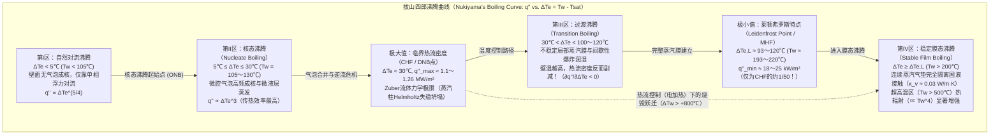
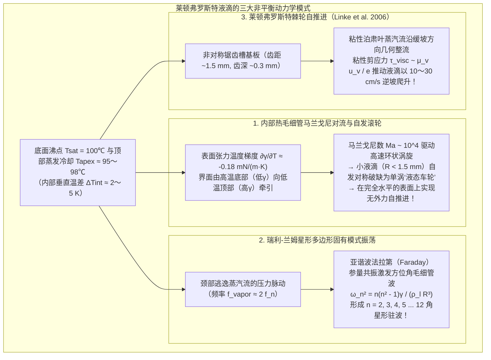

在日常烹饪中，有经验的厨师常会向预热好的铁锅或不锈钢平底锅中洒入几滴清水来判断锅温。当锅面温度仅略高于水的沸点（$100^\circ\text{C}$），大约处于 $110^\circ\text{C}$ 至 $130^\circ\text{C}$ 之间时，水滴接触锅底的瞬间便会发出剧烈的“滋啦”声，迅速铺展并沸腾，在不到一秒钟的时间内彻底蒸发殆尽。

然而，如果继续加热铁锅，使其表面温度越过 $200^\circ\text{C}$ 甚至达到 $300^\circ\text{C}$ 以上，极其反直觉的物理现象便会登场：落入锅中的水滴非但没有瞬间气化消失，反而瞬间收缩成一颗晶莹剔透、如同水银珠般的球体。它不再发出刺耳的沸腾声，也完全不润湿金属表面，而是像冰球台上的悬浮滑块一样<strong>以近乎零摩擦的状态在锅底四处狂奔、旋转与弹跳</strong>。更令人惊讶的是，尽管锅面温度高得多，这颗水珠却能存活<strong>数分钟之久</strong>——其寿命比在 $120^\circ\text{C}$ 时延长了数十倍乃至上百倍！

为什么加热面的温度越高，液滴的蒸发反而越慢？这一违背日常热力学直觉的现象被称为<strong>莱顿弗罗斯特效应（Leidenfrost effect）</strong>。当固体壁面温度跨越某一临界阈值——即<strong>莱顿弗罗斯特温度（Leidenfrost temperature, $T_L$）</strong>——时，液滴底部在靠近高温壁面的瞬间剧烈气化，在固液之间形成一层厚度仅为数十微米（$10\text{–}100\,\mu\text{m}$）的连续<strong>蒸汽气垫（vapor cushion / vapor film）</strong>。这层薄薄的水蒸气膜同时扮演了两个关键角色：在流体力学上，它如同气垫船的增压气室，依靠粘性润滑压力稳稳托起水珠的重量，彻底消除了固液直接接触；在传热学上，由于水蒸气的热导率（$\kappa_v \approx 0.03\,\text{W/(m}\cdot\text{K)}$）不到液态水（$\kappa_l \approx 0.68\,\text{W/(m}\cdot\text{K)}$）的二十分之一，它化身为一层高效的绝热屏障，将热流密度削减了近五十倍。

本文将从物理学与流体力学的第一性原理出发，系统剖析莱顿弗罗斯特效应的完整理论图景：从1756年约翰·戈特洛布·莱顿弗罗斯特的历史性实验，到1934年日本学者拔山四郎建立的<strong>池沸腾曲线（Boiling Curve）</strong>与四大沸腾区、诺瓦克·祖伯（N. Zuber）的<strong>临界热流密度（CHF）流体力学不稳定性极限</strong>、保罗·贝伦森（P. J. Berenson）的<strong>最小热流密度（MHF）</strong>；进而严格推导法国物理学家 A.-L. Biance、C. Clanet 与 D. Quéré（2003）提出的<strong>蒸汽膜润滑方程与标度律（$e \propto \Delta T^{1/4} R^{1/2}$）</strong>；最后深入探讨悬浮液滴内部自发破缺的<strong>热毛细管马兰戈尼（Marangoni）对流轮</strong>、受激发的<strong>瑞利-兰姆（Rayleigh-Lamb）多角星形固有模式振荡</strong>、海纳·林克（H. Linke, 2006）发现的<strong>锯齿棘轮自推进效应</strong>，以及这一效应在<strong>核反应堆失水事故（LOCA）堆芯再淹没骤冷</strong>与冶金淬火工程中的生死考验。

---

## 1. 赤热铁勺上的“水晶地球仪”：1756年莱顿弗罗斯特的发现

科学史上最早提及这一现象的是荷兰医化学家赫尔曼·布尔哈夫（Hermann Boerhaave，1732年），但对其展开系统定量实验与物理机制阐述的，则是德国杜伊斯堡大学的医学与自然哲学教授<strong>约翰·戈特洛布·莱顿弗罗斯特（Johann Gottlob Leidenfrost, 1715–1794）</strong>。

在1756年发表的拉丁文专著《论普通水的若干性质》（*De Aquae Communis Nonnullis Qualitatibus Tractatus*）中，莱顿弗罗斯特详细记录了将一滴纯净水滴入在炉火中烧至赤热发光的铁勺时的观察结果：

> “向这把烧得通红发光的铁勺中滴入一滴纯净的普通水……水滴既不附着于铁面，也不铺展开来；恰恰相反，在触碰的瞬间，它立即凝聚成一颗完美的球体，明亮而透明，宛如一颗<strong>水晶地球仪（crystal globe / globulus crystallinus）</strong>。它在勺底轻盈地高速旋转、四处游走，既不发出嘶嘶声，也不冒出白烟。它非但没有立刻消失，反而在三十秒、四十秒甚至整整一分钟的时间里极其缓慢地缩小，直到最后化为一颗肉眼难辨的微粒，伴随着一声轻微的‘啪’声彻底消失。”

莱顿弗罗斯特敏锐地意识到，当铁勺逐渐冷却至不再发光的某一温度时，水滴的寿命会突然从近一分钟骤降至不到一秒。这证明<strong>固液界面间的传热速率并非随温度单调递增，而是在越过某一临界温度后发生断崖式下跌</strong>。19世纪中叶，法国物理学家皮埃尔·布蒂尼（P. H. Boutigny, 1842）将其命名为物质的“球状状态（spheroidal state）”，甚至在烧红的铂金坩埚内利用处于莱顿弗罗斯特状态的液态二氧化硫将水冻结成了冰块！然而，这一现象背后的完整相变传热图谱，直到1934年才由日本东北帝国大学的<strong>拔山四郎（Shiro Nukiyama）</strong>通过著名的铂丝沸腾实验彻底绘出。

---

## 2. 拔山四郎沸腾曲线（1934）与池沸腾的四个区域

为了定量理解水滴在 $120^\circ\text{C}$ 与 $250^\circ\text{C}$ 下的天壤之别，我们需要考察加热壁面向饱和液体传递的<strong>热流密度（Heat flux）</strong> $q''$ $[\text{W/m}^2]$ 随<strong>壁面过热度（Wall superheat）</strong> $\Delta T_e \equiv T_w - T_{\text{sat}}$（其中 $T_w$ 为壁面温度，常压下水的饱和沸点 $T_{\text{sat}} = 100^\circ\text{C}$）变化的规律——即<strong>拔山沸腾曲线</strong>。

### 2.1 第I区：自然对流沸腾（$\Delta T_e < 5^\circ\text{C}$）

当壁面过热度 $\Delta T_e < 5^\circ\text{C}$ 时，壁面微米级凹坑（腔口半径 $r_c$）内的气胚受到表面张力 $\gamma$ 产生的拉普拉斯附加压力 $\Delta P = 2\gamma / r_c$ 的抑制。根据克劳修斯-克拉佩龙方程，只有当过热度超过激活阈值 $\Delta T_{\text{ONB}} \approx \frac{2\gamma T_{\text{sat}}}{\rho_v L_{lv} r_c}$ 时气泡才能长大。因此该区域无气泡生成，热量仅通过单相自然对流传递，$q'' \propto \Delta T_e^{5/4}$。

### 2.2 第II区：核态沸腾（$5^\circ\text{C} \le \Delta T_e \le 30^\circ\text{C}$）与 Zuber 临界热流密度（CHF）

当 $\Delta T_e$ 越过 $5^\circ\text{C}$ 后，壁面微腔大量激活并高频喷出气泡。气泡根部<strong>微液层（microlayer）的瞬态剧烈蒸发</strong>以及气泡脱离引发的<strong>冷液微对流冲刷</strong>，使热流密度随过热度的三次方急剧攀升（Rohsenow 关联式：$q'' \propto \Delta T_e^3$）。在 $120^\circ\text{C}$ 的铁锅上水滴之所以在1秒内消失，正是因为处于核态沸腾区。

然而，当 $\Delta T_e \approx 30^\circ\text{C}$（$T_w \approx 130^\circ\text{C}$）时，密集上升的气泡合并为连续的<strong>蒸汽柱（vapor columns）</strong>。1958年，<strong>诺瓦克·祖伯（Novak Zuber）</strong>证明：重液体（密度 $\rho_l$）位于轻蒸汽（密度 $\rho_v$）之上会引发波长为 $\lambda_{RT} = 2\pi\sqrt{3\gamma/[g(\rho_l - \rho_v)]}$ 的<strong>瑞利-泰勒不稳定性（Rayleigh-Taylor instability）</strong>；而当向上喷射的蒸汽速度达到触发气液界面<strong>开尔文-亥姆霍兹不稳定性（Kelvin-Helmholtz instability）</strong>的临界速度 $u_{v,\text{crit}} \sim \left[\frac{\gamma g(\rho_l - \rho_v)}{\rho_v^2}\right]^{1/4}$ 时，蒸汽柱坍塌并彻底阻断回流补充的液体。由此导出的<strong>Zuber临界热流密度（CHF）公式</strong>为：

$$q''_{\max} = C_{\text{Zuber}} \rho_v L_{lv} \left[ \frac{\gamma g (\rho_l - \rho_v)}{\rho_v^2} \right]^{1/4}, \qquad C_{\text{Zuber}} = \frac{\pi}{24} \approx 0.131$$

代入常压沸水的物性参数（$\rho_l = 958\,\text{kg/m}^3$, $\rho_v = 0.598\,\text{kg/m}^3$, $L_{lv} = 2.257 \times 10^6\,\text{J/kg}$, $\gamma = 0.0589\,\text{N/m}$），可得 $q''_{\max} \approx 1.10\text{–}1.26\,\text{MW/m}^2$。在拔山四郎1934年的电加热铂丝实验中，一旦热流达到 $q''_{\max}$，铂丝温度便会从 $130^\circ\text{C}$ 瞬间跃迁至 $1000^\circ\text{C}$ 以上并熔断（即<strong>烧毁现象 Burnout</strong>）。

### 2.3 第III区：过渡沸腾（$30^\circ\text{C} < \Delta T_e < 100\text{–}120^\circ\text{C}$）

在温度控制实验中，越过 CHF 后进入过渡沸腾区。此时壁面被不稳定的局部蒸汽毯覆盖，固液接触间歇性爆发。随着壁温 $T_w$ 升高，绝热干蒸汽覆盖的时间与面积分数增加，导致<strong>热流密度随温度升高反而急剧下降</strong>，微分热导率为负（$\partial q'' / \partial \Delta T_e < 0$）。

### 2.4 第IV区：稳定膜态沸腾与莱顿弗罗斯特点（Berenson 最小热流密度）

当壁面过热度达到<strong>莱顿弗罗斯特阈值 $\Delta T_{e,L} = T_L - T_{\text{sat}}$</strong>（抛光金属表面上水滴约为 $T_L \approx 193^\circ\text{C}\text{–}220^\circ\text{C}$）时，蒸汽膜的动量与润滑压力足以彻底阻止任何液波触碰固体表面。此时沸腾曲线达到极小值点——<strong>莱顿弗罗斯特点（Leidenfrost point）</strong>。

1961年，<strong>保罗·贝伦森（P. J. Berenson）</strong>从维持连续蒸汽膜不发生瑞利-泰勒塌陷所需的最小蒸发率出发，推导出了莱顿弗罗斯特点的<strong>最小热流密度（MHF）</strong>：

$$q''_{\min} = 0.09 \rho_v L_{lv} \left[ \frac{\gamma g (\rho_l - \rho_v)}{(\rho_l + \rho_v)^2} \right]^{1/4} \approx 18\text{–}25\,\text{kW/m}^2$$

这一数值仅为核态沸腾峰值 $q''_{\max}$ 的<strong>五十分之一（约 $2\%$）</strong>！因为水蒸气的热导率 $\kappa_v \approx 0.03\,\text{W/(m}\cdot\text{K)}$ 极低，热量只能依靠缓慢的气体分子热传导穿过气垫，从而赋予了莱顿弗罗斯特水珠长达数分钟的惊人寿命。

| 沸腾区域 | 壁面过热度 $\Delta T_e = T_w - T_{\text{sat}}$（水，1 atm） | 典型热流密度 $q''$ $[\text{W/m}^2]$ | 核心传热与流体力学机制 | 铁锅上水滴的宏观表现与寿命 $\tau$ |
| :--- | :--- | :--- | :--- | :--- |
| <strong>I. 自然对流沸腾</strong> | $\Delta T_e < 5^\circ\text{C}$ ($T_w < 105^\circ\text{C}$) | $10^3 \text{–} 10^4$ | 微腔未激活；单相浮力对流（$q'' \propto \Delta T_e^{5/4}$）与自由表面平静蒸发。 | 润湿铺展成扁平液透镜，无气泡，在 $30\text{–}120\,\text{s}$ 内安静蒸发。 |
| <strong>II. 核态沸腾</strong> | $5^\circ\text{C} \le \Delta T_e \le 30^\circ\text{C}$ ($T_w = 105\text{–}130^\circ\text{C}$) | $10^4 \text{–} 1.26 \times 10^6$（CHF峰值） | 微腔气泡高频成核、微液层蒸发（$q'' \propto \Delta T_e^3$），在CHF处发生Zuber蒸汽柱失稳。 | 剧烈“滋啦”作响并沸腾铺展，在 <strong>$0.3\text{–}1.5\,\text{s}$</strong> 内瞬间消失。 |
| <strong>III. 过渡沸腾</strong> | $30^\circ\text{C} < \Delta T_e < 100^\circ\text{C}$ ($T_w = 130\text{–}200^\circ\text{C}$) | $1.2 \times 10^6 \to 2 \times 10^4$（$\partial q''/\partial \Delta T_e < 0$） | 局部蒸汽毯不稳定崩溃与间歇性固液接触、微爆轰飞溅交替发生。 | 噼啪作响、剧烈弹跳并向四周喷溅微滴，存活 $2\text{–}15\,\text{s}$。 |
| <strong>IV. 稳定膜态沸腾（莱顿弗罗斯特态）</strong> | $\Delta T_e \ge \Delta T_L \approx 93\text{–}120^\circ\text{C}$ ($T_w \ge 193\text{–}220^\circ\text{C}$) | $2 \times 10^4 \to 10^5$（MHF极小点） | $10\text{–}100\,\mu\text{m}$ 连续蒸汽气垫完全悬浮；传热受限于低热导率气体导热。 | 凝聚成晶莹球体或液饼，无声、零摩擦滑行，存活 <strong>$60\text{–}300\,\text{s}$</strong>。 |

---

## 3. 悬浮液滴的毛细管静力学与蒸汽膜润滑标度律（Biance, Clanet, & Quéré 2003）

### 3.1 毛细管长度 $\ell_c$ 与液滴的三种几何形态

由于蒸汽气垫彻底隔离了固液接触，莱顿弗罗斯特液滴等效于表观接触角 $\theta_c = 180^\circ$ 的完全不润湿液滴。其外形由表面张力拉普拉斯压（$\sim \gamma/R$）与重力静水压（$\sim \rho_l g R$）的竞争决定，二者的平衡定义了<strong>毛细管长度（Capillary length）</strong> $\ell_c$：

$$\ell_c = \sqrt{\frac{\gamma}{\rho_l g}} \approx 2.50\,\text{mm} \quad (\text{100}^\circ\text{C}\text{ 水：}\gamma = 58.9\,\text{mN/m}, \rho_l = 958\,\text{kg/m}^3)$$

以邦德数 $\text{Bo} = (R/\ell_c)^2$ 为判据，悬浮液滴呈现三种形态：
1. <strong>准球形液滴（$R < \ell_c \approx 2.5\,\text{mm}$）</strong>：表面张力占优，液滴近似为半径 $R$ 的圆球，仅底部被重力压出一个半径为 $r_c = \sqrt{\frac{2}{3}}\frac{R^2}{\ell_c}$ 的微小平坦接触圆斑。
2. <strong>重力液饼 / 水洼（Leidenfrost puddle, $\ell_c < R < 4\ell_c$）</strong>：重力占优，液滴被压扁成圆盘状“煎饼”，其平衡厚度由水平静水压与上下表面张力的平衡严格锁定为恒定值：
   $$h_p = 2\ell_c \sin(\theta_c / 2)\Big|_{\theta_c = 180^\circ} = 2\ell_c \approx 5.0\,\text{mm}$$
   激光干涉测量显示，液饼底面中心向上凹陷形成“蒸汽腔（dimple）”，而在外缘内侧形成蒸汽膜最薄的环状“颈部（annular neck）”。
3. <strong>瑞利-泰勒蒸汽烟囱喷发（$R > R_{\max} \approx 3.83\ell_c \approx 9.6\,\text{mm}$）</strong>：当液饼半径超过约 $1\,\text{cm}$ 时，表面张力无法继续抑制底层轻蒸汽与上层重水之间的瑞利-泰勒不稳定性，底部蒸汽腔向上刺穿液饼中心，周期性地冒出巨大的<strong>蒸汽泡（蒸汽烟囱 vapor chimney）</strong>。

### 3.2 蒸汽气垫厚度 $e$ 与寿命 $\tau$ 的严格推导

2003年，法国物理学家 <strong>A.-L. Biance、C. Clanet 与 D. Quéré</strong> 在《Physics of Fluids》上发表经典论文，通过耦合<strong>傅里叶热传导定律</strong>与<strong>粘性润滑理论（泊肃叶径向流出）</strong>，精确求出了蒸汽气垫厚度 $e$。

对于半径为 $R$（$R > \ell_c$）、厚度为 $2\ell_c$ 的液饼：
1. <strong>穿过蒸汽膜的傅里叶导热与蒸发质量流量 $\dot{m}$</strong>：
   跨越厚度为 $e$ 的气垫的导热功率 $Q$ 全部转化为蒸发潜热 $L_{lv}$：
   $$Q = \kappa_v \frac{\Delta T}{e} \pi R^2 = \dot{m} L_{lv} \quad \Longrightarrow \quad \dot{m} = \frac{\kappa_v \Delta T}{L_{lv} e} \pi R^2 \qquad \cdots (1)$$
2. <strong>粘性润滑近似（径向泊肃叶流）</strong>：
   由于 $e \ll R$，狭缝内径向逃逸的蒸汽满足润滑方程 $\mu_v \frac{\partial^2 u_r}{\partial z^2} = \frac{dP}{dr}$，给出抛物线速度分布 $u_r(r,z) = \frac{1}{2\mu_v}\left(-\frac{dP}{dr}\right)z(e-z)$。在半径 $r$ 处对高度 $z \in [0, e]$ 积分体积流量 $Q_v(r) = \frac{\pi r e^3}{6\mu_v}\left(-\frac{dP}{dr}\right) = \frac{\dot{m}}{\rho_v}\frac{r^2}{R^2}$，积分压力分布可得气垫的平均支撑超压：
   $$\Delta P_{\text{cushion}} = \frac{3 \mu_v \dot{m}}{2 \pi \rho_v e^3} \qquad \cdots (2)$$
3. <strong>静水压平衡与 $e \propto R^{1/2}$ 标度律</strong>：
   令气垫支撑压等于液饼自重静水压 $\Delta P_{\text{weight}} = 2\rho_l g \ell_c$，并将式(1)代入式(2)，消去 $\dot{m}$ 即得著名的<strong>Biance-Clanet-Quéré 蒸汽膜厚度公式</strong>：
   $$e = \left(\frac{3}{4}\right)^{1/4} \left( \frac{\kappa_v \mu_v \Delta T}{\rho_v \rho_l g L_{lv} \ell_c} \right)^{1/4} R^{1/2} \approx 10\text{–}100\,\mu\text{m} \qquad \cdots (3)$$
   对于 $T_w = 300^\circ\text{C}$（$\Delta T = 200\,\text{K}$）上半径 $R = 5\,\text{mm}$ 的水饼，计算可得 $e \approx 54\,\mu\text{m}$，大约相当于一根人类头发的直径！（若为 $R < \ell_c$ 的小液滴，代入 $r_c \sim R^2/\ell_c$ 与拉普拉斯压 $2\gamma/R$，则得 $e_{\text{small}} \propto \Delta T^{1/4} R^{5/4}$）。
4. <strong>液滴寿命标度律</strong>：
   将 $e \propto R^{1/2}$ 代回蒸发率方程 $-\frac{dM}{dt} = -4\pi \rho_l \ell_c R \frac{dR}{dt} = \dot{m} \propto R^{3/2}$，积分微分方程 $R^{-1/2}\frac{dR}{dt} = \text{const.}$ 可得液饼半径演化 $R(t) = R_0(1 - t/\tau)^2$，且总寿命满足 $\tau \propto \Delta T^{-3/4} R_0^{3/2}$（在中小液滴区或恒定膜厚近似下则表现为 $\tau \propto R_0^{5/4} \sim R_0^2$）。

---

## 4. 内部热马兰戈尼涡旋、星形固有模式振荡与棘轮自推进

莱顿弗罗斯特液滴绝非静态的悬浮水球，而是由持续热流驱动的<strong>非平衡耗散结构与活性物质（Active matter）</strong>。

### 4.1 内部热毛细管马兰戈尼对流与“莱顿弗罗斯特车轮”

液滴底部维持在 $T_{\text{base}} = 100^\circ\text{C}$，而顶部因环境空气蒸发冷却降至 $T_{\text{apex}} \approx 95\text{–}98^\circ\text{C}$。由于水的表面张力随温度升高而减小（$\frac{\partial \gamma}{\partial T} \approx -0.18\,\text{mN/(m}\cdot\text{K)}$），自由表面产生由底部指向顶部的<strong>马兰戈尼剪应力（Marangoni shear stress）</strong> $\tau_s = \frac{\partial \gamma}{\partial T}\nabla_s T$。对应的马兰戈尼数高达 $\text{Ma} = \frac{|\partial \gamma/\partial T|\Delta T_{\text{int}} R}{\mu_l \alpha_l} \sim 2 \times 10^4 \gg \text{Ma}_c$，驱动剧烈的内部环状涡流，并彻底消除了纳米颗粒干燥时的<strong>咖啡环效应（Coffee-ring effect）</strong>。

2018年，<strong>A. Bouillant 与 D. Quéré 等人</strong>在《Nature Physics》上证实：当液滴半径 $R \lesssim 1.5\,\text{mm}$ 时，轴对称环形马兰戈尼涡旋发生<strong>自发对称性破缺</strong>，演变为单一旋转涡胞——即<strong>“莱顿弗罗斯特车轮（Leidenfrost wheel）”</strong>。内部单向旋转的液体带动底部蒸汽膜产生倾角，使液滴即便在绝对水平的平面上也能以 $5\text{–}15\,\text{cm/s}$ 的速度自行滚动！

### 4.2 瑞利-兰姆（Rayleigh-Lamb）星形多边形振荡

较大的莱顿弗罗斯特液饼（$R \sim 5\text{–}15\,\text{mm}$）常会自发脉动，外缘轮廓变成三角形、正方形、五角星乃至十二角齿轮状的驻波。这对应于无粘液滴的<strong>瑞利-兰姆方位角毛细管固有模式</strong>：

$$\omega_n^2 = \frac{n(n^2 - 1)\gamma}{\rho_l R^3} \qquad (n = 2, 3, 4, \dots, 12)$$

当液滴颈部排出的蒸汽流以频率 $f_{\text{vapor}}$ 发生气动弹性脉动时，会通过马蒂厄方程（Mathieu equation）触发<strong>亚谐波法拉第参量共振（$f_n = \frac{\omega_n}{2\pi} \approx \frac{1}{2} f_{\text{vapor}} \approx 13\text{–}18\,\text{Hz}$）</strong>。随着液滴蒸发缩小，星形的角数 $n$ 会依序逐个递减（$n = 8 \to 7 \to \dots \to 2$）。

### 4.3 海纳·林克（Heiner Linke, 2006）锯齿棘轮自推进

2006年，俄勒冈大学的 <strong>Heiner Linke</strong> 团队在《Physical Review Letters》上展示了著名的<strong>莱顿弗罗斯特棘轮（Leidenfrost ratchet）</strong>：在刻有非对称锯齿槽（周期 $\sim 1.5\,\text{mm}$，深 $\sim 0.3\,\text{mm}$）的高温黄铜板上，悬浮液滴无需任何外力即可沿陡坡向上的方向以 $10\text{–}30\,\text{cm/s}$ 高速自推进，甚至能克服重力爬上斜坡！其物理根源在于：液滴底面局部下垂封闭了锯齿陡峭面，迫使底部的泊肃叶蒸汽流沿每个锯齿的缓坡向后作<strong>几何整流流动（viscous flow rectification）</strong>；高速向后喷出的蒸汽流对液滴底部施加粘性拖曳反作用力 $F_{\text{ratchet}} \sim \frac{\mu_v u_{\text{vapor}}}{e}\pi R^2 \sim 30\,\mu\text{N}$，在零固液静摩擦条件下驱动液滴向前飞驰。

---

## 5. 工业与极端物理应用：核反应堆 LOCA 骤冷、冶金淬火与液氮/熔铅效应

1. <strong>核反应堆失水事故（LOCA）与堆芯再淹没骤冷（Quenching）</strong>：
   压水堆（PWR）与沸水堆（BWR）正常运行时必须严格维持在核态沸腾区（第II区），保证最小偏离核态沸腾比 $\text{MDNBR} > 1.3$。一旦发生失水事故（LOCA）或功率暴增跨越临界热流密度（CHF），锆合金燃料包壳表面立即跃迁至莱顿弗罗斯特膜态沸腾态（第IV区），被绝热蒸汽毯包裹的包壳温度在数秒内飙升至 $1000^\circ\text{C}$ 以上（引发锆-水放热反应产生氢气）。当应急堆芯冷却系统（ECCS）注水再淹没堆芯时，冷却水因包壳高于莱顿弗罗斯特温度 $T_L$ 而被蒸汽膜弹开，只能依靠<strong>骤冷前沿（Quench front）</strong>通过包壳金属轴向导热缓慢推进（Yamanouchi 模型：$u_q \propto (T_L - T_{\text{sat}})/(T_{\text{init}} - T_L)$）。因此，研发微纳亲水多孔涂层以提高 CHF 和 $T_L$ 是当代耐事故核燃料（ATF）的核心课题。
2. <strong>钢铁冶金淬火（Steel Quenching）</strong>：
   将 $850^\circ\text{C}$ 的奥氏体钢浸入冷却液时，依次经历<strong>蒸汽膜阶段（莱顿弗罗斯特态，冷却慢）</strong>、<strong>核态沸腾阶段（蒸汽膜破裂，极速冷却生成马氏体）</strong>与<strong>自然对流阶段</strong>。若复杂工件表面的莱顿弗罗斯特蒸汽膜破裂不均匀，就会产生巨大的热应力与相变应力，导致工件变形甚至<strong>淬火开裂</strong>。使用盐水、聚合物淬火液或强力搅拌正是为了破坏蒸汽膜的稳定性。
3. <strong>湿手探熔铅与液氮泼手之谜</strong>：
   湿润的手指瞬间浸入 $400^\circ\text{C}$ 的熔融铅中之所以不会立刻烫伤（<strong>极度危险，切勿模仿</strong>），是因为皮肤表面的水分瞬间进入莱顿弗罗斯特态，形成低热导率的蒸汽屏障；同理，常压沸点为 $-196^\circ\text{C}$（$77\,\text{K}$）的<strong>液氮（$\text{LN}_2$）</strong>接触 $34^\circ\text{C}$（$307\,\text{K}$）的人体皮肤时，皮肤相对于液氮是过热度高达 $\Delta T_e = 230\,\text{K}$ 的“滚烫铁板”，液氮滴立即在氮气垫上悬浮滑落而不会冻伤裸手（但若戴棉线手套，纤维毛细管会锁住液氮导致严重冻伤）。

---

## 参考文献

1. <strong>Leidenfrost, J. G.</strong> (1756). *De Aquae Communis Nonnullis Qualitatibus Tractatus*. Duisburg.
2. <strong>Nukiyama, S.</strong> (1934). "The Maximum and Minimum Values of the Heat Transmitted from Metal to Boiling Water under Atmospheric Pressure". *J. Jpn. Soc. Mech. Eng.*, 37(206), 367–374.
3. <strong>Zuber, N.</strong> (1958). "On the stability of boiling heat transfer". *Trans. ASME*, 80(3), 711–720.
4. <strong>Berenson, P. J.</strong> (1961). "Film-boiling heat transfer from a horizontal surface". *J. Heat Transf.*, 83(3), 351–356.
5. <strong>Biance, A.-L., Clanet, C., & Quéré, D.</strong> (2003). "Leidenfrost drops". *Physics of Fluids*, 15(6), 1632–1637.
6. <strong>Linke, H., et al.</strong> (2006). "Self-Propelled Leidenfrost Droplets". *Physical Review Letters*, 96(15), 154502.
7. <strong>Quéré, D.</strong> (2013). "Leidenfrost Dynamics". *Annual Review of Fluid Mechanics*, 45, 197–215.
8. <strong>Bouillant, A., et al.</strong> (2018). "Leidenfrost wheels". *Nature Physics*, 14(12), 1188–1192.
