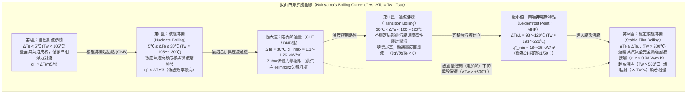
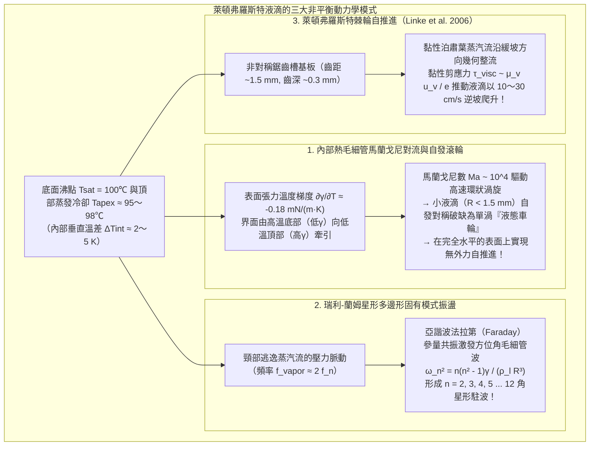

在日常烹飪中，有經驗的廚師常會向預熱好的鐵鍋或不鏽鋼平底鍋中灑入幾滴清水來判斷鍋溫。當鍋面溫度僅略高於水的沸點（$100^\circ\text{C}$），大約處於 $110^\circ\text{C}$ 至 $130^\circ\text{C}$ 之間時，水滴接觸鍋底的瞬間便會發出劇烈的「滋啦」聲，迅速鋪展並沸騰，在不到一秒鐘的時間內徹底蒸發殆盡。

然而，如果繼續加熱鐵鍋，使其表面溫度越過 $200^\circ\text{C}$ 甚至達到 $300^\circ\text{C}$ 以上，極其反直覺的物理現象便會登場：落入鍋中的水滴非但沒有瞬間氣化消失，反而瞬間收縮成一顆晶瑩剔透、如同水銀珠般的球體。它不再發出刺耳的沸騰聲，也完全不潤濕金屬表面，而是像氣墊球台上的滑塊一樣<strong>以近乎零摩擦的狀態在鍋底四處狂奔、旋轉與彈跳</strong>。更令人驚訝的是，儘管鍋面溫度高得多，這顆水珠卻能存活<strong>數分鐘之久</strong>——其壽命比在 $120^\circ\text{C}$ 時延長了數十倍乃至上百倍！

為什麼加熱面的溫度越高，液滴的蒸發反而越慢？這一違背日常熱力學直覺的現象被稱為<strong>萊頓弗羅斯特效應（Leidenfrost effect）</strong>。當固體壁面溫度跨越某一臨界閾值——即<strong>萊頓弗羅斯特溫度（Leidenfrost temperature, $T_L$）</strong>——時，液滴底部在靠近高溫壁面的瞬間劇烈氣化，在固液之間形成一層厚度僅為數十微米（$10\text{–}100\,\mu\text{m}$）的連續<strong>蒸汽氣墊（vapor cushion / vapor film）</strong>。這層薄薄的水蒸氣膜同時扮演了兩個關鍵角色：在流體力學上，它如同氣墊船的增壓氣室，依靠黏性潤滑壓力穩穩托起水珠的重量，徹底消除了固液直接接觸；在傳熱學上，由於水蒸氣的熱導率（$\kappa_v \approx 0.03\,\text{W/(m}\cdot\text{K)}$）不到液態水（$\kappa_l \approx 0.68\,\text{W/(m}\cdot\text{K)}$）的二十分之一，它化身為一層高效的絕熱屏障，將熱通量削減了近五十倍。

本文將從物理學與流體力學的第一性原理出發，系統剖析萊頓弗羅斯特效應的完整理論圖景：從1756年約翰·戈特洛布·萊頓弗羅斯特的歷史性實驗，到1934年日本學者拔山四郎建立的<strong>池沸騰曲線（Boiling Curve）</strong>與四大沸騰區、諾瓦克·祖伯（N. Zuber）的<strong>臨界熱通量（CHF）流體力學不穩定性極限</strong>、保羅·貝倫森（P. J. Berenson）的<strong>最小熱通量（MHF）</strong>；進而嚴格推導法國物理學家 A.-L. Biance、C. Clanet 與 D. Quéré（2003）提出的<strong>蒸汽膜潤滑方程與標度律（$e \propto \Delta T^{1/4} R^{1/2}$）</strong>；最後深入探討懸浮液滴內部自發破缺的<strong>熱毛細管馬蘭戈尼（Marangoni）對流輪</strong>、受激發的<strong>瑞利-蘭姆（Rayleigh-Lamb）多角星形固有模式振盪</strong>、海納·林克（H. Linke, 2006）發現的<strong>鋸齒棘輪自推進效應</strong>，以及這一效應在<strong>核反應爐冷卻劑流失事故（LOCA）爐心再淹沒驟冷</strong>與冶金淬火工程中的生死考驗。

---

## 1. 赤熱鐵勺上的「水晶地球儀」：1756年萊頓弗羅斯特的發現

科學史上最早提及這一現象的是荷蘭醫化學家赫爾曼·布爾哈夫（Hermann Boerhaave，1732年），但對其展開系統定量實驗與物理機制闡述的，則是德國杜伊斯堡大學的醫學與自然哲學教授<strong>約翰·戈特洛布·萊頓弗羅斯特（Johann Gottlob Leidenfrost, 1715–1794）</strong>。

在1756年發表的拉丁文專著《論普通水的若干性質》（*De Aquae Communis Nonnullis Qualitatibus Tractatus*）中，萊頓弗羅斯特詳細記錄了將一滴純淨水滴入在爐火中燒至赤熱發光的鐵勺時的觀察結果：

> 「向這把燒得通紅發光的鐵勺中滴入一滴純淨的普通水……水滴既不附著於鐵面，也不鋪展開來；恰恰相反，在觸碰的瞬間，它立即凝聚成一顆完美的球體，明亮而透明，宛如一顆<strong>水晶地球儀（crystal globe / globulus crystallinus）</strong>。它在勺底輕盈地高速旋轉、四處遊走，既不發出嘶嘶聲，也不冒出白煙。它非但沒有立刻消失，反而在三十秒、四十秒甚至整整一分鐘的時間裡極其緩慢地縮小，直到最後化為一顆肉眼難辨的微粒，伴隨著一聲輕微的『啪』聲徹底消失。」

萊頓弗羅斯特敏銳地意識到，當鐵勺逐漸冷卻至不再發光的某一溫度時，水滴的壽命會突然從近一分鐘驟降至不到一秒。這證明<strong>固液界面間的傳熱速率並非隨溫度單調遞增，而是在越過某一臨界溫度後發生斷崖式下跌</strong>。19世紀中葉，法國物理學家皮埃爾·布蒂尼（P. H. Boutigny, 1842）將其命名為物質的「球狀狀態（spheroidal state）」，甚至在燒紅的鉑金坩堝內利用處於萊頓弗羅斯特狀態的液態二氧化硫將水凍結成了冰塊！然而，這一現象背後的完整相變傳熱圖譜，直到1934年才由日本東北帝國大學的<strong>拔山四郎（Shiro Nukiyama）</strong>透過著名的鉑絲沸騰實驗徹底繪出。

---

## 2. 拔山四郎沸騰曲線（1934）與池沸騰的四個區域

為了定量理解水滴在 $120^\circ\text{C}$ 與 $250^\circ\text{C}$ 下的天壤之別，我們需要考察加熱壁面向飽和液體傳遞的<strong>熱通量（Heat flux）</strong> $q''$ $[\text{W/m}^2]$ 隨<strong>壁面過熱度（Wall superheat）</strong> $\Delta T_e \equiv T_w - T_{\text{sat}}$（其中 $T_w$ 為壁面溫度，常壓下水的飽和沸點 $T_{\text{sat}} = 100^\circ\text{C}$）變化的規律——即<strong>拔山沸騰曲線</strong>。

### 2.1 第I區：自然對流沸騰（$\Delta T_e < 5^\circ\text{C}$）

當壁面過熱度 $\Delta T_e < 5^\circ\text{C}$ 時，壁面微米級凹坑（腔口半徑 $r_c$）內的氣胚受到表面張力 $\gamma$ 產生的拉普拉斯附加壓力 $\Delta P = 2\gamma / r_c$ 的抑制。根據克勞修斯-克拉佩龍方程，只有當過熱度超過激活閾值 $\Delta T_{\text{ONB}} \approx \frac{2\gamma T_{\text{sat}}}{\rho_v L_{lv} r_c}$ 時氣泡才能長大。因此該區域無氣泡生成，熱量僅透過單相自然對流傳遞，$q'' \propto \Delta T_e^{5/4}$。

### 2.2 第II區：核態沸騰（$5^\circ\text{C} \le \Delta T_e \le 30^\circ\text{C}$）與 Zuber 臨界熱通量（CHF）

當 $\Delta T_e$ 越過 $5^\circ\text{C}$ 後，壁面微腔大量激活並高頻噴出氣泡。氣泡根部<strong>微液層（microlayer）的瞬態劇烈蒸發</strong>以及氣泡脫離引發的<strong>冷液微對流沖刷</strong>，使熱通量隨過熱度的三次方急劇攀升（Rohsenow 關聯式：$q'' \propto \Delta T_e^3$）。在 $120^\circ\text{C}$ 的鐵鍋上水滴之所以在1秒內消失，正是因為處於核態沸騰區。

然而，當 $\Delta T_e \approx 30^\circ\text{C}$（$T_w \approx 130^\circ\text{C}$）時，密集上升的氣泡合併為連續的<strong>蒸汽柱（vapor columns）</strong>。1958年，<strong>諾瓦克·祖伯（Novak Zuber）</strong>證明：重液體（密度 $\rho_l$）位於輕蒸汽（密度 $\rho_v$）之上會引發波長為 $\lambda_{RT} = 2\pi\sqrt{3\gamma/[g(\rho_l - \rho_v)]}$ 的<strong>瑞利-泰勒不穩定性（Rayleigh-Taylor instability）</strong>；而當向上噴射的蒸汽速度達到觸發氣液界面<strong>開爾文-亥姆霍茲不穩定性（Kelvin-Helmholtz instability）</strong>的臨界速度 $u_{v,\text{crit}} \sim \left[\frac{\gamma g(\rho_l - \rho_v)}{\rho_v^2}\right]^{1/4}$ 時，蒸汽柱坍塌並徹底阻斷回流補充的液體。由此導出的<strong>Zuber臨界熱通量（CHF）公式</strong>為：

$$q''_{\max} = C_{\text{Zuber}} \rho_v L_{lv} \left[ \frac{\gamma g (\rho_l - \rho_v)}{\rho_v^2} \right]^{1/4}, \qquad C_{\text{Zuber}} = \frac{\pi}{24} \approx 0.131$$

代入常壓沸水的物性參數（$\rho_l = 958\,\text{kg/m}^3$, $\rho_v = 0.598\,\text{kg/m}^3$, $L_{lv} = 2.257 \times 10^6\,\text{J/kg}$, $\gamma = 0.0589\,\text{N/m}$），可得 $q''_{\max} \approx 1.10\text{–}1.26\,\text{MW/m}^2$。在拔山四郎1934年的電加熱鉑絲實驗中，一旦熱通量達到 $q''_{\max}$，鉑絲溫度便會從 $130^\circ\text{C}$ 瞬間躍遷至 $1000^\circ\text{C}$ 以上並熔斷（即<strong>燒毀現象 Burnout</strong>）。

### 2.3 第III區：過渡沸騰（$30^\circ\text{C} < \Delta T_e < 100\text{–}120^\circ\text{C}$）

在溫度控制實驗中，越過 CHF 後進入過渡沸騰區。此時壁面被不穩定的局部蒸汽毯覆蓋，固液接觸間歇性爆發。隨著壁溫 $T_w$ 升高，絕熱乾蒸汽覆蓋的時間與面積分數增加，導致<strong>熱通量隨溫度升高反而急劇下降</strong>，微分熱導率為負（$\partial q'' / \partial \Delta T_e < 0$）。

### 2.4 第IV區：穩定膜態沸騰與萊頓弗羅斯特點（Berenson 最小熱通量）

當壁面過熱度達到<strong>萊頓弗羅斯特閾值 $\Delta T_{e,L} = T_L - T_{\text{sat}}$</strong>（拋光金屬表面上水滴約為 $T_L \approx 193^\circ\text{C}\text{–}220^\circ\text{C}$）時，蒸汽膜的動量與潤滑壓力足以徹底阻止任何液波觸碰固體表面。此時沸騰曲線達到極小值點——<strong>萊頓弗羅斯特點（Leidenfrost point）</strong>。

1961年，<strong>保羅·貝倫森（P. J. Berenson）</strong>從維持連續蒸汽膜不發生瑞利-泰勒塌陷所需的最小蒸發率出發，推導出了萊頓弗羅斯特點的<strong>最小熱通量（MHF）</strong>：

$$q''_{\min} = 0.09 \rho_v L_{lv} \left[ \frac{\gamma g (\rho_l - \rho_v)}{(\rho_l + \rho_v)^2} \right]^{1/4} \approx 18\text{–}25\,\text{kW/m}^2$$

這一數值僅為核態沸騰峰值 $q''_{\max}$ 的<strong>五十分之一（約 $2\%$）</strong>！因為水蒸氣的熱導率 $\kappa_v \approx 0.03\,\text{W/(m}\cdot\text{K)}$ 極低，熱量只能依靠緩慢的氣體分子熱傳導穿過氣墊，從而賦予了萊頓弗羅斯特水珠長達數分鐘的驚人壽命。

| 沸騰區域 | 壁面過熱度 $\Delta T_e = T_w - T_{\text{sat}}$（水，1 atm） | 典型熱通量 $q''$ $[\text{W/m}^2]$ | 核心傳熱與流體力學機制 | 鐵鍋上水滴的宏觀表現與壽命 $\tau$ |
| :--- | :--- | :--- | :--- | :--- |
| <strong>I. 自然對流沸騰</strong> | $\Delta T_e < 5^\circ\text{C}$ ($T_w < 105^\circ\text{C}$) | $10^3 \text{–} 10^4$ | 微腔未激活；單相浮力對流（$q'' \propto \Delta T_e^{5/4}$）與自由表面平靜蒸發。 | 潤濕鋪展成扁平液透鏡，無氣泡，在 $30\text{–}120\,\text{s}$ 內安靜蒸發。 |
| <strong>II. 核態沸騰</strong> | $5^\circ\text{C} \le \Delta T_e \le 30^\circ\text{C}$ ($T_w = 105\text{–}130^\circ\text{C}$) | $10^4 \text{–} 1.26 \times 10^6$（CHF峰值） | 微腔氣泡高頻成核、微液層蒸發（$q'' \propto \Delta T_e^3$），在CHF處發生Zuber蒸汽柱失穩。 | 劇烈「滋啦」作響並沸騰鋪展，在 <strong>$0.3\text{–}1.5\,\text{s}$</strong> 內瞬間消失。 |
| <strong>III. 過渡沸騰</strong> | $30^\circ\text{C} < \Delta T_e < 100^\circ\text{C}$ ($T_w = 130\text{–}200^\circ\text{C}$) | $1.2 \times 10^6 \to 2 \times 10^4$（$\partial q''/\partial \Delta T_e < 0$） | 局部蒸汽毯不穩定崩潰與間歇性固液接觸、微爆轟飛濺交替發生。 | 劈啪作響、劇烈彈跳並向四周噴濺微滴，存活 $2\text{–}15\,\text{s}$。 |
| <strong>IV. 穩定膜態沸騰（萊頓弗羅斯特態）</strong> | $\Delta T_e \ge \Delta T_L \approx 93\text{–}120^\circ\text{C}$ ($T_w \ge 193\text{–}220^\circ\text{C}$) | $2 \times 10^4 \to 10^5$（MHF極小點） | $10\text{–}100\,\mu\text{m}$ 連續蒸汽氣墊完全懸浮；傳熱受限於低熱導率氣體導熱。 | 凝聚成晶瑩球體或液餅，無聲、零摩擦滑行，存活 <strong>$60\text{–}300\,\text{s}$</strong>。 |

---

## 3. 懸浮液滴的毛細管靜力學與蒸汽膜潤滑標度律（Biance, Clanet, & Quéré 2003）

### 3.1 毛細管長度 $\ell_c$ 與液滴的三種幾何形態

由於蒸汽氣墊徹底隔離了固液接觸，萊頓弗羅斯特液滴等效於表觀接觸角 $\theta_c = 180^\circ$ 的完全不潤濕液滴。其外形由表面張力拉普拉斯壓（$\sim \gamma/R$）與重力靜水壓（$\sim \rho_l g R$）的競爭決定，二者的平衡定義了<strong>毛細管長度（Capillary length）</strong> $\ell_c$：

$$\ell_c = \sqrt{\frac{\gamma}{\rho_l g}} \approx 2.50\,\text{mm} \quad (\text{100}^\circ\text{C}\text{ 水：}\gamma = 58.9\,\text{mN/m}, \rho_l = 958\,\text{kg/m}^3)$$

以邦德數 $\text{Bo} = (R/\ell_c)^2$ 為判據，懸浮液滴呈現三種形態：
1. <strong>準球形液滴（$R < \ell_c \approx 2.5\,\text{mm}$）</strong>：表面張力佔優，液滴近似為半徑 $R$ 的圓球，僅底部被重力壓出一個半徑為 $r_c = \sqrt{\frac{2}{3}}\frac{R^2}{\ell_c}$ 的微小平坦接觸圓斑。
2. <strong>重力液餅 / 水窪（Leidenfrost puddle, $\ell_c < R < 4\ell_c$）</strong>：重力佔優，液滴被壓扁成圓盤狀「煎餅」，其平衡厚度由水平靜水壓與上下表面張力的平衡嚴格鎖定為恆定值：
   $$h_p = 2\ell_c \sin(\theta_c / 2)\Big|_{\theta_c = 180^\circ} = 2\ell_c \approx 5.0\,\text{mm}$$
   雷射干涉測量顯示，液餅底面中心向上凹陷形成「蒸汽腔（dimple）」，而在外緣內側形成蒸汽膜最薄的環狀「頸部（annular neck）」。
3. <strong>瑞利-泰勒蒸汽煙囪噴發（$R > R_{\max} \approx 3.83\ell_c \approx 9.6\,\text{mm}$）</strong>：當液餅半徑超過約 $1\,\text{cm}$ 時，表面張力無法繼續抑制底層輕蒸汽與上層重水之間的瑞利-泰勒不穩定性，底部蒸汽腔向上刺穿液餅中心，週期性地冒出巨大的<strong>蒸汽泡（蒸汽煙囪 vapor chimney）</strong>。

### 3.2 蒸汽氣墊厚度 $e$ 與壽命 $\tau$ 的嚴格推導

2003年，法國物理學家 <strong>A.-L. Biance、C. Clanet 與 D. Quéré</strong> 在《Physics of Fluids》上發表經典論文，透過耦合<strong>傅立葉熱傳導定律</strong>與<strong>黏性潤滑理論（泊肅葉徑向流出）</strong>，精確求出了蒸汽氣墊厚度 $e$。

對於半徑為 $R$（$R > \ell_c$）、厚度為 $2\ell_c$ 的液餅：
1. <strong>穿過蒸汽膜的傅立葉導熱與蒸發質量流量 $\dot{m}$</strong>：
   跨越厚度為 $e$ 的氣墊的導熱功率 $Q$ 全部轉化為蒸發潛熱 $L_{lv}$：
   $$Q = \kappa_v \frac{\Delta T}{e} \pi R^2 = \dot{m} L_{lv} \quad \Longrightarrow \quad \dot{m} = \frac{\kappa_v \Delta T}{L_{lv} e} \pi R^2 \qquad \cdots (1)$$
2. <strong>黏性潤滑近似（徑向泊肅葉流）</strong>：
   由於 $e \ll R$，狹縫內徑向逃逸的蒸汽滿足潤滑方程 $\mu_v \frac{\partial^2 u_r}{\partial z^2} = \frac{dP}{dr}$，給出拋物線速度分佈 $u_r(r,z) = \frac{1}{2\mu_v}\left(-\frac{dP}{dr}\right)z(e-z)$。在半徑 $r$ 處對高度 $z \in [0, e]$ 積分體積流量 $Q_v(r) = \frac{\pi r e^3}{6\mu_v}\left(-\frac{dP}{dr}\right) = \frac{\dot{m}}{\rho_v}\frac{r^2}{R^2}$，積分壓力分佈可得氣墊的平均支撐超壓：
   $$\Delta P_{\text{cushion}} = \frac{3 \mu_v \dot{m}}{2 \pi \rho_v e^3} \qquad \cdots (2)$$
3. <strong>靜水壓平衡與 $e \propto R^{1/2}$ 標度律</strong>：
   令氣墊支撐壓等於液餅自重靜水壓 $\Delta P_{\text{weight}} = 2\rho_l g \ell_c$，並將式(1)代入式(2)，消去 $\dot{m}$ 即得著名的<strong>Biance-Clanet-Quéré 蒸汽膜厚度公式</strong>：
   $$e = \left(\frac{3}{4}\right)^{1/4} \left( \frac{\kappa_v \mu_v \Delta T}{\rho_v \rho_l g L_{lv} \ell_c} \right)^{1/4} R^{1/2} \approx 10\text{–}100\,\mu\text{m} \qquad \cdots (3)$$
   對於 $T_w = 300^\circ\text{C}$（$\Delta T = 200\,\text{K}$）上半徑 $R = 5\,\text{mm}$ 的水餅，計算可得 $e \approx 54\,\mu\text{m}$，大約相當於一根人類頭髮的直徑！（若為 $R < \ell_c$ 的小液滴，代入 $r_c \sim R^2/\ell_c$ 與拉普拉斯壓 $2\gamma/R$，則得 $e_{\text{small}} \propto \Delta T^{1/4} R^{5/4}$）。
4. <strong>液滴壽命標度律</strong>：
   將 $e \propto R^{1/2}$ 代回蒸發率方程 $-\frac{dM}{dt} = -4\pi \rho_l \ell_c R \frac{dR}{dt} = \dot{m} \propto R^{3/2}$，積分微分方程 $R^{-1/2}\frac{dR}{dt} = \text{const.}$ 可得液餅半徑演化 $R(t) = R_0(1 - t/\tau)^2$，且總壽命滿足 $\tau \propto \Delta T^{-3/4} R_0^{3/2}$（在中小液滴區或恆定膜厚近似下則表現為 $\tau \propto R_0^{5/4} \sim R_0^2$）。

---

## 4. 內部熱馬蘭戈尼渦旋、星形固有模式振盪與棘輪自推進

萊頓弗羅斯特液滴絕非靜態的懸浮水球，而是由持續熱流驅動的<strong>非平衡耗散結構與活性物質（Active matter）</strong>。

### 4.1 內部熱毛細管馬蘭戈尼對流與「萊頓弗羅斯特車輪」

液滴底部維持在 $T_{\text{base}} = 100^\circ\text{C}$，而頂部因環境空氣蒸發冷卻降至 $T_{\text{apex}} \approx 95\text{–}98^\circ\text{C}$。由於水的表面張力隨溫度升高而減小（$\frac{\partial \gamma}{\partial T} \approx -0.18\,\text{mN/(m}\cdot\text{K)}$），自由表面產生由底部指向頂部的<strong>馬蘭戈尼剪應力（Marangoni shear stress）</strong> $\tau_s = \frac{\partial \gamma}{\partial T}\nabla_s T$。對應的馬蘭戈尼數高達 $\text{Ma} = \frac{|\partial \gamma/\partial T|\Delta T_{\text{int}} R}{\mu_l \alpha_l} \sim 2 \times 10^4 \gg \text{Ma}_c$，驅動劇烈的內部環狀渦流，並徹底消除了奈米顆粒乾燥時的<strong>咖啡環效應（Coffee-ring effect）</strong>。

2018年，<strong>A. Bouillant 與 D. Quéré 等人</strong>在《Nature Physics》上證實：當液滴半徑 $R \lesssim 1.5\,\text{mm}$ 時，軸對稱環形馬蘭戈尼渦旋發生<strong>自發對稱性破缺</strong>，演變為單一旋轉渦胞——即<strong>「萊頓弗羅斯特車輪（Leidenfrost wheel）」</strong>。內部單向旋轉的液體帶動底部蒸汽膜產生傾角，使液滴即便在絕對水平的平面上也能以 $5\text{–}15\,\text{cm/s}$ 的速度自行滾動！

### 4.2 瑞利-蘭姆（Rayleigh-Lamb）星形多邊形振盪

較大的萊頓弗羅斯特液餅（$R \sim 5\text{–}15\,\text{mm}$）常會自發脈動，外緣輪廓變成三角形、正方形、五角星乃至十二角齒輪狀的駐波。這對應於無黏液滴的<strong>瑞利-蘭姆方位角毛細管固有模式</strong>：

$$\omega_n^2 = \frac{n(n^2 - 1)\gamma}{\rho_l R^3} \qquad (n = 2, 3, 4, \dots, 12)$$

當液滴頸部排出的蒸汽流以頻率 $f_{\text{vapor}}$ 發生氣動彈性脈動時，會透過馬蒂厄方程（Mathieu equation）觸發<strong>亞諧波法拉第參量共振（$f_n = \frac{\omega_n}{2\pi} \approx \frac{1}{2} f_{\text{vapor}} \approx 13\text{–}18\,\text{Hz}$）</strong>。隨著液滴蒸發縮小，星形的角數 $n$ 會依序逐個遞減（$n = 8 \to 7 \to \dots \to 2$）。

### 4.3 海納·林克（Heiner Linke, 2006）鋸齒棘輪自推進

2006年，奧勒岡大學的 <strong>Heiner Linke</strong> 團隊在《Physical Review Letters》上展示了著名的<strong>萊頓弗羅斯特棘輪（Leidenfrost ratchet）</strong>：在刻有非對稱鋸齒槽（週期 $\sim 1.5\,\text{mm}$，深 $\sim 0.3\,\text{mm}$）的高溫黃銅板上，懸浮液滴無需任何外力即可沿陡坡向上的方向以 $10\text{–}30\,\text{cm/s}$ 高速自推進，甚至能克服重力爬上斜坡！其物理根源在於：液滴底面局部下垂封閉了鋸齒陡峭面，迫使底部的泊肅葉蒸汽流沿每個鋸齒的緩坡向後作<strong>幾何整流流動（viscous flow rectification）</strong>；高速向後噴出的蒸汽流對液滴底部施加黏性拖曳反作用力 $F_{\text{ratchet}} \sim \frac{\mu_v u_{\text{vapor}}}{e}\pi R^2 \sim 30\,\mu\text{N}$，在零固液靜摩擦條件下驅動液滴向前飛馳。

---

## 5. 工業與極端物理應用：核反應爐 LOCA 驟冷、冶金淬火與液氮/熔鉛效應

1. <strong>核反應爐冷卻劑流失事故（LOCA）與爐心再淹沒驟冷（Quenching）</strong>：
   壓水式反應爐（PWR）與沸水式反應爐（BWR）正常運轉時必須嚴格維持在核態沸騰區（第II區），保證最小偏離核態沸騰比 $\text{MDNBR} > 1.3$。一旦發生冷卻劑流失事故（LOCA）或功率暴增跨越臨界熱通量（CHF），鋯合金燃料護套表面立即躍遷至萊頓弗羅斯特膜態沸騰態（第IV區），被絕熱蒸汽毯包裹的護套溫度在數秒內飆升至 $1000^\circ\text{C}$ 以上（引發鋯-水放熱反應產生氫氣）。當緊急爐心冷卻系統（ECCS）注水再淹沒爐心時，冷卻水因護套高於萊頓弗羅斯特溫度 $T_L$ 而被蒸汽膜彈開，只能依靠<strong>驟冷前沿（Quench front）</strong>透過護套金屬軸向導熱緩慢推進（Yamanouchi 模型：$u_q \propto (T_L - T_{\text{sat}})/(T_{\text{init}} - T_L)$）。因此，研發微奈米親水多孔塗層以提高 CHF 和 $T_L$ 是當代耐事故核燃料（ATF）的核心課題。
2. <strong>鋼鐵冶金淬火（Steel Quenching）</strong>：
   將 $850^\circ\text{C}$ 的沃斯田鐵鋼浸入冷卻液時，依次經歷<strong>蒸汽膜階段（萊頓弗羅斯特態，冷卻慢）</strong>、<strong>核態沸騰階段（蒸汽膜破裂，極速冷卻生成麻田散鐵）</strong>與<strong>自然對流階段</strong>。若複雜工件表面的萊頓弗羅斯特蒸汽膜破裂不均勻，就會產生巨大的熱應力與相變應力，導致工件變形甚至<strong>淬火開裂</strong>。使用鹽水、聚合物淬火液或強力攪拌正是為了破壞蒸汽膜的穩定性。
3. <strong>濕手探熔鉛與液氮潑手之謎</strong>：
   濕潤的手指瞬間浸入 $400^\circ\text{C}$ 的熔融鉛中之所以不會立刻燙傷（<strong>極度危險，切勿模仿</strong>），是因為皮膚表面的水分瞬間進入萊頓弗羅斯特態，形成低熱導率的蒸汽屏障；同理，常壓沸點為 $-196^\circ\text{C}$（$77\,\text{K}$）的<strong>液態氮（$\text{LN}_2$）</strong>接觸 $34^\circ\text{C}$（$307\,\text{K}$）的人體皮膚時，皮膚相對於液態氮是過熱度高達 $\Delta T_e = 230\,\text{K}$ 的「滾燙鐵板」，液態氮滴立即在氮氣墊上懸浮滑落而不會凍傷裸手（但若戴棉線手套，纖維毛細管會鎖住液態氮導致嚴重凍傷）。

---

## 參考文獻

1. <strong>Leidenfrost, J. G.</strong> (1756). *De Aquae Communis Nonnullis Qualitatibus Tractatus*. Duisburg.
2. <strong>Nukiyama, S.</strong> (1934). "The Maximum and Minimum Values of the Heat Transmitted from Metal to Boiling Water under Atmospheric Pressure". *J. Jpn. Soc. Mech. Eng.*, 37(206), 367–374.
3. <strong>Zuber, N.</strong> (1958). "On the stability of boiling heat transfer". *Trans. ASME*, 80(3), 711–720.
4. <strong>Berenson, P. J.</strong> (1961). "Film-boiling heat transfer from a horizontal surface". *J. Heat Transf.*, 83(3), 351–356.
5. <strong>Biance, A.-L., Clanet, C., & Quéré, D.</strong> (2003). "Leidenfrost drops". *Physics of Fluids*, 15(6), 1632–1637.
6. <strong>Linke, H., et al.</strong> (2006). "Self-Propelled Leidenfrost Droplets". *Physical Review Letters*, 96(15), 154502.
7. <strong>Quéré, D.</strong> (2013). "Leidenfrost Dynamics". *Annual Review of Fluid Mechanics*, 45, 197–215.
8. <strong>Bouillant, A., et al.</strong> (2018). "Leidenfrost wheels". *Nature Physics*, 14(12), 1188–1192.
