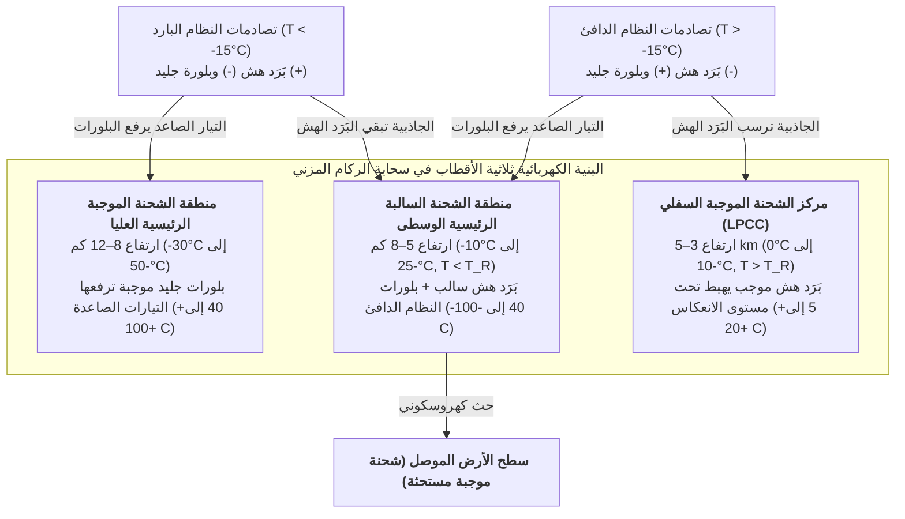

في كل ثانية، يمزق نحو 40 إلى 50 وميض برق الغلاف الجوي للأرض، أي قرابة 4 ملايين تفريغ كهربائي عالي الطاقة يومياً. وبعد مرور أكثر من 270 عاماً على تجربة الطائرة الورقية الشهيرة لبنجامين فرانكلين عام 1752، لا يزال أحد أكثر الأسئلة جوهرية في فيزياء الغلاف الجوي يثير الدهشة: <strong>كيف يبدأ وميض البرق فعلياً داخل سحابة رعدية؟</strong> إن بالونات الطقس وطائرات الأبحاث التي تخترق القلوب المضطربة لسحب الركام المزني (Cumulonimbus) النشطة لا تقيس أبداً مجالات كهربائية عيانية تتجاوز $0.1\text{–}0.4\,\text{MV/m}$ — أي أضعف بنحو عشر مرات من عتبة الانهيار العازل التقليدي للهواء الجاف عند مستوى سطح البحر ($E_{b0} \approx 3.0\,\text{MV/m}$) التي تفرضها نظرية سيول تاونسند وقانون باشن. وعلاوة على ذلك، لماذا لا ينتقل البرق في خط مستقيم أبداً، بل ينحت شجرة معقدة من <strong>الفروع الكسورية (Fractal branches)</strong> المحكومة بعدم استقرار النمو اللابلاسي؟ ولماذا يتقدم <strong>القائد المتدرج (Stepped leader)</strong> السالب في قفزات منفصلة بطول $50\,\text{m}$ كل $50\,\mu\text{s}$ قبل أن يطلق <strong>ضربة راجعة (Return stroke)</strong> تندفع من الأرض نحو السحابة بثلث سرعة الضوء ($v \approx c/3$) رافعةً حرارة القناة إلى $30,000\,\text{K}$؟ في هذه الدراسة نستعرض الفيزياء الكاملة للبرق من مقياس النانومتر إلى الديناميكا الكهربائية النسبية.

---

## 1. المولد الكهروسكوني للسحابة الركامية: فصل الشحنات غير الحثي والبنية ثلاثية الأقطاب

قبل حدوث الانهيار العازل، يجب أن تولد <strong>سحابة الركام المزني</strong> الناضجة فروق جهد تتراوح بين $10^8$ و$10^9\,\text{V}$ عبر مسافات كيلومترية. وفي <strong>منطقة الطور المختلط</strong> بين ارتفاعي $4\,\text{km}$ و$10\,\text{km}$ (حيث تتراوح الحرارة بين $0^\circ\text{C}$ و$-40^\circ\text{C}$)، تدفع التيارات الصاعدة القوية ($v_{\text{up}} \approx 10\text{–}30\,\text{m/s}$) ثلاثة أنواع من الجسيمات المائية للتعايش معاً: <strong>قطيرات الماء فائق التبريد</strong> ($d \approx 10\text{–}20\,\mu\text{m}$)، و<strong>بلورات الجليد</strong> ($20\text{–}200\,\mu\text{m}$) التي تنمو بترسب البخار، و<strong>البَرَد الهش (Graupel)</strong> الملليمتري ($1\text{–}5\,\text{mm}$) الذي ينمو سريعاً عبر <strong>التجمد التصادمي (Riming)</strong> لقطيرات الماء فائق التبريد.

أثبتت تجارب نفق الرياح التي أجراها تاكاهاشي (Takahashi, 1978) وسوندرز (Saunders, 1991) أن الآلية الأساسية للشحن هي <strong>فصل الشحنات غير الحثي (Non-inductive charge separation)</strong> أثناء التصادمات المرتدة بين حبيبات البَرَد الهش وبلورات الجليد بوجود قطيرات الماء فائق التبريد، حيث تنتقل شحنة قدرها $10\text{–}100\,\text{fC}$ ($10^{-14}\text{–}10^{-13}\,\text{C}$) في كل تصادم. ويكمن السر المجهري في <strong>الطبقة شبه السائلة (Quasi-Liquid Layer, QLL)</strong> ذات السمك النانومتري على سطح الجليد؛ فداخل الشبكة البلورية والـ QLL تتأين جزيئات الماء ذاتياً إلى بروتونات ($\text{H}^+$) وأيونات هيدروكسيل ($\text{OH}^-$). وبفضل آلية قفز البروتونات لغروتهوس عبر الروابط الهيدروجينية، فإن <strong>حركية أيونات $\text{H}^+$ الموجبة تفوق حركية أيونات $\text{OH}^-$ السالبة بعدة رتب مقدار</strong>.

أثناء التلامس العابر يتنافس تدرجان ديناميكيان حراريان: (1) <strong>تأثير التدرج الحراري</strong>: يسخن البَرَد الهش بفعل الحرارة الكامنة المنبعثة من تجمد القطيرات فائقة التبريد، فيمتلك تركيزاً أيونياً أعلى؛ لذا تنتشر بروتونات $\text{H}^+$ بسرعة من البَرَد الهش الأدفأ إلى بلورة الجليد الأبرد، تاركةً البَرَد الهش مشحوناً بشحنة سالبة ($-$) والبلورة بشحنة موجبة ($+$)؛ (2) <strong>تأثير سمك الطبقة شبه السائلة (آلية بيكر-داش)</strong>: عند درجات الحرارة الأعلى والمحتوى المائي السائل ($\text{LWC}$) المرتفع، تشكل حبيبة البَرَد الهش طبقة QLL أكثر سمكاً تعكس قطبية الشحنة المنتقلة عند الانفصال. ويحدد هذا الحد الفاصل <strong>درجة حرارة الانعكاس ($T_R \approx -15^\circ\text{C}$ إلى $-20^\circ\text{C}$)</strong>:

* <strong>النظام البارد ($T < T_R$، ارتفاع $7\text{–}10\,\text{km}$)</strong>: يُشحن <strong>البَرَد الهش الثقيل بشحنة سالبة ($-$)</strong> وتُشحن <strong>بلورات الجليد الخفيفة بشحنة موجبة ($+$)</strong>.
* <strong>النظام الدافئ ($T > T_R$، ارتفاع $4\text{–}6\,\text{km}$)</strong>: تنعكس القطبية — يُشحن <strong>البَرَد الهش بشحنة موجبة ($+$)</strong> وتُشحن <strong>بلورات الجليد بشحنة سالبة ($-$)</strong>.

بعد ذلك، يقوم <strong>الفرز الحجمي الثقالي</strong> بفصل هذه الشحنات عيانياً: تبقى حبيبات البَرَد الهش الثقيلة ($v_t \approx 5\text{–}10\,\text{m/s}$) في الطبقات الوسطى والسفلى، بينما ترفع التيارات الصاعدة بلورات الجليد الخفيفة ($v_t \ll 1\,\text{m/s}$) إلى السندان العلوي للسحابة، مما ينشئ <strong>البنية الكهربائية ثلاثية الأقطاب (Tripole structure)</strong> القياسية:

وتحكم كثافة شحنة الفضاء $\rho(\mathbf{r})$ الجهد الكهروسكوني $\phi(\mathbf{r})$ والمجال الكهربائي $\mathbf{E} = -\nabla\phi$ عبر <strong>معادلة بواسون</strong>:

$$\nabla^2 \\phi(\mathbf{r}) = -\frac{\rho(\mathbf{r})}{\varepsilon_0}$$

ويعمل <strong>مركز الشحنة الموجبة السفلي (LPCC)</strong> على تعزيز المجال الكهربائي المتجه للأسفل عند قاعدة الطبقة السالبة الرئيسية، كمنجنيق كهروسكوني يطلق القادة المتدرجين السالبين نحو الأرض. أما في <strong>العواصف الرعدية الشتوية</strong> (كما في ساحل هوكوريكو باليابان)، فينخفض خط تساوي الحرارة $-15^\circ\text{C}$ إلى أقل من $2\,\text{km}$ فوق سطح الأرض، مما يسمح للمنطقة الموجبة العليا بالتفريغ مباشرة إلى الأرض في <strong>صواعق موجبة خارقة (+CG Superbolts)</strong> بتيارات تصل إلى $200\text{–}300\,\text{kA}$.

---

## 2. لغز بدء البرق: انهيار تاونسند مقابل سيول الإلكترونات الهاربة النسبية (RREA)

في فيزياء تفريغ الغازات الكلاسيكية، يتنافس التأين بتصادم الإلكترونات (معامل تاونسند الأول $\alpha$) مع التصاق الإلكترونات بجزيئات الأكسجين الكهرسلبية (معامل الالتصاق $\eta_a$):

$$\frac{dN_e}{dx} = (\alpha - \eta_a) N_e \implies N_e(x) = N_0 \exp\left[ (\alpha - \eta_a) x \right]$$

ولكي يحدث <strong>سيل تاونسند</strong> الأسي يجب أن يتحقق الشرط $\alpha > \eta_a$، مما يحدد عتبة الانهيار التقليدي $E_{b0} \approx 3.0\,\text{MV/m}$ عند مستوى سطح البحر ($E/N \approx 120\,\text{Td}$). ووفقاً <strong>لقانون باشن</strong>، يتناسب مجال الانهيار خطياً مع كثافة الهواء النسبية $n(z) = \exp(-z/H)$:

$$E_b(z) = E_{b0} \cdot n(z) \approx (3.0\,\\text{MV/m}) \cdot \exp(-z/H)$$

وعند ارتفاع بدء البرق ($z \approx 6\,\text{km}$، $n \approx 0.5$)، لا يزال الانهيار التقليدي يتطلب $E_b(6\,\text{km}) \approx 1.5\,\text{MV/m}$، وهو أعلى بكثير من القيم المقاسة ($0.1\text{–}0.4\,\text{MV/m}$). وتحل آليتان فيزيائيتان هذه المفارقة:

1. <strong>سيول الإلكترونات الهاربة النسبية (RREA) المبذورة بالأشعة الكونية</strong>: تُعيق ذروة احتكاك التصادم غير المرن عند $100\text{–}200\,\text{eV}$ ($F_{\max} \approx 27\,\text{MeV/m}\cdot n(z)$) الإلكترونات الحرارية. غير أنه وفق صيغة بيته-بلوخ النسبية لقدرة الإيقاف، عندما يمتلك الإلكترون طاقة حركية نسبية $K_{\min} \approx 1.0\text{–}1.4\,\text{MeV}$، تهبط قوة الإعاقة التصادمية إلى حد أدنى $F_{\min} \approx 0.218\,\text{MeV/m}\cdot n(z)$. ومع احتساب تشتت كولوم النووي، يصبح <strong>مجال عتبة الهروب النسبي $E_{\text{RREA}}$</strong> (Gurevich, 1992; Dwyer, 2003):

$$E_{\\text{RREA}}(z) \approx 0.284\,\\text{MV/m} \cdot n(z), \qquad N_{\\text{RREA}}(L) = N_0 \exp\left(\frac{L}{\lambda_{\\text{RREA}}}\right)$$

   وعند ارتفاع $6\,\text{km}$ تبلغ العتبة $E_{\text{RREA}} \approx 0.14\,\text{MV/m}$، وهو ما يطابق تماماً أقصى المجالات المقاسة بالبالونات داخل السحب! وتوفر <strong>زخات الهواء الكونية الواسعة (EAS)</strong> الناتجة عن الأشعة الكونية إلكترونات بذرية ($\sim 1\,\text{MeV}$) تتسارع بلا توقف وتضاعف الإلكترونات الثانوية عبر تشتت مولر (Møller scattering).
2. <strong>تضخيم المجال عند أطراف بلورات الجليد والانهيار الموجب السريع (Fast Positive Breakdown)</strong>: عند الأطراف الحادة لبلورات الجليد المستطيلة ذات نسبة الطول إلى نصف القطر $l/r \gg 1$، يضخم الاستقطاب العازل المجال المحلي:

$$E_{\\text{tip}} \approx E_0 \frac{(l/r)^2}{\ln(2l/r) - 1}$$

   وعندما يتجاوز $E_{\text{tip}}$ محلياً $E_b(z)$، تنطلق <strong>خيوط كورونا الموجبة (Positive streamers)</strong> وتنتشر ذاتياً طالما زاد مجال الخلفية عن مجال الاستقرار $E_{\text{st}}^{+} \approx 0.45\,\text{MV/m}\cdot n(z)$. وفي عام 2016 أثبت ريسون وزملاؤه باستخدام التداخل الراديوي VHF عريض النطاق أن جميع ومضات البرق تبدأ بانفجار دون ميكروثانية لخيوط موجبة بسرعة $3\text{–}5 \times 10^7\,\text{m/s}$ يُعرف باسم <strong>الانهيار الموجب السريع (FPB / الأحداث ثنائية القطب الضيقة NBE)</strong>.

---

## 3. لماذا يتفرع البرق: الانتقال من الخيط إلى القائد والنمو الكسوري $\eta$-اللابلاسي

الخيط الواحد (Streamer) هو بلازما باردة ($T_g \approx 300\,\text{K}$) تفقد موصليتها خلال عشرات النانوثواني بسبب التصاق الإلكترونات بـ $\text{O}_2$. ولكن عندما تلتقي آلاف الخيوط في جذع مشترك (Stem)، يرفع تسخين جول حرارة الغاز المتعادل فوق العتبة الحرجة <strong>$T_{\text{crit}} \approx 1,500\text{–}5,000\,\text{K}$</strong>، مطلقاً ثلاث عمليات تغذية راجعة موجبة: (1) <strong>الانفصال الحراري للإلكترونات</strong> ($\text{O}_2^- + \text{M} \to \text{O}_2 + \text{M} + \text{e}^-$)، و(2) <strong>الاسترخاء الاهتزازي-الانتقالي (V-T)</strong> لجزيئات $\text{N}_2$، و(3) <strong>التمدد الهيدروديناميكي القطري</strong> الذي يخفض الكثافة $N$ ويرفع المجال المختزل $E/N$. وهكذا يتحول الخيط إلى قناة <strong>قائد (Leader)</strong> ساخنة عالية الموصلية تنقل جهد السحابة البالغ $-50\,\text{MV}$ إلى طرفها المتقدم.

وفي 90% من صواعق السحابة-الأرض (السالبة -CG)، يتقدم <strong>القائد المتدرج (Stepped leader)</strong> في قفزات متقطعة لأن الخيوط السالبة تتطلب مجالاً يعادل ضعف ما تتطلبه الخيوط الموجبة ($E_{\text{st}}^{-} \approx 1.0\text{–}1.2\,\text{MV/m}\cdot n$). وأمام طرف القائد الرئيسي تشتعل نواة بلازما معزولة تُسمى <strong>الجذع الفضائي (Space stem)</strong> تنمو منها قناة ثنائية الاتجاه؛ وحين يصطدم طرفها الموجب المرتد بالقائد السالب الرئيسي، تضيء خطوة جديدة بطول $L_{\text{step}} \approx 10\text{–}50\,\text{m}$ كل $\tau_{\text{step}} \approx 20\text{–}50\,\mu\text{s}$ (بسرعة متوسطة $\sim 2 \times 10^5\,\text{m/s}$).

ويُفسَّر التفرع الشجري بواسطة <strong>نموذج الانهيار العازل (DBM)</strong> لنيماير وبيترونيرو وفيسمان (1984). فبما أن شجرة القائد الموصلة تمثل تساوي جهد ($\phi = 0$) في فضاء يخضع لمعادلة لابلاس، فإن احتمالية الانهيار $P_i$ عند النقطة الحدودية $i$ تتناسب مع القوة $\eta$ للمجال الكهربائي المحلي:

$$\nabla^2 \\phi(\mathbf{r}) = 0, \qquad P_i = \frac{|\nabla \\phi_i|^\eta}{\sum_{j \in \\text{boundary}} |\nabla \\phi_j|^\eta} \quad \left(|\nabla \\phi_i| > E_{\\text{crit}}\right)$$

تعمل الأطراف البارزة على تكثيف أسطح تساوي الجهد وتضخيم المجال، بينما تُحجب الفروع الجانبية كهروسكونياً (<strong>عدم استقرار النمو لمولينز-سيكيركا</strong>)، مما يجبر الأطراف على الانشطار المستمر. وبينما يكافئ $\eta = 1$ التجمع المحدود بالانتشار (DLA، بعد كسوري $D_f \approx 1.71$ في بعدين)، فإن النظام اللاخطي للبرق ($\eta \approx 2$) ينتج <strong>بعداً كسورياً لهاوسدورف مسقطاً في بعدين قدره $D_f \approx 1.35\text{–}1.55$</strong>، وهو ما يطابق القياسات التصويرية بدقة.

---

## 4. الالتحام، الضربة الراجعة بحرارة $30,000\,\text{K}$، وميكانيكا الموجة الصدمية للرعد

عندما يقترب القائد المتدرج من الأرض ضمن <strong>مسافة الضرب (Striking distance) $r_s$</strong>، تنطلق من قمم المنشآت المؤرضة (مانعات الصواعق، الأشجار) <strong>قادة ربط موجبة صاعدة</strong>. وفي <strong>النموذج الكهرو-هندسي (EGM، أساس طريقة الكرة المتدحرجة)</strong>، ترتبط $r_s$ بتيار الذروة $I_p$ (بوحدة $\text{kA}$) وفق علاقة لاف (1973):

$$r_s = 10 \, I_p^{0.65} \quad [\\text{m}]$$

ولحظة التلامس ($20\text{–}100\,\text{m}$ فوق سطح الأرض)، تندفع موجة معادلة الجهد الأرضي — أي <strong>الضربة الراجعة (Return stroke)</strong> — صعوداً نحو السحابة بسرعة نسبية تبلغ <strong>$v_{\text{RS}} \approx c/3 \approx 1.0 \times 10^8\,\text{m/s}$</strong>. وخلال $1\text{–}5\,\mu\text{s}$ يمر تيار ذروة نموذجي قدره $30\,\text{kA}$ عبر قلب قطره $1\text{–}3\,\text{cm}$، فيرفع حرارة البلازما إلى <strong>$T \approx 30,000\,\text{K}$ (أعلى بخمس مرات من حرارة سطح الشمس)</strong>. وبعد الضربة الأولى، تنحدر <strong>القادة السهمية (Dart leaders)</strong> عبر القناة المتبقية الدافئة بسرعة $\sim 10^7\,\text{m/s}$ لتوليد ضربات راجعة لاحقة تجعل البرق يومض عدة مرات.

ولأن التسخين الميكروثاني يتم <strong>بثبات الحجم (Isochoric heating)</strong> قبل أن يتسنى للقناة التمدد صوتياً، يقفز الضغط الداخلي إلى $10\text{–}100\,\text{atm}$ وينفجر الأسطوانة البلازمية قطرياً بسرعة فرط صوتية تبلغ ماخ $10\text{–}20$، مولداً <strong>موجة صدمة أسطوانية لتايلور-سيدوف</strong>. ويتحدد نصف قطر الاسترخاء المميز $R_0$ والتردد الصوتي الأقصى $f_{\text{peak}}$ للرعد من الطاقة المودعة لكل وحدة طول $E_l$ والضغط الجوي $P_0$:

$$R_0 = \sqrt{\frac{E_l}{\pi P_0}}, \qquad f_{\\text{peak}} \approx 0.63 \, c_s \sqrt{\frac{P_0}{E_l}} = \frac{0.63 \, c_s}{\sqrt{\pi} R_0} \approx 50\\text{–}150\,\\text{Hz}$$

وعلى بُعد عدة كيلومترات، تتحول الموجة الصدمية على شكل حرف N إلى هزيم رعد منخفض التردد يدوم عشرات الثواني بفعل فروق أزمنة الوصول من القناة ثلاثية الأبعاد المتعرجة، والتوهين الجوي المتناسب مع مربع التردد ($\alpha_{\text{att}} \propto f^2$)، والانكسار الصوتي الحراري نحو الأعلى.

---

## 5. الظواهر الضوئية العابرة (TLEs) وومضات أشعة غاما الأرضية (TGFs) المنتجة للمادة المضادة

1. <strong>الظواهر الضوئية العابرة (TLEs)</strong>:
   * <strong>العفاريت الحمراء (Red Sprites، ارتفاع $50\text{–}90\,\text{km}$)</strong>: عقب صاعقة موجبة قوية (+CG) ذات تغير كبير في عزم الشحنة ($\text{CMC} \gtrsim 500\,\text{C}\cdot\text{km}$)، يتجاوز المجال شبه الكهروسكوني في طبقة الميزوسفير عتبة الانهيار $E_b(z)$ التي تهبط أسياً مع كثافة الهواء، فيشعل منظومات ضخمة من الخيوط الباردة بعرض عشرات الكيلومترات (تتوهج بالأحمر فوق $70\,\text{km}$ بسبب نطاق $\text{N}_2(1\text{P})$ وبالأزرق في المحاليق السفلية بسبب $\text{N}_2^+(1\text{N})$).
   * <strong>النفاثات الزرقاء (Blue Jets، $15\text{–}50\,\text{km}$) والنفاثات العملاقة (حتى $90\,\text{km}$)</strong>: مخاريط من القادة والخيوط الموجبة تنبثق من قمة السحابة بسرعة $\sim 100\,\text{km/s}$.
   * <strong>الإلفس (ELVES، $85\text{–}100\,\text{km}$)</strong>: حلقات حمراء مسطحة بقطر $300\text{–}500\,\text{km}$ تدوم أقل من $1\,\text{ms}$، تنتج عن تقاطع القشرة الكروية للنبضة الكهرومغناطيسية (EMP) للضربة الراجعة مع قاعدة الغلاف الأيوني بسرعة طور تفوق سرعة الضوء.
2. <strong>ومضات أشعة غاما الأرضية (TGFs) وإنتاج المادة المضادة بالتفاعلات النووية الضوئية</strong>: تُسرّع سيول RREA الإلكترونات إلى طاقات $20\text{–}40\,\text{MeV}$، مطلقةً أشعة غاما الانكباحية (Bremsstrahlung). وفي دراسة تاريخية عام 2017، أثبت تيرواكي إينوتو وزملاؤه (Enoto et al., *Nature*) أن فوتونات غاما التي تتجاوز طاقتها $10.55\,\text{MeV}$ تنتزع نيوترونات من نوى النيتروجين $^{14}\text{N}$؛ ثم يخضع النظير المشع الناتج $^{13}\text{N}$ لاضمحلال $\beta^+$ مطلقاً <strong>بوزيترونات المادة المضادة ($\text{e}^+$)</strong> التي تفنى مع إلكترونات الهواء منتجةً خط أشعة غاما المميز عند <strong>$0.511\,\text{MeV}$</strong> تماماً:

$$\gamma + {{}}^{14}_{7}\\text{N} \longrightarrow {{}}^{13}_{7}\\text{N} + \\text{n} \quad (E_\gamma > 10.55\,\\text{MeV})$$

$${{}}^{13}_{7}\\text{N} \longrightarrow {{}}^{13}_{6}\\text{C} + \\text{e}^+ + \nu_e, \qquad \\text{e}^+ + \\text{e}^- \longrightarrow 2\gamma \quad (E_\gamma = 0.511\,\\text{MeV})$$

---

## 6. مقارنة فيزيائية شاملة وآفاق الرصد الحديثة

| الظاهرة / النظام | الارتفاع / المقياس المكاني | المدة / المقياس الزمني | سرعة الانتشار $v$ | التيار أو الطاقة أو الحرارة المميزة | الآلية الفيزيائية الحاكمة |
| :--- | :--- | :--- | :--- | :--- | :--- |
| <strong>الشحن غير الحثي</strong> | $4\text{–}10\,\text{km}$ (منطقة الطور المختلط) | دورة حمل $10\text{–}30\,\text{min}$ | تيار صاعد $10\text{–}30\,\text{m/s}$ | $\sim 10^{-14}\,\text{C}$/تصادم؛ $\pm 40\text{–}100\,\text{C}$ بالسحابة | تصادم البَرَد الهش والجليد، انتشار $\text{H}^+$ في QLL، $T_R \approx -15^\circ\text{C}$ |
| <strong>الانهيار الموجب السريع (FPB)</strong> | $5\text{–}12\,\text{km}$؛ طول $0.3\text{–}1\,\text{km}$ | $10\text{–}20\,\mu\text{s}$ | $3 \times 10^7 \text{–} 5 \times 10^7\,\text{m/s}$ | نبضة راديوية VHF بعدة ميغاواط | سيل RREA الكوني + تضخيم المجال عند أطراف بلورات الجليد |
| <strong>القائد المتدرج السالب</strong> | سحابة–أرض (خطوات $10\text{–}50\,\text{m}$) | $10\text{–}30\,\text{ms}$ (توقف $20\text{–}50\,\mu\text{s}$) | متوسط $2 \times 10^5\,\text{m/s}$ | $100\text{–}1,000\,\text{A}$؛ القلب $T \approx 5,000\,\text{K}$ | انفصال حراري للإلكترونات ($>1,500\,\text{K}$)، جذوع فضائية، كسورية DBM |
| <strong>الضربة الراجعة</strong> | أرض–سحابة (قطر القلب $1\text{–}3\,\text{cm}$) | صعود $1\text{–}5\,\mu\text{s}$؛ اضمحلال $\sim 100\,\mu\text{s}$ | $v \approx c/3 \approx 1.0 \times 10^8\,\text{m/s}$ (صعوداً) | الوسيط $30\,\text{kA}$ (+CG حتى $300\,\text{kA}$)؛ <strong>$T \approx 30,000\,\text{K}$</strong> | موجة معادلة الجهد، تسخين جول بثبات الحجم ($10\text{–}100\,\text{atm}$)، موجة صدمة |
| <strong>العفاريت / النفاثات / الإلفس</strong> | $15\text{–}100\,\text{km}$ (ستراتوسفير–أيونوسفير) | $<1\,\text{ms}$ (ELVES) إلى $300\,\text{ms}$ (النفاثات) | $10^5\,\text{m/s}$ إلى سرعة طور $>c$ | بلازما باردة ($T_g \approx 200\text{–}300\,\text{K}$) | انهيار شبه كهروسكوني (QE)، اختلال الشحنة، قشرة EMP الكروية |
| <strong>ومضة غاما الأرضية (TGF)</strong> | $10\text{–}15\,\text{km}$ ($2\text{–}4\,\text{km}$ شتاءً) | $<1\,\text{ms}$ (وهج $\text{e}^+$ $\sim 10\,\text{min}$) | إلكترونات نسبية $v \approx 0.99c$ | طاقة الفوتونات حتى <strong>$20\text{–}40\,\text{MeV}$</strong> | إشعاع انكباحي RREA، تفاعل $^{14}\text{N}(\gamma,\text{n}){}^{13}\text{N}$ وفناء $\text{e}^+\text{e}^-$ عند $0.511\,\text{MeV}$ |

واليوم تتيح مصفوفات <strong>تحديد مواقع البرق ثلاثية الأبعاد بالترددات العالية جداً (3D VHF LMA)</strong> ومقاييس التداخل الرقمية عريضة النطاق إعادة بناء التطور ثلاثي الأبعاد لقنوات البرق داخل السحب بدقة مترية. وفي عام 2023، فوق قمة جبل سانتيس ($2,502\,\text{m}$ في سويسرا)، نجح ائتلاف أوروبي باستخدام ليزر فيمتوثانية بقدرة تيراواط في إنشاء قناة هوائية متأينة عبر <strong>التخيط الليزري (Laser filamentation)</strong> وتوجيه صواعق البرق الطبيعية على طول مسار الليزر لمسافة $50\,\text{m}$ لأول مرة في التاريخ (Houard et al., 2023). وعلى الصعيد الكوكبي، تعمل نحو 2,000 عاصفة رعدية نشطة في كل لحظة كبطارية تغذي <strong>الدارة الكهربائية العالمية لويلسون</strong>، محافظةً على جهد الغلاف الأيوني عند $+250\,\text{kV}$ ومجال الطقس الصحو ($100\text{–}150\,\text{V/m}$) و<strong>رنين شومان ($7.83\,\text{Hz}$)</strong>.
