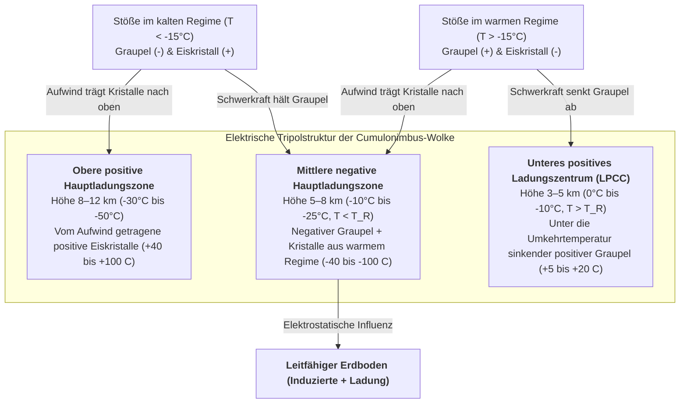

Jede Sekunde durchzucken weltweit etwa 40 bis 50 Blitze die Erdatmosphäre – fast vier Millionen hochenergetische Entladungen pro Tag. Mehr als 270 Jahre nach Benjamin Franklins berühmtem Drachenexperiment von 1752 birgt die Atmosphärenphysik noch immer ein fundamentales Paradoxon: <strong>Wie genau beginnt ein Blitz im Inneren einer Gewitterwolke?</strong> Wetterballons und Forschungsflugzeuge messen im turbulenten Kern aktiver Cumulonimbus-Wolken maximale makroskopische elektrische Felder von lediglich $0,1\text{–}0,4\,\text{MV/m}$ – eine ganze Größenordnung schwächer als die klassische dielektrische Durchbruchfeldstärke trockener Luft auf Meereshöhe ($E_{b0} \approx 3,0\,\text{MV/m}$) nach der Townsend-Lawinentheorie und dem Paschen-Gesetz. Warum bewegt sich ein Blitz zudem niemals geradlinig, sondern bildet einen komplexen <strong>fraktalen Baum</strong>, der durch Laplace-Wachstumsinstabilitäten gesteuert wird? Warum ruckt der abwärts gerichtete negative <strong>Stufenleitblitz (Stepped Leader)</strong> alle $50\,\mu\text{s}$ in $50\,\text{m}$-Schritten voran, bevor die blendende <strong>Hauptentladung (Return Stroke)</strong> mit einem Drittel der Lichtgeschwindigkeit ($v \approx c/3$) vom Boden nach oben rast und den Kanal auf $30.000\,\text{K}$ aufheizt? Dieser Artikel beleuchtet die vollständige Physik des Blitzes von der Nanoskala bis zur relativistischen Elektrodynamik.

---

## 1. Der elektrostatische Cumulonimbus-Generator: Nicht-induktive Ladungstrennung und Tripolstruktur

Vor einem dielektrischen Durchschlag muss eine reife <strong>Cumulonimbus-Wolke</strong> über Kilometer hinweg Spannungen von $10^8$ bis $10^9\,\text{V}$ aufbauen. In der turbulenten <strong>Mischphasenregion</strong> in $4\text{–}10\,\text{km}$ Höhe (Temperaturen von $0^\circ\text{C}$ bis $-40^\circ\text{C}$), angetrieben durch starke Aufwinde ($v_{\text{up}} \approx 10\text{–}30\,\text{m/s}$), koexistieren drei Hydrometeor-Arten: <strong>unterkühlte Wassertröpfchen</strong> ($d \approx 10\text{–}20\,\mu\text{m}$), durch Dampfdiffusion wachsende <strong>Eiskristalle</strong> ($20\text{–}200\,\mu\text{m}$) und millimetergroße <strong>Graupelpartikel</strong> ($1\text{–}5\,\text{mm}$), die durch das Anfrieren unterkühlter Tröpfchen (<strong>Bereifung / Riming</strong>) schnell anwachsen.

Wie Windkanalstudien von Takahashi (1978) und Saunders (1991) zeigten, beruht die Elektrifizierung auf der <strong>nicht-induktiven Ladungstrennung</strong> bei abprallenden Kollisionen zwischen Graupel und Eiskristallen in Gegenwart unterkühlter Tröpfchen, wobei pro Stoß etwa $10\text{–}100\,\text{fC}$ ($10^{-14}\text{–}10^{-13}\,\text{C}$) übertragen werden. Der mikroskopische Schlüssel liegt in der nanometordünnen <strong>Quasi-Flüssigschicht (Quasi-Liquid Layer, QLL)</strong> auf der Eisoberfläche. Im Eisgitter und der QLL dissoziieren Wassermoleküle in Protonen ($\text{H}^+$) und Hydroxid-Ionen ($\text{OH}^-$). Durch den Grotthuss-Protonenhüpfmechanismus entlang von Wasserstoffbrücken ist <strong>die Beweglichkeit von $\text{H}^+$ um Größenordnungen höher als die von $\text{OH}^-$</strong>.

Zwei konkurrierende Gradienten bestimmen das Vorzeichen des Ladungstransfers bei der Berührung: (1) <strong>Temperaturgradienten-Effekt</strong>: Durch die beim Gefrieren unterkühlter Tröpfchen freiwerdende Kristallisationswärme ist das Graupelkorn wärmer als der Eiskristall; hochmobile $\text{H}^+$-Protonen diffundieren vom wärmeren Graupel in den kälteren Eiskristall, sodass der Graupel negativ ($-$) und der Kristall positiv ($+$) zurückbleibt. (2) <strong>QLL-Dicken-Effekt (Baker-Dash-Mechanismus)</strong>: Bei höheren Temperaturen und hohem Flüssigwassergehalt ($\text{LWC}$) bildet die schneller wachsende Graupeloberfläche eine dickere QLL aus, deren Massentransfer beim Abprallen die Polarität umkehrt. Die Grenze zwischen beiden Regimen definiert die <strong>Umkehrtemperatur (Reversal Temperature, $T_R \approx -15^\circ\text{C}$ bis $-20^\circ\text{C}$)</strong>:

* <strong>Kaltes Regime ($T < T_R$, Höhe $7\text{–}10\,\text{km}$)</strong>: Schwerer <strong>Graupel lädt sich negativ ($-$)</strong> auf, leichte <strong>Eiskristalle positiv ($+$)</strong>.
* <strong>Warmes Regime ($T > T_R$, Höhe $4\text{–}6\,\text{km}$)</strong>: Polaritätsumkehr – schwerer <strong>Graupel lädt sich positiv ($+$)</strong> auf, leichte <strong>Eiskristalle negativ ($-$)</strong>.

Durch <strong>gravitative Größensortierung</strong> fallen die schweren Graupelkörner ($v_t \approx 5\text{–}10\,\text{m/s}$) in mittlere und tiefere Wolkenschichten, während leichte Eiskristalle ($v_t \ll 1\,\text{m/s}$) mit dem Aufwind in den oberen Amboss getragen werden. So entsteht die klassische <strong>elektrische Tripolstruktur</strong> der Gewitterwolke:

Die Raumladungsdichte $\rho(\mathbf{r})$ bestimmt das elektrostatische Potenzial $\phi(\mathbf{r})$ und das Feld $\mathbf{E} = -\nabla\phi$ über die <strong>Poisson-Gleichung</strong>:

$$\nabla^2 \\phi(\mathbf{r}) = -\frac{\rho(\mathbf{r})}{\varepsilon_0}$$

Das <strong>untere positive Ladungszentrum (LPCC)</strong> verstärkt lokal das abwärts gerichtete elektrische Feld am Unterrand der negativen Hauptladungszone und wirkt wie ein elektrostatisches Katapult für negative Leitblitze. In <strong>Wintergewittern</strong> (z. B. an der japanischen Küste) liegt die $-15^\circ\text{C}$-Isotherme nur knapp $2\,\text{km}$ über dem Boden, wodurch sich die obere positive Ladungszone direkt zur Erde entladen kann – als gewaltige <strong>positive Erdblitze (+CG „Superbolts“)</strong> mit Spitzenströmen bis $300\,\text{kA}$.

---

## 2. Das Rätsel der Blitzentstehung: Klassischer Durchschlag vs. Relativistische Runaway-Lawinen (RREA)

In der klassischen Gasentladungsphysik konkurrieren Elektronenstoßionisation (erster Townsend-Koeffizient $\alpha$) und Elektronenanlagerung an elektronegative Sauerstoffmoleküle (Anlagerungskoeffizient $\eta_a$):

$$\frac{dN_e}{dx} = (\alpha - \eta_a) N_e \implies N_e(x) = N_0 \exp\left[ (\alpha - \eta_a) x \right]$$

Für eine exponentielle <strong>Townsend-Lawine</strong> muss $\alpha > \eta_a$ gelten, was auf Meereshöhe eine Durchbruchfeldstärke $E_{b0} \approx 3,0\,\text{MV/m}$ ($E/N \approx 120\,\text{Td}$) erfordert. Nach dem <strong>Paschen-Gesetz</strong> skaliert das Durchbruchfeld proportional zur relativen Luftdichte $n(z) = \exp(-z/H)$:

$$E_b(z) = E_{b0} \cdot n(z) \approx (3.0\,\\text{MV/m}) \cdot \exp(-z/H)$$

Selbst in $6\,\text{km}$ Höhe ($n \approx 0,5$) wären noch $E_b(6\,\text{km}) \approx 1,5\,\text{MV/m}$ nötig – weit mehr als die gemessenen $0,1\text{–}0,4\,\text{MV/m}$. Zwei physikalische Prozesse lösen dieses Paradoxon:

1. <strong>Relativistische Runaway-Elektronenlawinen (RREA) durch kosmische Strahlung</strong>: Langsame thermische Elektronen scheitern an der hohen inelastischen Stoßbremsbarriere bei $100\text{–}200\,\text{eV}$ ($F_{\max} \approx 27\,\text{MeV/m}\cdot n(z)$). Besitzt ein Elektron jedoch bereits relativistische Energien ($K_{\min} \approx 1,0\text{–}1,4\,\text{MeV}$), sinkt die Bethe-Bloch-Bremskraft auf ein Minimum von $F_{\min} \approx 0,218\,\text{MeV/m}\cdot n(z)$. Unter Berücksichtigung der elastischen Coulomb-Streuung ergibt sich die <strong>RREA-Schwellenfeldstärke $E_{\text{RREA}}$</strong> (Gurevich, 1992; Dwyer, 2003):

$$E_{\\text{RREA}}(z) \approx 0.284\,\\text{MV/m} \cdot n(z), \qquad N_{\\text{RREA}}(L) = N_0 \exp\left(\frac{L}{\lambda_{\\text{RREA}}}\right)$$

   In $6\,\text{km}$ Höhe beträgt $E_{\text{RREA}} \approx 0,14\,\text{MV/m}$ – exakt im Bereich der Ballonmessungen! Hochenergetische kosmische Strahlung erzeugt <strong>ausgedehnte Luftschauer (EAS)</strong>, deren $\sim 1\,\text{MeV}$-Saatelektronen im Wolkenfeld davonlaufen (Runaway) und über Møller-Streuung eine relativistische Lawine auslösen.
2. <strong>Feldverstärkung an Eiskristallspitzen und schneller positiver Durchschlag (Fast Positive Breakdown)</strong>: An länglichen Eiskristallen mit großem Aspektverhältnis $l/r \gg 1$ verstärkt dielektrische Polarisation das lokale Spitzenfeld erheblich:

$$E_{\\text{tip}} \approx E_0 \frac{(l/r)^2}{\ln(2l/r) - 1}$$

   Überschreitet $E_{\text{tip}}$ lokal $E_b(z)$, starten <strong>positive Korona-Streamer</strong>, die sich ab dem Stabilitätsfeld $E_{\text{st}}^{+} \approx 0,45\,\text{MV/m}\cdot n(z)$ selbstständig ausbreiten. Rison et al. (2016) wiesen mittels Breitband-VHF-Interferometrie nach, dass Blitze mit einer explosionsartigen Kaskade positiver Streamer ($v \approx 3\text{–}5 \times 10^7\,\text{m/s}$) beginnen, dem sogenannten <strong>Fast Positive Breakdown (FPB / Narrow Bipolar Events, NBE)</strong>.

---

## 3. Warum Blitze sich verzweigen: Streamer-Leader-Übergang und $\eta$-Laplace-Fraktalwachstum

Ein einzelner Streamer ist ein kaltes Plasma ($T_g \approx 300\,\text{K}$), dessen freie Elektronen innerhalb von Nanosekunden an $\text{O}_2$ gebunden werden. Bündeln sich jedoch Tausende Streamer in einer gemeinsamen Wurzel (Stem), heizt Joulesche Wärme das Neutralgas über die kritische Schwelle von <strong>$T_{\text{crit}} \approx 1.500\text{–}5.000\,\text{K}$</strong> auf. Dadurch setzen (1) <strong>thermische Elektronenablösung</strong> ($\text{O}_2^- + \text{M} \to \text{O}_2 + \text{M} + \text{e}^-$), (2) <strong>Vibrations-Translations-(V-T)-Relaxation</strong> von $\text{N}_2$ und (3) <strong>hydrodynamische Kanalexpansion</strong> ein. Es entsteht ein hochleitfähiger, heißer <strong>Leitblitzkanal (Leader)</strong>, der das $-50\,\text{MV}$-Potenzial der Wolke wie ein Draht nach unten führt.

Da negative Streamer ein doppelt so hohes Feld benötigen wie positive ($E_{\text{st}}^{-} \approx 1,0\text{–}1,2\,\text{MV/m}\cdot n$), wächst der negative <strong>Stufenleitblitz (Stepped Leader)</strong> ruckartig: Einige Meter vor der Hauptspitze zündet ein isolierter Plasmakern (<strong>Space Stem</strong>), aus dem ein bidirektionaler Raumleader wächst. Sobald dessen rückwärts laufendes positives Ende die negative Hauptspitze berührt, schließt sich ein $L_{\text{step}} \approx 10\text{–}50\,\text{m}$ langes Segment in einem hellen Stromimpuls kurz (Pausenzeit $\tau_{\text{step}} \approx 20\text{–}50\,\mu\text{s}$, mittlere Geschwindigkeit $\sim 2 \times 10^5\,\text{m/s}$).

Die charakteristische Baumverzweigung erklärt das <strong>Dielectric Breakdown Model (DBM)</strong> von Niemeyer, Pietronero und Wiesmann (1984). Der leitfähige Leader-Baum wirkt als Äquipotenzialfläche ($\phi = 0$) im Laplace-Feld, wobei die Durchschlagswahrscheinlichkeit $P_i$ am Randpunkt $i$ mit der $\eta$-ten Potenz des lokalen Feldes skaliert:

$$\nabla^2 \\phi(\mathbf{r}) = 0, \qquad P_i = \frac{|\nabla \\phi_i|^\eta}{\sum_{j \in \\text{boundary}} |\nabla \\phi_j|^\eta} \quad \left(|\nabla \\phi_i| > E_{\\text{crit}}\right)$$

Hervorstehende Spitzen komprimieren die Äquipotenzialflächen, während Seitenäste elektrostatisch abgeschirmt werden (<strong>Mullins-Sekerka- / Laplace-Wachstumsinstabilität</strong>). Während $\eta = 1$ der diffusionsbegrenzten Aggregation (DLA, 2D $D_f \approx 1,71$) entspricht, liefert das nichtlineare Blitzregime ($\eta \approx 2$) eine 2D-projizierte <strong>fraktale Hausdorff-Dimension von $D_f \approx 1,35\text{–}1,55$</strong> – in exzellenter Übereinstimmung mit fotografischen Messungen.

---

## 4. Fangentladung, $30.000\,\text{K}$ Hauptentladung und Überschall-Stoßwellenmechanik des Donners

Nähert sich der Stufenleitblitz dem Boden bis auf die <strong>Enddurchschlagsstrecke (Striking Distance) $r_s$</strong>, starten von geerdeten Spitzen (Blitzableitern, Bäumen) aufwärts gerichtete <strong>Fangentladungen</strong>. Im <strong>elektrogeometrischen Modell (EGM, Blitzkugelverfahren)</strong> gilt nach Love (1973) für $r_s$ in Abhängigkeit vom Scheitelstrom $I_p$ (in $\text{kA}$):

$$r_s = 10 \, I_p^{0.65} \quad [\\text{m}]$$

Beim Zusammenschluss der Kanäle jagt eine Neutralisationswelle – die <strong>Hauptentladung (Return Stroke)</strong> – mit <strong>$v_{\text{RS}} \approx c/3 \approx 1,0 \times 10^8\,\text{m/s}$</strong> vom Boden in die Wolke hinauf. Innerhalb von $1\text{–}5\,\mu\text{s}$ fließen rund $30\,\text{kA}$ durch den nur $1\text{–}3\,\text{cm}$ dünnen Plasmakern und heizen ihn <strong>isochor</strong> auf <strong>$T \approx 30.000\,\text{K}$ (fünfmal heißer als die Sonnenoberfläche)</strong> auf. Nachfolgende <strong>Pfeilleitblitze (Dart Leaders)</strong> nutzen den warmen Restkanal mit $\sim 10^7\,\text{m/s}$ und erzeugen das typische Mehrfachflackern eines Blitzes.

Durch den sprunghaften Temperaturanstieg und die Dissoziation/Ionisation steigt der Kanaldruck auf $10\text{–}100\,\text{atm}$. Das Plasma expandiert radial mit Mach $10\text{–}20$ als zylindrische <strong>Taylor-Sedov-Stoßwelle</strong>. Der charakteristische Relaxationsradius $R_0$ und die akustische Hauptfrequenz $f_{\text{peak}}$ des Donners folgen aus der Linienenergiedichte $E_l$ und dem Luftdruck $P_0$:

$$R_0 = \sqrt{\frac{E_l}{\pi P_0}}, \qquad f_{\\text{peak}} \approx 0.63 \, c_s \sqrt{\frac{P_0}{E_l}} = \frac{0.63 \, c_s}{\sqrt{\pi} R_0} \approx 50\\text{–}150\,\\text{Hz}$$

In größerer Entfernung formen Laufzeitunterschiede entlang des gewundenen 3D-Kanals, die frequenzquadratische atmosphärische Dämpfung ($\alpha_{\text{att}} \propto f^2$) und die thermische Aufwärtsbrechung der Schallwellen das scharfe Knallen in ein langgezogenes Donnergrollen um.

---

## 5. Hochatmosphärische Entladungen (TLEs) und Antimaterie aus terrestrischen Gammablitzen (TGFs)

1. <strong>Transiente Leuchterscheinungen (TLEs)</strong>:
   * <strong>Rote Kobolde (Red Sprites, $50\text{–}90\,\text{km}$ Höhe)</strong>: Nach starken $+CG$-Blitzen mit großem Ladungsmomentenwechsel ($\text{CMC} \gtrsim 500\,\text{C}\cdot\text{km}$) übersteigt das quasi-elektrostatische Feld in $70\text{–}80\,\text{km}$ Höhe die exponentiell mit der Luftdichte gesunkene Durchbruchfeldstärke $E_b(z)$ und zündet riesige kalte Streamer-Komplexe (oben rot durch $\text{N}_2(1\text{P})$, unten blau durch $\text{N}_2^+(1\text{N})$).
   * <strong>Blue Jets ($15\text{–}50\,\text{km}$) und Gigantic Jets (bis $90\,\text{km}$)</strong>: Aus der Wolkenspitze mit $\sim 100\,\text{km/s}$ nach oben schießende positive Leader-Streamer-Kegel.
   * <strong>ELVES ($85\text{–}100\,\text{km}$)</strong>: Der kugelförmige elektromagnetische Puls (EMP) des Return Stroke schneidet die untere Ionosphäre und erzeugt in $<1\,\text{ms}$ einen mit Überlicht-Phasengeschwindigkeit expandierenden roten Leuchtring von $300\text{–}500\,\text{km}$ Durchmesser.
2. <strong>Terrestrische Gammablitze (TGFs) und photonukleare Antimaterie-Erzeugung</strong>: RREA-Elektronen ($20\text{–}40\,\text{MeV}$) erzeugen harte Bremsstrahlungs-Gammablitze. Enoto et al. (2017, *Nature*) bewiesen, dass Gammaphotonen oberhalb von $10,55\,\text{MeV}$ über die Riesen-Dipolresonanz Neutronen aus $^{14}\text{N}$-Kernen herausschlagen. Das entstehende instabile $^{13}\text{N}$ emittiert beim $\beta^+$-Zerfall <strong>Antimaterie-Positronen ($\text{e}^+$)</strong>, die mit Elektronen der Luft unter Aussendung der charakteristischen <strong>$0,511\,\text{MeV}$-Vernichtungsstrahlung</strong> annihilieren:

$$\gamma + {{}}^{14}_{7}\\text{N} \longrightarrow {{}}^{13}_{7}\\text{N} + \\text{n} \quad (E_\gamma > 10.55\,\\text{MeV})$$

$${{}}^{13}_{7}\\text{N} \longrightarrow {{}}^{13}_{6}\\text{C} + \\text{e}^+ + \nu_e, \qquad \\text{e}^+ + \\text{e}^- \longrightarrow 2\gamma \quad (E_\gamma = 0.511\,\\text{MeV})$$

---

## 6. Physikalischer Gesamtvergleich und moderne Messmethoden

| Phänomen / Phase | Höhe / Räumliche Skala | Dauer / Zeitskala | Geschwindigkeit $v$ | Typischer Strom, Energie oder Temperatur | Grundlegender physikalischer Mechanismus |
| :--- | :--- | :--- | :--- | :--- | :--- |
| <strong>Nicht-induktive Aufladung</strong> | $4\text{–}10\,\text{km}$ (Mischphasenzone) | $10\text{–}30\,\text{min}$ Konvektionszyklus | Aufwind $10\text{–}30\,\text{m/s}$ | $\sim 10^{-14}\,\text{C}$/Stoß; $\pm 40\text{–}100\,\text{C}$ Gesamtladung | Graupel-Eiskristall-Stöße, QLL-$\text{H}^+$-Diffusion, Umkehrtemperatur $T_R \approx -15^\circ\text{C}$ |
| <strong>Fast Positive Breakdown (NBE)</strong> | $5\text{–}12\,\text{km}$; Länge $0,3\text{–}1\,\text{km}$ | $10\text{–}20\,\mu\text{s}$ | $3 \times 10^7 \text{–} 5 \times 10^7\,\text{m/s}$ | Multi-Megawatt-VHF-Radiopuls | Kosmische RREA-Lawine + Spitzenfeldverstärkung an Eiskristallen |
| <strong>Negativer Stufenleitblitz</strong> | Wolke–Boden ($10\text{–}50\,\text{m}$ Stufen) | $10\text{–}30\,\text{ms}$ ($20\text{–}50\,\mu\text{s}$ Pausen) | Mittel $2 \times 10^5\,\text{m/s}$ | $100\text{–}1.000\,\text{A}$; Kern $T \approx 5.000\,\text{K}$ | Thermische Elektronenablösung ($>1.500\,\text{K}$), Space Stems, DBM $\eta$-Laplace-Fraktal |
| <strong>Hauptentladung (Return Stroke)</strong> | Boden–Wolke (Kerndurchmesser $1\text{–}3\,\text{cm}$) | $1\text{–}5\,\mu\text{s}$ Anstieg; $\sim 100\,\mu\text{s}$ Abfall | $v \approx c/3 \approx 1,0 \times 10^8\,\text{m/s}$ (aufwärts) | Median $30\,\text{kA}$ (+CG bis $300\,\text{kA}$); <strong>$T \approx 30.000\,\text{K}$</strong> | Erdpotenzial-Neutralisationswelle, isochore Aufheizung ($10\text{–}100\,\text{atm}$), Zylinderstoßwelle |
| <strong>Sprites / Blue Jets / ELVES</strong> | $15\text{–}100\,\text{km}$ (Stratosphäre–Ionosphäre) | $<1\,\text{ms}$ (ELVES) bis $300\,\text{ms}$ (Jets) | $10^5\,\text{m/s}$ bis $>c$ (Phasengeschw.) | Kaltes Plasma ($T_g \approx 200\text{–}300\,\text{K}$) | Quasi-elektrostatischer Durchschlag, Ladungsungleichgewicht, sphärische EMP-Schale |
| <strong>Terrestrischer Gammablitz (TGF)</strong> | $10\text{–}15\,\text{km}$ (Wintergewitter $2\text{–}4\,\text{km}$) | $<1\,\text{ms}$ ($\text{e}^+$-Nachleuchten $\sim 10\,\text{min}$) | Relativistische Elektronen $v \approx 0,99c$ | Photonenenergien bis <strong>$20\text{–}40\,\text{MeV}$</strong> | RREA-Bremsstrahlung, $^{14}\text{N}(\gamma,\text{n}){}^{13}\text{N}$-Kernreaktion & $0,511\,\text{MeV}$ $\text{e}^+\text{e}^-$-Annihilation |

Heute ermöglichen GPS-synchronisierte <strong>3D-VHF-Lightning-Mapping-Arrays (LMA)</strong> und Breitband-Interferometer die dreidimensionale Rekonstruktion von Blitzkanälen im Wolkeninneren in Echtzeit. Im Jahr 2023 gelang es zudem einem europäischen Konsortium auf dem Säntis ($2.502\,\text{m}$) in der Schweiz erstmals, natürliche Blitze mithilfe eines Terawatt-Femtosekundenlasers über <strong>Laser-Filamentierung</strong> auf einer Strecke von $50\,\text{m}$ gezielt zum Blitzableiter zu führen (Houard et al., 2023). Global halten die rund 2.000 ständig aktiven Gewitter als Batterie des <strong>globalen elektrischen Stromkreises (Global Electric Circuit)</strong> die Ionosphäre auf $+250\,\text{kV}$, treiben das Schönwetterfeld ($100\text{–}150\,\text{V/m}$) an und regen die <strong>Schumann-Resonanzen ($7,83\,\text{Hz}$)</strong> des Erde-Ionosphäre-Hohlraums an.
