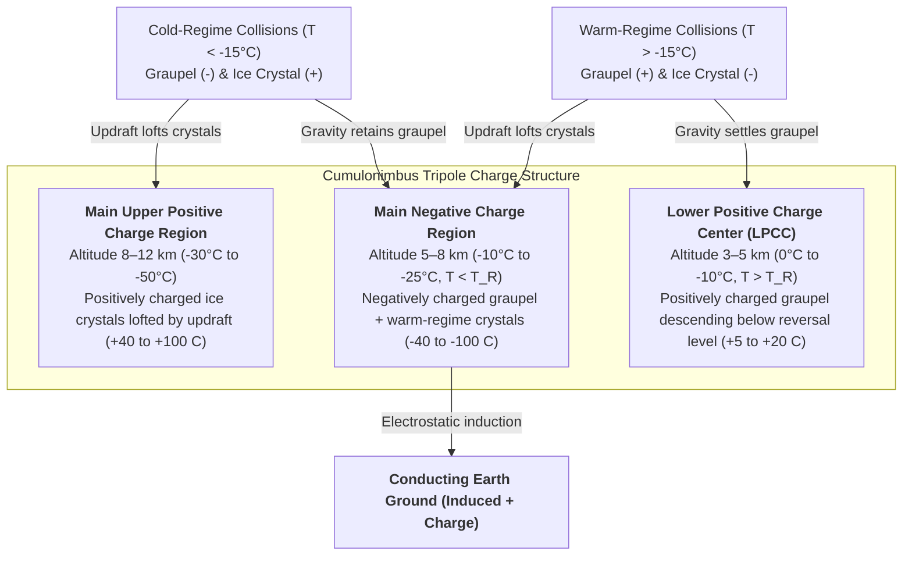
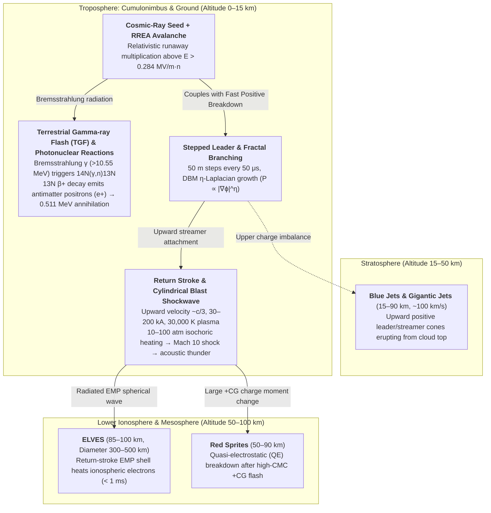

Every second, somewhere across Earth's atmosphere, approximately 40 to 50 lightning flashes tear across the sky—amounting to nearly 4 million high-energy electrical discharges per day. More than 270 years have elapsed since Benjamin Franklin's famous 1752 kite experiment demonstrated that lightning is an electrical discharge. Yet remarkably, even with modern plasma diagnostics, satellite-borne gamma-ray detectors, and broadband radio interferometers, one of the most fundamental questions in atmospheric physics remains only partially solved: <strong>How does a lightning flash actually begin inside a thundercloud?</strong>

When weather balloons and research aircraft penetrate the turbulent cores of active cumulonimbus clouds, the maximum macroscopic electric fields they measure never exceed $0.1\text{–}0.4\,\text{MV/m}$—roughly an order of magnitude weaker than the conventional dielectric breakdown threshold of air ($E_b \approx 3\,\text{MV/m}$ at sea level) required by Townsend avalanche theory and Paschen's law. Solving this <strong>Lightning Initiation Mystery</strong> requires bridging cloud microphysics with relativistic cosmic-ray physics and non-thermal plasma dynamics.

Furthermore, why does a lightning bolt never travel in a straight line, instead carving a complex, self-similar tree of <strong>fractal branches</strong> governed by Laplacian growth instabilities? Why does the descending negative <strong>stepped leader</strong> pause every $50\,\mu\text{s}$ to advance in discrete $50\,\text{m}$ jumps, only to trigger a blinding <strong>return stroke</strong> that surges upward from the ground at one-third the speed of light ($v \approx c/3 \approx 10^8\,\text{m/s}$), heating a centimeter-wide channel to $30,000\,\text{K}$—five times hotter than the surface of the Sun? And how do thunderstorms launch gigantic <strong>Red Sprites</strong>, <strong>Blue Jets</strong>, and <strong>ELVES</strong> into the mesosphere while operating as natural particle accelerators that trigger photonuclear reactions and generate <strong>antimatter positrons ($\text{e}^+$)</strong> via <strong>Terrestrial Gamma-ray Flashes (TGFs)</strong>?

In this comprehensive treatise, we trace the complete physical lifecycle of lightning from the nanoscale quasi-liquid layer of colliding ice crystals to relativistic electrodynamics and supersonic shockwave acoustics.

---

## 1. The Cumulonimbus Electrostatic Generator: Non-Inductive Charge Separation and the Tripole Structure

Before dielectric breakdown can occur, a thundercloud must generate potential differences of $10^8$ to $10^9\,\text{V}$ across kilometer-scale volumes. This electrostatic engine is driven by the vigorous thermodynamics and mixed-phase microphysics of a mature <strong>cumulonimbus cloud</strong>.

### 1.1 Mixed-Phase Microphysics and Non-Inductive Riming Collisions

Driven by latent heat release, powerful convective updrafts ($v_{\text{up}} \approx 10\text{–}30\,\text{m/s}$) carry moist air into the middle and upper troposphere. Between altitudes of roughly $4\,\text{km}$ and $10\,\text{km}$ (where ambient temperatures span $0^\circ\text{C}$ to $-40^\circ\text{C}$), a turbulent <strong>mixed-phase region</strong> forms in which three distinct hydrometeor species coexist:

1. <strong>Supercooled water droplets</strong>: Tiny liquid cloud droplets ($d \approx 10\text{–}20\,\mu\text{m}$) that remain liquid well below $0^\circ\text{C}$.
2. <strong>Pristine ice crystals</strong>: Microscopic hexagonal plates, columns, and needles ($d \approx 20\text{–}200\,\mu\text{m}$) growing primarily by vapor deposition.
3. <strong>Graupel (soft hail)</strong>: Millimeter-sized ($d \approx 1\text{–}5\,\text{mm}$) porous ice pellets that grow rapidly by <strong>riming</strong>—sweeping up and freezing supercooled water droplets upon impact.

Decades of laboratory and field investigations (Reynolds et al., 1957; Takahashi, 1978; Jayaratne et al., 1983; Saunders et al., 1991) have established that the primary charging mechanism in thunderclouds is <strong>non-inductive charge separation</strong> (meaning it operates independently of any pre-existing background electric field). Charge is separated during rebounding collisions between millimeter-sized <strong>graupel pellets</strong> and micron-sized <strong>ice crystals</strong> in the presence of supercooled water droplets, transferring approximately $10\text{–}100\,\text{fC}$ ($10^{-14}\text{–}10^{-13}\,\text{C}$) per collision.

### 1.2 The Reversal Temperature ($T_R \approx -15^\circ\text{C}$) and Quasi-Liquid Layer (QLL) Physics

Why does a brief mechanical contact between two pieces of ice transfer electric charge, and why does the polarity of that charge reverse depending on ambient temperature? The answer lies in the surface condensed-matter physics of ice—specifically the <strong>Quasi-Liquid Layer (QLL)</strong>—and the landmark wind-tunnel experiments of Tsutomu Takahashi (1978) and Clive Saunders (1991).

Even at temperatures down to $-30^\circ\text{C}$, the outermost nanometers of an ice crystal's surface do not form a rigid hexagonal lattice; instead, dangling hydrogen bonds create a disordered, mobile <strong>Quasi-Liquid Layer (QLL)</strong>. Within the ice lattice and QLL, water molecules undergo auto-ionization into hydronium protons ($\text{H}^+$ / $\text{H}_3\text{O}^+$) and hydroxyl ions ($\text{OH}^-$). Because protons hop rapidly along hydrogen-bond chains via the Grotthuss mechanism, <strong>the cationic mobility of $\text{H}^+$ in ice is orders of magnitude greater than the anionic mobility of $\text{OH}^-$</strong>.

During a brief graupel–crystal collision, two competing thermodynamic gradients drive charge transfer across the transient contact neck:

* <strong>Temperature Gradient Effect</strong>: A graupel pellet undergoing riming is warmed by the latent heat of fusion released as supercooled droplets freeze onto its surface. Because warmer ice has a higher equilibrium concentration of dissociated $\text{H}^+$ and $\text{OH}^-$ ions, high-mobility $\text{H}^+$ protons diffuse rapidly from the warmer graupel into the colder rebounding ice crystal, leaving the graupel negatively charged ($-$) and the crystal positively charged ($+$).
* <strong>Relative Diffusional Growth Rate / QLL Thickness Effect (Baker-Dash Mechanism)</strong>: The particle whose surface is growing faster from vapor deposition (or accreting supercooled water) develops a thicker QLL with an excess negative surface potential due to preferential orientation of water dipoles and ionic segregation. Upon separation, mass transfer from the thicker QLL to the thinner QLL reverses the net polarity under warm, high-liquid-water conditions.

Takahashi's (1978) classic two-dimensional charging diagram—mapping graupel charge polarity as a function of ambient temperature $T$ and cloud Liquid Water Content ($\text{LWC}$)—revealed a critical boundary known as the <strong>Reversal Temperature ($T_R \approx -15^\circ\text{C}$ to $-20^\circ\text{C}$)</strong>:

* <strong>Cold Regime ($T < T_R$, Altitude $\sim 7\text{–}10\,\text{km}$)</strong>: Rebounding collisions charge the heavy <strong>graupel negatively ($-$)</strong> and the light <strong>ice crystals positively ($+$)</strong>.
* <strong>Warm Regime ($T > T_R$, Altitude $\sim 4\text{–}6\,\text{km}$)</strong>: At moderate-to-high $\text{LWC}$, the charging sign reverses: heavy <strong>graupel charges positively ($+$)</strong> and light <strong>ice crystals charge negatively ($-$)</strong>.

### 1.3 Gravitational Size Sorting and the Tripole Charge Structure

Microscopic charge exchange alone cannot create a lightning flash if positive and negative particles remain mixed within the same volume. The macroscopic charge separation that turns a cloud into a giant capacitor is achieved by <strong>gravitational size sorting</strong> against the convective updraft:

* Heavy millimeter-sized <strong>graupel pellets</strong> possess large terminal fall speeds ($v_t \approx 5\text{–}10\,\text{m/s}$) and therefore remain suspended in the middle-to-lower cloud layers or descend toward the melting level.
* Light micron-sized <strong>ice crystals</strong> have negligible terminal fall speeds ($v_t \ll 1\,\text{m/s}$) and are swept upward by the $10\text{–}30\,\text{m/s}$ updraft into the upper anvil of the cloud.

Combining the microphysical reversal temperature $T_R \approx -15^\circ\text{C}$ with macroscopic gravitational sorting naturally produces the canonical <strong>electrical tripole structure</strong> of a thunderstorm (Williams, 1989):

The resulting macroscopic space-charge density $\rho(\mathbf{r})$ governs the electrostatic potential $\phi(\mathbf{r})$ and electric field $\mathbf{E}(\mathbf{r}) = -\nabla\phi(\mathbf{r})$ via <strong>Poisson's equation</strong>:

$$\nabla^2 \phi(\mathbf{r}) = -\frac{\rho(\mathbf{r})}{\varepsilon_0}$$

Here, the <strong>Lower Positive Charge Center (LPCC)</strong> plays a pivotal mechanical role: by sitting directly beneath the Main Negative Charge Region, it forms a localized vertical dipole that dramatically enhances the downward-directed electric field at the bottom of the negative layer, acting as an electrostatic "catapult" that launches negative stepped leaders toward the ground. Conversely, in <strong>winter thunderstorms</strong> (such as those along the Sea of Japan coast in Hokuriku), cold surface temperatures lower the $-15^\circ\text{C}$ isotherm to within $2\,\text{km}$ of the ground, tilting and compressing the tripole so that the Upper Positive Charge Region discharges directly to Earth in massive <strong>positive cloud-to-ground (+CG) "superbolts."</strong>

---

## 2. The Lightning Initiation Mystery: Conventional Breakdown vs. Relativistic Runaway Avalanches

Once the tripole charge structure is established, how does the air transition from an insulator (conductivity $\sigma \sim 10^{-14}\,\text{S/m}$) into a white-hot plasma channel ($\sigma \sim 10^4\,\text{S/m}$)? Here we confront the central paradox of atmospheric electricity.

### 2.1 Townsend Avalanche, Electron Attachment, and Paschen's Law

In classical gas discharge physics, dielectric breakdown of air is governed by the competition between <strong>electron impact ionization</strong> (quantified by the first Townsend ionization coefficient $\alpha$, the number of ionizing collisions per unit length) and <strong>electron attachment</strong> to electronegative oxygen molecules ($\text{e}^- + \text{O}_2 + \text{M} \to \text{O}_2^- + \text{M}$ and dissociative attachment $\text{e}^- + \text{O}_2 \to \text{O}^- + \text{O}$, quantified by the attachment coefficient $\eta_a$).

A free electron population $N_e(x)$ drifting along an electric field $E$ evolves according to:

$$\frac{dN_e}{dx} = (\alpha - \eta_a) N_e \implies N_e(x) = N_0 \exp\left[ (\alpha - \eta_a) x \right]$$

For an exponentially growing <strong>Townsend avalanche</strong> to occur, the effective ionization coefficient must be positive ($\alpha_{\text{eff}} = \alpha - \eta_a > 0$). Because both $\alpha/N$ and $\eta_a/N$ are universal functions of the <strong>reduced electric field $E/N$</strong> (where $N$ is the neutral gas number density, measured in Townsends, $1\,\text{Td} = 10^{-21}\,\text{V}\cdot\text{m}^2$), the condition $\alpha = \eta_a$ defines the <strong>conventional dielectric breakdown threshold $E_{b0}$</strong> of dry air at standard sea-level density ($N_0 \approx 2.5 \times 10^{25}\,\text{m}^{-3}$, corresponding to $E/N \approx 120\,\text{Td}$):

$$E_{b0} \approx 3.0 \times 10^6\,\text{V/m} \quad (3\,\text{MV/m} = 30\,\text{kV/cm})$$

According to <strong>Paschen's law</strong> on the high-pressure side of the Paschen minimum ($p d \gg (pd)_{\min}$), the breakdown electric field scales linearly with relative air density $n(z) = N(z)/N_0 \approx \exp(-z/H)$ (with atmospheric scale height $H \approx 8\,\text{km}$):

$$E_b(z) = E_{b0} \cdot n(z) \approx (3.0\,\text{MV/m}) \cdot n(z)$$

At typical lightning initiation altitudes of $z \approx 5\text{–}7\,\text{km}$ ($n(z) \approx 0.45\text{–}0.55$), conventional breakdown still requires a macroscopic electric field of <strong>$E_b(6\,\text{km}) \approx 1.5\,\text{MV/m}$</strong>.

### 2.2 The Observational Paradox

Over the past four decades, dozens of balloon-borne electric field mill soundings, research aircraft penetrations, and rocket-borne sensors (Marshall et al., 1995; Stolzenburg et al., 2007) have directly measured the electric fields inside active thunderclouds right before lightning strikes. <strong>The measured maximum macroscopic electric fields inside thunderclouds consistently fall in the range of $0.1\text{–}0.4\,\text{MV/m}$—never exceeding roughly 10% to 25% of the altitude-adjusted conventional breakdown field $E_b(z)$!</strong>

How can lightning initiate reliably when the ambient cloud field is nearly an order of magnitude below the dielectric breakdown strength of air? Two complementary physical mechanisms resolve this paradox.

### 2.3 Solution I: Relativistic Runaway Electron Avalanches (RREA) Seeded by Cosmic Rays

The first mechanism stems from a profound insight by C.T.R. Wilson (1925), later formulated into modern kinetic theory by Alexander Gurevich et al. (1992) and Joseph Dwyer (2003): <strong>Relativistic Runaway Electron Avalanches (RREA)</strong>.

In a conventional Townsend discharge, electrons start with thermal or near-thermal kinetic energies ($K \sim 1\text{–}10\,\text{eV}$). As a low-energy electron accelerates in an electric field, the dynamic friction force (collisional stopping power $F_d(K) = -dK/dx$ due to inelastic excitation and ionization of $\text{N}_2$ and $\text{O}_2$) rises steeply, reaching a massive peak barrier of $F_{\max} \approx 27\,\text{MeV/m}\cdot n(z)$ at electron energies around $K \approx 100\text{–}200\,\text{eV}$. Consequently, thermal electrons cannot "run away" unless the electric field exceeds a staggering $27\,\text{MV/m}\cdot n(z)$.

However, what happens if an electron already possesses a <strong>relativistic kinetic energy ($K \sim 0.1\text{–}10\,\text{MeV}$)</strong>? According to the relativistic <strong>Bethe-Bloch stopping power formula</strong>, as an electron's velocity $v$ approaches the speed of light $c$, the interaction time with bound atomic electrons decreases, causing the collisional drag force $F_d(K)$ to drop precipitously above $200\,\text{eV}$ and reach a broad minimum—the <strong>minimum ionizing value $F_{\min}$</strong>—at $K_{\min} \approx 1.0\text{–}1.4\,\text{MeV}$:

$$F_{\min}(z) \approx 0.218\,\text{MeV/m} \cdot n(z)$$

Consequently, if the ambient electric field $E$ exceeds the <strong>breakeven field $E_{\text{th}} = F_{\min}/e \approx 0.218\,\text{MV/m}\cdot n(z)$</strong>—or more precisely, accounting for elastic Coulomb scattering off atomic nuclei, the <strong>RREA threshold field $E_{\text{RREA}}$</strong> (Dwyer, 2003):

$$E_{\text{RREA}}(z) \approx 0.284\,\text{MV/m} \cdot n(z)$$

then any energetic seed electron with $K > K_{\text{crit}}$ gains more energy from the electric field per unit length ($eE$) than it loses to collisional drag ($F_d$), accelerating continuously to multi-$\text{MeV}$ energies! At an altitude of $z = 6\,\text{km}$ ($n \approx 0.5$), the RREA threshold is <strong>$E_{\text{RREA}}(6\,\text{km}) \approx 0.14\,\text{MV/m}$</strong>—which matches the exact maximum electric fields ($0.1\text{–}0.4\,\text{MV/m}$) observed by balloons inside thunderclouds!

As these relativistic runaway electrons streak through the cloud, they undergo hard knock-on electron-electron collisions (<strong>Møller scattering</strong>), liberating secondary electrons with kinetic energies exceeding the runaway threshold ($K > 100\,\text{keV}$). These secondaries also run away, creating an exponential relativistic avalanche over an e-folding length $\lambda_{\text{RREA}}$:

$$N_{\text{RREA}}(L) = N_0 \exp\left(\frac{L}{\lambda_{\text{RREA}}}\right), \quad \lambda_{\text{RREA}} \approx \frac{7.3\,\text{MV}}{E - (0.276\,\text{MV/m})\cdot n(z)}$$

Where do the initial $\sim 1\,\text{MeV}$ seed electrons come from? They are continuously supplied by <strong>Extensive Air Showers (EAS)</strong> generated when high-energy <strong>cosmic rays</strong> (protons and atomic nuclei with primary energies of $10^{15}\text{–}10^{17}\,\text{eV}$ originating from supernova remnants) slam into the upper atmosphere (Gurevich & Zybin, 2001). When a dense cosmic-ray air shower core traverses a high-field thundercloud region ($E > E_{\text{RREA}}$), relativistic multiplication produces a massive sheet of ionization that locally compresses and amplifies the electric field.

### 2.4 Solution II: Hydrometeor Field Amplification and Fast Positive Breakdown

The second mechanism operates at the millimeter scale of cloud ice particles (Loeb, 1966; Petersen et al., 2008; Rison et al., 2016). When an elongated conducting or dielectric ice crystal (such as an ice column or needle of length $l$ and tip radius of curvature $r$, with aspect ratio $l/r \gg 1$) is immersed in a sub-breakdown macroscopic field $E_0 \approx 0.2\,\text{MV/m}$, dielectric polarization concentrates surface charge at the sharp tips, amplifying the local electric field according to prolate spheroidal electrostatics:

$$E_{\text{tip}} \approx E_0 \frac{(l/r)^2}{\ln(2l/r) - 1}$$

For a modest aspect ratio of $l/r \approx 10\text{–}30$ (or during the near-contact of two oppositely polarized raindrops/graupel pellets), $E_{\text{tip}}$ locally exceeds $E_b(z) \approx 1.5\,\text{MV/m}$, launching non-thermal <strong>positive corona streamers</strong>. Crucial to lightning initiation is that once a positive streamer forms, the intense space-charge field packed into its own micron-thin head allows it to propagate indefinitely as long as the ambient background field exceeds the <strong>positive streamer stability field</strong> $E_{\text{st}}^{+} \approx 0.45\,\text{MV/m}\cdot n(z)$ ($\approx 0.22\,\text{MV/m}$ at $6\,\text{km}$).

In 2016, Rison et al. used broadband VHF interferometry to discover that virtually all lightning flashes begin with an explosive sub-microsecond burst of meter-scale positive streamer systems—termed <strong>Fast Positive Breakdown (FPB)</strong> or <strong>Narrow Bipolar Events (NBEs)</strong>—propagating at $v \approx 3\text{–}5 \times 10^7\,\text{m/s}$. In the modern unified picture, cosmic-ray RREA avalanches and turbulent hydrometeor clustering locally elevate the field above $E_{\text{st}}^{+}$, triggering a percolation cascade of positive streamers off millions of ice crystals that rapidly thermalizes into the first embryonic leader channel.

---

## 3. Why Lightning Branches: Streamer-to-Leader Transition, Stepped Leaders, and Fractal Laplacian Growth

Once an embryonic plasma channel is born inside the cloud, it elongates bidirectionally—its positive end extending into the negative charge layer while its negative end descends out of the cloud base toward the ground. Why does this descending bolt advance in discrete steps and split into a complex fractal tree?

### 3.1 Thermodynamics of the Streamer-to-Leader Phase Transition

A single corona <strong>streamer</strong> cannot cross kilometers of air because it is a <strong>cold, non-equilibrium plasma</strong>: although its electrons are energetic ($T_e \sim 20,000\text{–}50,000\,\text{K}$), the heavy neutral gas molecules remain at ambient temperature ($T_g \approx 250\text{–}300\,\text{K}$). Withintens of nanoseconds behind the streamer head, free electrons attach to $\text{O}_2$ molecules ($\text{e}^- + \text{O}_2 + \text{M} \to \text{O}_2^- + \text{M}$), causing the electrical conductivity of the cold streamer trail to collapse.

For a discharge to survive over kilometer distances, it must undergo a thermodynamic phase transition into a hot <strong>leader</strong> channel (Gallimberti, 1979; Bazelyan & Raizer, 2000). When thousands of streamers converge into a common root (the <strong>stem</strong>), their combined displacement and conduction currents heat the neutral gas via Joule dissipation. Once the gas temperature crosses the critical threshold of <strong>$T_{\text{crit}} \approx 1,500\text{–}5,000\,\text{K}$</strong>, three positive-feedback processes ignite:

1. <strong>Thermal Electron Detachment</strong>: Collisions with hot neutrals strip electrons back off negative oxygen ions ($\text{O}_2^- + \text{M} \to \text{O}_2 + \text{M} + \text{e}^-$), restoring high free-electron density.
2. <strong>Vibrational-Translational (V-T) Relaxation</strong>: Above $1,500\,\text{K}$, the large reservoir of energy stored in the vibrational states of $\text{N}_2$ molecules (excited by electron impact) rapidly relaxes into translational kinetic energy, explosively heating the gas core toward $5,000\,\text{K}$.
3. <strong>Hydrodynamic Expansion and associative ionization</strong>: The heated gas core expands radially, lowering the local neutral density $N$ inside the channel, which boosts the reduced field $E/N$ and sustains high thermal conductivity ($\sigma \sim 10^2\text{–}10^3\,\text{S/m}$) at a very low internal axial field ($E_{\text{leader}} \sim 10^4\,\text{V/m}$).

Because the internal voltage drop along this hot plasma leader is small, the channel acts like a conducting wire connected to the cloud's $-50\,\text{MV}$ reservoir, carrying extreme electrostatic potential directly to its advancing tip.

### 3.2 The Negative Stepped Leader Mechanism

In roughly 90% of cloud-to-ground flashes (<strong>negative cloud-to-ground flashes, -CG</strong>), a negatively charged leader propagates downward from the main negative charge region. As first revealed by B.F.J. Schonland's (1935) Boys camera photographs and later resolved by million-frame-per-second high-speed cameras, this negative leader does not advance smoothly; instead, it lurches downward in discrete, intermittent leaps known as a <strong>Stepped Leader</strong>:

* <strong>Step Length</strong>: $L_{\text{step}} \approx 10\text{–}50\,\text{m}$ per jump
* <strong>Inter-step Pause Time</strong>: $\tau_{\text{step}} \approx 20\text{–}50\,\mu\text{s}$
* <strong>Average Downward Propagation Velocity</strong>: $v_{\text{avg}} \approx 1.5 \times 10^5$ to $3.0 \times 10^5\,\text{m/s}$ ($\sim 200\,\text{km/s}$, or $0.07\%$ of $c$)
* <strong>Total Duration to Ground</strong>: $10\text{–}30\,\text{ms}$, depositing $-5$ to $-20\,\text{C}$ of negative charge along the channel column.

Why does a negative leader step whereas a positive leader propagates almost continuously? Because electrons drift *outward* from a negative tip into weakening fields, negative streamers require a much higher background field ($E_{\text{st}}^{-} \approx 1.0\text{–}1.2\,\text{MV/m}\cdot n$) than positive streamers ($E_{\text{st}}^{+} \approx 0.45\,\text{MV/m}\cdot n$). Consequently, the negative leader's corona brush stalls after a few meters. Ahead of this stalled negative streamer zone, intense space-charge fields ignite an isolated plasma nucleus called a <strong>space stem</strong> (or pilot system).

From this floating space stem, a miniature <strong>bidirectional space leader</strong> grows: a <strong>positive space leader</strong> propagates *backward* toward the main negative leader tip, while a <strong>negative space leader</strong> propagates *forward* into virgin air. The instant the backward-moving positive space leader collides with the main negative leader channel, their huge potential difference equalizes in a violent current pulse ($\sim 1\text{–}5\,\text{kA}$), illuminating the newly forged $50\,\text{m}$ segment and advancing the main channel by one discrete step!

### 3.3 The Dielectric Breakdown Model (DBM) and $\eta$-Laplacian Fractal Growth

Because multiple space stems form and compete simultaneously within the 3D corona zone ahead of the leader tip, the channel frequently splits. The universal fractal geometry of this branching was explained in a landmark statistical physics paper by Niemeyer, Pietronero, and Wiesmann (1984), who formulated the <strong>Dielectric Breakdown Model (DBM)</strong>.

Because the hot leader tree has high electrical conductivity, the entire plasma structure can be approximated as an equipotential conductor ($\phi = 0$), while the distant ground or cloud boundary sits at potential $\phi = V_0$. In the charge-free space surrounding the leader branches, the electrostatic potential $\phi(\mathbf{r})$ satisfies <strong>Laplace's equation</strong>:

$$\nabla^2 \phi(\mathbf{r}) = 0$$

Consider a small bump or perturbation protruding from the plasma boundary. By the electrostatic <strong>lightning rod effect</strong>, equipotential surfaces crowd together over any region of high positive curvature, amplifying the local electric field $E = |\nabla \phi|$ at the tip while electrostatically <strong>screening (shielding)</strong> the recessed fjords behind it. Because higher electric fields drive faster ionization, the protruding tip grows even faster—a classic <strong>Mullins-Sekerka / Laplacian growth morphological instability</strong> that inevitably forces growing tips to bifurcate (<strong>tip splitting</strong>).

To capture both stochastic fluctuations and the nonlinear dependence of ionization on electric field, the DBM discretizes space onto a lattice and postulates that the probability $P_i$ of boundary site $i$ breaking down at the next step is proportional to the $\eta$-th power of the local electric field $|\nabla \phi_i|$:

$$P_i = \frac{|\nabla \phi_i|^\eta}{\sum_{j \in \text{boundary}} |\nabla \phi_j|^\eta} \quad \left(\text{for } |\nabla \phi_i| > E_{\text{crit}}\right)$$

The exponent $\eta \ge 0$ controls the competition between tip amplification and spatial randomness, continuously tuning the <strong>fractal Hausdorff dimension $D_f$</strong> (defined by how total branch mass $M(R)$ scales with radius $R$: $M(R) \propto R^{D_f}$):

* <strong>$\eta = 0$ (Eden Growth Limit)</strong>: Breakdown probability is independent of the electric field, producing a compact, non-fractal blob with $D_f = 2.0$ in 2D ($D_f = 3.0$ in 3D).
* <strong>$\eta = 1$ (Diffusion-Limited Aggregation / DLA Limit)</strong>: Because the steady-state diffusion equation ($\nabla^2 u = 0$) is identical to Laplace's equation ($\nabla^2 \phi = 0$), the $\eta = 1$ DBM is mathematically isomorphic to Witten and Sander's (1981) <strong>Diffusion-Limited Aggregation (DLA)</strong>! This yields a universal fractal dimension of $D_f \approx 1.71$ in 2D and $D_f \approx 2.50$ in 3D.
* <strong>$\eta > 1$ (Dielectric Breakdown / Lightning Regime, $\eta \approx 1.5\text{–}3.0$)</strong>: Because Townsend ionization $\alpha(E)$ and streamer velocity depend strongly and nonlinearly on $E$, sites with the highest electric fields are heavily favored ($\eta > 1$). Side branches are strongly screened, producing sparser, more directional dendritic trees with 2D projected fractal dimensions of <strong>$D_f \approx 1.3\text{–}1.6$</strong>. Empirical box-counting analyses of lightning photographs yield $D_f \approx 1.35\text{–}1.55$ (Tsonis & Elsner, 1987; Kawasaki et al., 1989), in remarkable agreement with $\eta \approx 2$ Laplacian growth.

---

## 4. Attachment, the Return Stroke, and the Supersonic Shockwave Mechanics of Thunder

As the fractal tree of the stepped leader approaches within $50\text{–}200\,\text{m}$ of the ground, the final, most violent phase of the lightning flash begins.

### 4.1 Striking Distance, Upward Connecting Leaders, and the Electro-Geometric Model

Carrying $-5$ to $-20\,\text{C}$ of charge at a potential of $-50\,\text{MV}$, the descending stepped leader induces an intense upward-directed electric field at the Earth's surface. At the sharp tips of tall grounded structures—lightning rods, trees, transmission towers, or church steeples—the local field exceeds the conventional breakdown threshold $E_{b0}$, igniting one or more <strong>upward connecting positive leaders (answering streamers)</strong> that race skyward at $10^5\,\text{m/s}$ to meet the descending branches.

Crucially, a lightning bolt does not "choose" its strike point when it leaves the cloud; the strike point is determined only during this final <strong>attachment process</strong> when the descending leader enters the <strong>striking distance $r_s$</strong> of a grounded object. In high-voltage lightning protection engineering (e.g., IEEE Std 1243), the <strong>Electro-Geometric Model (EGM)</strong> relates the striking distance $r_s$ (in meters) to the prospective peak return-stroke current $I_p$ (in kiloamperes) via Love's (1973) empirical power law:

$$r_s = 10 \, I_p^{0.65} \quad [\text{m}]$$

For a median negative flash ($I_p = 30\,\text{kA}$), the striking distance is $r_s \approx 91\,\text{m}$; for a severe $100\,\text{kA}$ strike, $r_s \approx 200\,\text{m}$. This equation forms the physical foundation of the <strong>Rolling Sphere Method</strong> used worldwide to design lightning protection zones around buildings, launchpads, and substations: an imaginary sphere of radius $r_s$ is rolled over the terrain and structures, and only points touched by the sphere can be struck directly.

### 4.2 The Return Stroke: $30,000\,\text{K}$ Plasma Racing Upward at $c/3$

The instant the downward stepped leader and upward connecting leader touch (typically $20\text{–}100\,\text{m}$ above the ground), a short circuit is established between the $-50\,\text{MV}$ plasma column and the $0\,\text{V}$ conducting Earth.

Immediately, a ground-potential neutralization wave—the <strong>Return Stroke</strong>—propagates <strong>upward from the ground into the cloud</strong> along the pre-ionized leader core:

* <strong>Relativistic Propagation Velocity</strong>: Guided by the highly conducting leader core like an electromagnetic wave on a transmission line, the return stroke wavefront races upward at <strong>one-third to one-half the speed of light ($v_{\text{RS}} \approx 1.0 \times 10^8\,\text{m/s} \approx c/3$)</strong>, traversing a $5\,\text{km}$ channel in just $50\,\mu\text{s}$. As the wavefront passes each branch junction, it drains the negative charge stored in the side branches as well, illuminating the entire fractal tree simultaneously to the human eye.
* <strong>Peak Current and Rise Time</strong>: A typical negative first return stroke delivers a peak current of <strong>$I_p \approx 30\,\text{kA}$</strong> with a sub-microsecond-to-microsecond rise time ($\tau_{\text{rise}} \approx 1\text{–}5\,\mu\text{s}$), generating an extreme current derivative of $dI/dt \sim 10^{11}\,\text{A/s}$ and radiating a powerful electromagnetic pulse (EMP). Rare <strong>positive return strokes (+CG)</strong> draining the upper positive cloud region can reach <strong>$I_p \approx 200\text{–}300\,\text{kA}$</strong> and transfer over $300\,\text{C}$ of charge via long continuing currents.
* <strong>$30,000\,\text{K}$ Plasma Thermodynamics</strong>: Squeezing $30\,\text{kA}$ through an arc core only $1\text{–}3\,\text{cm}$ in diameter unleashes gigawatts per meter of Joule heating. Within microseconds, the channel plasma temperature skyrockets from $\sim 5,000\,\text{K}$ to <strong>$T \approx 30,000\,\text{K}$ (roughly five times hotter than the Sun's $5,778\,\text{K}$ photosphere!)</strong>. At $30,000\,\text{K}$, $\text{N}_2$ and $\text{O}_2$ molecules are completely dissociated and singly/doubly ionized, emitting the brilliant blue-white flash dominated by singly ionized nitrogen ($\text{N II}$ at $500.5\,\text{nm}$) and oxygen ($\text{O II}$) line emissions superimposed on a bremsstrahlung and recombination continuum.

### 4.3 Subsequent Dart Leaders and Flickering Flashes

Why does a lightning bolt often appear to flicker 3 to 5 times (and occasionally up to 20 times) over half a second? After the first return stroke subsides, the main channel cools over $20\text{–}50\,\text{ms}$ to around $3,000\,\text{K}$. Although no longer brightly luminous, this warm, low-density residual channel retains a much lower breakdown threshold than virgin air.

If In-cloud K-changes tap fresh pockets of negative charge and feed them into the top of this decaying channel, a new leader—called a <strong>Dart Leader</strong>—races continuously down the smooth pre-existing main trunk at <strong>$v_{\text{dart}} \approx 1.0\text{–}2.0 \times 10^7\,\text{m/s}$</strong> (nearly 100 times faster than a stepped leader), generally ignoring the decayed side branches. Upon reaching the ground, each dart leader triggers a <strong>subsequent return stroke</strong>.

### 4.4 The Fluid Mechanics of Thunder: Cylindrical Blast Waves to Acoustic Rumbling

How does the return stroke generate <strong>thunder</strong>? Because the return stroke heats the centimeter-wide channel from $\sim 3,000\,\text{K}$ to $30,000\,\text{K}$ in $\Delta t \approx 1\text{–}5\,\mu\text{s}$—far faster than the acoustic expansion timescale $\tau_{\text{ac}} \sim r_c / c_s \approx 30\,\mu\text{s}$—the heating is strictly <strong>isochoric (constant-volume heating)</strong>.

By the ideal gas law $P = n_{\text{part}} k_B T$, a tenfold temperature jump combined with molecular dissociation ($\text{N}_2 \to 2\text{N}$) and ionization ($\text{N} \to \text{N}^+ + \text{e}^-$) increases the particle number density $n_{\text{part}}$ and drives the internal channel pressure to <strong>$P \approx 10\text{–}100\,\text{atm}$ ($1\text{–}10\,\text{MPa}$)</strong>!

This overpressurized plasma cylinder explodes radially outward like a cylindrical piston at supersonic speeds of <strong>Mach 10 to Mach 20 ($3,000\text{–}7,000\,\text{m/s}$)</strong>, driving a nonlinear <strong>cylindrical blast shockwave</strong> into the surrounding air. Applying the cylindrical analog of Taylor-Sedov blast wave theory (Lin, 1954; Few, 1969; Plooster, 1971), the transition from a strong supersonic shockwave to a linear acoustic wave is governed by the <strong>characteristic relaxation radius $R_0$</strong>, defined by the energy deposited per unit length $E_l$ (typically $E_l \approx 10^5\text{–}10^6\,\text{J/m}$) and ambient atmospheric pressure $P_0 \approx 10^5\,\text{Pa}$:

$$R_0 = \sqrt{\frac{E_l}{\pi P_0}}$$

For a typical return stroke ($E_l \approx 3 \times 10^5\,\text{J/m}$), $R_0 \approx 1.0\,\text{m}$ (expanding to $R_0 \approx 3\text{–}5\,\text{m}$ for powerful $+CG$ superbolts):

1. <strong>Strong Shock Regime ($r \ll R_0$)</strong>: Inside $R_0$, the shock overpressure decays inversely with the square of radial distance ($\Delta P / P_0 \propto (R_0/r)^2$). An observer within tens of meters hears the high-frequency shock front and upward streamer discharges as a deafening, rifle-like <strong>"click-crack!"</strong>
2. <strong>Weak Shock and Acoustic Transition ($r \sim R_0 \text{ to } 10 R_0$)</strong>: As the cylindrical shockwave expands and performs $P dV$ work on the surrounding air, its Mach number relaxes toward unity, evolving into an N-shaped pressure pulse (<strong>N-wave</strong>) that propagates at the ambient speed of sound ($c_s \approx 340\,\text{m/s}$). Few (1969) showed that the length of the N-wave scales with $R_0$, fixing the dominant acoustic peak frequency $f_{\text{peak}}$ of thunder:
   $$f_{\text{peak}} \approx 0.63 \, c_s \sqrt{\frac{P_0}{E_l}} = \frac{0.63 \, c_s}{\sqrt{\pi} R_0} \approx 50\text{–}150\,\text{Hz}$$

At distances of several kilometers, the sharp crack transforms into a drawn-out, low-frequency <strong>rumbling</strong> lasting 10 to 30 seconds due to three physical effects:

* <strong>3D Tortuosity and Arrival-Time Differences</strong>: Because a $6\,\text{km}$ lightning channel spans vastly different distances from the listener, sound from the nearest point arrives up to $15\text{–}20\,\text{s}$ before sound from the farthest in-cloud branches. Furthermore, each $50\,\text{m}$ step changes the channel's orientation; segments oriented perpendicular to the observer's line of sight focus cylindrical acoustic waves coherently, producing loud booming claps interspersed with quieter intervals.
* <strong>Frequency-Squared Atmospheric Attenuation</strong>: Classical Stokes-Kirchhoff viscosity and molecular vibrational relaxation of $\text{O}_2$ and $\text{N}_2$ absorb sound energy at a rate proportional to frequency squared ($\alpha_{\text{att}} \propto f^2$), stripping away frequencies above $500\,\text{Hz}$ over a few kilometers and leaving only deep bass frequencies ($50\text{–}100\,\text{Hz}$).
* <strong>Thermal Upward Refraction</strong>: Because tropospheric temperature decreases with altitude ($dT/dz \approx -6.5\,\text{K/km}$), the speed of sound $c_s(z) = \sqrt{\gamma R_d T(z)}$ also decreases with height. By Snell's law, acoustic rays curve upward away from the ground, creating an <strong>acoustic shadow zone</strong> beyond roughly $15\text{–}25\,\text{km}$ where lightning is seen as silent "heat lightning" without audible thunder.

---

## 5. Lightning Above the Clouds: Transient Luminous Events (TLEs) and Antimatter-Producing Gamma-Ray Flashes (TGFs)

For most of the 20th century, pilot reports of ephemeral red and blue flashes shooting upward from thunderclouds into space were dismissed as optical illusions—until 1989, when John R. Winckler and colleagues at the University of Minnesota accidentally captured the first low-light video of a mesospheric discharge. Today, we know that thunderstorms couple directly to the upper atmosphere and near-Earth space through two extraordinary classes of high-energy phenomena.

### 5.1 Transient Luminous Events (TLEs): Red Sprites, Blue Jets, and ELVES

Collectively termed <strong>Transient Luminous Events (TLEs)</strong>, these upper-atmospheric electrical discharges occur across the stratosphere, mesosphere, and lower ionosphere (Pasko et al., 1997; Neubert, 2003):

1. <strong>Red Sprites (Altitude $50\text{–}90\,\text{km}$)</strong>:
   * <strong>Morphology and Physics</strong>: Sprites are colossal, jellyfish- or carrot-shaped complexes of cold plasma streamers spanning $10\text{–}50\,\text{km}$ horizontally and lasting $5\text{–}50\,\text{ms}$. They are triggered almost exclusively $1\text{–}10\,\text{ms}$ after a powerful <strong>positive cloud-to-ground (+CG) stroke</strong> removes a massive positive charge ($Q \sim +50\text{ to }+200\,\text{C}$) from the upper cloud, producing an extreme <strong>Charge Moment Change ($\text{CMC} = Q \cdot h \gtrsim 300\text{–}500\,\text{C}\cdot\text{km}$)</strong>.
   * <strong>Quasi-Electrostatic (QE) Breakdown</strong>: While the quasi-electrostatic dipole field $E(z) \propto z^{-3}$ decays algebraically with altitude $z$, the neutral air density $N(z)$—and hence the conventional breakdown threshold $E_b(z) \propto N(z) \propto \exp(-z/H)$—drops *exponentially* with altitude! Around $z \approx 70\text{–}80\,\text{km}$ (where air density is $10^{-5}$ of sea level), the transient QE field exceeds $E_b(z)$, igniting downward- and upward-propagating streamer trees whose individual channels are scaled up by $N_0/N(z) \sim 10^5$ to tens of meters in diameter.
   * <strong>Spectral Color Transition</strong>: Above $70\,\text{km}$, electron impact excites the $\text{N}_2$ <strong>First Positive ($1\text{P}$, $\text{B}^3\Pi_g \to \text{A}^3\Sigma_u^+$)</strong> band system, glowing brilliant red ($600\text{–}750\,\text{nm}$). Below $70\,\text{km}$, higher air density collisionally quenches the metastable $\text{B}^3\Pi_g$ state before it can radiate, causing the lower tendrils to shift to blue/violet emissions from the rapid $\text{N}_2$ Second Positive ($2\text{P}$) and $\text{N}_2^+$ First Negative ($1\text{N}$) bands.
2. <strong>Blue Jets and Gigantic Jets (Altitude $15\text{–}90\,\text{km}$)</strong>:
   * <strong>Blue Jets</strong> are narrow cones of blue streamer-leader plasma that erupt directly out of the electrically active core of a cumulonimbus anvil ($z \approx 15\text{–}18\,\text{km}$), propagating upward at $v \approx 100\,\text{km/s}$ to altitudes of $40\text{–}50\,\text{km}$ in the stratosphere over $200\text{–}300\,\text{ms}$. They occur when an electrical imbalance between the upper positive cloud charge and the negative screening layer above the cloud top forces the positive end of an in-cloud bidirectional leader to break upward out of the cloud rather than downward to Earth. Even more dramatic <strong>Gigantic Jets</strong> propagate all the way from the cloud top ($15\,\text{km}$) to the base of the ionosphere ($90\,\text{km}$), directly short-circuiting the troposphere to space.
3. <strong>ELVES (Altitude $85\text{–}100\,\text{km}$)</strong>:
   * An acronym for *Emission of Light and Very Low Frequency perturbations due to Electromagnetic Pulse Sources*, <strong>ELVES</strong> appear at the base of the ionosphere ($z \approx 90\,\text{km}$) as colossal, flat, doughnut-shaped rings of red light ($300\text{–}500\,\text{km}$ in diameter) that expand radially outward faster than the speed of light and vanish in under $1\,\text{ms}$.
   * Unlike sprites (driven by quasi-electrostatic fields), ELVES are driven by the <strong>radiative Electromagnetic Pulse (EMP)</strong> ($E_{\text{rad}} \propto (dI/dt)/r$) launched by a high-current return stroke ($I_p \gtrsim 80\,\text{kA}$). As the spherical EMP shell intersects the horizontal conductive sheet of the lower ionosphere at $90\,\text{km}$, it accelerates ambient free electrons above the $7.35\,\text{eV}$ excitation threshold of the $\text{N}_2(1\text{P})$ red band. The geometric intersection of an expanding sphere with a flat horizontal plane sweeps outward at a superluminal phase velocity $v_{\text{phase}} = c / \sin\theta > c$, leaving a dark hole directly above the vertical dipole where dipole radiation is zero.

### 5.2 Terrestrial Gamma-ray Flashes (TGFs) and Photonuclear Antimatter Production

In 1994, the BATSE instrument aboard NASA's Compton Gamma Ray Observatory—designed to detect cosmic gamma-ray bursts from distant black holes and neutron stars—detected sub-millisecond flashes of hard gamma rays with photon energies reaching <strong>$20\text{–}40\,\text{MeV}$</strong> coming from Earth's own thunderclouds (Fishman et al., 1994). Named <strong>Terrestrial Gamma-ray Flashes (TGFs)</strong>, these events are the most energetic natural electromagnetic phenomena produced on Earth.

TGFs are generated when strong electric fields ahead of stepping in-cloud leaders (or inside large high-field cloud volumes via Dwyer's <strong>Relativistic Feedback Discharge</strong> mechanism, where backward-propagating positrons and X-rays seed fresh avalanches) drive massive <strong>Relativistic Runaway Electron Avalanches (RREA)</strong>. As up to $10^{17}$ relativistic electrons ($K \sim 1\text{–}30\,\text{MeV}$) scatter off the Coulomb fields of atmospheric nitrogen and oxygen nuclei, they emit an intense beam of <strong>bremsstrahlung gamma rays</strong>.

In a landmark 2017 *Nature* study, Teruaki Enoto and collaborators (Enoto et al., 2017) used ground-based radiation detectors during winter thunderstorms in Kashiwazaki, Japan, to prove conclusively that <strong>lightning TGFs trigger atmospheric photonuclear reactions that synthesize radioactive isotopes and antimatter positrons ($\text{e}^+$)</strong>:

1. <strong>Photonuclear Neutron Knockout (Giant Dipole Resonance)</strong>:
   When bremsstrahlung gamma-ray photons with energies exceeding the nuclear binding threshold of $E_{\text{th}} = 10.55\,\text{MeV}$ strike stable atmospheric nitrogen-14 nuclei ($^{14}_{7}\text{N}$) (or $E_{\text{th}} = 15.66\,\text{MeV}$ for $^{16}_{8}\text{O}$), they excite the nuclear Giant Dipole Resonance and knock out a fast <strong>neutron ($\text{n}$)</strong>:
   $$\gamma + {}^{14}_{7}\text{N} \longrightarrow {}^{13}_{7}\text{N} + \text{n} \quad (E_\gamma > 10.55\,\text{MeV})$$
   $$\gamma + {}^{16}_{8}\text{O} \longrightarrow {}^{15}_{8}\text{O} + \text{n} \quad (E_\gamma > 15.66\,\text{MeV})$$
2. <strong>Neutron Thermalization and Capture Afterglow</strong>:
   The liberated fast neutrons scatter through the lower atmosphere for tens of milliseconds before being captured by ambient $^{14}\text{N}$ nuclei via $^{14}\text{N}(\text{n}, \gamma){}^{15}\text{N}$, releasing a delayed gamma-ray afterglow line up to $10.8\,\text{MeV}$.
3. <strong>$\beta^+$ Decay and Antimatter Positron Annihilation ($0.511\,\text{MeV}$)</strong>:
   The unstable daughter nuclei $^{13}_{7}\text{N}$ (half-life $T_{1/2} = 9.97\,\text{min}$) and $^{15}_{8}\text{O}$ ($T_{1/2} = 2.04\,\text{min}$) drift with the wind inside the low-altitude thundercloud and decay via <strong>$\beta^+$ positron emission</strong>:
   $${}^{13}_{7}\text{N} \longrightarrow {}^{13}_{6}\text{C} + \text{e}^+ + \nu_e$$
   The emitted <strong>positron ($\text{e}^+$)—the antimatter counterpart of the electron</strong>—slows down in air and annihilates with an ambient atmospheric electron ($\text{e}^-$), converting their rest masses ($2 m_e c^2$) into a pair of monoenergetic gamma-ray photons at exactly <strong>$0.511\,\text{MeV}$</strong>:
   $$\text{e}^+ + \text{e}^- \longrightarrow 2\gamma \quad (E_\gamma = 0.511\,\text{MeV})$$

Enoto's team detected both the intense neutron-capture burst and the unmistakable $0.511\,\text{MeV}$ positron annihilation line drifting directly overhead inside the post-lightning cloud—demonstrating that every major thunderstorm functions as a natural nuclear transmutation reactor and antimatter factory.

---

## 6. Comprehensive Physical Comparison and Modern Observational Frontiers

The table below synthesizes the physical scales, velocities, temperatures, and governing mechanisms across all regimes of atmospheric electrical discharge.

| Phenomenon / Regime | Altitude / Spatial Scale | Duration / Timescale | Propagation Velocity $v$ | Characteristic Current, Energy, or Temperature | Governing Physical Mechanism |
| :--- | :--- | :--- | :--- | :--- | :--- |
| <strong>Non-Inductive Charging</strong> | $4\text{–}10\,\text{km}$ (mixed-phase updraft) | $10\text{–}30\,\text{min}$ convective cycle | Updraft $10\text{–}30\,\text{m/s}$ | $\sim 10^{-14}\,\text{C}$/collision; $\pm 40\text{–}100\,\text{C}$ total cloud charge | Graupel–ice crystal riming collisions, QLL $\text{H}^+$ diffusion, reversal temp $T_R \approx -15^\circ\text{C}$ |
| <strong>Fast Positive Breakdown (NBE)</strong> | $5\text{–}12\,\text{km}$; length $0.3\text{–}1\,\text{km}$ | $10\text{–}20\,\mu\text{s}$ | $3 \times 10^7 \text{–} 5 \times 10^7\,\text{m/s}$ | Multi-megawatt VHF radio burst | Cosmic-ray RREA + hydrometeor tip amplification launching positive streamer cascades |
| <strong>Negative Stepped Leader</strong> | Cloud to ground ($3\text{–}8\,\text{km}$; $10\text{–}50\,\text{m}$ steps) | $10\text{–}30\,\text{ms}$ total ($20\text{–}50\,\mu\text{s}$ pauses) | Avg $2 \times 10^5\,\text{m/s}$ ($\sim 0.07\% c$) | $100\text{–}1,000\,\text{A}$ avg; core $T \approx 5,000\,\text{K}$ | Streamer-to-leader thermal detachment ($>1,500\,\text{K}$), space stems, DBM $\eta$-Laplacian branching |
| <strong>Return Stroke</strong> | Ground to cloud (core diameter $1\text{–}3\,\text{cm}$) | $1\text{–}5\,\mu\text{s}$ rise; $\sim 100\,\mu\text{s}$ decay | $1.0 \times 10^8\,\text{m/s} \approx c/3$ (upward) | $30\,\text{kA}$ median (up to $300\,\text{kA}$ in +CG); <strong>$T \approx 30,000\,\text{K}$</strong> | Ground-potential neutralization wave, isochoric Joule heating ($10\text{–}100\,\text{atm}$), Taylor-Sedov blast wave |
| <strong>Dart Leader</strong> | Pre-conditioned main channel (unbranched) | $1\text{–}2\,\text{ms}$ | $1.0 \times 10^7 \text{–} 2.0 \times 10^7\,\text{m/s}$ | $\sim 1\,\text{kA}$; $T \approx 3,000\text{–}10,000\,\text{K}$ | Continuous ionization wave guided down warm, low-density residual channel |
| <strong>Red Sprites</strong> | $50\text{–}90\,\text{km}$ ($10\text{–}50\,\text{km}$ wide) | $5\text{–}50\,\text{ms}$ | Streamers $\sim 10^7\,\text{m/s}$ | Cold plasma ($T_g \approx 200\text{–}300\,\text{K}$); $\text{N}_2(1\text{P})$ red emission | Quasi-electrostatic (QE) field above high-CMC $+CG$ exceeding exponential $E_b(z)$ |
| <strong>Blue Jets / Gigantic Jets</strong> | $15\text{–}45\,\text{km}$ (up to $90\,\text{km}$) | $200\text{–}300\,\text{ms}$ | $\sim 1.0 \times 10^5\,\text{m/s}$ | $\text{N}_2(2\text{P})$ and $\text{N}_2^+(1\text{N})$ blue emission | Upper cloud charge imbalance driving upward positive leader-streamer cones |
| <strong>ELVES</strong> | $85\text{–}100\,\text{km}$ ($300\text{–}500\,\text{km}$ ring) | $< 1\,\text{ms}$ | Apparent radial speed $> c$ | Transient heating of lower D-region electrons | Spherical return-stroke EMP shell intersecting horizontal ionospheric sheet |
| <strong>Terrestrial Gamma-ray Flash (TGF)</strong> | $10\text{–}15\,\text{km}$ ($2\text{–}4\,\text{km}$ in winter storms) | $30\,\mu\text{s}\text{–}1\,\text{ms}$ ($\text{e}^+$ glow $\sim 10\,\text{min}$) | $v \approx 0.99c$ (photons at $c$) | Photon energies up to <strong>$20\text{–}40\,\text{MeV}$</strong> | RREA bremsstrahlung + $^{14}\text{N}(\gamma,\text{n}){}^{13}\text{N}$ photonuclear knockout & $0.511\,\text{MeV}$ $\text{e}^+\text{e}^-$ annihilation |

### 6.1 3D VHF Lightning Mapping Arrays (LMA), Broadband Interferometry, and Laser-Guided Lightning

Because thick cloud droplets scatter optical light, the internal physics of lightning initiation and stepping remained hidden until the development of radio-frequency imaging techniques that detect the impulsive <strong>Very High Frequency (VHF, $30\text{–}300\,\text{MHz}$)</strong> radiation emitted whenever streamer tips break down virgin air:

* <strong>3D Lightning Mapping Arrays (LMA)</strong>: Developed at New Mexico Tech (Rison et al., 1999), an LMA deploys 10 to 20 GPS-synchronized VHF time-of-arrival (TOA) stations across $50\text{–}100\,\text{km}$. By triangulating tens of thousands of impulsive VHF radiation sources per flash with meter-scale spatial accuracy and nanosecond timing, LMAs reconstruct complete 3D time-evolving movies of in-cloud bidirectional leaders and map the exact altitudes of the tripole charge layers.
* <strong>Broadband VHF Digital Interferometers</strong>: Using closely spaced antenna arrays sampling directly at hundreds of megahertz, digital interferometers compute sub-microsecond phase differences across broad bandwidths, resolving the meter-scale structure of Fast Positive Breakdown, space stems, and dart-stepped leaders inside clouds.
* <strong>Rocket-Triggered and Terawatt Laser-Guided Lightning</strong>: To bring the return stroke into the laboratory, researchers at facilities like Camp Blanding (Florida) fire small rockets trailing grounded Kevlar-coated copper wires into overhead thunderclouds, artificially triggering upward leaders to measure return-stroke currents, X-ray bursts, and nitric oxide ($\text{NO}_x$) production directly at the strike point. Even more remarkably, in 2023 a European consortium (Houard et al., 2023, *Nature Photonics*) deployed a repetition-rate terawatt femtosecond laser atop Mount Säntis ($2,502\,\text{m}$) in Switzerland. Through nonlinear Kerr self-focusing and <strong>laser filamentation</strong>, the laser beam created a long-lived, low-density ionized air channel alongside a telecommunications tower, successfully guiding natural lightning leaders along the laser filament over a distance of $50\,\text{m}$ for the first time in history.

### 6.2 The Global Electric Circuit (GEC) and Planetary Lightning

On a planetary scale, the roughly 2,000 thunderstorms active across Earth at any given moment act as the collective battery of <strong>Wilson's Global Electric Circuit (GEC)</strong>. Together, cloud-to-ground lightning, corona point discharge beneath storms, and electrified shower clouds pump a continuous upward charging current of $\sim 1,000\text{–}1,800\,\text{A}$ that maintains the Earth's ionosphere at a positive potential of <strong>$+250\,\text{kV}$</strong> relative to the conducting Earth surface. In fair-weather regions far from any storm, this global spherical capacitor drives the downward-directed <strong>fair-weather electric field of $100\text{–}150\,\text{V/m}$</strong> and a gentle leakage current density of $\sim 2\,\text{pA/m}^2$—while global lightning EMPs continuously ring the Earth–ionosphere cavity at its fundamental eigenfrequencies, the <strong>Schumann Resonances ($7.83\,\text{Hz}, 14.1\,\text{Hz}, 20.3\,\text{Hz}, \dots$)</strong>.

Beyond Earth, spacecraft observations by *Voyager*, *Galileo*, *Juno*, and *Cassini* have revealed that convective water-ammonia clouds on <strong>Jupiter and Saturn</strong> generate colossal "superbolts" carrying up to $1,000$ times the optical and radio energy of terrestrial lightning—proving that wherever turbulent convection, phase-changing condensates, and gravitational sorting coexist in a planetary atmosphere, the universal physics of non-inductive charging and fractal dielectric breakdown will light up the sky.
