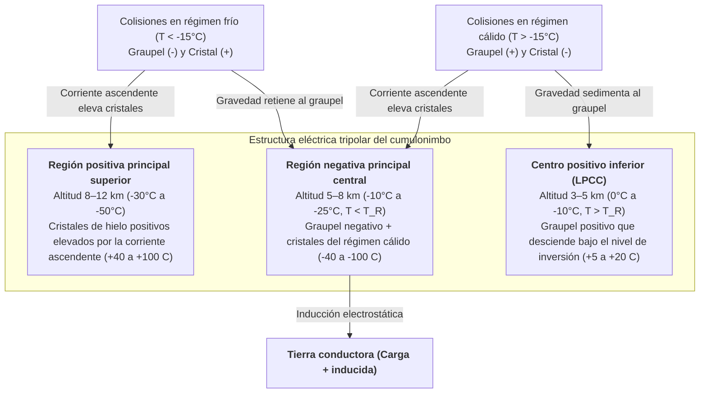

Cada segundo, entre 40 y 50 relámpagos rasgan la atmósfera terrestre, sumando casi 4 millones de descargas eléctricas de alta energía al día. Más de 270 años después del célebre experimento de la cometa de Benjamin Franklin en 1752, una de las preguntas más fundamentales de la física atmosférica sigue siendo apasionante: <strong>¿cómo se inicia realmente un rayo dentro de una nube de tormenta?</strong> Los globos meteorológicos y aviones de investigación que penetran en los núcleos turbulentos de los cumulonimbos activos nunca miden campos eléctricos macroscópicos superiores a $0,1\text{–}0,4\,\text{MV/m}$, un orden de magnitud por debajo del umbral de ruptura dieléctrica convencional del aire seco al nivel del mar ($E_{b0} \approx 3,0\,\text{MV/m}$) exigido por la teoría de avalanchas de Townsend y la ley de Paschen. Además, ¿por qué un rayo nunca viaja en línea recta, sino que esculpe un árbol <strong>fractal</strong> gobernado por inestabilidades de crecimiento laplaciano? ¿Por qué el <strong>líder escalonado (stepped leader)</strong> avanza en saltos discretos de $50\,\text{m}$ cada $50\,\mu\text{s}$ antes de desencadenar una <strong>descarga de retorno (return stroke)</strong> que asciende desde el suelo a un tercio de la velocidad de la luz ($v \approx c/3$) calentando el canal a $30.000\,\text{K}$? En este artículo deducimos la física completa del rayo desde la escala nanométrica hasta la electrodinámica relativista.

---

## 1. El generador electrostático del cumulonimbo: Separación no inductiva de cargas y estructura tripolar

Antes de la ruptura dieléctrica, un <strong>cumulonimbo</strong> maduro debe generar diferencias de potencial de $10^8$ a $10^9\,\text{V}$ a escala kilométrica. En la <strong>región de fase mixta</strong> situada entre $4\,\text{km}$ y $10\,\text{km}$ de altitud (temperaturas de $0^\circ\text{C}$ a $-40^\circ\text{C}$), intensas corrientes ascendentes ($v_{\text{up}} \approx 10\text{–}30\,\text{m/s}$) hacen coexistir tres especies de hidrometeoros: <strong>gotitas de agua sobreenfriada</strong> ($d \approx 10\text{–}20\,\mu\text{m}$), <strong>cristales de hielo</strong> ($20\text{–}200\,\mu\text{m}$) que crecen por deposición de vapor y <strong>graupel (granizo blando)</strong> milimétrico ($1\text{–}5\,\text{mm}$) que crece rápidamente por <strong>escarchado (riming)</strong> al congelar gotitas sobreenfriadas tras el impacto.

Los experimentos en túnel de viento de Takahashi (1978) y Saunders (1991) demostraron que el mecanismo principal de electrificación es la <strong>separación no inductiva de cargas</strong> durante colisiones con rebote entre el graupel y los cristales de hielo en presencia de agua sobreenfriada, transfiriendo unos $10\text{–}100\,\text{fC}$ ($10^{-14}\text{–}10^{-13}\,\text{C}$) por colisión. La clave microscópica reside en la <strong>capa cuasilíquida (Quasi-Liquid Layer, QLL)</strong> nanométrica de la superficie del hielo. En la red cristalina y la QLL, las moléculas de agua se autoionizan en protones ($\text{H}^+$) e iones hidroxilo ($\text{OH}^-$). Gracias al mecanismo de salto protónico de Grotthuss a lo largo de los puentes de hidrógeno, <strong>la movilidad catiónica del $\text{H}^+$ es varios órdenes de magnitud mayor que la del $\text{OH}^-$</strong>.

Durante el contacto compiten dos gradientes termodinámicos: (1) <strong>efecto del gradiente térmico</strong>: el graupel, calentado por el calor latente liberado al congelarse las gotitas sobreenfriadas, posee mayor concentración iónica; los protones $\text{H}^+$ difunden rápidamente del graupel cálido al cristal frío, dejando al graupel con carga negativa ($-$) y al cristal con carga positiva ($+$); (2) <strong>efecto del espesor de la QLL (mecanismo de Baker-Dash)</strong>: a temperaturas más cálidas y alto contenido de agua líquida ($\text{LWC}$), la QLL más gruesa del graupel invierte la transferencia neta de carga. Esta frontera define la <strong>temperatura de inversión ($T_R \approx -15^\circ\text{C}$ a $-20^\circ\text{C}$)</strong>:

* <strong>Régimen frío ($T < T_R$, altitud $7\text{–}10\,\text{km}$)</strong>: el <strong>graupel pesado se carga negativamente ($-$)</strong> y los <strong>cristales de hielo ligeros positivamente ($+$)</strong>.
* <strong>Régimen cálido ($T > T_R$, altitud $4\text{–}6\,\text{km}$)</strong>: se invierte el signo — el <strong>graupel se carga positivamente ($+$)</strong> y los <strong>cristales negativamente ($-$)</strong>.

La <strong>clasificación gravitatoria por tamaño</strong> separa luego estas cargas macroscópicamente: el graupel pesado ($v_t \approx 5\text{–}10\,\text{m/s}$) permanece en las capas medias y bajas, mientras que los cristales ligeros ($v_t \ll 1\,\text{m/s}$) son arrastrados por la corriente ascendente hacia el yunque superior, creando la <strong>estructura eléctrica tripolar</strong> canónica:

La densidad de carga espacial $\rho(\mathbf{r})$ determina el potencial electrostático $\phi(\mathbf{r})$ y el campo eléctrico $\mathbf{E} = -\nabla\phi$ mediante la <strong>ecuación de Poisson</strong>:

$$\nabla^2 \\phi(\mathbf{r}) = -\frac{\rho(\mathbf{r})}{\varepsilon_0}$$

El <strong>centro positivo inferior (LPCC)</strong> intensifica el campo eléctrico descendente en la base de la capa negativa principal, actuando como una catapulta electrostática que lanza los líderes escalonados negativos hacia tierra. En las <strong>tormentas invernales</strong> (como en la costa de Hokuriku, Japón), la isoterma de $-15^\circ\text{C}$ desciende a menos de $2\,\text{km}$ del suelo, permitiendo que la región positiva superior descargue directamente a tierra en colosales <strong>superrayos positivos (+CG)</strong> de $200\text{–}300\,\text{kA}$.

---

## 2. El misterio del inicio del rayo: Ruptura de Townsend frente a avalanchas relativistas (RREA)

En la física clásica de descargas de gases, la ionización por impacto electrónico (primer coeficiente de Townsend $\alpha$) compite con la captura electrónica por moléculas electronegativas de oxígeno (coeficiente $\eta_a$):

$$\frac{dN_e}{dx} = (\alpha - \eta_a) N_e \implies N_e(x) = N_0 \exp\left[ (\alpha - \eta_a) x \right]$$

Una <strong>avalancha de Townsend</strong> exponencial requiere $\alpha > \eta_a$, lo que fija el umbral de ruptura convencional $E_{b0} \approx 3,0\,\text{MV/m}$ al nivel del mar ($E/N \approx 120\,\text{Td}$). Según la <strong>ley de Paschen</strong>, el campo de ruptura escala linealmente con la densidad relativa del aire $n(z) = \exp(-z/H)$:

$$E_b(z) = E_{b0} \cdot n(z) \approx (3.0\,\\text{MV/m}) \cdot \exp(-z/H)$$

A la altitud típica de inicio ($z \approx 6\,\text{km}$, $n \approx 0,5$), la ruptura clásica aún exige $E_b(6\,\text{km}) \approx 1,5\,\text{MV/m}$, muy por encima de los $0,1\text{–}0,4\,\text{MV/m}$ medidos. Dos mecanismos físicos resuelven esta paradoja:

1. <strong>Avalanchas de electrones fugitivos relativistas (RREA) sembradas por rayos cósmicos</strong>: los electrones térmicos son frenados por la enorme barrera de fricción inelástica en $100\text{–}200\,\text{eV}$ ($F_{\max} \approx 27\,\text{MeV/m}\cdot n(z)$). Sin embargo, según la fórmula relativista de Bethe-Bloch, para electrones con energía cinética $K_{\min} \approx 1,0\text{–}1,4\,\text{MeV}$, la fuerza de frenado cae a un mínimo $F_{\min} \approx 0,218\,\text{MeV/m}\cdot n(z)$. Contabilizando la dispersión de Coulomb nuclear, el <strong>campo umbral RREA $E_{\text{RREA}}$</strong> (Gurevich, 1992; Dwyer, 2003) es:

$$E_{\\text{RREA}}(z) \approx 0.284\,\\text{MV/m} \cdot n(z), \qquad N_{\\text{RREA}}(L) = N_0 \exp\left(\frac{L}{\lambda_{\\text{RREA}}}\right)$$

   A $6\,\text{km}$ de altitud, $E_{\text{RREA}} \approx 0,14\,\text{MV/m}$, ¡coincidiendo exactamente con los campos máximos medidos por globos dentro de las nubes! Los electrones semilla ($\sim 1\,\text{MeV}$) aportados por <strong>cascadas atmosféricas extensas (EAS)</strong> de rayos cósmicos se aceleran sin freno y multiplican electrones secundarios mediante dispersión de Møller.
2. <strong>Amplificación del campo en hidrometeoros y ruptura positiva rápida (Fast Positive Breakdown)</strong>: en las puntas de un cristal de hielo alargado con relación de aspecto $l/r \gg 1$, la polarización dieléctrica amplifica el campo local:

$$E_{\\text{tip}} \approx E_0 \frac{(l/r)^2}{\ln(2l/r) - 1}$$

   Cuando $E_{\text{tip}}$ supera localmente $E_b(z)$, se lanzan <strong>streamers (dardos de corona) positivos</strong> que se propagan indefinidamente si el campo de fondo supera el umbral de estabilidad $E_{\text{st}}^{+} \approx 0,45\,\text{MV/m}\cdot n(z)$. Rison et al. (2016) descubrieron mediante interferometría VHF de banda ancha que los rayos comienzan con una ráfaga submicrosegundo de streamers positivos a $3\text{–}5 \times 10^7\,\text{m/s}$, denominada <strong>ruptura positiva rápida (FPB / eventos bipolares estrechos NBE)</strong>.

---

## 3. Por qué se ramifica el rayo: Transición streamer-líder y crecimiento fractal $\eta$-laplaciano

Un streamer individual es un plasma frío ($T_g \approx 300\,\text{K}$) cuyos electrones libres se adhieren al $\text{O}_2$ en decenas de nanosegundos. Cuando miles de streamers convergen en un tallo común (stem), el calentamiento por efecto Joule eleva la temperatura del gas neutro por encima del umbral crítico <strong>$T_{\text{crit}} \approx 1.500\text{–}5.000\,\text{K}$</strong>, activando: (1) el <strong>desprendimiento térmico de electrones</strong> ($\text{O}_2^- + \text{M} \to \text{O}_2 + \text{M} + \text{e}^-$), (2) la <strong>relajación vibracional-traslacional (V-T)</strong> del $\text{N}_2$, y (3) la <strong>expansión hidrodinámica radial</strong> que reduce la densidad $N$ y eleva $E/N$. Así nace un canal <strong>líder (leader)</strong> caliente y conductor que transporta el potencial de $-50\,\text{MV}$ de la nube hasta su punta.

En el 90 % de los rayos nube-tierra (negativos, -CG), el <strong>líder escalonado (stepped leader)</strong> avanza a saltos porque los streamers negativos requieren un campo el doble de intenso que los positivos ($E_{\text{st}}^{-} \approx 1,0\text{–}1,2\,\text{MV/m}\cdot n$). Delante de la punta principal se enciende un núcleo de plasma aislado (<strong>space stem</strong>) que desarrolla un líder espacial bidireccional; cuando su extremo positivo retrógrado choca con el líder negativo principal, se conecta un nuevo peldaño de $L_{\text{step}} \approx 10\text{–}50\,\text{m}$ cada $\tau_{\text{step}} \approx 20\text{–}50\,\mu\text{s}$ (velocidad media $\sim 2 \times 10^5\,\text{m/s}$).

La ramificación fractal es explicada por el <strong>Modelo de Ruptura Dieléctrica (DBM)</strong> de Niemeyer, Pietronero y Wiesmann (1984). El árbol conductor del líder ($\phi = 0$) se halla en un campo laplaciano donde la probabilidad de ruptura $P_i$ en el sitio frontera $i$ escala con la potencia $\eta$ del campo eléctrico local:

$$\nabla^2 \\phi(\mathbf{r}) = 0, \qquad P_i = \frac{|\nabla \\phi_i|^\eta}{\sum_{j \in \\text{boundary}} |\nabla \\phi_j|^\eta} \quad \left(|\nabla \\phi_i| > E_{\\text{crit}}\right)$$

Las puntas salientes comprimen las superficies equipotenciales mientras que las ramas laterales quedan apantalladas electrostáticamente (<strong>inestabilidad de crecimiento de Mullins-Sekerka</strong>), provocando la bifurcación continua. Mientras que $\eta = 1$ equivale a la agregación limitada por difusión (DLA, $D_f \approx 1,71$ en 2D), el régimen no lineal del rayo ($\eta \approx 2$) arroja una <strong>dimensión fractal de Hausdorff proyectada en 2D de $D_f \approx 1,35\text{–}1,55$</strong>.

---

## 4. Enganche, descarga de retorno a $30.000\,\text{K}$ y mecánica de la onda de choque del trueno

Cuando el líder escalonado desciende dentro de la <strong>distancia de impacto (striking distance) $r_s$</strong>, desde las puntas de estructuras conectadas a tierra (pararrayos, árboles) brotan <strong>líderes ascendentes de conexión</strong>. En el <strong>Modelo Electrogeométrico (EGM, método de la esfera rodante)</strong>, $r_s$ se relaciona con la corriente pico $I_p$ (en $\text{kA}$) mediante la ley de Love (1973):

$$r_s = 10 \, I_p^{0.65} \quad [\\text{m}]$$

En el instante del contacto ($20\text{–}100\,\text{m}$ sobre el suelo), la onda de neutralización —la <strong>descarga de retorno (return stroke)</strong>— asciende hacia la nube a <strong>$v_{\text{RS}} \approx c/3 \approx 1,0 \times 10^8\,\text{m/s}$</strong>. En $1\text{–}5\,\mu\text{s}$, una corriente típica de $30\,\text{kA}$ atraviesa un núcleo de $1\text{–}3\,\text{cm}$ y calienta el plasma a <strong>$T \approx 30.000\,\text{K}$ (cinco veces la temperatura superficial del Sol)</strong>. Posteriormente, <strong>líderes dardo (dart leaders)</strong> descienden por el canal residual cálido a $\sim 10^7\,\text{m/s}$, produciendo el parpadeo del rayo.

Dado que el calentamiento ocurre en microsegundos, es estrictamente <strong>isocórico</strong>: la presión interna salta a $10\text{–}100\,\text{atm}$ y el cilindro explota radialmente a Mach $10\text{–}20$ formando una <strong>onda de choque cilíndrica de Taylor-Sedov</strong>. El radio de relajación $R_0$ y la frecuencia pico $f_{\text{peak}}$ del trueno dependen de la energía por unidad de longitud $E_l$ y la presión atmosférica $P_0$:

$$R_0 = \sqrt{\frac{E_l}{\pi P_0}}, \qquad f_{\\text{peak}} \approx 0.63 \, c_s \sqrt{\frac{P_0}{E_l}} = \frac{0.63 \, c_s}{\sqrt{\pi} R_0} \approx 50\\text{–}150\,\\text{Hz}$$

A varios kilómetros, la onda en N se convierte en un retumbo grave debido a las diferencias de tiempo de llegada desde el canal 3D tortuoso, la absorción atmosférica proporcional a $f^2$ y la refracción acústica térmica hacia arriba.

---

## 5. Eventos luminosos transitorios (TLE) y destellos terrestres de rayos gamma (TGF) con antimateria

1. <strong>Eventos Luminosos Transitorios (TLE)</strong>:
   * <strong>Sprites rojos (altitud $50\text{–}90\,\text{km}$)</strong>: tras un intenso rayo $+CG$ con gran cambio de momento de carga ($\text{CMC} \gtrsim 500\,\text{C}\cdot\text{km}$), el campo cuasielectrostático supera en la mesosfera el umbral de ruptura $E_b(z)$ (que cae exponencialmente con la densidad del aire), encendiendo complejos de streamers fríos de decenas de kilómetros (rojos arriba por $\text{N}_2(1\text{P})$, zarcillos azules abajo por $\text{N}_2^+(1\text{N})$).
   * <strong>Chorro azul (Blue Jets, $15\text{–}50\,\text{km}$) y Chorros gigantes (hasta $90\,\text{km}$)</strong>: conos de líderes-streamers positivos que emergen de la cima de la nube a $\sim 100\,\text{km/s}$.
   * <strong>ELVES ($85\text{–}100\,\text{km}$)</strong>: anillos planos de luz roja ($300\text{–}500\,\text{km}$ de diámetro, $<1\,\text{ms}$) generados cuando el pulso electromagnético (EMP) esférico de la descarga de retorno corta la base de la ionosfera con velocidad de fase superlumínica.
2. <strong>Destellos terrestres de rayos gamma (TGF) y producción fotonuclear de antimateria</strong>: las avalanchas RREA aceleran electrones hasta $20\text{–}40\,\text{MeV}$, emitiendo radiación gamma de frenado (bremsstrahlung). En 2017, Enoto et al. (*Nature*) demostraron que los fotones gamma superiores a $10,55\,\text{MeV}$ arrancan neutrones de los núcleos de $^{14}\text{N}$; el isótopo inestable $^{13}\text{N}$ sufre desintegración $\beta^+$ emitiendo <strong>positrones de antimateria ($\text{e}^+$)</strong>, cuya aniquilación con electrones atmosféricos produce la línea gamma característica de <strong>$0,511\,\text{MeV}$</strong>:

$$\gamma + {{}}^{14}_{7}\\text{N} \longrightarrow {{}}^{13}_{7}\\text{N} + \\text{n} \quad (E_\gamma > 10.55\,\\text{MeV})$$

$${{}}^{13}_{7}\\text{N} \longrightarrow {{}}^{13}_{6}\\text{C} + \\text{e}^+ + \nu_e, \qquad \\text{e}^+ + \\text{e}^- \longrightarrow 2\gamma \quad (E_\gamma = 0.511\,\\text{MeV})$$

---

## 6. Comparación física integral y fronteras modernas de observación

| Fenómeno / Régimen | Altitud / Escala espacial | Duración / Escala temporal | Velocidad de propagación $v$ | Corriente, energía o temperatura típica | Mecanismo físico rector |
| :--- | :--- | :--- | :--- | :--- | :--- |
| <strong>Carga no inductiva</strong> | $4\text{–}10\,\text{km}$ (región de fase mixta) | Ciclo convectivo $10\text{–}30\,\text{min}$ | Ascenso $10\text{–}30\,\text{m/s}$ | $\sim 10^{-14}\,\text{C}$/choque; $\pm 40\text{–}100\,\text{C}$ total | Colisiones graupel-hielo, difusión de $\text{H}^+$ en QLL, $T_R \approx -15^\circ\text{C}$ |
| <strong>Ruptura positiva rápida (FPB)</strong> | $5\text{–}12\,\text{km}$; longitud $0,3\text{–}1\,\text{km}$ | $10\text{–}20\,\mu\text{s}$ | $3 \times 10^7 \text{–} 5 \times 10^7\,\text{m/s}$ | Ráfaga de radio VHF multimegavatio | Avalancha RREA cósmica + amplificación en puntas de cristales de hielo |
| <strong>Líder escalonado negativo</strong> | Nube–suelo (pasos de $10\text{–}50\,\text{m}$) | $10\text{–}30\,\text{ms}$ (pausas $20\text{–}50\,\mu\text{s}$) | Media $2 \times 10^5\,\text{m/s}$ | $100\text{–}1.000\,\text{A}$; núcleo $T \approx 5.000\,\text{K}$ | Desprendimiento térmico ($>1.500\,\text{K}$), space stems, fractal DBM $\eta$-laplaciano |
| <strong>Descarga de retorno</strong> | Suelo–nube (diámetro núcleo $1\text{–}3\,\text{cm}$) | Subida $1\text{–}5\,\mu\text{s}$; caída $\sim 100\,\mu\text{s}$ | $v \approx c/3 \approx 1,0 \times 10^8\,\text{m/s}$ (ascendente) | Mediana $30\,\text{kA}$ (+CG hasta $300\,\text{kA}$); <strong>$T \approx 30.000\,\text{K}$</strong> | Onda de neutralización, calentamiento isocórico ($10\text{–}100\,\text{atm}$), onda de choque |
| <strong>Sprites / Jets / ELVES</strong> | $15\text{–}100\,\text{km}$ (estratosfera–ionosfera) | $<1\,\text{ms}$ (ELVES) a $300\,\text{ms}$ (Jets) | $10^5\,\text{m/s}$ a velocidad de fase $>c$ | Plasma frío ($T_g \approx 200\text{–}300\,\text{K}$) | Ruptura cuasielectrostática (QE), desequilibrio de carga, capa esférica EMP |
| <strong>Destello gamma terrestre (TGF)</strong> | $10\text{–}15\,\text{km}$ ($2\text{–}4\,\text{km}$ en invierno) | $<1\,\text{ms}$ (resplandor $\text{e}^+$ $\sim 10\,\text{min}$) | Electrones relativistas $v \approx 0,99c$ | Fotones de hasta <strong>$20\text{–}40\,\text{MeV}$</strong> | Bremsstrahlung RREA, reacción $^{14}\text{N}(\gamma,\text{n}){}^{13}\text{N}$ y aniquilación $\text{e}^+\text{e}^-$ a $0,511\,\text{MeV}$ |

Hoy en día, las redes <strong>3D VHF Lightning Mapping Arrays (LMA)</strong> y los interferómetros digitales de banda ancha permiten reconstruir en 3D la evolución interna de los rayos con precisión métrica. En 2023, en la cima del monte Säntis ($2.502\,\text{m}$, Suiza), un consorcio europeo empleó un láser de femtosegundos de teravatios para generar un canal ionizado mediante <strong>filamentación láser</strong>, logrando guiar rayos naturales a lo largo de $50\,\text{m}$ por primera vez en la historia (Houard et al., 2023). A escala planetaria, las cerca de 2.000 tormentas activas simultáneamente alimentan el <strong>Circuito Eléctrico Global de Wilson</strong>, manteniendo la ionosfera a $+250\,\text{kV}$, sosteniendo el campo eléctrico de buen tiempo ($100\text{–}150\,\text{V/m}$) y excitando las <strong>resonancias de Schumann ($7,83\,\text{Hz}$)</strong>.
