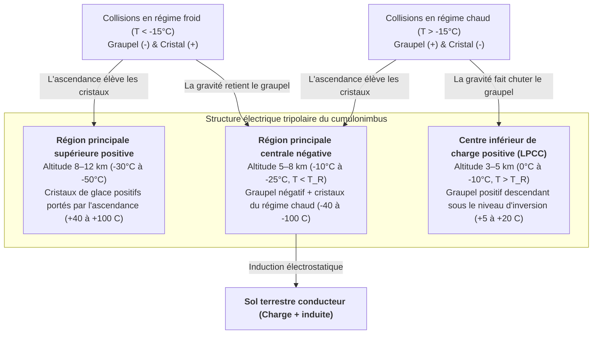

Chaque seconde, environ 40 à 50 éclairs déchirent l'atmosphère terrestre, soit près de 4 millions de décharges électriques de haute énergie par jour. Plus de 270 ans après la célèbre expérience du cerf-volant de Benjamin Franklin en 1752, l'une des questions les plus fondamentales de la physique atmosphérique demeure fascinante : <strong>comment un éclair s'amorce-t-il réellement à l'intérieur d'un nuage d'orage ?</strong> Les ballons-sondes et les avions de recherche qui pénètrent au cœur des cumulonimbus actifs ne mesurent jamais de champs électriques macroscopiques supérieurs à $0,1\text{–}0,4\,\text{MV/m}$ — soit une valeur près de dix fois inférieure au seuil de claquage diélectrique conventionnel de l'air sec au niveau de la mer ($E_{b0} \approx 3,0\,\text{MV/m}$) dicté par la théorie des avalanches de Townsend et la loi de Paschen. De plus, pourquoi la foudre ne se propage-t-elle jamais en ligne droite, mais sculpte-t-elle une arborescence <strong>fractale</strong> gouvernée par des instabilités de croissance laplacienne ? Pourquoi le <strong>traceur par bonds (stepped leader)</strong> progresse-t-il par sauts discrets de $50\,\text{m}$ toutes les $50\,\mu\text{s}$ avant de déclencher un <strong>arc en retour (return stroke)</strong> remontant du sol à un tiers de la vitesse de la lumière ($v \approx c/3$) et chauffant le canal à $30\,000\,\text{K}$ ? Cet article retrace toute la chaîne physique de la foudre, de l'échelle nanométrique de la glace à l'électrodynamique relativiste.

---

## 1. Le générateur électrostatique du cumulonimbus : Séparation non inductive des charges et structure tripolaire

Avant qu'un claquage diélectrique ne survienne, un <strong>cumulonimbus</strong> mature doit générer des différences de potentiel de $10^8$ à $10^9\,\text{V}$ sur plusieurs kilomètres. Dans la <strong>région à phase mixte</strong> située entre $4\,\text{km}$ et $10\,\text{km}$ d'altitude (températures de $0^\circ\text{C}$ à $-40^\circ\text{C}$), de puissants courants ascendants ($v_{\text{up}} \approx 10\text{–}30\,\text{m/s}$) font coexister trois types d'hydrométéores : des <strong>gouttelettes d'eau surfondue</strong> ($d \approx 10\text{–}20\,\mu\text{m}$), des <strong>cristaux de glace</strong> ($20\text{–}200\,\mu\text{m}$) croissant par déposition de vapeur, et du <strong>graupel (neige roulée)</strong> millimétrique ($1\text{–}5\,\text{mm}$) grossissant par <strong>givrage (riming)</strong> lors de la congélation à l'impact des gouttelettes surfondues.

Les expériences en soufflerie de Takahashi (1978) et Saunders (1991) ont établi que le mécanisme principal est la <strong>séparation non inductive des charges</strong> : lors des collisions avec rebond entre le graupel et les cristaux de glace en présence d'eau surfondue, environ $10\text{–}100\,\text{fC}$ ($10^{-14}\text{–}10^{-13}\,\text{C}$) sont transférés par impact. L'origine microscopique réside dans la <strong>couche quasi liquide (Quasi-Liquid Layer, QLL)</strong> nanométrique à la surface de la glace. Les molécules d'eau s'y auto-ionisent en protons hydronium ($\text{H}^+$) et ions hydroxyle ($\text{OH}^-$). Grâce au mécanisme de saut protonique de Grotthuss le long des liaisons hydrogène, <strong>la mobilité cationique de $\text{H}^+$ est supérieure de plusieurs ordres de grandeur à celle de $\text{OH}^-$</strong>.

Deux gradients thermodynamiques s'affrontent lors du contact : (1) <strong>l'effet du gradient thermique</strong> : le graupel, réchauffé par la chaleur latente de fusion des gouttelettes surfondues, présente une concentration ionique plus élevée ; les protons $\text{H}^+$ diffusent rapidement du graupel chaud vers le cristal froid, laissant le graupel chargé négativement ($-$) et le cristal positivement ($+$) ; (2) <strong>l'effet d'épaisseur de la QLL (mécanisme de Baker-Dash)</strong> : à température plus élevée et fort contenu en eau liquide ($\text{LWC}$), la QLL plus épaisse du graupel transfère de la masse négative au cristal, inversant la polarité. Cette frontière définit la <strong>température d'inversion ($T_R \approx -15^\circ\text{C}$ à $-20^\circ\text{C}$)</strong> :

* <strong>Régime froid ($T < T_R$, altitude $7\text{–}10\,\text{km}$)</strong> : le <strong>graupel lourd se charge négativement ($-$)</strong> et les <strong>cristaux de glace légers positivement ($+$)</strong>.
* <strong>Régime chaud ($T > T_R$, altitude $4\text{–}6\,\text{km}$)</strong> : inversion de polarité — le <strong>graupel se charge positivement ($+$)</strong> et les <strong>cristaux négativement ($-$)</strong>.

Le <strong>tri gravitationnel par taille</strong> sépare ensuite ces charges à l'échelle du nuage : le graupel lourd ($v_t \approx 5\text{–}10\,\text{m/s}$) reste dans les couches moyennes et basses, tandis que les cristaux légers ($v_t \ll 1\,\text{m/s}$) sont emportés vers l'enclume supérieure, formant la <strong>structure électrique tripolaire</strong> classique :

La densité de charge d'espace $\rho(\mathbf{r})$ gouverne le potentiel électrostatique $\phi(\mathbf{r})$ et le champ $\mathbf{E} = -\nabla\phi$ via l'<strong>équation de Poisson</strong> :

$$\nabla^2 \\phi(\mathbf{r}) = -\frac{\rho(\mathbf{r})}{\varepsilon_0}$$

Le <strong>centre inférieur de charge positive (LPCC)</strong> renforce localement le champ électrique dirigé vers le bas sous la couche négative principale, agissant comme une catapulte électrostatique pour lancer les traceurs négatifs vers le sol. Dans les <strong>orages d'hiver</strong> (comme sur la côte de Hokuriku au Japon), l'isotherme $-15^\circ\text{C}$ descend à moins de $2\,\text{km}$ du sol, permettant à la région positive supérieure de se décharger directement vers la Terre en de gigantesques <strong>super-éclairs positifs (+CG)</strong> atteignant $200\text{–}300\,\text{kA}$.

---

## 2. Le mystère de l'amorçage : Claquage de Townsend vs Avalanches d'électrons relativistes (RREA)

En physique classique des décharges gazeuses, l'ionisation par impact électronique (premier coefficient de Townsend $\alpha$) entre en compétition avec l'attachement électronique sur l'oxygène électronégatif (coefficient $\eta_a$) :

$$\frac{dN_e}{dx} = (\alpha - \eta_a) N_e \implies N_e(x) = N_0 \exp\left[ (\alpha - \eta_a) x \right]$$

Une <strong>avalanche de Townsend</strong> exponentielle exige $\alpha > \eta_a$, ce qui définit le seuil de claquage conventionnel $E_{b0} \approx 3,0\,\text{MV/m}$ au niveau de la mer ($E/N \approx 120\,\text{Td}$). D'après la <strong>loi de Paschen</strong>, ce champ varie proportionnellement à la densité relative de l'air $n(z) = \exp(-z/H)$ :

$$E_b(z) = E_{b0} \cdot n(z) \approx (3.0\,\\text{MV/m}) \cdot \exp(-z/H)$$

À l'altitude d'amorçage $z \approx 6\,\text{km}$ ($n \approx 0,5$), le claquage classique requiert encore $E_b(6\,\text{km}) \approx 1,5\,\text{MV/m}$, alors que les champs mesurés plafonnent à $0,1\text{–}0,4\,\text{MV/m}$. Deux mécanismes complémentaires résolvent ce paradoxe :

1. <strong>Les avalanches d'électrons découplés relativistes (RREA) amorcées par les rayons cosmiques</strong> : les électrons thermiques sont bloqués par la barrière de freinage collisionnel inélastique vers $100\text{–}200\,\text{eV}$ ($F_{\max} \approx 27\,\text{MeV/m}\cdot n(z)$). Mais selon la formule relativiste de Bethe-Bloch, pour un électron d'énergie cinétique $K_{\min} \approx 1,0\text{–}1,4\,\text{MeV}$, la force de freinage tombe à un minimum $F_{\min} \approx 0,218\,\text{MeV/m}\cdot n(z)$. En incluant la diffusion coulombienne, le <strong>champ seuil RREA $E_{\text{RREA}}$</strong> (Gurevich, 1992 ; Dwyer, 2003) vaut :

$$E_{\\text{RREA}}(z) \approx 0.284\,\\text{MV/m} \cdot n(z), \qquad N_{\\text{RREA}}(L) = N_0 \exp\left(\frac{L}{\lambda_{\\text{RREA}}}\right)$$

   À $6\,\text{km}$ d'altitude, $E_{\text{RREA}} \approx 0,14\,\text{MV/m}$, en parfait accord avec les mesures par ballon ! Les électrons germes ($\sim 1\,\text{MeV}$) issus des <strong>grandes gerbes atmosphériques (EAS)</strong> générées par les rayons cosmiques s'emballent (runaway) et multiplient les électrons secondaires par diffusion de Møller.
2. <strong>Amplification du champ par les hydrométéores et claquage positif rapide (Fast Positive Breakdown)</strong> : aux pointes d'un cristal de glace allongé de rapport d'aspect $l/r \gg 1$, la polarisation diélectrique amplifie le champ local :

$$E_{\\text{tip}} \approx E_0 \frac{(l/r)^2}{\ln(2l/r) - 1}$$

   Lorsque $E_{\text{tip}}$ dépasse localement $E_b(z)$, des <strong>streamers (dardons) positifs</strong> de plasma froid sont émis et se propagent dès que le champ ambiant excède le champ de stabilité $E_{\text{st}}^{+} \approx 0,45\,\text{MV/m}\cdot n(z)$. En 2016, Rison et al. ont démontré par interférométrie VHF large bande que les éclairs débutent par une cascade explosive de streamers positifs se propageant à $3\text{–}5 \times 10^7\,\text{m/s}$ : le <strong>claquage positif rapide (FPB / événements bipolaires étroits NBE)</strong>.

---

## 3. Pourquoi la foudre se ramifie : Transition streamer-traceur et croissance fractale $\eta$-laplacienne

Un streamer isolé est un plasma froid ($T_g \approx 300\,\text{K}$) dont la conductivité s'effondre en quelques dizaines de nanosecondes par attachement électronique sur $\text{O}_2$. Lorsque des milliers de streamers convergent vers une racine commune (stem), le chauffage par effet Joule porte le gaz neutre au-delà du seuil critique <strong>$T_{\text{crit}} \approx 1\,500\text{–}5\,000\,\text{K}$</strong>, déclenchant : (1) le <strong>détachement thermique des électrons</strong> ($\text{O}_2^- + \text{M} \to \text{O}_2 + \text{M} + \text{e}^-$), (2) la <strong>relaxation vibration-translation (V-T)</strong> de $\text{N}_2$, et (3) l'<strong>expansion hydrodynamique radiale</strong> qui abaisse la densité $N$ et élève le champ réduit $E/N$. Le canal devient alors un <strong>traceur (leader)</strong> thermique conducteur qui transporte le potentiel de $-50\,\text{MV}$ du nuage vers sa pointe.

Dans 90 % des éclairs nuage-sol (négatifs, -CG), le <strong>traceur par bonds (stepped leader)</strong> progresse par sauts car les streamers négatifs nécessitent un champ deux fois plus fort que les positifs ($E_{\text{st}}^{-} \approx 1,0\text{–}1,2\,\text{MV/m}\cdot n$). En avant de la pointe principale s'allume un noyau de plasma isolé (<strong>space stem</strong>) qui développe un traceur spatial bidirectionnel ; lorsque sa branche positive rétrograde rejoint le traceur principal, un nouveau segment de $L_{\text{step}} \approx 10\text{–}50\,\text{m}$ s'illumine toutes les $\tau_{\text{step}} \approx 20\text{–}50\,\mu\text{s}$ (vitesse moyenne $\sim 2 \times 10^5\,\text{m/s}$).

La géométrie ramifiée s'explique par le <strong>modèle de claquage diélectrique (Dielectric Breakdown Model, DBM)</strong> de Niemeyer, Pietronero et Wiesmann (1984). L'arbre conducteur ($\phi = 0$) évolue dans un champ laplacien où la probabilité de claquage $P_i$ au site frontière $i$ est proportionnelle à la puissance $\eta$ du champ local :

$$\nabla^2 \\phi(\mathbf{r}) = 0, \qquad P_i = \frac{|\nabla \\phi_i|^\eta}{\sum_{j \in \\text{boundary}} |\nabla \\phi_j|^\eta} \quad \left(|\nabla \\phi_i| > E_{\\text{crit}}\right)$$

Les pointes saillantes concentrent les équipotentielles tandis que les branches latérales sont écrantées électrostatiquement (<strong>instabilité morphologique de Mullins-Sekerka</strong>), provoquant la bifurcation continue des pointes. Alors que $\eta = 1$ reproduit l'agrégation limitée par diffusion (DLA, $D_f \approx 1,71$ en 2D), le régime non linéaire de la foudre ($\eta \approx 2$) produit une <strong>dimension fractale de Hausdorff projetée en 2D de $D_f \approx 1,35\text{–}1,55$</strong>, conforme aux observations photographiques.

---

## 4. Attachement, arc en retour à $30\,000\,\text{K}$ et mécanique des ondes de choc du tonnerre

Lorsque le traceur par bonds s'approche du sol en deçà de la <strong>distance d'amorçage (striking distance) $r_s$</strong>, des <strong>traceurs ascendants de connexion</strong> jaillissent des structures élancées (paratonnerres, arbres). Dans le <strong>modèle électrogéométrique (EGM, méthode de la sphère fictive)</strong>, $r_s$ dépend du courant de crête $I_p$ (en $\text{kA}$) selon la loi de Love (1973) :

$$r_s = 10 \, I_p^{0.65} \quad [\\text{m}]$$

Dès la jonction à $20\text{–}100\,\text{m}$ du sol, l'onde de neutralisation — l'<strong>arc en retour (return stroke)</strong> — remonte vers le nuage à <strong>$v_{\text{RS}} \approx c/3 \approx 1,0 \times 10^8\,\text{m/s}$</strong>. En $1\text{–}5\,\mu\text{s}$, un courant médian de $30\,\text{kA}$ traverse un cœur de $1\text{–}3\,\text{cm}$ de diamètre et porte le plasma à <strong>$T \approx 30\,000\,\text{K}$ (cinq fois la température de la photosphère solaire)</strong>. Des <strong>traceurs flèches (dart leaders)</strong> ultérieurs redescendent le canal résiduel chaud à $\sim 10^7\,\text{m/s}$, causant le scintillement de l'éclair.

Ce chauffage ultrarapide étant strictement <strong>isochore</strong>, la pression interne bondit à $10\text{–}100\,\text{atm}$ et le cylindre de plasma explose radialement à Mach $10\text{–}20$, générant une <strong>onde de choc cylindrique de Taylor-Sedov</strong>. Le rayon de relaxation $R_0$ et la fréquence acoustique dominante $f_{\text{peak}}$ du tonnerre s'expriment en fonction de l'énergie linéique $E_l$ et de la pression ambiante $P_0$ :

$$R_0 = \sqrt{\frac{E_l}{\pi P_0}}, \qquad f_{\\text{peak}} \approx 0.63 \, c_s \sqrt{\frac{P_0}{E_l}} = \frac{0.63 \, c_s}{\sqrt{\pi} R_0} \approx 50\\text{–}150\,\\text{Hz}$$

À plusieurs kilomètres, l'onde en N se transforme en un grondement grave prolongé sous l'effet des différences de temps d'arrivée le long du canal tortueux 3D, de l'atténuation atmosphérique en $f^2$ et de la réfraction acoustique thermique vers le haut.

---

## 5. Phénomènes lumineux transitoires (TLE) et flashs gamma terrestres (TGF) producteurs d'antimatière

1. <strong>Phénomènes lumineux transitoires (TLE)</strong> :
   * <strong>Sylphes rouges (Red Sprites, altitude $50\text{–}90\,\text{km}$)</strong> : après un puissant éclair $+CG$ à fort changement de moment de charge ($\text{CMC} \gtrsim 500\,\text{C}\cdot\text{km}$), le champ quasi électrostatique dépasse le seuil de claquage $E_b(z)$ qui décroît exponentiellement avec la densité de l'air, déclenchant d'immenses streamers froids dans la mésosphère (rouges au-dessus de $70\,\text{km}$ via $\text{N}_2(1\text{P})$, vrilles bleues en dessous via $\text{N}_2^+(1\text{N})$).
   * <strong>Jets bleus ($15\text{–}50\,\text{km}$) et Jets géants (jusqu'à $90\,\text{km}$)</strong> : cônes de traceurs-streamers positifs jaillissant du sommet du nuage à $\sim 100\,\text{km/s}$.
   * <strong>ELVES ($85\text{–}100\,\text{km}$)</strong> : anneaux lumineux rouges de $300\text{–}500\,\text{km}$ de diamètre (< $1\,\text{ms}$) créés par l'intersection de la coquille sphérique d'impulsion électromagnétique (EMP) de l'arc en retour avec la base de l'ionosphère.
2. <strong>Flashs gamma terrestres (TGF) et production photonucléaire d'antimatière</strong> : les avalanches RREA accélèrent des électrons jusqu'à $20\text{–}40\,\text{MeV}$, émettant des flashs de rayons gamma de freinage (bremsstrahlung). En 2017, Enoto et al. (*Nature*) ont prouvé que les photons gamma au-delà de $10,55\,\text{MeV}$ arrachent des neutrons aux noyaux $^{14}\text{N}$ par résonance dipolaire géante ; le noyau fils instable $^{13}\text{N}$ subit une désintégration $\beta^+$ émettant des <strong>positrons d'antimatière ($\text{e}^+$)</strong> qui s'annihilent avec les électrons de l'air en produisant la raie gamma caractéristique à <strong>$0,511\,\text{MeV}$</strong> :

$$\gamma + {{}}^{14}_{7}\\text{N} \longrightarrow {{}}^{13}_{7}\\text{N} + \\text{n} \quad (E_\gamma > 10.55\,\\text{MeV})$$

$${{}}^{13}_{7}\\text{N} \longrightarrow {{}}^{13}_{6}\\text{C} + \\text{e}^+ + \nu_e, \qquad \\text{e}^+ + \\text{e}^- \longrightarrow 2\gamma \quad (E_\gamma = 0.511\,\\text{MeV})$$

---

## 6. Synthèse comparative des régimes de décharge et frontières observationnelles

| Phénomène / Régime | Altitude / Échelle spatiale | Durée / Échelle temporelle | Vitesse de propagation $v$ | Courant, énergie ou température typique | Mécanisme physique gouvernant |
| :--- | :--- | :--- | :--- | :--- | :--- |
| <strong>Charge non inductive</strong> | $4\text{–}10\,\text{km}$ (zone à phase mixte) | Cycle convectif $10\text{–}30\,\text{min}$ | Ascendance $10\text{–}30\,\text{m/s}$ | $\sim 10^{-14}\,\text{C}$/choc ; $\pm 40\text{–}100\,\text{C}$ total | Collisions graupel-glace, diffusion $\text{H}^+$ dans la QLL, $T_R \approx -15^\circ\text{C}$ |
| <strong>Claquage positif rapide (FPB)</strong> | $5\text{–}12\,\text{km}$ ; longueur $0,3\text{–}1\,\text{km}$ | $10\text{–}20\,\mu\text{s}$ | $3 \times 10^7 \text{–} 5 \times 10^7\,\text{m/s}$ | Sursaut radio VHF multi-mégawatts | Avalanche RREA cosmique + amplification aux pointes des cristaux |
| <strong>Traceur négatif par bonds</strong> | Nuage–sol (bonds de $10\text{–}50\,\text{m}$) | $10\text{–}30\,\text{ms}$ (pauses $20\text{–}50\,\mu\text{s}$) | Moyenne $2 \times 10^5\,\text{m/s}$ | $100\text{–}1\,000\,\text{A}$ ; cœur $T \approx 5\,000\,\text{K}$ | Détachement thermique ($>1\,500\,\text{K}$), space stems, croissance fractale DBM |
| <strong>Arc en retour (Return Stroke)</strong> | Sol–nuage (diamètre cœur $1\text{–}3\,\text{cm}$) | Montée $1\text{–}5\,\mu\text{s}$ ; déclin $\sim 100\,\mu\text{s}$ | $v \approx c/3 \approx 1,0 \times 10^8\,\text{m/s}$ (ascendant) | Médiane $30\,\text{kA}$ (+CG jusqu'à $300\,\text{kA}$) ; <strong>$T \approx 30\,000\,\text{K}$</strong> | Onde de neutralisation, chauffage Joule isochore ($10\text{–}100\,\text{atm}$), onde de choc |
| <strong>Sprites / Jets bleus / ELVES</strong> | $15\text{–}100\,\text{km}$ (stratosphère–ionosphère) | $<1\,\text{ms}$ (ELVES) à $300\,\text{ms}$ (Jets) | $10^5\,\text{m/s}$ à vitesse de phase $>c$ | Plasma froid ($T_g \approx 200\text{–}300\,\text{K}$) | Claquage quasi électrostatique (QE), déséquilibre de charge, coquille EMP |
| <strong>Flash gamma terrestre (TGF)</strong> | $10\text{–}15\,\text{km}$ ($2\text{–}4\,\text{km}$ en hiver) | $<1\,\text{ms}$ (lueur $\text{e}^+$ $\sim 10\,\text{min}$) | Électrons relativistes $v \approx 0,99c$ | Photons jusqu'à <strong>$20\text{–}40\,\text{MeV}$</strong> | Bremsstrahlung RREA, réaction $^{14}\text{N}(\gamma,\text{n}){}^{13}\text{N}$ et annihilation $\text{e}^+\text{e}^-$ à $0,511\,\text{MeV}$ |

Les réseaux <strong>3D VHF Lightning Mapping Arrays (LMA)</strong> et les interféromètres numériques large bande cartographient désormais en 3D la naissance des traceurs au cœur des nuages. En 2023, au sommet du mont Säntis ($2\,502\,\text{m}$, Suisse), un consortium européen a utilisé un laser femtoseconde térawatt pour créer un canal ionisé par <strong>filamentation laser</strong>, guidant pour la première fois des éclairs naturels sur $50\,\text{m}$ (Houard et al., 2023). À l'échelle planétaire, les quelque 2 000 orages actifs en permanence alimentent le <strong>circuit électrique global de Wilson</strong>, maintenant l'ionosphère à $+250\,\text{kV}$, générant le champ électrique de beau temps ($100\text{–}150\,\text{V/m}$) et excitant les <strong>résonances de Schumann ($7,83\,\text{Hz}$)</strong>.
