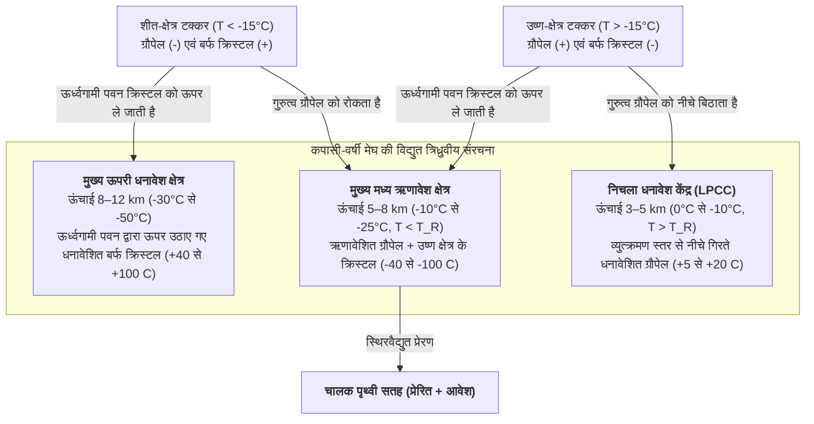

पृथ्वी के वायुमंडल में प्रत्येक सेकंड लगभग 40 से 50 बार बिजली चमकती है—अर्थात् प्रतिदिन लगभग 40 लाख उच्च-ऊर्जा विद्युत विसर्जन होते हैं। 1752 में बेंजामिन फ्रैंकलिन के प्रसिद्ध पतंग प्रयोग के 270 से अधिक वर्षों के बाद भी, वायुमंडलीय भौतिकी का एक सबसे मौलिक प्रश्न अत्यंत रोचक बना हुआ है: <strong>गरज वाले बादल (थंडरक्लाउड) के भीतर बिजली वास्तव में कैसे शुरू होती है?</strong> जब मौसम गुब्बारे और अनुसंधान विमान सक्रिय कपासी-वर्षी मेघों (Cumulonimbus clouds) के अशांत केंद्रों में प्रवेश करते हैं, तो उनके द्वारा मापा गया अधिकतम स्थूल विद्युत क्षेत्र कभी भी $0.1\text{–}0.4\,\text{MV/m}$ से अधिक नहीं होता—जो समुद्र तल पर शुष्क वायु के पारंपरिक टाउनसेंड डाइइलेक्ट्रिक ब्रेकडाउन थ्रेशोल्ड ($E_{b0} \approx 3.0\,\text{MV/m}$) की तुलना में लगभग दस गुना कम है। इसके अतिरिक्त, बिजली कभी सीधी रेखा में क्यों नहीं चलती, बल्कि लाप्लासियन वृद्धि अस्थिरता (Laplacian growth instability) द्वारा शासित एक जटिल <strong>फ्रैक्टल वृक्ष (Fractal tree)</strong> क्यों बनाती है? क्यों ऋणात्मक <strong>स्टेप्ड लीडर (Stepped leader)</strong> हर $50\,\mu\text{s}$ में $50\,\text{m}$ के असतत कदमों में आगे बढ़ता है और फिर प्रकाश की गति के एक-तिहाई ($v \approx c/3$) वेग से जमीन से ऊपर उठने वाले <strong>रिटर्न स्ट्रोक (Return stroke)</strong> को जन्म देता है जो चैनल को $30,000\,\text{K}$ तक गर्म कर देता है? इस लेख में हम नैनोस्केल बर्फ भौतिकी से लेकर सापेक्षकीय विद्युतगतिकी तक बिजली के संपूर्ण भौतिकी का विश्लेषण करेंगे।

---

## 1. कपासी-वर्षी स्थिरवैद्युत जनरेटर: गैर-प्रेरक आवेश पृथक्करण और त्रिध्रुवीय संरचना

डाइइलेक्ट्रिक ब्रेकडाउन होने से पहले, एक परिपक्व <strong>कपासी-वर्षी मेघ (Cumulonimbus)</strong> को किलोमीटर पैमाने पर $10^8$ से $10^9\,\text{V}$ का विभवांतर उत्पन्न करना होता है। $4\text{–}10\,\text{km}$ की ऊंचाई (तापमान $0^\circ\text{C}$ से $-40^\circ\text{C}$) के बीच अशांत <strong>मिश्रित-प्रावस्था क्षेत्र (Mixed-phase region)</strong> में, शक्तिशाली ऊर्ध्वगामी पवनें ($v_{\text{up}} \approx 10\text{–}30\,\text{m/s}$) तीन प्रकार के जल-कणों को एक साथ रखती हैं: <strong>अतिशीतित जल की बूंदें (Supercooled water droplets)</strong> ($d \approx 10\text{–}20\,\mu\text{m}$), वाष्प निक्षेपण से बढ़ने वाले <strong>बर्फ के क्रिस्टल</strong> ($20\text{–}200\,\mu\text{m}$), और मिलीमीटर आकार के <strong>ग्रौपेल (Graupel / नरम ओले, $1\text{–}5\,\text{mm}$)</strong> जो अतिशीतित बूंदों के टकराकर जमने (<strong>राइमिंग / Riming</strong>) से तेजी से बढ़ते हैं।

ताकाहाशी (Takahashi, 1978) और सॉन्डर्स (Saunders, 1991) के पवन-सुरंग प्रयोगों ने स्थापित किया कि बादलों में आवेशन की मुख्य प्रक्रिया <strong>गैर-प्रेरक आवेश पृथक्करण (Non-inductive charge separation)</strong> है: अतिशीतित जल की बूंदों की उपस्थिति में ग्रौपेल और बर्फ क्रिस्टल के बीच टकराकर उछलने से प्रति टक्कर लगभग $10\text{–}100\,\text{fC}$ ($10^{-14}\text{–}10^{-13}\,\text{C}$) आवेश स्थानांतरित होता है। इसका सूक्ष्म कारण बर्फ की सतह पर मौजूद नैनोमीटर पतली <strong>अर्ध-तरल परत (Quasi-Liquid Layer, QLL)</strong> है। बर्फ जालक और QLL के भीतर जल के अणु स्वतः आयनित होकर प्रोटॉन ($\text{H}^+$) और हाइड्रॉक्सिल आयन ($\text{OH}^-$) बनाते हैं। हाइड्रोजन बंधों के अनुदिश ग्रोथस प्रोटॉन-कूद तंत्र (Grotthuss mechanism) के कारण <strong>$\text{H}^+$ की धनायन गतिशीलता $\text{OH}^-$ की तुलना में कई गुना अधिक होती है</strong>।

संक्षिप्त संपर्क के दौरान दो ऊष्मागतिक प्रवणताएं प्रतिस्पर्धा करती हैं: (1) <strong>तापमान प्रवणता प्रभाव</strong>: अतिशीतित बूंदों के जमने से मुक्त गुप्त ऊष्मा के कारण ग्रौपेल गर्म होता है और उसमें आयन सांद्रता अधिक होती है; इसलिए $\text{H}^+$ प्रोटॉन गर्म ग्रौपेल से ठंडे बर्फ क्रिस्टल में तेजी से विसरित होते हैं, जिससे ग्रौपेल ऋणावेशित ($-$) और क्रिस्टल धनावेशित ($+$) हो जाता है; (2) <strong>QLL मोटाई प्रभाव (बेकर-डैश तंत्र)</strong>: अधिक तापमान और उच्च तरल जल मात्रा ($\text{LWC}$) पर, ग्रौपेल की अधिक मोटी QLL परत आवेश स्थानांतरण की ध्रुवता को उलट देती है। यह सीमा <strong>व्युत्क्रमण तापमान (Reversal Temperature, $T_R \approx -15^\circ\text{C}$ से $-20^\circ\text{C}$)</strong> को परिभाषित करती है:

* <strong>शीत क्षेत्र ($T < T_R$, ऊंचाई $7\text{–}10\,\text{km}$)</strong>: भारी <strong>ग्रौपेल ऋणावेशित ($-$)</strong> और हल्के <strong>बर्फ क्रिस्टल धनावेशित ($+$)</strong> होते हैं।
* <strong>उष्ण क्षेत्र ($T > T_R$, ऊंचाई $4\text{–}6\,\text{km}$)</strong>: आवेश का चिह्न उलट जाता है — भारी <strong>ग्रौपेल धनावेशित ($+$)</strong> और हल्के <strong>बर्फ क्रिस्टल ऋणावेशित ($-$)</strong> होते हैं।

इसके बाद <strong>गुरुत्वीय आकार छंटाई (Gravitational size sorting)</strong> इन आवेशों को बड़े पैमाने पर अलग करती है: भारी ग्रौपेल ($v_t \approx 5\text{–}10\,\text{m/s}$) बादल के मध्य और निचले हिस्सों में रहते हैं, जबकि हल्के बर्फ क्रिस्टल ($v_t \ll 1\,\text{m/s}$) ऊर्ध्वगामी हवाओं द्वारा ऊपरी निहाई (Anvil) में पहुंचा दिए जाते हैं, जिससे मानक <strong>विद्युत त्रिध्रुवीय संरचना (Tripole structure)</strong> बनती है:

स्थूल अंतरिक्ष-आवेश घनत्व $\rho(\mathbf{r})$ <strong>पॉइसन समीकरण (Poisson's equation)</strong> के माध्यम से स्थिरवैद्युत विभव $\phi(\mathbf{r})$ और विद्युत क्षेत्र $\mathbf{E} = -\nabla\phi$ को निर्धारित करता है:

$$\nabla^2 \\phi(\mathbf{r}) = -\frac{\rho(\mathbf{r})}{\varepsilon_0}$$

यहाँ <strong>निचला धनावेश केंद्र (LPCC)</strong> मुख्य ऋणावेश क्षेत्र के ठीक नीचे स्थानीय द्विध्रुव बनाकर नीचे की ओर विद्युत क्षेत्र को तीव्र करता है और ऋणात्मक स्टेप्ड लीडर को जमीन की ओर प्रक्षेपित करने वाले स्थिरवैद्युत गुलेल की तरह कार्य करता है। इसके विपरीत, <strong>शीतकालीन तड़ितझंझाओं</strong> (जैसे जापान के होकुरिकु तट पर) में $-15^\circ\text{C}$ समताप रेखा जमीन से मात्र $2\,\text{km}$ ऊपर आ जाती है, जिससे ऊपरी धनावेश क्षेत्र सीधे पृथ्वी पर $200\text{–}300\,\text{kA}$ के विशाल <strong>धनात्मक सुपरबोल्ट (+CG)</strong> के रूप में विसर्जित होता है।

---

## 2. बिजली शुरू होने का रहस्य: टाउनसेंड ब्रेकडाउन बनाम सापेक्षकीय रनअवे हिमस्खलन (RREA)

चिरसम्मत गैस विसर्जन भौतिकी में, इलेक्ट्रॉन संघट्ट आयनन (प्रथम टाउनसेंड गुणांक $\alpha$) और विद्युत-ऋणात्मक ऑक्सीजन अणुओं द्वारा इलेक्ट्रॉन जुड़ाव (जुड़ाव गुणांक $\eta_a$) के बीच प्रतिस्पर्धा होती है:

$$\frac{dN_e}{dx} = (\alpha - \eta_a) N_e \implies N_e(x) = N_0 \exp\left[ (\alpha - \eta_a) x \right]$$

चरघातांकी <strong>टाउनसेंड हिमस्खलन (Townsend avalanche)</strong> के लिए $\alpha > \eta_a$ आवश्यक है, जो समुद्र तल पर पारंपरिक ब्रेकडाउन क्षेत्र $E_{b0} \approx 3.0\,\text{MV/m}$ ($E/N \approx 120\,\text{Td}$) निर्धारित करता है। <strong>पाशन के नियम (Paschen's law)</strong> के अनुसार, ब्रेकडाउन क्षेत्र सापेक्ष वायु घनत्व $n(z) = \exp(-z/H)$ के समानुपाती होता है:

$$E_b(z) = E_{b0} \cdot n(z) \approx (3.0\,\\text{MV/m}) \cdot \exp(-z/H)$$

बिजली शुरू होने की सामान्य ऊंचाई $z \approx 6\,\text{km}$ ($n \approx 0.5$) पर भी पारंपरिक ब्रेकडाउन के लिए $E_b(6\,\text{km}) \approx 1.5\,\text{MV/m}$ चाहिए, जबकि मापा गया क्षेत्र $0.1\text{–}0.4\,\text{MV/m}$ से अधिक नहीं होता। दो पूरक भौतिक तंत्र इस विरोधाभास को सुलझाते हैं:

1. <strong>कॉस्मिक किरणों द्वारा प्रेरित सापेक्षकीय रनअवे इलेक्ट्रॉन हिमस्खलन (RREA)</strong>: तापीय इलेक्ट्रॉनों को $100\text{–}200\,\text{eV}$ पर विशाल अप्रत्यास्थ संघट्ट घर्षण अवरोध ($F_{\max} \approx 27\,\text{MeV/m}\cdot n(z)$) रोक लेता है। किंतु सापेक्षकीय बेथे-ब्लॉख (Bethe-Bloch) सूत्र के अनुसार, जब इलेक्ट्रॉन की गतिज ऊर्जा $K_{\min} \approx 1.0\text{–}1.4\,\text{MeV}$ होती है, तो घर्षण बल घटकर न्यूनतम $F_{\min} \approx 0.218\,\text{MeV/m}\cdot n(z)$ रह जाता है। नाभिकीय कूलॉम प्रकीर्णन को शामिल करने पर <strong>RREA थ्रेशोल्ड क्षेत्र $E_{\text{RREA}}$</strong> (Gurevich, 1992; Dwyer, 2003) है:

$$E_{\\text{RREA}}(z) \approx 0.284\,\\text{MV/m} \cdot n(z), \qquad N_{\\text{RREA}}(L) = N_0 \exp\left(\frac{L}{\lambda_{\\text{RREA}}}\right)$$

   $6\,\text{km}$ की ऊंचाई पर $E_{\text{RREA}} \approx 0.14\,\text{MV/m}$ होता है, जो बादलों में गुब्बारों द्वारा मापे गए अधिकतम विद्युत क्षेत्र से सटीक मेल खाता है! उच्च-ऊर्जा कॉस्मिक किरणों के <strong>विस्तृत वायु बौछार (EAS)</strong> से प्राप्त $\sim 1\,\text{MeV}$ बीज इलेक्ट्रॉन अनवरत त्वरित (Runaway) होते हैं और मोलर प्रकीर्णन (Møller scattering) द्वारा द्वितीयक इलेक्ट्रॉनों का हिमस्खलन उत्पन्न करते हैं।
2. <strong>जल-कण नोक क्षेत्र प्रवर्धन और तीव्र धनात्मक ब्रेकडाउन (Fast Positive Breakdown)</strong>: उच्च पहलू अनुपात $l/r \gg 1$ वाले लंबे बर्फ क्रिस्टल की नुकीली नोकों पर डाइइलेक्ट्रिक ध्रुवण स्थानीय क्षेत्र को प्रवर्धित करता है:

$$E_{\\text{tip}} \approx E_0 \frac{(l/r)^2}{\ln(2l/r) - 1}$$

   जब $E_{\text{tip}}$ स्थानीय रूप से $E_b(z)$ को पार कर जाता है, तो <strong>धनात्मक कोरोना स्ट्रीमर</strong> निकलते हैं जो पृष्ठभूमि क्षेत्र के स्थिरता थ्रेशोल्ड $E_{\text{st}}^{+} \approx 0.45\,\text{MV/m}\cdot n(z)$ से अधिक होने पर अनिश्चित काल तक संचरित होते हैं। रॉयसन आदि (Rison et al., 2016) ने ब्रॉडबैंड VHF इंटरफेरोमेट्री से खोजा कि सभी बिजली चमक $3\text{–}5 \times 10^7\,\text{m/s}$ से फैलने वाले धनात्मक स्ट्रीमरों के विस्फोटक प्रपात से शुरू होती हैं, जिसे <strong>तीव्र धनात्मक ब्रेकडाउन (FPB / नैरो बाइपोलर इवेंट NBE)</strong> कहा जाता है।

---

## 3. बिजली क्यों शाखित होती है: स्ट्रीमर-लीडर संक्रमण और $\eta$-लाप्लासियन फ्रैक्टल वृद्धि

एकल कोरोना स्ट्रीमर ठंडा प्लाज्मा ($T_g \approx 300\,\text{K}$) है जिसके मुक्त इलेक्ट्रॉन कुछ नैनोसेकंड में $\text{O}_2$ से जुड़कर चालकता खो देते हैं। जब हजारों स्ट्रीमर एक साझा तने (Stem) में मिलते हैं, तो जूल तापन उदासीन गैस को क्रांतिक तापमान <strong>$T_{\text{crit}} \approx 1,500\text{–}5,000\,\text{K}$</strong> से ऊपर गर्म कर देता है, जिससे तीन धनात्मक पुनर्भरण प्रक्रियाएं शुरू होती हैं: (1) <strong>तापीय इलेक्ट्रॉन वियोजन</strong> ($\text{O}_2^- + \text{M} \to \text{O}_2 + \text{M} + \text{e}^-$), (2) $\text{N}_2$ का <strong>कंपन-स्थानांतरण (V-T) विश्रांति तापन</strong>, और (3) <strong>हाइड्रोडायनामिक त्रिज्यीय प्रसार</strong> जो घनत्व $N$ को घटाकर $E/N$ को बढ़ाता है। इससे उच्च चालकता वाला गर्म <strong>लीडर (Leader)</strong> चैनल बनता है जो बादल के $-50\,\text{MV}$ विभव को अपनी नोक तक ले जाता है।

90% बादल-से-जमीन (-CG) बिजली में, ऋणात्मक <strong>स्टेप्ड लीडर (Stepped leader)</strong> रुक-रुक कर आगे बढ़ता है क्योंकि ऋणात्मक स्ट्रीमरों को धनात्मक की तुलना में दोगुने क्षेत्र ($E_{\text{st}}^{-} \approx 1.0\text{–}1.2\,\text{MV/m}\cdot n$) की आवश्यकता होती है। मुख्य लीडर नोक के आगे एक पृथक प्लाज्मा केंद्रक (<strong>स्पेस स्टेम / Space stem</strong>) बनता है जिससे द्विदिशीय स्पेस लीडर उगता है; जब इसका पीछे की ओर बढ़ता धनात्मक सिरा मुख्य ऋणात्मक लीडर से टकराता है, तो हर $\tau_{\text{step}} \approx 20\text{–}50\,\mu\text{s}$ में $L_{\text{step}} \approx 10\text{–}50\,\text{m}$ का नया कदम चमक उठता है (औसत वेग $\sim 2 \times 10^5\,\text{m/s}$)।

शाखाओं के फ्रैक्टल ज्यामिति की व्याख्या नीमेयर, पिएत्रोनेरो और वीसमैन (1984) के <strong>डाइइलेक्ट्रिक ब्रेकडाउन मॉडल (DBM)</strong> द्वारा की जाती है। चालक लीडर वृक्ष ($\phi = 0$) लाप्लास समीकरण का पालन करता है, जहाँ सीमा बिंदु $i$ के टूटने की प्रायिकता $P_i$ स्थानीय विद्युत क्षेत्र की $\eta$ घात के समानुपाती होती है:

$$\nabla^2 \\phi(\mathbf{r}) = 0, \qquad P_i = \frac{|\nabla \\phi_i|^\eta}{\sum_{j \in \\text{boundary}} |\nabla \\phi_j|^\eta} \quad \left(|\nabla \\phi_i| > E_{\\text{crit}}\right)$$

उभरी हुई नोकें समविभव पृष्ठों को संकुचित कर क्षेत्र को बढ़ाती हैं जबकि पार्श्व शाखाएं स्थिरवैद्युत रूप से परिरक्षित (Screened) हो जाती हैं (<strong>मुलिंस-सेकेरका वृद्धि अस्थिरता</strong>), जिससे नोकें लगातार द्विभाजित होती हैं। जहाँ $\eta = 1$ विसरण-सीमित एकत्रीकरण (DLA, 2D $D_f \approx 1.71$) के समतुल्य है, वहीं बिजली का अरैखिक शासन ($\eta \approx 2$) 2D प्रक्षेपित <strong>हॉसडॉर्फ फ्रैक्टल आयाम $D_f \approx 1.35\text{–}1.55$</strong> देता है।

---

## 4. जुड़ाव, $30,000\,\text{K}$ रिटर्न स्ट्रोक और मेघगर्जन की पराध्वनिक प्रघात तरंग यांत्रिकी

जब स्टेप्ड लीडर जमीन से <strong>प्रहार दूरी (Striking distance) $r_s$</strong> के भीतर आता है, तो भू-संपर्कित ऊंची संरचनाओं (तड़ित चालक, पेड़) की नोकों से <strong>ऊर्ध्वगामी संयोजक धनात्मक लीडर</strong> ऊपर उठते हैं। <strong>इलेक्ट्रो-जियोमेट्रिक मॉडल (EGM, रोलिंग स्फीयर विधि का आधार)</strong> में $r_s$ और शिखर धारा $I_p$ ($\text{kA}$ में) का संबंध लव (1973) के सूत्र से दिया जाता है:

$$r_s = 10 \, I_p^{0.65} \quad [\\text{m}]$$

संपर्क के क्षण ($20\text{–}100\,\text{m}$ ऊंचाई पर), भू-विभव उदासीनीकरण तरंग—अर्थात् <strong>रिटर्न स्ट्रोक (Return stroke)</strong>—पूर्व-आयनित चैनल के अनुदिश <strong>$v_{\text{RS}} \approx c/3 \approx 1.0 \times 10^8\,\text{m/s}$</strong> के वेग से जमीन से बादल की ओर दौड़ती है! मात्र $1\text{–}5\,\mu\text{s}$ में $30\,\text{kA}$ धारा $1\text{–}3\,\text{cm}$ व्यास के कोर से गुजरती है और प्लाज्मा को <strong>$T \approx 30,000\,\text{K}$ (सूर्य की सतह से पांच गुना अधिक गर्म)</strong> तक तपा देती है। इसके बाद गर्म अवशिष्ट चैनल से होकर $\sim 10^7\,\text{m/s}$ के वेग से आने वाले <strong>डार्ट लीडर (Dart leaders)</strong> अनुवर्ती रिटर्न स्ट्रोक उत्पन्न करते हैं जिससे बिजली टिमटिमाती हुई दिखाई देती है।

चूंकि यह माइक्रोसेकंड तापन <strong>समआयतनिक (Isochoric)</strong> होता है, आंतरिक दाब $10\text{–}100\,\text{atm}$ तक पहुंच जाता है और प्लाज्मा बेलन मैक $10\text{–}20$ के पराध्वनिक वेग से बाहर की ओर फटता है, जिससे <strong>टेलर-सेडोव बेलनाकार प्रघात तरंग (Cylindrical blast shockwave)</strong> बनती है। अभिलक्षणिक विश्रांति त्रिज्या $R_0$ और मेघगर्जन की शिखर आवृत्ति $f_{\text{peak}}$ प्रति इकाई लंबाई ऊर्जा $E_l$ और वायुमंडलीय दाब $P_0$ पर निर्भर करती हैं:

$$R_0 = \sqrt{\frac{E_l}{\pi P_0}}, \qquad f_{\\text{peak}} \approx 0.63 \, c_s \sqrt{\frac{P_0}{E_l}} = \frac{0.63 \, c_s}{\sqrt{\pi} R_0} \approx 50\\text{–}150\,\\text{Hz}$$

कई किलोमीटर की दूरी पर, टेढ़े-मेढ़े 3D चैनल के विभिन्न भागों से ध्वनि के पहुंचने के समय में अंतर, $f^2$ के समानुपाती वायुमंडलीय अवशोषण और ऊर्ध्वगामी तापीय ध्वनि अपवर्तन के कारण तीखी कड़कड़ाहट लंबी, गहरी गड़गड़ाहट में बदल जाती है।

---

## 5. बादलों के ऊपर बिजली: क्षणिक दीप्त घटनाएं (TLEs) और एंटीमैटर बनाने वाले गामा-रे फ्लैश (TGFs)

1. <strong>क्षणिक दीप्त घटनाएं (Transient Luminous Events, TLEs)</strong>:
   * <strong>रेड स्प्राइट्स (Red Sprites, ऊंचाई $50\text{–}90\,\text{km}$)</strong>: उच्च आवेश आघूर्ण परिवर्तन ($\text{CMC} \gtrsim 500\,\text{C}\cdot\text{km}$) वाले शक्तिशाली $+CG$ स्ट्रोक के बाद, मध्यमंडल (Mesosphere) में अर्ध-स्थिरवैद्युत क्षेत्र वायु घनत्व के साथ चरघातांकी रूप से घटते ब्रेकडाउन थ्रेशोल्ड $E_b(z)$ को पार कर जाता है, जिससे विशाल ठंडे स्ट्रीमर समूह चमक उठते हैं ($70\,\text{km}$ के ऊपर $\text{N}_2(1\text{P})$ के कारण लाल और नीचे $\text{N}_2^+(1\text{N})$ के कारण नीले तंतु)।
   * <strong>ब्लू जेट्स ($15\text{–}50\,\text{km}$) और विशालकाय जेट्स ($90\,\text{km}$ तक)</strong>: बादल के शीर्ष से $\sim 100\,\text{km/s}$ की गति से ऊपर फूटने वाले धनात्मक लीडर-स्ट्रीमर शंकु।
   * <strong>एल्व्स (ELVES, $85\text{–}100\,\text{km}$)</strong>: रिटर्न स्ट्रोक के गोलाकार विद्युतचुंबकीय पल्स (EMP) के निचले आयनमंडल से टकराने पर $<1\,\text{ms}$ में प्रकाश से तेज कला वेग से फैलने वाले $300\text{–}500\,\text{km}$ व्यास के लाल छल्ले।
2. <strong>टेरेस्ट्रियल गामा-रे फ्लैश (TGFs) और फोटोन्यूक्लियर एंटीमैटर उत्पादन</strong>: RREA हिमस्खलन इलेक्ट्रॉनों को $20\text{–}40\,\text{MeV}$ तक त्वरित कर ब्रेम्सस्ट्राहलुंग (Bremsstrahlung) गामा किरणें उत्सर्जित करते हैं। 2017 में तेरुआकी एनोतो और सहयोगियों (Enoto et al., *Nature*) ने प्रमाणित किया कि $10.55\,\text{MeV}$ से अधिक ऊर्जा वाले गामा फोटॉन $^{14}\text{N}$ नाभिक से न्यूट्रॉन बाहर निकाल देते हैं; अस्थायी समस्थानिक $^{13}\text{N}$ फिर $\beta^+$ क्षय द्वारा <strong>एंटीमैटर पॉज़िट्रॉन ($\text{e}^+$)</strong> उत्सर्जित करता है, जो वायु के इलेक्ट्रॉनों के साथ विलोपित (Annihilate) होकर सटीक <strong>$0.511\,\text{MeV}$ गामा रेखा</strong> उत्पन्न करता है:

$$\gamma + {{}}^{14}_{7}\\text{N} \longrightarrow {{}}^{13}_{7}\\text{N} + \\text{n} \quad (E_\gamma > 10.55\,\\text{MeV})$$

$${{}}^{13}_{7}\\text{N} \longrightarrow {{}}^{13}_{6}\\text{C} + \\text{e}^+ + \nu_e, \qquad \\text{e}^+ + \\text{e}^- \longrightarrow 2\gamma \quad (E_\gamma = 0.511\,\\text{MeV})$$

---

## 6. व्यापक भौतिक तुलना और आधुनिक प्रेक्षण तकनीकें

| घटना / प्रावस्था | ऊंचाई / स्थानिक पैमाना | अवधि / समय पैमाना | संचरण वेग $v$ | अभिलक्षणिक धारा, ऊर्जा या तापमान | मुख्य भौतिक तंत्र |
| :--- | :--- | :--- | :--- | :--- | :--- |
| <strong>गैर-प्रेरक आवेशन</strong> | $4\text{–}10\,\text{km}$ (मिश्रित-प्रावस्था क्षेत्र) | $10\text{–}30\,\text{min}$ संवहन चक्र | ऊर्ध्वगामी पवन $10\text{–}30\,\text{m/s}$ | $\sim 10^{-14}\,\text{C}$/टक्कर; कुल $\pm 40\text{–}100\,\text{C}$ | ग्रौपेल-बर्फ टक्कर, QLL में $\text{H}^+$ विसरण, $T_R \approx -15^\circ\text{C}$ |
| <strong>तीव्र धनात्मक ब्रेकडाउन (FPB)</strong> | $5\text{–}12\,\text{km}$; लंबाई $0.3\text{–}1\,\text{km}$ | $10\text{–}20\,\mu\text{s}$ | $3 \times 10^7 \text{–} 5 \times 10^7\,\text{m/s}$ | मल्टी-मेगावाट VHF रेडियो प्रस्फोट | कॉस्मिक RREA हिमस्खलन + बर्फ क्रिस्टल नोक क्षेत्र प्रवर्धन |
| <strong>ऋणात्मक स्टेप्ड लीडर</strong> | बादल से जमीन ($10\text{–}50\,\text{m}$ कदम) | $10\text{–}30\,\text{ms}$ (विराम $20\text{–}50\,\mu\text{s}$) | औसत $2 \times 10^5\,\text{m/s}$ | $100\text{–}1,000\,\text{A}$; कोर $T \approx 5,000\,\text{K}$ | तापीय इलेक्ट्रॉन वियोजन ($>1,500\,\text{K}$), स्पेस स्टेम, DBM फ्रैक्टल |
| <strong>रिटर्न स्ट्रोक</strong> | जमीन से बादल (कोर व्यास $1\text{–}3\,\text{cm}$) | उत्थान $1\text{–}5\,\mu\text{s}$; क्षय $\sim 100\,\mu\text{s}$ | $v \approx c/3 \approx 1.0 \times 10^8\,\text{m/s}$ (ऊपर) | माध्यिका $30\,\text{kA}$ (+CG $300\,\text{kA}$ तक); <strong>$T \approx 30,000\,\text{K}$</strong> | भू-विभव उदासीनीकरण तरंग, समआयतनिक तापन ($10\text{–}100\,\text{atm}$), प्रघात तरंग |
| <strong>स्प्राइट्स / जेट्स / एल्व्स</strong> | $15\text{–}100\,\text{km}$ (समतापमंडल–आयनमंडल) | $<1\,\text{ms}$ (ELVES) से $300\,\text{ms}$ (जेट्स) | $10^5\,\text{m/s}$ से कला वेग $>c$ तक | ठंडा प्लाज्मा ($T_g \approx 200\text{–}300\,\text{K}$) | अर्ध-स्थिरवैद्युत (QE) ब्रेकडाउन, आवेश असंतुलन, गोलाकार EMP आवरण |
| <strong>टेरेस्ट्रियल गामा-रे फ्लैश (TGF)</strong> | $10\text{–}15\,\text{km}$ (शीतकाल में $2\text{–}4\,\text{km}$) | $<1\,\text{ms}$ ($\text{e}^+$ दीप्ति $\sim 10\,\text{min}$) | सापेक्षकीय इलेक्ट्रॉन $v \approx 0.99c$ | फोटॉन ऊर्जा <strong>$20\text{–}40\,\text{MeV}$</strong> तक | RREA ब्रेम्सस्ट्राहलुंग, $^{14}\text{N}(\gamma,\text{n}){}^{13}\text{N}$ अभिक्रिया एवं $0.511\,\text{MeV}$ विलोपन |

आज जीपीएस-सिंक्रनाइज़्ड <strong>3D VHF लाइटनिंग मैपिंग एरे (LMA)</strong> और ब्रॉडबैंड डिजिटल इंटरफेरोमीटर बादलों के भीतर लीडर के 3D विकास को मीटर सटीकता के साथ चित्रित करते हैं। 2023 में स्विट्जरलैंड के माउंट सैंटिस ($2,502\,\text{m}$) पर एक यूरोपीय संघ ने टेरावाट फेम्टोसेकंड लेजर द्वारा <strong>लेजर फिलामेंटेशन</strong> के माध्यम से आयनित चैनल बनाकर इतिहास में पहली बार प्राकृतिक बिजली को $50\,\text{m}$ की दूरी तक लेजर पथ के अनुदिश निर्देशित करने में सफलता प्राप्त की (Houard et al., 2023)। वैश्विक स्तर पर, हर समय सक्रिय लगभग 2,000 तड़ितझंझाएं <strong>विल्सन के वैश्विक विद्युत परिपथ (Global Electric Circuit)</strong> की बैटरी के रूप में कार्य करती हैं, जो आयनमंडल को $+250\,\text{kV}$ विभव पर बनाए रखती हैं, स्वच्छ मौसम के विद्युत क्षेत्र ($100\text{–}150\,\text{V/m}$) को चलाती हैं और <strong>शूमान अनुनाद ($7.83\,\text{Hz}$)</strong> को गुंजायमान रखती हैं।
