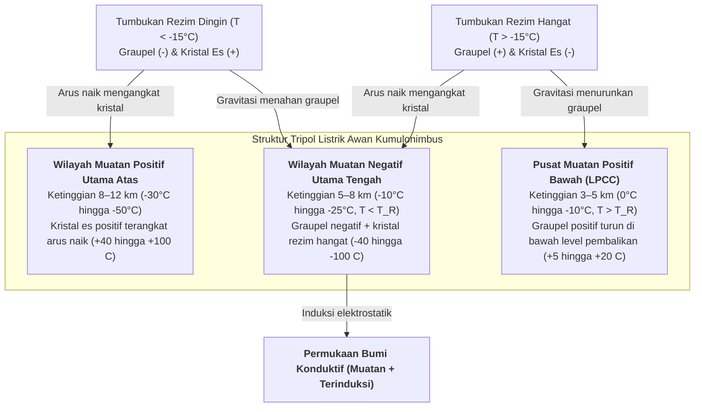

Setiap detik, sekitar 40 hingga 50 kilatan petir menyambar atmosfer Bumi—mencapai hampir 4 juta pelepasan muatan listrik berenergi tinggi per hari. Lebih dari 270 tahun setelah eksperimen layang-layang Benjamin Franklin pada tahun 1752, salah satu pertanyaan paling mendasar dalam fisika atmosfer tetap memikat: <strong>bagaimana sebenarnya kilatan petir bermula di dalam awan badai?</strong> Balon cuaca dan pesawat peneliti yang menembus inti turbulen awan kumulonimbus aktif tidak pernah mengukur medan listrik makroskopis melebihi $0,1\text{–}0,4\,\text{MV/m}$—satu orde besaran lebih lemah daripada ambang batas peluruhan dielektrik konvensional udara kering di permukaan laut ($E_{b0} \approx 3,0\,\text{MV/m}$) menurut teori guguran Townsend dan hukum Paschen. Selain itu, mengapa petir tidak pernah merambat lurus, melainkan membentuk pohon <strong>fraktal</strong> yang diatur oleh ketidakstabilan pertumbuhan Laplace? Mengapa <strong>stepped leader (pemimpin berjenjang)</strong> negatif melompat sejauh $50\,\text{m}$ setiap $50\,\mu\text{s}$ sebelum memicu <strong>return stroke (sambaran balik)</strong> yang melesat dari tanah dengan sepertiga kecepatan cahaya ($v \approx c/3$) dan memanaskan saluran hingga $30.000\,\text{K}$? Artikel ini menguraikan fisika lengkap petir dari skala nanometer hingga elektrodinamika relativistik.

---

## 1. Generator Elektrostatik Kumulonimbus: Pemisahan Muatan Non-Induktif dan Struktur Tripol

Sebelum peluruhan dielektrik terjadi, awan <strong>kumulonimbus</strong> matang harus membangun beda potensial $10^8$ hingga $10^9\,\text{V}$ pada skala kilometer. Di <strong>wilayah fase campuran</strong> pada ketinggian $4\text{–}10\,\text{km}$ (suhu $0^\circ\text{C}$ hingga $-40^\circ\text{C}$), arus udara naik yang kuat ($v_{\text{up}} \approx 10\text{–}30\,\text{m/s}$) mempertemukan tiga spesies hidrometeor: <strong>tetesan air lewat dingin (supercooled water droplets)</strong> ($d \approx 10\text{–}20\,\mu\text{m}$), <strong>kristal es</strong> ($20\text{–}200\,\mu\text{m}$) yang tumbuh melalui deposisi uap, dan <strong>graupel (hujan es lunak)</strong> berukuran milimeter ($1\text{–}5\,\text{mm}$) yang tumbuh cepat melalui proses <strong>riming</strong> (pembekuan tetesan air lewat dingin saat tumbukan).

Eksperimen terowongan angin Takahashi (1978) dan Saunders (1991) membuktikan bahwa mekanisme utama elektrifikasi awan adalah <strong>pemisahan muatan non-induktif</strong> saat tumbukan memantul antara graupel dan kristal es di hadapan air lewat dingin, mentransfer sekitar $10\text{–}100\,\text{fC}$ ($10^{-14}\text{–}10^{-13}\,\text{C}$) per tumbukan. Kunci mikroskopisnya terletak pada <strong>Lapisan Kuasi-Cair (Quasi-Liquid Layer, QLL)</strong> setebal nanometer di permukaan es. Di dalam kisi es dan QLL, molekul air mengalami auto-ionisasi menjadi proton ($\text{H}^+$) dan ion hidroksil ($\text{OH}^-$). Melalui mekanisme lompatan proton Grotthuss di sepanjang ikatan hidrogen, <strong>mobilitas kation $\text{H}^+$ beberapa orde besaran lebih tinggi daripada anion $\text{OH}^-$</strong>.

Saat kontak singkat, dua gradien termodinamika bersaing: (1) <strong>efek gradien suhu</strong>: graupel yang dihangatkan oleh kalor laten pembekuan tetesan lewat dingin memiliki konsentrasi ion lebih tinggi; proton $\text{H}^+$ berdifusi cepat dari graupel hangat ke kristal es dingin, meninggalkan graupel bermuatan negatif ($-$) dan kristal bermuatan positif ($+$); (2) <strong>efek ketebalan QLL (mekanisme Baker-Dash)</strong>: pada suhu lebih hangat dan kandungan air cair ($\text{LWC}$) tinggi, QLL graupel yang lebih tebal membalikkan polaritas transfer muatan. Batas ini mendefinisikan <strong>Suhu Pembalikan (Reversal Temperature, $T_R \approx -15^\circ\text{C}$ hingga $-20^\circ\text{C}$)</strong>:

* <strong>Rezim Dingin ($T < T_R$, ketinggian $7\text{–}10\,\text{km}$)</strong>: <strong>graupel berat bermuatan negatif ($-$)</strong> dan <strong>kristal es ringan bermuatan positif ($+$)</strong>.
* <strong>Rezim Hangat ($T > T_R$, ketinggian $4\text{–}6\,\text{km}$)</strong>: tanda muatan berbalik — <strong>graupel bermuatan positif ($+$)</strong> dan <strong>kristal es bermuatan negatif ($-$)</strong>.

Selanjutnya, <strong>pemilahan ukuran gravitasi</strong> memisahkan muatan secara makroskopis: graupel berat ($v_t \approx 5\text{–}10\,\text{m/s}$) bertahan di lapisan tengah-bawah, sedangkan kristal es ringan ($v_t \ll 1\,\text{m/s}$) terbawa arus naik ke puncak paron (anvil), membentuk <strong>struktur tripol listrik</strong> kanonik:

Kerapatan muatan ruang $\rho(\mathbf{r})$ menentukan potensial elektrostatik $\phi(\mathbf{r})$ dan medan listrik $\mathbf{E} = -\nabla\phi$ melalui <strong>persamaan Poisson</strong>:

$$\nabla^2 \\phi(\mathbf{r}) = -\frac{\rho(\mathbf{r})}{\varepsilon_0}$$

<strong>Pusat Muatan Positif Bawah (LPCC)</strong> memperkuat medan listrik arah bawah di dasar lapisan negatif utama, berfungsi sebagai ketapel elektrostatik yang meluncurkan stepped leader negatif ke tanah. Pada <strong>badai petir musim dingin</strong> (seperti di pesisir Hokuriku, Jepang), isoterm $-15^\circ\text{C}$ turun hingga di bawah $2\,\text{km}$ dari permukaan tanah, memungkinkan wilayah positif atas melepaskan muatan langsung ke Bumi sebagai <strong>superbolt positif (+CG)</strong> dengan arus puncak $200\text{–}300\,\text{kA}$.

---

## 2. Misteri Inisiasi Petir: Peluruhan Townsend vs. Guguran Elektron Relativistik (RREA)

Dalam fisika peluruhan gas klasik, ionisasi tumbukan elektron (koefisien Townsend pertama $\alpha$) bersaing dengan penangkapan elektron oleh molekul oksigen elektronegatif (koefisien $\eta_a$):

$$\frac{dN_e}{dx} = (\alpha - \eta_a) N_e \implies N_e(x) = N_0 \exp\left[ (\alpha - \eta_a) x \right]$$

Guguran <strong>Townsend</strong> eksponensial menuntut $\alpha > \eta_a$, yang menetapkan ambang batas peluruhan konvensional $E_{b0} \approx 3,0\,\text{MV/m}$ di permukaan laut ($E/N \approx 120\,\text{Td}$). Menurut <strong>hukum Paschen</strong>, medan peluruhan berskala linier terhadap kerapatan udara relatif $n(z) = \exp(-z/H)$:

$$E_b(z) = E_{b0} \cdot n(z) \approx (3.0\,\\text{MV/m}) \cdot \exp(-z/H)$$

Pada ketinggian inisiasi petir ($z \approx 6\,\text{km}$, $n \approx 0,5$), peluruhan klasik masih membutuhkan $E_b(6\,\text{km}) \approx 1,5\,\text{MV/m}$, jauh di atas hasil pengukuran $0,1\text{–}0,4\,\text{MV/m}$. Dua mekanisme fisik memecahkan paradoks ini:

1. <strong>Relativistic Runaway Electron Avalanches (RREA) yang Dipicu Sinar Kosmik</strong>: elektron termal terhalang oleh puncak gaya gesek inelastik pada $100\text{–}200\,\text{eV}$ ($F_{\max} \approx 27\,\text{MeV/m}\cdot n(z)$). Namun, menurut rumus daya henti relativistik Bethe-Bloch, bagi elektron dengan energi kinetik $K_{\min} \approx 1,0\text{–}1,4\,\text{MeV}$, gaya hambat turun ke nilai minimum $F_{\min} \approx 0,218\,\text{MeV/m}\cdot n(z)$. Dengan memperhitungkan hamburan Coulomb inti atom, <strong>medan ambang RREA $E_{\text{RREA}}$</strong> (Gurevich, 1992; Dwyer, 2003) adalah:

$$E_{\\text{RREA}}(z) \approx 0.284\,\\text{MV/m} \cdot n(z), \qquad N_{\\text{RREA}}(L) = N_0 \exp\left(\frac{L}{\lambda_{\\text{RREA}}}\right)$$

   Pada ketinggian $6\,\text{km}$, $E_{\text{RREA}} \approx 0,14\,\text{MV/m}$, tepat sesuai dengan medan maksimum yang diukur balon cuaca! Elektron benih ($\sim 1\,\text{MeV}$) dari <strong>Extensive Air Showers (EAS)</strong> sinar kosmik mengalami percepatan lepas (runaway) dan menggandakan elektron sekunder melalui hamburan Møller.
2. <strong>Amplifikasi Medan Hidrometeor dan Fast Positive Breakdown (FPB)</strong>: pada ujung kristal es memanjang dengan rasio aspek $l/r \gg 1$, polarisasi dielektrik memperkuat medan listrik lokal:

$$E_{\\text{tip}} \approx E_0 \frac{(l/r)^2}{\ln(2l/r) - 1}$$

   Saat $E_{\text{tip}}$ melampaui $E_b(z)$, <strong>streamer korona positif</strong> diluncurkan dan merambat terus-menerus selama medan latar melebihi ambang stabilitas $E_{\text{st}}^{+} \approx 0,45\,\text{MV/m}\cdot n(z)$. Rison dkk. (2016) menggunakan interferometri VHF pita lebar untuk membuktikan bahwa semua petir diawali oleh semburan eksplosif streamer positif berkecepatan $3\text{–}5 \times 10^7\,\text{m/s}$, yang disebut <strong>Fast Positive Breakdown (FPB / Narrow Bipolar Events NBE)</strong>.

---

## 3. Mengapa Petir Bercabang: Transisi Streamer-Leader dan Pertumbuhan Fraktal $\eta$-Laplace

Satu streamer adalah plasma dingin ($T_g \approx 300\,\text{K}$) yang kehilangan konduktivitas dalam puluhan nanodetik karena elektron menempel pada $\text{O}_2$. Ketika ribuan streamer menyatu pada satu pangkal (stem), pemanasan Joule menaikkan suhu gas netral melewati ambang kritis <strong>$T_{\text{crit}} \approx 1.500\text{–}5.000\,\text{K}$</strong>, memicu: (1) <strong>pelepasan elektron termal</strong> ($\text{O}_2^- + \text{M} \to \text{O}_2 + \text{M} + \text{e}^-$), (2) <strong>relaksasi vibrasi-translasi (V-T)</strong> molekul $\text{N}_2$, dan (3) <strong>ekspansi hidrodinamik radial</strong> yang menurunkan kerapatan $N$ serta menaikkan $E/N$. Terbentuklah saluran <strong>leader</strong> panas yang menghantarkan potensial $-50\,\text{MV}$ awan hingga ke ujungnya.

Pada 90% petir awan-ke-tanah (negatif, -CG), <strong>stepped leader</strong> bergerak tersendat-sendat karena streamer negatif membutuhkan medan dua kali lebih besar daripada streamer positif ($E_{\text{st}}^{-} \approx 1,0\text{–}1,2\,\text{MV/m}\cdot n$). Di depan ujung leader utama, terbentuk inti plasma terisolasi (<strong>space stem</strong>) yang menumbuhkan leader ruang dua arah; saat ujung positifnya yang bergerak mundur menyentuh leader negatif utama, segmen baru sepanjang $L_{\text{step}} \approx 10\text{–}50\,\text{m}$ menyala setiap $\tau_{\text{step}} \approx 20\text{–}50\,\mu\text{s}$ (kecepatan rata-rata $\sim 2 \times 10^5\,\text{m/s}$).

Percabangan fraktal dijelaskan oleh <strong>Dielectric Breakdown Model (DBM)</strong> dari Niemeyer, Pietronero, dan Wiesmann (1984). Pohon leader konduktif ($\phi = 0$) berada dalam medan Laplace di mana probabilitas peluruhan $P_i$ pada titik batas $i$ sebanding dengan pangkat $\eta$ dari medan listrik lokal:

$$\nabla^2 \\phi(\mathbf{r}) = 0, \qquad P_i = \frac{|\nabla \\phi_i|^\eta}{\sum_{j \in \\text{boundary}} |\nabla \\phi_j|^\eta} \quad \left(|\nabla \\phi_i| > E_{\\text{crit}}\right)$$

Ujung yang menonjol memadatkan permukaan ekuipotensial sementara cabang samping terlindungi secara elektrostatik (<strong>ketidakstabilan pertumbuhan Mullins-Sekerka</strong>), memaksa ujung terus membelah. Sementara $\eta = 1$ setara dengan Diffusion-Limited Aggregation (DLA, 2D $D_f \approx 1,71$), rezim petir nonlinier ($\eta \approx 2$) menghasilkan <strong>dimensi fraktal Hausdorff proyeksi 2D sebesar $D_f \approx 1,35\text{–}1,55$</strong>.

---

## 4. Sambungan, Return Stroke $30.000\,\text{K}$, dan Mekanika Gelombang Kejut Guntur

Ketika stepped leader mendekati tanah dalam <strong>jarak sambar (striking distance) $r_s$</strong>, dari ujung struktur tinggi yang ditanahkan (penangkal petir, pohon) meluncur <strong>upward connecting leader positif</strong>. Dalam <strong>Model Elektro-Geometris (EGM, metode bola bergulir)</strong>, $r_s$ dikaitkan dengan arus puncak $I_p$ (dalam $\text{kA}$) melalui rumus Love (1973):

$$r_s = 10 \, I_p^{0.65} \quad [\\text{m}]$$

Begitu keduanya bertemu ($20\text{–}100\,\text{m}$ di atas tanah), gelombang netralisasi potensial tanah—<strong>Return Stroke (sambaran balik)</strong>—melesat ke atas menuju awan dengan kecepatan <strong>$v_{\text{RS}} \approx c/3 \approx 1,0 \times 10^8\,\text{m/s}$</strong>. Dalam $1\text{–}5\,\mu\text{s}$, arus puncak median $30\,\text{kA}$ melewati inti berdiameter $1\text{–}3\,\text{cm}$ dan memanaskan plasma hingga <strong>$T \approx 30.000\,\text{K}$ (lima kali lebih panas dari fotosfer Matahari)</strong>. Selanjutnya, <strong>dart leader</strong> meluncur turun melalui saluran sisa yang hangat pada $\sim 10^7\,\text{m/s}$, menyebabkan efek berkedip pada petir.

Karena pemanasan mikrodetik ini bersifat <strong>isokorik (volume konstan)</strong>, tekanan internal melonjak hingga $10\text{–}100\,\text{atm}$ dan silinder plasma meledak secara radial pada kecepatan supersonik Mach $10\text{–}20$, membentuk <strong>gelombang kejut silinder Taylor-Sedov</strong>. Radius relaksasi karakteristik $R_0$ dan frekuensi puncak akustik $f_{\text{peak}}$ guntur ditentukan oleh energi per satuan panjang $E_l$ dan tekanan atmosfer $P_0$:

$$R_0 = \sqrt{\frac{E_l}{\pi P_0}}, \qquad f_{\\text{peak}} \approx 0.63 \, c_s \sqrt{\frac{P_0}{E_l}} = \frac{0.63 \, c_s}{\sqrt{\pi} R_0} \approx 50\\text{–}150\,\\text{Hz}$$

Pada jarak beberapa kilometer, gelombang-N berubah menjadi gemuruh panjang berfrekuensi rendah akibat perbedaan waktu tiba dari saluran 3D yang berliku, redaman atmosfer sebanding $f^2$, dan pembiasan akustik termal ke atas.

---

## 5. Transient Luminous Events (TLE) dan Terrestrial Gamma-ray Flashes (TGF) Penghasil Antimateri

1. <strong>Transient Luminous Events (TLE)</strong>:
   * <strong>Red Sprites (ketinggian $50\text{–}90\,\text{km}$)</strong>: setelah petir $+CG$ kuat dengan perubahan momen muatan besar ($\text{CMC} \gtrsim 500\,\text{C}\cdot\text{km}$), medan kuasi-elektrostatik di mesosfer melampaui ambang peluruhan $E_b(z)$ yang turun secara eksponensial bersama kerapatan udara, memicu kompleks streamer dingin raksasa (merah di atas oleh $\text{N}_2(1\text{P})$, sulur biru di bawah oleh $\text{N}_2^+(1\text{N})$).
   * <strong>Blue Jets ($15\text{–}50\,\text{km}$) dan Gigantic Jets (hingga $90\,\text{km}$)</strong>: kerucut leader-streamer positif yang menyembur ke atas dari puncak awan dengan kecepatan $\sim 100\,\text{km/s}$.
   * <strong>ELVES ($85\text{–}100\,\text{km}$)</strong>: cincin cahaya merah datar berdiameter $300\text{–}500\,\text{km}$ ($<1\,\text{ms}$) akibat perpotongan kulit bola pulsa elektromagnetik (EMP) return stroke dengan lapisan bawah ionosfer pada kecepatan fase superluminal.
2. <strong>Terrestrial Gamma-ray Flashes (TGF) dan Produksi Antimateri Fotonuklir</strong>: guguran RREA mempercepat elektron hingga $20\text{–}40\,\text{MeV}$, memancarkan sinar gama bremsstrahlung. Pada tahun 2017, Enoto dkk. (*Nature*) membuktikan bahwa foton gama di atas $10,55\,\text{MeV}$ menendang keluar neutron dari inti $^{14}\text{N}$; isotop tidak stabil $^{13}\text{N}$ mengalami peluruhan $\beta^+$ yang memancarkan <strong>positron antimateri ($\text{e}^+$)</strong>, yang kemudian mengalami anihilasi dengan elektron udara menghasilkan garis spektrum gama tepat pada <strong>$0,511\,\text{MeV}$</strong>:

$$\gamma + {{}}^{14}_{7}\\text{N} \longrightarrow {{}}^{13}_{7}\\text{N} + \\text{n} \quad (E_\gamma > 10.55\,\\text{MeV})$$

$${{}}^{13}_{7}\\text{N} \longrightarrow {{}}^{13}_{6}\\text{C} + \\text{e}^+ + \nu_e, \qquad \\text{e}^+ + \\text{e}^- \longrightarrow 2\gamma \quad (E_\gamma = 0.511\,\\text{MeV})$$

---

## 6. Perbandingan Fisika Komprehensif dan Teknologi Observasi Modern

| Fenomena / Rezim | Ketinggian / Skala Spasial | Durasi / Skala Waktu | Kecepatan Rambat $v$ | Arus, Energi, atau Suhu Karakteristik | Mekanisme Fisika Utama |
| :--- | :--- | :--- | :--- | :--- | :--- |
| <strong>Pemuatan Non-Induktif</strong> | $4\text{–}10\,\text{km}$ (zona fase campuran) | Siklus konvektif $10\text{–}30\,\text{menit}$ | Arus naik $10\text{–}30\,\text{m/s}$ | $\sim 10^{-14}\,\text{C}$/tumbukan; $\pm 40\text{–}100\,\text{C}$ total | Tumbukan graupel-es, difusi $\text{H}^+$ di QLL, $T_R \approx -15^\circ\text{C}$ |
| <strong>Fast Positive Breakdown (FPB)</strong> | $5\text{–}12\,\text{km}$; panjang $0,3\text{–}1\,\text{km}$ | $10\text{–}20\,\mu\text{s}$ | $3 \times 10^7 \text{–} 5 \times 10^7\,\text{m/s}$ | Semburan radio VHF multimegawatt | Guguran RREA kosmik + amplifikasi ujung kristal es |
| <strong>Negative Stepped Leader</strong> | Awan–tanah (langkah $10\text{–}50\,\text{m}$) | $10\text{–}30\,\text{ms}$ (jeda $20\text{–}50\,\mu\text{s}$) | Rata-rata $2 \times 10^5\,\text{m/s}$ | $100\text{–}1.000\,\text{A}$; inti $T \approx 5.000\,\text{K}$ | Pelepasan termal ($>1.500\,\text{K}$), space stems, fraktal DBM $\eta$-Laplace |
| <strong>Return Stroke</strong> | Tanah–awan (diameter inti $1\text{–}3\,\text{cm}$) | Naik $1\text{–}5\,\mu\text{s}$; luruh $\sim 100\,\mu\text{s}$ | $v \approx c/3 \approx 1,0 \times 10^8\,\text{m/s}$ (ke atas) | Median $30\,\text{kA}$ (+CG hingga $300\,\text{kA}$); <strong>$T \approx 30.000\,\text{K}$</strong> | Gelombang netralisasi, pemanasan isokorik ($10\text{–}100\,\text{atm}$), gelombang kejut |
| <strong>Sprites / Jets / ELVES</strong> | $15\text{–}100\,\text{km}$ (stratosfer–ionosfer) | $<1\,\text{ms}$ (ELVES) hingga $300\,\text{ms}$ (Jets) | $10^5\,\text{m/s}$ hingga kecepatan fase $>c$ | Plasma dingin ($T_g \approx 200\text{–}300\,\text{K}$) | Peluruhan kuasi-elektrostatik (QE), ketidakseimbangan muatan, kulit bola EMP |
| <strong>Terrestrial Gamma-ray Flash (TGF)</strong> | $10\text{–}15\,\text{km}$ ($2\text{–}4\,\text{km}$ musim dingin) | $<1\,\text{ms}$ (pendaran $\text{e}^+$ $\sim 10\,\text{menit}$) | Elektron relativistik $v \approx 0,99c$ | Energi foton hingga <strong>$20\text{–}40\,\text{MeV}$</strong> | Bremsstrahlung RREA, reaksi $^{14}\text{N}(\gamma,\text{n}){}^{13}\text{N}$ & anihilasi $\text{e}^+\text{e}^-$ ($0,511\,\text{MeV}$) |

Saat ini, jaringan <strong>3D VHF Lightning Mapping Arrays (LMA)</strong> dan interferometer digital pita lebar mampu merekonstruksi evolusi 3D saluran petir di dalam awan dengan akurasi meter. Pada tahun 2023 di puncak Gunung Säntis ($2.502\,\text{m}$, Swiss), konsorsium Eropa menggunakan laser femtodetik terawatt untuk membentuk saluran udara terionisasi melalui <strong>filamentasi laser</strong>, berhasil memandu petir alami sepanjang $50\,\text{m}$ untuk pertama kalinya dalam sejarah (Houard dkk., 2023). Secara global, sekitar 2.000 badai petir yang aktif setiap saat menggerakkan <strong>Sirkuit Listrik Global Wilson</strong>, menjaga ionosfer pada potensial $+250\,\text{kV}$, mempertahankan medan listrik cuaca cerah ($100\text{–}150\,\text{V/m}$), dan membangkitkan <strong>Resonansi Schumann ($7,83\,\text{Hz}$)</strong>.
