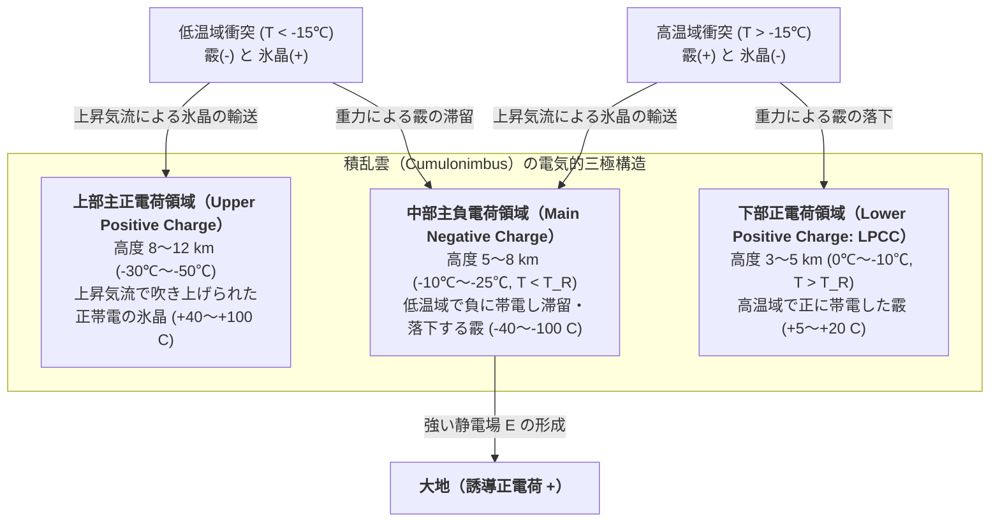
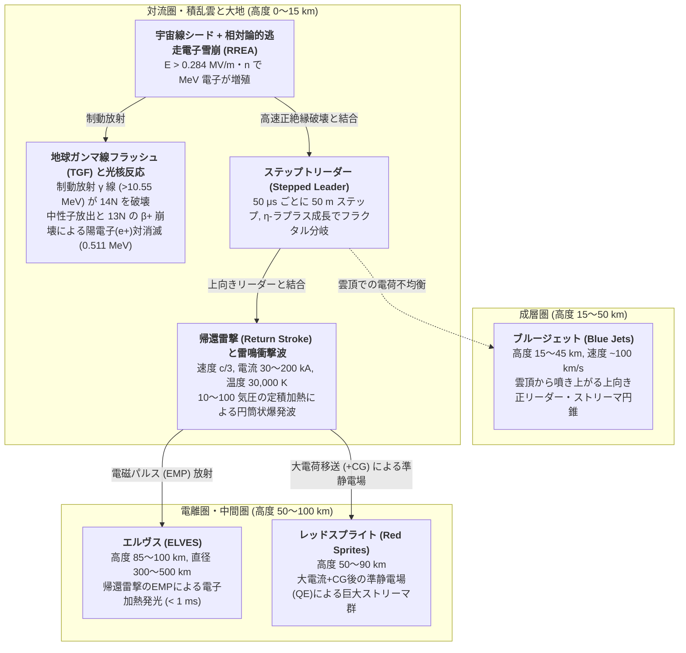

夏の夕暮れや冬の日本海沿岸で、暗雲を切り裂く青白い閃光とともに大地を揺るがす轟音が響き渡るとき、私たちは地球大気中で最も劇的な高エネルギー物理現象を目撃している。地球全体では毎秒約40〜50回、1日に換算すると約400万回もの<strong>雷放電（Lightning Discharge）</strong>が発生している。

1752年にベンジャミン・フランクリン（Benjamin Franklin）が凧の実験によって「雷の正体は電気（静電気放電）である」ことを証明してから270年以上が経過した。しかし驚くべきことに、現代の大気物理学・プラズマ物理学をもってしても、<strong>「積乱雲の中で、そもそもどのようにして最初の放電（雷の始まり：Lightning Initiation）が起きるのか？」</strong>という最も根本的な問いは、完全には解決されていない最大のミステリーの一つであり続けている。気球や航空機を積乱雲の内部に直接突入させて測定した電場の強さは、空気が絶縁破壊を起こすのに必要な理論値のわずか10分の1程度しかないのである。

さらに、空を走る稲妻はなぜ一本の直線にならず、見事なまでに複雑な樹状の<strong>フラクタル構造（枝分かれ）</strong>を描くのか？雲から伸びる先駆放電（ステップトリーダー）はなぜ50マイクロ秒ごとに休止しながら段階的に進み、地上と繋がった瞬間に光速の3分の1という猛烈な速度で駆け上がる<strong>帰還雷撃（Return Stroke）</strong>へと変貌するのか？そして近年、雷雲の上空（成層圏・中間圏）で発見された巨大な発光現象<strong>スプライト（Sprites）</strong>や<strong>エルヴス（ELVES）</strong>、さらには雷が引き起こす光核反応によって大気中で<strong>反物質（陽電子 $\text{e}^+$）やガンマ線</strong>が生成されているという事実は、雷が単なる気象現象ではなく「大気圏内の天然粒子加速器」であることを物語っている。

本稿では、氷の表面物理から気体エレクトロニクス、非線形フラクタル成長モデル、超音速衝撃波の流体力学、そして高エネルギー宇宙線・原子核物理学に至るまで、雷の全生涯を支配する物理法則を体系的に解き明かしていく。

---

## 第1章：積乱雲という巨大静電発電機 — 非誘導的電荷分離と三極構造

雷が起きるためには、まず大気中に巨大な電位差（数千万〜数億ボルト）が作り出されなければならない。この静電エネルギーを生み出す発電機こそが、発達した<strong>積乱雲（Cumulonimbus）</strong>である。

### 1.1 混相雲のミクロ物理と非誘導的電荷分離機構

積乱雲の内部には、秒速 $10\text{〜}30\,\text{m/s}$ にも達する強烈な<strong>上昇気流（Updraft）</strong>が存在する。高度が上がるにつれて気温は低下し、高度 $4\text{〜}10\,\text{km}$（気温 $0^\circ\text{C}\sim -40^\circ\text{C}$）の領域には、以下の3種類の水物質（Hydrometeors）が共存する<strong>混相状態（Mixed-phase region）</strong>が形成される。

1. <strong>過冷却水滴（Supercooled water droplets）</strong>：$0^\circ\text{C}$ 以下でも凍結せずに液体のまま浮遊する微小水滴（直径 $10\text{〜}20\,\mu\text{m}$）。
2. <strong>氷晶（Ice crystals）</strong>：水蒸気の昇華凝結によって成長する小さな氷の結晶（直径数十〜数百 $\mu\text{m}$）。
3. <strong>霰（あられ：Graupel）</strong>：氷晶の周囲に過冷却水滴が次々と衝突・凍結（ライミング：Riming）して成長した、直径数ミリメートルの比較的大きく重い氷の塊。

大気電気学において長年議論された末に確立された最も支配的な電荷生成プロセスは、外部電場の存在を必要としない<strong>非誘導的電荷分離機構（Non-inductive charging mechanism）</strong>である（Reynolds et al., 1957; Takahashi, 1978; Saunders et al., 1991）。これは、上昇気流の中で<strong>「霰（Graupel）」と「氷晶（Ice crystal）」が衝突し、反発して離れる瞬間に電荷（電荷量にして1衝突あたり数十フェムトクーロン：$\sim 10^{-14}\,\text{C}$）をやり取りする現象</strong>である。

### 1.2 逆転温度（$T_R \approx -15^\circ\text{C}$）と擬似液体層（QLL）の物理

なぜ氷同士がぶつかるだけで電気が生まれるのか？しかも、なぜ周囲の温度によって帯電のプラス・マイナスが逆転するのか？この謎を解いたのが、日本の雲物理学者・<strong>高橋劭（Takahashi, 1978）</strong>らによる歴史的な低温風洞実験と、氷表面の<strong>擬似液体層（Quasi-Liquid Layer: QLL）</strong>の物理学である。

氷の表面には、融点（$0^\circ\text{C}$）よりはるかに低い $-30^\circ\text{C}$ 付近であっても、水素結合のネットワークが完全には固定されていない厚さ数ナノメートルの水のような無秩序層（QLL）が存在する。このQLLおよび氷結晶格子の中では、水分子が自己解離したプロトン（$\text{H}^+$、正確にはヒドロニウムイオン $\text{H}_3\text{O}^+$）と水酸化物イオン（$\text{OH}^-$）が存在しているが、結晶構造の対称性と水素結合のジャンプ機構（グロッタス機構）により、<strong>正電荷を持つ $\text{H}^+$ の移動度（Mobility）は、負電荷を持つ $\text{OH}^-$ よりも圧倒的に大きい</strong>。

ここに以下の2つの熱力学的・速度論的勾配が働く。

* <strong>温度勾配効果（Temperature Gradient Effect）</strong>：2つの氷が接触したとき、温度が高い側では水分子の解離度が高く $\text{H}^+$ 濃度が高いため、移動度の高い $\text{H}^+$ が<strong>温かい氷から冷たい氷へと急速に拡散</strong>する。結果として、冷たい側の氷が正（$+$）に、温かい側の氷が負（$-$）に帯電する。
* <strong>成長速度差・擬似液体層厚効果（Baker-Dash / Saunders Mechanism）</strong>：過冷却水滴が凍結する際（ライミング）には潜熱が放出されるため、霰の表面温度やQLLの厚さは周囲の氷晶と異なる。より速く気相成長（昇華凝結）している側、あるいはQLLが厚い側から薄い側へと負電荷（または反対方向への正電荷）の質量移動が生じる。

高橋（1978）が温度 $T$ と雲水量（Liquid Water Content: $\text{LWC}$）を変化させて測定した電荷分離ダイアグラムは、驚くべき境界線の存在を示した。それが<strong>逆転温度（Reversal Temperature: $T_R \approx -15^\circ\text{C}\sim -20^\circ\text{C}$）</strong>である。

* <strong>低温領域（$T < T_R$、高度約 $7\text{〜}10\,\text{km}$）</strong>：衝突の際、重い<strong>霰（Graupel）が負（$-$）</strong>に帯電し、軽い<strong>氷晶（Ice crystal）が正（$+$）</strong>に帯電する。
* <strong>高温領域（$T > T_R$、高度約 $4\text{〜}6\,\text{km}$）</strong>：雲水量が十分に高い条件下で符号が逆転し、重い<strong>霰が正（$+$）</strong>に帯電し、軽い<strong>氷晶が負（$-$）</strong>に帯電する。

### 1.3 重力分別による電気的三極構造（Tripole Structure）の形成

ミクロな衝突で霰と氷晶の間で電荷が分かれても、両者が同じ場所に混ざり合っていれば雲全体としては電気的に中性のままである。ここで決定的な役割を果たすのが、<strong>重力によるサイズ分別（Gravitational Size Sorting）と上昇気流の力学</strong>である。

ミリメートルサイズの重い霰は終端落下速度が大きく（$v_t \approx 5\text{〜}10\,\text{m/s}$）、雲の中層から下層へと落下・滞留する。一方、マイクロメートルサイズの軽い氷晶は終端落下速度が極めて小さく（$v_t \ll 1\,\text{m/s}$）、秒速 $10\text{〜}20\,\text{m/s}$ の上昇気流に乗って雲頂（高度 $10\text{〜}12\,\text{km}$）まで一気に吹き上げられる。

このミクロな逆転温度 $T_R$ とマクロな重力分別が組み合わさることで、積乱雲の内部には以下のような見事な<strong>電気的三極構造（Tripole Charge Structure）</strong>が自律的に形成される。

この電荷分布 $\rho(\mathbf{r})$ は、真空の誘電率 $\varepsilon_0$ を用いた<strong>ポアソン方程式（Poisson's Equation）</strong>に従って空間電位 $\phi(\mathbf{r})$ と電場 $\mathbf{E}(\mathbf{r}) = -\nabla \phi(\mathbf{r})$ を生成する。

$$\nabla^2 \phi(\mathbf{r}) = -\frac{\rho(\mathbf{r})}{\varepsilon_0}$$

中部主負電荷領域（$-40\text{〜}-100\,\text{C}$）と下部正電荷領域（$+5\text{〜}+20\,\text{C}$）の境界付近、および主負電荷領域と上部正電荷領域の間には極めて強い電場が形成される。特に下部正電荷領域（LPCC）は、主負電荷領域の下端における電場を局所的に強化し、雲底から地上へと向かう負極性落雷の引き金（カタパルト）として機能することが知られている。

なお、日本の北陸地方などで冬に発生する<strong>冬季雷（Winter Lightning）</strong>では、寒気団の影響で気温 $0^\circ\text{C}$ や $-15^\circ\text{C}$ の高度が夏場より $3\text{〜}4\,\text{km}$ も低く、雲頂高度自体が $5\text{〜}6\,\text{km}$ 程度しかない。そのため、上部の正電荷領域が地表に極めて近い位置に張り出し、通常の夏雷とは逆に上部正電荷領域から直接大地へと大電流が落ちる<strong>正極性落雷（Positive Cloud-to-Ground: +CG）</strong>が多発する原因となっている。

---

## 第2章：雷発生（イニシエーション）のパラドックス — なぜ空気は絶縁破壊するのか？

積乱雲の中に巨大な電荷が蓄えられたとして、そこからどのようにして最初の電気火花（放電チャネル）が生まれるのだろうか？ここには、大気電気学者を半世紀以上にわたって悩ませてきた<strong>「雷発生のパラドックス（The Lightning Initiation Mystery）」</strong>が横たわっている。

### 2.1 タウンゼント雪崩とパッシェンの法則による絶縁破壊閾値

気体である空気は、通常は自由電子がほとんど存在しない優れた<strong>絶縁体（誘電体）</strong>である。しかし、外部から強い電場 $E$ を印加すると、わずかに存在する自由電子が電場からエネルギーを得て加速し、空気中の窒素分子（$\text{N}_2$）や酸素分子（$\text{O}_2$）に衝突して新たな電子を叩き出す<strong>衝突電離（Impact Ionization）</strong>を起こす。

単位距離あたりに1個の電子が電離によって生み出す新電子の数を<strong>第1タウンゼント電離係数 $\alpha$</strong> と呼び、逆に酸素などの電気陰性気体に電子が捕獲されて負イオン（$\text{O}_2^-, \text{O}^-$）になり失われる割合を<strong>電子付着係数 $\eta_a$</strong> と呼ぶ。電子数 $N_e(x)$ が距離 $x$ とともに指数関数的に増殖する<strong>タウンゼント電子雪崩（Townsend Avalanche）</strong>が成立するための条件は、実効電離係数 $\alpha_{\text{eff}} = \alpha - \eta_a > 0$ となることである。

$$\frac{dN_e}{dx} = (\alpha - \eta_a) N_e \implies N_e(x) = N_0 \exp\left[ (\alpha - \eta_a) x \right]$$

$\alpha/N$ および $\eta_a/N$ は、電場 $E$ を気体分子数密度 $N$ で割った<strong>換算電場（Reduced Electric Field） $E/N$</strong>（単位はタウンゼント：$\text{Td}$、$1\,\text{Td} = 10^{-21}\,\text{V}\cdot\text{m}^2$）の関数である。標準状態（海面気圧 $1\,\text{atm}$、気温 $20^\circ\text{C}$、数密度 $N_0 \approx 2.5 \times 10^{25}\,\text{m}^{-3}$）の乾燥空気において、$\alpha = \eta_a$ となって絶縁破壊が始まる<strong>従来型絶縁破壊電場（Conventional Breakdown Threshold） $E_{b0}$</strong> は約 $120\,\text{Td}$、すなわち以下の値となる。

$$E_{b0} \approx 3.0 \times 10^6\,\text{V/m} \quad (3\,\text{MV/m} = 30\,\text{kV/cm})$$

高度 $z$ が高くなると空気密度 $N(z)$ が減少するため、電子の平均自由行程（Mean free path $\lambda_e \propto 1/N$）が長くなり、より小さな電場でも電子は電離に必要なエネルギーまで加速できるようになる（<strong>パッシェンの法則：Paschen's Law</strong>の高気圧側スケーリング）。相対空気密度を $n(z) = N(z)/N_0$ と定義すると、高度 $z$ における絶縁破壊電場は次のようにスケールする。

$$E_b(z) = E_{b0} \cdot n(z) \approx (3.0\,\text{MV/m}) \cdot \exp\left(-\frac{z}{H}\right)$$

ここでスケールハイト $H \approx 8\,\text{km}$ である。雷が最も頻繁に発生する高度 $z \approx 6\,\text{km}$ では $n(z) \approx 0.5$ であるため、そこでの絶縁破壊には少なくとも <strong>$E_b(6\,\text{km}) \approx 1.5\,\text{MV/m}$</strong> の電場が必要となるはずである。

### 2.2 観測上の難題：雲内の電場は理論値の10分の1しかない

ところが、Marshall et al.（1995）やStolzenburg et al.（2007）らによる気球（電場ゾンデ）、ロケット、観測航空機を用いた積乱雲内部の直接電場測定を何百回行っても、<strong>雷が発生する直前の積乱雲内部で観測された最大電場は、せいぜい $0.1\text{〜}0.4\,\text{MV/m}$（高度換算しても従来型絶縁破壊閾値 $E_b(z)$ の10%〜25%程度）に過ぎなかった</strong>のである。

なぜ絶縁破壊電場 $E_b(z)$ に遠く及ばない電場しか存在しないのに、積乱雲の中ではいとも簡単に雷が始まるのか？このパラドックスを解決するために、現代物理学は2つの革新的なメカニズム（およびそれらのハイブリッド理論）に到達した。

### 2.3 解決機構①：相対論的逃走電子雪崩（RREA）と高エネルギー宇宙線シャワー

第1のブレークスルーは、ノーベル賞物理学者C.T.R.ウィルソン（Wilson, 1925）の着想を現代的に発展させた、アレクサンドル・グレヴィッチ（Gurevich et al., 1992）とジョセフ・ドワイアー（Dwyer, 2003）による<strong>相対論的逃走電子雪崩（RREA: Relativistic Runaway Electron Avalanche）</strong>理論である。

通常のタウンゼント放電では、数 $\text{eV}$ の低エネルギー電子を考える。電子の運動エネルギー $K$ が数 $\text{eV}$ から約 $100\,\text{eV}$ に向かって増加するとき、空気分子との非弾性衝突（励起・電離）による動的摩擦力（阻止能：Stopping Power $F_d(K) = -dK/dx$）は急激に増大する（約 $100\text{〜}200\,\text{eV}$ で最大の摩擦障壁 $F_{\max} \approx 27\,\text{MeV/m}\cdot n$ に達する）。そのため、低エネルギー電子をゼロから加速して逃走させる（Runaway）には $E > 27\,\text{MV/m}\cdot n$ というとてつもない電場が必要になる。

しかし、もし最初から<strong>運動エネルギーが $100\,\text{keV}\sim 1\,\text{MeV}$ を超える相対論的電子（Relativistic Electron）</strong>が空気中に飛び込んできたらどうなるか？ベーテ・ブロッホの式（Bethe-Bloch formula）が示す通り、高エネルギー領域では電子の速度 $v$ が光速 $c$ に近づくため、空気分子と相互作用する時間が短くなり、阻止能 $F_d(K)$ はエネルギーとともに減少して、運動エネルギー $K_{\min} \approx 1.0\text{〜}1.4\,\text{MeV}$ において<strong>極小値（Minimum Ionizing摩擦） $F_{\min}$</strong> をとる。

$$F_{\min}(z) \approx 0.218\,\text{MV/m} \cdot n(z)$$

つまり、積乱雲内の電場 $E$ がこの<strong>ブレークイーブン電場（Breakeven Field） $E_{\text{th}} \approx 0.218\,\text{MV/m}\cdot n(z)$</strong>（弾性散乱による角度分散を考慮した実際のRREA閾値は <strong>$E_{\text{RREA}} \approx 0.284\,\text{MV/m}\cdot n(z)$</strong>）を超えさえすれば、高エネルギー電子は空気の摩擦抵抗に打ち勝って際限なく加速し続けることができる！高度 $6\,\text{km}$（$n \approx 0.5$）における $E_{\text{RREA}}$ は約 <strong>$0.14\,\text{MV/m}$</strong> であり、これは<strong>気球観測で実際に測定された積乱雲内の最大電場（$0.1\text{〜}0.4\,\text{MV/m}$）とピタリと一致する</strong>のである。

この相対論的逃走電子が空気分子とハードな電子-電子衝突（<strong>メラー散乱：Møller Scattering</strong>）を起こすと、叩き出された二次電子もまた数百 $\text{keV}$ 以上の高エネルギーを持つため、それも逃走電子となって連鎖的に増殖する。これがRREAであり、距離 $L$ 進んだ後の逃走電子数 $N_{\text{RREA}}(L)$ は次の特性長 $\lambda_{\text{RREA}}$ で指数関数的に増大する（Dwyer, 2003）。

$$N_{\text{RREA}}(L) = N_0 \exp\left(\frac{L}{\lambda_{\text{RREA}}}\right), \quad \lambda_{\text{RREA}} \approx \frac{7.3\,\text{MV}}{E - (0.276\,\text{MV/m}) \cdot n(z)}$$

では、最初の $1\,\text{MeV}$ 近い高エネルギーの「種（シード電子）」はどこから来るのか？それこそが、超新星残骸など宇宙の彼方から地球大気に絶えず降り注いでいる<strong>高エネルギー宇宙線（Cosmic Rays、エネルギー $10^{15}\text{〜}10^{17}\,\text{eV}$ の陽子や原子核）が引き起こす空気シャワー（Extensive Air Shower: EAS）</strong>である（Gurevich & Zybin, 2001）。宇宙線空気シャワーが $E > E_{\text{RREA}}$ の強電場領域を貫いた瞬間、無数の二次電子が一斉にRREAを起こし、局所的に莫大な電離電子群と空間電荷の歪みを作り出す。

### 2.4 解決機構②：氷粒子先端の電場増幅と高速正ストリーマ（Fast Positive Breakdown）

第2のメカニズムは、雲内に無数に浮遊する<strong>水文気象粒子（Hydrometeors：特に細長い氷針結晶や衝突寸前の水滴ペア）による局所的な電場増幅とストリーマ・リーダー遷移</strong>である（Loeb, 1966; Petersen et al., 2008; Rison et al., 2016）。

背景の巨視的電場 $E_0$ が $0.2\,\text{MV/m}$ 程度であっても、長さ $l$、先端の曲率半径 $r$（アスペクト比 $l/r \gg 1$）の細長い氷結晶（または誘電分極によって引き伸ばされた大水滴）が存在すると、静電誘導によってその鋭い先端部では電場が次のように劇的に増幅される。

$$E_{\text{tip}} \approx E_0 \frac{(l/r)^2}{\ln(2l/r) - 1}$$

アスペクト比が $10\text{〜}30$ あれば、先端の微小領域（数ミリメートル）では局所電場が数十倍に跳ね上がり、従来型絶縁破壊閾値 $E_b(z)$ を容易に突破して<strong>正コロナ・ストリーマ（Positive Streamer）</strong>が発生する。正ストリーマは、一度発生するとその先端自身の空間電荷が作る強電場によって、背景電場が $E_{\text{stability}} \approx 0.45\,\text{MV/m}\cdot n(z)$（高度 $6\,\text{km}$ で約 $0.22\,\text{MV/m}$）以上あれば自律的にどこまでも進展し続けることができる。

2016年、Risonらは超高分解能の広帯域VHF干渉計を用いて、多くの雷が<strong>「高速正絶縁破壊（Fast Positive Breakdown）」</strong>あるいは<strong>狭双極子現象（NBE: Narrow Bipolar Event）</strong>と呼ばれる、長さ数百メートルを速度 $v \approx 5 \times 10^7\,\text{m/s}$ で一気に駆け抜ける高密度の正ストリーマ群の爆発的連鎖から始まっていることを突き止めた。現代の統一的理解では、<strong>「宇宙線空気シャワーによるRREA（あるいは乱流による氷粒子の局所集中）がメートル〜デカメートルスケールの電場を極限まで高め、そこにある氷晶群から一斉に高速正ストリーマ系（Fast Positive Breakdown）が発火して最初の高温リーダーチャネルを生み出す」</strong>という複合プロセスが最も有力視されている。

---

## 第3章：なぜ雷はギザギザに枝分かれするのか？ — ストリーマ、ステップトリーダー、そしてラプラス成長のフラクタル物理

雲の中で放電の種が生まれると、それは地上（または別の電荷領域）へ向かって伸びていく。私たちが写真や肉眼で見る稲妻は、なぜ定規で引いたような直線ではなく、複雑に折れ曲がりながら樹状に枝分かれ（Branching）するのだろうか？

### 3.1 ストリーマ・リーダー遷移（Streamer-to-Leader Transition）の熱力学

気体放電が長距離を進展するためには、<strong>「ストリーマ（Streamer）」から「リーダー（Leader）」への熱力学的な相転移</strong>が不可欠である（Gallimberti, 1979; Bazelyan & Raizer, 2000）。

* <strong>ストリーマ（Streamer：コロナ放電フィラメント）</strong>：先端の強い空間電荷電場による電離波として毎秒 $10^5\text{〜}10^7\,\text{m/s}$ で進むが、内部の電子温度 $T_e$ だけが高く（数万 $\text{K}$）、気体分子の並進温度 $T_g$ は周囲と同じ<strong>室温（$\sim 300\,\text{K}$）のままの低温プラズマ（Cold Plasma）</strong>である。低温空気中では、自由電子はわずか数十ナノ秒のうちに酸素分子への三体付着反応（$\text{e}^- + \text{O}_2 + \text{M} \to \text{O}_2^- + \text{M}$）によって動きの鈍い負イオンに捕獲されてしまうため、ストリーマ単体ではすぐに電気伝導性を失い、数センチ〜数メートルで消滅してしまう。
* <strong>リーダー（Leader：先駆放電チャネル）</strong>：多数のストリーマが根元の1点（ステム：Stem）に集まり、そこに流れる合計電流が閾値を超えると、ジュール加熱によって気体温度 $T_g$ が急上昇する。気体温度が <strong>$T_{\text{crit}} \approx 1,500\text{〜}5,000\,\text{K}$</strong> を突破すると、以下の3つの劇的な変化が連鎖する。
  1. <strong>熱的電子脱離（Thermal Detachment）</strong>：$\text{O}_2^- + \text{M} \to \text{O}_2 + \text{M} + \text{e}^-$ の逆反応が卓越して、捕獲されていた電子が一気に解放される。
  2. <strong>振動・並進緩和（V-T Relaxation）の加速</strong>：電子衝突で窒素分子 $\text{N}_2$ の振動準位に蓄えられていたエネルギーが気体の熱運動へと一気に解放され、温度がさらに $5,000\,\text{K}$ 付近まで跳ね上がる。
  3. <strong>流体力学的膨張と熱電離</strong>：加熱された気体が膨張して局所密度 $N$ が下がるため換算電場 $E/N$ が増大し、かつ熱電離（$\text{NO}$ などの生成を伴う電離）が維持される。

こうして生まれた高温・高導電率の細いプラズマ管こそが<strong>リーダー（Leader）</strong>である。リーダーは内部の電位降下が極めて小さいため、雲内の数千万ボルトの電位をほとんど減衰させずにそのまま先端まで運ぶ「伸びる高圧電線」として機能する。

### 3.2 ステップトリーダー（段階的先駆放電）の間欠的ジャンプ機構

落雷の約90%を占める<strong>負極性落雷（Negative Cloud-to-Ground: -CG）</strong>では、雲底から地上へ向かって負電荷を帯びたリーダーが降下してくる。1930年代にB.F.J.ショーンランド（Schonland, 1935）がボイズ回転レンズカメラを用いて発見し、近年の毎秒100万コマを超える超高速度ビデオカメラが鮮明に捉えたように、この負リーダーは連続的に滑らかに伸びるのではなく、<strong>一定時間ごとに休止しながら断続的（段階的）にジャンプして進む</strong>。そのため、これを<strong>ステップトリーダー（Stepped Leader：段階的先駆放電）</strong>と呼ぶ。

ステップトリーダーの典型的な物理パラメータは以下の通りである。

* <strong>1ステップの長さ</strong>：$L_{\text{step}} \approx 10\text{〜}50\,\text{m}$
* <strong>ステップ間の休止時間（インターバル）</strong>：$\tau_{\text{step}} \approx 20\text{〜}50\,\mu\text{s}$
* <strong>平均降下速度</strong>：$v_{\text{avg}} \approx 1.5 \times 10^5 \text{〜} 3.0 \times 10^5\,\text{m/s}$（秒速150〜300 km、光速の約0.05〜0.1%）
* <strong>降下に要する全時間</strong>：雲底（高度 $3\text{〜}5\,\text{km}$）から地上まで約 $10\text{〜}30\,\text{ms}$（ミリ秒）
* <strong>リーダーチャネルに蓄えられる電荷量</strong>：全長あたり約 $-5\text{〜}-20\,\text{C}$（線電荷密度 $\lambda_q \approx 10^{-3}\,\text{C/m}$）

なぜ負リーダーはステップを踏むのか？正リーダーが先端から連続的に正ストリーマを出しながら比較的滑らかに進むのに対し、負リーダーの先端では事情が異なる。負リーダーの先端から前方に向かって低温の負ストリーマコロナ領域が数メートル広がると、その負ストリーマ領域のすぐ前方（無電離領域との境界付近）に<strong>空間ステム（Space Stem：またはパイロットシステム）</strong>と呼ばれる孤立した高電離のプラズマ核が発生する。

この空間ステムから、<strong>後方（既存の主リーダー先端側）へ向かって伸びる正リーダー</strong>と、<strong>前方（地上側）へ向かって伸びる負リーダー</strong>という小さな<strong>双方向リーダー（Bidirectional Space Leader）</strong>が同時に成長する。やがて後方に伸びた正リーダーが既存の主リーダー先端に到達・結合した瞬間、電位差が一気に解消されて数千アンペアの激しい電流パルスが走り、空間リーダー全体が一瞬にして眩しく発光しながら高温の主チャネルへと統合される。これが「1回のステップ（$10\text{〜}50\,\text{m}$ の前進）」の正体であり、統合された新しい先端から再び次のコロナと空間ステムが形成されるまで $20\text{〜}50\,\mu\text{s}$ の時間を要するため、ステップ状の不連続な運動となるのである。

### 3.3 誘電破壊モデル（DBM）と $\eta$-ラプラス成長によるフラクタル分岐

そして、この空間ステムの形成とステップの前進が3次元空間のランダムな揺らぎの中で同時に複数箇所で競合するため、ステップトリーダーは必然的に<strong>枝分かれ（Branching）</strong>を起こす。

この分岐パターンの美しさと普遍性を統計物理学の言葉で完璧に定式化したのが、Niemeyer, Pietronero, & Wiesmann（1984）が提唱した<strong>誘電破壊モデル（DBM: Dielectric Breakdown Model）</strong>である。

成長しつつあるプラズマチャネル（リーダー）は電気伝導率が非常に高いため、近似的に<strong>等電位体（$\phi = \phi_0$、簡単のため $\phi = 0$ とする）</strong>とみなせる。一方、遠方の大地や境界の電位を $\phi = V_0$ とすると、放電チャネルの周囲の空間における電位分布 $\phi(\mathbf{r})$ は<strong>ラプラス方程式（Laplace's Equation）</strong>（または背景空間電荷を含むポアソン方程式）に従う。

$$\nabla^2 \phi(\mathbf{r}) = 0$$

ここで、放電チャネルの表面にわずかな突起（揺らぎ）が生じたとしよう。電磁気学の<strong>先端効果（Lightning Rod Effect）</strong>により、等電位面の曲率が大きい突起の先端には電気力線が集中し、局所電場 $E = |\nabla \phi|$ が周囲よりも強くなる。局所電場が強くなれば、そこでの電離と空間ステムの形成がさらに加速され、突起はますます速く前方へと成長する。逆に、突起の脇にある凹んだ領域は電気的に遮蔽（Screening）されて電場が弱まり、成長が止まる。これは結晶成長や流体界面における<strong>マリンズ・セケルカ不安定性（Mullins-Sekerka Instability）</strong>と同型の<strong>ラプラス成長不安定性（Laplacian Growth Instability）</strong>であり、成長する先端は必ず不安定化して分裂（Tip Splitting）を起こすのである。

DBMでは、空間を離散格子に分け、既存の放電クラスタに隣接する未破壊の境界サイト $i$ が次のステップで絶縁破壊を起こしてチャネルに組み込まれる<strong>成長確率 $P_i$</strong> を、その地点の局所電場 $E_i = |\nabla \phi_i|$ の非線形べき乗（指数 $\eta$）に比例するとして与える。

$$P_i = \frac{|\nabla \phi_i|^\eta}{\sum_{j \in \text{boundary}} |\nabla \phi_j|^\eta} \quad (\text{ただし } |\nabla \phi_i| > E_{\text{crit}})$$

ここで導入された<strong>発展指数 $\eta$（Eta parameter）</strong>が、放電の枝分かれの幾何学的形状、すなわち<strong>フラクタル次元（Fractal Dimension） $D_f$</strong>（半径 $R$ の球内に含まれるチャネルの総長または質量 $M(R)$ が $M(R) \propto R^{D_f}$ とスケールするときの指数）を決定する。

* <strong>$\eta = 0$ の場合</strong>：成長確率が電場に依存せず完全に一様となり、塊状に広がるエデン成長モデル（Eden Model）に帰着する。2次元空間でのフラクタル次元は $D_f = 2.0$（空間を隙間なく埋め尽くす）となる。
* <strong>$\eta = 1$ の場合</strong>：成長確率が電場（勾配 $|\nabla \phi|$）に正比例する。ランダムウォークの拡散方程式 $\nabla^2 u = 0$ と静電場のラプラス方程式 $\nabla^2 \phi = 0$ は数学的に完全に同一であるため、$\eta = 1$ のDBMはWitten & Sander（1981）の<strong>拡散律速凝集（DLA: Diffusion-Limited Aggregation）</strong>と厳密に等価となる！このとき、2次元空間でのフラクタル次元は $D_f \approx 1.71$、3次元空間では $D_f \approx 2.50$ となる。
* <strong>$\eta > 1$ の場合（実際の雷放電：$\eta \approx 1.5\text{〜}3.0$）</strong>：電離係数 $\alpha(E)$ が電場に対して強い非線形性を持つため、電場がわずかに強い先端が圧倒的な高確率で選ばれる。その結果、脇枝の成長が強く抑制されてより直線的でスパースな樹状構造となり、2次元投影におけるフラクタル次元は <strong>$D_f \approx 1.3\text{〜}1.6$</strong> へと低下する。実際の落雷写真の画像解析から測定されたフラクタル次元は $D_f \approx 1.35\text{〜}1.55$（Tsonis & Elsner, 1987; Kawasaki et al., 1989）であり、$\eta$-ラプラス成長モデル（$\eta \approx 2$）の予測と驚異的な一致を見せる。

---

## 第4章：結合過程（Attachment）、帰還雷撃（Return Stroke）、そして雷鳴の衝撃波力学

雲底を出発して何百もの枝を広げながら段階的に降下してきたステップトリーダーが、いよいよ地表に近づいたとき、クライマックスとなる「落雷（Cloud-to-Ground Flash）」の瞬間が訪れる。

### 4.1 撃距離（Striking Distance）と上向き正リーダーによる結合過程

ステップトリーダーの先端が地上から高度数十メートル〜百数十メートルの距離にまで迫ると、リーダー全体が持つ数千万ボルト（$\sim -50\,\text{MV}$）の負電位によって、地表の電場が急激に跳ね上がる。すると、地上の建物、避雷針、樹木、送電鉄塔などの突起物の先端において電場が絶縁破壊閾値を突破し、今度は<strong>大地側から空に向かって「上向き正極性リーダー（Upward Connecting Positive Leader / Answering Streamer）」</strong>が立ち上がる。

実は、雷はどこに落ちるかを雲を出た瞬間に決めているのではない。ステップトリーダーが地表からある臨界距離である<strong>撃距離（Striking Distance: $r_s$）</strong>まで降りてきたときに初めて、最も強く反応して伸びてきた上向きリーダーと引き合い、両者の先端が空中（地上高数十メートル）で出会って結合する（<strong>結合過程：Attachment Process / Final Jump</strong>）。

耐雷設計工学（IEEE Std 1243など）において用いられる<strong>電気幾何学モデル（EGM: Electro-Geometric Model）</strong>では、撃距離 $r_s$（単位：$\text{m}$）はリーダーに蓄えられた電荷量、すなわち直後に流れる<strong>帰還雷撃のピーク電流 $I_p$（単位：$\text{kA}$）</strong>の関数として次式で表される（Love, 1973）。

$$r_s = 10 \, I_p^{0.65} \quad [\text{m}]$$

例えば、平均的な落雷（$I_p = 30\,\text{kA}$）では撃距離は $r_s \approx 91\,\text{m}$、大電流の落雷（$I_p = 100\,\text{kA}$）では $r_s \approx 200\,\text{m}$ となる。半径 $r_s$ の仮想的な球を地上および構造物の上で転がし、球が触れる場所に雷が落ちると判定する現代の避雷針設計法（<strong>回転球体法：Rolling Sphere Method</strong>）は、まさにこの物理法則に基づいている。

### 4.2 帰還雷撃（Return Stroke）：光速の3分の1で駆け上がる30,000 Kのプラズマ

下降してきたステップトリーダーと地上からの上向きリーダーが空中で結合した瞬間、数キロメートル上空の雷雲と大地（アース）を直接結ぶ1本の連続した導電プラズマ回路が完成する（ショートする）。

この瞬間、リーダーチャネル全体（幹だけでなく空中に広がった無数の枝も含む）に沿って分布していた負電荷が、結合点から大地へと猛烈な勢いで流入し始める。電磁気学的には、大地電位（$0\,\text{V}$）という「中和波（電離電位波）」がリーダーという伝送線路（Transmission Line）に沿って<strong>地上から雲へ向かって逆向きに駆け上がる</strong>現象である。これこそが、私たちが「雷が落ちた！」と認識する最も眩しく激烈な主放電、<strong>帰還雷撃（Return Stroke）</strong>である。

* <strong>伝播速度と方向</strong>：ステップトリーダーが上から下へ秒速約200 kmで降りてきたのに対し、帰還雷撃は<strong>下（地上）から上（雲）へ向かって、光速の約3分の1から2分の1（$v_{\text{RS}} \approx 1.0 \times 10^8\,\text{m/s} \approx c/3$）</strong>という相対論的な超高速で駆け上がる。地上から雲底までの $4\,\text{km}$ をわずか $40\,\mu\text{s}$（100万分の40秒）で走破するため、人間の目には上から下へ落ちたのか下から上へ昇ったのか全く区別できず、全経路が同時に光ったように見える。また、主幹のチャネルを帰還雷撃が駆け上がる際、途中で分岐していた脇枝の負電荷も主幹へと吸い込まれて同時に放電するため、枝分かれしたすべての枝が一斉に眩しく輝く。
* <strong>ピーク電流と立ち上がり</strong>：典型的な負極性第1帰還雷撃のピーク電流は <strong>$I_p \approx 30\,\text{kA}$</strong>（3万アンペア）であり、わずか $1\text{〜}5\,\mu\text{s}$ の間にゼロから最大値まで立ち上がる。電流の時間変化率 $dI/dt$ は最大で $10^{11}\,\text{A/s}$ に達し、これによって周囲に強烈な誘導電磁場（雷サージ）を発生させて電子機器を破壊する。
* <strong>正極性落雷（+CG）とスーパーボルト</strong>：雲上部の正電荷領域や冬季雷から直接落ちる正極性落雷（全落雷の約5〜10%）では、ピーク電流が <strong>$100\text{〜}300\,\text{kA}$</strong> に達し、数ミリ秒以上にわたって連続電流（Continuing Current）が流れ続けるため、移送される総電荷量は数百クーロンにも及ぶ。この巨大なジュール熱は森林火災や風力発電ブレードの爆裂破壊を引き起こす。
* <strong>30,000 Kの熱プラズマと発光スペクトル</strong>：直径わずか数センチメートル（電流が集中するアークコア径は $1\text{〜}3\,\text{cm}$）の細いチャネルに数万アンペアの電流が流れることで、猛烈なジュール加熱によりチャネル温度は一気に <strong>$T \approx 30,000\,\text{K}$（太陽の表面温度約 $5,778\,\text{K}$ の実に5倍以上！）</strong>まで急上昇する。この極限状態では空気分子は完全に解離・電離し、1価電離した窒素イオン（$\text{N II}$、波長 $500.5\,\text{nm}$ など）や酸素イオン（$\text{O II}$）の鋭い輝線スペクトルと、自由電子の制動放射・再結合放射による連続スペクトルが重なり合い、あの目が眩むような青白い閃光を放つのである。

### 4.3 ダートリーダー（矢形先駆放電）と多重雷撃のメカニズム

私たちが落雷を見るとき、稲妻が「チカチカッ」と数回点滅（フリッカー）して見えることが多い。これは目の錯覚ではなく、同じチャネルを使って複数回の雷撃（<strong>多重雷撃：Multiple Strokes</strong>、平均3〜5回、多い場合は20回以上）が実際に繰り返されているからである。

第1帰還雷撃が終わると、チャネルの電流は一旦途絶え、プラズマは冷却されていく。しかし、経過時間がまだ数十ミリ秒（$30\text{〜}50\,\text{ms}$）以内であれば、以前のチャネルの気体温度はまだ $2,000\text{〜}3,000\,\text{K}$ 程度に保たれており、周囲の空気より密度が低く電離度もわずかに残っている（残留チャネル）。

このとき、雲内の別の電荷ポケットからこの残留チャネルに新たな負電荷が供給されると、今度はステップを踏むことなく、既存のメインチャネルの跡をなぞるようにして<strong>秒速約 $1.0 \times 10^7\,\text{m/s}$（ステップトリーダーの約50倍の速度）で一気に地上まで滑り降りる放電</strong>が発生する。これを<strong>ダートリーダー（Dart Leader：矢形先駆放電）</strong>と呼ぶ。ダートリーダーはすでに開通している主幹の跡だけを走るため、原則として<strong>枝分かれを起こさない</strong>。そしてダートリーダーが地上に達した瞬間、再び第2、第3の帰還雷撃（Subsequent Return Strokes）が下から上へと駆け上がるのである。

### 4.4 雷鳴（Thunder）の衝撃波力学：円筒状爆発波から音波への減衰

なぜ雷はあのような凄まじい音（<strong>雷鳴：Thunder</strong>）を轟かせるのか？「雲と雲がぶつかる音」などというのは論外として、「空気が膨張する音」という説明だけでも物理学的には半分しか正しくない。雷鳴の本質は、<strong>超音速の非線形円筒状爆発衝撃波（Cylindrical Blast Shock Wave）の形成と、その線形音波への減衰過程</strong>にある（Lin, 1954; Few, 1969; Plooster, 1971）。

帰還雷撃において、チャネル温度はわずか数マイクロ秒（$\Delta t \sim 1\text{〜}5\,\mu\text{s}$）のうちに $300\,\text{K}$ から $30,000\,\text{K}$ へと約100倍に跳ね上がる。半径 $r_c \sim 1\,\text{cm}$ の気体柱が音響的に膨張するのに要する特性時間 $\tau_{\text{acoustic}} \sim r_c / c_s \approx 30\,\mu\text{s}$ と比較すると、加熱時間 $\Delta t$ の方がはるかに短い（$\Delta t \ll \tau_{\text{acoustic}}$）。つまり、<strong>周囲の空気が膨張して逃げる暇が全くない「定積加熱（Isochoric Heating）」</strong>が起きるのである。

理想気体の状態方程式 $P = n_{\text{part}} k_B T$ を考えよう。温度 $T$ が100倍になるだけでなく、窒素分子（$\text{N}_2$）や酸素分子（$\text{O}_2$）が原子へと完全解離してさらに1価電離（$\text{N}_2 \to 2\text{N}^+ + 2\text{e}^-$）するため、粒子数密度 $n_{\text{part}}$ も約4倍に増える。その結果、プラズマチャネル内部の圧力 $P$ は一瞬にして周囲の大気圧（$P_0 = 1\,\text{atm}$）の<strong>数十倍〜100倍以上（$P \approx 10\text{〜}100\,\text{atm}$）</strong>に達する！

この超高圧の細いプラズマ円柱が、ピストンのように周囲の大気を押しのけて<strong>マッハ10〜20（秒速 $3,000\text{〜}7,000\,\text{m/s}$）という猛烈な超音速で急膨張</strong>し、強力な<strong>円筒状衝撃波（Cylindrical Shock Wave）</strong>を生み出す。

テイラー・セドフ（Taylor-Sedov）の爆発波理論を円筒対称系に拡張したLin（1954）およびFew（1969）の理論によれば、単位長さあたりに放電チャネルへ投入されるエネルギーを $E_l$（典型的な帰還雷撃で $E_l \approx 10^5\text{〜}10^6\,\text{J/m}$）、周囲の大気圧を $P_0$（$\approx 10^5\,\text{Pa}$）としたとき、衝撃波の振る舞いを決定づける<strong>特性緩和半径（Relaxation Radius） $R_0$</strong> は次のように定義される。

$$R_0 = \sqrt{\frac{E_l}{\pi P_0}}$$

$E_l = 3 \times 10^5\,\text{J/m}$ を代入すると、$R_0 \approx 1.0\,\text{m}$（大電流の正極性落雷では $R_0 \approx 3\text{〜}5\,\text{m}$）となる。

1. <strong>強衝撃波領域（$r \ll R_0$）</strong>：チャネルから数十センチ〜数メートルの領域では、衝撃波の先端圧力 $P_s(r)$ は距離の2乗に反比例して減衰する（$P_s(r)/P_0 \propto (R_0/r)^2$）。
2. <strong>弱衝撃波・遷移領域（$r \sim R_0 \text{〜} 10 R_0$）</strong>：衝撃波が拡大してエネルギーを周囲の空気に渡し終えると、マッハ数は $1$ に漸近し、N型の急峻な圧力波形（N-wave）を持つ<strong>通常の線形音波（Acoustic Wave、音速 $c_s \approx 340\,\text{m/s}$）</strong>へと遷移する。雷鳴のスペクトルのピーク周波数 $f_{\text{peak}}$ は、この緩和半径 $R_0$ によって理論的に決定される（Few, 1969）。
   $$f_{\text{peak}} \approx 0.63 \, c_s \sqrt{\frac{P_0}{E_l}} = \frac{0.63 \, c_s}{\sqrt{\pi} R_0} \approx 50\text{〜}150\,\text{Hz}$$

落雷のすぐ近く（数十〜百メートル以内）にいるとき、私たちが「バリバリッ！」「ピシャッ！」という耳をつんざくような鋭い破裂音（Claps / Clicks）を聞くのは、上向きリーダーや至近距離の主幹セグメントから発生した減衰前の高周波衝撃波成分（数 $\text{kHz}$）が直接届くためである。

一方、数キロメートル離れた場所で雷鳴が「ゴロゴロ……」と低く長く（10秒以上も）響き渡る（Rumbling）のは、以下の3つの物理的効果による。

* <strong>幾何学的到達時間差</strong>：雷の放電路は全長 $5\text{〜}10\,\text{km}$ にも及ぶため、観測者に最も近い部分からの音波と最も遠い部分からの音波とでは、到達時間に $\Delta L / c_s \approx 15\text{〜}30\,\text{秒}$ もの時間差が生じる。さらにステップトリーダーが作った $50\,\text{m}$ ごとの折れ曲がり（Tortuosity）のうち、観測者に対して垂直に向いたセグメントからの円筒波がコヒーレントに強め合って届くため、音の強弱のうねり（ゴロゴロという山と谷）が生まれる。
* <strong>高周波音波の大気減衰</strong>：音波が空気中を数キロメートル伝播する間に、空気の粘性・熱伝導および水蒸気・酸素・窒素分子の振動回転緩和吸収（減衰係数 $\alpha_{\text{att}} \propto f^2$）によって高周波成分（$> 500\,\text{Hz}$）は急速に吸収・消滅し、重低音（$50\text{〜}100\,\text{Hz}$）だけが遠くまで生き残る。
* <strong>大気屈折と地形反射</strong>：対流圏では高度が上がるほど気温 $T(z)$ が下がるため、音速 $c_s(z) = \sqrt{\gamma R_d T(z)}$ も上空ほど遅くなる。そのため、スネルの法則により雷鳴の音波線は常に<strong>上空に向かって凹型に屈折（Upward Refraction）</strong>する。その結果、落雷地点から約 $15\text{〜}25\,\text{km}$ 以上離れると、音波が地表を飛び越えてしまい、<strong>「稲妻の光は見えるのに雷鳴が全く聞こえない領域（音響的影領域：Acoustic Shadow Zone）」</strong>が生じるのである。

---

## 第5章：宇宙空間へ突き抜ける雷 — 中間圏発光現象（TLEs）と反物質を生む地球ガンマ線フラッシュ（TGFs）

長年、雷は対流圏（高度 $0\text{〜}15\,\text{km}$）の内部だけで完結する気象現象だと考えられてきた。しかし1989年、ミネソタ大学のジョン・ウィンクラー（John R. Winckler）らが夜間用の高感度ビデオカメラをテスト撮影していた際、積乱雲のはるか上空、高度 $50\text{〜}90\,\text{km}$ の中間圏（Mesosphere）で一瞬だけ輝く巨大な発光現象を偶然捉えたことで、大気電気学の常識は根底から覆された。

### 5.1 過渡的発光現象（TLEs）：スプライト、ブルージェット、エルヴス

現在、積乱雲の上空（成層圏・中間圏・下部熱圏／電離圏）で発生する一連の超高層放電現象は<strong>過渡的発光現象（TLEs: Transient Luminous Events）</strong>と総称されている（Pasko et al., 1997; Neubert, 2003）。その代表的な3種を物理機構とともに整理する。

1. <strong>レッドスプライト（Red Sprites）</strong>
   * <strong>発生高度と形態</strong>：高度 $50\text{〜}90\,\text{km}$ に出現し、持続時間は数ミリ〜数十ミリ秒。上部の高度 $75\text{〜}85\,\text{km}$ には赤くぼんやりと広がる頭部（Hair / Diffuse region）があり、下部の高度 $50\text{〜}70\,\text{km}$ には青紫色の無数の細い触手（Tendrils）が垂れ下がるため、全体として「巨大なクラゲ（Jellyfish sprite）」や「ニンジン（Carrot sprite）」、あるいは「柱（Columniform sprite）」のような姿を見せる。水平方向の広がりは $10\text{〜}50\,\text{km}$ にも達する。
   * <strong>発生メカニズム（準静電場加熱・絶縁破壊モデル：Quasi-Electrostatic Field Model）</strong>：大電荷を移送する<strong>正極性落雷（+CG）</strong>が発生して雲上部の正電荷（例えば $+100\,\text{C}$）が一瞬で大地へ抜けると、それまで雲上空に誘導されていた負の遮蔽電荷が取り残され、雲頂から中間圏にかけて巨大な双極子モーメント変化（Charge Moment Change: $\text{CMC} = Q \cdot h \gtrsim 300\text{〜}500\,\text{C}\cdot\text{km}$）が生じる。この準静電場 $E(z)$ は距離の3乗で減衰する（$E \propto z^{-3}$）のに対し、大気密度 $N(z)$、すなわち絶縁破壊閾値 $E_b(z) \propto N(z) \propto \exp(-z/H)$ は高度とともに指数関数的に急減する！その結果、高度 $70\text{〜}80\,\text{km}$ 付近でついに $E(z) > E_b(z)$ の逆転が起き、中間圏の希薄な空気中で<strong>直径数十メートルの巨大なストリーマ放電（相似則 $N \cdot d = \text{const.}$ により地上の数ミリのストリーマが約 $10^5$ 倍に拡大されたもの）</strong>が一斉に発火する。
   * <strong>なぜ赤いのか？</strong>：窒素分子（$\text{N}_2$）の励起状態 $\text{B}^3\Pi_g \to \text{A}^3\Sigma_u^+$ の遷移である<strong>第1正バンド系（First Positive Band: 1P、波長 $600\text{〜}750\,\text{nm}$）</strong>が鮮やかな赤色光を放つためである（高度 $70\,\text{km}$ 以下では励起寿命中に酸素分子などとの衝突脱励起 Quenching が起きるため赤色が消え、寿命の短い $\text{N}_2$ 第2正バンド系や $\text{N}_2^+$ 第1負バンド系の青色光が残る）。
2. <strong>ブルージェット（Blue Jets）と巨大ジェット（Gigantic Jets）</strong>
   * 積乱雲の雲頂（高度 $15\text{〜}18\,\text{km}$）から直接、成層圏へ向かって秒速約 $100\,\text{km/s}$ で細い円錐状（ラッパ状）に噴き上がる青色の放電現象であり、高度 $40\text{〜}50\,\text{km}$ まで到達する（持続時間約 $200\text{〜}300\,\text{ms}$）。これは雲内の上部正電荷領域と、雲頂すぐ上に形成された薄い負の遮蔽電荷層との間の不均衡によって、双方向リーダーの上向き正リーダー（およびストリーマコロナ）が上空へ突き抜けたものである。さらに、雲頂から高度 $90\,\text{km}$ の電離圏下部まで一本の放電チャネルで完全に直結してしまう<strong>巨大ジェット（Gigantic Jets）</strong>も観測されている。
3. <strong>エルヴス（ELVES: Emission of Light and Very Low Frequency perturbations due to EMP Sources）</strong>
   * 高度 $85\text{〜}100\,\text{km}$（電離圏D領域下部）において、<strong>直径 $300\text{〜}500\,\text{km}$ にも及ぶ巨大な赤い光のリング（ドーナツ）</strong>が、わずか1ミリ秒未満（$< 1\,\text{ms}$）のうちに外側に光速以上の見かけ速度で広がるように輝く現象。
   * <strong>発生メカニズム</strong>：スプライトが準静電場（QE field）で起きるのに対し、エルヴスはピーク電流が極めて大きい帰還雷撃（正負問わず $I_p \gtrsim 80\,\text{kA}$）から放射された強烈な<strong>電磁パルス（EMP: Electromagnetic Pulse、放射電磁場 $E_{\text{rad}} \propto (dI/dt)/r$）</strong>が球面波として上空へ伝播し、高度 $90\,\text{km}$ の電離圏下部の自由電子層に衝突して電子を急加熱・加速し、$\text{N}_2$（1Pバンド）を励起発光させることで生じる。球面波と平面状の電離層が交差する幾何学のため、中心が暗く周囲がドーナツ状に広がる輪として観測される。

### 5.2 地球ガンマ線フラッシュ（TGFs）と雷が生み出す「反物質」

さらに世界を震撼させたのが、1994年にNASAのコンプトン・ガンマ線天文台（CGRO）に搭載された検出器BATSEが、宇宙のブラックホールや超新星からではなく、<strong>地球自身の積乱雲から宇宙空間へ向かって放たれる強烈なガンマ線バースト</strong>を捉えたことであった（Fishman et al., 1994）。これは<strong>地球ガンマ線フラッシュ（TGFs: Terrestrial Gamma-ray Flashes）</strong>と名付けられた。

TGFの持続時間はわずか数十マイクロ秒〜数ミリ秒であるが、1個あたりの光子のエネルギーは最大で <strong>$20\text{〜}40\,\text{MeV}$（メガ電子ボルト：医療用レントゲンX線の約1,000倍！）</strong>にも達する。

この超エネルギー現象の正体は、第2章で解説した<strong>相対論的逃走電子雪崩（RREA）</strong>と、ドワイアー（Dwyer, 2003, 2012）が解明した<strong>相対論的フィードバック放電（Relativistic Feedback Discharge）</strong>である。雲内リーダーの先端や強電場領域でRREAによって光速の99%以上にまで加速された大量の相対論的電子群が、空気中の窒素や酸素の原子核が作る強いクーロン電場によって急激に軌道を曲げられ減速される際、高エネルギーの<strong>制動放射ガンマ線（Bremsstrahlung $\gamma$-rays）</strong>を放出する。

そして2017年、京都大学の榎戸輝揚（Teruaki Enoto）らの研究グループは、新潟県柏崎刈羽原子力発電所の敷地内に設置した放射線検出器によって冬季雷を観測し、物理学史に残る決定的な発見を科学誌 *Nature* に発表した（Enoto et al., 2017）。<strong>雷が放つガンマ線が、大気中の窒素原子核を直接破壊する「光核反応（Photonuclear Reaction）」を引き起こし、中性子と「反物質（陽電子 $\text{e}^+$）」を大量に生成していたのである！</strong>

その核反応プロセスは以下の3段階で進行する。

1. <strong>光核反応による中性子の叩き出し（Giant Dipole Resonance）</strong>：
   雷のRREAから放たれた制動放射ガンマ線のうち、エネルギーが閾値 $E_{\text{th}} = 10.55\,\text{MeV}$ を超える光子が、大気中の安定な窒素14原子核（$^{14}\text{N}$）や酸素16原子核（$^{16}\text{O}$、$E_{\text{th}} = 15.66\,\text{MeV}$）に吸収されると、巨大双極子共鳴（Giant Dipole Resonance）を起こして原子核から<strong>中性子（$\text{n}$）</strong>を1個弾き飛ばし、不安定な放射性同位体 $^{13}\text{N}$ や $^{15}\text{O}$ を生成する。
   $$\gamma + {}^{14}_{7}\text{N} \longrightarrow {}^{13}_{7}\text{N} + \text{n} \quad (E_\gamma > 10.55\,\text{MeV})$$
   $$\gamma + {}^{16}_{8}\text{O} \longrightarrow {}^{15}_{8}\text{O} + \text{n} \quad (E_\gamma > 15.66\,\text{MeV})$$
2. <strong>中性子の減速と捕獲ガンマ線</strong>：
   叩き出された高速中性子は周囲の大気分子と衝突して減速された後、大気中の $^{14}\text{N}$ に再び捕獲（$^{14}\text{N}(\text{n}, \gamma){}^{15}\text{N}$）され、数十ミリ秒間にわたって最大 $10.8\,\text{MeV}$ に及ぶ中性子捕獲ガンマ線（Neutron capture $\gamma$-rays）の残光を放つ。
3. <strong>$\beta^+$ 崩壊による陽電子（反物質）の生成と対消滅ライン（$0.511\,\text{MeV}$）</strong>：
   光核反応で作られた不安定な $^{13}\text{N}$（半減期 $T_{1/2} = 9.97\,\text{分}$）および $^{15}\text{O}$（半減期 $T_{1/2} = 2.04\,\text{分}$）は、風に流されて雲とともに移動しながら<strong>陽電子放出（$\beta^+$ 崩壊）</strong>を起こし、安定な炭素13（$^{13}\text{C}$）や窒素15（$^{15}\text{N}$）へと変わる。
   $${}^{13}_{7}\text{N} \longrightarrow {}^{13}_{6}\text{C} + \text{e}^+ + \nu_e$$
   ここで放出された<strong>陽電子（Positron: $\text{e}^+$）は、電子の反物質（Antimatter）</strong>である。陽電子は空気中の通常の電子（$\text{e}^-$）と出会うと直ちに<strong>対消滅（Pair Annihilation）</strong>を起こし、アインシュタインの質量とエネルギーの等価式 $E = m_e c^2 = 0.511\,\text{MeV}$ に厳密に対応する2本のガンマ線光子へと変換される。
   $$\text{e}^+ + \text{e}^- \longrightarrow 2\gamma \quad (E_\gamma = 0.511\,\text{MeV})$$

榎戸らのチームは、雷の直後にまさにこの鋭い <strong>$0.511\,\text{MeV}$ の対消滅ガンマ線輝線</strong>が、風に乗って流れてきた放射性同位体の雲から数分間にわたって降り注ぐ様子を完璧に捉えた。宇宙線と太陽風、そして光合成による植物の吸収以外では起きないと考えられていた大気中の核変換（同位体生成）が、私たちの頭上で鳴り響く雷によって日常的に引き起こされていたのである。

---

## 第6章：雷放電・高層発光現象の物理パラメータ総覧と現代の観測・制御フロンティア

ここまで見てきた雷の多様なフェーズと関連現象の物理量を、以下の比較表に体系的にまとめる。

| 現象・フェーズ | 発生高度 / 空間スケール | 持続時間 / タイムスケール | 伝播速度 $v$ | 代表的な電流・エネルギー・温度 | 支配的な物理メカニズム |
| :--- | :--- | :--- | :--- | :--- | :--- |
| <strong>非誘導的電荷分離</strong> | 高度 $4\text{〜}10\,\text{km}$（混相雲内） | 雲の成長時間 $\sim 10\text{〜}30\,\text{min}$ | 上昇気流 $10\text{〜}30\,\text{m/s}$ | 1衝突あたり $\sim 10^{-14}\,\text{C}$、雲全体で数十〜百 $\text{C}$ | 霰と氷晶の衝突・擬似液体層（QLL）の $\text{H}^+$ 移動と逆転温度 $T_R \approx -15^\circ\text{C}$ |
| <strong>高速正絶縁破壊 (NBE)</strong> | 高度 $5\text{〜}12\,\text{km}$、長さ $0.3\text{〜}1\,\text{km}$ | $10\text{〜}20\,\mu\text{s}$ | $3 \times 10^7 \text{〜} 5 \times 10^7\,\text{m/s}$ | 高出力VHF放射（数 $\text{MW}$） | 宇宙線RREAと氷晶先端増幅による正ストリーマ群の爆発的連鎖 |
| <strong>ステップトリーダー</strong> | 雲底〜地上（全長 $3\text{〜}8\,\text{km}$、1ステップ $10\text{〜}50\,\text{m}$） | 全降下 $10\text{〜}30\,\text{ms}$（休止間隔 $20\text{〜}50\,\mu\text{s}$） | 平均 $2 \times 10^5\,\text{m/s}$（光速の約0.07%） | 平均電流 $100\text{〜}1,000\,\text{A}$、温度 $\sim 5,000\,\text{K}$ | ストリーマ・リーダー遷移、空間ステム双方向成長、DBM $\eta$-ラプラス分岐 |
| <strong>帰還雷撃 (Return Stroke)</strong> | 地上〜雲底（コア径 $1\text{〜}3\,\text{cm}$） | ピーク立ち上がり $1\text{〜}5\,\mu\text{s}$、減衰 $\sim 100\,\mu\text{s}$ | $1.0 \times 10^8\,\text{m/s} \approx c/3$（地上から上空へ） | ピーク電流 $30\,\text{kA}$（+CGで最大 $300\,\text{kA}$）、温度 <strong>$30,000\,\text{K}$</strong> | 接地中和電位波の超高速伝播、ジュール定積加熱による $10\text{〜}100\,\text{atm}$ 衝撃波 |
| <strong>ダートリーダー</strong> | 既存の残留チャネル（分岐なし） | $1\text{〜}2\,\text{ms}$ | $1.0 \times 10^7 \text{〜} 2.0 \times 10^7\,\text{m/s}$ | 数百〜数千 $\text{A}$、温度 $\sim 3,000\text{〜}10,000\,\text{K}$ | 温かく低密度な前回の残留チャネルに沿った連続的電離波の降下 |
| <strong>レッドスプライト</strong> | 高度 $50\text{〜}90\,\text{km}$（幅 $10\text{〜}50\,\text{km}$） | $5\text{〜}50\,\text{ms}$ | ストリーマ進展 $\sim 10^7\,\text{m/s}$ | 低温プラズマ（$T_g \approx 200\text{〜}300\,\text{K}$）、$\text{N}_2$ 1P赤色発光 | 大電荷 +CG 後の準静電場（QE field）による中間圏の巨大ストリーマ破壊 |
| <strong>ブルージェット</strong> | 高度 $15\text{〜}45\,\text{km}$（円錐状） | $200\text{〜}300\,\text{ms}$ | $\sim 1.0 \times 10^5\,\text{m/s}$ | $\text{N}_2$ 2P青色発光 | 雲頂正電荷と上空遮蔽層の不均衡による上向き正リーダー・ストリーマ噴出 |
| <strong>エルヴス (ELVES)</strong> | 高度 $85\text{〜}100\,\text{km}$（直径 $300\text{〜}500\,\text{km}$） | $< 1\,\text{ms}$ | 見かけの水平拡大速度 $> c$ | 電離圏下部電子の過渡加熱 | 帰還雷撃が放つ強力な電磁パルス（EMP）球面波と電離層の交差 |
| <strong>地球ガンマ線フラッシュ (TGF)</strong> | 高度 $10\text{〜}15\,\text{km}$（冬季雷では高度 $2\text{〜}4\,\text{km}$） | $30\,\mu\text{s} \text{〜} 1\,\text{ms}$（陽電子残光は数分） | 光速 $c$（相対論的電子 $v \approx 0.99c$） | 光子エネルギー最大 <strong>$20\text{〜}40\,\text{MeV}$</strong> | RREA・相対論的フィードバック制動放射と $^{14}\text{N}(\gamma,\text{n}){}^{13}\text{N}$ 光核反応 |

### 6.1 3次元雷マッピング（LMA）と広帯域VHF干渉計による可視化革命

厚い雲の内部で秒速数百キロメートル〜光速の3分の1で進展する雷を、現代の科学者はどうやって「見て」いるのか？光学カメラでは雲の散乱光に阻まれて内部の放電路を見ることはできない。そこで主役となっているのが、放電の先端（特に負ステップトリーダーや高速正絶縁破壊）が絶縁破壊を起こす瞬間に放射する<strong>VHF帯（超短波帯：$30\text{〜}300\,\text{MHz}$）の電磁波パルス</strong>を利用した電波観測網である。

* <strong>3次元雷マッピングアレイ（LMA: Lightning Mapping Array）</strong>：ニューメキシコ工科大学（Rison et al., 1999）が開発したシステムで、数十キロメートル四方に配置した10局以上のGPS時刻同期アンテナでVHFパルスの<strong>到来時間差（TOA: Time of Arrival）</strong>をナノ秒精度で計測する。これにより、1回の雷放電が雲の中で生み出す数千〜数万個のVHF放射源の3次元座標 $(x, y, z, t)$ を再構成し、目に見えない雲内の三極電荷構造や双方向リーダーの成長を立体映像として描き出すことができる。
* <strong>広帯域VHFデジタル干渉計（Broadband VHF Interferometer）</strong>：数メートル間隔で配置した複数のアンテナで受信した広帯域VHF波形の位相差を連続的にクロス相関解析することで、サブマイクロ秒（$< 1\,\mu\text{s}$）の時間分解能でストリーマやリーダーの進展を追跡する技術である。この装置によって、雷の最初の1マイクロ秒に起きる「高速正絶縁破壊（Fast Positive Breakdown）」や、ステップトリーダー先端の空間ステムの微細構造が初めて解明された。
* <strong>ロケット誘雷とレーザー誘雷（Laser-Guided Lightning）の最前線</strong>：雷がいつどこに落ちるかわからないという観測上の壁を突破するため、細いケブラー被覆銅線を繋いだ小型ロケットを雷雲に向けて打ち上げ、人工的に上向きリーダーを誘発して指定した計測地点へ落雷させる<strong>ロケット誘雷（Rocket-Triggered Lightning）</strong>がフロリダ大学（Camp Blanding）や中国・日本で盛んに行われている。さらに2023年、ヨーロッパの共同研究チーム（Houard et al., 2023, *Nature Photonics*）は、スイスのセンティス山頂（標高 $2,502\,\text{m}$）の電波塔の脇から、毎秒1,000発のテラワット級フェムト秒レーザーパルスを上空へ照射した。レーザーの自己収束効果（カー効果）による<strong>レーザーフィラメンテーション（Laser Filamentation）</strong>が空気中に長距離のイオン化低密度チャネルを形成し、実際に自然の雷放電をレーザービームに沿って約 $50\,\text{m}$ にわたり誘導する<strong>「レーザー誘雷（Laser-Guided Lightning）」</strong>に世界で初めて成功したのである。

### 6.2 全球大気電気回路（GEC）と惑星大気における雷

最後に、雷が地球システム全体の中で果たしている役割に目を向けよう。晴れた日の穏やかな草原であっても、地球の大気中には上空から地表に向かって約 $100\text{〜}150\,\text{V/m}$ の下向き静電場（<strong>晴天大気電場：Fair-Weather Electric Field</strong>）が常に存在しており、電離圏（高度約 $60\text{〜}100\,\text{km}$）は大地面に対して約 <strong>$+250\,\text{kV}$（25万ボルト）</strong> の正電位に保たれている。

大気には宇宙線や地表の放射性物質によってわずかな電気伝導率があるため、この球殻コンデンサ（大地と電離圏）からは晴天域全体を通して合計約 $1,000\text{〜}1,800\,\text{A}$ の漏れ電流（大気・大地電流）が絶えず流れており、もし何の充電機構もなければわずか10〜15分で完全に放電して電位差はゼロになってしまうはずである。この地球規模のコンデンサを絶えず充電し続けているバッテリーこそが、地球上で常時約2,000個活動している積乱雲と雷放電なのである（ウィルソンの<strong>全球大気電気回路：Global Electric Circuit, GEC</strong>）。また、地球全体で毎秒50回発生する雷の電磁パルスは、大地と電離圏という球殻導波管の中で定在波として共鳴し続け、基本周波数 $f_1 \approx 7.83\,\text{Hz}$（および高調波 $14.1\,\text{Hz}, 20.3\,\text{Hz}, \dots$）の<strong>シューマン共振（Schumann Resonance）</strong>という「地球の電磁的な鼓動」を生み出している。

さらに視野を太陽系へ広げれば、雷は地球固有の現象ではない。木星（ガリレオ探査機やジュノー探査機が観測）や土星（カッシーニ探査機が観測）の深い対流大気中では、水・アンモニア雲の対流によって地球の落雷の1,000倍以上のエネルギーを持つ超巨大雷が吹き荒れている。

---

## おわりに：一筋の稲妻に凝縮された物理学の大統一

空を裂く一筋の稲妻。私たちがほんの数十分の1秒の間に目撃するその閃光の背後には、驚くほど多層的で壮大な物理学の連鎖が隠されている。

それはまず、積乱雲の上昇気流の中でぶつかり合うミリメートルの霰とミクロンの氷晶の表面における、数ナノメートルの擬似液体層（QLL）を介したプロトン移動という<strong>凝縮系・表面物理学</strong>から始まる。重力分別によって生み出された巨視的電場が絶縁破壊閾値に届かないというパラドックスを打ち破るのは、銀河の彼方から飛来した超高エネルギー宇宙線空気シャワーと、ベーテ・ブロッホの阻止能の谷を駆け抜ける<strong>相対論的逃走電子雪崩（RREA）</strong>という<strong>高エネルギー宇宙線物理学</strong>である。

そして、低温ストリーマから高温リーダーへの熱力学的相転移を経て誕生したステップトリーダーは、ラプラス方程式の先端不安定性と非線形確率成長（DBM: $P \propto |\nabla \phi|^\eta$）という<strong>非平衡統計力学・フラクタル幾何学</strong>に従って美しい樹状の枝分かれを描き出す。地上からの上向きリーダーと結合した瞬間に光速の3分の1で駆け上がる帰還雷撃は、チャネルを太陽表面の5倍の $30,000\,\text{K}$・100気圧の<strong>高密度プラズマ物理学</strong>の極限領域へと叩き込み、定積加熱によって生じたマッハ10の円筒状爆発波がテイラー・セドフ解に従って減衰する<strong>超音速流体力学・音響学</strong>として雷鳴を轟かせる。さらにそのエネルギーは中間圏のレッドスプライトやエルヴスとして宇宙空間の入り口を彩り、さらには $10\,\text{MeV}$ を超える制動放射ガンマ線が窒素原子核を打ち砕いて中性子と反物質（陽電子）を生み出す<strong>原子核物理学</strong>へと到達する。

次に遠くの空で稲妻が光り、数秒遅れて重低音の雷鳴が響いてきたとき、ぜひ思い出してほしい。あなたは今、氷のナノ表面から相対論的量子電磁力学、そしてフラクタル統計力学に至る自然界のあらゆる基本法則が、大気というキャンバスの中で一斉に交響曲を奏でた瞬間を聴いているのである。
