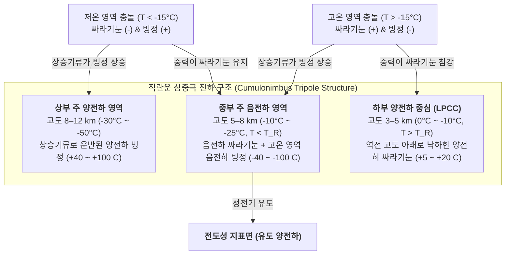

지구 대기권에서는 매초 약 40~50회, 하루에 약 400만 번의 번개 방전이 일어납니다. 1752년 벤저민 프랭클린의 연 실험 이후 270여 년이 흘렀지만, 현대 대기물리학에서 가장 근본적인 질문 하나는 오랫동안 수수께끼로 남아 있었습니다. 바로 <strong>"뇌우 구름 내부에서 번개는 실제로 어떻게 시작되는가?"</strong>입니다. 기상 관측 기구와 연구용 항공기가 활발한 적란운 내부에서 측정한 거시적 최대 전기장은 $0.1\text{–}0.4\,\text{MV/m}$에 불과하며, 이는 해수면 건조 공기의 전통적인 타운센드(Townsend) 유전체 절연파괴 임계값($E_{b0} \approx 3.0\,\text{MV/m}$)보다 약 10배나 약합니다. 또한 왜 번개는 직선으로 떨어지지 않고 라플라스 성장 불안정성(Laplacian growth instability)에 지배되는 복잡한 <strong>프랙탈 나뭇가지(Fractal branches)</strong>를 형성할까요? 왜 음극 <strong>계단형 리더(Stepped leader)</strong>는 $50\,\mu\text{s}$마다 $50\,\text{m}$씩 불연속적으로 도약한 뒤, 광속의 3분의 1($v \approx c/3$)로 지면에서 치솟으며 채널을 $30,000\,\text{K}$까지 가열하는 <strong>귀환 뇌격(Return stroke)</strong>을 유발할까요? 본 논문에서는 구름 미세물리학부터 상대론적 전기역학 및 초음속 충격파 음향학까지 번개의 전 과정을 체계적으로 규명합니다.

---

## 1. 적란운 정전기 발전기: 비유도 전하 분리와 삼중극 전하 구조

절연파괴가 일어나기 전에 성숙한 <strong>적란운(Cumulonimbus)</strong>은 수 킬로미터 규모에 걸쳐 $10^8\text{–}10^9\,\text{V}$의 전위차를 생성해야 합니다. 고도 $4\text{–}10\,\text{km}$(기온 $0^\circ\text{C} \sim -40^\circ\text{C}$)의 난류 <strong>혼합상 영역(Mixed-phase region)</strong>에서는 강한 상승기류($v_{\text{up}} \approx 10\text{–}30\,\text{m/s}$) 속에서 세 가지 수성체(Hydrometeors)가 공존합니다: <strong>과냉각 물방울</strong>($d \approx 10\text{–}20\,\mu\text{m}$), 수증기 승화로 자라는 <strong>빙정(Ice crystals)</strong>($20\text{–}200\,\mu\text{m}$), 그리고 과냉각 물방울을 충돌·동결시키는 <strong>착빙(Riming)</strong>을 통해 빠르게 성장하는 밀리미터 크기의 <strong>싸라기눈(Graupel, $1\text{–}5\,\text{mm}$)</strong>입니다.

다카하시(Takahashi, 1978)와 손더스(Saunders, 1991)의 풍동 실험을 통해 확립된 주된 대전 메커니즘은 <strong>비유도 전하 분리(Non-inductive charge separation)</strong>입니다. 과냉각 물방울이 존재하는 상태에서 싸라기눈과 빙정이 충돌 후 반발할 때 충돌당 약 $10\text{–}100\,\text{fC}$($10^{-14}\text{–}10^{-13}\,\text{C}$)의 전하가 이동합니다. 그 핵심 원리는 얼음 표면 나노미터 두께의 <strong>준액체층(Quasi-Liquid Layer, QLL)</strong>에 있습니다. 얼음 격자와 QLL 내부에서 물 분자는 수소 이온($\text{H}^+$)과 수산화 이온($\text{OH}^-$)으로 자가 이온화되는데, 양성자($\text{H}^+$)는 Grotthuss 수소결합 도약 메커니즘을 통해 이동하므로 <strong>$\text{H}^+$의 이동도가 $\text{OH}^-$보다 수 자릿수 이상 큽니다</strong>.

접촉 순간 두 가지 열역학적 구배가 경쟁합니다: (1) <strong>온도 구배 효과</strong>: 착빙 잠열로 인해 싸라기눈이 주변 빙정보다 따뜻하므로, 이온 농도가 높은 따뜻한 싸라기눈에서 차가운 빙정으로 $\text{H}^+$가 빠르게 확산되어 싸라기눈은 음전하($-$), 빙정은 양전하($+$)를 띱니다. (2) <strong>준액체층 두께 효과(Baker-Dash 메커니즘)</strong>: 비교적 높은 온도와 높은 액체 수분 함량($\text{LWC}$)에서는 표면이 더 빠르게 성장하는 싸라기눈이 더 두꺼운 QLL을 형성하여 분리 시 전하 극성이 반전됩니다. 이 경계를 <strong>역전 온도(Reversal Temperature, $T_R \approx -15^\circ\text{C} \sim -20^\circ\text{C}$)</strong>라고 합니다:

* <strong>저온 영역($T < T_R$, 고도 $7\text{–}10\,\text{km}$)</strong>: 무거운 <strong>싸라기눈은 음전하($-$)</strong>, 가벼운 <strong>빙정은 양전하($+$)</strong>로 대전됩니다.
* <strong>고온 영역($T > T_R$, 고도 $4\text{–}6\,\text{km}$)</strong>: 극성이 역전되어 무거운 <strong>싸라기눈은 양전하($+$)</strong>, 가벼운 <strong>빙정은 음전하($-$)</strong>로 대전됩니다.

이후 <strong>중력 크기 분별(Gravitational size sorting)</strong>에 의해 낙하 속도가 빠른 싸라기눈($v_t \approx 5\text{–}10\,\text{m/s}$)은 구름 중하부에 머물고, 가벼운 빙정($v_t \ll 1\,\text{m/s}$)은 상승기류를 타고 구름 꼭대기 모루(Anvil)로 운반되어 표준적인 <strong>전기적 삼중극 구조(Tripole structure)</strong>를 형성합니다:

거시적 공간 전하 밀도 $\rho(\mathbf{r})$는 <strong>푸아송 방정식(Poisson's equation)</strong>을 통해 정전 퍼텐셜 $\phi(\mathbf{r})$과 전기장 $\mathbf{E} = -\nabla\phi$를 결정합니다:

$$\nabla^2 \\phi(\mathbf{r}) = -\frac{\rho(\mathbf{r})}{\varepsilon_0}$$

여기서 <strong>하부 양전하 중심(LPCC)</strong>은 주 음전하 영역 바로 아래에서 국소 수직 쌍극자를 형성하여 하향 전기장을 증폭시키고 음극 계단형 리더를 지면으로 발사하는 정전기적 투석기 역할을 합니다. 반면 일본 호쿠리쿠 해안 등의 <strong>겨울철 뇌우</strong>에서는 한랭한 기온으로 인해 $-15^\circ\text{C}$ 등온선이 지면 위 $2\,\text{km}$까지 낮아져 상부 양전하 영역이 지면으로 직접 방전하는 $200\text{–}300\,\text{kA}$급 <strong>양극 낙뢰(+CG) 슈퍼볼트</strong>를 발생시킵니다.

---

## 2. 번개 시작의 미스터리: 타운센드 절연파괴 대 상대론적 도주 전자 눈사태(RREA)

고전 기체 방전 물리학에서 전자 충돌 이온화(제1 타운센드 계수 $\alpha$)와 산소 분자에 의한 전자 부착(부착 계수 $\eta_a$)의 경쟁은 다음 미분방정식을 따릅니다:

$$\frac{dN_e}{dx} = (\alpha - \eta_a) N_e \implies N_e(x) = N_0 \exp\left[ (\alpha - \eta_a) x \right]$$

지수적 <strong>타운센드 눈사태</strong>가 발생하려면 $\alpha > \eta_a$여야 하며, 해수면 공기 밀도 $N_0$에서 임계 전기장은 $E_{b0} \approx 3.0\,\text{MV/m}$($E/N \approx 120\,\text{Td}$)입니다. <strong>파셴의 법칙(Paschen's law)</strong>에 의해 고도 $z$에서의 절연파괴 전기장은 상대 공기 밀도 $n(z) = \exp(-z/H)$에 비례합니다:

$$E_b(z) = E_{b0} \cdot n(z) \approx (3.0\,\\text{MV/m}) \cdot \exp(-z/H)$$

번개가 시작되는 고도 $z \approx 6\,\text{km}$($n \approx 0.5$)에서도 $E_b(6\,\text{km}) \approx 1.5\,\text{MV/m}$가 필요하지만, 실제 관측값은 $0.1\text{–}0.4\,\text{MV/m}$를 넘지 못합니다. 이 역설은 두 가지 보완 메커니즘으로 해결됩니다:

1. <strong>우주선이 씨앗이 되는 상대론적 도주 전자 눈사태(RREA)</strong>: 저에너지 열전자는 $100\text{–}200\,\text{eV}$ 부근에서 거대한 비탄성 충돌 마찰 장벽($F_{\max} \approx 27\,\text{MeV/m}\cdot n(z)$)에 가로막힙니다. 그러나 상대론적 Bethe-Bloch 저지능 공식에 따르면, 운동에너지가 $K_{\min} \approx 1.0\text{–}1.4\,\text{MeV}$인 상대론적 전자는 충돌 저항이 최소값 $F_{\min} \approx 0.218\,\text{MeV/m}\cdot n(z)$으로 떨어집니다. 원자핵 쿨롱 산란을 고려한 <strong>RREA 임계 전기장 $E_{\text{RREA}}$</strong>(Gurevich, 1992; Dwyer, 2003)는 다음과 같습니다:

$$E_{\\text{RREA}}(z) \approx 0.284\,\\text{MV/m} \cdot n(z), \qquad N_{\\text{RREA}}(L) = N_0 \exp\left(\frac{L}{\lambda_{\\text{RREA}}}\right)$$

   고도 $6\,\text{km}$에서 $E_{\text{RREA}} \approx 0.14\,\text{MV/m}$로 낮아져 관측된 구름 내부 최대 전기장과 정확히 일치합니다! 초신성 잔해 등에서 날아온 고에너지 우주선의 <strong>광범위 공기 샤워(EAS)</strong>가 공급한 $\sim 1\,\text{MeV}$ 씨앗 전자는 Møller 산란을 통해 이차 도주 전자를 기하급수적으로 증폭시킵니다.
2. <strong>수성체 첨단 전기장 증폭과 고속 양극 절연파괴(Fast Positive Breakdown)</strong>: 종횡비 $l/r \gg 1$인 바늘형 빙정이 배경 전기장 $E_0$에 놓이면 유전 분극에 의해 양 끝단의 국소 전기장이 증폭됩니다:

$$E_{\\text{tip}} \approx E_0 \frac{(l/r)^2}{\ln(2l/r) - 1}$$

   증폭된 첨단 전기장이 국소적으로 $E_b(z)$를 넘으면 비평형 냉플라즈마인 <strong>양극 코로나 스트리머(Positive streamers)</strong>가 방출되며, 배경 전기장이 안정 전파 임계값 $E_{\text{st}}^{+} \approx 0.45\,\text{MV/m}\cdot n(z)$ 이상이면 무한히 전파됩니다. Rison 등(2016)은 광대역 VHF 간섭계를 이용해 모든 번개가 $3\text{–}5 \times 10^7\,\text{m/s}$로 폭발하는 미터 규모의 양극 스트리머 연쇄 반응인 <strong>고속 양극 절연파괴(FPB / 협대역 양극성 이벤트 NBE)</strong>로 시작됨을 밝혀냈습니다.

---

## 3. 번개가 갈라지는 이유: 스트리머-리더 상전이와 $\eta$-라플라스 프랙탈 성장

단일 코로나 스트리머는 전자는 뜨겁지만($T_e \sim 30,000\,\text{K}$) 중성 기체는 차가운($T_g \approx 300\,\text{K}$) 냉플라즈마이므로 수십 나노초 내에 전자가 산소에 부착되어 소멸합니다. 수천 개의 스트리머가 하나의 줄기(Stem)로 모이면 줄 가열을 통해 기체 온도가 임계값 <strong>$T_{\text{crit}} \approx 1,500\text{–}5,000\,\text{K}$</strong>를 넘으면서 상전이가 일어납니다: (1) <strong>열적 전자 탈착</strong>($\text{O}_2^- + \text{M} \to \text{O}_2 + \text{M} + \text{e}^-$), (2) <strong>질소 분자 진동-병진(V-T) 이완 가열</strong>, (3) <strong>유체역학적 팽창</strong>에 의한 채널 밀도 $N$ 감소 및 $E/N$ 상승입니다. 이렇게 탄생한 뜨거운 <strong>리더(Leader)</strong> 채널은 구름의 $-50\,\text{MV}$ 전위를 첨단까지 전달하는 도선처럼 작동합니다.

음극 지면 낙뢰(-CG)의 <strong>계단형 리더(Stepped Leader)</strong>는 음극 스트리머의 높은 요구 전기장($E_{\text{st}}^{-} \approx 1.0\text{–}1.2\,\text{MV/m}\cdot n$) 때문에 연속 전진하지 못하고, 주 채널 전방 코로나 영역에 고립된 플라즈마 핵인 <strong>공간 줄기(Space stem)</strong>를 형성합니다. 공간 줄기에서 자라난 양방향 공간 리더의 양극 끝이 주 음극 리더와 충돌하는 순간 $L_{\text{step}} \approx 10\text{–}50\,\text{m}$ 구간이 단락되며 밝게 빛나고, $\tau_{\text{step}} \approx 20\text{–}50\,\mu\text{s}$ 간격으로 계단식 전진을 반복합니다(평균 속도 $\sim 2 \times 10^5\,\text{m/s}$).

나뭇가지처럼 갈라지는 프랙탈 기하학은 Niemeyer, Pietronero, Wiesmann(1984)의 <strong>유전체 절연파괴 모델(Dielectric Breakdown Model, DBM)</strong>로 설명됩니다. 전도성 리더 트리를 등전위체($\phi = 0$)로 두면 주변 공간은 라플라스 방정식을 만족하며, 경계 격자점 $i$가 다음 단계에서 절연파괴될 확률 $P_i$는 국소 전기장 크기의 $\eta$ 거듭제곱에 비례합니다:

$$\nabla^2 \\phi(\mathbf{r}) = 0, \qquad P_i = \frac{|\nabla \\phi_i|^\eta}{\sum_{j \in \\text{boundary}} |\nabla \\phi_j|^\eta} \quad \left(|\nabla \\phi_i| > E_{\\text{crit}}\right)$$

돌출된 첨단은 등전위면을 압축해 전기장을 증폭시키는 반면 오목한 피오르드 영역은 정전기적으로 차폐(Screening)하는 <strong>Mullins-Sekerka / 라플라스 성장 불안정성</strong>이 발생하여 끝단이 끊임없이 갈라집니다(Tip splitting). $\eta = 1$은 확산 제한 응집(DLA, 2D $D_f \approx 1.71$)과 동형이며, 비선형 이온화가 지배하는 실제 번개($\eta \approx 2$)는 2차원 투영 <strong>하우스도르프 프랙탈 차원 $D_f \approx 1.35\text{–}1.55$</strong>를 보입니다.

---

## 4. 연결 과정, $30,000\,\text{K}$ 귀환 뇌격, 그리고 천둥의 초음속 충격파 역학

하강하는 계단형 리더가 지면으로부터 <strong>뇌격 거리(Striking distance) $r_s$</strong> 이내에 진입하면, 지상의 피뢰침이나 나무 끝에서 상향 연결 양극 리더가 치솟아 오릅니다. <strong>전기-기하학적 모델(EGM, 회전구체법의 기초)</strong>에서 뇌격 거리 $r_s$와 귀환 뇌격 첨두 전류 $I_p$(단위 $\text{kA}$)의 관계는 다음과 같습니다:

$$r_s = 10 \, I_p^{0.65} \quad [\\text{m}]$$

두 리더가 지상 $20\text{–}100\,\text{m}$에서 만나는 순간, 지면 전위 중화파인 <strong>귀환 뇌격(Return Stroke)</strong>이 광속의 3분의 1(<strong>$v_{\text{RS}} \approx c/3 \approx 1.0 \times 10^8\,\text{m/s}$</strong>)로 채널을 따라 지면에서 구름으로 치솟습니다! 단 $1\text{–}5\,\mu\text{s}$ 만에 첨두 전류 $30\,\text{kA}$가 직경 $1\text{–}3\,\text{cm}$ 코어를 통과하며 플라즈마 온도를 <strong>$T \approx 30,000\,\text{K}$(태양 광구 온도의 5배)</strong>로 가열합니다. 첫 귀환 뇌격 후 잔류 온열 채널을 따라 $10^7\,\text{m/s}$로 연속 하강하는 <strong>다트 리더(Dart Leader)</strong>는 후속 귀환 뇌격을 일으켜 번개가 깜빡이게 만듭니다.

귀환 뇌격의 가열 시간($\sim \mu\text{s}$)은 음향 팽창 시간($\sim 30\,\mu\text{s}$)보다 훨씬 짧으므로 <strong>등적 가열(Isochoric heating)</strong>이 일어나며, 채널 압력이 $10\text{–}100\,\text{atm}$으로 폭증하여 마하 $10\text{–}20$의 초음속 <strong>원통형 폭발 충격파(Cylindrical blast wave)</strong>를 방출합니다. 단위 길이당 에너지 $E_l$과 대기압 $P_0$에 의해 결정되는 이완 반경 $R_0$ 및 천둥의 피크 주파수 $f_{\text{peak}}$는 다음과 같습니다:

$$R_0 = \sqrt{\frac{E_l}{\pi P_0}}, \qquad f_{\\text{peak}} \approx 0.63 \, c_s \sqrt{\frac{P_0}{E_l}} = \frac{0.63 \, c_s}{\sqrt{\pi} R_0} \approx 50\\text{–}150\,\\text{Hz}$$

수 미터 밖에서 충격파는 N파(N-wave) 음향 펄스로 이완되며, 수 킬로미터 거리에서는 3차원 채널의 도달 시간차, 고주파 대기 감쇠($\alpha_{\text{att}} \propto f^2$), 대류권 온도 구배에 의한 상향 음향 굴절이 결합하여 길고 낮은 천둥소리를 만듭니다.

---

## 5. 구름 위의 번개: 메조스피어 고층 대기 방전(TLEs)과 반물질 생성 감마선 플래시(TGFs)

1. <strong>과도 발광 현상(TLEs)</strong>:
   * <strong>레드 스프라이트(Red Sprites, 고도 $50\text{–}90\,\text{km}$)</strong>: 강력한 양극 낙뢰(+CG)가 거대한 전하 모멘트 변화($\text{CMC} \gtrsim 500\,\text{C}\cdot\text{km}$)를 일으킨 직후, 공기 밀도 $N(z)$와 절연파괴 임계장 $E_b(z)$가 고도에 따라 지수적으로 감소하기 때문에 고도 $70\text{–}80\,\text{km}$에서 준정전기장(QE)이 $E_b(z)$를 초과하여 발생하는 거대 냉플라즈마 방전입니다(상부는 $\text{N}_2(1\text{P})$ 적색광, 하부 촉수는 $\text{N}_2^+(1\text{N})$ 청색광).
   * <strong>블루 제트(Blue Jets, $15\text{–}50\,\text{km}$) 및 거대 제트(Gigantic Jets, 최대 $90\,\text{km}$)</strong>: 구름 상부 전하 불균형으로 구름 꼭대기에서 약 $100\,\text{km/s}$로 분출되는 상향 양극 리더-스트리머 원뿔입니다.
   * <strong>엘브스(ELVES, $85\text{–}100\,\text{km}$)</strong>: 대회전류 귀환 뇌격이 방사한 구면 전자기 펄스(EMP)가 고도 $90\,\text{km}$ 전리층 하부와 교차하며 $<1\,\text{ms}$ 동안 초광속 위상 속도로 팽창하는 직경 $300\text{–}500\,\text{km}$의 붉은 도넛형 발광 고리입니다.
2. <strong>지구 감마선 플래시(TGFs)와 광핵반응 반물질 생성</strong>: RREA 눈사태로 가속된 $20\text{–}40\,\text{MeV}$ 상대론적 전자가 제동복사 감마선 폭발(TGF)을 방출합니다. 에노토 테루아키 연구팀(Enoto et al., 2017, *Nature*)은 $10.55\,\text{MeV}$ 이상의 감마선이 대기 중 질소 원자핵($^{14}\text{N}$)에서 광핵반응으로 중성자를 튕겨내고, 생성된 불안정 동위원소 $^{13}\text{N}$이 $\beta^+$ 붕괴하며 방출한 <strong>반물질 양전자($\text{e}^+$)</strong>가 주변 전자와 쌍소멸하여 정확한 <strong>$0.511\,\text{MeV}$ 감마선 스펙트럼선</strong>을 방출함을 관측으로 입증했습니다:

$$\gamma + {{}}^{14}_{7}\\text{N} \longrightarrow {{}}^{13}_{7}\\text{N} + \\text{n} \quad (E_\gamma > 10.55\,\\text{MeV})$$

$${{}}^{13}_{7}\\text{N} \longrightarrow {{}}^{13}_{6}\\text{C} + \\text{e}^+ + \nu_e, \qquad \\text{e}^+ + \\text{e}^- \longrightarrow 2\gamma \quad (E_\gamma = 0.511\,\\text{MeV})$$

---

## 6. 대기 방전 현상의 물리적 규모 비교 및 현대 관측 기술

| 방전 단계 / 물리 현상 | 고도 / 공간 스케일 | 지속 시간 / 시간 스케일 | 전파 속도 $v$ | 특성 전류, 에너지 또는 온도 | 핵심 물리 메커니즘 |
| :--- | :--- | :--- | :--- | :--- | :--- |
| <strong>비유도 전하 분리</strong> | $4\text{–}10\,\text{km}$ (혼합상 영역) | $10\text{–}30\,\text{min}$ 대류 주기 | 상승기류 $10\text{–}30\,\text{m/s}$ | 충돌당 $\sim 10^{-14}\,\text{C}$; 총 $\pm 40\text{–}100\,\text{C}$ | 싸라기눈-빙정 착빙 충돌, QLL $\text{H}^+$ 확산, 역전 온도 $T_R \approx -15^\circ\text{C}$ |
| <strong>고속 양극 절연파괴 (FPB)</strong> | $5\text{–}12\,\text{km}$; 길이 $0.3\text{–}1\,\text{km}$ | $10\text{–}20\,\mu\text{s}$ | $3 \times 10^7 \text{–} 5 \times 10^7\,\text{m/s}$ | 수 메가와트급 VHF 전파 폭발 | 우주선 RREA 눈사태 + 빙정 첨단 전기장 증폭에 의한 양극 스트리머 연쇄 |
| <strong>음극 계단형 리더</strong> | 구름~지면 (계단 길이 $10\text{–}50\,\text{m}$) | 총 $10\text{–}30\,\text{ms}$ (휴지 $20\text{–}50\,\mu\text{s}$) | 평균 $2 \times 10^5\,\text{m/s}$ | $100\text{–}1,000\,\text{A}$; 코어 $T \approx 5,000\,\text{K}$ | 스트리머-리더 열적 탈착 상전이($>1,500\,\text{K}$), 공간 줄기, DBM $\eta$-라플라스 프랙탈 |
| <strong>귀환 뇌격 (Return Stroke)</strong> | 지면~구름 (코어 직경 $1\text{–}3\,\text{cm}$) | 상승 $1\text{–}5\,\mu\text{s}$; 감쇠 $\sim 100\,\mu\text{s}$ | $v \approx c/3 \approx 1.0 \times 10^8\,\text{m/s}$ (상향) | 중앙값 $30\,\text{kA}$ (+CG 최대 $300\,\text{kA}$); <strong>$T \approx 30,000\,\text{K}$</strong> | 지면 전위 중화파, 등적 줄 가열($10\text{–}100\,\text{atm}$), Taylor-Sedov 원통형 충격파 |
| <strong>스프라이트 / 제트 / ELVES</strong> | $15\text{–}100\,\text{km}$ (성층권~전리층) | $<1\,\text{ms}$ (ELVES) ~ $300\,\text{ms}$ (제트) | $10^5\,\text{m/s}$ ~ 초광속 위상 속도 | 냉플라즈마 ($T_g \approx 200\text{–}300\,\text{K}$) | 준정전기장(QE) 절연파괴, 상부 전하 불균형, 귀환 뇌격 구면 EMP 전리층 가열 |
| <strong>지구 감마선 플래시 (TGF)</strong> | $10\text{–}15\,\text{km}$ (겨울 뇌우 $2\text{–}4\,\text{km}$) | $<1\,\text{ms}$ (양전자 잔광 $\sim 10\,\text{min}$) | 상대론적 전자 $v \approx 0.99c$ | 광자 에너지 최대 <strong>$20\text{–}40\,\text{MeV}$</strong> | RREA 제동복사, $^{14}\text{N}(\gamma,\text{n}){}^{13}\text{N}$ 광핵반응 및 $0.511\,\text{MeV}$ 양전자 쌍소멸 |

오늘날 GPS 동기화 <strong>3차원 VHF 번개 매핑 어레이(LMA)</strong>와 광대역 디지털 간섭계는 구름 내부의 방전 궤적을 미터 해상도로 시각화하며, 2023년에는 스위스 젠티스산(Mount Säntis)에서 테라와트 펨토초 레이저의 비선형 필라멘트화(Laser filamentation)를 이용해 자연 번개를 $50\,\text{m}$ 구간 동안 레이저 경로로 유도하는 데 최초로 성공했습니다(Houard et al., 2023). 나아가 전 지구적으로 동시에 활동하는 약 2,000개의 뇌우는 <strong>윌슨의 전 지구 전기 회로(Global Electric Circuit)</strong>를 구동하여 전리층을 $+250\,\text{kV}$로 유지하고 맑은 날 대기 전기장($100\text{–}150\,\text{V/m}$)과 <strong>슈만 공명($7.83\,\text{Hz}$)</strong>을 만들어냅니다.
