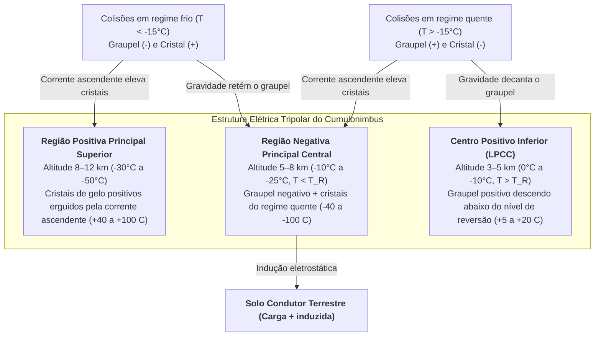

A cada segundo, cerca de 40 a 50 relâmpagos cortam a atmosfera da Terra, totalizando quase 4 milhões de descargas elétricas de alta energia por dia. Mais de 270 anos após o famoso experimento da pipa de Benjamin Franklin em 1752, uma das questões mais fundamentais da física atmosférica permanece fascinante: <strong>como um raio realmente se inicia dentro de uma nuvem de tempestade?</strong> Balões meteorológicos e aeronaves de pesquisa que penetram nos núcleos turbulentos de cumulonimbus ativos nunca medem campos elétricos macroscópicos superiores a $0,1\text{–}0,4\,\text{MV/m}$ — uma ordem de grandeza abaixo do limiar de ruptura dielétrica convencional do ar seco ao nível do mar ($E_{b0} \approx 3,0\,\text{MV/m}$) exigido pela teoria de avalanches de Townsend e pela lei de Paschen. Além disso, por que um raio nunca viaja em linha reta, mas esculpe uma árvore <strong>fractal</strong> governada por instabilidades de crescimento laplaciano? Por que o <strong>líder escalonado (stepped leader)</strong> avança em saltos discretos de $50\,\text{m}$ a cada $50\,\mu\text{s}$ antes de desencadear uma <strong>descarga de retorno (return stroke)</strong> que sobe do solo a um terço da velocidade da luz ($v \approx c/3$), aquecendo o canal a $30.000\,\text{K}$? Neste artigo, deduzimos toda a física dos raios, desde a escala nanométrica até a eletrodinâmica relativística.

---

## 1. O Gerador Eletrostático do Cumulonimbus: Separação Não Indutiva de Cargas e Estrutura Tripolar

Antes da ruptura dielétrica, um <strong>cumulonimbus</strong> maduro deve gerar diferenças de potencial de $10^8$ a $10^9\,\text{V}$ em escala quilométrica. Na <strong>região de fase mista</strong> entre $4\,\text{km}$ e $10\,\text{km}$ de altitude (temperaturas de $0^\circ\text{C}$ a $-40^\circ\text{C}$), fortes correntes ascendentes ($v_{\text{up}} \approx 10\text{–}30\,\text{m/s}$) fazem coexistir três espécies de hidrometeoros: <strong>gotículas de água super-resfriada</strong> ($d \approx 10\text{–}20\,\mu\text{m}$), <strong>cristais de gelo</strong> ($20\text{–}200\,\mu\text{m}$) que crescem por deposição de vapor e <strong>graupel (granizo macio)</strong> milimétrico ($1\text{–}5\,\text{mm}$) que cresce rapidamente por <strong>encrostamento (riming)</strong> ao congelar gotículas super-resfriadas no impacto.

Os experimentos em túnel de vento de Takahashi (1978) e Saunders (1991) demonstraram que o mecanismo principal de eletrificação é a <strong>separação não indutiva de cargas</strong> durante colisões com rebote entre o graupel e os cristais de gelo na presença de água super-resfriada, transferindo cerca de $10\text{–}100\,\text{fC}$ ($10^{-14}\text{–}10^{-13}\,\text{C}$) por colisão. A chave microscópica reside na <strong>camada quase líquida (Quasi-Liquid Layer, QLL)</strong> nanométrica na superfície do gelo. Na rede cristalina e na QLL, as moléculas de água sofrem autoionização em prótons ($\text{H}^+$) e íons hidroxila ($\text{OH}^-$). Graças ao mecanismo de salto protônico de Grotthuss ao longo das ligações de hidrogênio, <strong>a mobilidade catiônica do $\text{H}^+$ é várias ordens de grandeza maior que a do $\text{OH}^-$</strong>.

Durante o contato, dois gradientes termodinâmicos competem: (1) <strong>efeito do gradiente térmico</strong>: o graupel, aquecido pelo calor latente liberado no congelamento das gotículas super-resfriadas, possui maior concentração iônica; os prótons $\text{H}^+$ difundem-se rapidamente do graupel mais quente para o cristal mais frio, deixando o graupel carregado negativamente ($-$) e o cristal positivamente ($+$); (2) <strong>efeito da espessura da QLL (mecanismo de Baker-Dash)</strong>: em temperaturas mais altas e alto teor de água líquida ($\text{LWC}$), a QLL mais espessa do graupel inverte a transferência líquida de carga. Essa fronteira define a <strong>temperatura de reversão ($T_R \approx -15^\circ\text{C}$ a $-20^\circ\text{C}$)</strong>:

* <strong>Regime frio ($T < T_R$, altitude $7\text{–}10\,\text{km}$)</strong>: o <strong>graupel pesado carrega-se negativamente ($-$)</strong> e os <strong>cristais de gelo leves positivamente ($+$)</strong>.
* <strong>Regime quente ($T > T_R$, altitude $4\text{–}6\,\text{km}$)</strong>: o sinal se inverte — o <strong>graupel carrega-se positivamente ($+$)</strong> e os <strong>cristais negativamente ($-$)</strong>.

A <strong>separação gravitacional por tamanho</strong> divide então essas cargas macroscopicamente: o graupel pesado ($v_t \approx 5\text{–}10\,\text{m/s}$) permanece nas camadas médias e baixas, enquanto os cristais leves ($v_t \ll 1\,\text{m/s}$) são levados pela corrente ascendente para a bigorna superior, criando a <strong>estrutura elétrica tripolar</strong> canônica:

A densidade de carga espacial $\rho(\mathbf{r})$ governa o potencial eletrostático $\phi(\mathbf{r})$ e o campo elétrico $\mathbf{E} = -\nabla\phi$ pela <strong>equação de Poisson</strong>:

$$\nabla^2 \\phi(\mathbf{r}) = -\frac{\rho(\mathbf{r})}{\varepsilon_0}$$

O <strong>centro positivo inferior (LPCC)</strong> intensifica o campo elétrico descendente na base da camada negativa principal, funcionando como uma catapulta eletrostática que lança líderes escalonados negativos em direção ao solo. Já nas <strong>tempestades de inverno</strong> (como na costa de Hokuriku, no Japão), a isoterma de $-15^\circ\text{C}$ desce a menos de $2\,\text{km}$ do solo, permitindo que a região positiva superior descarregue diretamente na Terra em colossais <strong>super-raios positivos (+CG)</strong> de $200\text{–}300\,\text{kA}$.

---

## 2. O Mistério da Iniciação: Ruptura de Townsend vs. Avalanches Relativísticas (RREA)

Na física clássica de descargas em gases, a ionização por impacto de elétrons (primeiro coeficiente de Townsend $\alpha$) compete com a captura eletrônica por moléculas eletronegativas de oxigênio (coeficiente $\eta_a$):

$$\frac{dN_e}{dx} = (\alpha - \eta_a) N_e \implies N_e(x) = N_0 \exp\left[ (\alpha - \eta_a) x \right]$$

Uma <strong>avalanche de Townsend</strong> exponencial exige $\alpha > \eta_a$, o que define o limiar de ruptura convencional $E_{b0} \approx 3,0\,\text{MV/m}$ ao nível do mar ($E/N \approx 120\,\text{Td}$). Pela <strong>lei de Paschen</strong>, o campo de ruptura escala linearmente com a densidade relativa do ar $n(z) = \exp(-z/H)$:

$$E_b(z) = E_{b0} \cdot n(z) \approx (3.0\,\\text{MV/m}) \cdot \exp(-z/H)$$

Na altitude típica de iniciação ($z \approx 6\,\text{km}$, $n \approx 0,5$), a ruptura clássica ainda requer $E_b(6\,\text{km}) \approx 1,5\,\text{MV/m}$, muito acima dos $0,1\text{–}0,4\,\text{MV/m}$ medidos. Dois mecanismos físicos resolvem esse paradoxo:

1. <strong>Avalanches de Elétrons Fugitivos Relativísticos (RREA) semeadas por raios cósmicos</strong>: elétrons térmicos são barrados pelo pico de atrito inelástico em $100\text{–}200\,\text{eV}$ ($F_{\max} \approx 27\,\text{MeV/m}\cdot n(z)$). Contudo, segundo a fórmula relativística de Bethe-Bloch, para elétrons com energia cinética $K_{\min} \approx 1,0\text{–}1,4\,\text{MeV}$, a força de arrasto cai para um mínimo $F_{\min} \approx 0,218\,\text{MeV/m}\cdot n(z)$. Incluindo o espalhamento de Coulomb nuclear, o <strong>campo limiar RREA $E_{\text{RREA}}$</strong> (Gurevich, 1992; Dwyer, 2003) é:

$$E_{\\text{RREA}}(z) \approx 0.284\,\\text{MV/m} \cdot n(z), \qquad N_{\\text{RREA}}(L) = N_0 \exp\left(\frac{L}{\lambda_{\\text{RREA}}}\right)$$

   A $6\,\text{km}$ de altitude, $E_{\text{RREA}} \approx 0,14\,\text{MV/m}$, coincidindo exatamente com os campos máximos medidos por balões dentro das nuvens! Elétrons semente ($\sim 1\,\text{MeV}$) gerados por <strong>chuveiros atmosféricos extensos (EAS)</strong> de raios cósmicos sofrem aceleração contínua (runaway) e multiplicam elétrons secundários por espalhamento de Møller.
2. <strong>Amplificação de campo em hidrometeoros e Ruptura Positiva Rápida (Fast Positive Breakdown)</strong>: nas pontas de um cristal de gelo alongado com razão de aspecto $l/r \gg 1$, a polarização dielétrica amplifica o campo local:

$$E_{\\text{tip}} \approx E_0 \frac{(l/r)^2}{\ln(2l/r) - 1}$$

   Quando $E_{\text{tip}}$ supera localmente $E_b(z)$, lançam-se <strong>streamers (flâmulas de corona) positivos</strong> que se propagam indefinidamente se o campo de fundo superar o limiar de estabilidade $E_{\text{st}}^{+} \approx 0,45\,\text{MV/m}\cdot n(z)$. Rison et al. (2016) descobriram via interferometria VHF de banda larga que os raios começam com uma explosão submicrossegundo de streamers positivos a $3\text{–}5 \times 10^7\,\text{m/s}$, chamada <strong>Ruptura Positiva Rápida (FPB / Eventos Bipolares Estreitos NBE)</strong>.

---

## 3. Por Que o Raio se Ramifica: Transição Streamer-Líder e Crescimento Fractal $\eta$-Laplaciano

Um streamer individual é um plasma frio ($T_g \approx 300\,\text{K}$) cujos elétrons livres se ligam ao $\text{O}_2$ em dezenas de nanossegundos. Quando milhares de streamers convergem em uma raiz comum (stem), o aquecimento por efeito Joule eleva a temperatura do gás neutro acima do limiar crítico <strong>$T_{\text{crit}} \approx 1.500\text{–}5.000\,\text{K}$</strong>, ativando: (1) o <strong>desprendimento térmico de elétrons</strong> ($\text{O}_2^- + \text{M} \to \text{O}_2 + \text{M} + \text{e}^-$), (2) a <strong>relaxação vibracional-translacional (V-T)</strong> do $\text{N}_2$, e (3) a <strong>expansão hidrodinâmica radial</strong> que reduz a densidade $N$ e eleva $E/N$. Surge assim um canal <strong>líder (leader)</strong> quente e condutor que leva o potencial de $-50\,\text{MV}$ da nuvem até sua ponta.

Em 90% dos raios nuvem-solo (negativos, -CG), o <strong>líder escalonado (stepped leader)</strong> avança em saltos porque os streamers negativos exigem um campo duas vezes mais intenso que os positivos ($E_{\text{st}}^{-} \approx 1,0\text{–}1,2\,\text{MV/m}\cdot n$). À frente da ponta principal acende-se um núcleo isolado de plasma (<strong>space stem</strong>) que desenvolve um líder espacial bidirecional; quando sua extremidade positiva retrógrada colide com o líder negativo principal, um novo degrau de $L_{\text{step}} \approx 10\text{–}50\,\text{m}$ se ilumina a cada $\tau_{\text{step}} \approx 20\text{–}50\,\mu\text{s}$ (velocidade média $\sim 2 \times 10^5\,\text{m/s}$).

A ramificação fractal é explicada pelo <strong>Modelo de Ruptura Dielétrica (DBM)</strong> de Niemeyer, Pietronero e Wiesmann (1984). A árvore condutora do líder ($\phi = 0$) encontra-se em um campo laplaciano onde a probabilidade de ruptura $P_i$ no sítio de fronteira $i$ escala com a potência $\eta$ do campo elétrico local:

$$\nabla^2 \\phi(\mathbf{r}) = 0, \qquad P_i = \frac{|\nabla \\phi_i|^\eta}{\sum_{j \in \\text{boundary}} |\nabla \\phi_j|^\eta} \quad \left(|\nabla \\phi_i| > E_{\\text{crit}}\right)$$

Pontas salientes comprimem as superfícies equipotenciais enquanto ramos laterais sofrem blindagem eletrostática (<strong>instabilidade de crescimento de Mullins-Sekerka</strong>), forçando a bifurcação contínua. Enquanto $\eta = 1$ equivale à agregação limitada por difusão (DLA, $D_f \approx 1,71$ em 2D), o regime não linear do raio ($\eta \approx 2$) produz uma <strong>dimensão fractal de Hausdorff projetada em 2D de $D_f \approx 1,35\text{–}1,55$</strong>.

---

## 4. Conexão, Descarga de Retorno a $30.000\,\text{K}$ e Mecânica da Onda de Choque do Trovão

Quando o líder escalonado desce dentro da <strong>distância de atração (striking distance) $r_s$</strong>, das pontas de estruturas aterradas (para-raios, árvores) emergem <strong>líderes conectores ascendentes</strong>. No <strong>Modelo Eletrogeométrico (EGM, método da esfera rolante)</strong>, $r_s$ relaciona-se com a corrente de pico $I_p$ (em $\text{kA}$) pela lei de Love (1973):

$$r_s = 10 \, I_p^{0.65} \quad [\\text{m}]$$

No instante do contato ($20\text{–}100\,\text{m}$ acima do solo), a onda de neutralização — a <strong>descarga de retorno (return stroke)</strong> — sobe em direção à nuvem a <strong>$v_{\text{RS}} \approx c/3 \approx 1,0 \times 10^8\,\text{m/s}$</strong>. Em $1\text{–}5\,\mu\text{s}$, uma corrente típica de $30\,\text{kA}$ atravessa um núcleo de $1\text{–}3\,\text{cm}$ e aquece o plasma a <strong>$T \approx 30.000\,\text{K}$ (cinco vezes a temperatura da superfície do Sol)</strong>. Posteriormente, <strong>líderes dardo (dart leaders)</strong> descem pelo canal residual quente a $\sim 10^7\,\text{m/s}$, causando a cintilação do raio.

Como o aquecimento ocorre em microssegundos, ele é estritamente <strong>isocórico</strong>: a pressão interna salta para $10\text{–}100\,\text{atm}$ e o cilindro explode radialmente a Mach $10\text{–}20$, formando uma <strong>onda de choque cilíndrica de Taylor-Sedov</strong>. O raio de relaxação $R_0$ e a frequência de pico $f_{\text{peak}}$ do trovão dependem da energia por unidade de comprimento $E_l$ e da pressão atmosférica $P_0$:

$$R_0 = \sqrt{\frac{E_l}{\pi P_0}}, \qquad f_{\\text{peak}} \approx 0.63 \, c_s \sqrt{\frac{P_0}{E_l}} = \frac{0.63 \, c_s}{\sqrt{\pi} R_0} \approx 50\\text{–}150\,\\text{Hz}$$

A vários quilômetros, a onda em N transforma-se em um estrondo grave prolongado devido às diferenças no tempo de chegada ao longo do canal 3D tortuoso, à absorção atmosférica proporcional a $f^2$ e à refração acústica térmica para cima.

---

## 5. Eventos Luminosos Transitórios (TLE) e Flashes Terrestres de Raios Gama (TGF) com Antimatéria

1. <strong>Eventos Luminosos Transitórios (TLE)</strong>:
   * <strong>Sprites vermelhos (altitude $50\text{–}90\,\text{km}$)</strong>: após um intenso raio $+CG$ com grande mudança de momento de carga ($\text{CMC} \gtrsim 500\,\text{C}\cdot\text{km}$), o campo quase eletrostático supera na mesosfera o limiar de ruptura $E_b(z)$ (que cai exponencialmente com a densidade do ar), acendendo complexos de streamers frios de dezenas de quilômetros (vermelhos no topo por $\text{N}_2(1\text{P})$, gavinhas azuis na base por $\text{N}_2^+(1\text{N})$).
   * <strong>Jatos azuis (Blue Jets, $15\text{–}50\,\text{km}$) e Jatos gigantes (até $90\,\text{km}$)</strong>: cones de líderes-streamers positivos que emergem do topo da nuvem a $\sim 100\,\text{km/s}$.
   * <strong>ELVES ($85\text{–}100\,\text{km}$)</strong>: anéis planos de luz vermelha ($300\text{–}500\,\text{km}$ de diâmetro, $<1\,\text{ms}$) gerados quando o pulso eletromagnético (EMP) esférico da descarga de retorno intercepta a base da ionosfera com velocidade de fase superluminal.
2. <strong>Flashes Terrestres de Raios Gama (TGF) e produção fotonuclear de antimatéria</strong>: as avalanches RREA aceleram elétrons até $20\text{–}40\,\text{MeV}$, emitindo radiação gama de freamento (bremsstrahlung). Em 2017, Enoto et al. (*Nature*) demonstraram que fótons gama acima de $10,55\,\text{MeV}$ arrancam nêutrons dos núcleos de $^{14}\text{N}$; o isótopo instável $^{13}\text{N}$ sofre decaimento $\beta^+$ emitindo <strong>pósitrons de antimatéria ($\text{e}^+$)</strong>, cuja aniquilação com elétrons atmosféricos produz a linha gama característica de <strong>$0,511\,\text{MeV}$</strong>:

$$\gamma + {{}}^{14}_{7}\\text{N} \longrightarrow {{}}^{13}_{7}\\text{N} + \\text{n} \quad (E_\gamma > 10.55\,\\text{MeV})$$

$${{}}^{13}_{7}\\text{N} \longrightarrow {{}}^{13}_{6}\\text{C} + \\text{e}^+ + \nu_e, \qquad \\text{e}^+ + \\text{e}^- \longrightarrow 2\gamma \quad (E_\gamma = 0.511\,\\text{MeV})$$

---

## 6. Comparação Física Abrangente e Fronteiras Modernas de Observação

| Fenômeno / Regime | Altitude / Escala Espacial | Duração / Escala Temporal | Velocidade de Propagação $v$ | Corrente, Energia ou Temperatura Típica | Mecanismo Físico Governante |
| :--- | :--- | :--- | :--- | :--- | :--- |
| <strong>Carga não indutiva</strong> | $4\text{–}10\,\text{km}$ (região de fase mista) | Ciclo convectivo $10\text{–}30\,\text{min}$ | Ascensão $10\text{–}30\,\text{m/s}$ | $\sim 10^{-14}\,\text{C}$/choque; $\pm 40\text{–}100\,\text{C}$ total | Colisões graupel-gelo, difusão de $\text{H}^+$ na QLL, $T_R \approx -15^\circ\text{C}$ |
| <strong>Ruptura positiva rápida (FPB)</strong> | $5\text{–}12\,\text{km}$; comprimento $0,3\text{–}1\,\text{km}$ | $10\text{–}20\,\mu\text{s}$ | $3 \times 10^7 \text{–} 5 \times 10^7\,\text{m/s}$ | Explosão de rádio VHF multimegawatt | Avalanche RREA cósmica + amplificação nas pontas de cristais de gelo |
| <strong>Líder escalonado negativo</strong> | Nuvem–solo (passos de $10\text{–}50\,\text{m}$) | $10\text{–}30\,\text{ms}$ (pausas $20\text{–}50\,\mu\text{s}$) | Média $2 \times 10^5\,\text{m/s}$ | $100\text{–}1.000\,\text{A}$; núcleo $T \approx 5.000\,\text{K}$ | Desprendimento térmico ($>1.500\,\text{K}$), space stems, fractal DBM $\eta$-laplaciano |
| <strong>Descarga de retorno</strong> | Solo–nuvem (diâmetro núcleo $1\text{–}3\,\text{cm}$) | Subida $1\text{–}5\,\mu\text{s}$; queda $\sim 100\,\mu\text{s}$ | $v \approx c/3 \approx 1,0 \times 10^8\,\text{m/s}$ (ascendente) | Mediana $30\,\text{kA}$ (+CG até $300\,\text{kA}$); <strong>$T \approx 30.000\,\text{K}$</strong> | Onda de neutralização, aquecimento isocórico ($10\text{–}100\,\text{atm}$), onda de choque |
| <strong>Sprites / Jets / ELVES</strong> | $15\text{–}100\,\text{km}$ (estratosfera–ionosfera) | $<1\,\text{ms}$ (ELVES) a $300\,\text{ms}$ (Jets) | $10^5\,\text{m/s}$ a velocidade de fase $>c$ | Plasma frio ($T_g \approx 200\text{–}300\,\text{K}$) | Ruptura quase eletrostática (QE), desequilíbrio de carga, camada esférica EMP |
| <strong>Flash gama terrestre (TGF)</strong> | $10\text{–}15\,\text{km}$ ($2\text{–}4\,\text{km}$ no inverno) | $<1\,\text{ms}$ (brilho $\text{e}^+$ $\sim 10\,\text{min}$) | Elétrons relativísticos $v \approx 0,99c$ | Fótons de até <strong>$20\text{–}40\,\text{MeV}$</strong> | Bremsstrahlung RREA, reação $^{14}\text{N}(\gamma,\text{n}){}^{13}\text{N}$ e aniquilação $\text{e}^+\text{e}^-$ a $0,511\,\text{MeV}$ |

Atualmente, redes <strong>3D VHF Lightning Mapping Arrays (LMA)</strong> e interferômetros digitais de banda larga permitem reconstruir em 3D a evolução interna dos raios com precisão métrica. Em 2023, no topo do monte Säntis ($2.502\,\text{m}$, Suíça), um consórcio europeu utilizou um laser de femtossegundos de terawatts para gerar um canal ionizado por <strong>filamentação a laser</strong>, guiando raios naturais ao longo de $50\,\text{m}$ pela primeira vez na história (Houard et al., 2023). Em escala planetária, as cerca de 2.000 tempestades ativas simultaneamente alimentam o <strong>Circuito Elétrico Global de Wilson</strong>, mantendo a ionosfera a $+250\,\text{kV}$, sustentando o campo elétrico de bom tempo ($100\text{–}150\,\text{V/m}$) e excitando as <strong>ressonâncias de Schumann ($7,83\,\text{Hz}$)</strong>.
