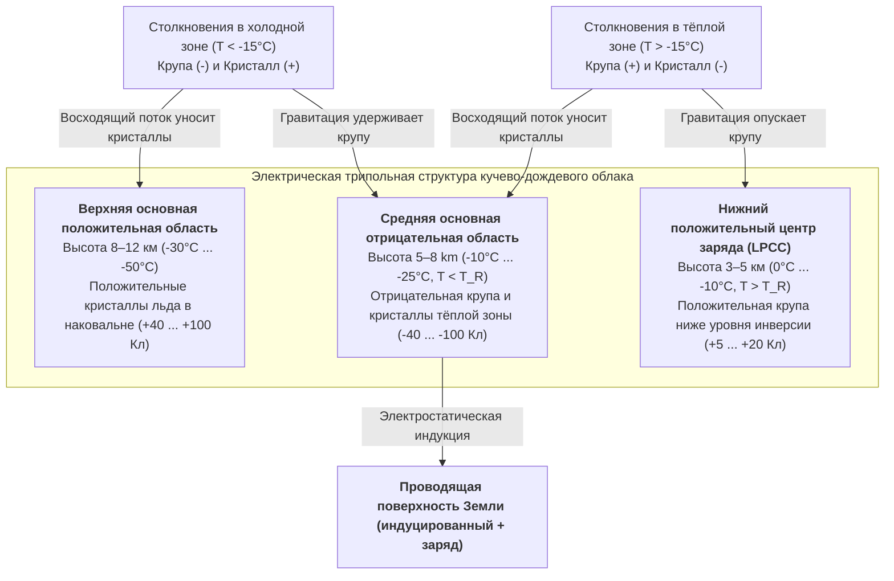

Каждую секунду в атмосфере Земли вспыхивает от 40 до 50 молний — почти 4 миллиона высокоэнергетических разрядов в сутки. Спустя более 270 лет после знаменитого эксперимента Бенджамина Франклина с воздушным змеем (1752 г.) один из фундаментальных вопросов физики атмосферы долгое время оставался нерешённым: <strong>как именно зарождается молния внутри грозового облака?</strong> Метеозонды и самолёты-лаборатории внутри активных кучево-дождевых облаков регистрируют максимальные макроскопические электрические поля лишь в диапазоне $0,1\text{–}0,4\,\text{МВ/м}$ — на порядок ниже классического порога диэлектрического пробоя сухого воздуха на уровне моря ($E_{b0} \approx 3,0\,\text{МВ/м}$), определяемого теорией лавин Таунсенда и законом Пашена. Почему молния никогда не бьёт по прямой, а образует сложное <strong>фрактальное дерево</strong>, подчиняющееся лапласовской неустойчивости роста? Почему отрицательный <strong>ступенчатый лидер (stepped leader)</strong> продвигается дискретными скачками по $50\,\text{м}$ каждые $50\,\text{мкс}$, а затем вызывает ослепительный <strong>обратный удар (return stroke)</strong>, несущийся от земли вверх со скоростью в треть скорости света ($v \approx c/3$) и разогревающий канал до $30\,000\,\text{К}$? В этой статье мы последовательно выведем полную физическую картину молнии.

---

## 1. Электростатический генератор кучево-дождевого облака: безындукционная электризация и трипольная структура

Перед пробоем зрелое <strong>кучево-дождевое облако (Cumulonimbus)</strong> должно создать разность потенциалов $10^8\text{–}10^9\,\text{В}$. В турбулентной <strong>смешанной фазовой зоне</strong> на высотах $4\text{–}10\,\text{км}$ (температура от $0^\circ\text{C}$ до $-40^\circ\text{C}$) мощные восходящие потоки ($v_{\text{up}} \approx 10\text{–}30\,\text{м/с}$) поддерживают сосуществование трёх видов гидрометеоров: <strong>переохлаждённых капель воды</strong> ($d \approx 10\text{–}20\,\text{мкм}$), растущих из пара <strong>ледяных кристаллов</strong> ($20\text{–}200\,\text{мкм}$) и миллиметровых частиц <strong>снежной крупы (graupel, $1\text{–}5\,\text{мм}$)</strong>, быстро растущих за счёт <strong>обзернения (riming)</strong> — намерзания переохлаждённых капель при ударе.

Эксперименты Такахаси (Takahashi, 1978) и Сондерса (Saunders, 1991) доказали, что основной механизм — <strong>безындукционное разделение зарядов</strong> при упругих столкновениях частиц крупы с кристаллами льда в присутствии переохлаждённых капель (перенос $10\text{–}100\,\text{фКл} = 10^{-14}\text{–}10^{-13}\,\text{Кл}$ за соударение). Микроскопическая природа эффекта связана с нанометровым <strong>квазижидким слоем (Quasi-Liquid Layer, QLL)</strong> на поверхности льда. Молекулы воды в решётке и QLL диссоциируют на протоны ($\text{H}^+$) и гидроксил-ионы ($\text{OH}^-$). Благодаря эстафетному механизму Гротгуса вдоль водородных связей <strong>подвижность протонов $\text{H}^+$ на несколько порядков превышает подвижность $\text{OH}^-$</strong>.

При контакте конкурируют два термодинамических градиента: (1) <strong>эффект температурного градиента</strong>: частица крупы нагревается скрытой теплотой замерзания переохлаждённых капель, поэтому из более тёплой крупы с высокой концентрацией ионов протоны $\text{H}^+$ быстро диффундируют в холодный кристалл, заряжая крупу отрицательно ($-$), а кристалл положительно ($+$); (2) <strong>эффект толщины QLL (механизм Бейкера — Дэша)</strong>: при более высокой температуре и высокой водности ($\text{LWC}$) более толстый слой QLL на крупе меняет знак переноса заряда. Граница между режимами определяет <strong>температуру инверсии ($T_R \approx -15^\circ\text{C} \dots -20^\circ\text{C}$)</strong>:

* <strong>Холодный режим ($T < T_R$, высота $7\text{–}10\,\text{км}$)</strong>: тяжёлая <strong>крупа заряжается отрицательно ($-$)</strong>, лёгкие <strong>кристаллы льда — положительно ($+$)</strong>.
* <strong>Тёплый режим ($T > T_R$, высота $4\text{–}6\,\text{км}$)</strong>: инверсия знака — тяжёлая <strong>крупа заряжается положительно ($+$)</strong>, лёгкие <strong>кристаллы — отрицательно ($-$)</strong>.

Затем <strong>гравитационная сортировка по размерам</strong> разделяет заряды в масштабе всего облака: тяжёлая крупа ($v_t \approx 5\text{–}10\,\text{м/с}$) остаётся в средних и нижних слоях, а лёгкие кристаллы ($v_t \ll 1\,\text{м/с}$) уносятся восходящим потоком в верхнюю наковальню, формируя классическую <strong>электрическую трипольную структуру</strong>:

Плотность пространственного заряда $\rho(\mathbf{r})$ определяет потенциал $\phi(\mathbf{r})$ и электрическое поле $\mathbf{E} = -\nabla\phi$ через <strong>уравнение Пуассона</strong>:

$$\nabla^2 \\phi(\mathbf{r}) = -\frac{\rho(\mathbf{r})}{\varepsilon_0}$$

<strong>Нижний положительный центр заряда (LPCC)</strong> усиливает направленное вниз поле у основания отрицательного слоя, работая как электростатическая катапульта для запуска отрицательных лидеров к земле. В <strong>зимних грозах</strong> (например, на побережье Хокурику в Японии) изотерма $-15^\circ\text{C}$ опускается ниже $2\,\text{км}$, и верхняя положительная область разряжается напрямую в землю в виде гигантских <strong>положительных суперболтов (+CG)</strong> с токами до $200\text{–}300\,\text{кА}$.

---

## 2. Загадка инициации молнии: пробой Таунсенда против релятивистских лавин (RREA)

В классической физике газового разряда ударная ионизация электронами (первый коэффициент Таунсенда $\alpha$) конкурирует с прилипанием электронов к электроотрицательным молекулам кислорода (коэффициент $\eta_a$):

$$\frac{dN_e}{dx} = (\alpha - \eta_a) N_e \implies N_e(x) = N_0 \exp\left[ (\alpha - \eta_a) x \right]$$

Для экспоненциальной <strong>лавины Таунсенда</strong> необходимо $\alpha > \eta_a$, что на уровне моря даёт порог $E_{b0} \approx 3,0\,\text{МВ/м}$ ($E/N \approx 120\,\text{Тд}$). Согласно <strong>закону Пашена</strong>, пробивное поле убывает пропорционально относительной плотности воздуха $n(z) = \exp(-z/H)$:

$$E_b(z) = E_{b0} \cdot n(z) \approx (3.0\,\\text{MV/m}) \cdot \exp(-z/H)$$

На высоте зарождения молний $z \approx 6\,\text{км}$ ($n \approx 0,5$) классический пробой требует $E_b(6\,\text{км}) \approx 1,5\,\text{МВ/м}$, тогда как измерения дают не более $0,1\text{–}0,4\,\text{МВ/м}$. Этот парадокс разрешают два механизма:

1. <strong>Лавины релятивистских убегающих электронов (RREA), инициируемые космическими лучами</strong>: тепловые электроны останавливаются гигантским пиком неупругого торможения при $100\text{–}200\,\text{эВ}$ ($F_{\max} \approx 27\,\text{МэВ/м}\cdot n(z)$). Однако по релятивистской формуле Бете — Блоха при кинетической энергии $K_{\min} \approx 1,0\text{–}1,4\,\text{МэВ}$ сила трения падает до минимума $F_{\min} \approx 0,218\,\text{МэВ/м}\cdot n(z)$. С учётом кулоновского рассеяния на ядрах <strong>пороговое поле RREA $E_{\text{RREA}}$</strong> (Гуревич, 1992; Дуайер, 2003) составляет:

$$E_{\\text{RREA}}(z) \approx 0.284\,\\text{MV/m} \cdot n(z), \qquad N_{\\text{RREA}}(L) = N_0 \exp\left(\frac{L}{\lambda_{\\text{RREA}}}\right)$$

   На высоте $6\,\text{км}$ порог равен $E_{\text{RREA}} \approx 0,14\,\text{МВ/м}$, что в точности совпадает с данными зондов! Затравочные электроны ($\sim 1\,\text{МэВ}$) из <strong>широких атмосферных ливней (ШАЛ)</strong> от космических лучей переходят в режим убегания и размножаются за счёт мёллеровского рассеяния.
2. <strong>Усиление поля на гидрометеорах и быстрый положительный пробой (Fast Positive Breakdown)</strong>: на остриях вытянутых ледяных кристаллов ($l/r \gg 1$) диэлектрическая поляризация усиливает локальное поле:

$$E_{\\text{tip}} \approx E_0 \frac{(l/r)^2}{\ln(2l/r) - 1}$$

   Когда $E_{\text{tip}}$ превышает $E_b(z)$, стартуют холодные <strong>положительные коронные стримеры</strong>, способные неограниченно распространяться при фоновом поле выше порога стабильности $E_{\text{st}}^{+} \approx 0,45\,\text{МВ/м}\cdot n(z)$. В 2016 г. Рисон и др. с помощью широкополосной УКВ-интерферометрии показали, что молнии начинаются со взрывного каскада положительных стримеров ($v \approx 3\text{–}5 \times 10^7\,\text{м/с}$) — <strong>быстрого положительного пробоя (FPB / узких биполярных событий NBE)</strong>.

---

## 3. Почему молния ветвится: переход стример–лидер и $\eta$-лапласовский фрактальный рост

Одиночный стример — это холодная плазма ($T_g \approx 300\,\text{К}$), теряющая проводимость за десятки наносекунд из-за прилипания электронов к $\text{O}_2$. Когда тысячи стримеров сливаются в общий стебель (stem), джоулев нагрев поднимает температуру газа выше критического порога <strong>$T_{\text{crit}} \approx 1500\text{–}5000\,\text{К}$</strong>, запуская: (1) <strong>термический отлип электронов</strong> ($\text{O}_2^- + \text{M} \to \text{O}_2 + \text{M} + \text{e}^-$), (2) <strong>колебательно-поступательную (V-T) релаксацию</strong> $\text{N}_2$ и (3) <strong>гидродинамическое расширение канала</strong>, снижающее плотность $N$ и повышающее $E/N$. Так рождается горячий проводящий <strong>лидер (leader)</strong>, переносящий потенциал облака ($-50\,\text{МВ}$) к своей головке.

В 90% разрядов облако–земля (отрицательных, -CG) <strong>ступенчатый лидер (stepped leader)</strong> движется скачками, поскольку отрицательным стримерам нужно вдвое более сильное поле, чем положительным ($E_{\text{st}}^{-} \approx 1,0\text{–}1,2\,\text{МВ/м}\cdot n$). Впереди головки лидера зажигается изолированное плазменное ядро (<strong>объёмный стебель / space stem</strong>), из которого растёт двунаправленный лидер; когда его положительный конец смыкается с основным каналом, вспыхивает новая ступень длиной $L_{\text{step}} \approx 10\text{–}50\,\text{м}$ каждые $\tau_{\text{step}} \approx 20\text{–}50\,\text{мкс}$ (средняя скорость $\sim 2 \times 10^5\,\text{м/с}$).

Фрактальное ветвление объясняет <strong>модель диэлектрического пробоя (DBM)</strong> Нимейера, Пьетронеро и Висманна (1984). Проводящее дерево лидера ($\phi = 0$) находится в лапласовском поле, а вероятность пробоя $P_i$ в граничной точке $i$ пропорциональна $\eta$-й степени локального поля:

$$\nabla^2 \\phi(\mathbf{r}) = 0, \qquad P_i = \frac{|\nabla \\phi_i|^\eta}{\sum_{j \in \\text{boundary}} |\nabla \\phi_j|^\eta} \quad \left(|\nabla \\phi_i| > E_{\\text{crit}}\right)$$

Выступающие вершины сгущают эквипотенциали, а боковые ветви экранируются (<strong>неустойчивость Маллинза — Секерки</strong>), вызывая расщепление вершин. При $\eta = 1$ модель изоморфна диффузионно-ограниченной агрегации (DLA, 2D $D_f \approx 1,71$), а нелинейный режим молнии ($\eta \approx 2$) даёт 2D-проекцию <strong>фрактальной размерности Хаусдорфа $D_f \approx 1,35\text{–}1,55$</strong>.

---

## 4. Соединение, обратный удар при $30\,000\,\text{К}$ и ударно-волновая механика грома

Когда ступенчатый лидер приближается к земле на <strong>дистанцию ориентировки (striking distance) $r_s$</strong>, с вершин заземлённых объектов (молниеотводов, деревьев) стартуют <strong>встречные положительные лидеры</strong>. В <strong>электрогеометрической модели (EGM, метод катящейся сферы)</strong> связь $r_s$ с пиковым током $I_p$ (в $\text{кА}$) описывается формулой Лава (1973):

$$r_s = 10 \, I_p^{0.65} \quad [\\text{m}]$$

В момент контакта ($20\text{–}100\,\text{м}$ над землёй) волна нейтрализации потенциала — <strong>обратный удар (return stroke)</strong> — устремляется от земли к облаку со скоростью <strong>$v_{\text{RS}} \approx c/3 \approx 1,0 \times 10^8\,\text{м/с}$</strong>. За $1\text{–}5\,\mu\text{s}$ пиковый ток $\sim 30\,\text{кА}$ проходит через ядро диаметром $1\text{–}3\,\text{см}$, разогревая плазму до <strong>$T \approx 30\,000\,\text{К}$ (в пять раз горячее фотосферы Солнца)</strong>. Последующие <strong>стреловидные лидеры (dart leaders)</strong> пробегают по остывающему главному каналу со скоростью $\sim 10^7\,\text{м/с}$, вызывая мерцание молнии.

Поскольку микросекундный нагрев является строго <strong>изохорным</strong>, давление в канале скачком возрастает до $10\text{–}100\,\text{атм}$, и плазменный цилиндр расширяется со сверхзвуковой скоростью $10\text{–}20\,\text{Махов}$, порождая <strong>цилиндрическую взрывную волну Тейлора — Седова</strong>. Характерный радиус релаксации $R_0$ и пиковая частота грома $f_{\text{peak}}$ определяются погонной энергией $E_l$ и атмосферным давлением $P_0$:

$$R_0 = \sqrt{\frac{E_l}{\pi P_0}}, \qquad f_{\\text{peak}} \approx 0.63 \, c_s \sqrt{\frac{P_0}{E_l}} = \frac{0.63 \, c_s}{\sqrt{\pi} R_0} \approx 50\\text{–}150\,\\text{Hz}$$

На расстоянии нескольких километров N-волна превращается в долгие раскаты грома из-за разницы времён прихода звука от извилистого 3D-канала, квадратичного по частоте затухания в воздухе ($\alpha_{\text{att}} \propto f^2$) и тепловой рефракции звука вверх.

---

## 5. Транзиентные световые явления (TLE) и земные гамма-вспышки (TGF) с рождением антиматерии

1. <strong>Транзиентные световые явления (TLE)</strong>:
   * <strong>Красные спрайты (высота $50\text{–}90\,\text{км}$)</strong>: после мощного удара $+CG$ с большим изменением дипольного момента заряда ($\text{CMC} \gtrsim 500\,\text{Кл}\cdot\text{км}$) квазиэлектростатическое поле в мезосфере превышает экспоненциально падающий с плотностью воздуха порог пробоя $E_b(z)$, зажигая гигантские комплексы холодных стримеров (красное свечение $\text{N}_2(1\text{P})$ сверху, синие усики $\text{N}_2^+(1\text{N})$ снизу).
   * <strong>Синие джеты ($15\text{–}50\,\text{км}$) и Гигантские джеты (до $90\,\text{км}$)</strong>: конусы положительных лидеров-стримеров, бьющие вверх из вершины облака со скоростью $\sim 100\,\text{км/с}$.
   * <strong>Эльфы (ELVES, $85\text{–}100\,\text{км}$)</strong>: расширяющиеся со сверхсветовой фазовой скоростью красные кольца диаметром $300\text{–}500\,\text{км}$ ($<1\,\text{мс}$) при пересечении сферического ЭМИ (EMP) обратного удара с нижней ионосферой.
2. <strong>Земные гамма-вспышки (TGF) и фотоядерное рождение антиматерии</strong>: лавины RREA ускоряют электроны до $20\text{–}40\,\text{МэВ}$, излучая тормозные гамма-кванты. В 2017 г. Эното и др. (Enoto et al., *Nature*) доказали, что гамма-фотоны с энергией $>10,55\,\text{МэВ}$ выбивают нейтроны из ядер $^{14}\text{N}$; нестабильный изотоп $^{13}\text{N}$ испытывает $\beta^+$-распад с испусканием <strong>позитронов антиматерии ($\text{e}^+$)</strong>, аннигиляция которых с электронами воздуха даёт характерную гамма-линию <strong>$0,511\,\text{МэВ}$</strong>:

$$\gamma + {{}}^{14}_{7}\\text{N} \longrightarrow {{}}^{13}_{7}\\text{N} + \\text{n} \quad (E_\gamma > 10.55\,\\text{MeV})$$

$${{}}^{13}_{7}\\text{N} \longrightarrow {{}}^{13}_{6}\\text{C} + \\text{e}^+ + \nu_e, \qquad \\text{e}^+ + \\text{e}^- \longrightarrow 2\gamma \quad (E_\gamma = 0.511\,\\text{MeV})$$

---

## 6. Сводное физическое сравнение и современные методы наблюдений

| Явление / Режим | Высота / Пространственный масштаб | Длительность | Скорость распространения $v$ | Характерный ток, энергия или температура | Основной физический механизм |
| :--- | :--- | :--- | :--- | :--- | :--- |
| <strong>Безындукционная зарядка</strong> | $4\text{–}10\,\text{км}$ (смешанная зона) | $10\text{–}30\,\text{мин}$ цикл конвекции | Восходящий поток $10\text{–}30\,\text{м/с}$ | $\sim 10^{-14}\,\text{Кл}$/удар; $\pm 40\text{–}100\,\text{Кл}$ в облаке | Соударения крупы и кристаллов, диффузия $\text{H}^+$ в QLL, $T_R \approx -15^\circ\text{C}$ |
| <strong>Быстрый положительный пробой (FPB)</strong> | $5\text{–}12\,\text{км}$; длина $0,3\text{–}1\,\text{км}$ | $10\text{–}20\,\mu\text{s}$ | $3 \times 10^7 \text{–} 5 \times 10^7\,\text{м/с}$ | Мультимегаваттный УКВ-радиовсплеск | Лавина RREA + усиление поля на остриях ледяных кристаллов |
| <strong>Отрицательный ступенчатый лидер</strong> | Облако–земля (шаги $10\text{–}50\,\text{м}$) | $10\text{–}30\,\text{мс}$ (паузы $20\text{–}50\,\mu\text{s}$) | Средняя $2 \times 10^5\,\text{м/с}$ | $100\text{–}1000\,\text{А}$; ядро $T \approx 5000\,\text{К}$ | Термический отлип ($>1500\,\text{К}$), space stems, фрактал DBM |
| <strong>Обратный удар (Return Stroke)</strong> | Земля–облако (диаметр ядра $1\text{–}3\,\text{см}$) | Фронт $1\text{–}5\,\mu\text{s}$; спад $\sim 100\,\mu\text{s}$ | $v \approx c/3 \approx 1,0 \times 10^8\,\text{м/с}$ (вверх) | Медиана $30\,\text{кА}$ (+CG до $300\,\text{кА}$); <strong>$T \approx 30\,000\,\text{К}$</strong> | Волна нейтрализации, изохорный нагрев ($10\text{–}100\,\text{атм}$), цилиндрическая ударная волна |
| <strong>Спрайты / Джеты / Эльфы</strong> | $15\text{–}100\,\text{км}$ (стратосфера–ионосфера) | $<1\,\text{мс}$ (ELVES) до $300\,\text{мс}$ (джеты) | $10^5\,\text{м/с}$ до фазовой скорости $>c$ | Холодная плазма ($T_g \approx 200\text{–}300\,\text{К}$) | Квазиэлектростатический пробой, дисбаланс заряда, сферический ЭМИ |
| <strong>Земная гамма-вспышка (TGF)</strong> | $10\text{–}15\,\text{км}$ ($2\text{–}4\,\text{км}$ зимой) | $<1\,\text{мс}$ (свечение $\text{e}^+$ $\sim 10\,\text{мин}$) | Релятивистские электроны $v \approx 0,99c$ | Энергия фотонов до <strong>$20\text{–}40\,\text{МэВ}$</strong> | Тормозное излучение RREA, реакция $^{14}\text{N}(\gamma,\text{n}){}^{13}\text{N}$ и аннигиляция $\text{e}^+\text{e}^-$ ($0,511\,\text{МэВ}$) |

Сегодня системы <strong>3D VHF Lightning Mapping Arrays (LMA)</strong> и широкополосные цифровые интерферометры реконструируют трёхмерную динамику молний внутри облаков с метровой точностью. В 2023 г. на вершине горы Зентис ($2502\,\text{м}$, Швейцария) европейский консорциум с помощью тераваттного фемтосекундного лазера создал ионизированный канал за счёт <strong>лазерной филаментации</strong> и впервые в истории направил природную молнию вдоль лазерного луча на расстояние $50\,\text{м}$ (Houard et al., 2023). В планетарном масштабе около 2000 одновременно действующих гроз питают <strong>глобальную электрическую цепь Вильсона</strong>, поддерживая потенциал ионосферы $+250\,\text{кВ}$, поле хорошей погоды ($100\text{–}150\,\text{В/м}$) и <strong>резонансы Шумана ($7,83\,\text{Гц}$)</strong>.
