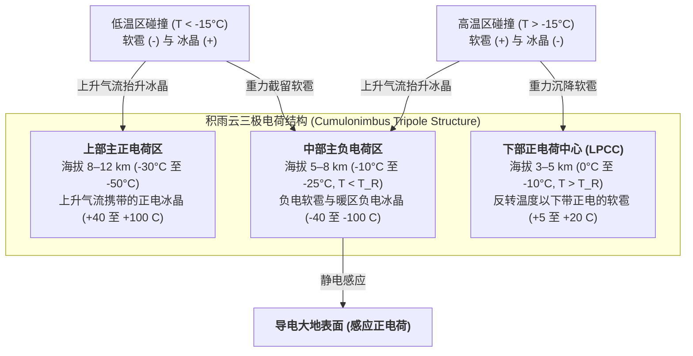

地球大气层每秒钟约发生 40 至 50 次闪电，每天产生近 400 万次高能放电。尽管距离富兰克林 1752 年著名的风筝实验已过去两个半世纪，现代大气物理学仍面临着一个核心悖论：<strong>雷电究竟是如何在雷暴云内部启动的？</strong>探空气球与科研飞机在活跃积雨云内部测得的宏观电场最大值仅为 $0.1\text{–}0.4\,\text{MV/m}$，比海平面干燥空气的传统汤森介电击穿阈值（$E_{b0} \approx 3.0\,\text{MV/m}$）低了整整一个数量级。此外，为何闪电从不沿直线传播，而是形成遵循拉普拉斯生长不稳定性的复杂<strong>分形树状分支</strong>？为何负<strong>梯级先导（Stepped Leader）</strong>每隔 $50\,\mu\text{s}$ 跳跃 $50\,\text{m}$，随后触发以三分之一光速（$v \approx c/3$）向上奔涌、温度高达 $30,000\,\text{K}$ 的<strong>回击（Return Stroke）</strong>？本文将从云微物理学、相对论电动力学与激波声学角度，系统推导雷电的完整物理机制。

---

## 1. 积雨云静电机：非感应电荷分离与三极电荷结构

在发生介电击穿之前，成熟<strong>积雨云（Cumulonimbus）</strong>必须在数公里尺度上建立起 $10^8\text{–}10^9\,\text{V}$ 的电势差。在海拔 $4\text{–}10\,\text{km}$（环境温度 $0^\circ\text{C}$ 至 $-40^\circ\text{C}$）的湍流<strong>混合相区（Mixed-phase region）</strong>，强大的上升气流（$v_{\text{up}} \approx 10\text{–}30\,\text{m/s}$）使三种水成物共存：<strong>过冷水滴</strong>（直径 $10\text{–}20\,\mu\text{m}$）、水汽凝华生长的<strong>冰晶</strong>（$20\text{–}200\,\mu\text{m}$）以及通过撞冻过冷水滴（<strong>淞附过程，Riming</strong>）快速生长的毫米级<strong>软雹（Graupel，霰，直径 $1\text{–}5\,\text{mm}$）</strong>。

高桥劭（Takahashi, 1978）与 Saunders（1991）的风洞实验证实，雷暴云的主导起电机制是<strong>非感应电荷分离（Non-inductive charge separation）</strong>：软雹与冰晶在过冷水滴存在下发生碰撞并反弹，每次碰撞转移约 $10\text{–}100\,\text{fC}$（$10^{-14}\text{–}10^{-13}\,\text{C}$）的电荷。其微观机理源于冰表面纳米级的<strong>准液态层（Quasi-Liquid Layer, QLL）</strong>。在冰晶格与准液态层中，水分子自偶电离产生质子（$\text{H}^+$）与氢氧根离子（$\text{OH}^-$）。由于质子可通过 Grotthuss 氢键跳跃机制快速迁移，<strong>$\text{H}^+$ 的迁移率比 $\text{OH}^-$ 高出数个数量级</strong>。

碰撞瞬间的电荷转移受控于两个竞争梯度：（1）<strong>温度梯度效应</strong>：软雹因过冷水滴冻结释放潜热而比环境冰晶更温暖，高温侧具有更高浓度的电离离子，$\text{H}^+$ 从温暖软雹向寒冷冰晶快速扩散，使软雹带负电（$-$）、冰晶带正电（$+$）；（2）<strong>准液态层厚度效应（Baker-Dash 机制）</strong>：在较高温度和较大液态水含量（$\text{LWC}$）下，表面生长更快的软雹形成更厚的准液态层，接触分离时的质量转移导致极性反转。这两个机制的交界定义了著名的<strong>反转温度（Reversal Temperature，$T_R \approx -15^\circ\text{C}$ 至 $-20^\circ\text{C}$）</strong>：

* <strong>低温区（$T < T_R$，海拔 $7\text{–}10\,\text{km}$）</strong>：碰撞使重<strong>软雹带负电（$-$）</strong>，轻<strong>冰晶带正电（$+$）</strong>。
* <strong>高温区（$T > T_R$，海拔 $4\text{–}6\,\text{km}$）</strong>：极性反转，重<strong>软雹带正电（$+$）</strong>，轻<strong>冰晶带负电（$-$）</strong>。

随后，<strong>重力粒径分选</strong>将微观电荷分离转化为宏观电容：终端下落速度较大（$v_t \approx 5\text{–}10\,\text{m/s}$）的软雹停留在云中下部，而轻小冰晶（$v_t \ll 1\,\text{m/s}$）被上升气流吹送至云顶砧状部，自然形成经典的<strong>三极电荷结构（Tripole charge structure）</strong>：

宏观空间电荷密度 $\rho(\mathbf{r})$ 通过<strong>泊松方程（Poisson's equation）</strong>决定静电势 $\phi(\mathbf{r})$ 与电场 $\mathbf{E} = -\nabla\phi$：

$$\nabla^2 \\phi(\mathbf{r}) = -\frac{\rho(\mathbf{r})}{\varepsilon_0}$$

其中<strong>下部正电荷中心（LPCC）</strong>与中部主负电荷区构成局部垂直偶极子，显著增强了负电荷区底部的向下电场，充当将负先导推向地面的“静电弹射器”。而在日本北陆等地的<strong>冬季雷暴</strong>中，由于地面寒冷，$-15^\circ\text{C}$ 等温线降至距地面仅 $2\,\text{km}$ 处，强风切变使上部正电荷区直接向地面放电，形成峰值电流高达 $200\text{–}300\,\text{kA}$ 的<strong>正地闪（+CG）超级雷电</strong>。

---

## 2. 雷电起始之谜：传统汤森击穿与相对论逃逸电子雪崩（RREA）

在经典气体放电物理中，自由电子在电场中漂移时，电子碰撞电离（第一汤森电离系数 $\alpha$）与电负性氧分子的电子附着（$\text{e}^- + \text{O}_2 + \text{M} \to \text{O}_2^- + \text{M}$，附着系数 $\eta_a$）相互竞争：

$$\frac{dN_e}{dx} = (\alpha - \eta_a) N_e \implies N_e(x) = N_0 \exp\left[ (\alpha - \eta_a) x \right]$$

只有当 $\alpha > \eta_a$ 时才能发生指数级<strong>汤森雪崩（Townsend avalanche）</strong>。在海平面标准空气密度 $N_0$ 下，$\alpha = \eta_a$ 对应的传统击穿阈值为 $E_{b0} \approx 3.0\,\text{MV/m}$（约合化约电场 $E/N \approx 120\,\text{Td}$）。根据高气压区的<strong>帕申定律（Paschen's law）</strong>，击穿电场随相对空气密度 $n(z) = N(z)/N_0 \approx \exp(-z/H)$（标高 $H \approx 8\,\text{km}$）线性递减：

$$E_b(z) = E_{b0} \cdot n(z) \approx (3.0\,\\text{MV/m}) \cdot \exp(-z/H)$$

在雷电起始海拔 $z \approx 6\,\text{km}$（$n \approx 0.5$）处，传统击穿仍需 $E_b(6\,\text{km}) \approx 1.5\,\text{MV/m}$，但实测最大宏观电场从不超过 $0.1\text{–}0.4\,\text{MV/m}$。现代物理学通过两大协同机制破解了这一难题：

1. <strong>宇宙射线引发的相对论逃逸电子雪崩（RREA）</strong>：低能热电子加速时会遇到约 $100\text{–}200\,\text{eV}$ 处的非弹性碰撞阻力峰（$F_{\max} \approx 27\,\text{MeV/m}\cdot n(z)$）。然而根据相对论 Bethe-Bloch 阻止本领公式，当电子动能达到 $K_{\min} \approx 1.0\text{–}1.4\,\text{MeV}$ 时，碰撞摩擦阻力降至最低值 $F_{\min} \approx 0.218\,\text{MeV/m}\cdot n(z)$。计入原子核库仑散射后，Gurevich（1992）与 Dwyer（2003）推导出<strong>相对论逃逸阈值电场 $E_{\text{RREA}}$</strong>：

$$E_{\\text{RREA}}(z) \approx 0.284\,\\text{MV/m} \cdot n(z), \qquad N_{\\text{RREA}}(L) = N_0 \exp\left(\frac{L}{\lambda_{\\text{RREA}}}\right)$$

   在 $z = 6\,\text{km}$ 处，$E_{\text{RREA}} \approx 0.14\,\text{MV/m}$，与气球实测最大电场完美吻合！高能宇宙射线产生<strong>广延大气簇射（EAS）</strong>提供的 $\sim 1\,\text{MeV}$ 种子电子在云内发生硬 Møller 电子-电子散射，倍增出大量高能次级逃逸电子，形成相对论雪崩。
2. <strong>冰晶尖端电场放大与快速正击穿（Fast Positive Breakdown）</strong>：在宏观亚击穿电场 $E_0$ 中，长径比为 $l/r \gg 1$ 的柱状或针状冰晶尖端通过介电极化将局部电场放大：

$$E_{\\text{tip}} \approx E_0 \frac{(l/r)^2}{\ln(2l/r) - 1}$$

   当 $l/r \approx 20$ 时，尖端电场突破 $E_b(z)$ 并激发非平衡冷等离子体<strong>正流注（Positive corona streamers）</strong>。正流注一旦产生，只要背景电场高于正流注稳定传播场 $E_{\text{st}}^{+} \approx 0.45\,\text{MV/m}\cdot n(z)$，即可自持扩展。2016 年 Rison 等人利用宽带甚高频（VHF）干涉仪证实，雷电均起始于以 $3\text{–}5 \times 10^7\,\text{m/s}$ 爆发的米级正流注级联——即<strong>快速正击穿（FPB / 窄双极事件 NBE）</strong>。

---

## 3. 闪电为何分叉：流注-先导热相变、梯级先导与 $\eta$-拉普拉斯分形生长

单个流注属于冷等离子体（电子温度 $T_e \sim 30,000\,\text{K}$，但中性气体温度 $T_g \approx 300\,\text{K}$），流注尾部电子在数十纳秒内便因附着于 $\text{O}_2$ 而失去导电性。当数千条正流注汇聚于同一根部（Stem）时，焦耳加热使中性气体升温并跨越临界相变温度 <strong>$T_{\text{crit}} \approx 1,500\text{–}5,000\,\text{K}$</strong>，触发三大正反馈：（1）<strong>热电子脱附</strong>（$\text{O}_2^- + \text{M} \to \text{O}_2 + \text{M} + \text{e}^-$ 恢复自由电子浓度）；（2）<strong>氮分子振动-平动（V-T）弛豫加热</strong>；（3）<strong>流体力学径向膨胀</strong>降低通道密度 $N$，提高化约场 $E/N$。流注由此相变为高导电率的热等离子体<strong>先导（Leader）</strong>，如同将云内 $-50\,\text{MV}$ 高压直接延伸至先导前端的导线。

在占 90% 的负地闪中，向下传播的<strong>负梯级先导（Stepped Leader）</strong>由于负流注需要比正流注高出一倍以上的传播场（$E_{\text{st}}^{-} \approx 1.0\text{–}1.2\,\text{MV/m}\cdot n$），无法连续推进，而是在主通道前方数米处触发孤立的<strong>空间茎（Space stem）</strong>。空间茎演化出双向空间先导，当向后生长的正空间先导与主负先导头部相撞时，瞬间导通 $L_{\text{step}} \approx 10\text{–}50\,\text{m}$ 的新阶梯，阶梯间停顿 $\tau_{\text{step}} \approx 20\text{–}50\,\mu\text{s}$，平均下落速度约 $2 \times 10^5\,\text{m/s}$。

为何闪电会分叉成树状？Niemeyer、Pietronero 和 Wiesmann（1984）提出的<strong>介电击穿模型（Dielectric Breakdown Model, DBM）</strong>给出了严格解释。高导电先导树可视作等势体（$\phi = 0$），周围无电荷区满足拉普拉斯方程，而边界点 $i$ 的下一步击穿概率 $P_i$ 正比于局部电场模值的 $\eta$ 次方：

$$\nabla^2 \\phi(\mathbf{r}) = 0, \qquad P_i = \frac{|\nabla \\phi_i|^\eta}{\sum_{j \in \\text{boundary}} |\nabla \\phi_j|^\eta} \quad \left(|\nabla \\phi_i| > E_{\\text{crit}}\right)$$

曲率较大的尖端挤密等势面（尖端放大效应），而凹陷处与侧枝受到静电屏蔽（<strong>Mullins-Sekerka / 拉普拉斯生长不稳定性</strong>），导致尖端不断劈裂分叉：
* 当 $\eta = 1$ 时，模型在数学上等价于 Witten-Sander <strong>扩散限制凝聚（DLA）</strong>，二维分形维数 $D_f \approx 1.71$；
* 对于真实雷电，电离率对电场高度非线性（$\eta \approx 1.5\text{–}3.0$），测得闪电二维投影的<strong>豪斯多夫分形维数 $D_f \approx 1.35\text{–}1.55$</strong>，与 $\eta \approx 2$ 的随机拉普拉斯分形完美一致。

---

## 4. 连接过程、$30,000\,\text{K}$ 回击与雷声激波流体力学

当携带着 $-5$ 至 $-20\,\text{C}$ 电荷的梯级先导降至距地面<strong>击穿距离（Striking distance）$r_s$</strong> 以内时，地面高耸物体尖端激发向上的迎面正先导。在防雷工程的<strong>电气几何模型（EGM，滚球法基础）</strong>中，击穿距离与回击峰值电流 $I_p$（单位 $\text{kA}$）遵循幂律关系：

$$r_s = 10 \, I_p^{0.65} \quad [\\text{m}]$$

典型 $I_p = 30\,\text{kA}$ 雷击对应 $r_s \approx 91\,\text{m}$。上下先导接触瞬间，接地电位中和波——即<strong>回击（Return Stroke）</strong>——沿预电离通道以 <strong>$v_{\text{RS}} \approx c/3 \approx 1.0 \times 10^8\,\text{m/s}$</strong> 的相对论速度从地面直冲云霄！在 $1\text{–}5\,\mu\text{s}$ 的上升时间内，$30\,\text{kA}$ 峰值电流流经直径仅 $1\text{–}3\,\text{cm}$ 的电弧核心，将通道加热至 <strong>$T \approx 30,000\,\text{K}$（太阳表面温度的 5 倍）</strong>。首回击后若云内继续向残留温热通道注入电荷，将产生以 $10^7\,\text{m/s}$ 沿主干连续下冲的<strong>直窜先导（Dart Leader）</strong>，引发多次闪烁的后续回击。

由于回击加热时间（$\sim \mu\text{s}$）远小于声学膨胀时间（$\sim 30\,\mu\text{s}$），通道经历<strong>等容加热（Isochoric heating）</strong>，叠加分子离解与电离使内部压强骤升至 $10\text{–}100\,\text{atm}$，以马赫数 $10\text{–}20$ 向外径向爆炸，形成 Taylor-Sedov <strong>圆柱激波（Cylindrical blast wave）</strong>。特征弛豫半径 $R_0$ 与雷声主频 $f_{\text{peak}}$ 由单位长度沉积能量 $E_l$（$\sim 10^5\text{–}10^6\,\text{J/m}$）和大气压 $P_0$ 决定：

$$R_0 = \sqrt{\frac{E_l}{\pi P_0}}, \qquad f_{\\text{peak}} \approx 0.63 \, c_s \sqrt{\frac{P_0}{E_l}} = \frac{0.63 \, c_s}{\sqrt{\pi} R_0} \approx 50\\text{–}150\,\\text{Hz}$$

在数米之外，强激波衰减为 N 型声波脉冲；而在数公里外，受三维蜿蜒通道各段声程差、大气对高频声波的平方衰减（$\alpha_{\text{att}} \propto f^2$）以及对流层温度递减引起的向上声折射影响，清脆的炸雷演变为持续数十秒的低频隆隆雷声。

---

## 5. 云顶之上的高能物理：瞬态发光事件（TLEs）与产生反物质的地球伽马射线闪（TGFs）

雷暴不仅向地面放电，还通过两类高能物理过程直接耦合中高层大气与空间环境：

1. <strong>瞬态发光事件（TLEs）</strong>：
   * <strong>红色精灵（Red Sprites，海拔 $50\text{–}90\,\text{km}$）</strong>：强正地闪（+CG）产生巨大电荷矩变化（$\text{CMC} \gtrsim 500\,\text{C}\cdot\text{km}$）后，由于空气密度 $N(z)$ 随高度指数衰减的速度快于准静电场（QE）的代数衰减，在 $70\text{–}80\,\text{km}$ 中层大气超过局部击穿阈值 $E_b(z)$，激发直径数十公里的冷等离子体流注群，上部呈 $\text{N}_2(1\text{P})$ 跃迁的亮红色，下部卷须呈 $\text{N}_2^+(1\text{N})$ 蓝色。
   * <strong>蓝色喷流（Blue Jets，$15\text{–}50\,\text{km}$）与巨大喷流（Gigantic Jets，直达 $90\,\text{km}$）</strong>：由云顶正电荷失衡向上喷发的正先导-流注锥体，速度约 $100\,\text{km/s}$。
   * <strong>淘气精灵（ELVES，$85\text{–}100\,\text{km}$）</strong>：回击辐射的球面电磁脉冲（EMP）切割电离层底部水平导电面，形成在 $<1\,\text{ms}$ 内以超光速相速度扩展至直径 $300\text{–}500\,\text{km}$ 的红色发光环。
2. <strong>地球伽马射线闪（TGFs）与光核反应反物质生成</strong>：云内强电场中的 RREA 雪崩加速电子至 $20\text{–}40\,\text{MeV}$，撞击大气原子核产生韧致辐射伽马射线闪。2017 年榎户辉扬（Enoto et al., *Nature*）团队证实，高于 $10.55\,\text{MeV}$ 的伽马光子会激发氮-14 原子核巨偶极共振并敲出中子，生成的放射性 $^{13}\text{N}$（半衰期 $9.97\,\text{min}$）发生 $\beta^+$ 衰变释放<strong>反物质正电子（$\text{e}^+$）</strong>，随后与大气电子湮灭辐射出特征的 <strong>$0.511\,\text{MeV}$ 伽马谱线</strong>：

$$\gamma + {{}}^{14}_{7}\\text{N} \longrightarrow {{}}^{13}_{7}\\text{N} + \\text{n} \quad (E_\gamma > 10.55\,\\text{MeV})$$

$${{}}^{13}_{7}\\text{N} \longrightarrow {{}}^{13}_{6}\\text{C} + \\text{e}^+ + \nu_e, \qquad \\text{e}^+ + \\text{e}^- \longrightarrow 2\gamma \quad (E_\gamma = 0.511\,\\text{MeV})$$

---

## 6. 大气放电全尺度物理机制对比与现代探测前沿

| 放电阶段 / 物理现象 | 海拔高度 / 空间尺度 | 持续时间 / 时间尺度 | 传播速度 $v$ | 特征电流、能量或温度 | 核心物理机制 |
| :--- | :--- | :--- | :--- | :--- | :--- |
| <strong>非感应起电</strong> | $4\text{–}10\,\text{km}$（混合相区） | $10\text{–}30\,\text{min}$ 对流周期 | 上升气流 $10\text{–}30\,\text{m/s}$ | $\sim 10^{-14}\,\text{C}$/次；云总电荷 $\pm 40\text{–}100\,\text{C}$ | 软雹-冰晶淞附碰撞、准液态层 $\text{H}^+$ 扩散、反转温度 $T_R \approx -15^\circ\text{C}$ |
| <strong>快速正击穿 (FPB/NBE)</strong> | $5\text{–}12\,\text{km}$；尺度 $0.3\text{–}1\,\text{km}$ | $10\text{–}20\,\mu\text{s}$ | $3 \times 10^7 \text{–} 5 \times 10^7\,\text{m/s}$ | 兆瓦级甚高频（VHF）射电暴 | 宇宙射线 RREA 雪崩 + 冰晶尖端电场放大触发正流注级联 |
| <strong>负梯级先导</strong> | 云底至地面（步长 $10\text{–}50\,\text{m}$） | 总计 $10\text{–}30\,\text{ms}$（间隔 $20\text{–}50\,\mu\text{s}$） | 平均 $2 \times 10^5\,\text{m/s}$ | $100\text{–}1,000\,\text{A}$；核心 $T \approx 5,000\,\text{K}$ | 流注-先导热脱附相变（$>1,500\,\text{K}$）、空间茎、DBM $\eta$-拉普拉斯分形 |
| <strong>回击 (Return Stroke)</strong> | 地面至云内（核心直径 $1\text{–}3\,\text{cm}$） | 上升 $1\text{–}5\,\mu\text{s}$；衰减 $\sim 100\,\mu\text{s}$ | $v \approx c/3 \approx 1.0 \times 10^8\,\text{m/s}$（向上） | 中位 $30\,\text{kA}$（+CG 达 $300\,\text{kA}$）；<strong>$T \approx 30,000\,\text{K}$</strong> | 接地中和波、等容焦耳加热（$10\text{–}100\,\text{atm}$）、Taylor-Sedov 圆柱激波 |
| <strong>红色精灵 / 蓝色喷流 / ELVES</strong> | $15\text{–}100\,\text{km}$（平流层至电离层） | $<1\,\text{ms}$（ELVES）至 $300\,\text{ms}$（喷流） | $10^5\,\text{m/s}$ 至超光速相速度 | 冷等离子体（$T_g \approx 200\text{–}300\,\text{K}$） | 准静电场（QE）击穿、云顶电荷失衡、回击球面 EMP 壳层切割电离层 |
| <strong>地球伽马射线闪 (TGF)</strong> | $10\text{–}15\,\text{km}$（冬季雷暴 $2\text{–}4\,\text{km}$） | 脉冲 $<1\,\text{ms}$（正电子余辉 $\sim 10\,\text{min}$） | 相对论电子 $v \approx 0.99c$ | 光子能量高达 <strong>$20\text{–}40\,\text{MeV}$</strong> | RREA 韧致辐射、$^{14}\text{N}(\gamma,\text{n}){}^{13}\text{N}$ 光核敲出与 $0.511\,\text{MeV}$ 正负电子湮灭 |

现代雷电物理学借助 GPS 同步<strong>三维甚高频雷电定位阵列（3D VHF LMA）</strong>与数字宽带干涉仪，已能以米级精度和纳秒级时间分辨率重建云内先导的三维演化。2023 年，欧洲研究团队在瑞士森蒂斯峰（Mount Säntis）利用太瓦级飞秒激光通过非线性克尔自聚焦形成<strong>激光丝（Laser filamentation）</strong>电离通道，人类历史上首次成功引导自然雷电沿激光路径传播了 $50\,\text{m}$。在全球尺度上，地球表面时刻活动的约 2,000 场雷暴作为<strong>威尔逊全球电路（Global Electric Circuit）</strong>的发电机，维持着电离层相对于地面 $+250\,\text{kV}$ 的电势、晴天大气 $100\text{–}150\,\text{V/m}$ 的向下电场以及 $7.83\,\text{Hz}$ 基频的<strong>舒曼共振（Schumann Resonances）</strong>。从纳米级冰晶准液态层到产生反物质的相对论雪崩，雷电展现了跨尺度物理学令人惊叹的统一之美。
