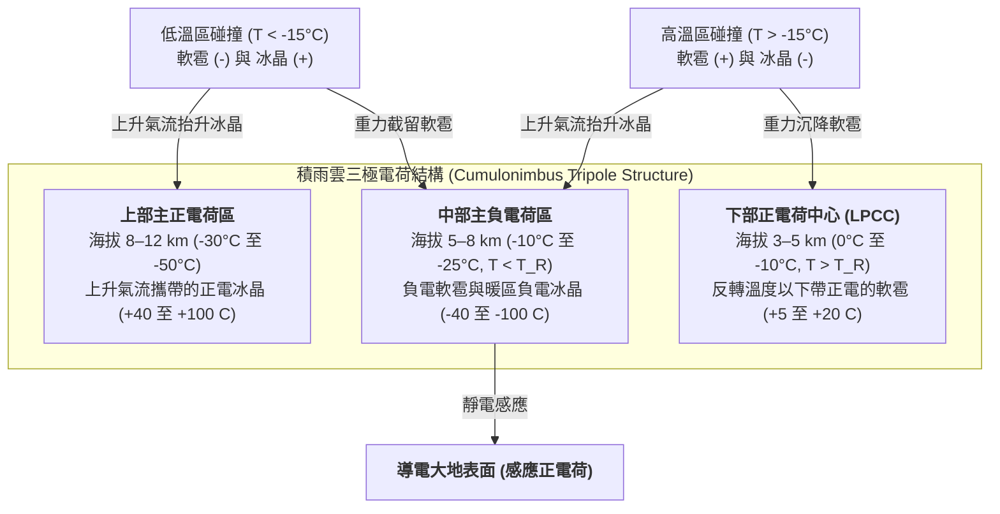

地球大氣層每秒鐘約發生 40 至 50 次閃電，每天產生近 400 萬次高能放電。儘管距離富蘭克林 1752 年著名的風箏實驗已過去兩個半世紀，現代大氣物理學仍面臨著一個核心悖論：<strong>雷電究竟是如何在雷暴雲內部啟動的？</strong>探空氣球與科研飛機在活躍積雨雲內部測得的巨觀電場最大值僅為 $0.1\text{–}0.4\,\text{MV/m}$，比海平面乾燥空氣的傳統湯森介電擊穿閾值（$E_{b0} \approx 3.0\,\text{MV/m}$）低了整整一個數量級。此外，為何閃電從不沿直線傳播，而是形成遵循拉普拉斯生長不穩定性的複雜<strong>分形樹狀分支</strong>？為何負<strong>梯級先導（Stepped Leader）</strong>每隔 $50\,\mu\text{s}$ 跳躍 $50\,\text{m}$，隨後觸發以三分之一光速（$v \approx c/3$）向上奔湧、溫度高達 $30,000\,\text{K}$ 的<strong>回擊（Return Stroke）</strong>？本文將從雲微物理學、相對論電動力學與激波聲學角度，系統推導雷電的完整物理機制。

---

## 1. 積雨雲靜電機：非感應電荷分離與三極電荷結構

在發生介電擊穿之前，成熟<strong>積雨雲（Cumulonimbus）</strong>必須在數公里尺度上建立起 $10^8\text{–}10^9\,\text{V}$ 的電位差。在海拔 $4\text{–}10\,\text{km}$（環境溫度 $0^\circ\text{C}$ 至 $-40^\circ\text{C}$）的湍流<strong>混合相區（Mixed-phase region）</strong>，強大的上升氣流（$v_{\text{up}} \approx 10\text{–}30\,\text{m/s}$）使三種水成物共存：<strong>過冷水滴</strong>（直徑 $10\text{–}20\,\mu\text{m}$）、水汽凝華生長的<strong>冰晶</strong>（$20\text{–}200\,\mu\text{m}$）以及透過撞凍過冷水滴（<strong>淞附過程，Riming</strong>）快速生長的毫米級<strong>軟雹（Graupel，霰，直徑 $1\text{–}5\,\text{mm}$）</strong>。

高橋劭（Takahashi, 1978）與 Saunders（1991）的風洞實驗證實，雷暴雲的主導起電機制是<strong>非感應電荷分離（Non-inductive charge separation）</strong>：軟雹與冰晶在過冷水滴存在下發生碰撞並反彈，每次碰撞轉移約 $10\text{–}100\,\text{fC}$（$10^{-14}\text{–}10^{-13}\,\text{C}$）的電荷。其微觀機理源於冰表面奈米級的<strong>準液態層（Quasi-Liquid Layer, QLL）</strong>。在冰晶格與準液態層中，水分子自偶電離產生質子（$\text{H}^+$）與氫氧根離子（$\text{OH}^-$）。由於質子可透過 Grotthuss 氫鍵跳躍機制快速遷移，<strong>$\text{H}^+$ 的遷移率比 $\text{OH}^-$ 高出數個數量級</strong>。

碰撞瞬間的電荷轉移受控於兩個競爭梯度：（1）<strong>溫度梯度效應</strong>：軟雹因過冷水滴凍結釋放潛熱而比環境冰晶更溫暖，高溫側具有更高濃度的電離離子，$\text{H}^+$ 從溫暖軟雹向寒冷冰晶快速擴散，使軟雹帶負電（$-$）、冰晶帶正電（$+$）；（2）<strong>準液態層厚度效應（Baker-Dash 機制）</strong>：在較高溫度和較大液態水含量（$\text{LWC}$）下，表面生長更快的軟雹形成更厚的準液態層，接觸分離時的質量轉移導致極性反轉。這兩個機制的交界定義了著名的<strong>反轉溫度（Reversal Temperature，$T_R \approx -15^\circ\text{C}$ 至 $-20^\circ\text{C}$）</strong>：

* <strong>低溫區（$T < T_R$，海拔 $7\text{–}10\,\text{km}$）</strong>：碰撞使重<strong>軟雹帶負電（$-$）</strong>，輕<strong>冰晶帶正電（$+$）</strong>。
* <strong>高溫區（$T > T_R$，海拔 $4\text{–}6\,\text{km}$）</strong>：極性反轉，重<strong>軟雹帶正電（$+$）</strong>，輕<strong>冰晶帶負電（$-$）</strong>。

隨後，<strong>重力粒徑分選</strong>將微觀電荷分離轉化為巨觀電容：終端下落速度較大（$v_t \approx 5\text{–}10\,\text{m/s}$）的軟雹停留在雲中下部，而輕小冰晶（$v_t \ll 1\,\text{m/s}$）被上升氣流吹送至雲頂砧狀部，自然形成經典的<strong>三極電荷結構（Tripole charge structure）</strong>：

巨觀空間電荷密度 $\rho(\mathbf{r})$ 透過<strong>泊松方程式（Poisson's equation）</strong>決定靜電位 $\phi(\mathbf{r})$ 與電場 $\mathbf{E} = -\nabla\phi$：

$$\nabla^2 \\phi(\mathbf{r}) = -\frac{\rho(\mathbf{r})}{\varepsilon_0}$$

其中<strong>下部正電荷中心（LPCC）</strong>與中部主負電荷區構成局部垂直偶極子，顯著增強了負電荷區底部的向下電場，充當將負先導推向地面的「靜電彈射器」。而在日本北陸等地的<strong>冬季雷暴</strong>中，由於地面寒冷，$-15^\circ\text{C}$ 等溫線降至距地面僅 $2\,\text{km}$ 處，強風切變使上部正電荷區直接向地面放電，形成峰值電流高達 $200\text{–}300\,\text{kA}$ 的<strong>正地閃（+CG）超級雷電</strong>。

---

## 2. 雷電起始之謎：傳統湯森擊穿與相對論逃逸電子雪崩（RREA）

在古典氣體放電物理中，自由電子在電場中漂移時，電子碰撞電離（第一湯森電離係數 $\alpha$）與電負性氧分子的電子附著（$\text{e}^- + \text{O}_2 + \text{M} \to \text{O}_2^- + \text{M}$，附著係數 $\eta_a$）相互競爭：

$$\frac{dN_e}{dx} = (\alpha - \eta_a) N_e \implies N_e(x) = N_0 \exp\left[ (\alpha - \eta_a) x \right]$$

只有當 $\alpha > \eta_a$ 時才能發生指數級<strong>湯森雪崩（Townsend avalanche）</strong>。在海平面標準空氣密度 $N_0$ 下，$\alpha = \eta_a$ 對應的傳統擊穿閾值為 $E_{b0} \approx 3.0\,\text{MV/m}$（約合化約電場 $E/N \approx 120\,\text{Td}$）。根據高氣壓區的<strong>帕申定律（Paschen's law）</strong>，擊穿電場隨相對空氣密度 $n(z) = N(z)/N_0 \approx \exp(-z/H)$（標高 $H \approx 8\,\text{km}$）線性遞減：

$$E_b(z) = E_{b0} \cdot n(z) \approx (3.0\,\\text{MV/m}) \cdot \exp(-z/H)$$

在雷電起始海拔 $z \approx 6\,\text{km}$（$n \approx 0.5$）處，傳統擊穿仍需 $E_b(6\,\text{km}) \approx 1.5\,\text{MV/m}$，但實測最大巨觀電場從不超過 $0.1\text{–}0.4\,\text{MV/m}$。現代物理學透過兩大協同機制破解了這一難題：

1. <strong>宇宙射線引發的相對論逃逸電子雪崩（RREA）</strong>：低能熱電子加速時會遇到約 $100\text{–}200\,\text{eV}$ 處的非彈性碰撞阻力峰（$F_{\max} \approx 27\,\text{MeV/m}\cdot n(z)$）。然而根據相對論 Bethe-Bloch 阻止本領公式，當電子動能達到 $K_{\min} \approx 1.0\text{–}1.4\,\text{MeV}$ 時，碰撞摩擦阻力降至最低值 $F_{\min} \approx 0.218\,\text{MeV/m}\cdot n(z)$。計入原子核庫侖散射後，Gurevich（1992）與 Dwyer（2003）推導出<strong>相對論逃逸閾值電場 $E_{\text{RREA}}$</strong>：

$$E_{\\text{RREA}}(z) \approx 0.284\,\\text{MV/m} \cdot n(z), \qquad N_{\\text{RREA}}(L) = N_0 \exp\left(\frac{L}{\lambda_{\\text{RREA}}}\right)$$

   在 $z = 6\,\text{km}$ 處，$E_{\text{RREA}} \approx 0.14\,\text{MV/m}$，與氣球實測最大電場完美吻合！高能宇宙射線產生<strong>廣延大氣簇射（EAS）</strong>提供的 $\sim 1\,\text{MeV}$ 種子電子在雲內發生硬 Møller 電子-電子散射，倍增出大量高能次級逃逸電子，形成相對論雪崩。
2. <strong>冰晶尖端電場放大與快速正擊穿（Fast Positive Breakdown）</strong>：在巨觀亞擊穿電場 $E_0$ 中，長徑比為 $l/r \gg 1$ 的柱狀或針狀冰晶尖端透過介電極化將局部電場放大：

$$E_{\\text{tip}} \approx E_0 \frac{(l/r)^2}{\ln(2l/r) - 1}$$

   當 $l/r \approx 20$ 時，尖端電場突破 $E_b(z)$ 並激發非平衡冷電漿<strong>正流注（Positive corona streamers）</strong>。正流注一旦產生，只要背景電場高於正流注穩定傳播場 $E_{\text{st}}^{+} \approx 0.45\,\text{MV/m}\cdot n(z)$，即可自持擴展。2016 年 Rison 等人利用寬頻甚高頻（VHF）干涉儀證實，雷電均起始於以 $3\text{–}5 \times 10^7\,\text{m/s}$ 爆發的米級正流注級聯——即<strong>快速正擊穿（FPB / 窄雙極事件 NBE）</strong>。

---

## 3. 閃電為何分叉：流注-先導熱相變、梯級先導與 $\eta$-拉普拉斯分形生長

單個流注屬於冷電漿（電子溫度 $T_e \sim 30,000\,\text{K}$，但中性氣體溫度 $T_g \approx 300\,\text{K}$），流注尾部電子在數十奈秒內便因附著於 $\text{O}_2$ 而失去導電性。當數千條正流注匯聚於同一根部（Stem）時，焦耳加熱使中性氣體升溫並跨越臨界相變溫度 <strong>$T_{\text{crit}} \approx 1,500\text{–}5,000\,\text{K}$</strong>，觸發三大正回饋：（1）<strong>熱電子脫附</strong>（$\text{O}_2^- + \text{M} \to \text{O}_2 + \text{M} + \text{e}^-$ 恢復自由電子濃度）；（2）<strong>氮分子振動-平動（V-T）弛豫加熱</strong>；（3）<strong>流體力學徑向膨脹</strong>降低通道密度 $N$，提高化約場 $E/N$。流注由此相變為高導電率的熱電漿<strong>先導（Leader）</strong>，如同將雲內 $-50\,\text{MV}$ 高壓直接延伸至先導前端的導線。

在佔 90% 的負地閃中，向下傳播的<strong>負梯級先導（Stepped Leader）</strong>由於負流注需要比正流注高出一倍以上的傳播場（$E_{\text{st}}^{-} \approx 1.0\text{–}1.2\,\text{MV/m}\cdot n$），無法連續推進，而是在主通道前方數公尺處觸發孤立的<strong>空間莖（Space stem）</strong>。空間莖演化出雙向空間先導，當向後生長的正空間先導與主負先導頭部相撞時，瞬間導通 $L_{\text{step}} \approx 10\text{–}50\,\text{m}$ 的新階梯，階梯間停頓 $\tau_{\text{step}} \approx 20\text{–}50\,\mu\text{s}$，平均下落速度約 $2 \times 10^5\,\text{m/s}$。

為何閃電會分叉成樹狀？Niemeyer、Pietronero 和 Wiesmann（1984）提出的<strong>介電擊穿模型（Dielectric Breakdown Model, DBM）</strong>給出了嚴格解釋。高導電先導樹可視作等位體（$\phi = 0$），周圍無電荷區滿足拉普拉斯方程式，而邊界點 $i$ 的下一步擊穿機率 $P_i$ 正比於局部電場模值的 $\eta$ 次方：

$$\nabla^2 \\phi(\mathbf{r}) = 0, \qquad P_i = \frac{|\nabla \\phi_i|^\eta}{\sum_{j \in \\text{boundary}} |\nabla \\phi_j|^\eta} \quad \left(|\nabla \\phi_i| > E_{\\text{crit}}\right)$$

曲率較大的尖端擠密等位面（尖端放大效應），而凹陷處與側枝受到靜電屏蔽（<strong>Mullins-Sekerka / 拉普拉斯生長不穩定性</strong>），導致尖端不斷劈裂分叉：
* 當 $\eta = 1$ 時，模型在數學上等價於 Witten-Sander <strong>擴散限制凝聚（DLA）</strong>，二維分形維數 $D_f \approx 1.71$；
* 對於真實雷電，電離率對電場高度非線性（$\eta \approx 1.5\text{–}3.0$），測得閃電二維投影的<strong>豪斯多夫分形維數 $D_f \approx 1.35\text{–}1.55$</strong>，與 $\eta \approx 2$ 的隨機拉普拉斯分形完美一致。

---

## 4. 連接過程、$30,000\,\text{K}$ 回擊與雷聲激波流體力學

當攜帶著 $-5$ 至 $-20\,\text{C}$ 電荷的梯級先導降至距地面<strong>擊穿距離（Striking distance）$r_s$</strong> 以內時，地面高聳物體尖端激發向上的迎面正先導。在防雷工程的<strong>電氣幾何模型（EGM，滾球法基礎）</strong>中，擊穿距離與回擊峰值電流 $I_p$（單位 $\text{kA}$）遵循冪律關係：

$$r_s = 10 \, I_p^{0.65} \quad [\\text{m}]$$

典型 $I_p = 30\,\text{kA}$ 雷擊對應 $r_s \approx 91\,\text{m}$。上下先導接觸瞬間，接地電位中和波——即<strong>回擊（Return Stroke）</strong>——沿預電離通道以 <strong>$v_{\text{RS}} \approx c/3 \approx 1.0 \times 10^8\,\text{m/s}$</strong> 的相對論速度從地面直衝雲霄！在 $1\text{–}5\,\mu\text{s}$ 的上升時間內，$30\,\text{kA}$ 峰值電流流經直徑僅 $1\text{–}3\,\text{cm}$ 的電弧核心，將通道加熱至 <strong>$T \approx 30,000\,\text{K}$（太陽表面溫度的 5 倍）</strong>。首回擊後若雲內繼續向殘留溫熱通道注入電荷，將產生以 $10^7\,\text{m/s}$ 沿主幹連續下衝的<strong>直竄先導（Dart Leader）</strong>，引發多次閃爍的後續回擊。

由於回擊加熱時間（$\sim \mu\text{s}$）遠小於聲學膨脹時間（$\sim 30\,\mu\text{s}$），通道經歷<strong>等容加熱（Isochoric heating）</strong>，疊加分子離解與電離使內部壓強驟升至 $10\text{–}100\,\text{atm}$，以馬赫數 $10\text{–}20$ 向外徑向爆炸，形成 Taylor-Sedov <strong>圓柱激波（Cylindrical blast wave）</strong>。特徵弛豫半徑 $R_0$ 與雷聲主頻 $f_{\text{peak}}$ 由單位長度沉積能量 $E_l$（$\sim 10^5\text{–}10^6\,\text{J/m}$）和大氣壓 $P_0$ 決定：

$$R_0 = \sqrt{\frac{E_l}{\pi P_0}}, \qquad f_{\\text{peak}} \approx 0.63 \, c_s \sqrt{\frac{P_0}{E_l}} = \frac{0.63 \, c_s}{\sqrt{\pi} R_0} \approx 50\\text{–}150\,\\text{Hz}$$

在數公尺之外，強激波衰減為 N 型聲波脈衝；而在數公里外，受三維蜿蜒通道各段聲程差、大氣對高頻聲波的平方衰減（$\alpha_{\text{att}} \propto f^2$）以及對流層溫度遞減引起的向上聲折射影響，清脆的炸雷演變為持續數十秒的低頻隆隆雷聲。

---

## 5. 雲頂之上的高能物理：瞬態發光事件（TLEs）與產生反物質的地球伽馬射線閃（TGFs）

雷暴不僅向地面放電，還透過兩類高能物理過程直接耦合中高層大氣與太空環境：

1. <strong>瞬態發光事件（TLEs）</strong>：
   * <strong>紅色精靈（Red Sprites，海拔 $50\text{–}90\,\text{km}$）</strong>：強正地閃（+CG）產生巨大電荷矩變化（$\text{CMC} \gtrsim 500\,\text{C}\cdot\text{km}$）後，由於空氣密度 $N(z)$ 隨高度指數衰減的速度快於準靜電場（QE）的代數衰減，在 $70\text{–}80\,\text{km}$ 中氣層超過局部擊穿閾值 $E_b(z)$，激發直徑數十公里的冷電漿流注群，上部呈 $\text{N}_2(1\text{P})$ 躍遷的亮紅色，下部捲鬚呈 $\text{N}_2^+(1\text{N})$ 藍色。
   * <strong>藍色噴流（Blue Jets，$15\text{–}50\,\text{km}$）與巨大噴流（Gigantic Jets，直達 $90\,\text{km}$）</strong>：由雲頂正電荷失衡向上噴發的正先導-流注錐體，速度約 $100\,\text{km/s}$。
   * <strong>淘氣精靈（ELVES，$85\text{–}100\,\text{km}$）</strong>：回擊輻射的球面電磁脈衝（EMP）切割電離層底部水平導電面，形成在 $<1\,\text{ms}$ 內以超光速相速度擴展至直徑 $300\text{–}500\,\text{km}$ 的紅色發光環。
2. <strong>地球伽馬射線閃（TGFs）與光核反應反物質生成</strong>：雲內強電場中的 RREA 雪崩加速電子至 $20\text{–}40\,\text{MeV}$，撞擊大氣原子核產生制動輻射伽馬射線閃。2017 年榎戶輝揚（Enoto et al., *Nature*）團隊證實，高於 $10.55\,\text{MeV}$ 的伽馬光子會激發氮-14 原子核巨偶極共振並敲出中子，生成的放射性 $^{13}\text{N}$（半衰期 $9.97\,\text{min}$）發生 $\beta^+$ 衰變釋放<strong>反物質正電子（$\text{e}^+$）</strong>，隨後與大氣電子湮滅輻射出特徵的 <strong>$0.511\,\text{MeV}$ 伽馬譜線</strong>：

$$\gamma + {{}}^{14}_{7}\\text{N} \longrightarrow {{}}^{13}_{7}\\text{N} + \\text{n} \quad (E_\gamma > 10.55\,\\text{MeV})$$

$${{}}^{13}_{7}\\text{N} \longrightarrow {{}}^{13}_{6}\\text{C} + \\text{e}^+ + \nu_e, \qquad \\text{e}^+ + \\text{e}^- \longrightarrow 2\gamma \quad (E_\gamma = 0.511\,\\text{MeV})$$

---

## 6. 大氣放電全尺度物理機制對比與現代探測前沿

| 放電階段 / 物理現象 | 海拔高度 / 空間尺度 | 持續時間 / 時間尺度 | 傳播速度 $v$ | 特徵電流、能量或溫度 | 核心物理機制 |
| :--- | :--- | :--- | :--- | :--- | :--- |
| <strong>非感應起電</strong> | $4\text{–}10\,\text{km}$（混合相區） | $10\text{–}30\,\text{min}$ 對流週期 | 上升氣流 $10\text{–}30\,\text{m/s}$ | $\sim 10^{-14}\,\text{C}$/次；雲總電荷 $\pm 40\text{–}100\,\text{C}$ | 軟雹-冰晶淞附碰撞、準液態層 $\text{H}^+$ 擴散、反轉溫度 $T_R \approx -15^\circ\text{C}$ |
| <strong>快速正擊穿 (FPB/NBE)</strong> | $5\text{–}12\,\text{km}$；尺度 $0.3\text{–}1\,\text{km}$ | $10\text{–}20\,\mu\text{s}$ | $3 \times 10^7 \text{–} 5 \times 10^7\,\text{m/s}$ | 兆瓦級甚高頻（VHF）射電暴 | 宇宙射線 RREA 雪崩 + 冰晶尖端電場放大觸發正流注級聯 |
| <strong>負梯級先導</strong> | 雲底至地面（步長 $10\text{–}50\,\text{m}$） | 總計 $10\text{–}30\,\text{ms}$（間隔 $20\text{–}50\,\mu\text{s}$） | 平均 $2 \times 10^5\,\text{m/s}$ | $100\text{–}1,000\,\text{A}$；核心 $T \approx 5,000\,\text{K}$ | 流注-先導熱脫附相變（$>1,500\,\text{K}$）、空間莖、DBM $\eta$-拉普拉斯分形 |
| <strong>回擊 (Return Stroke)</strong> | 地面至雲內（核心直徑 $1\text{–}3\,\text{cm}$） | 上升 $1\text{–}5\,\mu\text{s}$；衰減 $\sim 100\,\mu\text{s}$ | $v \approx c/3 \approx 1.0 \times 10^8\,\text{m/s}$（向上） | 中位 $30\,\text{kA}$（+CG 達 $300\,\text{kA}$）；<strong>$T \approx 30,000\,\text{K}$</strong> | 接地中和波、等容焦耳加熱（$10\text{–}100\,\text{atm}$）、Taylor-Sedov 圓柱激波 |
| <strong>紅色精靈 / 藍色噴流 / ELVES</strong> | $15\text{–}100\,\text{km}$（平流層至電離層） | $<1\,\text{ms}$（ELVES）至 $300\,\text{ms}$（噴流） | $10^5\,\text{m/s}$ 至超光速相速度 | 冷電漿（$T_g \approx 200\text{–}300\,\text{K}$） | 準靜電場（QE）擊穿、雲頂電荷失衡、回擊球面 EMP 殼層切割電離層 |
| <strong>地球伽馬射線閃 (TGF)</strong> | $10\text{–}15\,\text{km}$（冬季雷暴 $2\text{–}4\,\text{km}$） | 脈衝 $<1\,\text{ms}$（正電子餘暉 $\sim 10\,\text{min}$） | 相對論電子 $v \approx 0.99c$ | 光子能量高達 <strong>$20\text{–}40\,\text{MeV}$</strong> | RREA 制動輻射、$^{14}\text{N}(\gamma,\text{n}){}^{13}\text{N}$ 光核敲出與 $0.511\,\text{MeV}$ 正負電子湮滅 |

現代雷電物理學藉助 GPS 同步<strong>三維甚高頻雷電定位陣列（3D VHF LMA）</strong>與數位寬頻干涉儀，已能以公尺級精度和奈秒級時間解析度重建雲內先導的三維演化。2023 年，歐洲研究團隊在瑞士森蒂斯峰（Mount Säntis）利用太瓦級飛秒雷射透過非線性克爾自聚焦形成<strong>雷射絲（Laser filamentation）</strong>電離通道，人類歷史上首次成功引導自然雷電沿雷射路徑傳播了 $50\,\text{m}$。在全球尺度上，地球表面時刻活動的約 2,000 場雷暴作為<strong>威爾遜全球電路（Global Electric Circuit）</strong>的發電機，維持著電離層相對於地面 $+250\,\text{kV}$ 的電位、晴天大氣 $100\text{–}150\,\text{V/m}$ 的向下電場以及 $7.83\,\text{Hz}$ 基頻的<strong>舒曼共振（Schumann Resonances）</strong>。從奈米級冰晶準液態層到產生反物質的相對論雪崩，雷電展現了跨尺度物理學令人驚嘆的統一之美。
