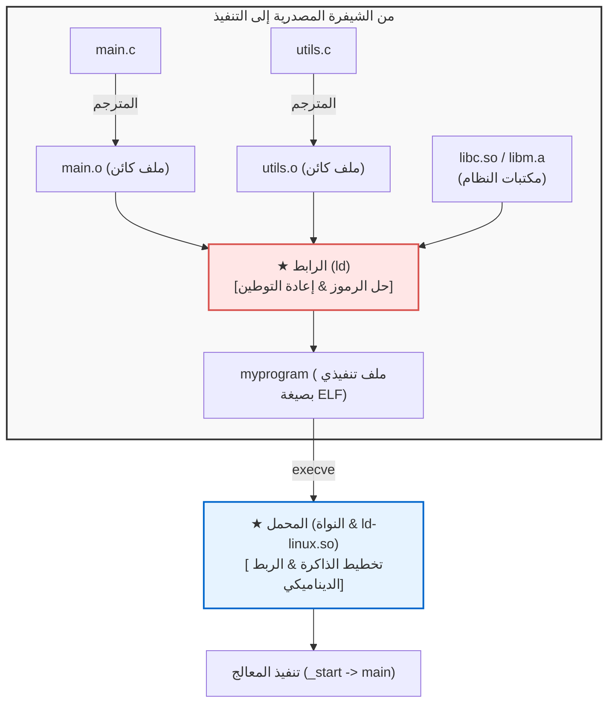

## مقدمة: البناة الخفيون للبرمجيات الحديثة

في حياتنا اليومية كمطورين، نكتب بانتظام أوامر مثل:

```bash
gcc -O2 main.c utils.c math.c -o myprogram
```

غالباً ما نطلق على هذا المسار مسمى "الترجمة البرمجية" (Compilation)، لكن المترجم ينجز نصف الرحلة فقط.
أما النصف الثاني—<strong>حياكة العشرات من ملفات الكائنات والمكتبات البرمجية المنفصلة، وحل العناوين المتضاربة، وتحميل الملف التنفيذي في الذاكرة لتشغيله عبر المعالج</strong>—فيقع تماماً على عاتق بطلين مجهولين: <strong>الرابط (Linker)</strong> و<strong>المحمل (Loader)</strong>.



لولا الرابط، لاستحال تطبيق مبادئ البرمجة المعيارية، ولكنا مضطرين لكتابة ملايين الأسطر في ملف واحد ضخم.

---

## 1. تشريح ملف الكائن: معيار صيغة ELF

الملفات الناتجة عن التجميع (`.o`) تسمى <strong>ملفات كائنات قابلة لإعادة التوطين</strong> وفق صيغة <strong>ELF (Executable and Linkable Format)</strong>:
- <strong>`.text`:</strong> تعليمات لغة الآلة التنفيذية.
- <strong>`.rodata`:</strong> الثوابت والنصوص النصية للقراءة فقط.
- <strong>`.data`:</strong> المتغيرات العامة والساكنة التي تم إسناد قيم ابتدائية لها.
- <strong>`.bss`:</strong> المتغيرات العامة غير المعرفة. <strong>لا تستهلك أي مساحة على القرص الصلب!</strong> حيث تخصص لها الذاكرة وتصفر عند تشغيل البرنامج.
- <strong>`.symtab`:</strong> جدول الرموز (سجل أسماء الدوال والمتغيرات).
- <strong>`.rela.text`:</strong> سجلات إعادة التوطين التي تحدد العناوين المؤقتة الواجب تصحيحها.

---

## 2. حل الرموز (Symbol Resolution)

يقوم الرابط بربط كل استدعاء خارجي بتعريفه الحقيقي.

<strong>الرموز القوية والضعيفة:</strong>
- <strong>قوي:</strong> تعريفات الدوال والمتغيرات العامة ذات القيم الابتدائية (`int x = 1;`).
- <strong>ضعيف:</strong> المتغيرات العامة غير المهيأة (`int x;`).

*قواعد الفصل:*
1. تكرار الرموز القوية يولد خطأ فورياً (`multiple definition`).
2. الرمز القوي يتفوق دائماً على الرمز الضعيف.
3. عند تزاحم رموز ضعيفة، يختار الرابط واحداً عشوائياً (خطر تلف الذاكرة).

<strong>أهمية ترتيب المكتبات:</strong> يقوم الرابط بمسح المعاملات من اليسار إلى اليمين في مسار واحد، لذا يجب كتابة `-lm` دائماً بعد `main.c`.

---

## 3. إعادة التوطين (Relocation)

يضع المترجم أصفاراً كعناوين وهمية مؤقتة للدوال الخارجية:
```assembly
callq 0x00000000  # إزاحة وهمية
```
يقوم الرابط بدمج المقاطع وتحديد العناوين الافتراضية النهائية وتصحيح الشيفرة بالمعادلة:
$$\text{القيمة} = S + A - P$$
($S$: عنوان الرمز، $A$: الإضافة، $P$: موقع التعليمة).

---

## 4. الربط الديناميكي: شيفرة مستقلة عن الموقع (PIC) وجداول GOT و PLT

لتفادي تكرار المكتبات في الذاكرة، ظهرت <strong>المكتبات المشتركة (`.so`)</strong>.
وهي تعتمد على <strong>الشيفرة المستقلة عن الموقع (PIC)</strong> بالاستناد إلى جدولين:
- <strong>GOT (Global Offset Table):</strong> يخزن العناوين الحقيقية في الذاكرة.
- <strong>PLT (Procedure Linkage Table):</strong> جدول قفز في مقطع الشيفرة.

بفضل <strong>الربط الكسول (Lazy Binding)</strong>، لا يتم حل عنوان الدالة عبر الرابط الديناميكي (`ld-linux.so`) إلا عند استدعائها الفعلي للمرة الأولى.

---

## 5. المحمل: من `_start` إلى `main()`

عند تشغيل البرنامج عبر الأمر `execve`، يقوم محمل النواة بإسقاط أجزاء ELF في الذاكرة الافتراضية (`mmap`)، وتهيئة المكدس، ثم القفز إلى نقطة البداية الحقيقية: <strong>`_start`</strong>.
تقوم بيئة تشغيل لغة C بتنفيذ الدوال البنائية العامة في <strong>`.init_array`</strong> قبل تسليم الدفة أخيراً للدالة `main()`.
---

## 6. أدوات التشخيص وتحليل الثنائيات للمهندسين

يعتمد مهندسو النظم على حزمة من الأدوات المتقدمة لفحص ملفات ELF وتحليل سلوك الرابط والمحمل:
- <strong>`readelf`:</strong> لقراءة ترويسات ELF وتفاصيل المقاطع والجداول:
  ```bash
  readelf -h myprogram    # فحص ترويسة الملف
  readelf -l myprogram    # فحص ترويسات البرامج (Segments)
  ```
- <strong>`nm`:</strong> لاستعراض جدول الرموز البرمجية، وتتبع الدوال غير المعرفة التي تسبب أخطاء الربط:
  ```bash
  nm -u myprogram        # إظهار الرموز غير المعرفة فقط
  ```
- <strong>`objdump`:</strong> لتفكيك الشيفرة التنفيذية وقراءة سجلات إعادة التوطين بدقة:
  ```bash
  objdump -d main.o      # تفكيك الشيفرة الآلية
  objdump -r main.o      # عرض إدخالات إعادة التوطين
  ```
- <strong>`ldd`:</strong> لاستعراض كافة المكتبات المشتركة الديناميكية التي يعتمد عليها البرنامج التنفيذي وتحديد المفقود منها فوراً.
