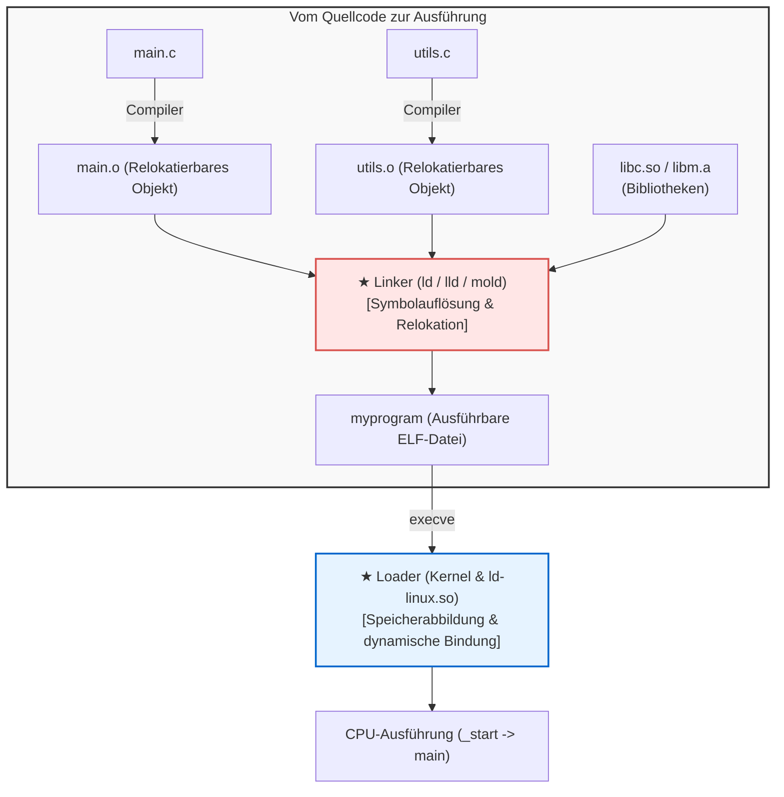

## Einleitung: Die unsichtbaren Baumeister der Software

Entwickler nutzen täglich Befehle wie:

```bash
gcc -O2 main.c utils.c math.c -o myprogram
```

Dieser Vorgang wird umgangssprachlich oft als „Kompilieren“ bezeichnet. Doch der Compiler erledigt nur die halbe Arbeit.
Die zweite Hälfte—<strong>das fehlerfreie Zusammenfügen hunderter einzelner Objektdateien und Bibliotheken, das Zuweisen virtueller Adressen und das Laden in den Speicher</strong>—übernehmen zwei unverzichtbare Werkzeuge: der <strong>Linker</strong> und der <strong>Loader</strong>.



Ohne Linker gäbe es keine modulare Softwareentwicklung. Wir müssten Millionen Zeilen Code in einer einzigen gigantischen Datei verfassen und bei jeder Änderung stundenlang neu kompilieren.

---

## 1. Das ELF-Format: Anatomie einer Objektdatei

Eine Zwischendatei (`.o`) ist eine <strong>relokatierbare Objektdatei</strong> im <strong>ELF-Format (Executable and Linkable Format)</strong>. Sie besteht überwiegend aus Metadaten für den Linker:
- <strong>`.text`:</strong> Die kompilierten Maschinencode-Befehle (ausführbar, read-only).
- <strong>`.rodata`:</strong> Schreibgeschützte Konstanten und Zeichenketten.
- <strong>`.data`:</strong> Initialisierte globale und statische Variablen.
- <strong>`.bss`:</strong> Uninitialisierte globale Variablen. <strong>Verbraucht 0 Byte auf der Festplatte!</strong> Der Speicher wird erst zur Laufzeit reserviert und mit Nullen gefüllt.
- <strong>`.symtab`:</strong> Die Symboltabelle (Verzeichnis aller Funktionen und Variablen).
- <strong>`.rela.text`:</strong> Die Relokationstabelle (Anweisungen, welche Platzhalter-Adressen der Linker korrigieren muss).

---

## 2. Symbolauflösung (Symbol Resolution)

Der Linker gleicht unvollständige Funktionsaufrufe mit Definitionen aus anderen Modulen ab.

<strong>Starke vs. Schwache Symbole:</strong>
- <strong>Stark:</strong> Funktionsdefinitionen und initialisierte globale Variablen (`int x = 1;`).
- <strong>Schwach:</strong> Uninitialisierte globale Variablen (`int x;`).

*Regeln:*
1. Mehrere gleichnamige starke Symbole führen zu einem Linker-Fehler (`multiple definition`).
2. Stark überschreibt schwach.
3. Bei mehreren schwachen Symbolen wählt der Linker willkürlich eines aus (Gefahr unbemerkter Speicherüberschreibungen).

<strong>Reihenfolge statischer Bibliotheken:</strong> Der Linker scannt Argumente strikt von links nach rechts. Daher muss `-lm` hinter `main.c` stehen, da sonst zur Zeit der Überprüfung von `libm.a` noch keine unaufgelösten Symbole bekannt sind.

---

## 3. Relokation (Relocation)

Der Compiler setzt für externe Adressen zunächst Nullen ein:
```assembly
callq 0x00000000  # Dummy-Offset
```
Nachdem der Linker alle Sektionen zusammengefügt hat, berechnet er die echten Offsets nach der Formel:
$$\text{Wert} = S + A - P$$
($S$: Symboladresse, $A$: Addend, $P$: Position der Anweisung).

---

## 4. Dynamisches Linken: Position-Independent Code (PIC), GOT & PLT

Um Speicherverschwendung durch statisches Linken zu vermeiden, nutzen moderne Systeme <strong>Shared Libraries (`.so`)</strong>.
Diese erfordern <strong>Positionsunabhängigen Code (PIC)</strong>, realisiert über zwei Tabellen:
- <strong>GOT (Global Offset Table):</strong> Speichert absolute Laufzeitadressen im Datenbereich.
- <strong>PLT (Procedure Linkage Table):</strong> Sprungtabelle im Codebereich.

Dank <strong>Lazy Binding</strong> werden Funktionsadressen erst beim ersten tatsächlichen Aufruf durch den dynamischen Linker (`ld-linux.so`) aufgelöst und in die GOT eingetragen. Folgeaufrufe springen direkt ohne Overhead.

---

## 5. Der Loader: Von `_start` zu `main()`

Beim Aufruf von `./myprogram` mappt der Kernel-Loader die ELF-Segmente per `mmap` in den virtuellen Speicher, bereitet den Stack (`argc`, `argv`, `envp`) vor und springt zum wahren Einstiegspunkt: <strong>`_start`</strong>.
Dort führt die C-Runtime (`__libc_start_main`) zunächst alle globalen Konstruktoren in <strong>`.init_array`</strong> aus, bevor `main()` aufgerufen wird.

