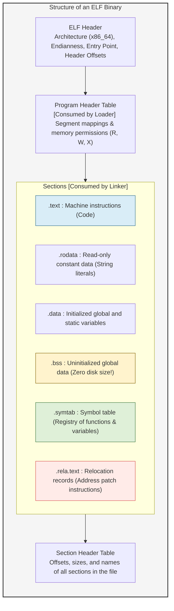
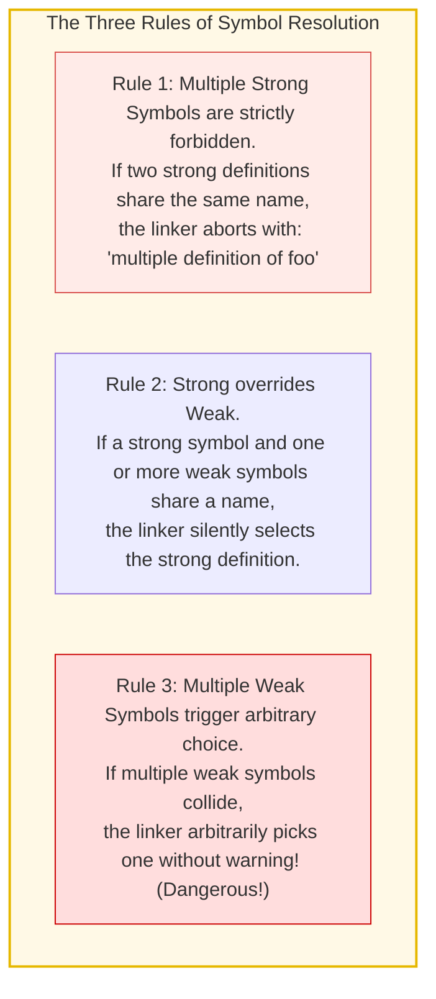
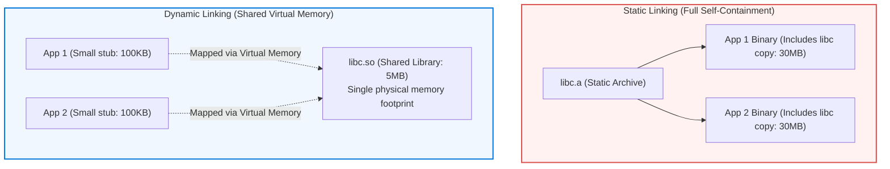
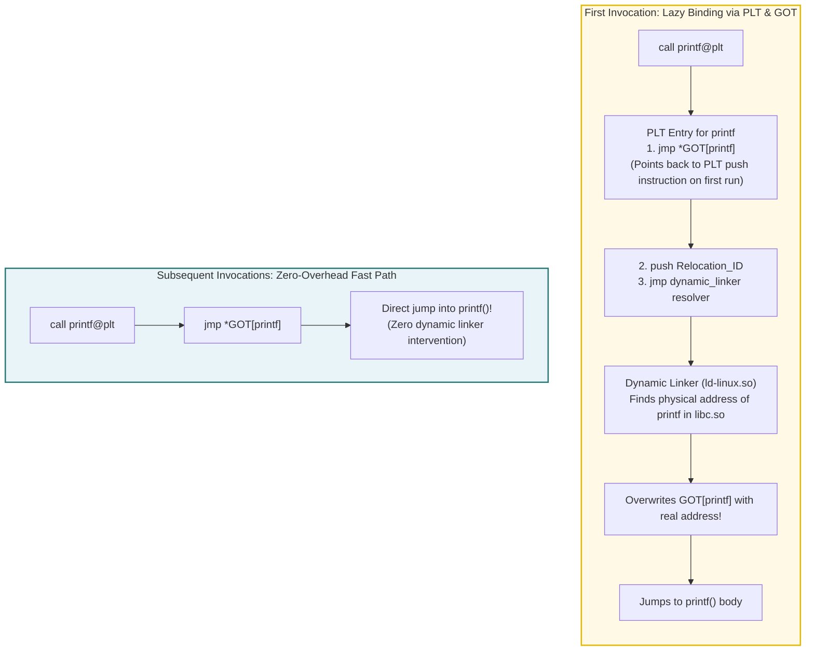
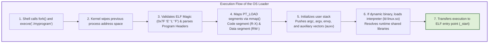
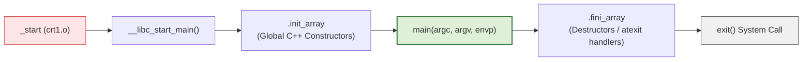

## Introduction: The Invisible Titans of Software Construction

In modern software development, programmers execute commands like this hundreds of times a week:

```bash
gcc -O2 main.c utils.c math.c -o myprogram
```

Or they click "Build & Run" inside an integrated development environment. Within seconds, a functional binary executable emerges, ready to run.

Colloquially, developers refer to this entire pipeline as "compilation."
Yet translating human-readable source code into machine instructions accounts for merely half the journey. The second half—<strong>taking dozens of isolated object files, resolving their tangled dependencies, unifying them into an executable, and loading that executable into physical memory to awaken the processor</strong>—is orchestrated by two foundational systems utilities: the <strong>Linker</strong> and the <strong>Loader</strong>.

```mermaid
flowchart TD
    subgraph BuildPipeline ["The Journey from Source Code to Execution"]
        SourceA["main.c"] -->|Compiler (gcc -S)| AsmA["main.s (Assembly)"]
        SourceB["utils.c"] -->|Compiler (gcc -S)| AsmB["utils.s (Assembly)"]

        AsmA -->|Assembler (as)| ObjA["main.o (Relocatable Object)"]
        AsmB -->|Assembler (as)| ObjB["utils.o (Relocatable Object)"]
        Lib["libc.so / libm.a\n(Standard Libraries)"]

        ObjA --> Linker["★ Linker (ld / lld / mold)\n[Symbol Resolution & Address Relocation]"]
        ObjB --> Linker
        Lib --> Linker

        Linker --> Exec["myprogram (Executable ELF Binary)"]
    end

    Exec -->|./myprogram (execve)| Loader["★ Loader (OS Kernel & ld-linux.so)\n[Virtual Memory Mapping & Dynamic Linking]"]
    Loader --> CPU["CPU Execution (_start -> main)"]

    style BuildPipeline fill:#f9f9f9,stroke:#333,stroke-width:2px
    style Linker fill:#ffe6e6,stroke:#d9534f,stroke-width:2px
    style Loader fill:#e6f3ff,stroke:#0066cc,stroke-width:2px
```

Without the linker, modular programming would be impossible. We would be doomed to write entire systems within monolithic, multi-million-line files, enduring hours of total recompilation whenever fixing a single typo.
Separate compilation—the bedrock of modern software engineering—is made possible entirely through the mathematical and structural mechanics of linking and loading.

This definitive treatise explores the inner workings of binary generation. We dissect the anatomy of the ubiquitous <strong>Executable and Linkable Format (ELF)</strong>; demystify the strict mechanics of <strong>Symbol Resolution</strong>; calculate address patching in <strong>Relocation</strong>; unveil the elegant machinery of Position-Independent Code (PIC), the Global Offset Table (GOT), and Procedure Linkage Table (PLT) in <strong>Dynamic Linking</strong>; and trace the operating system's journey from `execve()` to the hidden runtime preamble that invokes `main()`.

---

## 1. Anatomy of an Object File: The ELF Standard

Compilers and assemblers produce intermediate files (`.o` on Unix, `.obj` on Windows) known as <strong>Relocatable Object Files</strong>.
On Linux, Android, and modern Unix systems, these files conform to the <strong>ELF (Executable and Linkable Format)</strong> specification (counterparts include PE/COFF on Windows and Mach-O on macOS).

A relocatable object file is far more than a block of raw CPU opcodes. In fact, machine code represents only a fraction of the file. The bulk of an ELF file consists of <strong>metadata, symbol tables, and architectural blueprints</strong> designed specifically for the linker.



### 1.1 The Core Sections of an Object File
An ELF file is divided into functional compartments called <strong>Sections</strong>:

1. <strong>`.text` Section:</strong>
   Contains the compiled machine code instructions intended for the CPU. Typically marked with Read/Execute permissions.
2. <strong>`.rodata` Section:</strong>
   Stores read-only data, such as format strings in `printf("Hello World\n")`, jump tables for `switch` statements, and `const` variables.
3. <strong>`.data` Section:</strong>
   Holds initialized global and static variables, such as `int max_users = 1000;`. These values occupy physical byte space in the binary on disk.
4. <strong>`.bss` Section (Block Started by Symbol / Better Save Space):</strong>
   Allocated for uninitialized or zero-initialized global and static variables (e.g., `int buffer[1000000];`).
   Here lies an extraordinary architectural optimization: <strong>`.bss` consumes zero bytes of disk storage in the object file!</strong> The ELF header simply records the total memory size required. Physical DRAM pages are only allocated and zero-filled on demand by the OS kernel when the program executes.
5. <strong>`.symtab` Section (Symbol Table):</strong>
   A structured array indexing every function, global variable, and external reference defined or imported by the module.
6. <strong>`.rela.text` Section (Relocation Information):</strong>
   A list of instruction locations where the compiler left placeholder addresses, accompanied by explicit mathematical formulas telling the linker how to calculate the true address once other modules are merged.

---

## 2. Linker Mission 1: Symbol Resolution

The linker's lifecycle divides cleanly into two operations: <strong>Symbol Resolution</strong> and <strong>Relocation</strong>.
Symbol resolution answers the question: *Which definition of a variable or function corresponds to which usage across all files?*

### 2.1 The Three Classes of Symbols
In the context of the linker, symbols fall into three categories:
- <strong>Global Symbols:</strong> Functions and variables defined in the current module that can be referenced by external modules (non-static functions and globals).
- <strong>External Symbols:</strong> Global functions or variables referenced in the current module but defined in an external compilation unit (e.g., `extern int counter;` or library calls like `sin()`).
- <strong>Local Symbols:</strong> Variables and functions declared with the C `static` keyword. These are strictly private to the compilation unit; the linker treats them in isolation and guarantees they will never collide across files.

### 2.2 Strong vs. Weak Symbols: Rules of Engagement
What happens if two independent C source files declare a global variable with the same name? The compiler classifies symbols into <strong>Strong</strong> and <strong>Weak</strong>:

- <strong>Strong Symbols:</strong> Function definitions and initialized global variables (e.g., `int x = 10;`, `void compute() {}`).
- <strong>Weak Symbols:</strong> Uninitialized global variables (e.g., `int x;`) or symbols annotated with `__attribute__((weak))`.

The linker resolves conflicts using three cardinal rules:



Rule 3 is a notorious source of insidious memory bugs in legacy C code. If `module1.c` defines `double x;` (8 bytes) as weak, and `module2.c` defines `int x;` (4 bytes) as weak, the linker merges them without error. When code in `module2.c` writes to `x`, it may overwrite the adjacent 4 bytes of memory, corrupting unrelated variables.

### 2.3 Static Libraries (`.a`) and Link Order Sensitivity
Every developer eventually encounters a baffling scenario where a library is clearly supplied on the command line, yet the build fails with an "undefined reference" error:

```bash
# FAILS: undefined reference to 'sqrt'
gcc -lm main.c

# SUCCEEDS!
gcc main.c -lm
```

Why does command-line order matter? 
Static libraries (`.a`) are simply Unix archives (`ar`) containing collections of `.o` files. When linking, `ld` scans command-line inputs <strong>from left to right in a single pass</strong>, maintaining three internal sets:
- <strong>Set $E$ (Executable):</strong> Object files that will be incorporated into the final binary.
- <strong>Set $U$ (Undefined):</strong> Symbols that have been referenced but not yet resolved.
- <strong>Set $D$ (Defined):</strong> Symbols that have been encountered and defined.


If `-lm` is placed *before* `main.c`, the undefined set $U$ is empty when the linker inspects `libm.a`. The linker determines that none of the library's members are needed, discards the archive, and moves on. When it subsequently parses `main.c`, it discovers the undefined symbol `sqrt`, but the library is already gone!

---

## 3. Linker Mission 2: Relocation

Once every symbol reference is paired with a concrete definition, the linker begins <strong>Relocation</strong>: calculating the absolute memory layout and patching instruction operands.

### 3.1 The Compiler's Placeholder Operands
When compiling an isolated file, the compiler cannot know where functions in other files will live in virtual memory.
When an instruction calls an external function, the assembler emits a <strong>placeholder value (typically all zeros)</strong>:

```assembly
e8 00 00 00 00       callq  0 <main+0xe>   # Placeholder offset: 0x00000000
```

Simultaneously, it records an entry in the `.rela.text` section:
> *"Attention Linker: At offset 0x0A, apply a 32-bit PC-relative patch pointing to `utils_func`."*

### 3.2 Relocation Records and Mathematical Equations
In 64-bit ELF, relocation entries are structured as:

```c
typedef struct {
    Elf64_Addr   r_offset; // Section offset where the patch must be written
    Elf64_Xword  r_info;   // Symbol table index and relocation type
    Elf64_Sxword r_addend; // Addend (constant bias used in the calculation)
} Elf64_Rela;
```

The two most common x86-64 relocation types are:

1. <strong>PC-Relative Relocation (`R_X86_64_PC32`):</strong>
   Used for `call` and `jmp` instructions. The value written is the signed 32-bit displacement between the target symbol and the Program Counter (RIP):
   $$\text{Value} = S + A - P$$
   - $S$: Final virtual address of the target symbol.
   - $A$: Addend encoded in the relocation record (typically $-4$).
   - $P$: Virtual address of the byte field being patched.

2. <strong>Absolute Address Relocation (`R_X86_64_32` or `R_X86_64_64`):</strong>
   Used for pointer variables and global address references:
   $$\text{Value} = S + A$$

The linker aggregates identical sections across all input files (combining all `.text` into a master `.text`, all `.data` into a master `.data`), assigns contiguous virtual address blocks, and iterates through every relocation entry, rewriting placeholders with mathematical precision.

---

## 4. Static Linking vs. Dynamic Linking: The Magic of Shared Libraries

Software can be linked in two fundamental ways: <strong>Static Linking</strong> and <strong>Dynamic Linking</strong>.



### 4.1 The Flaws of Static Linking
Static linking embeds complete copies of library functions inside every binary. While robust and portable, it exhibits severe flaws at scale:
- <strong>Massive Storage and Memory Waste:</strong> If 500 running programs each statically link `libc`, 500 identical copies of `printf` occupy precious disk space and physical RAM.
- <strong>Maintenance Nightmare:</strong> When a critical security vulnerability is patched in `OpenSSL` or `glibc`, every statically linked binary on the system must be manually recompiled and redeployed.

### 4.2 Dynamic Linking and Position-Independent Code (PIC)
In dynamic linking, the executable contains only a stub referencing shared libraries (`.so` on Linux, `.dll` on Windows).
When the program launches, the OS dynamic linker (`ld-linux.so`) maps the shared library into physical memory once. Multiple processes share the same read-only `.text` segment in physical RAM.

To enable this, shared libraries must be compiled as <strong>Position-Independent Code (PIC, `-fPIC`)</strong>: the code must execute correctly regardless of what arbitrary virtual address the OS kernel assigns to it.

PIC achieves this using the <strong>Global Offset Table (GOT)</strong> and the <strong>Procedure Linkage Table (PLT)</strong>.



### 4.3 The Mechanics of Lazy Binding
A massive shared library like `libc` contains thousands of functions, but a typical application calls only a tiny fraction of them. Resolving all dynamic symbols at startup would severely degrade launch performance.

Through <strong>Lazy Binding</strong>, symbol resolution occurs on-demand:
1. <strong>Initial Call:</strong> When `main()` executes `call printf@plt`, execution jumps to the PLT stub. The PLT reads the address stored in `GOT[printf]`. On the first run, the GOT contains a pointer pointing back to the next line in the PLT!
2. <strong>Linker Resolution:</strong> The PLT pushes the symbol ID onto the stack and jumps to the dynamic linker (`ld-linux.so`). The dynamic linker looks up the real virtual address of `printf` inside `libc.so`.
3. <strong>GOT Patching:</strong> The dynamic linker writes the resolved address directly into `GOT[printf]`.
4. <strong>Subsequent Calls:</strong> When `printf@plt` is called again, `jmp *GOT[printf]` jumps directly into the real function body without executing the dynamic linker resolver. Overhead drops to a single indirect jump.

---

## 5. The Loader's Mission: Mapping the Binary into Memory

When a user types `./myprogram` in a shell, the shell executes the `execve()` system call. Control passes to the operating system kernel's binary loader.



### 5.1 Program Headers (Segments) vs. Sections
While the linker organizes files by <strong>Sections</strong>, the OS loader processes <strong>Segments</strong> defined in the <strong>Program Header Table</strong>:
- <strong>`PT_LOAD` (Code Segment):</strong> Contains `.text` and `.rodata`, mapped with Read/Execute permissions (`R-X`).
- <strong>`PT_LOAD` (Data Segment):</strong> Contains `.data` and `.bss`, mapped with Read/Write permissions (`RW-`), enforced by hardware NX (No-Execute) bits to prevent buffer overflow exploits.

The kernel does not load the entire binary from disk into RAM at once. It maps the segments into the process's virtual memory using demand paging (`mmap`). Physical memory pages are only loaded when the CPU touches a memory address, triggering a page fault.

### 5.2 From `_start` to `main()`: The Hidden Preamble
The true entry point of a C or C++ binary is not `main()`. It is an assembly routine named <strong>`_start`</strong>, supplied by the C runtime library (`crt1.o`).



Before `main()` receives control, the runtime executes critical setup:
1. Pops `argc`, `argv`, and `envp` from the stack into architectural registers.
2. Initializes Thread-Local Storage (TLS).
3. Sets up stack canary values (`-fstack-protector`) to guard against buffer overflows.
4. Executes the <strong>`.init_array`</strong> section: running constructors for global C++ objects and functions decorated with `__attribute__((constructor))`.
5. Finally, invokes `main(argc, argv, envp)`.
6. When `main()` returns, the runtime processes the return code, invokes destructors in <strong>`.fini_array`</strong>, and issues the `exit` system call to terminate the process cleanly.

---

## 6. Diagnostic Toolkit for Systems Engineers

When low-level build failures occur, master engineers use command-line binary analysis tools to inspect ELF internals:

| Tool | Purpose & Syntax | Real-World Use Case |
|---|---|---|
| <strong>`readelf`</strong> | Detailed ELF header and section inspection<br>`readelf -h a.out` (File header)<br>`readelf -l a.out` (Program segments) | Verifying target architecture, inspecting memory permissions |
| <strong>`nm`</strong> | Symbol table inspector<br>`nm -C binary` (Demangles C++ symbols)<br>`nm -u binary` (Lists undefined symbols) | Debugging `undefined reference` errors; discovering missing libraries |
| <strong>`objdump`</strong> | Machine code disassembler and relocation dumper<br>`objdump -d a.o` (Disassembles `.text`)<br>`objdump -r a.o` (Displays relocation records) | Verifying how compilers emit placeholder offsets |
| <strong>`ldd`</strong> | Displays dynamic shared library dependencies<br>`ldd /bin/bash` | Locating missing `.so` dependencies on target deployment servers |
| <strong>`strace`</strong> | Traces system calls issued by the loader<br>`strace -e openat,mmap ./myprogram` | Debugging dynamic loader path resolution failures |

---

## 7. Conclusion: The Unsung Art of Systems Engineering

Every application running today—from distributed cloud microservices to game engines—stands upon the shoulders of the Linker and the Loader.

The ability to split massive codebases across hundreds of source files, link against shared libraries, and load executables into virtual memory with deterministic precision is one of computing's greatest triumphs.
The next time you compile a program and run it in your terminal, take a moment to appreciate the silent choreography: hundreds of symbols matched, thousands of addresses recalculated, and a virtual universe mapped out—all in the span of a heartbeat.

