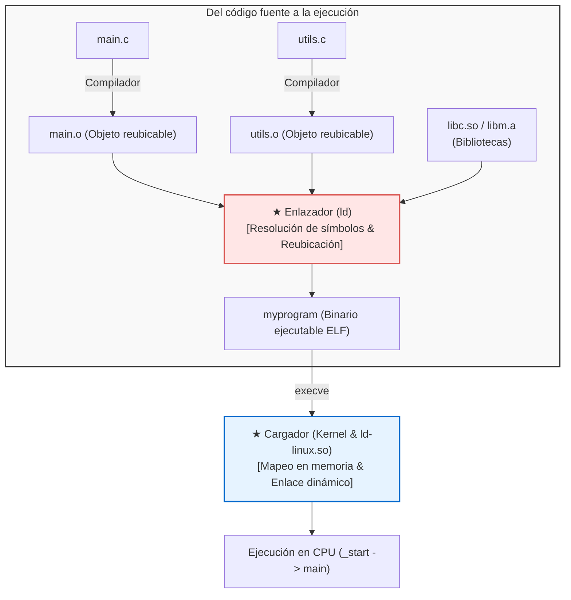

## Introducción: Los arquitectos invisibles del software

En el desarrollo cotidiano ejecutamos a menudo:

```bash
gcc -O2 main.c utils.c math.c -o myprogram
```

Este proceso suele denominarse de forma genérica «compilación». Sin embargo, el compilador solo realiza la mitad de la tarea.
La otra mitad—<strong>unir decenas de archivos objeto y bibliotecas independientes, resolver sus referencias cruzadas y cargarlos en memoria para que la CPU los ejecute</strong>—recae enteramente en el <strong>Enlazador (Linker)</strong> y el <strong>Cargador (Loader)</strong>.



Sin enlazadores, la programación modular sería inviable: tendríamos que escribir millones de líneas en un único archivo monstruoso.

---

## 1. El formato ELF: Anatomía de un archivo objeto

Los archivos intermedios (`.o`) son <strong>archivos objeto reubicables</strong> bajo el formato estándar <strong>ELF (Executable and Linkable Format)</strong>:
- <strong>`.text`:</strong> Código máquina ejecutable.
- <strong>`.rodata`:</strong> Constantes de solo lectura y cadenas de texto.
- <strong>`.data`:</strong> Variables globales y estáticas inicializadas.
- <strong>`.bss`:</strong> Variables globales no inicializadas. <strong>¡No ocupa espacio físico en disco!</strong> Solo se reserva y llena con ceros al cargar el programa.
- <strong>`.symtab`:</strong> Tabla de símbolos (registro de funciones y variables).
- <strong>`.rela.text`:</strong> Tabla de reubicación con las direcciones temporales que deben corregirse.

---

## 2. Resolución de símbolos (Symbol Resolution)

El enlazador asocia cada llamada externa con su definición concreta.

<strong>Símbolos Fuertes y Débiles:</strong>
- <strong>Fuerte:</strong> Definiciones de funciones y variables globales inicializadas (`int x = 1;`).
- <strong>Débil:</strong> Variables globales no inicializadas (`int x;`).

*Reglas:*
1. Múltiples símbolos fuertes con el mismo nombre generan error (`multiple definition`).
2. Un símbolo fuerte siempre prevalece sobre uno débil.
3. Entre múltiples símbolos débiles, el enlazador elige uno al azar (riesgo de corrupción de memoria).

<strong>Sensibilidad al orden de bibliotecas estáticas:</strong> El enlazador procesa los argumentos de izquierda a derecha en una sola pasada. Por ello, `-lm` debe situarse siempre después de `main.c`.

---

## 3. Reubicación de direcciones (Relocation)

El compilador escribe ceros como marcador provisional en las llamadas externas:
```assembly
callq 0x00000000  # Desplazamiento ficticio
```
El enlazador fusiona las secciones, asigna direcciones virtuales definitivas y corrige el código aplicando la fórmula:
$$\text{Valor} = S + A - P$$
($S$: dirección del símbolo, $A$: addend, $P$: posición de la instrucción).

---

## 4. Enlace dinámico: Código independiente de posición (PIC), GOT y PLT

Para no duplicar bibliotecas en disco y memoria RAM, nacieron las <strong>bibliotecas compartidas (`.so`)</strong>.
Requieren <strong>Código Independiente de Posición (PIC)</strong>, soportado por dos tablas:
- <strong>GOT (Global Offset Table):</strong> Contiene las direcciones reales en memoria.
- <strong>PLT (Procedure Linkage Table):</strong> Tabla de salto en la sección de código.

Gracias al <strong>Enlace Perezoso (Lazy Binding)</strong>, el enlazador dinámico (`ld-linux.so`) solo calcula la dirección de una función la primera vez que se invoca realmente.

---

## 5. El cargador: De `_start` a `main()`

Al invocar `./myprogram`, la llamada `execve` mapea los segmentos ELF en la memoria virtual (`mmap`), inicializa la pila (`argc`, `argv`, `envp`) y salta al punto de entrada: <strong>`_start`</strong>.
La biblioteca de C ejecuta los constructores globales de <strong>`.init_array`</strong> antes de ceder el control a `main()`.

