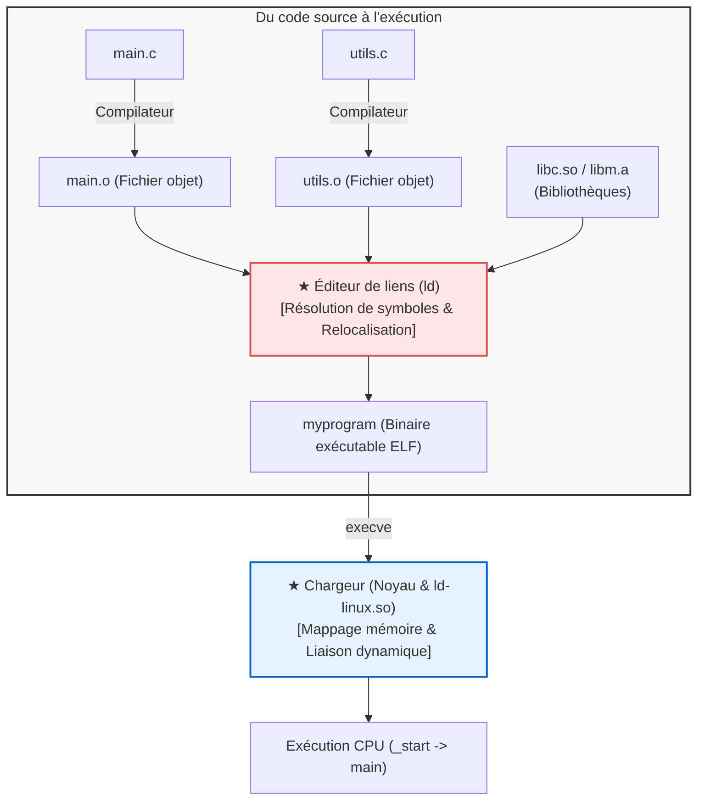

## Introduction : Les maîtres invisibles de l'exécution logicielle

Chaque jour, les développeurs lancent des commandes telles que :

```bash
gcc -O2 main.c utils.c math.c -o myprogram
```

On qualifie souvent ce processus de simple « compilation ». Pourtant, le compilateur ne réalise que la moitié du travail.
La seconde moitié—<strong>assembler harmonieusement des dizaines de fichiers objets et de bibliothèques, calculer les adresses virtuelles et charger l'exécutable en mémoire</strong>—est assurée par deux piliers du système : <strong>l'éditeur de liens (Linker)</strong> et <strong>le chargeur (Loader)</strong>.



Sans éditeur de liens, la programmation modulaire serait impossible : nous devrions écrire des millions de lignes de code dans un fichier unique.

---

## 1. Le format ELF : Anatomie d'un fichier objet

Un fichier intermédiaire (`.o`) est un <strong>fichier objet relocalisable</strong> au format <strong>ELF (Executable and Linkable Format)</strong> :
- <strong>`.text` :</strong> Code machine exécutable.
- <strong>`.rodata` :</strong> Données constantes en lecture seule.
- <strong>`.data` :</strong> Variables globales et statiques initialisées.
- <strong>`.bss` :</strong> Variables globales non initialisées. <strong>Ne consomme aucun octet sur le disque !</strong> La mémoire est allouée et mise à zéro à l'exécution.
- <strong>`.symtab` :</strong> Table des symboles (fonctions et variables).
- <strong>`.rela.text` :</strong> Table de relocalisation indiquant les adresses temporaires à corriger.

---

## 2. Résolution des symboles (Symbol Resolution)

L'éditeur de liens associe chaque référence externe à sa définition réelle.

<strong>Symboles forts et faibles :</strong>
- <strong>Fort :</strong> Définitions de fonctions et variables globales initialisées (`int x = 1;`).
- <strong>Faible :</strong> Variables globales non initialisées (`int x;`).

*Règles d'arbitrage :*
1. Deux symboles forts identiques provoquent une erreur (`multiple definition`).
2. Un symbole fort l'emporte toujours sur un symbole faible.
3. Entre plusieurs symboles faibles, le linker en choisit un arbitrairement (source de bogues sournois).

<strong>Ordre des bibliothèques statiques :</strong> L'éditeur de liens analyse la ligne de commande de gauche à droite en une seule passe. C'est pourquoi `-lm` doit obligatoirement figurer après `main.c`.

---

## 3. Relocalisation (Relocation)

Le compilateur place des zéros provisoires pour les fonctions externes :
```assembly
callq 0x00000000  # Déplacement temporaire
```
Le linker fusionne les sections, attribue les adresses virtuelles et patche les instructions selon la formule :
$$\text{Valeur} = S + A - P$$
($S$ : adresse du symbole, $A$ : addend, $P$ : position de l'instruction).

---

## 4. Liaison dynamique : PIC, GOT et PLT

Pour éviter de dupliquer les bibliothèques sur disque et en mémoire, les systèmes modernes utilisent des <strong>bibliothèques partagées (`.so`)</strong>.
Elles nécessitent du <strong>Code Indépendant de la Position (PIC)</strong> grâce à deux tables :
- <strong>GOT (Global Offset Table) :</strong> Stocke les adresses réelles en mémoire.
- <strong>PLT (Procedure Linkage Table) :</strong> Table de saut dans la section code.

Grâce à la <strong>liaison paresseuse (Lazy Binding)</strong>, l'adresse d'une fonction n'est résolue par le lieur dynamique (`ld-linux.so`) que lors de son tout premier appel.

---

## 5. Le chargeur : De `_start` à `main()`

Lors de l'exécution, l'appel système `execve` mappe les segments ELF en mémoire virtuelle (`mmap`), configure la pile (`argc`, `argv`, `envp`) et saute vers <strong>`_start`</strong>.
La fonction d'initialisation de la libc exécute les constructeurs globaux dans <strong>`.init_array`</strong> avant d'appeler enfin la fonction `main()`.

