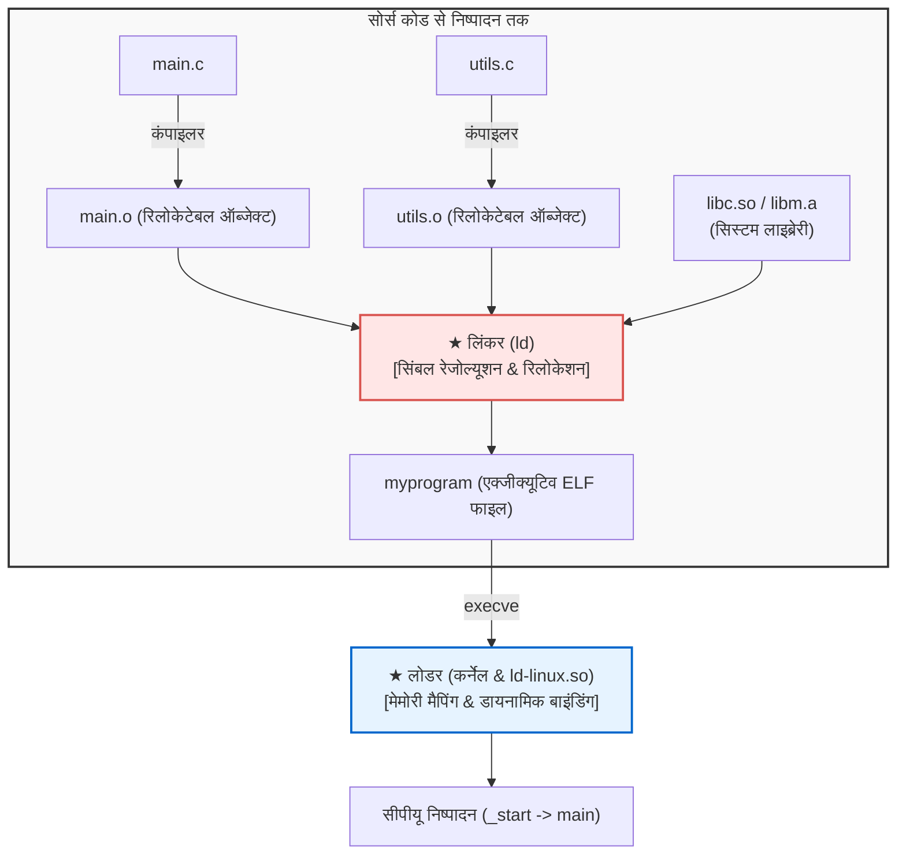

## प्रस्तावना: सॉफ्टवेयर निर्माण के अदृश्य शिल्पी

दैनिक सॉफ्टवेयर विकास में हम अक्सर यह कमांड चलाते हैं:

```bash
gcc -O2 main.c utils.c math.c -o myprogram
```

इस पूरी प्रक्रिया को बोलचाल में केवल "कंपाइलेशन" कह दिया जाता है। परंतु कंपाइलर का काम केवल आधा सफर तय करना है।
शेष आधा सफर—<strong>दर्जनों अलग-अलग ऑब्जेक्ट फाइलों और लाइब्रेरी को आपस में जोड़ना, मेमोरी पते निर्धारित करना और प्रोग्राम को रैम में लोड करना</strong>—<strong>लिंकर (Linker)</strong> और <strong>लोडर (Loader)</strong> द्वारा पूरा किया जाता है।



यदि लिंकर न होता तो हमें लाखों पंक्तियों का कोड एक ही भारी-भरकम फाइल में लिखना पड़ता।

---

## 1. ऑब्जेक्ट फाइल का विच्छेदन: ELF फॉर्मेट

कंपाइलर द्वारा निर्मित `.o` फाइल <strong>ELF (Executable and Linkable Format)</strong> प्रारूप में होती है:
- <strong>`.text`:</strong> सीपीयू मशीन कोड निर्देश।
- <strong>`.rodata`:</strong> केवल पढ़ने योग्य स्ट्रिंग और स्थिरांक।
- <strong>`.data`:</strong> प्रारंभिक मान वाले ग्लोबल और स्टैटिक वेरिएबल्स।
- <strong>`.bss`:</strong> बिना प्रारंभिक मान वाले ग्लोबल वेरिएबल्स। <strong>डिस्क पर यह शून्य बाइट घेरता है!</strong>
- <strong>`.symtab`:</strong> सिंबल टेबल (फंक्शन व वेरिएबल नामों की सूची)।
- <strong>`.rela.text`:</strong> रिलोकेशन तालिका जिसमें सुधारे जाने वाले पते दर्ज होते हैं।

---

## 2. सिंबल रेजोल्यूशन (Symbol Resolution)

लिंकर प्रत्येक बाहरी संदर्भ को उसकी वास्तविक परिभाषा से जोड़ता है।

<strong>मजबूत (Strong) बनाम कमजोर (Weak) सिंबल:</strong>
- <strong>मजबूत:</strong> फंक्शन और मान वाले ग्लोबल वेरिएबल (`int x = 1;`)।
- <strong>कमजोर:</strong> बिना मान वाले ग्लोबल वेरिएबल (`int x;`)।

*नियम:*
1. एक ही नाम के दो मजबूत सिंबल होने पर लिंकर एरर देता है (`multiple definition`)।
2. मजबूत सिंबल हमेशा कमजोर पर भारी पड़ता है।
3. दो कमजोर सिंबलों में लिंकर किसी एक को मनमाने ढंग से चुन लेता है।

<strong>लाइब्रेरी क्रम:</strong> लिंकर तर्कों को बाएं से दाएं एक ही बार पढ़ता है, इसलिए `-lm` को हमेशा `main.c` के बाद लिखना चाहिए।

---

## 3. रिलोकेशन (Relocation)

कंपाइलर बाहरी फंक्शन कॉल के स्थान पर शून्य लिख देता है:
```assembly
callq 0x00000000  # अस्थायी पता
```
लिंकर सभी सेक्शन्स को मिलाकर वास्तविक पता निर्धारित करता है और सूत्र द्वारा कोड को सुधारता है:
$$\text{मान} = S + A - P$$
($S$: सिंबल पता, $A$: एडेंड, $P$: निर्देश पता)।

---

## 4. डायनामिक लिंकिंग: PIC, GOT और PLT

मेमोरी की बर्बादी रोकने के लिए <strong>शेयर्ड लाइब्रेरी (`.so`)</strong> का उपयोग किया जाता है।
इसके लिए <strong>पोजिशन-इंडिपेंडेंट कोड (PIC)</strong> की आवश्यकता होती है, जो दो तालिकाओं द्वारा काम करता है:
- <strong>GOT (Global Offset Table):</strong> डेटा मेमोरी में वास्तविक पते रखता है।
- <strong>PLT (Procedure Linkage Table):</strong> कोड में जंप टेबल बनाता है।

<strong>लेजी बाइंडिंग (Lazy Binding)</strong> के कारण किसी फंक्शन का पता डायनामिक लिंकर (`ld-linux.so`) द्वारा तभी खोजा जाता है जब उसे पहली बार बुलाया जाए।

---

## 5. लोडर: `_start` से `main()` तक

जब `./myprogram` चलाया जाता है, तो कर्नेल का `execve` सिस्टम कॉल मेमोरी में पेज मैप करता है और <strong>`_start`</strong> पर जंप करता है।
सी-रनटाइम <strong>`.init_array`</strong> के सभी ग्लोबल कंस्ट्रक्टर्स को चलाकर अंततः हमारे `main()` फंक्शन को आमंत्रित करता है।
---

## 6. सिस्टम इंजीनियर्स के लिए बाइनरी विश्लेषण और डायग्नोस्टिक टूल्स

जब सिस्टम स्तर पर लिंकिंग या लोडिंग की समस्याएं आती हैं, तो पेशेवर इंजीनियर इन कमांड-लाइन टूल्स का उपयोग करते हैं:
- <strong>`readelf`:</strong> ELF हेडर, सेक्शन्स और प्रोग्राम हेडर्स की विस्तृत जानकारी प्राप्त करने के लिए:
  ```bash
  readelf -h myprogram    # फ़ाइल हेडर की जांच
  readelf -l myprogram    # प्रोग्राम हेडर (मेमोरी सेगमेंट्स)
  ```
- <strong>`nm`:</strong> सिंबल टेबल का विश्लेषण करने और अनसुलझे (undefined) सिंबलों की खोज के लिए:
  ```bash
  nm -u myprogram        # केवल अनिर्धारित सिंबल देखना
  ```
- <strong>`objdump`:</strong> मशीन कोड को डिसअसेंबल करने और रिलोकेशन रिकॉर्ड्स की जांच के लिए:
  ```bash
  objdump -d main.o      # डिसअसेंबली देखना
  objdump -r main.o      # रिलोकेशन रिकॉर्ड्स देखना
  ```
- <strong>`ldd`:</strong> यह जांचने के लिए कि निष्पादन योग्य बाइनरी किन डायनामिक शेयर्ड लाइब्रेरीज़ पर निर्भर है:
  ```bash
  ldd /bin/bash          # साझा लाइब्रेरी निर्भरता
  ```
