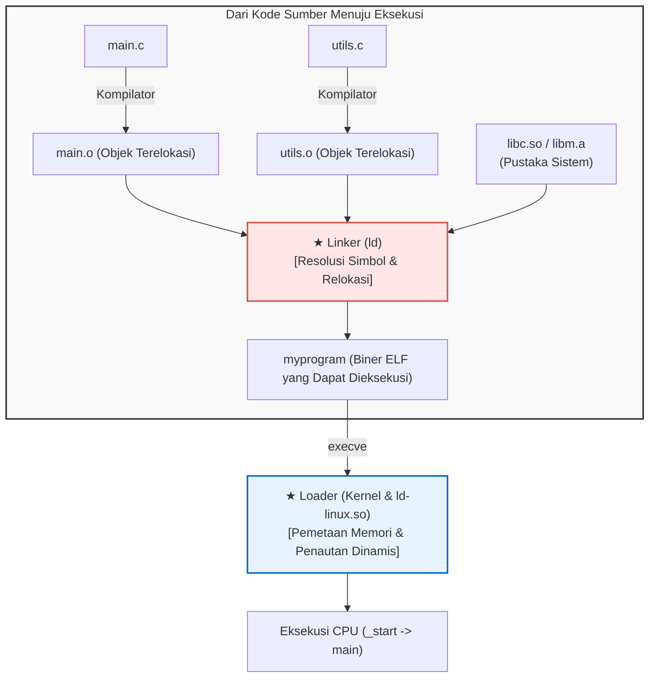

## Pendahuluan: Arsitek Tak Terlihat di Balik Perangkat Lunak

Setiap hari para pengembang mengetikkan perintah seperti:

```bash
gcc -O2 main.c utils.c math.c -o myprogram
```

Proses ini sering kali secara keliru disebut sebagai sekadar "kompilasi". Padahal kompilasi hanya menyelesaikan separuh perjalanan.
Separuh sisanya—<strong>menyatukan puluhan file objek dan pustaka yang terpisah, menetapkan alamat memori virtual, dan memuatnya ke dalam RAM untuk dieksekusi CPU</strong>—dijalankan oleh <strong>Linker</strong> dan <strong>Loader</strong>.



Tanpa linker, pemrograman modular tidak akan pernah ada; kita terpaksa menulis jutaan baris kode dalam satu file raksasa.

---

## 1. Anatomi File Objek ELF

File perantara (`.o`) adalah <strong>file objek terelokasi</strong> berformat <strong>ELF (Executable and Linkable Format)</strong>:
- <strong>`.text`:</strong> Instruksi kode mesin CPU.
- <strong>`.rodata`:</strong> Data konstanta baca-saja dan teks literal.
- <strong>`.data`:</strong> Variabel global dan statis yang telah diinisialisasi.
- <strong>`.bss`:</strong> Variabel global tanpa inisialisasi. <strong>Tidak memakan ruang disk sama sekali!</strong> Memori dialokasikan dan dinolkan saat program dijalankan.
- <strong>`.symtab`:</strong> Tabel simbol (daftar nama fungsi dan variabel).
- <strong>`.rela.text`:</strong> Catatan relokasi berisi alamat sementara yang harus diperbaiki linker.

---

## 2. Resolusi Simbol (Symbol Resolution)

Linker mencocokkan setiap pemanggilan fungsi eksternal dengan definisi konkretnya.

<strong>Simbol Kuat vs Lemah:</strong>
- <strong>Kuat:</strong> Definisi fungsi dan variabel global terinisialisasi (`int x = 1;`).
- <strong>Lemah:</strong> Variabel global yang belum diinisialisasi (`int x;`).

*Aturan Resolusi:*
1. Dua simbol kuat bernama sama akan menghasilkan error (`multiple definition`).
2. Simbol kuat selalu mengalahkan simbol lemah.
3. Di antara sesama simbol lemah, linker memilih secara acak (berpotensi merusak memori).

<strong>Urutan Pustaka Statis:</strong> Linker memindai argumen dari kiri ke kanan dalam satu lintasan. Oleh karena itu, opsi `-lm` wajib diletakkan setelah `main.c`.

---

## 3. Relokasi Alamat (Relocation)

Kompilator mengisi alamat nol sementara untuk fungsi eksternal:
```assembly
callq 0x00000000  # Offset pura-pura
```
Linker menggabungkan semua bagian, menetapkan alamat virtual permanen, dan menambal kode mesin dengan rumus:
$$\text{Nilai} = S + A - P$$
($S$: alamat simbol, $A$: addend, $P$: posisi instruksi).

---

## 4. Penautan Dinamis: PIC, GOT, dan PLT

Pustaka bersama (<strong>Shared Libraries `.so`</strong>) diciptakan agar ribuan program tidak menduplikasi kode pustaka di memori.
Teknologi ini menggunakan <strong>Position-Independent Code (PIC)</strong> dengan dua tabel:
- <strong>GOT (Global Offset Table):</strong> Menyimpan alamat memori nyata.
- <strong>PLT (Procedure Linkage Table):</strong> Tabel lompatan pada bagian kode.

Melalui <strong>Lazy Binding</strong>, linker dinamis (`ld-linux.so`) hanya mencari alamat fungsi pada saat fungsi tersebut pertama kali dipanggil.

---

## 5. Loader: Dari `_start` ke `main()`

Saat menjalankan `./myprogram`, panggilan sistem `execve` memetakan segmen ELF ke memori virtual (`mmap`), menyiapkan tumpukan stack (`argc`, `argv`, `envp`), dan melompat ke titik masuk <strong>`_start`</strong>.
Runtime C mengeksekusi konstruktor global dalam <strong>`.init_array`</strong> sebelum akhirnya memanggil fungsi `main()`.

