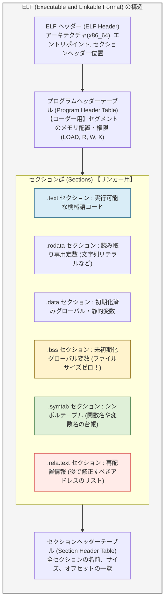
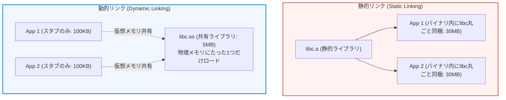
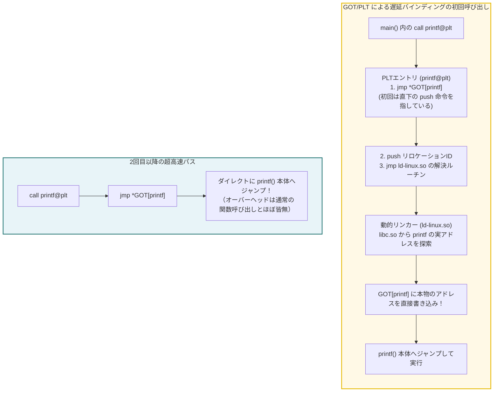
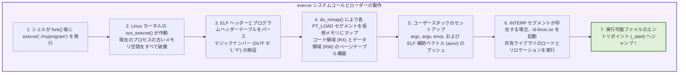
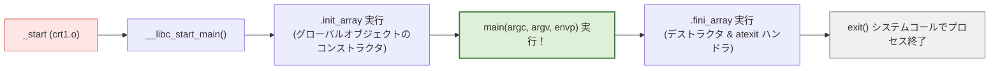

## 序論：プログラマが最も恩恵を受け、最も無視している「陰の黒幕」

ソフトウェア開発において、私たちは日常的に次のようなコマンドをターミナルに打ち込んでいます：

```bash
gcc -O2 main.c utils.c math.c -o myprogram
```

あるいは、IDEの「ビルド（Build）」や「実行（Run）」ボタンを何気なくクリックします。数秒後には実行可能バイナリが生成され、プログラムは何事もなかったかのように動き始めます。

多くのプログラマは、このプロセス全体を漠然と「コンパイル（Compile）」と一括りに呼んでいます。
しかし、ソースコードが機械語に翻訳される過程を仔細に観察すれば、コンパイラ（Compiler）が担っているのは全体の半分に過ぎません。残りの半分――<strong>バラバラに分割された何十、何百ものソースコードやライブラリを縫い合わせ、1つの調和した実行可能ファイルへと昇華させ、さらにそれをメモリ上に展開してCPUに実行させる役割</strong>――を担っている真の立役者こそが、<strong>リンカー（Linker）</strong>と<strong>ローダー（Loader）</strong>です。

```mermaid
flowchart TD
    subgraph BuildPipeline ["ソースコードから実行可能ファイルへの旅路"]
        SourceA["main.c"] -->|コンパイラ (gcc -S)| AsmA["main.s (アセンブリ)"]
        SourceB["utils.c"] -->|コンパイラ (gcc -S)| AsmB["utils.s (アセンブリ)"]

        AsmA -->|アセンブラ (as)| ObjA["main.o (再配置可能オブジェクト)"]
        AsmB -->|アセンブラ (as)| ObjB["utils.o (再配置可能オブジェクト)"]
        Lib["libc.so / libm.a\n(標準ライブラリ)"]

        ObjA --> Linker["★ リンカー (ld / lld / mold)\n【シンボル解決 & アドレス再配置】"]
        ObjB --> Linker
        Lib --> Linker

        Linker --> Exec["myprogram (実行可能 ELF バイナリ)"]
    end

    Exec -->|./myprogram 実行 (execve)| Loader["★ ローダー (OS Kernel & ld-linux.so)\n【仮想メモリ展開 & 動的リンク】"]
    Loader --> CPU["CPUによる実行 (main関数へ)"]

    style BuildPipeline fill:#f9f9f9,stroke:#333,stroke-width:2px
    style Linker fill:#ffe6e6,stroke:#d9534f,stroke-width:2px
    style Loader fill:#e6f3ff,stroke:#0066cc,stroke-width:2px
```

もしリンカーが存在しなければ、私たちはあらゆるプログラムを数百万行の単一の超巨大ファイルに記述しなければならず、1文字修正するたびに数時間かけて全体を再コンパイルすることを余儀なくされていたでしょう。

プログラミング言語が「分割コンパイル（Separate Compilation）」と「モジュール化」という現代的ソフトウェア工学の恩恵を享受できるのは、ひとえにリンカーとローダーが舞台裏で極めて複雑な数学的・構造的パズルを解き続けてくれているおかげなのです。

本稿では、バイナリの内部構造規格である<strong>ELFフォーマット</strong>の解剖から、<strong>シンボル解決（Symbol Resolution）</strong>の厳格なルール、アドレスを決定する<strong>再配置（Relocation）</strong>の数理的計算式、GOTとPLTが織りなす<strong>動的リンク（Dynamic Linking）</strong>の遅延バインディングの神業、そしてOSカーネルのローダーが`main()`関数を呼び出す直前に実行する隠された儀式までを徹底的に解明します。

---

## 1. オブジェクトファイルの中身を暴く：ELF（Executable and Linkable Format）の解剖学

コンパイラやアセンブラが出力する中間ファイル（`.o` や `.obj`）は、<strong>「再配置可能オブジェクトファイル（Relocatable Object File）」</strong>と呼ばれます。
LinuxやBSDをはじめとする現代のUnix系システムでは、このファイルフォーマットとして<strong>ELF（Executable and Linkable Format）</strong>が標準規格として採用されています（WindowsではPE: Portable Executable、macOSではMach-Oが対応）。

初学者はしばしば「オブジェクトファイルの中身は純粋な機械語命令の羅列だろう」と誤解します。しかし実際には、機械語そのものはファイル全体のほんの一部に過ぎません。ELFファイルの大半は、<strong>「リンカーが後からコードを安全に結合・修正できるようにするための設計図とメタデータ」</strong>で埋め尽くされています。



### 1.1 主要セクションの役割
ELF内部は、用途ごとに<strong>セクション（Section）</strong>と呼ばれる独立した区画に細かく分割されています：

1. <strong>`.text` セクション：</strong>
   コンパイルされたCPUの機械語命令（Machine Code）がそのまま格納されています。原則として読み取り・実行可能（Read/Execute）属性を持ちます。
2. <strong>`.rodata` セクション：</strong>
   `printf("Hello, World!\n");` のような文字列リテラルや、`const` 修飾された定数が格納される読み取り専用データ領域です。
3. <strong>`.data` セクション：</strong>
   `int global_counter = 42;` のように、プログラマが明示的に初期値を指定したグローバル変数や `static` 変数が格納されます。
4. <strong>`.bss` セクション（Block Started by Symbol / Better Save Space）：</strong>
   初期化されていない、あるいはゼロで初期化されたグローバル変数が属する領域です。
   ここには驚くべき最適化が存在します。<strong>`.bss` セクションは、ディスク上のファイルサイズを実質1バイトも消費しません！</strong>
   例えば、`int large_array[1000000];`（約4MB）を宣言しても、ELFファイルは4MBも肥大化せず、ヘッダーに「このプログラムは起動時に4MBのゼロクリアされた領域を要求する」というサイズ情報だけが記録されます。メモリ上に実際にページが確保されてゼロ埋めされるのは、プログラムがOSローダーによって実行される瞬間です。
5. <strong>`.symtab`（シンボルテーブル）：</strong>
   プログラム内で定義されている、あるいは外部から参照されているすべての関数名・変数名のメタデータ台帳です。
6. <strong>`.rela.text`（再配置情報）：</strong>
   コンパイラが未確定のアドレスのまま仮置きした場所と、リンカーが後から修正すべき計算方法の指示書です。

---

## 2. リンカーの第1の使命：シンボル解決（Symbol Resolution）

リンカーの仕事は、大きく分けて<strong>「シンボル解決」</strong>と<strong>「再配置」</strong>の2段階から構成されます。
最初のステップであるシンボル解決とは、<strong>「各オブジェクトファイルが要求している未定義の関数や変数を、他のオブジェクトファイルやライブラリで定義されている実体と1対1で結びつける作業」</strong>です。

### 2.1 3種類のシンボル
ELFシンボルテーブルにおいて、シンボルは以下の3種類に分類されます：
- <strong>グローバルシンボル（Global Symbols）：</strong> 自モジュールで定義され、他モジュールからも参照できる関数や大域変数（例：非staticな関数 `void do_work()`）。
- <strong>外部シンボル（External Symbols）：</strong> 自モジュール内で使用されているが、他モジュールで定義されているシンボル（例：`extern int count;`、あるいは別ファイルで定義された関数の呼び出し）。
- <strong>ローカルシンボル（Local Symbols）：</strong> `static` 修飾子を付けて宣言された関数や変数。自オブジェクトファイル内でのみ可視であり、リンカーは他モジュールとの競合を気にしません。

### 2.2 強シンボル（Strong）と弱シンボル（Weak）の掟
C言語において、複数のファイルで同名のグローバル変数が定義されていた場合、リンカーはどのように優劣を判断するのでしょうか？
リンカーには、コンパイラから渡されるシンボルの<strong>「強さ（Strength）」</strong>に基づく厳格な規則が存在します：

- <strong>強シンボル（Strong Symbol）：</strong> 関数定義、および初期値を持つグローバル変数（例：`int x = 5;`、`void foo() {}`）。
- <strong>弱シンボル（Weak Symbol）：</strong> 初期値を持たないグローバル変数（例：`int x;`）、あるいは `__attribute__((weak))` で明示されたシンボル。


この「規則3」は、C言語の歴史上最も恐ろしいバグの原因の一つです。
もし `file1.c` で `double x;`（8バイト）と宣言し、`file2.c` で `int x;`（4バイト）と宣言した場合、リンカーはどちらのエラーも出さずに結合してしまいます。そして `file2.c` が `x` に代入した瞬間、`file1.c` の隣接するメモリ領域（別の変数）が不正に上書き破壊されるという、怪奇現象のようなメモリ破壊バグが発生します。

### 2.3 静的ライブラリ（.a）の探索アルゴリズムと「リンク順序問題」
Cプログラマなら誰しも一度は、<strong>「ライブラリを指定しているのに未定義シンボルエラーが出る」</strong>というトラブルに遭遇したことがあるはずです：

```bash
# 失敗する（エラー！）
gcc -lm main.c

# 成功する！
gcc main.c -lm
```

なぜ `-lm`（数学ライブラリ `libm.a`）を末尾に置かなければならないのでしょうか？
それは、静的リンカーがコマンドライン引数を<strong>左から右へ厳密に1回だけスキャンする</strong>という古典的なアルゴリズムを採用しているからです。

リンカーは内部に3つの集合を維持してスキャンを進めます：
1. <strong>$E$（Executable）：</strong> 最終バイナリに結合されるオブジェクトファイルの集合。
2. <strong>$U$（Undefined）：</strong> 参照されたが、まだ実体が見つかっていない未定義シンボルの集合。
3. <strong>$D$（Defined）：</strong> これまでに読み込まれたファイルで定義されているシンボルの集合。


もし `gcc -lm main.c` と書くと、リンカーが `libm.a` を見た時点では、未定義集合 $U$ はまだ空っぽです。そのためリンカーは「このライブラリからは何も取り出す必要がない」と判断して完全に捨て去ってしまいます。その後で `main.c` を読み込み、`sqrt` が未定義集合 $U$ に追加されますが、もうスキャンは終わっているため、誰にも解決されずに `undefined reference to 'sqrt'` でクラッシュするのです。

---

## 3. リンカーの第2の使命：再配置（Relocation）

シンボル解決が完了すると、リンカーはすべての参照がどこに存在するかを把握します。次なる仕事が、バイナリ結合の物理的手術とも言える<strong>「再配置（Relocation）」</strong>です。

### 3.1 仮置きのアドレス：コンパイラの孤独
コンパイラが `main.c` をコンパイルしているとき、コンパイラは世界に `main.c` しか存在しないかのように振る舞います。
別のファイルにある関数 `utils_func()` を呼び出すコードに出会ったとき、コンパイラはその関数が最終的にメモリのどこに配置されるか知る術がありません。

そのため、アセンブラは機械語コードの中に<strong>ダミーのアドレス（通常は `0x00000000`）</strong>を仮置きしておきます：

```assembly
e8 00 00 00 00       callq  0 <main+0xe>   # 0x00000000 への仮ジャンプ！
```

そしてアセンブラは、`.rela.text` セクションに<strong>「再配置エントリ（Relocation Entry）」</strong>を1行書き残します：
> 「おいリンカー、オフセット `0x0A` の位置にある4バイトのダミー値は、後で `utils_func` の本当のアドレスが決まったら書き換えておいてくれ！」

### 3.2 再配置エントリのデータ構造と数理計算
64ビットELFにおける再配置エントリは、次の構造体で定義されます：

```c
typedef struct {
    Elf64_Addr   r_offset; // 修正すべき場所のセクション内オフセット
    Elf64_Xword  r_info;   // シンボルテーブルのインデックスと再配置型
    Elf64_Sxword r_addend; // 計算に使用する加数（バイアス値）
} Elf64_Rela;
```

最も代表的な2つの再配置型を見てみましょう：

1. <strong>PC相対再配置（`R_X86_64_PC32`）：</strong>
   x86-64の `call` 命令などで多用される方式です。「呼び出し元の次の命令のアドレス（プログラムカウンタ: PC）」からの相対オフセットを書き込みます。
   $$\text{書き込む値} = S + A - P$$
   - $S$：参照先シンボルの最終的な仮想メモリアドレス
   - $A$：再配置エントリに記録された加数（`r_addend`、通常は $-4$）
   - $P$：修正対象のメモリアドレスそのもの

2. <strong>絶対アドレス再配置（`R_X86_64_32`）：</strong>
   ポインタ変数などに直接絶対アドレスを書き込む方式です。
   $$\text{書き込む値} = S + A$$

リンカーは、すべての `.o` ファイルから集めた `.text` 同士、`.data` 同士をそれぞれ一箇所に結合して連番の仮想アドレスを割り振った後、すべての再配置エントリをループで巡回し、機械語コードの該当箇所を電光石火の勢いで真のアドレスへとパッチ当てしていきます。

---

## 4. 静的リンク vs 動的リンク：共有ライブラリの魔法

実行可能ファイルを生成する方法には、<strong>静的リンク（Static Linking）</strong>と<strong>動的リンク（Dynamic Linking）</strong>の2大パラダイムが存在します。



### 4.1 静的リンクの限界と動的リンクの夜明け
かつて主流だった静的リンクは、プログラムが必要とするすべてのライブラリコードを実行可能ファイルの中に物理的にコピー・内包します。
自己完結しており配布が容易であるという巨大なメリットがある反面、現代の大規模環境では以下の致命的な欠点が露呈しました：
- <strong>ディスクとメモリの途方もない浪費：</strong> `printf` などの標準Cライブラリ関数を使うプログラムが1,000個動いていれば、1,000個分の重複した機械語がディスクを圧迫し、物理RAMを食いつぶします。
- <strong>セキュリティ修正の絶望的コスト：</strong> `glibc` や `OpenSSL` に重大な脆弱性が見つかった場合、システム内に存在する数万個の静的バイナリをすべて再コンパイルして再配布しなければなりません。

この問題を解決するために考案されたのが、<strong>共有ライブラリ（Shared Library: Linuxの `.so`、Windowsの `.dll`、macOSの `.dylib`）</strong>と<strong>動的リンク</strong>です。

動的リンクでは、実行可能ファイルには「このプログラムは実行時に `libc.so.6` を必要とする」という名前のメモだけを残しておきます。プログラムが起動されたとき、OSの<strong>動的リンカー（`ld-linux.so`）</strong>がメモリ上に共有ライブラリをロードし、複数のプロセスが物理メモリ上のまったく同一のライブラリコード領域（`.text`）を共有します。

### 4.2 位置独立コード（PIC）と GOT / PLT の神技
動的リンクを実現するためには、1つの巨大な技術的壁を乗り越える必要がありました。
「共有ライブラリが、異なるプロセスの仮想メモリ空間の<strong>どのランダムなアドレスにロードされても、コードを一切書き換えることなくそのまま実行できる</strong>ようにしなければならない」という要件です。これが<strong>位置独立コード（PIC: Position Independent Code）</strong>です。

コンパイラに `-fPIC` オプションを渡すと、コンパイラは直接アドレスを参照するコードの生成を一切やめ、<strong>GOT（Global Offset Table）</strong>と<strong>PLT（Procedure Linkage Table）</strong>という2つのテーブルを経由した間接呼び出しコードを出力します。



### 4.3 遅延バインディング（Lazy Binding）の美しいステップ
ライブラリ内には数万個の関数が存在しますが、プログラムの起動時にそのすべてのアドレスを解決していては、起動時間が著しく遅くなってしまいます。そこで考案されたのが、<strong>「最初に関数が実際に呼ばれた瞬間に初めてアドレスを解決する」</strong>という<strong>遅延バインディング（Lazy Binding）</strong>です。

1. <strong>初回呼び出し：</strong>
   プログラムが `printf@plt` を呼び出します。PLTは `GOT[printf]` に書かれたアドレスへジャンプします。しかし初回起動時、GOTにはまだ本物のアドレスは入っておらず、PLTの次の行のアドレスが書き込まれています。
2. <strong>動的リンカーの介入：</strong>
   PLTは関数の識別番号をスタックに積み、動的リンカー（`ld-linux.so`）を呼び出します。動的リンカーはシンボルテーブルを探索して `printf` の実メモリアドレスを特定します。
3. <strong>GOTの書き換え：</strong>
   動的リンカーは、特定した本物のアドレスを `GOT[printf]` のスロットに上書き保存し、そのまま `printf` を実行します。
4. <strong>2回目以降の爆速呼び出し：</strong>
   2回目以降に `printf@plt` が呼ばれると、`GOT[printf]` にはすでに本物のアドレスが書き込まれているため、動的リンカーを介することなく、<strong>たった1回の間接ジャンプだけで即座に本物の関数へ直行</strong>します。

この優美な仕組みにより、動的ライブラリは安全かつ極小のオーバーヘッドで現代のあらゆるOSを駆動させています。

---

## 5. ローダー（Loader）の仕事：ディスクからメモリの宇宙へ

リンカーによってビルドが完了した実行可能ELFファイルは、ディスク上に静かに眠っています。
ユーザがシェルで `./myprogram` と入力し、Enterキーを押した瞬間、OSの<strong>ローダー（Loader）</strong>が起動します。



### 5.1 プログラムヘッダー（Program Headers）：実行時の設計図
セクション（Sections）が「リンカーのための構造」であったのに対し、ローダーが参照するのは<strong>プログラムヘッダーテーブル（Program Header Table）</strong>に記述された<strong>セグメント（Segments）</strong>です。

ローダーはセクションの細かな違い（`.text` か `.rodata` か）を気にしません。「メモリ上にどのような権限（読み取り、書き込み、実行）でロードすべきか」という観点でセクションをグループ化したものがセグメントです：
- <strong>`PT_LOAD`（コードセグメント）：</strong> `.text` や `.rodata` を含み、メモリ保護属性は `R-X`（読み取り・実行可、書き込み不可）。
- <strong>`PT_LOAD`（データセグメント）：</strong> `.data` や `.bss` を含み、メモリ保護属性は `RW-`（読み取り・書き込み可、実行不可 / DEP/NXビットによるセキュリティ保護）。

ローダーは、カーネルの仮想メモリサブシステム（`do_mmap`）を呼び出し、ELFファイルの内容を仮想メモリ空間へと直接マッピングします。
ここで重要なのは、<strong>ローダーはファイル全体を一気にRAMに読み込むわけではない</strong>という点です。ページフォールト（Demand Paging）の仕組みを利用し、CPUが実際にそのメモリ番地にアクセスした瞬間に、ハードウェアが自動的にディスクから4KB単位のページをRAMへと吸い上げます。これにより、ギガバイト級の超巨大ゲームやアプリであっても、瞬時に起動できるのです。

### 5.2 `_start` から `main()` へ至る隠された儀式
プログラムの本当のエントリポイントは、プログラマが書いた `main()` 関数ではありません。
ELFヘッダーに記録されている真のエントリポイントアドレスは、Cランタイムライブラリが提供する<strong>`_start`</strong>というアセンブリ関数を指しています。



`_start` から `main()` が呼ばれるまでのあいだに、以下の膨大な初期化が実行されています：
1. スタックからコマンドライン引数の個数（`argc`）、引数文字列配列（`argv`）、環境変数配列（`envp`）を取り出し、レジスタに配置。
2. スレッド局所記憶（TLS: Thread Local Storage）の初期化。
3. スタック破壊検知（Stack Canaries: `-fstack-protector`）の乱数シードの設定。
4. <strong>`.init_array` セクションの巡回実行：</strong> C++のグローバルオブジェクトのコンストラクタや、C言語の `__attribute__((constructor))` で修飾された初期化関数をすべて実行。
5. そして満を持して、プログラマの書いた `main(argc, argv, envp)` を呼び出します。
6. `main()` が `return` すると、戻り値を引数にして `exit()` システムコールを呼び出し、`.fini_array`（デストラクタ）を実行して、プロセスはOSへと静かに還っていきます。

---

## 6. 実務エンジニアのためのデバッグと診断コマンド

リンカーとローダーの挙動を深く理解しているエンジニアは、バイナリレベルの難解なトラブルに直面した際、以下の強力な標準ツール群を用いて一瞬で原因を突き止めます。

| コマンド | 用途と主要オプション | 典型的な使用シナリオ |
|---|---|---|
| <strong>`readelf`</strong> | ELFヘッダー、セクション、セグメントの詳細ダンプ<br>`readelf -h a.out`（ヘッダー確認）<br>`readelf -S a.out`（セクション一覧）<br>`readelf -l a.out`（プログラムヘッダー） | バイナリのアーキテクチャ確認、セクションサイズの分析 |
| <strong>`nm`</strong> | シンボルテーブルの一覧表示<br>`nm -C myprog`（C++の名前マングリング解除）<br>`nm -u myprog`（未定義シンボルのみ抽出） | `undefined reference` エラーの原因特定、ライブラリ内のシンボル有無調査 |
| <strong>`objdump`</strong> | 機械語の逆アセンブルと再配置情報の確認<br>`objdump -d a.o`（逆アセンブル）<br>`objdump -r a.o`（再配置エントリ表示） | コンパイラがどのような仮アドレスと再配置型を生成したかの検証 |
| <strong>`ldd`</strong> | 実行ファイルが依存している動的共有ライブラリの一覧表示<br>`ldd /bin/bash` | `not found` になっている共有ライブラリの特定、依存バージョン確認 |
| <strong>`strace`</strong> | プログラムが発行する全システムコールの追跡<br>`strace -e trace=openat,mmap ./myprogram` | ローダーがどのパスからライブラリを探索・オープンしているかの追跡 |

---

## 7. 結論：目に見えぬ接着剤が支える現代ソフトウェアの世界

現代のソフトウェアは、何百ものオープンソースライブラリ、OSのシステムコール、サードパーティ製フレームワークが幾重にも組み合わさることで初めて成り立っています。

私たちが何千行ものファイルを自在にモジュール分割し、GitHubからクローンした外部ライブラリを数行の設定で結合し、何百ものプロセスをメモリ効率よく並行稼働させられるのは、すべて<strong>リンカーとローダーという偉大な陰の立役者たちが、1バイトの狂いもなくシンボルを紡ぎ合わせ、アドレスを調停し続けてくれているから</strong>に他なりません。

コンパイルエラーを恐れるプログラマから、バイナリの内部構造を掌握し、リンカーのエラーメッセージの真意を読み解く真のシステムエンジニアへ。
ELFのセクションを、GOTとPLTの跳躍を、そしてローダーが切り拓く仮想メモリの地平を直視したとき、あなたの目の前にあるコードは、単なるテキストから「コンピュータを駆動させる生きた機構」へと姿を変えるはずです。

