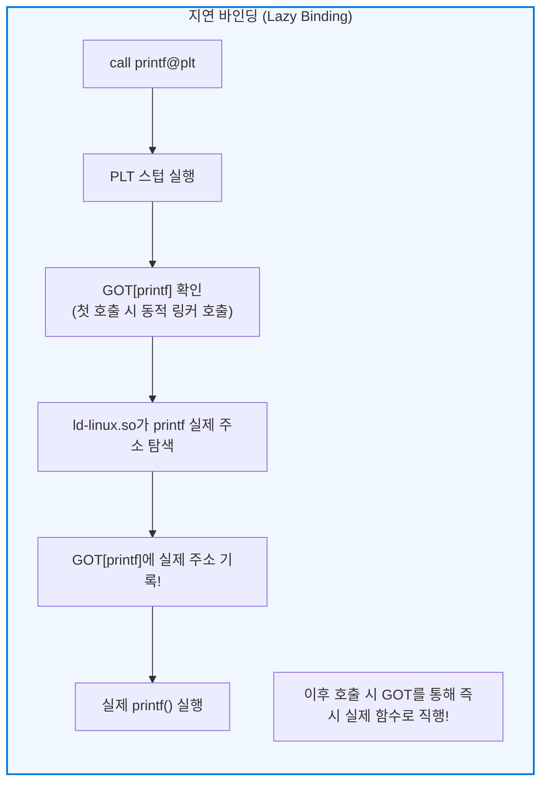

## 서론: 가장 위대하지만 가장 간과되는 시스템의 보이지 않는 손

우리는 터미널에서 늘 다음과 같은 명령어를 실행합니다:

```bash
gcc -O2 main.c utils.c math.c -o myprogram
```

많은 프로그래머들은 이 과정을 뭉뚱그려 단순히 ‘컴파일’이라고 부릅니다.
그러나 소스코드가 기계어로 번역되는 과정에서 컴파일러가 담당하는 부분은 전체의 절반에 불과합니다. 나머지 절반—<strong>서로 다른 수십, 수백 개의 소스 파일과 라이브러리를 하나로 엮고, 가상 메모리 주소를 재배치하며, 실행 시점에 메모리에 적재하여 CPU가 실행할 수 있도록 준비하는 핵심 역할</strong>—은 바로 <strong>링커(Linker)</strong>와 <strong>로더(Loader)</strong>가 맡고 있습니다.

```mermaid
flowchart TD
    subgraph BuildPipeline ["소스코드에서 실행에 이르는 여정"]
        SourceA["main.c"] -->|컴파일러 (gcc -S)| AsmA["main.s (어셈블리)"]
        SourceB["utils.c"] -->|컴파일러 (gcc -S)| AsmB["utils.s (어셈블리)"]

        AsmA -->|어셈블러 (as)| ObjA["main.o (재배치 가능 목적 파일)"]
        AsmB -->|어셈블러 (as)| ObjB["utils.o (재배치 가능 목적 파일)"]
        Lib["libc.so / libm.a\n(표준 라이브러리)"]

        ObjA --> Linker["★ 링커 (ld / lld / mold)\n【심볼 해석 & 주소 재배치】"]
        ObjB --> Linker
        Lib --> Linker

        Linker --> Exec["myprogram (실행 가능 ELF 바이너리)"]
    end

    Exec -->|./myprogram 실행 (execve)| Loader["★ 로더 (OS 커널 & ld-linux.so)\n【가상 메모리 매핑 & 동적 바인딩】"]
    Loader --> CPU["CPU 실행 (_start -> main)"]

    style BuildPipeline fill:#f9f9f9,stroke:#333,stroke-width:2px
    style Linker fill:#ffe6e6,stroke:#d9534f,stroke-width:2px
    style Loader fill:#e6f3ff,stroke:#0066cc,stroke-width:2px
```

만약 링커가 존재하지 않는다면, 우리는 수백만 줄의 거대한 단일 파일에 모든 코드를 작성해야 했을 것이며, 오타 하나를 고칠 때마다 몇 시간씩 전체를 다시 컴파일해야 했을 것입니다. 분할 컴파일과 모듈화라는 현대 소프트웨어 공학의 축복은 오직 링커와 로더 덕분에 가능합니다.

---

## 1. 목적 파일의 해부: ELF 포맷의 구조

컴파일러와 어셈블러가 출력하는 중간 파일(`.o`)은 <strong>재배치 가능 목적 파일(Relocatable Object File)</strong>이라고 불리며, 리눅스 표준인 <strong>ELF(Executable and Linkable Format)</strong> 형식을 따릅니다.

목적 파일은 단순한 기계어의 나열이 아닙니다. 파일의 대부분은 링커가 코드를 올바르게 결합하고 주소를 수정할 수 있도록 돕는 <strong>메타데이터, 심볼 테이블, 재배치 지침</strong>으로 채워져 있습니다:

- <strong>`.text` 섹션:</strong> 컴파일된 CPU 기계어 명령어 코드 (읽기/실행 가능).
- <strong>`.rodata` 섹션:</strong> 문자열 리터럴 등 읽기 전용 상수 데이터.
- <strong>`.data` 섹션:</strong> 초기값이 지정된 전역 변수 및 정적(static) 변수.
- <strong>`.bss` 섹션 (Better Save Space):</strong> 초기화되지 않은 전역 변수. <strong>디스크 파일 용량을 1바이트도 차지하지 않으며</strong>, 헤더에 요구 크기만 기록된 뒤 실행 시점에 0으로 채워집니다.
- <strong>`.symtab` 섹션 (심볼 테이블):</strong> 함수와 전역 변수의 이름과 오프셋을 기록한 장부.
- <strong>`.rela.text` 섹션 (재배치 정보):</strong> 아직 확정되지 않아 나중에 링커가 수정해야 할 메모리 주소들의 목록.

---

## 2. 링커의 첫 번째 임무: 심볼 해석 (Symbol Resolution)

심볼 해석은 각 목적 파일이 요구하는 미정의 외부 함수나 변수를 다른 파일의 정의와 1:1로 결합하는 작업입니다.

### 강한 심볼(Strong)과 약한 심볼(Weak)
- <strong>강한 심볼:</strong> 함수 정의 및 초기화된 전역 변수 (`int x = 1;`).
- <strong>약한 심볼:</strong> 초기화되지 않은 전역 변수 (`int x;`).

<strong>링커의 3대 판정 규칙:</strong>
1. 강한 심볼이 중복되면 즉시 링크 에러(`multiple definition`)를 낸다.
2. 강한 심볼과 약한 심볼이 충돌하면 강한 심볼을 우선한다.
3. 약한 심볼끼리 충돌하면 링커가 임의로 하나를 선택한다 (심각한 메모리 오염 버그의 원인).

또한 링커는 정적 라이브러리(`.a`)를 좌에서 우로 단 1회 스캔하므로, `gcc -lm main.c`와 같이 라이브러리를 앞에 두면 미정의 심볼 집합이 비어 있어 라이브러리를 무시하고 넘어가 링크 에러를 일으킵니다. 라이브러리는 반드시 의존하는 파일 뒤에 명시해야 합니다.

---

## 3. 링커의 두 번째 임무: 재배치 (Relocation)

컴파일 시점에는 외부 함수의 실제 메모리 주소를 알 수 없으므로 임시로 더미 값(`0x00000000`)을 채워 둡니다:
```assembly
callq 0x00000000  # 임시 주소
```
링커는 모든 목적 파일의 `.text`를 하나로 합쳐 절대 가상 주소를 할당한 뒤, PC 상대 재배치 공식에 따라 실제 주소 오프셋을 계산하여 기계어 코드를 수정합니다:

$$\text{수정값} = S + A - P$$
($S$: 심볼의 주소, $A$: 가수/Addend, $P$: 수정 위치의 주소)

---

## 4. 동적 링크와 위치 독립 코드 (PIC, GOT, PLT)

모든 프로그램에 라이브러리를 통째로 복사하는 정적 링크의 메모리 낭비를 해결하기 위해 <strong>공유 라이브러리(`.so`)</strong>와 <strong>동적 링크</strong>가 탄생했습니다.

동적 라이브러리는 메모리의 어느 주소에 로드되더라도 수정 없이 실행 가능한 <strong>위치 독립 코드(PIC, `-fPIC`)</strong>여야 합니다. 이를 위해 <strong>GOT(Global Offset Table)</strong>와 <strong>PLT(Procedure Linkage Table)</strong>를 사용합니다.



<strong>지연 바인딩(Lazy Binding)</strong>을 통해 프로그램 시작 시 수천 개의 함수를 미리 해석하지 않고, 실제로 처음 호출되는 순간에만 동적 링커가 주소를 찾아 GOT에 기록하므로 실행 속도가 비약적으로 향상됩니다.

---

## 5. 로더(Loader)와 프로그램의 탄생: `_start`에서 `main()`까지

터미널에서 `./myprogram`을 실행하면 커널의 `execve` 시스템 호출이 동작하여 <strong>로더</strong>가 실행됩니다:
1. ELF 프로그램 헤더를 읽어 코드 세그먼트(RX)와 데이터 세그먼트(RW)를 가상 메모리에 매핑(`mmap`)합니다.
2. 스택에 `argc`, `argv`, `envp`를 설정합니다.
3. 실제 실행 진입점인 <strong>`_start`</strong>로 점프합니다.

`_start`는 C 런타임 초기화 함수(`__libc_start_main`)를 실행하여 <strong>`.init_array`에 등록된 전역 생성자들을 모두 호출한 뒤에야</strong> 비로소 우리가 작성한 `main()` 함수를 실행합니다.

---

## 6. 결론: 현대 소프트웨어를 지탱하는 보이지 않는 접착제

독립적으로 작성된 수많은 코드 조각들이 한 치의 오차도 없이 맞물려 돌아가는 기적, 그것은 링커와 로더가 백그라운드에서 복잡한 심볼 해석과 메모리 재배치를 완벽히 수행해주기 때문입니다.
바이너리의 내부 구조를 이해하는 것은 거대한 소프트웨어 생태계의 심장을 꿰뚫어 보는 가장 강력한 통찰입니다.

