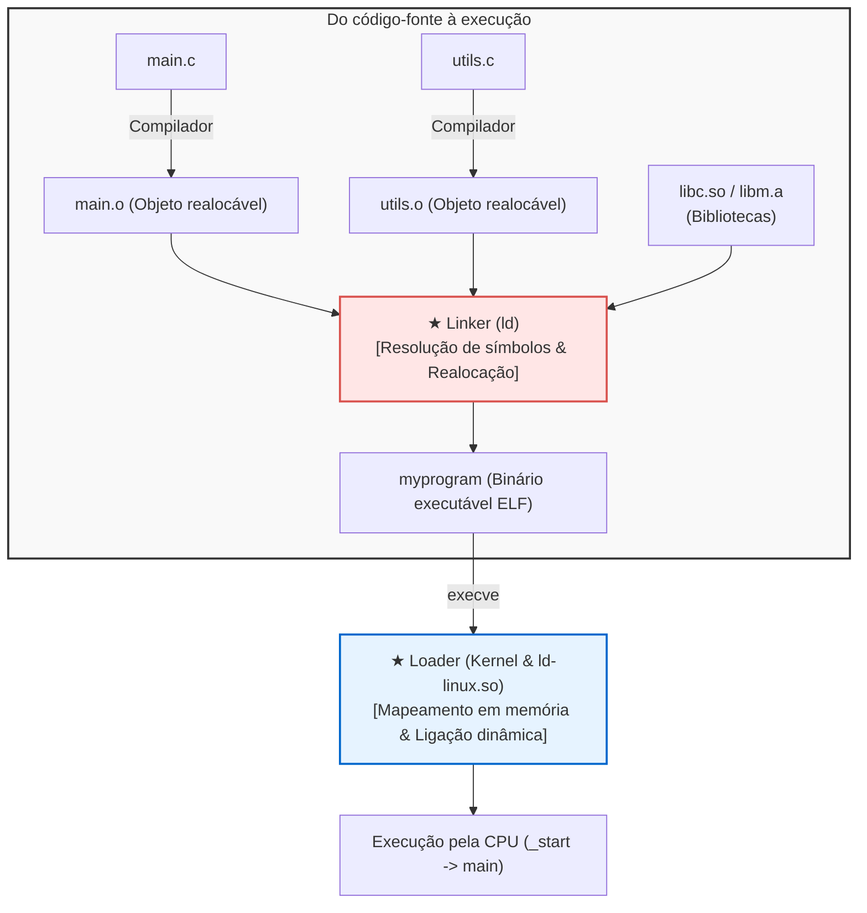

## Introdução: Os arquitetos invisíveis do software moderno

No desenvolvimento diário, compilamos código com comandos como:

```bash
gcc -O2 main.c utils.c math.c -o myprogram
```

Frequentemente chamamos esse processo de "compilação", mas o compilador realiza apenas metade da jornada.
A outra metade—<strong>costurar dezenas de arquivos-objeto e bibliotecas, unificar endereços e carregar o binário na memória para a CPU executar</strong>—é realizada pelo <strong>Linker (Ligador)</strong> e pelo <strong>Loader (Carregador)</strong>.



Sem o linker, seríamos forçados a escrever milhões de linhas de código em um único arquivo gigantesco.

---

## 1. O formato ELF: Anatomia de um arquivo-objeto

Arquivos intermediários (`.o`) são <strong>arquivos-objeto realocáveis</strong> no formato <strong>ELF (Executable and Linkable Format)</strong>:
- <strong>`.text`:</strong> Instruções em linguagem de máquina.
- <strong>`.rodata`:</strong> Constantes e cadeias de caracteres somente-leitura.
- <strong>`.data`:</strong> Variáveis globais e estáticas inicializadas.
- <strong>`.bss`:</strong> Variáveis globais não-inicializadas. <strong>Ocupa zero bytes no disco!</strong> O espaço é alocado e zerado apenas em tempo de execução.
- <strong>`.symtab`:</strong> Tabela de símbolos (índice de funções e variáveis).
- <strong>`.rela.text`:</strong> Registros de realocação com endereços provisórios a serem corrigidos.

---

## 2. Resolução de símbolos (Symbol Resolution)

O linker emparelha chamadas de funções e variáveis externas com suas definições concretas.

<strong>Símbolos Fortes vs. Fracos:</strong>
- <strong>Forte:</strong> Funções e variáveis globais inicializadas (`int x = 1;`).
- <strong>Fraco:</strong> Variáveis globais não-inicializadas (`int x;`).

*Regras:*
1. Dois símbolos fortes iguais causam erro de compilação (`multiple definition`).
2. Símbolo forte sempre tem precedência sobre fraco.
3. Entre múltiplos símbolos fracos, o linker escolhe um arbitrariamente (risco grave de corrupção de memória).

<strong>Ordem na linha de comando:</strong> O linker varre arquivos da esquerda para a direita. Por isso, `-lm` deve ficar após `main.c`.

---

## 3. Realocação de endereços (Relocation)

O compilador usa zeros como marcadores temporários para chamadas externas:
```assembly
callq 0x00000000  # Endereço fictício
```
O linker une as seções, define os endereços virtuais absolutos e reescreve os códigos segundo a equação:
$$\text{Valor} = S + A - P$$
($S$: endereço do símbolo, $A$: addend, $P$: posição da instrução).

---

## 4. Ligação dinâmica: Código Independente de Posição (PIC), GOT e PLT

Para não duplicar bibliotecas na memória, surgiram as <strong>bibliotecas compartilhadas (`.so`)</strong>.
Elas utilizam <strong>Código Independente de Posição (PIC)</strong>, viabilizado por:
- <strong>GOT (Global Offset Table):</strong> Armazena endereços reais de memória.
- <strong>PLT (Procedure Linkage Table):</strong> Tabela de saltos na seção de código.

Com <strong>Lazy Binding (Ligação Tardia)</strong>, o linker dinâmico (`ld-linux.so`) calcula o endereço da função somente na primeira vez em que ela é chamada.

---

## 5. O Loader: De `_start` até `main()`

Ao executar `./myprogram`, a chamada `execve` mapeia os segmentos ELF na memória virtual (`mmap`), prepara a pilha (`argc`, `argv`, `envp`) e salta para o ponto de entrada <strong>`_start`</strong>.
A biblioteca de tempo de execução executa os construtores globais em <strong>`.init_array`</strong> antes de chamar a função `main()`.

