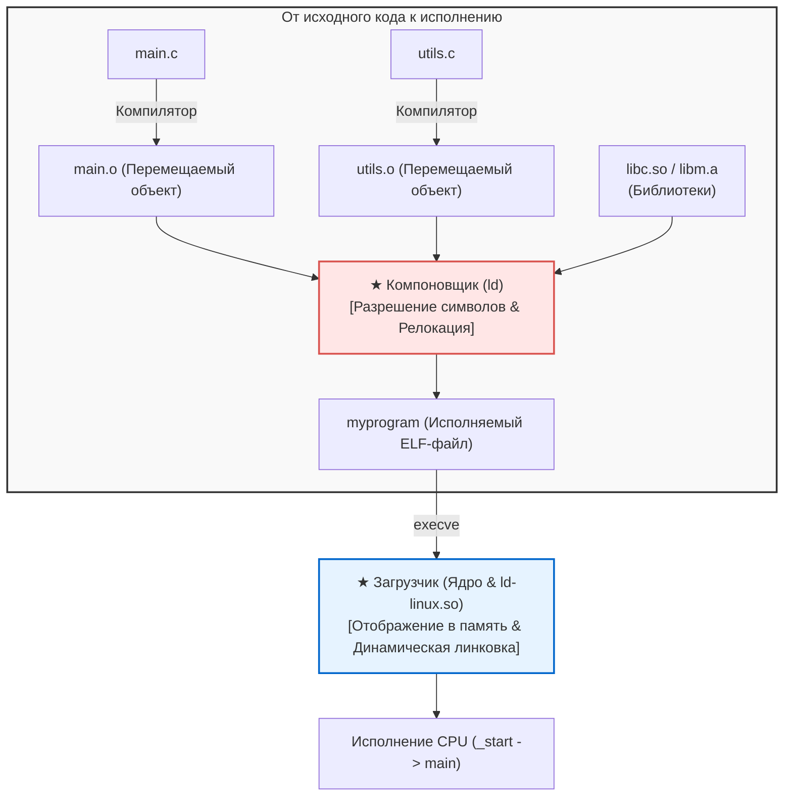

## Введение: Невидимые зодчие программного мира

В повседневной разработке мы регулярно вводим команды вроде:

```bash
gcc -O2 main.c utils.c math.c -o myprogram
```

Этот процесс часто называют «компиляцией», однако компилятор выполняет лишь начальную фазу.
Вторую половину работы—<strong>бесшовное сшивание десятков объектных файлов и библиотек, назначение виртуальных адресов и загрузку исполняемого файла в оперативную память для передачи управления процессору</strong>—выполняют <strong>компоновщик (Linker)</strong> и <strong>загрузчик (Loader)</strong>.



Без компоновщика модульное программирование было бы невозможным: нам пришлось бы писать миллионы строк кода в одном огромном файле.

---

## 1. Анатомия объектного файла ELF

Промежуточный файл (`.o`) представляет собой <strong>перемещаемый объектный файл</strong> формата <strong>ELF (Executable and Linkable Format)</strong>:
- <strong>`.text`:</strong> Машинный код процессора.
- <strong>`.rodata`:</strong> Константы и строковые литералы только для чтения.
- <strong>`.data`:</strong> Инициализированные глобальные и статические переменные.
- <strong>`.bss`:</strong> Неинициализированные глобальные переменные. <strong>Не занимает места на диске!</strong> Память выделяется и обнуляется только во время запуска программы.
- <strong>`.symtab`:</strong> Таблица символов (реестр функций и переменных).
- <strong>`.rela.text`:</strong> Записи релокации, содержащие адреса-заглушки, подлежащие корректировке.

---

## 2. Разрешение символов (Symbol Resolution)

Компоновщик сопоставляет внешние ссылки с их фактическими определениями.

<strong>Сильные и слабые символы:</strong>
- <strong>Сильные:</strong> Определения функций и инициализированные глобальные переменные (`int x = 1;`).
- <strong>Слабые:</strong> Неинициализированные глобальные переменные (`int x;`).

*Правила разрешения:*
1. Несколько одинаковых сильных символов вызывают ошибку компоновки (`multiple definition`).
2. Сильный символ всегда побеждает слабый.
3. Из нескольких слабых символов компоновщик выбирает один наугад (опасность порчи памяти).

<strong>Порядок библиотек в командной строке:</strong> Компоновщик сканирует аргументы строго слева направо в один проход. Поэтому `-lm` обязан стоять после `main.c`.

---

## 3. Релокация адресов (Relocation)

Компилятор подставляет нули вместо адресов внешних функций:
```assembly
callq 0x00000000  # Временное смещение
```
Компоновщик объединяет секции, вычисляет итоговые виртуальные адреса и перезаписывает инструкции по формуле:
$$\text{Значение} = S + A - P$$
($S$: адрес символа, $A$: адденд, $P$: адрес инструкции).

---

## 4. Динамическая компоновка: PIC, GOT и PLT

Чтобы не дублировать код библиотек в памяти, используются <strong>разделяемые библиотеки (`.so`)</strong>.
Они требуют <strong>позиционно-независимого кода (PIC)</strong>, работающего через две таблицы:
- <strong>GOT (Global Offset Table):</strong> Хранит абсолютные адреса в области данных.
- <strong>PLT (Procedure Linkage Table):</strong> Таблица переходов в области кода.

Благодаря <strong>отложенному связыванию (Lazy Binding)</strong> динамический компоновщик (`ld-linux.so`) разрешает адрес функции только при её первом реальном вызове.

---

## 5. Загрузчик: От `_start` к `main()`

При запуске программы системный вызов `execve` отображает сегменты ELF в виртуальную память (`mmap`), настраивает стек (`argc`, `argv`, `envp`) и передает управление в точку входа <strong>`_start`</strong>.
Среда выполнения C исполняет глобальные конструкторы из секции <strong>`.init_array`</strong> перед вызовом функции `main()`.

