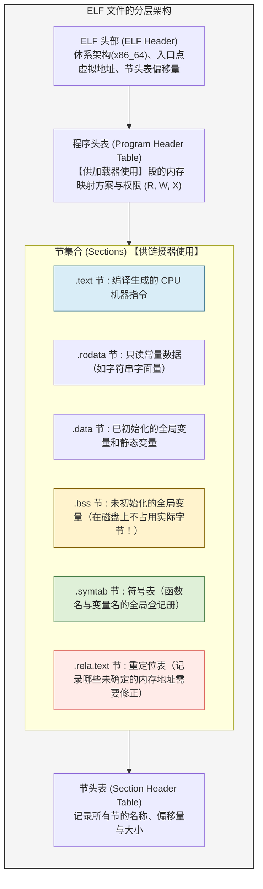
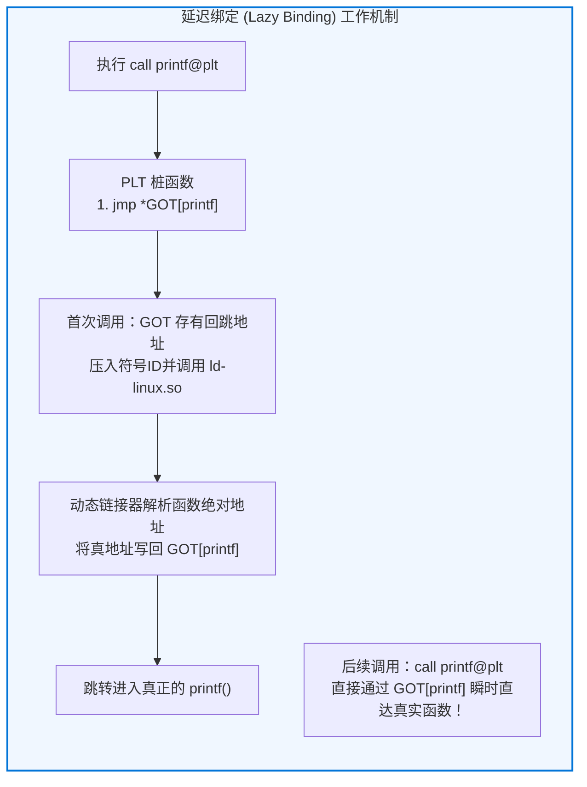

## 引言：被严重低估的幕后功臣

在日常软件开发中，我们频繁执行如下命令：

```bash
gcc -O2 main.c utils.c math.c -o myprogram
```

许多开发者通常将这一完整构建过程笼统地称作“编译（Compile）”。然而，将高级代码翻译为机器指令其实只完成了旅途的上一半。
至于剩下的另一半——<strong>如何将分散在数十甚至数千个源文件与库中的机器码无缝缝合在一起，赋予它们统一的虚拟内存地址，并在操作系统启动程序时将其精准载入物理内存交付CPU执行</strong>——则完全由两位隐形的核心巨匠主导：<strong>链接器（Linker）</strong>与<strong>加载器（Loader）</strong>。

```mermaid
flowchart TD
    subgraph BuildPipeline ["从源代码到最终执行的完整链条"]
        SourceA["main.c"] -->|编译器 (gcc -S)| AsmA["main.s (汇编)"]
        SourceB["utils.c"] -->|编译器 (gcc -S)| AsmB["utils.s (汇编)"]

        AsmA -->|汇编器 (as)| ObjA["main.o (可重定位目标文件)"]
        AsmB -->|汇编器 (as)| ObjB["utils.o (可重定位目标文件)"]
        Lib["libc.so / libm.a\n(系统依赖库)"]

        ObjA --> Linker["★ 链接器 (ld / lld / mold)\n【符号解析 & 地址重定位】"]
        ObjB --> Linker
        Lib --> Linker

        Linker --> Exec["myprogram (可执行 ELF 二进制)"]
    end

    Exec -->|./myprogram (系统调用 execve)| Loader["★ 加载器 (内核 & ld-linux.so)\n【虚拟内存映射 & 动态绑定】"]
    Loader --> CPU["CPU 执行 (_start -> main)"]

    style BuildPipeline fill:#f9f9f9,stroke:#333,stroke-width:2px
    style Linker fill:#ffe6e6,stroke:#d9534f,stroke-width:2px
    style Loader fill:#e6f3ff,stroke:#0066cc,stroke-width:2px
```

如果没有链接器，软件工程中的“模块化设计”与“独立编译”将化为泡影。我们将不得不将数百万行代码挤在同一个臃肿的单体源文件里，只要改动一个标点符号就不得不承受长达数小时的全量重编译。正是链接器在底层解决的复杂代数与重定位谜题，才奠定了当代大规模软件工业的基石。

---

## 1. 拆解目标文件：ELF（可执行与可链接格式）全景图

编译器输出的中间产物（`.o` 或 `.obj`）被称为<strong>可重定位目标文件（Relocatable Object File）</strong>。在现代 Linux 系统中，其统一遵循 <strong>ELF（Executable and Linkable Format）</strong>标准。

很多人误以为目标文件仅仅是一长串冰冷的 CPU 机器指令，但实际上，纯粹的机器码仅占整个 ELF 文件的一小部分。ELF 文件绝大多数空间被用于存放供链接器操作的<strong>元数据、符号表和重定位指示书</strong>。



### 1.1 关键节区剖析
- <strong>`.text`（代码节）：</strong> 存放经过编译的机器指令序列，只读且可执行。
- <strong>`.rodata`（只读数据节）：</strong> 存放 `const` 常量和 `printf` 所需的固定字符串。
- <strong>`.data`（数据节）：</strong> 存放程序员赋有初始值的全局变量（如 `int count = 100;`）。
- <strong>`.bss`（未初始化数据节）：</strong> 存放未赋初始值或初始化为 0 的全局变量。这里蕴含着极具智慧的工程优化：<strong>`.bss` 节在磁盘文件中不占用物理空间</strong>，仅在头部记录一个大小数值。实际的零填充内存在程序被操作系统加载时才动态分配。
- <strong>`.symtab`（符号表）：</strong> 记录模块内定义或引用的所有符号名称、类型与其偏移量。

---

## 2. 链接器的第一使命：符号解析（Symbol Resolution）

链接器的核心任务第一步是<strong>符号解析</strong>：将每个目标文件中未定义的引用（如函数调用或外部变量），与其它文件中导出的定义一一精确匹配。

### 2.1 强符号（Strong）与弱符号（Weak）的仲裁法则
当不同文件出现同名全局变量时，链接器基于符号强弱机制进行裁决：
- <strong>强符号：</strong> 函数定义、显式初始化的全局变量（如 `void func() {}`, `int x = 1;`）。
- <strong>弱符号：</strong> 未初始化的全局变量（如 `int x;`）或被声明为弱属性的符号。


### 2.2 静态库（.a）的顺序敏感性之谜
在编译时我们常发现，参数位置不对就会报未定义符号错误：
```bash
gcc -lm main.c   # 报错：undefined reference to 'sqrt'
gcc main.c -lm   # 成功！
```
这是因为静态链接器对命令行参数采用<strong>严格的从左至右单遍扫描</strong>算法。它维护三个集合：
1. <strong>$E$（已选目标集合）：</strong> 最终合并的文件；
2. <strong>$U$（未解析符号集合）：</strong> 已被引用但未找到实体的符号；
3. <strong>$D$（已定义符号集合）：</strong> 已发现的所有定义。

如果先放 `-lm`，此时集合 $U$ 为空，链接器认为数学库毫无用处而将其完全忽略；随后扫描 `main.c` 时才把 `sqrt` 加入 $U$，但此时已无库可找，导致报错。

---

## 3. 链接器的第二使命：地址重定位（Relocation）

编译器生成各个独立的 `.o` 文件时，彼此并不知道对方的内存地址。因此，对于外部函数的调用，汇编器只能先填入一个全为零的临时占位符：

```assembly
e8 00 00 00 00       callq  0 <main+0xe>   # 占位符偏移量 0x00000000
```

随后，在 `.rela.text` 节中写入一条<strong>重定位条目</strong>：指示链接器在最终合并时，将该处占位符改写为真正的目标函数虚拟内存相对偏移量。

对于 x86-64 最常见的 PC 相对重定位（`R_X86_64_PC32`），重定位计算公式如下：
$$\text{写入值} = S + A - P$$
其中：
- $S$ 为目标符号的最终虚拟内存地址；
- $A$ 为加数（Addend，通常为 $-4$）；
- $P$ 为被修补指令槽位自身的虚拟内存物理地址。

链接器合并各目标文件的 `.text` 与 `.data` 节并赋予确定基址后，批量迭代所有重定位条目，完成最后的补丁缝合。

---

## 4. 动态链接与位置无关代码（PIC / GOT / PLT）

为了解决静态链接导致的磁盘膨胀与内存重复占用难题，<strong>动态共享库（Linux `.so` / Windows `.dll`）</strong>应运而生。

动态库要求编译为<strong>位置无关代码（PIC: Position-Independent Code）</strong>，即无论库被内核加载到进程虚拟地址空间的哪个随机位置（ASLR），代码段本身都无需修改即可运行。其实现依托于两张精妙的数据表：
1. <strong>GOT（全局偏移表，Global Offset Table）：</strong> 位于数据段，存放外部变量与函数的真正运行时绝对地址；
2. <strong>PLT（过程链接表，Procedure Linkage Table）：</strong> 位于代码段，存放调用桩代码。



借助<strong>延迟绑定（Lazy Binding）</strong>机制，程序无需在启动时解析成千上万个可能用不到的函数，而是在首次调用时由动态链接器即时解析并回填 GOT 表，后续调用则以零开销直接跳转。

---

## 5. 加载器与程序的诞生：从 `_start` 到 `main()`

当用户在终端键入 `./myprogram` 时，内核执行 `execve` 系统调用，启动<strong>加载器（Loader）</strong>：
1. 解析 ELF 程序头表，利用 `mmap` 将 `PT_LOAD` 代码段（R-X）与数据段（RW-）映射入进程虚拟内存；
2. 为进程初始化用户栈，将命令行参数 `argc, argv` 和环境变量 `envp` 压栈；
3. 若为动态二进制，将控制权交给解释器 `ld-linux.so` 装载依赖共享库；
4. CPU 最终跳转至 ELF 文件真正的汇编入口——<strong>`_start`</strong>。

在真正进入程序员编写的 `main()` 之前，C 运行时（`__libc_start_main`）会预先遍历并执行 <strong>`.init_array` 节</strong> 中的全局构造函数；当 `main()` 返回后，再依次执行 <strong>`.fini_array`</strong> 的析构函数并触发 `exit` 系统调用安全退出。

---

## 6. 结语：看不见的数字粘合剂

现代软件没有哪怕一行是在真空中运行的。正是链接器与加载器在纳米级与微秒级的交织中，将人类用不同语言、不同文件编写的逻辑碎片，严丝合缝地拼接成逻辑自洽的宏伟整体。读懂了链接与加载，你便掌握了驾驭底层软硬件世界的最深刻钥匙。

