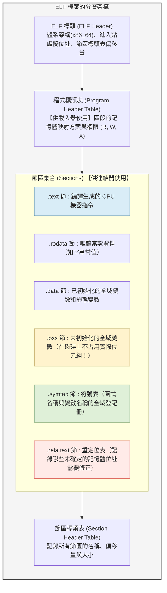
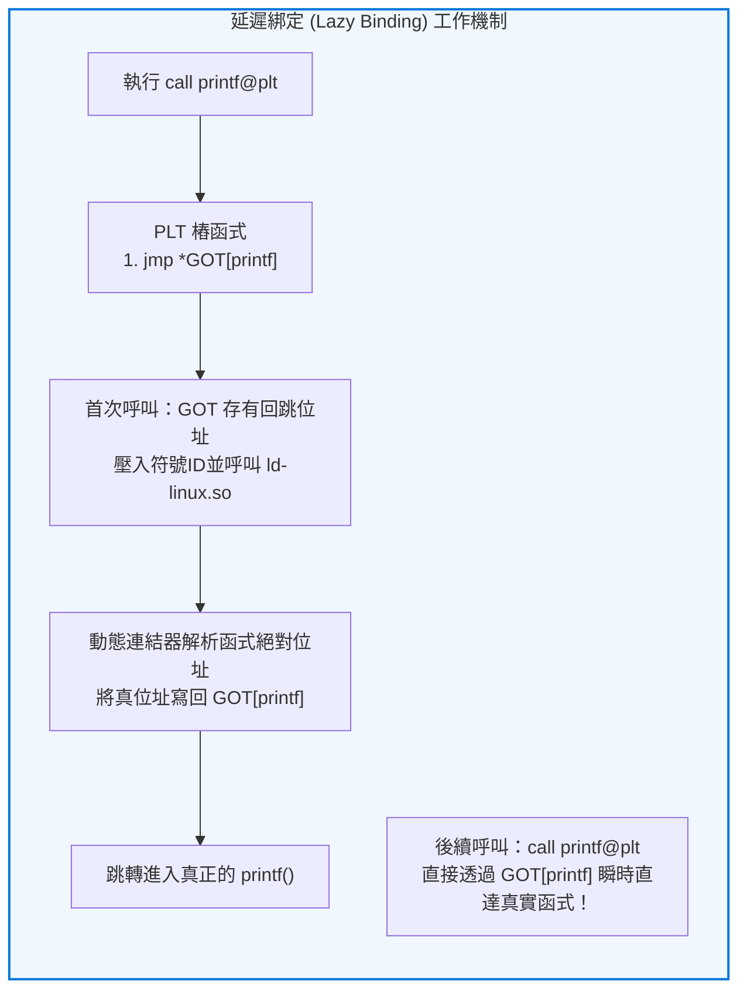

## 引言：被嚴重低估的幕後功臣

在日常軟體開發中，我們頻繁執行如下命令：

```bash
gcc -O2 main.c utils.c math.c -o myprogram
```

許多開發者通常將這一完整建置過程籠統地稱作「編譯（Compile）」。然而，將高階程式碼翻譯為機器指令其實只完成了旅途的上一半。
至於剩下的另一半——<strong>如何將分散在數十甚至數千個原始檔與函式庫中的機器碼無縫縫合在一起，賦予它們統一的虛擬記憶體位址，並在作業系統啟動程式時將其精準載入實體記憶體交付CPU執行</strong>——則完全由兩位隱形的核心巨匠主導：<strong>連結器（Linker）</strong>與<strong>載入器（Loader）</strong>。

```mermaid
flowchart TD
    subgraph BuildPipeline ["從原始碼到最終執行的完整鏈條"]
        SourceA["main.c"] -->|編譯器 (gcc -S)| AsmA["main.s (組合語言)"]
        SourceB["utils.c"] -->|編譯器 (gcc -S)| AsmB["utils.s (組合語言)"]

        AsmA -->|組譯器 (as)| ObjA["main.o (可重定位目標檔)"]
        AsmB -->|組譯器 (as)| ObjB["utils.o (可重定位目標檔)"]
        Lib["libc.so / libm.a\n(系統相依函式庫)"]

        ObjA --> Linker["★ 連結器 (ld / lld / mold)\n【符號解析 & 位址重定位】"]
        ObjB --> Linker
        Lib --> Linker

        Linker --> Exec["myprogram (可執行 ELF 二進位檔)"]
    end

    Exec -->|./myprogram (系統呼叫 execve)| Loader["★ 載入器 (核心 & ld-linux.so)\n【虛擬記憶體映射 & 動態綁定】"]
    Loader --> CPU["CPU 執行 (_start -> main)"]

    style BuildPipeline fill:#f9f9f9,stroke:#333,stroke-width:2px
    style Linker fill:#ffe6e6,stroke:#d9534f,stroke-width:2px
    style Loader fill:#e6f3ff,stroke:#0066cc,stroke-width:2px
```

如果沒有連結器，軟體工程中的「模組化設計」與「獨立編譯」將化為泡影。我們將不得不將數百萬行程式碼擠在同一個臃腫的單體原始檔裡，只要改動一個標點符號就不得不承受長達數小時的全量重新編譯。正是連結器在底層解決的複雜代數與重定位謎題，才奠定了當代大規模軟體工業的基石。

---

## 1. 拆解目標檔：ELF（可執行與可連結格式）全景圖

編譯器輸出的中間產物（`.o` 或 `.obj`）被稱為<strong>可重定位目標檔（Relocatable Object File）</strong>。在現代 Linux 系統中，其統一遵循 <strong>ELF（Executable and Linkable Format）</strong>標準。

很多人誤以為目標檔僅僅是一長串冰冷的 CPU 機器指令，但實際上，純粹的機器碼僅占整個 ELF 檔案的一小部分。ELF 檔案絕大多數空間被用於存放供連結器操作的<strong>元資料、符號表和重定位指示書</strong>。



### 1.1 關鍵節區剖析
- <strong>`.text`（程式碼節）：</strong> 存放經過編譯的機器指令序列，唯讀且可執行。
- <strong>`.rodata`（唯讀資料節）：</strong> 存放 `const` 常數和 `printf` 所需的固定字串。
- <strong>`.data`（資料節）：</strong> 存放程式設計師賦予初始值的全域變數（如 `int count = 100;`）。
- <strong>`.bss`（未初始化資料節）：</strong> 存放未賦初始值或初始化為 0 的全域變數。這裡蘊含著極具智慧的工程最佳化：<strong>`.bss` 節在磁碟檔案中不占用實體空間</strong>，僅在標頭記錄一個大小數值。實際的填零記憶體在程式被作業系統載入時才動態分配。
- <strong>`.symtab`（符號表）：</strong> 記錄模組內定義或引用的所有符號名稱、類型與其偏移量。

---

## 2. 連結器的第一使命：符號解析（Symbol Resolution）

連結器的核心任務第一步是<strong>符號解析</strong>：將每個目標檔中未定義的引用（如函式呼叫或外部變數），與其它檔案中導出的定義一一精確匹配。

### 2.1 強符號（Strong）與弱符號（Weak）的仲裁法則
當不同檔案出現同名全域變數時，連結器基於符號強弱機制進行裁決：
- <strong>強符號：</strong> 函式定義、顯式初始化的全域變數（如 `void func() {}`, `int x = 1;`）。
- <strong>弱符號：</strong> 未初始化的全域變數（如 `int x;`）或被宣告為弱屬性的符號。


### 2.2 靜態函式庫（.a）的順序敏感性之謎
在編譯時我們常發現，參數位置不對就會報未定義符號錯誤：
```bash
gcc -lm main.c   # 報錯：undefined reference to 'sqrt'
gcc main.c -lm   # 成功！
```
這是因為靜態連結器對命令列參數採用<strong>嚴格的從左至右單遍掃描</strong>演算法。它維護三個集合：
1. <strong>$E$（已選目標集合）：</strong> 最終合併的檔案；
2. <strong>$U$（未解析符號集合）：</strong> 已被引用但未找到實體的符號；
3. <strong>$D$（已定義符號集合）：</strong> 已發現的所有定義。

如果先放 `-lm`，此時集合 $U$ 為空，連結器認為數學函式庫毫無用處而將其完全忽略；隨後掃描 `main.c` 時才把 `sqrt` 加入 $U$，但此時已無函式庫可找，導致報錯。

---

## 3. 連結器的第二使命：位址重定位（Relocation）

編譯器生成各個獨立的 `.o` 檔案時，彼此並不知道對方的記憶體位址。因此，對於外部函式的呼叫，組譯器只能先填入一個全為零的臨時占位符：

```assembly
e8 00 00 00 00       callq  0 <main+0xe>   # 占位符偏移量 0x00000000
```

隨後，在 `.rela.text` 節中寫入一條<strong>重定位項目</strong>：指示連結器在最終合併時，將該處占位符改寫為真正的目標函式虛擬記憶體相對偏移量。

對於 x86-64 最常見的 PC 相對重定位（`R_X86_64_PC32`），重定位計算公式如下：
$$\text{寫入值} = S + A - P$$
其中：
- $S$ 為目標符號的最終虛擬記憶體位址；
- $A$ 為加數（Addend，通常為 $-4$）；
- $P$ 為被修補指令槽位自身的虛擬記憶體實體位址。

連結器合併各目標檔的 `.text` 與 `.data` 節並賦予確定基底位址後，批次反覆運算所有重定位項目，完成最後的修補縫合。

---

## 4. 動態連結與位置無關程式碼（PIC / GOT / PLT）

為了解決靜態連結導致的磁碟膨脹與記憶體重複占用難題，<strong>動態共享函式庫（Linux `.so` / Windows `.dll`）</strong>應運而生。

動態函式庫要求編譯為<strong>位置無關程式碼（PIC: Position-Independent Code）</strong>，即無論函式庫被核心載入到處理程序虛擬位址空間的哪個隨機位置（ASLR），程式碼段本身都無需修改即可運行。其實現依託於兩張精妙的資料表：
1. <strong>GOT（全域偏移表，Global Offset Table）：</strong> 位於資料段，存放外部變數與函式的真正執行階段絕對位址；
2. <strong>PLT（過程連結表，Procedure Linkage Table）：</strong> 位於程式碼段，存放呼叫樁程式碼。



借助<strong>延遲綁定（Lazy Binding）</strong>機制，程式無需在啟動時解析成千上萬個可能用不到的函式，而是在首次呼叫時由動態連結器即時解析並回填 GOT 表，後續呼叫則以零開銷直接跳轉。

---

## 5. 載入器與程式的誕生：從 `_start` 到 `main()`

當使用者在終端鍵入 `./myprogram` 時，核心執行 `execve` 系統呼叫，啟動<strong>載入器（Loader）</strong>：
1. 解析 ELF 程式標頭表，利用 `mmap` 將 `PT_LOAD` 程式碼區段（R-X）與資料區段（RW-）映射入處理程序虛擬記憶體；
2. 為處理程序初始化使用者堆疊，將命令列參數 `argc, argv` 和環境變數 `envp` 壓堆疊；
3. 若為動態二進位檔，將控制權交給直譯器 `ld-linux.so` 裝載相依共享函式庫；
4. CPU 最終跳轉至 ELF 檔案真正的組合語言進入點——<strong>`_start`</strong>。

在真正進入程式設計師編寫的 `main()` 之前，C 執行階段（`__libc_start_main`）會預先遍歷並執行 <strong>`.init_array` 節</strong> 中的全域建構函式；當 `main()` 返回後，再依次執行 <strong>`.fini_array`</strong> 的解構函式並觸發 `exit` 系統呼叫安全結束。

---

## 6. 結語：看不見的數位黏著劑

現代軟體沒有哪怕一行是在真空中運行的。正是連結器與載入器在奈米級與微秒級的交織中，將人類用不同語言、不同檔案編寫的邏輯碎片，嚴絲合縫地拼接成邏輯自洽的宏偉整體。讀懂了連結與載入，你便掌握了駕馭底層軟硬體世界的最深刻鑰匙。

