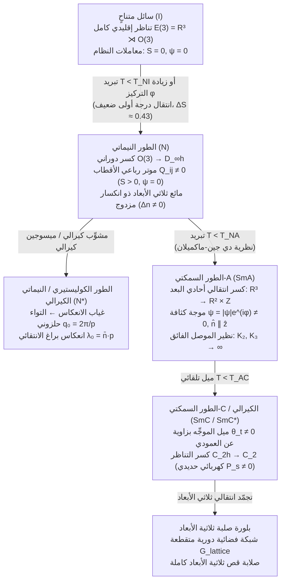

## 1. الحالة الرابعة للمادة الكلاسيكية: الكسر التلقائي التدريجي للتناظر

في عام 1888، لاحظ عالم النبات والكيمياء النمساوي <strong>فريدريش راينيتسر (Friedrich Reinitzer)</strong> ظاهرة مذهلة أثناء تسخين بلورات <strong>بنزوات الكوليستيريل</strong> المستخلصة من الجزر: أظهر المركب <strong>نقطتي انصهار متمايزتين</strong>. عند درجة حرارة $145.5\,^\circ\text{C}$، انصهر الجسم البلوري الصلب إلى مائع عكر متألق يتدفق بحرية كالسائل ولكنه يحتفظ بانكسار مزدوج بصري قوي؛ وفقط عند $178.5\,^\circ\text{C}$ تحول هذا المائع العكر إلى سائل شفاف تماماً ومتناحٍ بصرياً. فحص الفيزيائي الألماني <strong>أوتو ليمان (Otto Lehmann)</strong> هذا الطور الوسيط تحت مجهر ضوء مستقطب مزود بمنصة تسخين وصاغ مصطلح <strong>«البلورات السائلة» (Flüssige Kristalle)</strong>. وفي عام 1922، وضع عالم البلورات الفرنسي <strong>جورج فريدل (Georges Friedel)</strong> التصنيف الحديث <strong>للأطوار الوسيطة (Mesophases)</strong> إلى ثلاث فئات أساسية: <strong>النيماتية (Nematic)</strong>، و<strong>الكوليستيرية (Cholesteric)</strong>، و<strong>السمكتية (Smectic)</strong>.

من منظور فيزياء المادة المكثفة الحديثة (<strong>بيير-جيل دي جين</strong>، جائزة نوبل في الفيزياء عام 1991)، تمثل البلورات السائلة النموذج الأمثل <strong>للكسر التلقائي التدريجي للتناظر (Spontaneous Symmetry Breaking, SSB)</strong> للزمرة الإقليدية ثلاثية الأبعاد:

$$\mathcal{G} = E(3) = \mathbb{R}^3 \rtimes O(3)$$

في السائل المتناحي ($I$)، يظل كل من التناظر الانتقالي المستمر $\mathbb{R}^3$ والتناظر الدوراني المستمر $O(3)$ سليمين تماماً. أما في البلورة الصلبة ثلاثية الأبعاد، فينكسر كلا التناظرين في آنٍ واحد إلى شبكة فضائية متقطعة. تفصل البلورات السائلة بين هذين الانتقالين:

1. <strong>الطور النيماتي ($N$)</strong>: يظل التناظر الانتقالي المستمر $\mathbb{R}^3$ سليماً بالكامل — حيث تتدفق مراكز كتل الجزيئات مثل أي سائل عادي دون نظام موضعي بعيد المدى — لكن التناظر الدوراني المستمر $O(3)$ ينكسر تلقائياً إلى الزمرة الأسطوانية ثنائية الوجه $D_{\infty h}$. تصطف الجزيئات العصوية أو القرصية (<strong>الميسوجينات</strong>) إحصائياً على طول محور وحدة عياني مشترك يُسمى <strong>الموجِّه (Director) $\hat{\mathbf{n}}$</strong> ($|\hat{\mathbf{n}}| = 1$).
2. <strong>الطور الكوليستيري / النيماتي الكيرالي ($N^*$)</strong>: عندما تكون الجزيئات كيرالية (تفتقر إلى تناظر الانعكاس المرآتي، مما يختزل $O(3) \to SO(3)$)، يلتوي الموجِّه تلقائياً في الفضاء مشكلاً حلزوناً عيانياً بخطوة $p = 2\pi / |q_0|$، مما ينشئ فجوة نطاق فوتونية أحادية البعد تعكس انتقائياً الضوء المستقطب دائرياً عند طول موجة براغ $\lambda_0 = \bar{n}\,p$.
3. <strong>الأطوار السمكتية ($\text{SmA}, \text{SmC}$)</strong>: بالإضافة إلى النظام التوجيهي النيماتي، ينكسر التناظر الانتقالي المستمر $\mathbb{R}^3$ جزئياً على طول <strong>اتجاه فضائي واحد</strong> ($\mathbb{R}^3 \to \mathbb{R}^2 \times \mathbb{Z}$). يشكّل النظام موجة كثافة أحادية البعد — كومة دورية من طبقات مائعة ثنائية الأبعاد — حيث تتدفق الجزيئات داخل كل طبقة كسائل ثنائي الأبعاد مع الحفاظ على دورية بلورية أحادية البعد على طول العمودي على الطبقات.

---

## 2. موتر معامل النظام النيماتي $Q_{ij}$ وتناظر الرأس والذيل $\hat{\mathbf{n}} \equiv -\hat{\mathbf{n}}$

لماذا لا يمكن وصف الحالة النيماتية بمجرد متجه استقطاب $\mathbf{P} = \langle \mathbf{u} \rangle$ كما في الانتقال المغناطيسي الحديدي لهايزنبرغ؟ في الغالبية العظمى من البلورات السائلة النيماتية، حتى عندمايمتلك الجزيء المنفرد عزم ثنائي قطب كهربائي دائم، فإن حالة التوازن العيانية تتمتع <strong>بتناظر غير قطبي بين الرأس والذيل</strong>: الاتجاه $+\hat{\mathbf{n}}$ والاتجاه المعاكس $-\hat{\mathbf{n}}$ متطابقان فيزيائياً ولا يمكن التمييز بينهما ($\hat{\mathbf{n}} \equiv -\hat{\mathbf{n}}$). وبالتالي تحقق دالة التوزيع الاحتمالي التوجيهي الشرط $f(-\mathbf{u}) = f(\mathbf{u})$، مما يجعل جميع العزوم الفردية (ثنائية القطب) تنعدم تماماً: $\langle u_i \rangle = 0$.

أول عزم متعدد أقطاب غير صفري يميز الطور النيماتي المتباين الخواص عن السائل المتناحي هو <strong>العزم رباعي الأقطاب من الرتبة الثانية</strong>. ولكي ينعدم معامل النظام في الطور المتناحي ($\langle u_i u_j \rangle_{\text{iso}} = \frac{1}{3}\delta_{ij}$)، نعرّف <strong>موتر معامل النظام لدي جين $Q_{ij}$</strong> المتماثل وعديم الأثر ($\text{Tr}\,\mathbf{Q} = 0$):

$$\hat{\mathbf{n}} \equiv -\hat{\mathbf{n}}, \qquad Q_{ij} = \left\langle u_{\alpha, i} u_{\alpha, j} - \frac{1}{3}\delta_{ij} \right\rangle = S \left( n_i n_j - \frac{1}{3}\delta_{ij} \right)$$

في النيماتي أحادي المحور ذي التناظر الأسطواني حول $\hat{\mathbf{n}}$، تنعدم ثنائية المحور $P = 0$ ويُختزل مقدار الاصطفاف التوجيهي بالكامل في <strong>معامل النظام السلمي لماير-ساوب $S$</strong>، وهو المتوسط الحراري لكثير حدود ليجاندر الثاني $P_2(\cos\theta)$:

$$S = \langle P_2(\cos\theta) \rangle = \left\langle \frac{3\cos^2\theta - 1}{2} \right\rangle = \int_0^\pi f(\theta) \left(\frac{3\cos^2\theta - 1}{2}\right) \sin\theta \, d\theta$$

في السائل المتناحي، $\langle \cos^2\theta \rangle = 1/3 \implies S = 0$. وفي الاصطفاف المتوازي التام، $\theta = 0 \implies S = 1$. وفي البلورات السائلة الحرارية الحقيقية (مثل <strong>5CB</strong> أو <strong>MBBA</strong>)، يقفز $S$ بشكل متقطع عند درجة حرارة الصفاء $T_{NI}$ إلى $S \approx 0.3\text{–}0.45$ ويزداد إلى $S \approx 0.6\text{–}0.8$ مع استمرار التبريد.

وفي <strong>الطور السمكتي-A ($\text{SmA}$)</strong>، يظهر معامل نظام انتقالي إضافي. بنشر الكثافة الجزيئية $\rho(\mathbf{r})$ في متسلسلة فورييه على طول العمودي على الطبقات $\hat{\mathbf{z}}$ بمتجه موجي $q_0 = 2\pi / d$ ($d \approx L$ طول الجزيء):

$$\rho(\mathbf{r}) = \rho_0 + |\psi(\mathbf{r})| \cos\left(q_0 z - q_0 u_z(\mathbf{r})\right), \qquad \lambda_0 = \bar{n} \, p \cos\theta_{\text{inc}}$$

كما صاغه <strong>بيير-جيل دي جين (1972)</strong> و<strong>ويليام ماكميلان</strong>، ينشئ معامل النظام المركب $\psi(\mathbf{r}) = |\psi|e^{i\phi(\mathbf{r})}$ <strong>تشاكلاً رياضياً دقيقاً بين انتقال $\text{N–SmA}$ وانتقال المعدن العادي إلى موصل فائق في نظرية غينزبورغ-لانداو</strong>: يقابل $\psi$ الدالة الموجية العيانية لأزواج كوبر، وتعمل التقلبات المستعرضة للموجِّه $\delta\mathbf{n}_\perp$ كجهد متجه كهرومغناطيسي $\mathbf{A}$، ويقابل طرد تشوهات الالتواء ($K_2$) والانحناء ($K_3$) من داخل السمكتي <strong>تأثير مايسنر (Meissner effect)</strong> تماماً (طرد المجال المغناطيسي $\mathbf{B} = \nabla \times \mathbf{A} = \mathbf{0}$).

---

## 3. الديناميكا الحرارية للانتقال المتناحي-النيماتي: لانداو-دي جين مقابل أونساغر

توجد عائلتان رئيسيتان للبلورات السائلة: <strong>الحرارية (Thermotropic)</strong> (يتحكم في انتقالها درجة الحرارة $T$ عبر قوى تشتت فان دير فالس / ماير-ساوب المتباينة الخواص) و<strong>الليوتروبية (Lyotropic)</strong> (يتحكم في انتقالها الكسر الحجمي $\phi$ في مذيب عبر التنافر الفراغي للحجم المستبعد).

### 3.1 مفكوك لانداو-دي جين واللامتغير التكعيبي لانتقال الدرجة الأولى

بنشر كثافة الطاقة الحرة $f_{\text{LdG}}$ بدلالة القوى اللامتغيرة دورانياً للموتر $Q_{ij}$، وبما أن $\text{Tr}(\mathbf{Q}) = 0$، يختفي الحد الخطي، ولكن — خلافاً لنموذج إيزينغ أو المغناطيسية الحديدية حيث يمنع التناظر $\mathbf{m} \to -\mathbf{m}$ القوى الفردية — فإن الموتر $3\times 3$ عديم الأثر يجعل $Q_{ij}$ و$-Q_{ij}$ يمثلان حالتين فيزيائيتين مختلفتين ($S > 0$ لاصطفاف العصي مقابل $S < 0$ للاصطفاف المستوي القرصي). لذلك فإن <strong>اللامتغير التكعيبي $\text{Tr}(\mathbf{Q}^3)$ مسموح به تناظرياً</strong>:

$$f_{\text{LdG}}(S, T) = f_0 + \frac{1}{3} a (T - T^*) S^2 - \frac{2}{27} B S^3 + \frac{1}{9} C S^4$$

$$T_{NI} = T^* + \frac{B^2}{27 a C}, \qquad S_{NI} = \frac{B}{3C}, \qquad \Delta H = \frac{a B^2 T_{NI}}{27 C^2}$$

يؤدي وجود الحد $-B\,S^3$ ($B > 0$) إلى تكوين حاجز طاقة حرة بين $S = 0$ و$S > 0$، مما يضمن أن الانتقال المتناحي-النيماتي ($I\text{–}N$) في ثلاثة أبعاد هو دائماً <strong>انتقال طور من الدرجة الأولى (انتقال درجة أولى ضعيف)</strong>: عند درجة حرارة الصفاء $T_{NI} = T^* + \frac{2B^2}{9a_0 C}$، يقفز معامل النظام قفزة شاملة $S(T_{NI}) = \frac{2B}{3C} \approx 0.43$ مصحوبة بحرارة كامنة صغيرة ($\Delta H \approx 1\text{–}2\,\text{kJ/mol}$).

### 3.2 نظرية الحجم المستبعد لأونساغر (1949): نظام مدفوع بالإنتروبيا الخالصة

في عام 1949، أثبت <strong>لارس أونساغر (Lars Onsager)</strong> نتيجة مدهشة لمعلّق من القضبان الصلبة بطول $L$ وقطر $D$ ($L \gg D$) دون أي تجاذب طاقي ($\Delta U = 0$): <strong>ينشأ الانتقال إلى الطور النيماتي المنظم حصرياً عن تعظيم الإنتروبيا الكلية</strong>. الحجم المستبعد المتبادل بين قضيبين بزاوية نسبية $\gamma$ هو $V_{\text{excl}}(\gamma) = 2 L^2 D |\sin\gamma|$. وفي المفكوك الفيريالي الثاني الدقيق عند النهاية $L/D \to \infty$:

$$v_{\text{excl}}(\gamma) = 2 L^2 D |\sin\gamma|, \qquad \phi_I = \frac{3.340}{L/D}, \qquad \phi_N = \frac{4.486}{L/D}$$

فوق الكسر الحجمي الحرج $\phi_{\text{iso}} \approx 3.29\,(D/L)$، يضحي النظام بجزء صغير من <strong>الإنتروبيا التوجيهية</strong> ($\sigma_{\text{rot}} < 0$) عبر محاذاة القضبان ($\langle|\sin\gamma|\rangle \ll \pi/4$)، مما يقلل الحجم المستبعد بشكل هائل ويحقق مكسباً أكبر بكثير في <strong>الإنتروبيا الانتقالية (إنتروبيا التعبئة)</strong> ($\sigma_{\text{pack}}$). ويظهر الطور النيماتي المتعايش عند $\phi_{\text{nem}} \approx 4.19\,(D/L)$ مع $S \approx 0.79$.

---

## 4. مرونة الوسط المتصل لفرانك-أوسين وانتقال فريدريكس في شاشات LCD

في الطور النيماتي، تتطلب التغيرات المكانية السلسة للموجِّه $\hat{\mathbf{n}}(\mathbf{r})$ على مقاييس أكبر بكثير من الحجم الجزيئي ($|\nabla\hat{\mathbf{n}}| \ll a^{-1}$) طاقة مرنة. أثبت <strong>أوسين (1933)</strong> و<strong>فرانك (1958)</strong> أن أي تشوه حجمي يتحلل إلى ثلاثة أنماط أساسية بثوابت مرونة $K_1, K_2, K_3 \sim 10^{-11}\,\text{N}$ ($10\,\text{pN}$):

1. <strong>الانفراج (Splay, $K_1$)</strong>: التباعد الشعاعي لخطوط الموجِّه، ويُقاس بـ $(\nabla \cdot \hat{\mathbf{n}})^2$.
2. <strong>الالتواء (Twist, $K_2$)</strong>: الدوران الحلزوني للموجِّه عمودياً على نفسه، ويُقاس بـ $(\hat{\mathbf{n}} \cdot \nabla \times \hat{\mathbf{n}})^2$.
3. <strong>الانحناء (Bend, $K_3$)</strong>: التقوس الطولي لخطوط الموجِّه، ويُقاس بـ $(\hat{\mathbf{n}} \times \nabla \times \hat{\mathbf{n}})^2$.

تُكتب كثافة الطاقة الحرة المرنة والعازلة الكلية (لتباين العزل الكهربائي $\Delta\varepsilon = \varepsilon_\parallel - \varepsilon_\perp > 0$) على النحو التالي:

$$f_{\text{Frank}} = \frac{1}{2} K_1 \left( \nabla \cdot \hat{\mathbf{n}} \right)^2 + \frac{1}{2} K_2 \left( \hat{\mathbf{n}} \cdot (\nabla \times \hat{\mathbf{n}}) + q_0 \right)^2 + \frac{1}{2} K_3 \left( \hat{\mathbf{n}} \times (\nabla \times \hat{\mathbf{n}}) \right)^2$$

عندما تخضع خلية نيماتية بسماكة $d$ وتثبيت مستوٍ قوي عند الحدود ($\theta(0) = \theta(d) = 0$) لمجال كهربائي عمودي $\mathbf{E} = (V/d)\hat{\mathbf{z}}$، فإن التنافس بين عزم الإرجاع المرن $\sim K_1(\pi/d)^2$ والعزم العازل الكهربائي $\sim \varepsilon_0 \Delta\varepsilon (V/d)^2$ يطلق تشعباً فوق حرج — <strong>انتقال فريدريكس (Fréedericksz transition, 1927)</strong> — فور فقدان النمط الأساسي $\sin(\pi z / d)$ لاستقراره:

$$E_{\text{th}} = \frac{\pi}{d} \sqrt{\frac{K_1}{\varepsilon_0 \Delta\varepsilon}} \quad \Longrightarrow \quad V_{\text{th}} = E_{\text{th}} d = \pi \sqrt{\frac{K_1}{\varepsilon_0 \Delta\varepsilon}}$$

من المثير للإعجاب أن سماكة الخلية $d$ تُختزل بالكامل! تعتمد عتبة التبديل حصرياً على <strong>الجهد الكهربائي $V_{\text{th}} \approx 1\,\text{V}$</strong> وليس على شدة المجال الكهربائي، مما يسمح لترانزستورات الأغشية الرقيقة (TFT) منخفضة الجهد بالتحكم في مليارات البكسلات عبر المعماريات الثلاث الرئيسية لشاشات LCD الحديثة: <strong>TN (Twisted Nematic)</strong>، و<strong>IPS (In-Plane Switching)</strong> (المحكومة بـ $K_2$ لزوايا رؤية واسعة)، و<strong>VA (Vertical Alignment)</strong> (المحكومة بـ $K_3$ مع $\Delta\varepsilon < 0$ لنسب تباين فائقة).

---

## 5. العيوب الطوبولوجية (Disclinations) وزمرة الهوموتوبي $\pi_1(\mathbb{R}P^2) = \mathbb{Z}_2$

نظراً لأن الفيزياء النيماتية صامدة تحت التحويل $\hat{\mathbf{n}} \leftrightarrow -\hat{\mathbf{n}}$، فإن متعدد الشعب لمعامل النظام في 3D ليس الكرة الواحدة $S^2$، بل <strong>المستوي الإسقاطي الحقيقي $\mathcal{M} = S^2 / \mathbb{Z}_2 = \mathbb{R}P^2$</strong> (الكرة مع مطابقة النقاط المتقابلة قطرياً). عند الدوران حول مسار مغلق $\Gamma$ يحيط بخط تفرد (<strong>عيب توجيهي / Disclination</strong>)، يحتاج الموجِّه فقط إلى الدوران بمضاعف صحيح للزاوية $\pi$ ($180^\circ$) ليعود إلى نفس الحالة الفيزيائية. في الهندسة المستوية ثنائية الأبعاد ($\mathcal{M}_{2\text{D}} = S^1/\mathbb{Z}_2 = \mathbb{R}P^1 \cong S^1$)، تكون الشحنة الطوبولوجية $s = \frac{\Delta\phi}{2\pi} \in \{0, \pm\frac{1}{2}, \pm 1, \pm\frac{3}{2}, \dots\}$، مما يسمح بوجود <strong>عيوب نصف صحيحة $s = +1/2$</strong> (هندسة قطبية تشبه المذنب) و<strong>$s = -1/2$</strong> (هندسة ثلاثية الفصوص).

ومع ذلك، في الفضاء ثلاثي الأبعاد الكامل، تُصنَّف الاستقرارية الطوبولوجية لخطوط العيوب بواسطة زمرة الهوموتوبي الأساسية الأولى لـ $\mathbb{R}P^2$:

$$\pi_1(\mathbb{R}P^2) = \mathbb{Z}_2 = \{0, 1\}, \qquad E_{\text{line}} = \pi K s^2 \ln\left(\frac{R}{r_c}\right) + E_{\text{core}}, \qquad B = 4|s|$$

خلافاً للزمرة $\mathbb{Z}$، تحتوي الزمرة الدورية $\mathbb{Z}_2 = \{0, 1\}$ على <strong>فئتي تكافؤ طوبولوجي فقط</strong>:
- <strong>الفئة غير التافهة ($1 \in \mathbb{Z}_2$)</strong>: جميع العيوب نصف الصحيحة ($s = \pm 1/2, \pm 3/2, \dots$) تقابل مسارات على الكرة $S^2$ تصل بين قطبين متقابلين ($\hat{\mathbf{n}} \to -\hat{\mathbf{n}}$)؛ وهذه المسارات لا يمكن تقليصها إلى نقطة، لذا فهي <strong>محمية طوبولوجياً</strong>.
- <strong>الفئة التافهة ($0 \in \mathbb{Z}_2$)</strong>: العيوب ذات الشحنة الصحيحة ($s = \pm 1$) تقابل حلقات مغلقة على $S^2$، وهي قابلة للتقليص دائماً! وكما أوضح <strong>ماير (1973)</strong> و<strong>كلاديس وكليمان (1972)</strong>، يتخلص الخط المفرد $s = +1$ من نواته المتفردة بإمالة الموجِّه بسلاسة نحو المحور الثالث $z$ في المركز — وهي ظاهرة <strong>«الهروب إلى البعد الثالث» (escape into the third dimension)</strong> الشهيرة.

تحت المستقطبات المتصالبة ($\mathbf{P} \perp \mathbf{A}$)، تنعدم النفاذية $I \propto \sin^2(2\phi)\sin^2(\pi\Delta n\,d/\lambda)$ عندما يكون $\phi(\varphi) = 0, \pi/2, \pi, 3\pi/2$. وفي <strong>نسيج شليرين (Schlieren texture)</strong>، يُظهر كل عيب ذي شحنة $s$ بالضبط <strong>$B = 4|s|$ فرشات مظلمة للانطفاء</strong>: <strong>فرشاتان</strong> للعيوب نصف الصحيحة ($s = \pm 1/2$) و<strong>4 فرشات</strong> للمراكز الصحيحة ($s = \pm 1$).

---

## 6. مقارنة الأطوار الوسيطة والآفاق التكنولوجية (الكيفلار، العضلات الاصطناعية، والمادة النشطة)

| الطور الوسيط / الحالة | النظام الموضعي (الانتقال) | النظام التوجيهي (الدوران) | التناظر النقطي / الفضائي | معاملات النظام الأساسية | البصمات البصرية والريولوجية |
| :--- | :--- | :--- | :--- | :--- | :--- |
| <strong>سائل متناحٍ ($I$)</strong> | لا يوجد (تناظر ثلاثي الأبعاد $\mathbb{R}^3$) | لا يوجد (تناظر ثلاثي الأبعاد $O(3)$) | $E(3) = \mathbb{R}^3 \rtimes O(3)$ | $S = 0, \; \psi = 0$ | متناحٍ بصرياً ($\Delta n = 0$)، مائع نيوتوني |
| <strong>نيماتي ($N$)</strong> | لا يوجد (مائع ثلاثي الأبعاد $\mathbb{R}^3$) | أحادي المحور بعيد المدى ($\hat{\mathbf{n}} \equiv -\hat{\mathbf{n}}$) | $\mathbb{R}^3 \rtimes D_{\infty h}$ | الموتر رباعي الأقطاب $Q_{ij}$ ($S \neq 0$) | انكسار مزدوج قوي $\Delta n$، نسيج شليرين ($B=2,4$)، لزوجة منخفضة |
| <strong>كوليستيري ($N^*$)</strong> | لا يوجد (مائع نيماتي محلياً) | التواء حلزوني ($q_0 = 2\pi/p$) | $\mathbb{R}^2 \rtimes D_\infty$ (كيرالي) | $Q_{ij}(\mathbf{r})$، خطوة الحلزون $p$ | انعكاس براغ الدائري ($\lambda_0 = \bar{n}p$)، قدرة تدوير بصري هائلة |
| <strong>سمكتي-A ($\text{SmA}$)</strong> | موجة كثافة طبقية أحادية البعد ($d \approx L$) | موازٍ للعمودي على الطبقة ($\hat{\mathbf{n}} \parallel \hat{\mathbf{k}}$) | $(\mathbb{R}^2 \times \mathbb{Z}) \rtimes D_{\infty h}$ | $S \neq 0$، موجة مركبة $\psi = |\psi|e^{i\phi}$ | أنسجة بؤرية مخروطية، طرد الالتواء والانحناء ($K_2, K_3 \to \infty$) |
| <strong>سمكتي-C كيرالي ($\text{SmC}^*$)</strong> | طبقات دورية أحادية البعد ($d = L\cos\theta_t$) | مائل بزاوية $\theta_t$ عن العمودي | أحادي الميل $C_2$ (قطبي) | $\psi \neq 0$، استقطاب تلقائي $\mathbf{P}_s$ | بصريات ثنائية المحور، تبديل كهربائي حديدي بالميكروثانية (SSFLC) |

إلى جانب الشاشات المسطحة، تقود فيزياء البلورات السائلة أربعة آفاق علمية وهندسية: (1) <strong>بوليمرات البلورات السائلة (LCP) وألياف الأراميد مثل الكيفلار (Kevlar)</strong> (الذي اخترعته <strong>ستيفاني كوليك</strong> عام 1965)، حيث تشكّل السلاسل الصلبة طوراً نيماتياً ليوتروبياً لأونساغر في حمض الكبريتيك المركز قبل الغزل الرطب، محققةً متانة شد نوعية تفوق الفولاذ بـ 5 إلى 8 أضعاف؛ (2) <strong>إلاستومرات البلورات السائلة (LCE)</strong> (التي تنبأ بها دي جين عام 1975)، حيث ينتج عن الاقتران بين الشبكة البوليمرية المتشابكة و$Q_{ij}$ <strong>عضلات اصطناعية</strong> تنقبض عكسياً بنسبة $30\%\text{–}400\%$ عند عبور $T_{NI}$؛ (3) <strong>معدِّلات الضوء المكانية LCoS وألواح Q الطوبولوجية</strong> القائمة على الطور الهندسي لبانشاراتنام-بيري ($\Phi_{\text{PB}} = \pm 2\alpha(\mathbf{r})$) للملاقط البصرية الهولوغرافية وحزم الدوامات البصرية؛ و(4) <strong>البلورية السائلة البيولوجية والنيماتيات النشطة</strong>: الأغشية الخلوية (ثنائيات طبقة $\text{SmA}$ ثنائية الأبعاد)، وتكثفات الحمض النووي *in vivo*، وشبكات الأنابيب الدقيقة المدفوعة بـ ATP، والأنسجة الظهارية تولّد <strong>موتر إجهاد نشط</strong> يتناسب مع $Q_{ij}$:

$$\sigma_{ij}^{\text{active}} = -\zeta \, Q_{ij}, \qquad \mathbf{f}^{\text{active}} = -\zeta \nabla \cdot \mathbf{Q}$$

وبما أن العيوب $+1/2$ التي تشبه المذنب تكسر التناظر القطبي بين الأمام والخلف ($\nabla\cdot\mathbf{Q} \neq \mathbf{0}$)، فإن تدرج الإجهاد النشط يولد قوة دافعة داخلية $\mathbf{f}_{\text{active}} = -\zeta\,\nabla\cdot\mathbf{Q} \neq \mathbf{0}$ تحوّل عيوب $+1/2$ إلى <strong>أشباه جسيمات ذاتية الدفع</strong> في حالة اضطراب نشط، مما يتحكم في قذف الخلايا المبرمجة للموت في الظهارة (Saw et al., *Nature* 2017) والتشكل التجددي لحيوان الهيدرا (*Hydra*، حيث تعمل عيوب $+1$ كمراكز تنظيمية للرأس والقدم).
