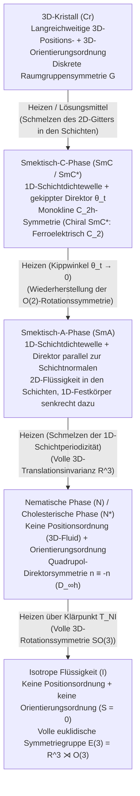

In der klassischen Physik teilen wir Materie in drei Aggregatzustände ein: fest, flüssig und gasförmig. Ein kristalliner Festkörper besitzt gleichzeitig langreichweitige <strong>Positionsordnung</strong> und <strong>Orientierungsordnung</strong>. Beim Schmelzen bricht dieses Gitter zusammen und bildet eine isotrope Flüssigkeit mit voller euklidischer Symmetriegruppe $E(3) = \mathbb{R}^3 \rtimes O(3)$. Doch die Natur kennt ein viertes Paradigma zwischen starrem Kristall und ungeordnetem Fluid: <strong>Flüssigkristalle (Mesophasen)</strong>. Sie fließen wie eine Flüssigkeit, zeigen aber zugleich optische Doppelbrechung, elastische Rückstellmomente und quantisierte topologische Defekte. Dieser Artikel entwickelt systematisch die Symmetriebrechung, statistische Mechanik, Kontinuumselastizität und Topologie der Flüssigkristalle.

---

## 1. Die Entdeckung des „doppelten Schmelzens“ und die Geburt der Physik der weichen Materie

Im März 1888 untersuchte der österreichische Botaniker <strong>Friedrich Reinitzer</strong> in Prag das aus Karotten gewonnene <strong>Cholesterylbenzoat ($\text{C}_{34}\text{H}_{50}\text{O}_2$)</strong> und entdeckte ein rätselhaftes <strong>„doppeltes Schmelzen“</strong>: (1) Bei $145,5\,^\circ\text{C}$ schmolzen die Kristalle zu einer milchig-trüben Flüssigkeit; (2) erst bei $178,5\,^\circ\text{C}$ (dem Klärpunkt $T_{NI}$) verschwand die Trübung schlagartig und hinterließ eine glasklare, isotrope Flüssigkeit. Der deutsche Physiker <strong>Otto Lehmann</strong> untersuchte die trübe Phase unter seinem Polarisationsmikroskop, beobachtete starke <strong>optische Doppelbrechung (Birefringence)</strong> und prägte 1889 den Begriff <strong>„Flüssige Kristalle“</strong>.

1922 führte der französische Mineraloge <strong>Georges Friedel</strong> den präzisen Begriff der <strong>Mesophasen</strong> ein und klassifizierte sie in die <strong>nematische Phase</strong> (griech. *nema*, „Faden“), die <strong>smektische Phase</strong> (griech. *smegma*, „Seife“) und die <strong>cholesterische Phase</strong>. Ein halbes Jahrhundert später zeigte <strong>Pierre-Gilles de Gennes</strong> (Nobelpreis für Physik 1991), dass Flüssigkristalle, Polymere und Kolloide denselben universellen Gesetzen der <strong>spontanen Symmetriebrechung, Ordnungsparameter und Eichanalogien</strong> gehorchen wie Supraleiter und Ferromagnete – die Geburtsstunde der <strong>Physik der weichen Materie (Soft Condensed Matter)</strong>.

---

## 2. Positions- vs. Orientierungsordnung: Nematische, smektische und cholesterische Phasen

Voraussetzung für Mesophasen ist eine starke <strong>Formanisotropie</strong> der Moleküle (<strong>Mesogene</strong>), etwa stäbchenförmige (kalamitische, z. B. <strong>5CB</strong> mit Aspektverhältnis $4:1$) oder scheibchenförmige (diskotische) Moleküle. Beim Erhitzen schmilzt zuerst das 3D-Schwerpunktgitter, während die sterische Hinderung die Rotation der Stäbchen blockiert – <strong>die Positionsordnung schmilzt, während die Orientierungsordnung erhalten bleibt</strong>:

### 2.1 Die nematische Phase ($N$), der Quadrupoltensor $Q_{ij}$ und der Ordnungsparameter $S$
In der uniaxialen <strong>nematischen Phase</strong> diffundieren die Molekülschwerpunkte frei im $\mathbb{R}^3$, während sich ihre Längsachsen $\mathbf{u}_\alpha$ im Mittel parallel zu einer gemeinsamen Vorzugsachse, dem <strong>Direktor $\hat{\mathbf{n}}$</strong> ($|\hat{\mathbf{n}}|=1$), ausrichten. Da gleich viele Moleküle in Richtung $+\hat{\mathbf{n}}$ und $-\hat{\mathbf{n}}$ zeigen, ist die Phase makroskopisch <strong>apolar (Kopf-Schwanz-symmetrisch)</strong> und $\hat{\mathbf{n}}$ lebt auf der <strong>reellen projektiven Ebene $\mathbb{R}P^2 = S^2/\mathbb{Z}_2$</strong>. Weil der Vektormittelwert $\langle \mathbf{u}_\alpha \rangle = \mathbf{0}$ verschwindet, führte de Gennes den symmetrischen, spurlosen <strong>Quadrupol-Tensorordnungsparameter zweiter Stufe $Q_{ij}$</strong> ein:

$$\hat{\mathbf{n}} \equiv -\hat{\mathbf{n}}, \qquad Q_{ij} = \left\langle u_{\alpha, i} u_{\alpha, j} - \frac{1}{3}\delta_{ij} \right\rangle = S \left( n_i n_j - \frac{1}{3}\delta_{ij} \right)$$

Der <strong>Maier-Saupe-Skalarordnungsparameter $S$</strong> ist das Ensemblemittel des zweiten Legendre-Polynoms $P_2(\cos\theta)$:

$$S = \langle P_2(\cos\theta) \rangle = \left\langle \frac{3\cos^2\theta - 1}{2} \right\rangle = \int_0^\pi f(\theta) \left(\frac{3\cos^2\theta - 1}{2}\right) \sin\theta \, d\theta$$

Für perfekte Parallelität gilt $S = 1$, in der isotropen Flüssigkeit ($\langle\cos^2\theta\rangle = 1/3$) gilt $S = 0$, und in realen Nematogen liegt $S$ zwischen $0,3$ und $0,8$.

### 2.2 Smektische Phasen ($\text{SmA}, \text{SmC}^*$) und cholesterische Bragg-Reflexion ($N^*$)
* <strong>Smektische Phasen</strong>: Moleküle ordnen sich in äquidistanten Schichten ($d \approx 2\text{–}4\,\text{nm}$) und bilden eine eindimensionale Massendichtewelle $\rho(\mathbf{r})$. De Gennes (1972) entdeckte, dass der <strong>Nematisch-$\text{SmA}$-Übergang mathematisch isomorph zur Ginzburg-Landau-Theorie eines Supraleiters</strong> ist: Konstante Schichtdicke verdrängt Verdrillung ($K_2 \to \infty$) und Biegung ($K_3 \to \infty$) exakt wie der Meißner-Ochsenfeld-Effekt das Magnetfeld! In der chiralen gekippten $\text{SmC}^*$-Phase erzwingt die $C_2$-Symmetrie eine spontane ferroelektrische Polarisation $\mathbf{P}_s \propto \hat{\mathbf{k}} \times \hat{\mathbf{n}}$ (Meyer, 1975), was mikrosekundenschnelle bistabile SSFLC-Schalter ermöglicht.
* <strong>Cholesterische Phase ($N^*$)</strong>: Chirale Moleküle verdrillen den Direktor helikal mit der Ganghöhe $p$ (optische Periode $p/2$) und erzeugen ein photonisches Stoppband mit <strong>händigkeitselektiver zirkular polarisierter Bragg-Reflexion</strong>:

$$\rho(\mathbf{r}) = \rho_0 + |\psi(\mathbf{r})| \cos\left(q_0 z - q_0 u_z(\mathbf{r})\right), \qquad \lambda_0 = \bar{n} \, p \cos\theta_{\text{inc}}$$

---

## 3. Statistische Mechanik der Phasenübergänge: Landau-de Gennes vs. Onsager-Theorie

1. <strong>Thermotrope Flüssigkristalle und Landau-de-Gennes-Theorie</strong>: Warum ist der isotrop-nematische Übergang in 3D stets <strong>schwach erster Ordnung (diskontinuierlich)</strong>? Weil die Zustände $Q_{ij}$ ($S>0$, zigarrenförmige Ausrichtung) und $-Q_{ij}$ ($S<0$, scheibenförmige Ausrichtung in der Ebene senkrecht zu $\hat{\mathbf{n}}$) physikalisch inäquivalent sind, verschwindet die <strong>kubische Invariante $\text{Tr}(\mathbf{Q}^3) = \frac{2}{9}S^3$</strong> in der freien Energie nicht:

$$f_{\text{LdG}}(S, T) = f_0 + \frac{1}{3} a (T - T^*) S^2 - \frac{2}{27} B S^3 + \frac{1}{9} C S^4$$

$$T_{NI} = T^* + \frac{B^2}{27 a C}, \qquad S_{NI} = \frac{B}{3C}, \qquad \Delta H = \frac{a B^2 T_{NI}}{27 C^2}$$

   Der kubische Term bewirkt am Klärpunkt $T_{NI}$ einen Sprung von $S=0$ auf $S_{NI} = B/(3C) \approx 0,43$ samt latenter Wärme $\Delta H$.
2. <strong>Lyotrope Flüssigkristalle und Onsagers entropisches Harte-Stäbchen-Modell (1949)</strong>: Lars Onsager bewies, dass eine Suspension starrer Zylinder ($L/D \gg 1$) völlig ohne anziehende Kräfte ($\Delta U = 0$) allein durch Maximierung der Gesamtentropie nematisch wird! Das <strong>ausgeschlossene Volumen $v_{\text{excl}}(\gamma)$</strong> zweier Stäbchen unter dem Relativwinkel $\gamma$ ist proportional zu $|\sin\gamma|$:

$$v_{\text{excl}}(\gamma) = 2 L^2 D |\sin\gamma|, \qquad \phi_I = \frac{3.340}{L/D}, \qquad \phi_N = \frac{4.486}{L/D}$$

   Oberhalb des kritischen Volumenanteils $\phi_I$ opfern die Stäbchen durch parallele Ausrichtung ($\gamma \to 0$) etwas Orientierungsentropie ($\Delta S_{\text{orient}} < 0$), gewinnen aber durch die drastische Reduktion von $v_{\text{excl}}$ weitaus mehr <strong>translatorische Packungsentropie ($\Delta S_{\text{trans}} \gg |\Delta S_{\text{orient}}|$)</strong>.

---

## 4. Kontinuumselastizität und Elektrooptik: Oseen-Frank-Theorie und Fréedericksz-Übergang

Räumliche Gradienten des Direktors $\hat{\mathbf{n}}(\mathbf{r})$ kosten elastische Energie, beschrieben durch die <strong>Oseen-Frank-Freie-Energiedichte</strong> mit den drei Grunddeformationen <strong>Spreizung (Splay, $K_1$)</strong>, <strong>Verdrillung (Twist, $K_2$)</strong> und <strong>Biegung (Bend, $K_3$)</strong>:

$$f_{\text{Frank}} = \frac{1}{2} K_1 \left( \nabla \cdot \hat{\mathbf{n}} \right)^2 + \frac{1}{2} K_2 \left( \hat{\mathbf{n}} \cdot (\nabla \times \hat{\mathbf{n}}) + q_0 \right)^2 + \frac{1}{2} K_3 \left( \hat{\mathbf{n}} \times (\nabla \times \hat{\mathbf{n}}) \right)^2$$

Mit $K_i \sim k_B T / a \sim 10\,\text{pN}$ sind Flüssigkristalle extrem weich; langwellige thermische Direktorfluktuationen $\langle|\delta\mathbf{n}(\mathbf{q})|^2\rangle = k_B T / (V K q^2)$ streuen Licht millionenfach stärker als normale Flüssigkeiten und erklären Reinitzers milchige Trübung.

In einer Zelle der Dicke $d$ konkurriert bei $\Delta\varepsilon = \varepsilon_\parallel - \varepsilon_\perp > 0$ das elektrische Drehmoment mit der elastischen Wandverankerung. Die Stabilitätsanalyse der Grundmode ($n=1$) liefert die kritische Feldstärke und Schwellenspannung des <strong>Fréedericksz-Übergangs</strong>:

$$E_{\text{th}} = \frac{\pi}{d} \sqrt{\frac{K_1}{\varepsilon_0 \Delta\varepsilon}} \quad \Longrightarrow \quad V_{\text{th}} = E_{\text{th}} d = \pi \sqrt{\frac{K_1}{\varepsilon_0 \Delta\varepsilon}}$$

Die Schichtdicke $d$ kürzt sich exakt heraus! Mit $V_{\text{th}} \approx 1\,\text{V}$ lassen sich Flüssigkristalle direkt durch CMOS-Dünnschichttransistoren (TFTs) in modernen <strong>TN- (Twisted Nematic)</strong>, <strong>IPS- (In-Plane Switching)</strong> und <strong>VA- (Vertical Alignment)</strong> LCD-Bildschirmen schalten.

---

## 5. Topologische Defekte (Disklinationen) und Homotopiegruppe $\pi_1(\mathbb{R}P^2) = \mathbb{Z}_2$

Wegen der Kopf-Schwanz-Äquivalenz $\hat{\mathbf{n}} \equiv -\hat{\mathbf{n}}$ genügt bei einem Umlauf ($2\pi$) um einen Defektkern eine Drehung des Direktors um ein Vielfaches von $\pi$ ($180^\circ$). Daher existieren in 2D <strong>halbzahlige Disklinationen ($s = \pm 1/2$)</strong>: kometenförmige $+1/2$- und kleeblattförmige $-1/2$-Defekte. Im 3D-Raum ist die Ordnungsparameter-Mannigfaltigkeit $\mathcal{M} = \mathbb{R}P^2$ mit der Fundamentalgruppe:

$$\pi_1(\mathbb{R}P^2) = \mathbb{Z}_2 = \{0, 1\}, \qquad E_{\text{line}} = \pi K s^2 \ln\left(\frac{R}{r_c}\right) + E_{\text{core}}, \qquad B = 4|s|$$

Folglich sind in 3D nur halbzahlige Defektlinien ($s = \pm 1/2$, Klasse $1 \in \mathbb{Z}_2$) topologisch stabil, während ganzzahlige Defekte ($s = \pm 1$, Klasse $0 \in \mathbb{Z}_2$) ihre Singularität durch Verkippen des Direktors in die dritte Dimension auflösen (<strong>„Escape into the third dimension“</strong>). In der <strong>Schlieren-Textur</strong> unter gekreuzten Polarisatoren zeigt ein Defektkern exakt $B = 4|s|$ dunkle Auslöschungsbürsten ($B=2$ für $s=\pm 1/2$, $B=4$ für $s=\pm 1$).

---

## 6. Vergleich der Mesophasen und moderne Anwendungen (Kevlar, Künstliche Muskeln, Aktive Materie)

| Mesophase / Zustand | Positionsordnung (Translation) | Orientierungsordnung (Rotation) | Punkt- / Raumgruppe | Primäre Ordnungsparameter | Optische & rheologische Merkmale |
| :--- | :--- | :--- | :--- | :--- | :--- |
| <strong>Isotrope Flüssigkeit ($I$)</strong> | Keine (volle 3D-$\mathbb{R}^3$-Invarianz) | Keine (volle 3D-$O(3)$-Invarianz) | $E(3) = \mathbb{R}^3 \rtimes O(3)$ | $S = 0, \; \psi = 0$ | Optisch isotrop ($\Delta n = 0$), Newtonsches Fluid |
| <strong>Nematisch ($N$)</strong> | Keine (3D-Fluid $\mathbb{R}^3$) | Langreichweitig uniaxial ($\hat{\mathbf{n}} \equiv -\hat{\mathbf{n}}$) | $\mathbb{R}^3 \rtimes D_{\infty h}$ | Quadrupoltensor $Q_{ij}$ ($S \neq 0$) | Hohe Doppelbrechung $\Delta n$, Schlieren-Textur ($B=2,4$), niedrige Viskosität |
| <strong>Cholesterisch ($N^*$)</strong> | Keine (lokal nematisches Fluid) | Helikale Verdrillung ($q_0 = 2\pi/p$) | $\mathbb{R}^2 \rtimes D_\infty$ (chiral) | $Q_{ij}(\mathbf{r})$, Ganghöhe $p$ | Zirkular polarisierte Bragg-Reflexion ($\lambda_0 = \bar{n}p$), optische Aktivität |
| <strong>Smektisch-A ($\text{SmA}$)</strong> | 1D-Schichtdichtewelle ($d \approx L$) | Parallel zur Schichtnormalen ($\hat{\mathbf{n}} \parallel \hat{\mathbf{k}}$) | $(\mathbb{R}^2 \times \mathbb{Z}) \rtimes D_{\infty h}$ | $S \neq 0$, komplexe Welle $\psi = |\psi|e^{i\phi}$ | Fokal-konische Texturen, Verdrängung von Twist & Bend ($K_2, K_3 \to \infty$) |
| <strong>Chiral Smektisch-C ($\text{SmC}^*$)</strong> | 1D-Schichten ($d = L\cos\theta_t$) | Gekippt um Winkel $\theta_t$ zu $\hat{\mathbf{k}}$ | Monoklin $C_2$ (polar) | $\psi \neq 0$, Spontanpolarisation $\mathbf{P}_s$ | Biaxiale Optik, mikrosekundenschnelles ferroelektrisches Schalten (SSFLC) |

Über Displays hinaus prägen Flüssigkristalle vier Hochtechnologiefelder: (1) <strong>Flüssigkristallpolymere (LCPs)</strong>: Durch Onsager-Ordnung starrer Aramidstäbchen in Schwefelsäure entwickelte Stephanie Kwolek <strong>Kevlar</strong> mit der fünf- bis achtfachen spezifischen Zugfestigkeit von Stahl; (2) <strong>Flüssigkristall-Elastomere (LCEs)</strong> als künstliche Muskeln mit $30\%\text{–}400\%$ reversibler Kontraktion am Phasenübergang $T_{NI}$; (3) <strong>LCoS-Raumlichtmodulatoren und Q-Plates</strong> für holografische optische Pinzetten und optische Wirbelstrahlen; sowie (4) <strong>Biologische Flüssigkristalle und Aktive Nematische Materie</strong>: Zellmembranen sind 2D-$\text{SmA}$-Doppelschichten, während ATP-getriebene Zytoskelett-Netzwerke und Epithelgewebe eine <strong>aktive Spannung</strong> proportional zu $Q_{ij}$ erzeugen:

$$\sigma_{ij}^{\text{active}} = -\zeta \, Q_{ij}, \qquad \mathbf{f}^{\text{active}} = -\zeta \nabla \cdot \mathbf{Q}$$

Da kometenförmige $+1/2$-Defekte die Vorwärts-Rückwärts-Symmetrie brechen ($\nabla\cdot\mathbf{Q} \neq \mathbf{0}$), bewegen sie sich als <strong>selbstangetriebene Quasiteilchen</strong> (aktive Turbulenz) und steuern biologische Prozesse wie die Zellextrusion im Epithel (Saw et al., *Nature* 2017) sowie die Regeneration des Süßwasserpolypen *Hydra* (Kopf- und Fußbildung an stabilen $+1$-Defekten, Tentakelknospung an $-1/2$-Defekten).
