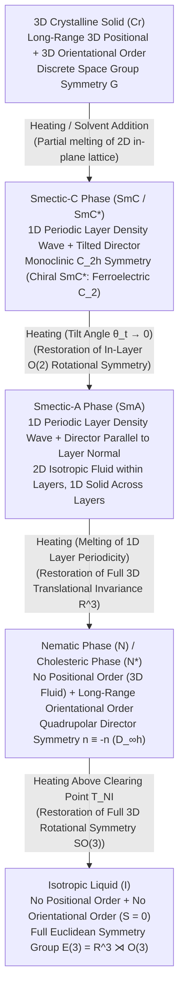
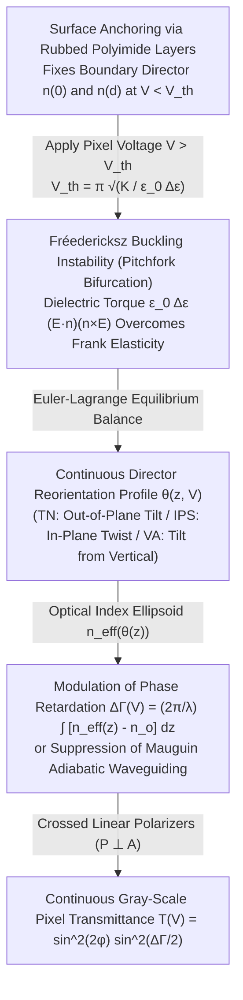

In elementary physics, we are taught to partition the material universe into three canonical states of matter: <strong>solid, liquid, and gas</strong>. In a crystalline solid, constituent atoms or molecules occupy a rigid, three-dimensional periodic lattice, simultaneously maintaining long-range <strong>positional order</strong> and long-range <strong>orientational order</strong>. When heated past a single sharp melting temperature, thermal fluctuations shatter this lattice all at once, yielding an isotropic liquid in which molecules diffuse freely with neither positional periodicity nor preferred orientation—restoring the full continuous Euclidean symmetry group $E(3) = \mathbb{R}^3 \rtimes O(3)$ of three-dimensional space.

Yet nature harbors a profound fourth paradigm that subverts this binary dichotomy between rigid crystalline order and featureless fluid disorder: <strong>Liquid Crystals (mesophases)</strong>. A liquid crystal flows under shear stress, forms coalescing droplets, and can be poured through a pipette like an ordinary fluid, yet it simultaneously exhibits optical birefringence, rotates the plane of polarized light, supports elastic restoring torques, and harbors quantized topological defects previously thought exclusive to ordered solids or superfluids.

How can a substance be both a flowing liquid and an anisotropic crystal at thermal equilibrium? In this article, we journey through the physics and mathematics of liquid crystals—beginning with Friedrich Reinitzer's serendipitous 1888 discovery of "double melting points" in carrot extracts, tracing Pierre-Gilles de Gennes's unification of soft condensed matter physics, deriving the quadrupolar tensor order parameter $Q_{ij}$, contrasting Landau-de Gennes thermotropic theory with Lars Onsager's purely entropic hard-rod transition, formulating Oseen-Frank continuum elasticity and the Fréedericksz transition that powers modern LCDs, classifying half-integer disclinations via the homotopy group $\pi_1(\mathbb{R}P^2) = \mathbb{Z}_2$, and exploring cutting-edge frontiers from Kevlar ballistic fibers and liquid crystal elastomer artificial muscles to living <strong>active nematics</strong>.

---

## 1. The Discovery of "Double Melting" and the Birth of Soft Matter Physics

### 1.1 Friedrich Reinitzer's Cholesteryl Benzoate and Otto Lehmann's Polarizing Microscope

The science of liquid crystals began in March 1888 in Prague. The Austrian botanist and chemist <strong>Friedrich Reinitzer</strong> was investigating the chemical constitution and physiological role of cholesterol in plants. Having extracted cholesterol from carrot roots, he synthesized its ester derivative, <strong>cholesteryl benzoate ($\text{C}_{34}\text{H}_{50}\text{O}_2$)</strong>, and attempted to verify its purity by measuring its melting point.

Where a pure organic compound should exhibit a single, sharp solid-to-liquid melting transition, Reinitzer observed an extraordinary anomaly that he termed <strong>"double melting" (double melting points)</strong>:

1. <strong>First Transition ($145.5\,^\circ\text{C}$)</strong>: Upon heating the solid crystals to $145.5\,^\circ\text{C}$, the rigid lattice melted abruptly into a mobile fluid. However, instead of becoming transparent like water or molten glass, this liquid remained stubbornly <strong>cloudy and turbid (milky)</strong>.
2. <strong>Second Transition ($178.5\,^\circ\text{C}$, the Clearing Point)</strong>: Upon further heating to $178.5\,^\circ\text{C}$, the cloudiness vanished instantaneously, yielding a completely transparent, optically isotropic liquid.
3. <strong>Iridescent Color Phenomena</strong>: Upon cooling the clear liquid back through $178.5\,^\circ\text{C}$, transient flashes of vivid violet and blue light appeared as the fluid turned cloudy, followed by a second violet-blue optical reflection just before crystallization at $145.5\,^\circ\text{C}$.

Suspecting chemical impurities, Reinitzer painstakingly recrystallized his samples, yet the temperature interval of $33\,^\circ\text{C}$ between the melting point and the clearing point remained invariant. Recognizing that the phenomenon required sophisticated optical analysis, Reinitzer wrote on March 14, 1888, to the German physicist <strong>Otto Lehmann</strong> at Aachen, enclosing several vials of cholesteryl esters. Lehmann had pioneered the <strong>crystallization microscope</strong>—a polarizing microscope equipped with crossed Nicol prisms and a precision heated stage.

When Lehmann examined the cloudy fluid phase between $145.5\,^\circ\text{C}$ and $178.5\,^\circ\text{C}$ under crossed polarizers, he witnessed a revelation. Although the substance flowed freely and coalesced into spherical droplets under surface tension, it displayed vibrant interference colors and dark extinction brushes characteristic of <strong>optical birefringence</strong> in uniaxial and biaxial mineral crystals. Convinced that fluidity and crystalline optical anisotropy coexisted within a single homogeneous thermodynamic phase, Lehmann coined the seemingly oxymoronic term <strong><em>Flüssige Kristalle</em> (Liquid Crystals)</strong> in 1889.

### 1.2 From Classical Skepticism to Friedel's Classification and de Gennes's Unified Physics

Lehmann's claim provoked fierce resistance from the doyens of classical physical chemistry and crystallography, notably Gustav Tammann and Walther Nernst. According to nineteenth-century orthodoxy, crystallinity was synonymous with a three-dimensional periodic space lattice; a "flowing crystal" was dismissed as a semantic contradiction, attributed instead to heterogeneous colloidal emulsions or imperfectly melted microcrystals suspended in an isotropic melt.

The controversy was decisively resolved in 1922 by the French mineralogist <strong>Georges Friedel</strong> in a monumental 200-page treatise. Rejecting the term "liquid crystal" precisely because these materials are neither true crystals nor ordinary liquids, Friedel introduced the rigorous concept of <strong>mesomorphic states (mesophases)</strong>—thermodynamically stable intermediate phases of matter situated between the crystalline solid and the isotropic liquid. By analyzing the geometry of their topological defect textures under polarized light, Friedel classified mesophases into three foundational families:

- <strong>Nematic phase</strong> (from the Greek $\nu\tilde{\eta}\mu\alpha$, *nema*, meaning "thread"), named after the dark, mobile thread-like defect lines (disclinations) observed inside the fluid.
- <strong>Smectic phase</strong> (from the Greek $\sigma\mu\tilde{\eta}\gamma\mu\alpha$, *smegma*, meaning "soap"), named after the slippery, layered lamellar structures originally observed in concentrated soap-water systems.
- <strong>Cholesteric phase</strong>, representing the chiral, helically twisted variant of the nematic phase exhibited by Reinitzer's cholesterol derivatives.

Half a century later, the French theoretical physicist <strong>Pierre-Gilles de Gennes</strong> revolutionized condensed matter physics by demonstrating that liquid crystals, polymers, and colloids obey the exact same universal mathematical framework of <strong>spontaneous symmetry breaking, order parameters, scaling laws, and gauge analogies</strong> that govern superconductors, superfluids, and ferromagnets. Awarded the <strong>1991 Nobel Prize in Physics</strong>, de Gennes established the field of <strong>Soft Condensed Matter Physics (<em>Matière Molle</em>)</strong>: systems in which weak intermolecular forces (van der Waals, dipolar, $\pi$-$\pi$ stacking, and entropic excluded-volume interactions) are comparable in magnitude to thermal energy $k_B T$ at room temperature, enabling macroscopic collective order that responds dramatically to minute external electric, magnetic, or mechanical perturbations.

---

## 2. Positional vs. Orientational Order: Symmetry Breaking and Order Parameters

Why do certain organic molecules pass through one or more liquid-crystalline mesophases rather than melting directly into an isotropic liquid? The microscopic prerequisite is strong <strong>molecular shape anisotropy (anisometry)</strong>. Molecules capable of forming mesophases—termed <strong>mesogens</strong>—typically adopt one of two architectures:

1. <strong>Calamitic (Rod-like) Mesogens</strong>: Elongated molecules comprising a rigid aromatic core (such as biphenyl, terphenyl, or Schiff bases) attached to one or more flexible aliphatic hydrocarbon tails. The archetypal room-temperature nematic mesogen is <strong>5CB (4-cyano-4'-pentylbiphenyl)</strong>, whose rigid biphenyl core and polar cyano ($-\text{CN}$) headgroup give it an aspect ratio of roughly $4:1$ (length $L \approx 2\text{ nm}$, diameter $D \approx 0.5\text{ nm}$).
2. <strong>Discotic (Disc-like) and Bent-Core (Banana-shaped) Mesogens</strong>: Flat, rigid polyaromatic cores (such as triphenylene or hexabenzocoronene) surrounded by six or more flexible alkyl chains (discovered by Sivaramakrishna Chandrasekhar in 1977), which stack into one-dimensional liquid-like columns arranged on a two-dimensional hexagonal lattice (<strong>Columnar phase</strong>).

When a crystal of rod-like molecules is heated, the thermal kinetic energy $k_B T$ first overcomes the translational energy barriers holding the molecular centers of mass onto a 3D Bravais lattice. However, because elongated rods cannot easily rotate past one another in a dense fluid without sterically colliding, rotational motion perpendicular to the long molecular axis remains hindered long after translational motion is liberated. Thus, <strong>positional order melts while orientational order survives</strong>.

### 2.1 The Nematic Phase ($N$) and the Quadrupolar Tensor Order Parameter $Q_{ij}$

The simplest and most technologically ubiquitous liquid crystal phase is the <strong>uniaxial nematic phase ($N$)</strong>. In the nematic phase, the center-of-mass pair correlation function $g(\mathbf{r})$ decays exponentially over a few molecular diameters, meaning the system possesses <strong>full three-dimensional translational invariance $\mathbb{R}^3$</strong> and flows with a low shear viscosity comparable to light machine oil.

Simultaneously, the three-dimensional rotational group $SO(3)$ is spontaneously broken down to the cylindrical dihedral group $D_{\infty h}$. Let the unit vector $\mathbf{u}_\alpha$ denote the long axis of the $\alpha$-th rod-like molecule. On average, the molecular axes align along a common macroscopic axis of broken symmetry called the <strong>director $\hat{\mathbf{n}}$</strong> (where $|\hat{\mathbf{n}}| = 1$).

Crucially, even when individual molecules carry a permanent electric dipole moment along their long axis (such as the $-\text{CN}$ group in 5CB), antiparallel pairing and thermal flip-flops ensure that an equal number of molecules point along $+\hat{\mathbf{n}}$ and $-\hat{\mathbf{n}}$ at equilibrium. Consequently, the nematic phase is macroscopically <strong>apolar (head-tail symmetric)</strong>:

$$\hat{\mathbf{n}} \equiv -\hat{\mathbf{n}}$$

Mathematically, the director $\hat{\mathbf{n}}$ is not a true polar vector on the unit sphere $S^2$, but a headless <strong>pseudovector (line element)</strong> living on the <strong>real projective plane $\mathbb{R}P^2 = S^2/\mathbb{Z}_2$</strong>. Because of this head-tail inversion symmetry, the thermal average of any odd-rank tensor—including the first-rank dipole vector $\langle \mathbf{u}_\alpha \rangle = \mathbf{0}$—vanishes identically in both the isotropic and nematic phases.

To construct a valid macroscopic order parameter that vanishes in the isotropic phase ($O(3)$ invariant) and is non-zero in the apolar nematic phase, de Gennes introduced the <strong>symmetric, traceless second-rank quadrupolar tensor order parameter $Q_{ij}$</strong>:

$$Q_{ij} = \left\langle u_{\alpha, i} u_{\alpha, j} - \frac{1}{3}\delta_{ij} \right\rangle$$

where $i, j \in \{x, y, z\}$ and $\delta_{ij}$ is the Kronecker delta. Notice that under molecular head-tail inversion $\mathbf{u}_\alpha \to -\mathbf{u}_\alpha$, the dyadic product $u_{\alpha, i} u_{\alpha, j}$ is strictly invariant, and taking the trace yields $\text{Tr}(\mathbf{Q}) = Q_{ii} = \langle |\mathbf{u}_\alpha|^2 - 1 \rangle = 0$.

In its principal axis frame $(\hat{\mathbf{l}}, \hat{\mathbf{m}}, \hat{\mathbf{n}})$, the general $3 \times 3$ symmetric traceless tensor $\mathbf{Q}$ can be parameterized by two scalar invariants—the uniaxial scalar order parameter $S$ and the biaxiality parameter $P$:

$$Q_{ij} = S \left( n_i n_j - \frac{1}{3}\delta_{ij} \right) + \frac{1}{2} P \left( l_i l_j - m_i m_j \right)$$

For a standard <strong>uniaxial nematic phase</strong> ($P = 0$, rotationally invariant around $\hat{\mathbf{n}}$), this reduces to:

$$Q_{ij} = S \left( n_i n_j - \frac{1}{3}\delta_{ij} \right) \xrightarrow{\hat{\mathbf{n}} = \hat{\mathbf{z}}} \mathbf{Q} = \begin{pmatrix} -S/3 & 0 & 0 \\ 0 & -S/3 & 0 \\ 0 & 0 & 2S/3 \end{pmatrix}$$

Projecting $Q_{ij} n_i n_j = \frac{2}{3}S$, we recover the <strong>Maier-Saupe scalar order parameter $S$</strong> as the ensemble average of the second Legendre polynomial $P_2(\cos\theta)$:

$$S = \langle P_2(\cos\theta) \rangle = \left\langle \frac{3\cos^2\theta - 1}{2} \right\rangle = \int_0^\pi f(\theta) \left(\frac{3\cos^2\theta - 1}{2}\right) \sin\theta \, d\theta$$

where $\theta_\alpha$ is the polar angle between the molecular axis $\mathbf{u}_\alpha$ and the macroscopic director $\hat{\mathbf{n}}$, and $f(\theta)$ is the orientational distribution function normalized via $\int_0^\pi f(\theta)\sin\theta\,d\theta = 1$. Let us examine the physical limits of $S$:

- <strong>Ideal Parallel Alignment ($\theta = 0$ or $\pi$)</strong>: Every molecule lies strictly parallel to $\hat{\mathbf{n}}$, so $\cos^2\theta = 1$ and <strong>$S = 1$</strong>.
- <strong>Isotropic Liquid (Random 3D Orientation)</strong>: When $f(\theta) = 1/2$ is uniform over the sphere, $\langle \cos^2\theta \rangle = \frac{1}{2}\int_{-1}^{1} \cos^2\theta \, d(\cos\theta) = \frac{1}{3}$, yielding <strong>$S = 0$</strong>.
- <strong>Perpendicular Planar Disorder ($\theta = \pi/2$)</strong>: If all rods lie randomly within the plane perpendicular to $\hat{\mathbf{n}}$, $\cos^2\theta = 0$ and <strong>$S = -1/2$</strong>.
- <strong>Experimental Nematic Range</strong>: In real thermotropic nematics, thermal agitation maintains $S$ between <strong>$0.3$ and $0.8$</strong>, jumping discontinuously from $S = 0$ to $S \approx 0.43$ at the isotropic-nematic clearing temperature $T_{NI}$ and increasing monotonically as the temperature is lowered.

### 2.2 Smectic Phases ($\text{SmA}, \text{SmC}, \text{SmC}^*$) and the Superconductor Analogy

When cooled below the nematic range, many rod-like mesogens undergo a further symmetry-breaking transition into a <strong>smectic phase</strong>, in which molecules self-assemble into well-defined, equidistant layers while retaining liquid-like disorder within each layer. Thus, translational symmetry $\mathbb{R}^3$ is broken along a single spatial direction (the layer normal $\hat{\mathbf{k}}$, taken along $z$), establishing a one-dimensional periodic <strong>mass density wave</strong>:

$$\rho(\mathbf{r}) = \rho_0 + \text{Re}\left[ \psi(\mathbf{r}) \, e^{i q_0 z} \right] = \rho_0 + |\psi(\mathbf{r})| \cos\left(q_0 z - q_0 u_z(\mathbf{r})\right)$$

Here $q_0 = \frac{2\pi}{d}$ is the fundamental wavevector corresponding to the layer spacing $d \approx 2\text{--}4\text{ nm}$, $|\psi|$ is the density wave amplitude, and $\phi(\mathbf{r}) = -q_0 u_z(\mathbf{r})$ represents the phase shift induced by a vertical layer displacement field $u_z(\mathbf{r})$.

1. <strong>Smectic-A Phase ($\text{SmA}$)</strong>: The director $\hat{\mathbf{n}}$ aligns parallel to the layer normal $\hat{\mathbf{k}}$ ($\hat{\mathbf{n}} \parallel \hat{\mathbf{k}}$). Within each layer, molecular centers of mass diffuse as a 2D isotropic fluid, while layers slide past one another easily. In 1972, de Gennes formulated one of the most celebrated analogies in theoretical physics: the <strong>de Gennes free energy of the $\text{Nematic--SmA}$ transition</strong> is mathematically isomorphic to the <strong>Ginzburg-Landau theory of a superconductor</strong>:
   $$f_{\text{SmA}} = \frac{1}{2} r |\psi|^2 + \frac{1}{4} u |\psi|^4 + \frac{\hbar^2}{2m_\parallel} |(\nabla_\parallel - i q_0 \delta\mathbf{n}_\perp)\psi|^2 + f_{\text{Frank}}(\hat{\mathbf{n}})$$
   where transverse director fluctuations $\delta\mathbf{n}_\perp = (\delta n_x, \delta n_y, 0)$ play the exact role of the electromagnetic vector potential $\mathbf{A}$ minimally coupled to the complex Cooper-pair wavefunction $\psi$! Just as a superconductor expels magnetic flux $\mathbf{B} = \nabla \times \mathbf{A} = \mathbf{0}$ via the <strong>Meissner effect</strong>, the establishment of constant layer thickness ($\nabla \times \hat{\mathbf{n}} = \mathbf{0}$ for curl-free layer normals $\hat{\mathbf{n}} = \nabla \Phi / |\nabla \Phi|$) forces a $\text{SmA}$ liquid crystal to <strong>completely expel twist ($K_2 \to \infty$) and bend ($K_3 \to \infty$) deformations</strong>! Moreover, when subjected to strong mechanical twist at boundaries, a $\text{SmA}$ phase can nucleate periodic arrays of screw dislocations—the <strong>Twist Grain Boundary ($\text{TGB}$) phase</strong> predicted by Renn and Lubensky (1988), which is the exact liquid-crystal analog of the Abrikosov vortex lattice in Type-II superconductors.
2. <strong>Smectic-C Phase ($\text{SmC}$) and Chiral Ferroelectric $\text{SmC}^*$</strong>: In the $\text{SmC}$ phase, the director $\hat{\mathbf{n}}$ tilts homogeneously by a polar angle $\theta_t(T)$ relative to the layer normal $\hat{\mathbf{k}}$, breaking the in-plane rotational symmetry $O(2)$ and reducing the point group symmetry to monoclinic $C_{2h}$ (a center of inversion, a two-fold rotation axis perpendicular to the tilt plane, and a mirror plane parallel to the tilt plane). In 1975, <strong>Robert B. Meyer</strong> realized through pure symmetry group analysis that if a $\text{SmC}$ phase is composed of <strong>chiral molecules ($\text{SmC}^*$)</strong>, the mirror plane and inversion center are automatically eliminated, leaving only the single two-fold polar axis $C_2$ along $\hat{\mathbf{k}} \times \hat{\mathbf{n}}$. Consequently, every single smectic layer must possess a non-vanishing <strong>spontaneous ferroelectric polarization $\mathbf{P}_s \propto \hat{\mathbf{k}} \times \hat{\mathbf{n}}$</strong> lying inside the layer plane perpendicular to the tilt direction! By confining $\text{SmC}^*$ into a thin cell ($d \sim 1.5\,\mu\text{m}$) to unwind its macroscopic helix, Noel Clark and Sven T. Lagerwall (1980) invented the <strong>Surface-Stabilized Ferroelectric Liquid Crystal (SSFLC)</strong>, achieving bistable electro-optic switching on a microsecond timescale ($\sim 1\text{--}10\,\mu\text{s}$)—three orders of magnitude faster than nematic LCDs.

### 2.3 Cholesteric (Chiral Nematic, $N^*$) Phase and Selective Bragg Reflection

When a nematic phase consists of chiral molecules—or an achiral nematic host doped with a chiral solute—intermolecular steric and van der Waals forces favor a slight local twist angle between neighboring rods. Over macroscopic distances, the director $\hat{\mathbf{n}}(\mathbf{r})$ traces a uniform spatial helix along a helical axis $\hat{\mathbf{h}}$ (taken as the $z$-axis):

$$\hat{\mathbf{n}}(z) = \begin{pmatrix} \cos(q_0 z + \phi_0) \\ \sin(q_0 z + \phi_0) \\ 0 \end{pmatrix}, \qquad q_0 = \frac{2\pi}{p}$$

This is the <strong>Cholesteric (or Chiral Nematic, $N^*$) phase</strong>—the exact mesophase discovered by Reinitzer in cholesteryl benzoate. Here $p$ is the <strong>helical pitch</strong> (the distance over which $\hat{\mathbf{n}}$ completes a full $2\pi$ rotation), with $q_0 > 0$ denoting a right-handed helix and $q_0 < 0$ a left-handed helix. Because $\hat{\mathbf{n}} \equiv -\hat{\mathbf{n}}$, the dielectric tensor $\varepsilon_{ij}(z) = \varepsilon_\perp \delta_{ij} + \Delta\varepsilon \, n_i(z) n_j(z)$ repeats every half-turn, making the <strong>true spatial and optical period equal to $p/2$</strong>.

When the pitch $p$ is comparable to the wavelength of visible light ($p \sim 300\text{--}700\text{ nm}$), solving Maxwell's equations in this continuously rotating periodic dielectric medium (the Oseen-de Vries exact solution) reveals a one-dimensional <strong>photonic stop-band (selective Bragg reflection)</strong>. For light incident at angle $\theta_{\text{inc}}$ to the helical axis, constructive Bragg interference occurs within a spectral band centered at wavelength $\lambda_0$ with bandwidth $\Delta\lambda$:

$$\lambda_0 = \bar{n} \, p \cos\theta_{\text{inc}}, \qquad \Delta\lambda = \Delta n \, p \cos\theta_{\text{inc}}$$

where $\bar{n} = \frac{1}{2}(n_e + n_o)$ is the average refractive index and $\Delta n = n_e - n_o$ is the birefringence. Crucially, unlike a conventional dielectric Bragg mirror that reflects both polarizations equally, a cholesteric helix exhibits <strong>handedness-selective circular polarization reflection</strong>: a right-handed cholesteric helix reflects up to $100\%$ of right-circularly polarized (RCP) light within $\Delta\lambda$ (without reversing its handedness upon reflection, unlike a metallic mirror!) while transmitting $100\%$ of left-circularly polarized (LCP) light completely unimpeded. This mechanism accounts for Reinitzer's violet-blue flashes, thermochromic liquid crystal sensors (where $p(T)$ diverges near a lower-temperature $\text{SmA}$ phase transition), and the brilliant metallic green circularly polarized exocuticle of the scarab beetle *Chrysina gloriosa*.

| Mesophase / State | Positional Order (Translational Symmetry) | Orientational Order (Rotational Symmetry) | Point / Space Symmetry | Primary Order Parameters | Optical & Rheological Signatures |
| :--- | :--- | :--- | :--- | :--- | :--- |
| <strong>Isotropic Liquid ($I$)</strong> | None (Full 3D $\mathbb{R}^3$ invariance) | None (Full 3D $O(3)$ invariance) | $E(3) = \mathbb{R}^3 \rtimes O(3)$ | $S = 0, \; \psi = 0$ | Optically isotropic ($\Delta n = 0$), Newtonian fluid |
| <strong>Nematic ($N$)</strong> | None (3D fluid $\mathbb{R}^3$) | Long-range uniaxial ($\hat{\mathbf{n}} \equiv -\hat{\mathbf{n}}$) | $\mathbb{R}^3 \rtimes D_{\infty h}$ | Quadrupolar tensor $Q_{ij}$ ($S \neq 0$) | High uniaxial birefringence $\Delta n$, Schlieren thread textures, low viscosity |
| <strong>Cholesteric ($N^*$)</strong> | None (Locally nematic fluid) | Helical twist along axis ($q_0 = 2\pi/p$) | $\mathbb{R}^2 \rtimes D_\infty$ (Chiral) | $Q_{ij}(\mathbf{r})$ with helical pitch $p$ | Circularly polarized Bragg reflection ($\lambda_0 = \bar{n}p$), giant optical rotatory power |
| <strong>Smectic-A ($\text{SmA}$)</strong> | 1D periodic layer wave ($d \approx L$) | Parallel to layer normal ($\hat{\mathbf{n}} \parallel \hat{\mathbf{k}}$) | $(\mathbb{R}^2 \times \mathbb{Z}) \rtimes D_{\infty h}$ | $S \neq 0$ and complex density wave $\psi = |\psi|e^{i\phi}$ | Focal-conic fan textures, expulsion of twist and bend ($K_2, K_3 \to \infty$) |
| <strong>Smectic-C ($\text{SmC} / \text{SmC}^*$)</strong> | 1D periodic layers ($d = L\cos\theta_t$) | Tilted by angle $\theta_t$ from $\hat{\mathbf{k}}$ | Monoclinic $C_{2h}$ ($\text{SmC}^*: C_2$) | $\psi \neq 0$, tilt vector $\mathbf{c}$ ($\text{SmC}^*$: polarization $\mathbf{P}_s$) | Biaxial optics; chiral $\text{SmC}^*$ enables microsecond ferroelectric switching |
| <strong>Discotic Columnar ($\text{Col}$)</strong> | 2D hexagonal/rectangular column lattice | Disc normals aligned along column axes | $(\mathbb{Z}^2 \times \mathbb{R}) \rtimes D_{6h}$ | 2D reciprocal lattice Fourier amplitudes $\rho_{\mathbf{G}}$ | 1D fluid along columns; high $\pi$-$\pi$ charge carrier mobility (organic electronics) |
| <strong>3D Crystal Solid ($\text{Cr}$)</strong> | 3D Bravais lattice ($\mathbb{Z}^3$) | Long-range 3D orientational order | 230 3D space groups | $\rho_{\mathbf{G}} \neq 0$ for 3D reciprocal lattice $\mathbf{G}$ | Non-zero static shear modulus ($\mu > 0$), elastic solid |

---

## 3. Statistical Mechanics of Phase Transitions: Landau-de Gennes vs. Onsager Theory

Liquid crystals are divided into two broad thermodynamic classes according to the control parameter that drives mesophase formation: <strong>Thermotropic liquid crystals</strong>, in which phase transitions are driven by varying temperature $T$ in a pure compound or mixture, and <strong>Lyotropic liquid crystals</strong>, in which phase transitions are driven by varying the solute concentration (volume fraction $\phi$) of anisotropic particles or amphiphilic micelles in a solvent.

### 3.1 Thermotropic Transitions and the Landau-de Gennes Free Energy Expansion

Consider the isotropic-to-nematic ($I\text{--}N$) transition in a thermotropic liquid crystal. In a uniaxial ferromagnet, the paramagnetic-to-ferromagnetic transition at the Curie temperature $T_C$ is a continuous (second-order) phase transition because time-reversal and inversion symmetry ($\mathbf{M} \to -\mathbf{M}$) forbid odd powers of the magnetization in the Landau free energy ($f = f_0 + \frac{1}{2}a(T-T_C)M^2 + \frac{1}{4}C M^4$). Why, then, is the isotropic-to-nematic transition in 3D <strong>universally a weakly first-order (discontinuous) phase transition</strong> accompanied by latent heat and a jump in the order parameter $S$?

To answer this, Pierre-Gilles de Gennes constructed the <strong>Landau-de Gennes (LdG) free energy density $f_{\text{LdG}}(\mathbf{Q}, T)$</strong> by expanding in powers of rotational invariants of the symmetric traceless tensor order parameter $Q_{ij}$:

$$f_{\text{LdG}}(\mathbf{Q}, T) = f_0 + \frac{1}{2} A(T) \, \text{Tr}(\mathbf{Q}^2) - \frac{1}{3} B \, \text{Tr}(\mathbf{Q}^3) + \frac{1}{4} C \left( \text{Tr}(\mathbf{Q}^2) \right)^2 + \mathcal{O}(\mathbf{Q}^5)$$

where $A(T) = a(T - T^*)$ changes sign at the spinodal supercooling temperature $T^*$ ($a > 0$), while $B > 0$ and $C > 0$ are weakly temperature-dependent phenomenological constants.

The decisive feature of this expansion is the presence of the <strong>cubic invariant $-\frac{1}{3} B \, \text{Tr}(\mathbf{Q}^3)$</strong>. Even though the nematic state is invariant under $\hat{\mathbf{n}} \to -\hat{\mathbf{n}}$, it is <strong>not</strong> invariant under $Q_{ij} \to -Q_{ij}$ (which sends $S \to -S$). Geometrically, a state with $S > 0$ corresponds to prolate alignment where rods align parallel to $\hat{\mathbf{n}}$, whereas a state with $S < 0$ corresponds to oblate alignment where rods lie randomly inside the plane perpendicular to $\hat{\mathbf{n}}$. Because these two physical states are entirely inequivalent, $f_{\text{LdG}}(S) \neq f_{\text{LdG}}(-S)$, and the cubic trace does not vanish!

Substituting the uniaxial ansatz $Q_{ij} = S(n_i n_j - \frac{1}{3}\delta_{ij})$, we compute the matrix traces in the diagonal frame $\mathbf{Q} = \text{diag}(-S/3, -S/3, 2S/3)$:

$$\text{Tr}(\mathbf{Q}^2) = \left(-\frac{S}{3}\right)^2 + \left(-\frac{S}{3}\right)^2 + \left(\frac{2S}{3}\right)^2 = \frac{2}{3} S^2$$

$$\text{Tr}(\mathbf{Q}^3) = \left(-\frac{S}{3}\right)^3 + \left(-\frac{S}{3}\right)^3 + \left(\frac{2S}{3}\right)^3 = \frac{2}{9} S^3$$

Inserting these traces into $f_{\text{LdG}}$ yields the scalar Landau-de Gennes potential:

$$f_{\text{LdG}}(S, T) = f_0 + \frac{1}{3} a (T - T^*) S^2 - \frac{2}{27} B S^3 + \frac{1}{9} C S^4$$

Because of the negative cubic term $-\frac{2}{27} B S^3$, as the temperature decreases toward $T^*$, a secondary minimum at $S > 0$ forms and drops below $f_0$ at a clearing temperature $T_{NI} > T^*$. At coexistence ($T = T_{NI}$), both the free energy excess $f_{\text{LdG}}(S_{NI}, T_{NI}) - f_0 = 0$ and its derivative $\frac{\partial f_{\text{LdG}}}{\partial S}\big|_{S_{NI}, T_{NI}} = 0$ vanish simultaneously:

$$S_{NI}^2 \left[ \frac{1}{3} a(T_{NI} - T^*) - \frac{2}{27} B S_{NI} + \frac{1}{9} C S_{NI}^2 \right] = 0$$

$$S_{NI} \left[ \frac{2}{3} a(T_{NI} - T^*) - \frac{2}{9} B S_{NI} + \frac{4}{9} C S_{NI}^2 \right] = 0$$

Solving this linear system yields the exact analytical expressions for the <strong>clearing temperature $T_{NI}$</strong>, the <strong>discontinuous order parameter jump $S_{NI}$</strong>, and the <strong>latent heat per unit volume $\Delta H$</strong>:

$$T_{NI} = T^* + \frac{B^2}{27 a C}, \qquad S_{NI} = \frac{B}{3C}, \qquad \Delta H = T_{NI} \Delta s = \frac{1}{3} a T_{NI} S_{NI}^2 = \frac{a B^2 T_{NI}}{27 C^2}$$

In typical calamitic nematics such as 5CB, $T_{NI} - T^* \approx 1.1\text{ K}$ is remarkably small and the latent heat $\Delta H \approx 1\text{--}2\text{ J/cm}^3$ is less than $2\%$ of a typical crystal-to-liquid melting enthalpy—explaining why the $I\text{--}N$ transition is termed <em>weakly first-order</em> and exhibits strong pre-transitional Cotton-Mouton and Kerr birefringence fluctuations $\chi \propto (T - T^*)^{-1}$ in the isotropic phase just above $T_{NI}$.

### 3.2 Lyotropic Liquid Crystals and Onsager's Entropic Hard-Rod Paradigm (1949)

Whereas thermotropic transitions are driven by attractive anisotropic intermolecular potentials (such as Maier-Saupe dispersion forces $U_{12} = -u_0 P_2(\cos\gamma_{12})/r_{12}^6$), <strong>lyotropic liquid crystals</strong>—such as aqueous suspensions of Tobacco Mosaic Virus (TMV), fd bacteriophages, DNA fragments, vanadium pentoxide ($\text{V}_2\text{O}_5$) nanoribbons, and nanocellulose—undergo an isotropic-to-nematic phase transition simply by increasing particle concentration at constant temperature.

In a landmark 1949 paper, the Norwegian-American theoretical physicist and Nobel laureate <strong>Lars Onsager</strong> asked a profound question: <em>Can a fluid of rigid, elongated rods with zero attractive interactions ($\Delta U = 0$) undergo a spontaneous phase transition into an ordered nematic state purely through steric repulsion?</em>

At first glance, this appears to violate basic thermodynamic intuition. In an athermal hard-particle system where potential energy is either $0$ (no overlap) or $+\infty$ (overlap), the internal energy $U$ is trivial, and minimizing the Helmholtz free energy $F = U - T S_{\text{total}} = -T S_{\text{total}}$ is strictly equivalent to <strong>maximizing the total entropy $S_{\text{total}}$</strong>. If entropy measures "disorder," how can maximizing entropy possibly create long-range orientational order?

Onsager resolved this paradox by recognizing that total entropy is the sum of two competing contributions:

$$S_{\text{total}}[f] = S_{\text{orient}}[f] + S_{\text{trans}}[f]$$

1. <strong>Orientational Entropy ($S_{\text{orient}}$)</strong>: The entropy associated with the angular distribution $f(\Omega)$ of molecular orientations $\Omega = (\theta, \varphi)$ (normalized so $\int f(\Omega) d\Omega = 1$):
   $$S_{\text{orient}}[f] = -N k_B \int f(\Omega) \ln\left[4\pi f(\Omega)\right] d\Omega$$
   This term is maximized when rods point randomly in all directions ($f(\Omega) = \frac{1}{4\pi}$, isotropic state) and decreases when rods align into a narrow cone around $\hat{\mathbf{n}}$.
2. <strong>Translational (Packing / Excluded-Volume) Entropy ($S_{\text{trans}}$)</strong>: Consider two hard cylindrical rods of length $L$ and diameter $D$ in the slender-rod limit ($L/D \gg 1$) whose axes make a relative angle $\gamma$. Because the two cylinders cannot interpenetrate, the center of mass of rod 2 is excluded from a parallelepiped volume surrounding rod 1 called the <strong>excluded volume $v_{\text{excl}}(\gamma)$</strong>:
   $$v_{\text{excl}}(\gamma) = 2 L^2 D |\sin\gamma| + \mathcal{O}(L D^2)$$

Look closely at the factor $|\sin\gamma|$. When two slender rods are perpendicular ($\gamma = \pi/2$), $|\sin\gamma| = 1$ and the excluded volume is $v_{\text{excl}}(\pi/2) = 2 L^2 D$, which exceeds the physical volume of a single rod $v_0 = \frac{\pi}{4} L D^2$ by a colossal factor of $\frac{8}{\pi}\left(\frac{L}{D}\right) \gg 1$! Conversely, when two rods align parallel to one another ($\gamma \to 0$), $|\sin\gamma| \to 0$, and the excluded volume collapses to $\mathcal{O}(L D^2)$.

Using the second virial expansion (which becomes exact as $L/D \to \infty$), Onsager wrote the total Helmholtz free energy functional for $N$ rods in volume $V$ (number density $c = N/V$, volume fraction $\phi = c v_0 = \frac{\pi}{4} c L D^2$):

$$\frac{F[f(\Omega)]}{N k_B T} = \ln(c \Lambda^3) - 1 + \int f(\Omega) \ln\left[4\pi f(\Omega)\right] d\Omega + c L^2 D \iint f(\Omega) f(\Omega') |\sin\gamma(\Omega, \Omega')| \, d\Omega \, d\Omega'$$

At low concentrations, the excluded-volume term is negligible and $f(\Omega) = \frac{1}{4\pi}$ minimizes $F$. However, when the dimensionless concentration $c L^2 D = \frac{4}{\pi}\left(\frac{L}{D}\right)\phi$ exceeds a critical threshold, rods in an isotropic configuration jam against one another, drastically depleting the available free volume for translational motion. By spontaneously aligning along a common director $\hat{\mathbf{n}}$, the rods sacrifice a modest amount of orientational entropy ($\Delta S_{\text{orient}} < 0$) in exchange for a massive reduction in $|\sin\gamma|$, unlocking a far larger gain in <strong>translational packing entropy ($\Delta S_{\text{trans}} \gg |\Delta S_{\text{orient}}|$)</strong>!

Minimizing Onsager's functional yields a first-order phase transition with a coexistence gap between the limiting isotropic volume fraction $\phi_I$ and the emerging nematic volume fraction $\phi_N$:

$$\phi_I = \frac{3.340}{L/D}, \qquad \phi_N = \frac{4.486}{L/D}, \qquad S(\phi_N) \approx 0.79$$

For Tobacco Mosaic Virus ($L = 300\text{ nm}, D = 18\text{ nm}, L/D \approx 16.7$) or rigid-rod aromatic polyamide chains in sulfuric acid, Onsager's theory quantitatively predicts spontaneous nematic ordering at volume fractions of just a few percent—establishing the foundational principle of <strong>entropy-driven self-assembly</strong> in soft matter physics.

---

## 4. Continuum Elasticity and Electro-Optics: Oseen-Frank Theory and the Fréedericksz Transition

### 4.1 The Oseen-Frank Elastic Free Energy Density

In the broken-symmetry nematic phase, rotating the director $\hat{\mathbf{n}}$ uniformly throughout all of space costs zero energy (the Goldstone mode of broken $SO(3)$ invariance). However, when boundary anchoring or external fields force the director field $\hat{\mathbf{n}}(\mathbf{r})$ to vary spatially over length scales much larger than molecular dimensions ($|\nabla \hat{\mathbf{n}}| \ll a^{-1}$), an elastic restoring energy arises.

Building on early work by Carl Wilhelm Oseen, <strong>Frederick Charles Frank (1958)</strong> constructed the most general continuum elastic free energy density $f_{\text{Frank}}$ quadratic in the spatial gradients $\partial_i n_j$ that respects the unit-length constraint $|\hat{\mathbf{n}}|^2 = 1$ (which implies $n_j \partial_i n_j = 0$) and the apolar head-tail symmetry $\hat{\mathbf{n}} \equiv -\hat{\mathbf{n}}$:

$$f_{\text{Frank}} = \frac{1}{2} K_1 \left( \nabla \cdot \hat{\mathbf{n}} \right)^2 + \frac{1}{2} K_2 \left( \hat{\mathbf{n}} \cdot (\nabla \times \hat{\mathbf{n}}) + q_0 \right)^2 + \frac{1}{2} K_3 \left( \hat{\mathbf{n}} \times (\nabla \times \hat{\mathbf{n}}) \right)^2$$

(up to a total divergence "saddle-splay" surface term $-K_{24}\nabla\cdot[\hat{\mathbf{n}}(\nabla\cdot\hat{\mathbf{n}}) + \hat{\mathbf{n}}\times(\nabla\times\hat{\mathbf{n}})]$, and with $q_0 = 0$ for achiral nematics).

The three material parameters $K_1, K_2, K_3$ are the <strong>Frank elastic constants</strong> (with dimensions of force: $\text{J/m}^3 \times \text{m}^2 = \text{N}$), corresponding to the three orthogonal geometric modes of director deformation:

1. <strong>Splay ($K_1$)</strong>: $\nabla \cdot \hat{\mathbf{n}} \neq 0$. Diverging or converging radial fanning of the director field within a plane containing $\hat{\mathbf{n}}$.
2. <strong>Twist ($K_2$)</strong>: $\hat{\mathbf{n}} \cdot (\nabla \times \hat{\mathbf{n}}) \neq 0$. Helical rotation of $\hat{\mathbf{n}}$ around an axis perpendicular to $\hat{\mathbf{n}}$, where adjacent planes twist relative to one another.
3. <strong>Bend ($K_3$)</strong>: $|\hat{\mathbf{n}} \times (\nabla \times \hat{\mathbf{n}})| = |(\hat{\mathbf{n}} \cdot \nabla)\hat{\mathbf{n}}| \neq 0$. Curvature of the integral streamlines of $\hat{\mathbf{n}}$ along their own tangent direction.

By dimensional analysis, the characteristic energy scale is thermal energy $k_B T \approx 4.1 \times 10^{-21}\text{ J}$ and the molecular length scale is $a \approx 1\text{--}2\text{ nm}$, yielding Frank elastic constants on the order of piconewtons:

$$K_i \sim \frac{k_B T}{a} \sim 10^{-11}\text{ N} = 10\text{ pN}$$

For 5CB at $25\,^\circ\text{C}$, experimental values are $K_1 \approx 6.2\text{ pN}$ (splay), $K_2 \approx 3.9\text{ pN}$ (twist), and $K_3 \approx 8.2\text{ pN}$ (bend), obeying the standard calamitic inequality $K_2 < K_1 < K_3$.

This extreme softness ($K \sim 10\text{ pN}$) immediately explains the <strong>milky turbidity</strong> that mystified Reinitzer in 1888. In Fourier space, a thermal fluctuation $\delta\mathbf{n}(\mathbf{q})$ of wavevector $\mathbf{q}$ costs elastic energy $\Delta F = \frac{1}{2} V K q^2 |\delta\mathbf{n}(\mathbf{q})|^2$. By the equipartition theorem, the mean-square thermal fluctuation amplitude is:

$$\left\langle |\delta\mathbf{n}(\mathbf{q})|^2 \right\rangle = \frac{k_B T}{V K q^2}$$

Because there is no mass gap (the restoring force vanishes as $q \to 0$), long-wavelength director fluctuations at optical wavelengths ($2\pi/q \sim 500\text{ nm}$) are enormous, producing giant refractive-index fluctuations that scatter light roughly <strong>$10^6$ times more strongly</strong> than density fluctuations in an ordinary isotropic liquid!

### 4.2 Optical Birefringence $\Delta n$, Mauguin Waveguiding, and Dielectric Anisotropy $\Delta\varepsilon$

To harness a nematic liquid crystal as an electro-optic light valve, we exploit the interplay between its high-frequency optical anisotropy and its low-frequency dielectric anisotropy:

- <strong>Optical Birefringence ($\Delta n = n_e - n_o$)</strong>: At optical frequencies ($\sim 500\text{ THz}$), light polarized parallel to the director $\hat{\mathbf{n}}$ (the extraordinary wave) experiences refractive index $n_e = n_\parallel$, whereas light polarized perpendicular to $\hat{\mathbf{n}}$ (the ordinary wave) experiences $n_o = n_\perp$. If $\hat{\mathbf{n}}(z)$ is tilted by polar angle $\theta(z)$ with respect to the propagation axis $z$, the local effective extraordinary index $n_{\text{eff}}(\theta)$ is given by the index ellipsoid:
  $$n_{\text{eff}}(\theta) = \frac{n_o n_e}{\sqrt{n_e^2 \cos^2\theta + n_o^2 \sin^2\theta}}$$
  As light traverses a cell of thickness $d$, the accumulated phase retardation between the two orthogonal polarizations is $\Delta\Gamma = \frac{2\pi}{\lambda} \int_0^d [n_{\text{eff}}(\theta(z)) - n_o] \, dz$. Because $\Delta n = n_e - n_o \approx 0.1\text{--}0.25$ is huge, a micron-thin layer ($d \sim 3\text{--}5\,\mu\text{m}$) suffices to act as a voltage-tunable half-wave plate.
- <strong>Dielectric Anisotropy ($\Delta\varepsilon = \varepsilon_\parallel - \varepsilon_\perp$)</strong>: At low frequencies ($\text{DC}$ to $\sim 10\text{ kHz}$ AC used to prevent ionic migration), the static permittivity tensor is $\varepsilon_{ij} = \varepsilon_\perp \delta_{ij} + \Delta\varepsilon \, n_i n_j$. In an external electric field $\mathbf{E}$, the electrostatic free energy density is:
  $$f_{\text{elec}} = -\frac{1}{2}\mathbf{D} \cdot \mathbf{E} = -\frac{1}{2}\varepsilon_0 \varepsilon_\perp E^2 - \frac{1}{2}\varepsilon_0 \Delta\varepsilon (\mathbf{E} \cdot \hat{\mathbf{n}})^2$$
  When <strong>$\Delta\varepsilon > 0$ (positive dielectric anisotropy)</strong>, minimizing $f_{\text{elec}}$ maximizes $(\mathbf{E}\cdot\hat{\mathbf{n}})^2$, exerting a dielectric torque $\boldsymbol{\Gamma}_{\text{elec}} = \mathbf{D} \times \mathbf{E} = \varepsilon_0 \Delta\varepsilon (\mathbf{E}\cdot\hat{\mathbf{n}})(\hat{\mathbf{n}} \times \mathbf{E})$ that rotates $\hat{\mathbf{n}}$ <strong>parallel to $\mathbf{E}$</strong>. When <strong>$\Delta\varepsilon < 0$ (negative dielectric anisotropy)</strong>, the torque rotates $\hat{\mathbf{n}}$ <strong>perpendicular to $\mathbf{E}$</strong>.

### 4.3 Exact Derivation of the Fréedericksz Transition and Threshold Voltage $V_{\text{th}}$

In 1927, the Russian physicist <strong>Vsevolod Fréedericksz</strong> discovered that a uniformly aligned nematic layer confined between two parallel glass plates does not reorient gradually when a small perpendicular field is applied; instead, it remains completely undeformed up to a sharp critical threshold field $E_{\text{th}}$, above which the director undergoes a spontaneous symmetry-breaking buckling instability—the <strong>Fréedericksz transition</strong>.

Let us derive this fundamental threshold for the planar splay geometry. Consider a nematic liquid crystal with $\Delta\varepsilon > 0$ confined between two parallel transparent ITO electrodes at $z = 0$ and $z = d$. Rubbed polyimide alignment layers impose strong planar anchoring along the $x$-axis at both boundaries:

$$\hat{\mathbf{n}}(z) = (\cos\theta(z), \, 0, \, \sin\theta(z)), \qquad \theta(0) = \theta(d) = 0$$

When a voltage $V = E d$ is applied along the $z$-axis ($\mathbf{E} = E \hat{\mathbf{z}}$), $\nabla \cdot \hat{\mathbf{n}} = \cos\theta \frac{d\theta}{dz}$ (splay) and $|\hat{\mathbf{n}} \times (\nabla \times \hat{\mathbf{n}})| = |\sin\theta \frac{d\theta}{dz}|$ (bend). Combining Oseen-Frank elasticity with the electrostatic coupling, the total free energy per unit area $\mathcal{F}[\theta(z)]$ is:

$$\mathcal{F}[\theta(z)] = \int_0^d \left[ \frac{1}{2}\left( K_1 \cos^2\theta + K_3 \sin^2\theta \right)\left(\frac{d\theta}{dz}\right)^2 - \frac{1}{2}\varepsilon_0 \Delta\varepsilon E^2 \sin^2\theta \right] dz$$

To find the onset of instability, we expand the integrand to quadratic order for small tilt angles $|\theta(z)| \ll 1$ ($\sin\theta \approx \theta, \cos\theta \approx 1$) and expand $\theta(z)$ in a Fourier sine series satisfying the boundary conditions $\theta(0) = \theta(d) = 0$:

$$\theta(z) = \sum_{n=1}^\infty \theta_n \sin\left(\frac{n \pi z}{d}\right)$$

Substituting this Fourier series into the quadratic free energy functional and using orthogonality $\int_0^d \sin(n\pi z/d)\sin(m\pi z/d)\,dz = \frac{d}{2}\delta_{nm}$ yields:

$$\mathcal{F} = \frac{d}{4} \sum_{n=1}^\infty \left[ K_1 \left(\frac{n \pi}{d}\right)^2 - \varepsilon_0 \Delta\varepsilon E^2 \right] \theta_n^2 + \mathcal{O}(\theta_n^4)$$

Notice how every Fourier mode $n$ has an effective harmonic stiffness proportional to $K_1 (n\pi/d)^2 - \varepsilon_0 \Delta\varepsilon E^2$. The lowest-energy fundamental mode ($n = 1$) becomes unstable first when the bracket changes sign from positive to negative! Equating the two terms for $n = 1$ gives the critical <strong>Fréedericksz threshold electric field $E_{\text{th}}$</strong> and <strong>threshold voltage $V_{\text{th}} = E_{\text{th}} d$</strong>:

$$E_{\text{th}} = \frac{\pi}{d} \sqrt{\frac{K_1}{\varepsilon_0 \Delta\varepsilon}} \quad \Longrightarrow \quad V_{\text{th}} = E_{\text{th}} d = \pi \sqrt{\frac{K_1}{\varepsilon_0 \Delta\varepsilon}}$$

(For a pure twist geometry where $\mathbf{E}$ lies in the $y$-direction, $K_1$ is replaced by $K_2$; for a homeotropic vertical alignment geometry with $\Delta\varepsilon < 0$, $K_1$ is replaced by $K_3$).

This elegant formula reveals why liquid crystals revolutionized optoelectronics:
1. <strong>Thickness Independence</strong>: Because the elastic penalty scales as $K/d^2$ while the electrostatic energy for a fixed voltage $V$ scales as $\varepsilon_0 \Delta\varepsilon (V/d)^2$, the cell thickness $d$ cancels out completely! The threshold voltage $V_{\text{th}}$ depends purely on intrinsic material constants ($K_i$ and $\Delta\varepsilon$).
2. <strong>CMOS Compatibility</strong>: With $K_1 \sim 10\text{ pN}$ and $\Delta\varepsilon \sim 10$, $V_{\text{th}} \approx 1.0\text{ V}$, allowing billions of sub-millimeter pixels to be switched directly by low-power thin-film transistors (TFTs).

### 4.4 Architecture of Modern LCD Modes: TN, IPS, and VA

By tailoring the boundary anchoring, electrode geometry, and sign of $\Delta\varepsilon$, display engineers created three primary LCD architectures:

- <strong>Twisted Nematic (TN, Schadt & Helfrich, 1971)</strong>: The top and bottom alignment layers are rubbed at $90^\circ$ to one another, inducing a quarter-pitch helical twist across the cell. In the field-off state ($V < V_{\text{th}}$), because the Mauguin parameter $\frac{2 d \Delta n}{\lambda} \gg 1$ is satisfied, linearly polarized light entering parallel to the input director adiabatically follows the $90^\circ$ twist and passes through the crossed analyzer (<em>Normally White</em> state). Above $V_{\text{th}} = \pi \sqrt{\frac{K_1 + \frac{1}{4}(K_3 - 2K_2)}{\varepsilon_0 \Delta\varepsilon}}$, the molecules stand up along $z$, destroying the waveguiding twist and blocking light at the analyzer (<em>Dark</em> state).
- <strong>In-Plane Switching (IPS, Soref 1974 / Oh-e & Kondo 1995)</strong>: In a TN cell, molecules tilt out of the substrate plane ($xz$) at intermediate voltages, causing the effective birefringence $n_{\text{eff}}(\theta)$ to vary drastically with viewing angle. IPS solves this by placing interdigitated electrodes on the same glass substrate to generate a <strong>lateral electric field parallel to the glass</strong>. The director rotates purely inside the $xy$ plane via pure twist elasticity ($V_{\text{th}} = \frac{\pi l}{d} \sqrt{\frac{K_2}{\varepsilon_0 \Delta\varepsilon}}$, where $l$ is electrode spacing), delivering wide, color-accurate viewing angles across $178^\circ$.
- <strong>Vertical Alignment (VA)</strong>: Uses a negative-anisotropy liquid crystal ($\Delta\varepsilon < 0$) treated with homeotropic alignment layers so that $\hat{\mathbf{n}} = (0, 0, 1)$ stands strictly perpendicular to the glass at $V = 0$. Because normally incident light travels along the optic axis, $\Delta n_{\text{eff}} = 0$ identically across all wavelengths, yielding near-perfect extinction between crossed polarizers and unmatched native contrast ratios ($> 5000:1$). When $V > V_{\text{th}} = \pi \sqrt{\frac{K_3}{\varepsilon_0 |\Delta\varepsilon|}}$, the molecules tilt toward the $xy$ plane, turning the pixel bright.

---

## 5. Topological Defects: Disclinations, Homotopy Theory of $\mathbb{R}P^2$, and Schlieren Textures

When a nematic liquid crystal is cooled from the isotropic phase without surface rubbing, different spatial regions spontaneously select different director orientations $\hat{\mathbf{n}}(\mathbf{r})$. Where these domains meet, the director field cannot always be smoothed out continuously, trapping singular cores known as <strong>topological defects</strong>—termed <strong>disclinations</strong> (discontinuities in inclination) by Frederick Charles Frank.

### 5.1 Homotopy Classification $\pi_1(\mathbb{R}P^2) = \mathbb{Z}_2$ and Half-Integer Winding Numbers

Why do nematic liquid crystals exhibit <strong>half-integer topological defects ($s = \pm 1/2$)</strong> that are strictly forbidden in planar ferromagnets, superfluids, or crystalline solids? The answer lies in algebraic topology—specifically, the fundamental homotopy group $\pi_1(\mathcal{M})$ of the <strong>order parameter manifold $\mathcal{M}$</strong>.

Consider first a 2D planar system where the director is confined to the $xy$ plane: $\hat{\mathbf{n}}(\mathbf{r}) = (\cos\phi(\mathbf{r}), \sin\phi(\mathbf{r}), 0)$. Let us traverse a closed loop $\Gamma$ encircling a singular core in the counterclockwise direction (as the polar coordinate angle $\varphi$ goes from $0$ to $2\pi$).

In an ordinary 2D XY ferromagnet or superfluid, the order parameter is a polar vector $\mathbf{M} = M_0(\cos\phi, \sin\phi)$ or complex phase $e^{i\phi}$ whose manifold is the unit circle $\mathcal{M} = S^1$. For $\mathbf{M}$ to be single-valued upon returning to $\varphi = 2\pi$, the phase angle $\phi$ must change by an integer multiple of $2\pi$: $\Delta\phi = 2\pi s$ with $s \in \mathbb{Z}$ (since $\pi_1(S^1) = \mathbb{Z}$).

In a nematic liquid crystal, however, <strong>head-tail equivalence $\hat{\mathbf{n}} \equiv -\hat{\mathbf{n}}$ identifies every angle $\phi$ with $\phi + \pi$</strong>! Thus, the 2D order parameter space is $S^1/\mathbb{Z}_2 \cong \mathbb{R}P^1$. Upon completing a full $2\pi$ circuit around the defect core, the director $\hat{\mathbf{n}}$ only needs to rotate by an <strong>integer multiple of $\pi$ ($180^\circ$)</strong> to return to a physically indistinguishable configuration:

$$\Delta\phi = \oint_\Gamma \nabla\phi \cdot d\mathbf{l} = 2\pi s = n \pi \quad \Longrightarrow \quad s = \frac{n}{2} \in \left\{ \pm \frac{1}{2}, \, \pm 1, \, \pm \frac{3}{2}, \, \pm 2, \dots \right\}$$

The rational number $s$ is the <strong>winding number (topological charge or Frank index)</strong> of the disclination:
- <strong>$s = +1/2$ Disclination (Comet / Hairpin)</strong>: As we walk $360^\circ$ counterclockwise around the core, the director rotates by $+180^\circ$ in the same sense, producing a polar, comet-shaped streamline geometry with one axis of symmetry.
- <strong>$s = -1/2$ Disclination (Trefoil)</strong>: As we walk $360^\circ$ counterclockwise around the core, the director rotates by $-180^\circ$ in the opposite sense, producing a three-fold symmetric trefoil ("Mercedes-Benz star") geometry.
- <strong>$s = +1$ and $s = -1$ Disclinations</strong>: Full $\pm 360^\circ$ rotations of the director around the core, yielding radial hedgehogs, circular vortices ($s = +1$), or four-fold hyperbolic saddles ($s = -1$).

When we pass from 2D to full <strong>3D space</strong>, the director $\hat{\mathbf{n}}$ can point anywhere on the unit sphere $S^2$, with antipodal points $\hat{\mathbf{n}}$ and $-\hat{\mathbf{n}}$ identified. The resulting 3D order parameter manifold is the <strong>real projective plane $\mathcal{M} = \mathbb{R}P^2 = S^2/\mathbb{Z}_2$</strong>. A closed loop in $\mathbb{R}P^2$ corresponds to a path on $S^2$ that either starts and ends at the same point $\hat{\mathbf{n}}_0$ (contractible to a point) or connects $\hat{\mathbf{n}}_0$ to its antipode $-\hat{\mathbf{n}}_0$ (non-contractible!). Traversing that antipodal path twice connects $\hat{\mathbf{n}}_0 \to -\hat{\mathbf{n}}_0 \to \hat{\mathbf{n}}_0$, which forms a closed loop on $S^2$ that <em>can</em> be continuously shrunk to a point over the North Pole! Consequently, the fundamental group of $\mathbb{R}P^2$ is the two-element cyclic group:

$$\pi_1(\mathbb{R}P^2) = \mathbb{Z}_2 = \{0, 1\}$$

This topological theorem has two remarkable physical consequences in 3D nematics:
1. <strong>Only Half-Integer Line Defects ($s = \pm 1/2$) Are Topologically Stable</strong>: All half-integer disclinations belong to the single non-trivial homotopy class $1 \in \mathbb{Z}_2$. Furthermore, because $+1/2 \equiv -1/2 \pmod 1$ in 3D, a single closed disclination loop can continuously transition from a $+1/2$ wedge cross-section on one side to a $-1/2$ wedge cross-section on the other via twist!
2. <strong>Escape into the Third Dimension for $s = \pm 1$</strong>: Integer disclinations ($s = \pm 1$) belong to the trivial homotopy class $0 \in \mathbb{Z}_2$. As discovered independently by Robert Meyer (1973) and Cladis & Kléman, an $s = +1$ line defect does not need to maintain a singular core in 3D: near the axis, the director smoothly tilts out of the $xy$ plane to point parallel to the $z$-axis ($\hat{\mathbf{n}}(r \to 0) \to \hat{\mathbf{z}}$), completely eliminating the singularity! This famous mechanism is known as <strong>escape into the third dimension</strong>. (True point defects in 3D, called <em>hedgehogs</em>, remain topologically stable because the second homotopy group is $\pi_2(\mathbb{R}P^2) = \mathbb{Z}$).

### 5.2 Elastic Energy of a Disclination and the Four-Brush / Two-Brush Rule

In the one-constant approximation ($K_1 = K_2 = K_3 = K$), the planar Oseen-Frank energy density is $f_{\text{Frank}} = \frac{1}{2} K (\nabla\phi)^2$, whose Euler-Lagrange equation $\nabla^2 \phi = 0$ admits the singular vortex solution $\phi(r, \varphi) = s \varphi + \phi_0$. Integrating $f_{\text{Frank}} = \frac{1}{2} K \frac{s^2}{r^2}$ from a microscopic defect core radius $r_c \sim \sqrt{K / A(T)} \sim 5\text{ nm}$ out to the system size $R$ yields the elastic energy per unit length of a disclination line:

$$E_{\text{line}} = \int_{r_c}^R \int_0^{2\pi} \frac{1}{2} K \frac{s^2}{r^2} \, r \, d\varphi \, dr + E_{\text{core}} = \pi K s^2 \ln\left(\frac{R}{r_c}\right) + E_{\text{core}}$$

Because the elastic energy scales quadratically with the winding number (<strong>$E_{\text{line}} \propto s^2$</strong>), an $s = \pm 1$ defect carries <strong>four times</strong> the elastic energy of an $s = \pm 1/2$ defect ($1^2 = 4 \times (1/2)^2$) and is energetically driven to either split into a pair of $s = \pm 1/2$ disclinations or escape into the third dimension.

Under a polarizing microscope with crossed polarizer ($\phi = 0$) and analyzer ($\phi = \pi/2$), transmitted light intensity is proportional to $\sin^2(2\phi(\varphi)) = \sin^2(2 s \varphi + 2\phi_0)$. Extinction (darkness) occurs whenever $\phi(\varphi)$ is an integer multiple of $\pi/2$. As $\varphi$ sweeps from $0$ to $2\pi$ around a defect core, $2\phi$ sweeps through $4\pi |s|$, producing a fixed number $B$ of radiating <strong>dark extinction brushes (Schlieren texture)</strong>:

$$B = 4 |s|$$

Thus, a defect core with <strong>two dark brushes ($B = 2$)</strong> is an unmistakable optical signature of a half-integer disclination ($|s| = 1/2$), whereas a defect core with <strong>four dark brushes ($B = 4$)</strong> corresponds to an integer defect ($|s| = 1$). Moreover, when the crossed polarizers are rotated together counterclockwise, the brushes around positive defects ($s > 0$) rotate in the same direction as the polarizers, while the brushes around negative defects ($s < 0$) rotate in the opposite direction!

---

## 6. Beyond Displays: High-Strength Polymers, Artificial Muscles, Photonics, and Active Matter

While liquid crystal displays revolutionized information technology, the physics of orientational order now extends far beyond flat screens into structural materials science, soft robotics, non-display photonics, and quantitative biology.

### 6.1 Liquid Crystal Polymers (LCPs): How Onsager Ordering Forges Kevlar and Zylon

Why is a spider's silk or a synthetic aramid fiber stronger than steel per unit weight? In conventional flexible polymers such as polyethylene, long chains coil into random Gaussian tangles in the melt; mechanical drawing can only partially align them, leaving entangled amorphous defects that limit tensile strength.

In 1965, chemist <strong>Stephanie Kwolek</strong> at DuPont synthesized <strong>poly-paraphenylene terephthalamide (PPTA, Kevlar)</strong>, a para-linked aromatic polyamide whose backbone is an inflexible, rigid rod. When dissolved at high concentration ($\sim 20\text{ wt}\%$) in concentrated sulfuric acid, PPTA rods spontaneously undergo <strong>Onsager's lyotropic isotropic-to-nematic phase transition</strong>, forming a cloudy liquid-crystalline dope whose viscosity drops precipitously as domains align! When this nematic solution is extruded through spinneret orifices (dry-jet wet spinning), elongational shear aligns the nematic directors $\hat{\mathbf{n}}$ globally along the fiber axis with $S > 0.95$. Coagulation locks in this defect-free, fully extended chain architecture, yielding fibers (such as Kevlar and PBO/<strong>Zylon</strong>) with specific tensile strengths <strong>five to eight times greater than structural steel</strong>. Similarly, thermotropic main-chain liquid crystal polymers (such as Vectra) exhibit near-zero thermal expansion and ultra-low dielectric loss at millimeter-wave frequencies, making them indispensable for 5G/6G high-frequency antennas and aerospace components.

### 6.2 Liquid Crystal Elastomers (LCEs) and Programmable Artificial Muscles

First envisioned by de Gennes (1975) and developed theoretically by Mark Warner and Eugene Terentjev, <strong>Liquid Crystal Elastomers (LCEs)</strong> crosslink mesogenic units into a flexible elastomeric polymer network. Because the nematic order tensor $Q_{ij}$ is mechanically coupled to the macroscopic elastic strain tensor $\varepsilon_{ij}$ of the rubber network, the polymer chains adopt an elongated prolate conformation along $\hat{\mathbf{n}}$ in the nematic state ($T < T_{NI}$).

When an LCE is heated across $T_{NI}$—or irradiated with UV/visible light in azobenzene-functionalized photo-mechanical LCEs (`trans` rod-like isomer $\to$ `cis` bent isomer)—the scalar order parameter $S$ collapses toward zero. The polymer backbone snaps back into an isotropic random coil, driving a <strong>reversible macroscopic contraction of $30\%$ to $400\%$</strong> along the director! By patterning spatially varying director fields $\hat{\mathbf{n}}(x,y)$ containing $+1$ azimuthal topological defects into thin LCE sheets, researchers program flat elastomers to morph into load-bearing 3D cones, saddles, and untethered swimming/crawling soft robots with work densities exceeding mammalian skeletal muscle.

### 6.3 Non-Display Photonics: LCoS Spatial Light Modulators, Q-Plates, and Cholesteric Lasers

- <strong>Liquid Crystal on Silicon (LCoS) Spatial Light Modulators (SLMs)</strong>: By replacing the absorptive color filters and polarizers of a display with a high-reflectivity silicon CMOS backplane driving a parallel-aligned nematic layer, an LCoS-SLM acts as a programmable 2D phase array $\Phi(x,y) = \frac{2\pi}{\lambda} n_{\text{eff}}(V(x,y)) \cdot 2d$. LCoS-SLMs sculpt arbitrary optical wavefronts in real time for <strong>holographic optical tweezers</strong>, astronomical adaptive optics, deep-tissue two-photon microscopy aberration correction, and fiber-optic <strong>Wavelength Selective Switches (WSS)</strong> that route internet traffic across global undersea cables.
- <strong>Topological Q-Plates and Optical Vortex Beams</strong>: By fabricating a planar liquid crystal cell with a patterned topological defect of winding number $q = s$ (such as $q = 1/2$ or $q = 1$), the spatially rotating fast axis converts circularly polarized light carrying spin angular momentum $\sigma = \pm \hbar$ into a helical <strong>Laguerre-Gaussian optical vortex beam</strong> carrying quantized orbital angular momentum $\ell = \pm 2 q \hbar$ (Marrucci et al., 2006).
- <strong>Mirrorless Cholesteric Band-Edge Lasers</strong>: Doping a fluorescent laser dye into a self-assembled cholesteric liquid crystal creates a distributed-feedback (DFB) resonator without external mirrors. At the edge of the selective Bragg reflection band ($\lambda = n_e p$ or $n_o p$), the photon group velocity $v_g = d\omega/dk \to 0$ vanishes, drastically amplifying the photonic density of states and enabling low-threshold, electrically tunable laser emission.

### 6.4 Biological Liquid Crystallinity and Active Nematics

Perhaps the most profound frontier of liquid crystal physics is the realization that <strong>living matter is fundamentally liquid-crystalline</strong>:

1. <strong>Cell Membranes as 2D Smectic-A Bilayers</strong>: Every biological cell membrane is a self-assembled lyotropic lamellar ($\text{SmA}$) liquid crystal formed by amphiphilic phospholipids. Liquid crystallinity resolves the central paradox of cellular life: the membrane maintains rigorous 1D positional order perpendicular to the bilayer (preventing uncontrolled leakage of ions), while operating as a 2D fluid in the lateral plane so membrane proteins and receptors can diffuse, interact, and deform during endocytosis and cell division.
2. <strong>Chromatin, Viral Capsids, and Bouligand Biocomposites</strong>: Inside bacteriophage capsids, sperm heads, and dinoflagellate chromosomes, double-stranded DNA at concentrations of $200\text{--}500\text{ mg/mL}$ self-organizes into cholesteric and hexagonal columnar liquid crystal phases to pack meters of genetic code without irreversible knotting. Meanwhile, the helicoidal <strong>Bouligand architecture</strong> found in arthropod cuticles (mantis shrimp clubs, beetle shells), plant cell walls (cellulose nanocrystals), and human compact bone (collagen fibrils) is a solidified cholesteric phase whose rotating pitch deflects crack propagation, achieving extraordinary fracture toughness.

Over the past decade, physicists and biologists have discovered that living tissues, bacterial colonies, and cytoskeletal networks behave as <strong>Active Nematics</strong>—liquid crystals driven far from thermal equilibrium by internal metabolic energy sources (ATP hydrolysis). In an active nematic, elongated units (such as kinesin-driven microtubule bundles or spindle-shaped epithelial/fibroblast cells) generate a dipolar <strong>active stress tensor</strong> proportional to the nematic order tensor:

$$\sigma_{ij}^{\text{active}} = -\zeta \, Q_{ij}$$

where $\zeta > 0$ denotes extensile activity (pushing fluid out along $\hat{\mathbf{n}}$ and pulling it in equatorially) and $\zeta < 0$ denotes contractile activity. Coupling $\nabla_j \sigma_{ij}^{\text{active}}$ to the Stokes-Ericksen-Leslie nematohydrodynamic equations reveals two landmark phenomena:
- <strong>Self-Propelled $+1/2$ Topological Defects</strong>: Because an $s = +1/2$ comet-shaped disclination breaks fore-aft inversion symmetry ($\nabla \cdot \mathbf{Q} \neq \mathbf{0}$), the active force density $\mathbf{f}^{\text{active}} = -\zeta \nabla \cdot \mathbf{Q}$ is non-zero at the defect core! Consequently, $+1/2$ disclinations spontaneously become <strong>motile, self-propelled quasiparticles</strong> that swim through the fluid, continuously nucleating and annihilating in pairs with passive, three-fold symmetric $-1/2$ defects in a state of <strong>active turbulence</strong> at zero Reynolds number.
- <strong>Topological Morphogenesis in Living Organisms</strong>: In confluent monolayers of mammalian epithelial cells, Saw et al. (*Nature*, 2017) demonstrated that apoptotic cell death and extrusion occur preferentially at the cores of $+1/2$ nematic defects, where active mechanics focus intense compressive stresses. Even more strikingly, Maroudas-Sacks et al. (*Nature Physics*, 2021) discovered that during the regeneration of the freshwater animal *Hydra*, supracellular actin fibers form a global nematic field whose topological defects act as <strong>biomechanical organizing centers</strong>: the head (mouth) and foot regenerate precisely at stable $+1$ defects, while tentacles bud at $-1/2$ defects!

---

## 7. Conclusion: The Universal Physics Between Crystal and Fluid

When Friedrich Reinitzer watched cholesteryl benzoate melt twice and flash with violet light in 1888, he could scarcely have imagined that his botanical curiosity would reshape twentieth- and twenty-first-century physics. Liquid crystals taught us that order and fluidity are not mutually exclusive opposites, but orthogonal symmetry axes that nature can break and restore independently.

From the traceless quadrupolar tensor $Q_{ij}$ and Onsager's counterintuitive discovery that entropy alone can generate orientational order, to the piconewton delicacy of Oseen-Frank elasticity, the thickness-independent beauty of the Fréedericksz threshold $V_{\text{th}} = \pi\sqrt{K/(\varepsilon_0\Delta\varepsilon)}$, and the $\pi_1(\mathbb{R}P^2) = \mathbb{Z}_2$ topology of half-integer disclinations, the mathematics of mesophases binds together flat-panel displays, bulletproof fibers, holographic optics, and the morphogenetic choreography of living cells. Nestled in the subtle twilight between the rigid crystal and the chaotic liquid, liquid crystals reveal the profound unity and elegance of soft condensed matter.
