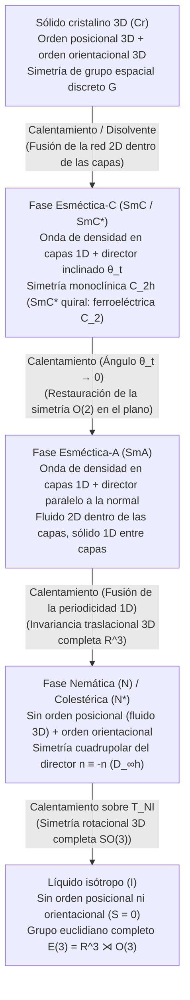

En física elemental dividimos la materia en tres estados canónicos: sólido, líquido y gas. Un sólido cristalino mantiene simultáneamente <strong>orden posicional</strong> y <strong>orden orientacional</strong> de largo alcance; al fundirse, la red colapsa en un líquido isótropo que restaura el grupo completo de simetría euclidiana $E(3) = \mathbb{R}^3 \rtimes O(3)$. Sin embargo, la naturaleza alberga un cuarto paradigma fascinante: los <strong>cristales líquidos (mesofases)</strong>. Un cristal líquido fluye como un fluido ordinario pero exhibe simultáneamente birrefringencia óptica, pares elásticos restauradores y defectos topológicos cuantizados. Este artículo deduce sistemáticamente la ruptura de simetría, la mecánica estadística, la elasticidad continua y la topología de los cristales líquidos.

---

## 1. El descubrimiento del «doble punto de fusión» y el nacimiento de la materia blanda

En marzo de 1888, el botánico austríaco <strong>Friedrich Reinitzer</strong> investigaba el <strong>benzoato de colesterilo ($\text{C}_{34}\text{H}_{50}\text{O}_2$)</strong> extraído de las zanahorias cuando observó una anomalía extraordinaria que denominó <strong>«doble fusión»</strong>: (1) al calentar los cristales a $145,5\,^\circ\text{C}$, la red rígida se fundía en un fluido móvil pero <strong>turbio y lechoso</strong>; (2) al seguir calentando hasta $178,5\,^\circ\text{C}$ (el punto de aclaramiento $T_{NI}$), la turbidez desaparecía instantáneamente dando paso a un líquido transparente e isótropo. El físico alemán <strong>Otto Lehmann</strong> examinó esta fase turbia bajo su microscopio polarizador con platina caliente, descubrió una intensa <strong>birrefringencia óptica</strong> y acuñó en 1889 el término <strong>«cristales líquidos» (Flüssige Kristalle)</strong>.

En 1922, el mineralogista francés <strong>Georges Friedel</strong> introdujo el concepto riguroso de <strong>estados mesomórficos (mesofases)</strong> y los clasificó en tres familias fundamentales: <strong>nemática</strong> (del griego *nema*, «hilo»), <strong>esméctica</strong> (del griego *smegma*, «jabón») y <strong>colestérica</strong>. Medio siglo después, el físico teórico francés <strong>Pierre-Gilles de Gennes</strong> (Premio Nobel de Física en 1991) demostró que los cristales líquidos, polímeros y coloides obedecen el mismo marco matemático universal de <strong>ruptura espontánea de simetría, parámetros de orden y analogías gauge</strong> que los superconductores y ferromagnetos, fundando la <strong>física de la materia condensada blanda (Soft Matter)</strong>.

---

## 2. Orden posicional frente a orden orientacional: Fases nemática, esméctica y colestérica

Las moléculas formadoras de mesofases (<strong>mesógenos</strong>) poseen una marcada anisotropía de forma: varillas rígidas (calamíticas, como el <strong>5CB</strong> con relación de aspecto $4:1$) o discos (discóticas). Al calentar un cristal de varillas, la energía térmica $k_B T$ vence primero las barreras de traslación de los centros de masa, pero el impedimento estérico restringe la rotación perpendicular al eje largo: <strong>el orden posicional se funde mientras el orden orientacional sobrevive</strong>:

### 2.1 La fase nemática ($N$), el tensor cuadrupolar $Q_{ij}$ y el parámetro de orden escalar $S$
En la <strong>fase nemática uniaxial</strong>, el fluido posee invariancia traslacional 3D ($\mathbb{R}^3$), pero los ejes moleculares $\mathbf{u}_\alpha$ se alinean en promedio a lo largo de un eje común llamado <strong>director $\hat{\mathbf{n}}$</strong> ($|\hat{\mathbf{n}}|=1$). Dado que un número igual de moléculas apunta en $+\hat{\mathbf{n}}$ y $-\hat{\mathbf{n}}$, la fase es macroscópicamente <strong>apolar (simetría cabeza-cola)</strong> y el director vive en el <strong>plano proyectivo real $\mathbb{R}P^2 = S^2/\mathbb{Z}_2$</strong>. Como el promedio dipolar $\langle \mathbf{u}_\alpha \rangle = \mathbf{0}$ se anula, de Gennes introdujo el <strong>tensor cuadrupolar simétrico y sin traza de segundo rango $Q_{ij}$</strong>:

$$\hat{\mathbf{n}} \equiv -\hat{\mathbf{n}}, \qquad Q_{ij} = \left\langle u_{\alpha, i} u_{\alpha, j} - \frac{1}{3}\delta_{ij} \right\rangle = S \left( n_i n_j - \frac{1}{3}\delta_{ij} \right)$$

donde el <strong>parámetro de orden escalar de Maier-Saupe $S$</strong> es el promedio estadístico del segundo polinomio de Legendre $P_2(\cos\theta)$:

$$S = \langle P_2(\cos\theta) \rangle = \left\langle \frac{3\cos^2\theta - 1}{2} \right\rangle = \int_0^\pi f(\theta) \left(\frac{3\cos^2\theta - 1}{2}\right) \sin\theta \, d\theta$$

Para una alineación paralela ideal $S = 1$, en el líquido isótropo ($\langle\cos^2\theta\rangle = 1/3$) es $S = 0$, y en los nemáticos reales $S \approx 0,3\text{–}0,8$.

### 2.2 Fases esmécticas ($\text{SmA}, \text{SmC}^*$) y reflexión de Bragg colestérica ($N^*$)
* <strong>Fases esmécticas</strong>: las moléculas se autoensamblan en capas equidistantes ($d \approx 2\text{–}4\,\text{nm}$), formando una onda periódica de densidad de masa 1D $\rho(\mathbf{r})$. De Gennes (1972) demostró que la <strong>transición Nemática–$\text{SmA}$ es matemáticamente isomorfa a la teoría de Ginzburg-Landau de un superconductor</strong>: mantener constante el espesor de las capas expulsa las deformaciones de torsión ($K_2 \to \infty$) y flexión ($K_3 \to \infty$) de forma análoga al efecto Meissner. En la fase quiral inclinada $\text{SmC}^*$, Robert Meyer (1975) dedujo por simetría $C_2$ la aparición de una polarización ferroeléctrica espontánea $\mathbf{P}_s \propto \hat{\mathbf{k}} \times \hat{\mathbf{n}}$, logrando conmutación electroóptica biestable en microsegundos (SSFLC).
* <strong>Fase colestérica ($N^*$)</strong>: la quiralidad molecular induce un giro helicoidal con paso $p$ (período óptico $p/2$), generando una banda prohibida fotónica con <strong>reflexión de Bragg selectiva en polarización circular</strong>:

$$\rho(\mathbf{r}) = \rho_0 + |\psi(\mathbf{r})| \cos\left(q_0 z - q_0 u_z(\mathbf{r})\right), \qquad \lambda_0 = \bar{n} \, p \cos\theta_{\text{inc}}$$

---

## 3. Mecánica estadística de las transiciones de fase: Landau-de Gennes frente a Onsager

1. <strong>Cristales líquidos termotrópicos y energía libre de Landau-de Gennes</strong>: ¿por qué la transición isótropo–nemática ($I\text{–}N$) en 3D es siempre de <strong>primer orden débil (discontinua)</strong>? Porque los estados $Q_{ij}$ ($S>0$, alineación prolata) y $-Q_{ij}$ ($S<0$, alineación oblata planar) son físicamente inequivalentes, por lo que el <strong>invariante cúbico $\text{Tr}(\mathbf{Q}^3) = \frac{2}{9}S^3$</strong> no se anula:

$$f_{\text{LdG}}(S, T) = f_0 + \frac{1}{3} a (T - T^*) S^2 - \frac{2}{27} B S^3 + \frac{1}{9} C S^4$$

$$T_{NI} = T^* + \frac{B^2}{27 a C}, \qquad S_{NI} = \frac{B}{3C}, \qquad \Delta H = \frac{a B^2 T_{NI}}{27 C^2}$$

   El término cúbico provoca en $T_{NI}$ un salto discontinuo desde $S=0$ hasta $S_{NI} = B/(3C) \approx 0,43$ con calor latente $\Delta H$.
2. <strong>Cristales líquidos liotrópicos y el paradigma entrópico de varillas duras de Onsager (1949)</strong>: Lars Onsager demostró que una suspensión de cilindros rígidos esbeltos ($L/D \gg 1$) sin ninguna interacción atractiva ($\Delta U = 0$) experimenta una transición espontánea al estado nemático puramente por maximización de la entropía. El <strong>volumen excluido $v_{\text{excl}}(\gamma)$</strong> entre dos varillas que forman un ángulo $\gamma$ es proporcional a $|\sin\gamma|$:

$$v_{\text{excl}}(\gamma) = 2 L^2 D |\sin\gamma|, \qquad \phi_I = \frac{3.340}{L/D}, \qquad \phi_N = \frac{4.486}{L/D}$$

   Al superar la fracción de volumen crítica $\phi_I$, la alineación paralela ($\gamma \to 0$) sacrifica una pequeña entropía orientacional ($\Delta S_{\text{orient}} < 0$) a cambio de reducir drásticamente $v_{\text{excl}}$, obteniendo una ganancia mucho mayor en <strong>entropía traslacional de empaquetamiento ($\Delta S_{\text{trans}} \gg |\Delta S_{\text{orient}}|$)</strong>.

---

## 4. Elasticidad continua y electroóptica: Teoría de Oseen-Frank y transición de Fréedericksz

Las deformaciones espaciales suaves del director $\hat{\mathbf{n}}(\mathbf{r})$ conllevan una <strong>densidad de energía libre elástica de Oseen-Frank</strong> gobernada por tres modos geométricos ortogonales: <strong>abanico o divergencia (splay, $K_1$)</strong>, <strong>torsión (twist, $K_2$)</strong> y <strong>flexión (bend, $K_3$)</strong>:

$$f_{\text{Frank}} = \frac{1}{2} K_1 \left( \nabla \cdot \hat{\mathbf{n}} \right)^2 + \frac{1}{2} K_2 \left( \hat{\mathbf{n}} \cdot (\nabla \times \hat{\mathbf{n}}) + q_0 \right)^2 + \frac{1}{2} K_3 \left( \hat{\mathbf{n}} \times (\nabla \times \hat{\mathbf{n}}) \right)^2$$

Por análisis dimensional, $K_i \sim k_B T / a \sim 10\,\text{pN}$. Esta extrema suavidad provoca enormes fluctuaciones térmicas del director $\langle|\delta\mathbf{n}(\mathbf{q})|^2\rangle = k_B T / (V K q^2)$ que dispersan la luz un millón de veces más que un líquido normal, explicando la turbidez lechosa observada por Reinitzer.

En una celda de espesor $d$ bajo un campo eléctrico $\mathbf{E}$ ($\Delta\varepsilon = \varepsilon_\parallel - \varepsilon_\perp > 0$), el par dieléctrico compite con el anclaje elástico superficial. El análisis de estabilidad del modo fundamental de Fourier ($n=1$) proporciona el umbral crítico de la <strong>transición de Fréedericksz</strong>:

$$E_{\text{th}} = \frac{\pi}{d} \sqrt{\frac{K_1}{\varepsilon_0 \Delta\varepsilon}} \quad \Longrightarrow \quad V_{\text{th}} = E_{\text{th}} d = \pi \sqrt{\frac{K_1}{\varepsilon_0 \Delta\varepsilon}}$$

¡El espesor $d$ se cancela por completo! El voltaje umbral $V_{\text{th}} \approx 1\,\text{V}$ depende únicamente de constantes materiales intrínsecas, permitiendo la conmutación mediante transistores TFT en las arquitecturas LCD modernas: <strong>TN (Twisted Nematic)</strong>, <strong>IPS (In-Plane Switching)</strong> y <strong>VA (Vertical Alignment)</strong>.

---

## 5. Defectos topológicos (disclinaciones) y grupo de homotopía $\pi_1(\mathbb{R}P^2) = \mathbb{Z}_2$

Debido a la equivalencia cabeza-cola $\hat{\mathbf{n}} \equiv -\hat{\mathbf{n}}$, al rodear un núcleo de defecto ($2\pi$), el director solo necesita girar un múltiplo entero de $\pi$ ($180^\circ$) para volver a la misma configuración física. Esto permite en 2D <strong>disclinaciones semienteras ($s = \pm 1/2$)</strong> (con forma de cometa para $+1/2$ y de trébol para $-1/2$). En el espacio 3D, la variedad del parámetro de orden es el plano proyectivo real $\mathcal{M} = \mathbb{R}P^2$, cuyo grupo fundamental de homotopía es:

$$\pi_1(\mathbb{R}P^2) = \mathbb{Z}_2 = \{0, 1\}, \qquad E_{\text{line}} = \pi K s^2 \ln\left(\frac{R}{r_c}\right) + E_{\text{core}}, \qquad B = 4|s|$$

En consecuencia, en 3D solo las líneas de defecto semienteras ($s = \pm 1/2$, clase no trivial $1 \in \mathbb{Z}_2$) son topológicamente estables, mientras que los defectos enteros ($s = \pm 1$, clase trivial $0 \in \mathbb{Z}_2$) eliminan su singularidad inclinando el director hacia la tercera dimensión (<strong>«escape hacia la tercera dimensión»</strong>). Bajo polarizadores cruzados, la <strong>textura Schlieren</strong> muestra exactamente $B = 4|s|$ pinceles oscuros de extinción alrededor de cada núcleo ($B=2$ para $s=\pm 1/2$, $B=4$ para $s=\pm 1$).

---

## 6. Comparación de mesofases y fronteras tecnológicas (Kevlar, músculos artificiales, materia activa)

| Mesofase / Estado | Orden posicional (Traslación) | Orden orientacional (Rotación) | Simetría puntual / espacial | Parámetros de orden primarios | Firmas ópticas y reológicas |
| :--- | :--- | :--- | :--- | :--- | :--- |
| <strong>Líquido isótropo ($I$)</strong> | Ninguno (invariancia 3D $\mathbb{R}^3$) | Ninguno (invariancia 3D $O(3)$) | $E(3) = \mathbb{R}^3 \rtimes O(3)$ | $S = 0, \; \psi = 0$ | Ópticamente isótropo ($\Delta n = 0$), fluido newtoniano |
| <strong>Nemático ($N$)</strong> | Ninguno (fluido 3D $\mathbb{R}^3$) | Uniaxial de largo alcance ($\hat{\mathbf{n}} \equiv -\hat{\mathbf{n}}$) | $\mathbb{R}^3 \rtimes D_{\infty h}$ | Tensor cuadrupolar $Q_{ij}$ ($S \neq 0$) | Alta birrefringencia $\Delta n$, textura Schlieren ($B=2,4$), baja viscosidad |
| <strong>Colestérico ($N^*$)</strong> | Ninguno (fluido localmente nemático) | Giro helicoidal ($q_0 = 2\pi/p$) | $\mathbb{R}^2 \rtimes D_\infty$ (quiral) | $Q_{ij}(\mathbf{r})$, paso helicoidal $p$ | Reflexión de Bragg circular ($\lambda_0 = \bar{n}p$), poder rotatorio gigante |
| <strong>Esméctico-A ($\text{SmA}$)</strong> | Onda de densidad 1D en capas ($d \approx L$) | Paralelo a la normal ($\hat{\mathbf{n}} \parallel \hat{\mathbf{k}}$) | $(\mathbb{R}^2 \times \mathbb{Z}) \rtimes D_{\infty h}$ | $S \neq 0$, onda compleja $\psi = |\psi|e^{i\phi}$ | Texturas focales-cónicas, expulsión de torsión y flexión ($K_2, K_3 \to \infty$) |
| <strong>Esméctico-C quiral ($\text{SmC}^*$)</strong> | Capas periódicas 1D ($d = L\cos\theta_t$) | Inclinado un ángulo $\theta_t$ | Monoclínica $C_2$ (polar) | $\psi \neq 0$, polarización $\mathbf{P}_s$ | Óptica biaxial, conmutación ferroeléctrica en microsegundos (SSFLC) |

Más allá de las pantallas, los cristales líquidos impulsan cuatro fronteras: (1) <strong>polímeros de cristal líquido (LCP)</strong> como el <strong>Kevlar</strong> (inventado por Stephanie Kwolek), donde el ordenamiento nemático liotrópico de Onsager produce fibras con una resistencia específica de 5 a 8 veces la del acero; (2) <strong>elastómeros de cristal líquido (LCE)</strong> como músculos artificiales con contracciones reversibles del $30\%\text{–}400\%$ al cruzar $T_{NI}$; (3) <strong>moduladores espaciales de luz LCoS y placas Q topológicas</strong> para pinzas ópticas holográficas y haces de vórtice óptico; y (4) <strong>cristalinidad líquida biológica y nemáticos activos</strong>: las membranas celulares son bicapas $\text{SmA}$ 2D, mientras que el citoesqueleto impulsado por ATP y los tejidos epiteliales generan un <strong>tensor de esfuerzo activo</strong> proporcional a $Q_{ij}$:

$$\sigma_{ij}^{\text{active}} = -\zeta \, Q_{ij}, \qquad \mathbf{f}^{\text{active}} = -\zeta \nabla \cdot \mathbf{Q}$$

Como las disclinaciones $+1/2$ en forma de cometa rompen la simetría delante-detrás ($\nabla\cdot\mathbf{Q} \neq \mathbf{0}$), se convierten en <strong>cuasipartículas autopropulsadas</strong> en un estado de turbulencia activa, gobernando la extrusión celular apoptótica (Saw et al., *Nature* 2017) y la morfogénesis regenerativa de la *Hydra* (regeneración de cabeza y pie en defectos $+1$, brote de tentáculos en defectos $-1/2$).
