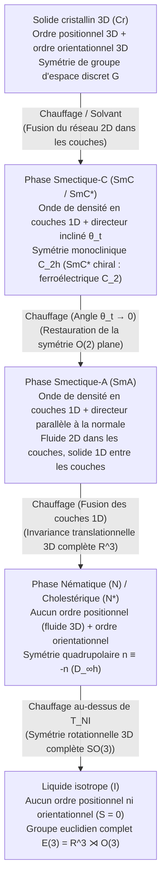

En physique élémentaire, la matière est divisée en trois états canoniques : solide, liquide et gaz. Un solide cristallin maintient simultanément un <strong>ordre positionnel</strong> et un <strong>ordre orientationnel</strong> à longue portée ; au-delà de la fusion, le réseau s'effondre en un liquide isotrope restaurant le groupe de symétrie euclidien complet $E(3) = \mathbb{R}^3 \rtimes O(3)$. Pourtant, la nature recèle un quatrième paradigme fascinant : les <strong>cristaux liquides (mésophases)</strong>. Un cristal liquide s'écoule comme un fluide ordinaire tout en présentant une biréfringence optique, des couples élastiques de rappel et des défauts topologiques quantifiés. Cet article déduit systématiquement la brisure de symétrie, la mécanique statistique, l'élasticité continue et la topologie des cristaux liquides.

---

## 1. La découverte de la « double fusion » et la naissance de la matière molle

En mars 1888, le botaniste autrichien <strong>Friedrich Reinitzer</strong> étudiait le <strong>benzoate de cholestéryle ($\text{C}_{34}\text{H}_{50}\text{O}_2$)</strong> extrait de la carotte lorsqu'il observa une anomalie extraordinaire qu'il nomma <strong>« double fusion »</strong> : (1) à $145,5\,^\circ\text{C}$, le cristal fondait en un fluide mobile mais <strong>laiteux et trouble</strong> ; (2) à $178,5\,^\circ\text{C}$ (point d'éclaircissement $T_{NI}$), la turbidité disparaissait instantanément pour donner un liquide transparent et isotrope. Le physicien allemand <strong>Otto Lehmann</strong> examina ce fluide trouble au microscope polarisant chauffant, observa une forte <strong>biréfringence optique</strong> et forgea en 1889 le terme de <strong>« cristaux liquides » (Flüssige Kristalle)</strong>.

En 1922, le minéralogiste français <strong>Georges Friedel</strong> introduisit le concept rigoureux d'<strong>états mésomorphes (mésophases)</strong> et les classa en trois familles : <strong>nématique</strong> (du grec *nema*, « fil »), <strong>smectique</strong> (du grec *smegma*, « savon ») et <strong>cholestérique</strong>. Un demi-siècle plus tard, le physicien théoricien français <strong>Pierre-Gilles de Gennes</strong> (prix Nobel de physique 1991) démontra que les cristaux liquides, les polymères et les colloïdes obéissent au même formalisme universel de <strong>brisure spontanée de symétrie, paramètres d'ordre et analogies de jauge</strong> que les supraconducteurs et les ferromagnétiques, fondant ainsi la <strong>physique de la matière molle</strong>.

---

## 2. Ordre positionnel vs ordre orientationnel : Phases nématique, smectique et cholestérique

Les molécules mésogènes possèdent une forte anisotropie de forme : bâtonnets rigides (calamitiques, comme le <strong>5CB</strong> de rapport d'aspect $4:1$) ou disques (discotiques). Lors du chauffage d'un cristal de bâtonnets, l'agitation thermique $k_B T$ libère d'abord la translation des centres de masse tandis que l'encombrement stérique bloque la rotation : <strong>l'ordre positionnel fond alors que l'ordre orientationnel survit</strong> :

### 2.1 La phase nématique ($N$), le tenseur quadrupolaire $Q_{ij}$ et le paramètre d'ordre scalaire $S$
Dans la <strong>phase nématique uniaxe</strong>, le fluide possède l'invariance par translation $\mathbb{R}^3$, mais les axes moléculaires $\mathbf{u}_\alpha$ s'alignent en moyenne le long d'un axe commun appelé <strong>directeur $\hat{\mathbf{n}}$</strong> ($|\hat{\mathbf{n}}|=1$). L'équiprobabilité des orientations $+\hat{\mathbf{n}}$ et $-\hat{\mathbf{n}}$ rend la phase <strong>apolaire (symétrie tête-queue)</strong> : le directeur appartient au <strong>plan projectif réel $\mathbb{R}P^2 = S^2/\mathbb{Z}_2$</strong>. Comme la moyenne dipolaire $\langle \mathbf{u}_\alpha \rangle = \mathbf{0}$ s'annule, de Gennes introduisit le <strong>tenseur quadrupolaire symétrique et sans trace de rang deux $Q_{ij}$</strong> :

$$\hat{\mathbf{n}} \equiv -\hat{\mathbf{n}}, \qquad Q_{ij} = \left\langle u_{\alpha, i} u_{\alpha, j} - \frac{1}{3}\delta_{ij} \right\rangle = S \left( n_i n_j - \frac{1}{3}\delta_{ij} \right)$$

où le <strong>paramètre d'ordre scalaire de Maier-Saupe $S$</strong> est la moyenne d'ensemble du second polynôme de Legendre $P_2(\cos\theta)$ :

$$S = \langle P_2(\cos\theta) \rangle = \left\langle \frac{3\cos^2\theta - 1}{2} \right\rangle = \int_0^\pi f(\theta) \left(\frac{3\cos^2\theta - 1}{2}\right) \sin\theta \, d\theta$$

On a $S = 1$ pour un alignement parfait, $S = 0$ dans le liquide isotrope ($\langle\cos^2\theta\rangle = 1/3$), et $S \approx 0,3\text{–}0,8$ dans les nématiques usuels.

### 2.2 Phases smectiques ($\text{SmA}, \text{SmC}^*$) et réflexion de Bragg cholestérique ($N^*$)
* <strong>Phases smectiques</strong> : les molécules s'organisent en couches périodiques d'épaisseur $d \approx 2\text{–}4\,\text{nm}$, formant une onde de densité 1D $\rho(\mathbf{r})$. De Gennes (1972) établit que la <strong>transition Nématique–$\text{SmA}$ est mathématiquement isomorphe à la théorie de Ginzburg-Landau des supraconducteurs</strong> : la constance de l'épaisseur des couches expulse totalement les déformations de torsion ($K_2 \to \infty$) et de flexion ($K_3 \to \infty$) par analogie avec l'effet Meissner ! Dans la phase chirale inclinée $\text{SmC}^*$, Robert Meyer (1975) montra par symétrie $C_2$ l'existence d'une polarisation ferroélectrique spontanée $\mathbf{P}_s \propto \hat{\mathbf{k}} \times \hat{\mathbf{n}}$, permettant la commutation bistable microseconde (SSFLC).
* <strong>Phase cholestérique ($N^*$)</strong> : la chiralité moléculaire impose une torsion hélicoïdale de pas $p$ (période optique $p/2$), engendrant une bande interdite photonique avec <strong>réflexion de Bragg sélective en polarisation circulaire</strong> :

$$\rho(\mathbf{r}) = \rho_0 + |\psi(\mathbf{r})| \cos\left(q_0 z - q_0 u_z(\mathbf{r})\right), \qquad \lambda_0 = \bar{n} \, p \cos\theta_{\text{inc}}$$

---

## 3. Mécanique statistique des transitions : Landau-de Gennes vs théorie d'Onsager

1. <strong>Cristaux liquides thermotropes et développement de Landau-de Gennes</strong> : pourquoi la transition isotrope–nématique ($I\text{–}N$) en 3D est-elle toujours du <strong>premier ordre (discontinue)</strong> ? Parce que les états $Q_{ij}$ ($S>0$, alignement prolate) et $-Q_{ij}$ ($S<0$, alignement oblate plan) sont physiquement inéquivalents, l'<strong>invariant cubique $\text{Tr}(\mathbf{Q}^3) = \frac{2}{9}S^3$</strong> ne s'annule pas :

$$f_{\text{LdG}}(S, T) = f_0 + \frac{1}{3} a (T - T^*) S^2 - \frac{2}{27} B S^3 + \frac{1}{9} C S^4$$

$$T_{NI} = T^* + \frac{B^2}{27 a C}, \qquad S_{NI} = \frac{B}{3C}, \qquad \Delta H = \frac{a B^2 T_{NI}}{27 C^2}$$

   Ce terme cubique provoque à $T_{NI}$ un saut discontinu de $S=0$ à $S_{NI} = B/(3C) \approx 0,43$ accompagné d'une chaleur latente $\Delta H$.
2. <strong>Cristaux liquides lyotropes et modèle entropique des bâtonnets durs d'Onsager (1949)</strong> : Lars Onsager démontra qu'un fluide de cylindres rigides élancés ($L/D \gg 1$) sans aucune attraction ($\Delta U = 0$) transite spontanément vers l'état nématique par pure maximisation de l'entropie ! Le <strong>volume exclu $v_{\text{excl}}(\gamma)$</strong> entre deux bâtonnets formant un angle $\gamma$ est proportionnel à $|\sin\gamma|$ :

$$v_{\text{excl}}(\gamma) = 2 L^2 D |\sin\gamma|, \qquad \phi_I = \frac{3.340}{L/D}, \qquad \phi_N = \frac{4.486}{L/D}$$

   Au-delà de la fraction volumique critique $\phi_I$, l'alignement parallèle ($\gamma \to 0$) sacrifie un peu d'entropie orientationnelle ($\Delta S_{\text{orient}} < 0$) mais réduit considérablement $v_{\text{excl}}$, procurant un gain majeur d'<strong>entropie translationnelle d'empilement ($\Delta S_{\text{trans}} \gg |\Delta S_{\text{orient}}|$)</strong>.

---

## 4. Élasticité continue et électro-optique : Théorie d'Oseen-Frank et transition de Fréedericksz

Les variations spatiales lentes du directeur $\hat{\mathbf{n}}(\mathbf{r})$ coûtent une énergie décrite par la <strong>densité d'énergie libre élastique d'Oseen-Frank</strong> selon trois modes géométriques : l'<strong>évasement (splay, $K_1$)</strong>, la <strong>torsion (twist, $K_2$)</strong> et la <strong>flexion (bend, $K_3$)</strong> :

$$f_{\text{Frank}} = \frac{1}{2} K_1 \left( \nabla \cdot \hat{\mathbf{n}} \right)^2 + \frac{1}{2} K_2 \left( \hat{\mathbf{n}} \cdot (\nabla \times \hat{\mathbf{n}}) + q_0 \right)^2 + \frac{1}{2} K_3 \left( \hat{\mathbf{n}} \times (\nabla \times \hat{\mathbf{n}}) \right)^2$$

Par analyse dimensionnelle, $K_i \sim k_B T / a \sim 10\,\text{pN}$. Cette extrême souplesse engendre des fluctuations thermiques géantes $\langle|\delta\mathbf{n}(\mathbf{q})|^2\rangle = k_B T / (V K q^2)$ qui diffusent la lumière un million de fois plus qu'un liquide isotrope, expliquant l'aspect laiteux observé par Reinitzer.

Dans une cellule d'épaisseur $d$ soumise à un champ électrique $\mathbf{E}$ ($\Delta\varepsilon = \varepsilon_\parallel - \varepsilon_\perp > 0$), le couple diélectrique s'oppose à l'ancrage élastique aux parois. L'analyse de stabilité du mode fondamental de Fourier ($n=1$) donne le seuil critique de la <strong>transition de Fréedericksz</strong> :

$$E_{\text{th}} = \frac{\pi}{d} \sqrt{\frac{K_1}{\varepsilon_0 \Delta\varepsilon}} \quad \Longrightarrow \quad V_{\text{th}} = E_{\text{th}} d = \pi \sqrt{\frac{K_1}{\varepsilon_0 \Delta\varepsilon}}$$

L'épaisseur $d$ s'élimine exactement ! La tension seuil $V_{\text{th}} \approx 1\,\text{V}$ ne dépend que des constantes du matériau, rendant possible la commande par transistors TFT dans les écrans LCD <strong>TN (Twisted Nematic)</strong>, <strong>IPS (In-Plane Switching)</strong> et <strong>VA (Vertical Alignment)</strong>.

---

## 5. Défauts topologiques (disinclinaisons) et groupe d'homotopie $\pi_1(\mathbb{R}P^2) = \mathbb{Z}_2$

En raison de l'équivalence $\hat{\mathbf{n}} \equiv -\hat{\mathbf{n}}$, le directeur n'a besoin de tourner que d'un multiple entier de $\pi$ ($180^\circ$) le long d'un contour fermé ($2\pi$) entourant un défaut. Cela autorise en 2D des <strong>disinclinaisons demi-entières ($s = \pm 1/2$)</strong> (en comète pour $+1/2$, en trèfle à trois feuilles pour $-1/2$). En 3D, la variété du paramètre d'ordre est le plan projectif réel $\mathcal{M} = \mathbb{R}P^2$, dont le groupe fondamental est :

$$\pi_1(\mathbb{R}P^2) = \mathbb{Z}_2 = \{0, 1\}, \qquad E_{\text{line}} = \pi K s^2 \ln\left(\frac{R}{r_c}\right) + E_{\text{core}}, \qquad B = 4|s|$$

Ainsi, seules les lignes de défaut demi-entières ($s = \pm 1/2$, classe non triviale $1 \in \mathbb{Z}_2$) sont topologiquement stables en 3D, tandis que les défauts entiers ($s = \pm 1$, classe triviale $0 \in \mathbb{Z}_2$) éliminent leur cœur singulier en basculant le long de l'axe $z$ : c'est la célèbre <strong>« fuite dans la troisième dimension (escape into the third dimension) »</strong>. En microscopie polarisante, la <strong>texture à noyaux (texture de Schlieren)</strong> présente exactement $B = 4|s|$ brosses sombres d'extinction autour de chaque défaut ($B=2$ pour $s=\pm 1/2$, $B=4$ pour $s=\pm 1$).

---

## 6. Comparaison des mésophases et frontières technologiques (Kevlar, muscles artificiels, matière active)

| Mésophase / État | Ordre positionnel (Translation) | Ordre orientationnel (Rotation) | Symétrie ponctuelle / spatiale | Paramètres d'ordre principaux | Signatures optiques et rhéologiques |
| :--- | :--- | :--- | :--- | :--- | :--- |
| <strong>Liquide isotrope ($I$)</strong> | Aucun (invariance 3D $\mathbb{R}^3$) | Aucun (invariance 3D $O(3)$) | $E(3) = \mathbb{R}^3 \rtimes O(3)$ | $S = 0, \; \psi = 0$ | Optiquement isotrope ($\Delta n = 0$), fluide newtonien |
| <strong>Nématique ($N$)</strong> | Aucun (fluide 3D $\mathbb{R}^3$) | Uniaxe à longue portée ($\hat{\mathbf{n}} \equiv -\hat{\mathbf{n}}$) | $\mathbb{R}^3 \rtimes D_{\infty h}$ | Tenseur quadrupolaire $Q_{ij}$ ($S \neq 0$) | Forte biréfringence $\Delta n$, texture de Schlieren ($B=2,4$), faible viscosité |
| <strong>Cholestérique ($N^*$)</strong> | Aucun (fluide localement nématique) | Torsion hélicoïdale ($q_0 = 2\pi/p$) | $\mathbb{R}^2 \rtimes D_\infty$ (chiral) | $Q_{ij}(\mathbf{r})$, pas hélicoïdal $p$ | Réflexion de Bragg circulaire ($\lambda_0 = \bar{n}p$), pouvoir rotatoire géant |
| <strong>Smectique-A ($\text{SmA}$)</strong> | Onde de densité 1D en couches ($d \approx L$) | Parallèle à la normale ($\hat{\mathbf{n}} \parallel \hat{\mathbf{k}}$) | $(\mathbb{R}^2 \times \mathbb{Z}) \rtimes D_{\infty h}$ | $S \neq 0$, onde complexe $\psi = |\psi|e^{i\phi}$ | Textures en coniques focales, expulsion de torsion et flexion ($K_2, K_3 \to \infty$) |
| <strong>Smectique-C chiral ($\text{SmC}^*$)</strong> | Couches périodiques 1D ($d = L\cos\theta_t$) | Incliné d'un angle $\theta_t$ | Monoclinique $C_2$ (polaire) | $\psi \neq 0$, polarisation $\mathbf{P}_s$ | Optique biaxe, commutation ferroélectrique microseconde (SSFLC) |

Au-delà des écrans, les cristaux liquides transforment quatre domaines : (1) les <strong>polymères à cristaux liquides (LCP)</strong> tels que le <strong>Kevlar</strong> (inventé par Stephanie Kwolek), où l'alignement nématique lyotrope d'Onsager confère une résistance spécifique 5 à 8 fois supérieure à l'acier ; (2) les <strong>élastomères à cristaux liquides (LCE)</strong> agissant comme muscles artificiels capables de se contracter de $30\%\text{–}400\%$ à $T_{NI}$ ; (3) les <strong>modulateurs spatiaux de lumière LCoS et lames Q topologiques</strong> pour pinces optiques holographiques et faisceaux vortex ; et (4) la <strong>matière biologique et les nématiques actifs</strong> : les membranes cellulaires sont des bicouches $\text{SmA}$ 2D, tandis que les réseaux cytosquelettiques et tissus épithéliaux génèrent une <strong>contrainte active</strong> proportionnelle à $Q_{ij}$ :

$$\sigma_{ij}^{\text{active}} = -\zeta \, Q_{ij}, \qquad \mathbf{f}^{\text{active}} = -\zeta \nabla \cdot \mathbf{Q}$$

Brisant la symétrie avant-arrière ($\nabla\cdot\mathbf{Q} \neq \mathbf{0}$), les défauts $+1/2$ en forme de comète deviennent des <strong>quasiparticules autopropulsées</strong> en régime de turbulence active, gouvernant l'extrusion cellulaire apoptotique (Saw et al., *Nature* 2017) et la morphogenèse de l'animal *Hydra* (régénération de la tête et du pied aux défauts $+1$, bourgeonnement des tentacules aux défauts $-1/2$).
