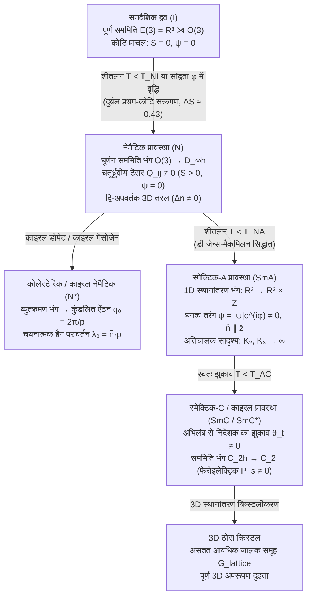

## 1. शास्त्रीय पदार्थ की चौथी अवस्था: चरणबद्ध स्वतः सममिति भंग (Stepwise SSB)

1888 में, ऑस्ट्रियाई वनस्पतिशास्त्री और रसायनज्ञ <strong>फ्रीडरिक राइनित्ज़र (Friedrich Reinitzer)</strong> ने गाजर से निकाले गए <strong>कोलेस्टेरिल बेंजोएट (cholesteryl benzoate)</strong> के क्रिस्टलों को गर्म करते समय एक अद्भुत घटना देखी: इस यौगिक में <strong>दो स्पष्ट गलनांक (two melting points)</strong> थे। $145.5\,^\circ\text{C}$ पर, ठोस क्रिस्टल पिघलकर एक धुंधले, दूधिया तरल में बदल गया जो सामान्य द्रव की तरह स्वतंत्र रूप से बहता था लेकिन प्रबल प्रकाशिक द्वि-अपवर्तन (optical birefringence) प्रदर्शित करता था; केवल $178.5\,^\circ\text{C}$ पर यह धुंधला तरल पूरी तरह से पारदर्शी और प्रकाशिक रूप से समदैशिक (isotropic) द्रव में परिवर्तित हुआ। जर्मन भौतिक विज्ञानी <strong>ओटो लेहमैन (Otto Lehmann)</strong> ने तापन मंच से युक्त ध्रुवण सूक्ष्मदर्शी के नीचे इस मध्यवर्ती प्रावस्था का अध्ययन किया और इसे <strong>"द्रव क्रिस्टल" (Flüssige Kristalle / Liquid Crystal)</strong> नाम दिया। 1922 में, फ्रांसीसी क्रिस्टल विज्ञानी <strong>जॉर्ज फ्रीडेल (Georges Friedel)</strong> ने इन <strong>मध्यवर्ती प्रावस्थाओं (mesophases)</strong> को तीन मूलभूत वर्गों में वर्गीकृत किया: <strong>नेमैटिक (nematic)</strong>, <strong>कोलेस्टेरिक (cholesteric)</strong> और <strong>स्मेक्टिक (smectic)</strong>।

आधुनिक संघनित पदार्थ भौतिकी (<strong>पियरे-गिल्स डी जेन्स / Pierre-Gilles de Gennes</strong>, 1991 भौतिकी का नोबेल पुरस्कार) के दृष्टिकोण से, द्रव क्रिस्टल त्रि-आयामी यूक्लिडियन समूह के <strong>चरणबद्ध स्वतः सममिति भंग (Spontaneous Symmetry Breaking, SSB)</strong> के आदर्श प्रतिमान हैं:

$$\mathcal{G} = E(3) = \mathbb{R}^3 \rtimes O(3)$$

समदैशिक द्रव ($I$) में सतत स्थानांतरण सममिति $\mathbb{R}^3$ और सतत घूर्णन सममिति $O(3)$ दोनों पूर्णतः सुरक्षित रहती हैं। 3D ठोस क्रिस्टल में ये दोनों सममितियाँ एक साथ टूटकर असतत जालक समूह में बदल जाती हैं। द्रव क्रिस्टल इन दोनों सममिति-भंग संक्रमणों को अलग-अलग चरणों में विभाजित करते हैं:

1. <strong>नेमैटिक प्रावस्था ($N$)</strong>: सतत स्थानांतरण सममिति $\mathbb{R}^3$ पूरी तरह अक्षुण्ण रहती है—अणुओं के द्रव्यमान केंद्र बिना किसी दीर्घ-परास स्थितिज क्रम के सामान्य द्रव की भाँति बहते हैं—किंतु सतत घूर्णन सममिति $O(3)$ स्वतः टूटकर बेलनाकार द्वितल समूह $D_{\infty h}$ में सिमट जाती है। छड़नुमा या चकतीनुमा अणु (<strong>मेसोजेन / mesogens</strong>) सांख्यिकीय रूप से अपनी लंबी अक्षों को एक साझा स्थूल इकाई सदिश के अनुदिश संरेखित कर लेते हैं, जिसे <strong>निदेशक (director) $\hat{\mathbf{n}}$</strong> ($|\hat{\mathbf{n}}| = 1$) कहा जाता है।
2. <strong>कोलेस्टेरिक / काइरल नेमैटिक प्रावस्था ($N^*$)</strong>: जब अणु काइरल (दर्पण परावर्तन सममिति से रहित, $O(3) \to SO(3)$) होते हैं, तो निदेशक अंतरिक्ष में स्वतः मुड़कर पिच $p = 2\pi / |q_0|$ की एक स्थूल कुंडली (helix) बनाता है, जो ब्रैग तरंगदैर्घ्य $\lambda_0 = \bar{n}\,p$ पर वृत्तीय ध्रुवित प्रकाश का चयनात्मक परावर्तन करने वाला 1D फोटोनिक बैंडगैप उत्पन्न करता है।
3. <strong>स्मेक्टिक प्रावस्थाएँ ($\text{SmA}, \text{SmC}$)</strong>: नेमैटिक अभिविन्यास क्रम के अतिरिक्त, सतत स्थानांतरण सममिति $\mathbb{R}^3$ <strong>केवल एक स्थानिक दिशा</strong> के अनुदिश आंशिक रूप से टूट जाती है ($\mathbb{R}^3 \to \mathbb{R}^2 \times \mathbb{Z}$)। निकाय एक-आयामी घनत्व तरंग—2D द्रव परतों का एक आवधिक ढेर—बनाता है, जहाँ प्रत्येक परत के भीतर अणु 2D द्रव की तरह बहते हैं जबकि परत अभिलंब के अनुदिश 1D ठोस आवधिकता बनी रहती है।

---

## 2. नेमैटिक कोटि प्राचल टेंसर $Q_{ij}$ और सिर-पूंछ सममिति $\hat{\mathbf{n}} \equiv -\hat{\mathbf{n}}$

नेमैटिक अवस्था को हाइजेनबर्ग लौहचुंबकीय संक्रमण की तरह केवल ध्रुवण सदिश $\mathbf{P} = \langle \mathbf{u} \rangle$ द्वारा क्यों नहीं दर्शाया जा सकता? अधिकांश नेमैटिक द्रव क्रिस्टलों में, भले ही एकल अणु में स्थायी विद्युत द्विध्रुव आघूर्ण हो, स्थूल संतुलन विन्यास में <strong>अध्रुवीय सिर-पूंछ सममिति (head-tail symmetry)</strong> होती है: अभिविन्यास $+\hat{\mathbf{n}}$ और विपरीत अभिविन्यास $-\hat{\mathbf{n}}$ भौतिक रूप से अभिन्न हैं ($\hat{\mathbf{n}} \equiv -\hat{\mathbf{n}}$)। फलस्वरूप, अभिविन्यास प्रायिकता वितरण फलन $f(-\mathbf{u}) = f(\mathbf{u})$ को संतुष्ट करता है, जिससे सभी विषम बहुध्रुवीय (द्विध्रुवीय) आघूर्ण सर्वसम रूप से शून्य हो जाते हैं: $\langle u_i \rangle = 0$।

समदैशिक द्रव से विषमदैशिक नेमैटिक प्रावस्था को अलग करने वाला पहला अशून्य बहुध्रुवीय आघूर्ण <strong>द्वितीय-कोटि का चतुर्ध्रुवीय आघूर्ण (quadrupolar moment)</strong> है। समदैशिक प्रावस्था में कोटि प्राचल को शून्य ($\langle u_i u_j \rangle_{\text{iso}} = \frac{1}{3}\delta_{ij}$) रखने के लिए, हम सममित और ट्रेस-रहित ($\text{Tr}\,\mathbf{Q} = 0$) <strong>डी जेन्स कोटि प्राचल टेंसर $Q_{ij}$</strong> को परिभाषित करते हैं:

$$\hat{\mathbf{n}} \equiv -\hat{\mathbf{n}}, \qquad Q_{ij} = \left\langle u_{\alpha, i} u_{\alpha, j} - \frac{1}{3}\delta_{ij} \right\rangle = S \left( n_i n_j - \frac{1}{3}\delta_{ij} \right)$$

$\hat{\mathbf{n}}$ के परितः बेलनाकार सममिति वाले एकअक्षीय (uniaxial) नेमैटिक में, द्विअक्षीयता $P = 0$ होती है और अभिविन्यास क्रम का संपूर्ण परिमाण <strong>मायर-सौपे अदिश कोटि प्राचल $S$</strong> द्वारा व्यक्त होता है, जो द्वितीय लेजेंड्रे बहुपद $P_2(\cos\theta)$ का तापीय औसत है:

$$S = \langle P_2(\cos\theta) \rangle = \left\langle \frac{3\cos^2\theta - 1}{2} \right\rangle = \int_0^\pi f(\theta) \left(\frac{3\cos^2\theta - 1}{2}\right) \sin\theta \, d\theta$$

समदैशिक द्रव में $\langle \cos^2\theta \rangle = 1/3 \implies S = 0$। पूर्ण समांतर संरेखण में $\theta = 0 \implies S = 1$। वास्तविक थर्मोट्रोपिक द्रव क्रिस्टलों (जैसे <strong>5CB</strong> या <strong>MBBA</strong>) में, स्वच्छता तापमान $T_{NI}$ पर $S$ असतत रूप से कूदकर $S \approx 0.3\text{–}0.45$ हो जाता है और अधिक ठंडा करने पर $S \approx 0.6\text{–}0.8$ तक पहुँच जाता है।

<strong>स्मेक्टिक-A ($\text{SmA}$) प्रावस्था</strong> में एक अतिरिक्त स्थानांतरण कोटि प्राचल उभरता है। परत अभिलंब $\hat{\mathbf{z}}$ के अनुदिश तरंग सदिश $q_0 = 2\pi / d$ ($d \approx L$, अणु की लंबाई) के साथ आणविक संख्या घनत्व $\rho(\mathbf{r})$ का फूरियर प्रसार करने पर:

$$\rho(\mathbf{r}) = \rho_0 + |\psi(\mathbf{r})| \cos\left(q_0 z - q_0 u_z(\mathbf{r})\right), \qquad \lambda_0 = \bar{n} \, p \cos\theta_{\text{inc}}$$

जैसा कि <strong>पियरे-गिल्स डी जेन्स (1972)</strong> और <strong>विलियम मैकमिलन</strong> ने प्रतिपादित किया, यह सम्मिश्र कोटि प्राचल $\psi(\mathbf{r}) = |\psi|e^{i\phi(\mathbf{r})}$ <strong>$\text{N–SmA}$ संक्रमण और गिन्ज़बर्ग-लैंडाउ सिद्धांत में सामान्य धातु–अतिचालक संक्रमण के बीच एक सटीक समरूपता (isomorphism)</strong> स्थापित करता है: $\psi$ कूपर युग्मों के स्थूल तरंग फलन के संगत है, निदेशक के अनुप्रस्थ उतार-चढ़ाव $\delta\mathbf{n}_\perp$ विद्युतचुंबकीय सदिश विभव $\mathbf{A}$ की भूमिका निभाते हैं, और स्मेक्टिक के भीतर से ऐंठन ($K_2$) तथा बंकन ($K_3$) विकृतियों का निष्कासन ठीक <strong>माइसनर प्रभाव (Meissner effect)</strong> (चुंबकीय क्षेत्र $\mathbf{B} = \nabla \times \mathbf{A} = \mathbf{0}$ का निष्कासन) के समतुल्य है।

---

## 3. समदैशिक-नेमैटिक संक्रमण का ऊष्मागतिकी: लैंडाउ-डी जेन्स बनाम ओन्सागर

द्रव क्रिस्टल के दो प्रमुख परिवार हैं: <strong>थर्मोट्रोपिक (Thermotropic)</strong> (जिनका संक्रमण वान डेर वाल्स / मायर-सौपे विषमदैशिक आकर्षण बलों के माध्यम से तापमान $T$ द्वारा नियंत्रित होता है) और <strong>लायोट्रोपिक (Lyotropic)</strong> (जिनका संक्रमण विलायक में अपवर्जित-आयतन प्रतिकर्षण के माध्यम से आयतन अंश $\phi$ द्वारा नियंत्रित होता है)।

### 3.1 लैंडाउ-डी जेन्स प्रसार और प्रथम-कोटि घन निश्चर (Cubic Invariant)

टेंसर $Q_{ij}$ के घूर्णन निश्चरों की घातों में मुक्त ऊर्जा घनत्व $f_{\text{LdG}}$ का प्रसार करने पर, चूँकि $\text{Tr}(\mathbf{Q}) = 0$, रैखिक पद शून्य होता है; परंतु—आइसिंग मॉडल या लौहचुंबकत्व के विपरीत जहाँ $\mathbf{m} \to -\mathbf{m}$ सममिति विषम घातों को प्रतिबंधित करती है—$3\times 3$ ट्रेस-रहित टेंसर के लिए $Q_{ij}$ और $-Q_{ij}$ भिन्न भौतिक अवस्थाओं को दर्शाते हैं ($S > 0$ छड़ों के संरेखण के लिए बनाम $S < 0$ चकतीनुमा समतलीय विन्यास के लिए)। इसलिए <strong>घन निश्चर $\text{Tr}(\mathbf{Q}^3)$ सममिति द्वारा अनुमत है</strong>:

$$f_{\text{LdG}}(S, T) = f_0 + \frac{1}{3} a (T - T^*) S^2 - \frac{2}{27} B S^3 + \frac{1}{9} C S^4$$

$$T_{NI} = T^* + \frac{B^2}{27 a C}, \qquad S_{NI} = \frac{B}{3C}, \qquad \Delta H = \frac{a B^2 T_{NI}}{27 C^2}$$

$-B\,S^3$ ($B > 0$) पद की उपस्थिति $S = 0$ और $S > 0$ के बीच एक मुक्त ऊर्जा अवरोध उत्पन्न करती है, जो यह सुनिश्चित करती है कि 3D में समदैशिक-नेमैटिक ($I\text{–}N$) संक्रमण अनिवार्य रूप से एक <strong>प्रथम-कोटि प्रावस्था संक्रमण (यद्यपि दुर्बल प्रथम-कोटि)</strong> है: स्वच्छता तापमान $T_{NI} = T^* + \frac{2B^2}{9a_0 C}$ पर कोटि प्राचल में $S(T_{NI}) = \frac{2B}{3C} \approx 0.43$ का सार्वत्रिक असतत उछाल आता है, जिसके साथ अल्प गुप्त ऊष्मा ($\Delta H \approx 1\text{–}2\,\text{kJ/mol}$) जुड़ी होती है।

### 3.2 ओन्सागर का अपवर्जित-आयतन सिद्धांत (1949): शुद्ध एन्ट्रॉपी से उत्पन्न क्रम

1949 में, <strong>लार्स ओन्सागर (Lars Onsager)</strong> ने बिना किसी आकर्षण ऊर्जा ($\Delta U = 0$) के लंबाई $L$ और व्यास $D$ ($L \gg D$) की कठोर छड़ों के निलंबन के लिए एक अत्यंत चौंकाने वाला परिणाम सिद्ध किया: <strong>क्रमबद्ध नेमैटिक प्रावस्था में संक्रमण पूरी तरह से कुल एन्ट्रॉपी के अधिकतमीकरण द्वारा संचालित होता है</strong>। सापेक्ष कोण $\gamma$ पर स्थित दो छड़ों के बीच पारस्परिक अपवर्जित आयतन $V_{\text{excl}}(\gamma) = 2 L^2 D |\sin\gamma|$ होता है। $L/D \to \infty$ की सीमा में सटीक द्वितीय विरियल प्रसार से:

$$v_{\text{excl}}(\gamma) = 2 L^2 D |\sin\gamma|, \qquad \phi_I = \frac{3.340}{L/D}, \qquad \phi_N = \frac{4.486}{L/D}$$

क्रांतिक आयतन अंश $\phi_{\text{iso}} \approx 3.29\,(D/L)$ से ऊपर, निकाय छड़ों को समांतर संरेखित करके ($\langle|\sin\gamma|\rangle \ll \pi/4$) थोड़ी सी <strong>अभिविन्यास एन्ट्रॉपी</strong> ($\sigma_{\text{rot}} < 0$) का त्याग करता है, जिससे पारस्परिक अपवर्जित आयतन में भारी कमी आती है और <strong>स्थानांतरण (संकुलन) एन्ट्रॉपी</strong> ($\sigma_{\text{pack}}$) में कहीं अधिक लाभ प्राप्त होता है। सह-अस्तित्व वाली नेमैटिक प्रावस्था $\phi_{\text{nem}} \approx 4.19\,(D/L)$ पर $S \approx 0.79$ के साथ प्रकट होती है।

---

## 4. फ्रैंक-ओसीन सातत्य प्रत्यास्थता और LCD में फ्रेडरिक्स संक्रमण

नेमैटिक प्रावस्था में, आणविक आकार से बहुत बड़े पैमाने ($|\nabla\hat{\mathbf{n}}| \ll a^{-1}$) पर निदेशक $\hat{\mathbf{n}}(\mathbf{r})$ के सुगम स्थानिक परिवर्तनों में प्रत्यास्थ ऊर्जा लगती है। <strong>सी. डब्ल्यू. ओसीन (1933)</strong> और <strong>एफ. सी. फ्रैंक (1958)</strong> ने सिद्ध किया कि किसी भी आयतन विरूपण को प्रत्यास्थता स्थिरांकों $K_1, K_2, K_3 \sim 10^{-11}\,\text{N}$ ($10\,\text{pN}$) के साथ तीन मूलभूत विधाओं में विभाजित किया जा सकता है:

1. <strong>फैलाव (Splay, $K_1$)</strong>: निदेशक रेखाओं का अरीय अपसरण, जिसे $(\nabla \cdot \hat{\mathbf{n}})^2$ द्वारा मापा जाता है।
2. <strong>ऐंठन (Twist, $K_2$)</strong>: स्वयं के लंबवत $\hat{\mathbf{n}}$ का कुंडलित घूर्णन, जिसे $(\hat{\mathbf{n}} \cdot \nabla \times \hat{\mathbf{n}})^2$ द्वारा मापा जाता है।
3. <strong>बंकन (Bend, $K_3$)</strong>: निदेशक रेखाओं की अनुदैर्घ्य वक्रता, जिसे $(\hat{\mathbf{n}} \times \nabla \times \hat{\mathbf{n}})^2$ द्वारा मापा जाता है।

कुल प्रत्यास्थ और परावैद्युत मुक्त ऊर्जा घनत्व (परावैद्युत विषमदैशिकता $\Delta\varepsilon = \varepsilon_\parallel - \varepsilon_\perp > 0$ के लिए) इस प्रकार लिखा जाता है:

$$f_{\text{Frank}} = \frac{1}{2} K_1 \left( \nabla \cdot \hat{\mathbf{n}} \right)^2 + \frac{1}{2} K_2 \left( \hat{\mathbf{n}} \cdot (\nabla \times \hat{\mathbf{n}}) + q_0 \right)^2 + \frac{1}{2} K_3 \left( \hat{\mathbf{n}} \times (\nabla \times \hat{\mathbf{n}}) \right)^2$$

जब प्रबल समतलीय बंधन ($\theta(0) = \theta(d) = 0$) वाली मोटाई $d$ की नेमैटिक परत पर लंबवत विद्युत क्षेत्र $\mathbf{E} = (V/d)\hat{\mathbf{z}}$ लगाया जाता है, तो प्रत्यास्थ प्रत्यनयन बल आघूर्ण $\sim K_1(\pi/d)^2$ और परावैद्युत बल आघूर्ण $\sim \varepsilon_0 \Delta\varepsilon (V/d)^2$ के बीच प्रतिस्पर्धा एक अतिक्रांतिक द्विशाखन—<strong>फ्रेडरिक्स संक्रमण (Fréedericksz transition, 1927)</strong>—को जन्म देती है जैसे ही मूल विधा $\sin(\pi z / d)$ अस्थिर होती है:

$$E_{\text{th}} = \frac{\pi}{d} \sqrt{\frac{K_1}{\varepsilon_0 \Delta\varepsilon}} \quad \Longrightarrow \quad V_{\text{th}} = E_{\text{th}} d = \pi \sqrt{\frac{K_1}{\varepsilon_0 \Delta\varepsilon}}$$

आश्चर्यजनक रूप से, सेल की मोटाई $d$ पूरी तरह कट जाती है! स्विचिंग देहली विद्युत क्षेत्र की तीव्रता पर नहीं बल्कि केवल <strong>विद्युत वोल्टता $V_{\text{th}} \approx 1\,\text{V}$</strong> पर निर्भर करती है, जिससे कम वोल्टता वाले थिन-फिल्म ट्रांजिस्टर (TFT) आधुनिक LCD डिस्प्ले की तीन प्रमुख संरचनाओं में अरबों पिक्सलों को नियंत्रित कर पाते हैं: <strong>TN (Twisted Nematic)</strong>, <strong>IPS (In-Plane Switching)</strong> ($K_2$ द्वारा शासित, व्यापक देखने के कोण के लिए), और <strong>VA (Vertical Alignment)</strong> ($\Delta\varepsilon < 0$ के साथ $K_3$ द्वारा शासित, अत्यधिक कंट्रास्ट अनुपात के लिए)।

---

## 5. टोपोलॉजिकल दोष (Disclinations) और होमोटोपी समूह $\pi_1(\mathbb{R}P^2) = \mathbb{Z}_2$

चूँकि नेमैटिक भौतिकी $\hat{\mathbf{n}} \leftrightarrow -\hat{\mathbf{n}}$ के अंतर्गत निश्चर है, 3D में कोटि प्राचल मैनिफोल्ड इकाई गोला $S^2$ न होकर <strong>वास्तविक प्रक्षेपी समतल (real projective plane) $\mathcal{M} = S^2 / \mathbb{Z}_2 = \mathbb{R}P^2$</strong> (प्रतिध्रुवीय बिंदुओं की पहचान वाला गोला) होता है। किसी विचित्रता रेखा (<strong>डिसक्लिनेशन / disclination</strong>) के चारों ओर बंद पथ $\Gamma$ पर घूमने पर, निदेशक को उसी भौतिक अवस्था में लौटने के लिए केवल $\pi$ ($180^\circ$) के पूर्णांक गुणज से घूमने की आवश्यकता होती है। 2D समतलीय ज्यामिति ($\mathcal{M}_{2\text{D}} = S^1/\mathbb{Z}_2 = \mathbb{R}P^1 \cong S^1$) में, टोपोलॉजिकल वाइंडिंग आवेश $s = \frac{\Delta\phi}{2\pi} \in \{0, \pm\frac{1}{2}, \pm 1, \pm\frac{3}{2}, \dots\}$ होता है, जो <strong>अर्ध-पूर्णांक दोषों $s = +1/2$</strong> (धूमकेतु के आकार की ध्रुवीय ज्यामिति) और <strong>$s = -1/2$</strong> (तिपतिया आकार की त्रिकोणीय ज्यामिति) को जन्म देता है।

किंतु पूर्ण त्रि-आयामी आकाश में, दोष रेखाओं का टोपोलॉजिकल स्थायित्व $\mathbb{R}P^2$ के प्रथम मूलभूत होमोटोपी समूह द्वारा वर्गीकृत होता है:

$$\pi_1(\mathbb{R}P^2) = \mathbb{Z}_2 = \{0, 1\}, \qquad E_{\text{line}} = \pi K s^2 \ln\left(\frac{R}{r_c}\right) + E_{\text{core}}, \qquad B = 4|s|$$

$\mathbb{Z}$ के विपरीत, चक्रीय समूह $\mathbb{Z}_2 = \{0, 1\}$ में केवल <strong>दो टोपोलॉजिकल तुल्यता वर्ग</strong> होते हैं:
- <strong>अतुच्छ वर्ग ($1 \in \mathbb{Z}_2$)</strong>: सभी अर्ध-पूर्णांक डिसक्लिनेशन ($s = \pm 1/2, \pm 3/2, \dots$) गोले $S^2$ पर दो विपरीत ध्रुवों ($\hat{\mathbf{n}} \to -\hat{\mathbf{n}}$) को जोड़ने वाले पथों के संगत हैं; इन्हें किसी बिंदु पर सिकोड़ा नहीं जा सकता और ये <strong>टोपोलॉजिकल रूप से सुरक्षित</strong> हैं।
- <strong>तुच्छ वर्ग ($0 \in \mathbb{Z}_2$)</strong>: पूर्णांक आवेश वाले डिसक्लिनेशन ($s = \pm 1$) गोले $S^2$ पर बंद लूपों के संगत हैं, जिन्हें सदैव एक बिंदु पर सिकोड़ा जा सकता है! जैसा कि <strong>आर. बी. मेयर (1973)</strong> तथा <strong>क्लाडिस और क्लेमैन (1972)</strong> ने दर्शाया, एक $s = +1$ विचित्र रेखा केंद्र में निदेशक को तीसरे आयाम $z$-अक्ष की ओर सुगमता से झुकाकर अपने विचित्र कोर को समाप्त कर देती है—इसे प्रसिद्ध रूप से <strong>"तीसरे आयाम में पलायन" (escape into the third dimension)</strong> कहा जाता है।

क्रॉसित ध्रुवकों ($\mathbf{P} \perp \mathbf{A}$) के नीचे, पारगम्यता $I \propto \sin^2(2\phi)\sin^2(\pi\Delta n\,d/\lambda)$ तब शून्य हो जाती है जब $\phi(\varphi) = 0, \pi/2, \pi, 3\pi/2$ हो। <strong>श्लीरेन बनावट (Schlieren texture)</strong> में, आवेश $s$ का प्रत्येक दोष कोर ठीक <strong>$B = 4|s|$ काले विलोपन ब्रश</strong> दिखाता है: अर्ध-पूर्णांक दोषों ($s = \pm 1/2$) के लिए <strong>2 ब्रश</strong> और पूर्णांक केंद्रों ($s = \pm 1$) के लिए <strong>4 ब्रश</strong>।

---

## 6. मेसोफेज की तुलना और तकनीकी सीमाएँ (केवलर, कृत्रिम मांसपेशियाँ और सक्रिय पदार्थ)

| मेसोफेज / अवस्था | स्थितिज क्रम (स्थानांतरण) | अभिविन्यास क्रम (घूर्णन) | बिंदु / आकाश सममिति | प्राथमिक कोटि प्राचल | प्रकाशिक और रियोलॉजिकल विशेषताएँ |
| :--- | :--- | :--- | :--- | :--- | :--- |
| <strong>समदैशिक द्रव ($I$)</strong> | कोई नहीं (3D निश्चरता $\mathbb{R}^3$) | कोई नहीं (3D निश्चरता $O(3)$) | $E(3) = \mathbb{R}^3 \rtimes O(3)$ | $S = 0, \; \psi = 0$ | प्रकाशिक रूप से समदैशिक ($\Delta n = 0$), न्यूटनी तरल |
| <strong>नेमैटिक ($N$)</strong> | कोई नहीं (3D तरल $\mathbb{R}^3$) | दीर्घ-परास एकअक्षीय ($\hat{\mathbf{n}} \equiv -\hat{\mathbf{n}}$) | $\mathbb{R}^3 \rtimes D_{\infty h}$ | चतुर्ध्रुवीय टेंसर $Q_{ij}$ ($S \neq 0$) | प्रबल द्वि-अपवर्तन $\Delta n$, श्लीरेन बनावट ($B=2,4$), कम श्यानता |
| <strong>कोलेस्टेरिक ($N^*$)</strong> | कोई नहीं (स्थानीय नेमैटिक तरल) | कुंडलित ऐंठन ($q_0 = 2\pi/p$) | $\mathbb{R}^2 \rtimes D_\infty$ (काइरल) | $Q_{ij}(\mathbf{r})$, हेलिक्स पिच $p$ | वृत्तीय ब्रैग परावर्तन ($\lambda_0 = \bar{n}p$), विशाल प्रकाशिक घूर्णन |
| <strong>स्मेक्टिक-A ($\text{SmA}$)</strong> | 1D स्तरित घनत्व तरंग ($d \approx L$) | परत अभिलंब के समांतर ($\hat{\mathbf{n}} \parallel \hat{\mathbf{k}}$) | $(\mathbb{R}^2 \times \mathbb{Z}) \rtimes D_{\infty h}$ | $S \neq 0$, सम्मिश्र तरंग $\psi = |\psi|e^{i\phi}$ | फोकल-शंक्वाकार डोमेन, ऐंठन और बंकन निष्कासन ($K_2, K_3 \to \infty$) |
| <strong>काइरल स्मेक्टिक-C ($\text{SmC}^*$)</strong> | 1D आवधिक परतें ($d = L\cos\theta_t$) | अभिलंब से $\theta_t$ कोण पर झुकाव | एकनताक्ष $C_2$ (ध्रुवीय) | $\psi \neq 0$, स्वतः ध्रुवण $\mathbf{P}_s$ | द्विअक्षीय प्रकाशिकी, माइक्रोसेकंड फेरोइलेक्ट्रिक स्विचिंग (SSFLC) |

समतल डिस्प्ले से परे, द्रव क्रिस्टल भौतिकी चार प्रमुख वैज्ञानिक क्षेत्रों को संचालित करती है: (1) <strong>द्रव क्रिस्टल बहुलक (LCP) और केवलर (Kevlar) जैसे एरामिड रेशे</strong> (1965 में <strong>स्टेफनी क्वोलेक</strong> द्वारा आविष्कृत), जहाँ कठोर पॉली(p-फेनिलीन टेरेफ्थैलामाइड) श्रृंखलाएँ गीली कताई से पहले सांद्र सल्फ्यूरिक अम्ल में ओन्सागर लायोट्रोपिक नेमैटिक प्रावस्था बनाती हैं, जिससे स्टील की तुलना में 5 से 8 गुना अधिक विशिष्ट तन्यता सामर्थ्य प्राप्त होता है; (2) <strong>द्रव क्रिस्टल इलास्टोमर (LCE)</strong> (1975 में डी जेन्स द्वारा भविष्यवाणी), जहाँ क्रॉस-लिंक्ड बहुलक जाल और $Q_{ij}$ के बीच युग्मन से <strong>कृत्रिम मांसपेशियाँ</strong> बनती हैं जो $T_{NI}$ पार करने पर $30\%\text{–}400\%$ का उत्क्रमणीय संकुचन दर्शाती हैं; (3) <strong>LCoS स्थानिक प्रकाश मॉड्यूलेटर और टोपोलॉजिकल Q-प्लेटें</strong> जो पंचरत्नम-बेरी ज्यामितीय कला ($\Phi_{\text{PB}} = \pm 2\alpha(\mathbf{r})$) के माध्यम से होलोग्राफिक ऑप्टिकल ट्वीज़र और कक्षीय कोणीय संवेग भँवर किरणें उत्पन्न करती हैं; तथा (4) <strong>जैविक द्रव क्रिस्टलीयता और सक्रिय नेमैटिक्स (Active Nematics)</strong>: कोशिका झिल्लियाँ (2D $\text{SmA}$ द्वि-परतें), *in vivo* DNA संघनित अवस्थाएँ, ATP-चालित साइटोस्केलेटन और उपकला ऊतक $Q_{ij}$ के समानुपाती एक <strong>सक्रिय प्रतिबल टेंसर (active stress tensor)</strong> उत्पन्न करते हैं:

$$\sigma_{ij}^{\text{active}} = -\zeta \, Q_{ij}, \qquad \mathbf{f}^{\text{active}} = -\zeta \nabla \cdot \mathbf{Q}$$

चूँकि धूमकेतु के आकार के $+1/2$ दोष अग्र-पश्च ध्रुवीय सममिति ($\nabla\cdot\mathbf{Q} \neq \mathbf{0}$) को तोड़ते हैं, इसलिए सक्रिय प्रतिबल प्रवणता एक आंतरिक प्रेरक बल $\mathbf{f}_{\text{active}} = -\zeta\,\nabla\cdot\mathbf{Q} \neq \mathbf{0}$ उत्पन्न करती है जो $+1/2$ डिसक्लिनेशन को सक्रिय प्रक्षोभ की अवस्था में <strong>स्व-चालित क्वासीपार्टिकल्स</strong> में बदल देती है, जो उपकला में एपोप्टोटिक कोशिका निष्कासन (Saw et al., *Nature* 2017) और हाइड्रा (*Hydra*) के पुनर्योजी आकारिकी विकास (जहाँ $+1$ दोष सिर और पैर के संगठन केंद्र के रूप में कार्य करते हैं) को नियंत्रित करता है।
