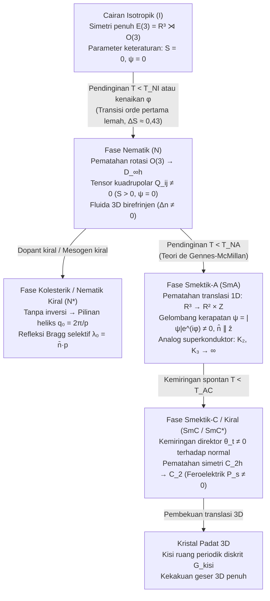

## 1. Wujud Materi Klasik Keempat: Pematahan Simetri Spontan Bertahap

Pada tahun 1888, ahli botani dan kimia Austria <strong>Friedrich Reinitzer</strong> mengamati anomali luar biasa saat memanaskan kristal <strong>kolesteril benzoat</strong> yang diekstraksi dari wortel: senyawa tersebut memiliki <strong>dua titik leleh yang berbeda</strong>. Pada suhu $145{,}5\,^\circ\text{C}$, padatan kristal meleleh menjadi fluida keruh berpendar yang mengalir bebas seperti cairan tetapi tetap mempertahankan birefrinjensi (bias ganda) optik yang kuat; baru pada suhu $178{,}5\,^\circ\text{C}$ fluida keruh tersebut berubah menjadi cairan yang sepenuhnya jernih dan isotropik secara optik. Fisikawan Jerman <strong>Otto Lehmann</strong> memeriksa fase antara ini di bawah mikroskop cahaya terpolarisasi berpemanas dan menciptakan istilah <strong>"kristal cair" (Flüssige Kristalle)</strong>. Pada tahun 1922, kristalografer Prancis <strong>Georges Friedel</strong> menyusun klasifikasi modern <strong>mesofase</strong> menjadi tiga kelas utama: <strong>nematik</strong>, <strong>kolesterik</strong>, dan <strong>smektik</strong>.

Dari sudut pandang fisika materi terkondensasi modern (<strong>Pierre-Gilles de Gennes</strong>, Hadiah Nobel Fisika 1991), kristal cair adalah wujud nyata dari <strong>pematahan simetri spontan (Spontaneous Symmetry Breaking, SSB) bertahap</strong> dari grup Euklides tiga dimensi:

$$\mathcal{G} = E(3) = \mathbb{R}^3 \rtimes O(3)$$

Dalam cairan isotropik ($I$), baik invariansi translasi kontinu $\mathbb{R}^3$ maupun invariansi rotasi kontinu $O(3)$ tetap utuh. Dalam kristal padat 3D, kedua simetri tersebut patah secara bersamaan menjadi kisi ruang diskrit. Kristal cair memisahkan kedua transisi pematahan simetri ini:

1. <strong>Fase nematik ($N$)</strong>: Invariansi translasi kontinu $\mathbb{R}^3$ tetap utuh sepenuhnya—pusat massa molekul mengalir seperti cairan biasa tanpa keteraturan posisi jarak jauh—tetapi simetri rotasi kontinu $O(3)$ patah secara spontan menjadi grup dihedral silindris $D_{\infty h}$. Molekul berbentuk batang atau cakram (<strong>mesogen</strong>) secara statistik menyelaraskan sumbu panjangnya di sepanjang satu arah satuan makroskopik yang disebut <strong>direktor $\hat{\mathbf{n}}$</strong> ($|\hat{\mathbf{n}}| = 1$).
2. <strong>Fase kolesterik / nematik kiral ($N^*$)</strong>: Ketika mesogen bersifat kiral (tidak memiliki simetri inversi cermin, mereduksi $O(3) \to SO(3)$), direktor berpilin secara spontan di dalam ruang membentuk heliks makroskopik dengan jarak puncak (pitch) $p = 2\pi / |q_0|$, menciptakan celah pita fotonik 1D yang memantulkan secara selektif cahaya terpolarisasi sirkular pada panjang gelombang Bragg $\lambda_0 = \bar{n}\,p$.
3. <strong>Fase smektik ($\text{SmA}, \text{SmC}$)</strong>: Selain keteraturan orientasi nematik, simetri translasi kontinu $\mathbb{R}^3$ patah sebagian di sepanjang <strong>satu arah ruang</strong> ($\mathbb{R}^3 \to \mathbb{R}^2 \times \mathbb{Z}$). Sistem membentuk gelombang kerapatan satu dimensi—tumpukan periodik lapisan-lapisan fluida 2D—di mana molekul mengalir bebas sebagai cairan 2D di dalam setiap lapisan sambil mempertahankan periodisitas 1D di sepanjang normal lapisan.

---

## 2. Tensor Parameter Keteraturan Nematik $Q_{ij}$ dan Simetri Kepala-Ekor $\hat{\mathbf{n}} \equiv -\hat{\mathbf{n}}$

Mengapa keadaan nematik tidak dapat dideskripsikan hanya dengan vektor polarisasi $\mathbf{P} = \langle \mathbf{u} \rangle$ seperti pada transisi feromagnetik Heisenberg? Pada hampir semua kristal cair nematik, meskipun satu molekul tunggal memiliki momen dipol listrik permanen, konfigurasi kesetimbangan makroskopiknya memiliki <strong>simetri apolar kepala-ekor</strong>: orientasi $+\hat{\mathbf{n}}$ dan orientasi sebaliknya $-\hat{\mathbf{n}}$ secara fisik tidak dapat dibedakan ($\hat{\mathbf{n}} \equiv -\hat{\mathbf{n}}$). Akibatnya, fungsi distribusi probabilitas orientasi memenuhi $f(-\mathbf{u}) = f(\mathbf{u})$, sehingga semua momen multipol ganjil (dipol) bernilai nol secara identik: $\langle u_i \rangle = 0$.

Momen multipol tak-nol pertama yang membedakan fase nematik anisotropik dari cairan isotropik adalah <strong>momen kuadrupolar peringkat kedua</strong>. Agar parameter keteraturan bernilai nol pada fase isotropik ($\langle u_i u_j \rangle_{\text{iso}} = \frac{1}{3}\delta_{ij}$), kita mendefinisikan <strong>tensor parameter keteraturan de Gennes $Q_{ij}$</strong> yang simetris dan tanpa jejak ($\text{Tr}\,\mathbf{Q} = 0$):

$$\hat{\mathbf{n}} \equiv -\hat{\mathbf{n}}, \qquad Q_{ij} = \left\langle u_{\alpha, i} u_{\alpha, j} - \frac{1}{3}\delta_{ij} \right\rangle = S \left( n_i n_j - \frac{1}{3}\delta_{ij} \right)$$

Dalam nematik uniaksial dengan simetri silindris di sekitar $\hat{\mathbf{n}}$, biaksialitas $P$ bernilai nol dan magnitudo keteraturan orientasi sepenuhnya diwakili oleh <strong>parameter keteraturan skalar Maier-Saupe $S$</strong>, yaitu rata-rata termal dari polinomial Legendre kedua $P_2(\cos\theta)$:

$$S = \langle P_2(\cos\theta) \rangle = \left\langle \frac{3\cos^2\theta - 1}{2} \right\rangle = \int_0^\pi f(\theta) \left(\frac{3\cos^2\theta - 1}{2}\right) \sin\theta \, d\theta$$

Dalam cairan isotropik, $\langle \cos^2\theta \rangle = 1/3 \implies S = 0$. Dalam penyelarasan sejajar sempurna, $\theta = 0 \implies S = 1$. Pada kristal cair termotropik nyata (seperti <strong>5CB</strong>, 4-siano-4'-pentilbifenil, atau <strong>MBBA</strong>), $S$ melompat secara diskontinu pada $T_{NI}$ ke $S \approx 0{,}3\text{–}0{,}45$ dan meningkat hingga $S \approx 0{,}6\text{–}0{,}8$ saat suhu diturunkan lebih lanjut.

Pada <strong>fase smektik-A ($\text{SmA}$)</strong>, muncul parameter keteraturan translasi tambahan. Dengan mengekspansikan kerapatan molekul $\rho(\mathbf{r})$ ke dalam deret Fourier di sepanjang normal lapisan $\hat{\mathbf{z}}$ dengan vektor gelombang $q_0 = 2\pi / d$ ($d \approx L$, panjang molekul):

$$\rho(\mathbf{r}) = \rho_0 + |\psi(\mathbf{r})| \cos\left(q_0 z - q_0 u_z(\mathbf{r})\right), \qquad \lambda_0 = \bar{n} \, p \cos\theta_{\text{inc}}$$

Sebagaimana dirumuskan oleh <strong>Pierre-Gilles de Gennes (1972)</strong> dan <strong>William L. McMillan</strong>, parameter keteraturan kompleks $\psi(\mathbf{r}) = |\psi|e^{i\phi(\mathbf{r})}$ ini membentuk <strong>isomorfisme eksak antara transisi $\text{N–SmA}$ dan transisi logam normal–superkonduktor dalam teori Ginzburg-Landau</strong>: $\psi$ berkorespondensi dengan fungsi gelombang makroskopik pasangan Cooper, fluktuasi transversal direktor $\delta\mathbf{n}_\perp$ berperan sebagai potensial vektor elektromagnetik $\mathbf{A}$, dan pengusiran deformasi pilinan ($K_2$) serta tekukan ($K_3$) dari bagian dalam smektik berkorespondensi persis dengan <strong>efek Meissner</strong> (pengusiran medan magnet $\mathbf{B} = \nabla \times \mathbf{A} = \mathbf{0}$).

---

## 3. Termodinamika Transisi Isotropik-Nematik: Landau-de Gennes vs. Onsager

Terdapat dua keluarga besar kristal cair: <strong>termotropik</strong> (transisi dikendalikan oleh suhu $T$ melalui gaya tarik dispersi anisotropik van der Waals / Maier-Saupe) dan <strong>liotropik</strong> (transisi dikendalikan oleh konsentrasi atau fraksi volume $\phi$ dalam pelarut melalui tolakan sterik volume terkecuali).

### 3.1 Ekspansi Landau-de Gennes dan Invarian Kubik Orde Pertama

Dengan mengekspansikan kerapatan energi bebas $f_{\text{LdG}}$ dalam pangkat invarian rotasi dari tensor $Q_{ij}$, karena $\text{Tr}(\mathbf{Q}) = 0$, suku linear hilang, tetapi—berbeda dengan model Ising atau feromagnetisme di mana simetri $\mathbf{m} \to -\mathbf{m}$ melarang pangkat ganjil—untuk tensor $3\times 3$ tanpa jejak, $Q_{ij}$ dan $-Q_{ij}$ merepresentasikan keadaan fisik yang berbeda ($S > 0$ untuk penyelarasan batang vs. $S < 0$ untuk penyelarasan bidang cakram). Oleh karena itu, <strong>invarian kubik $\text{Tr}(\mathbf{Q}^3)$ diizinkan oleh simetri</strong>:

$$f_{\text{LdG}}(S, T) = f_0 + \frac{1}{3} a (T - T^*) S^2 - \frac{2}{27} B S^3 + \frac{1}{9} C S^4$$

$$T_{NI} = T^* + \frac{B^2}{27 a C}, \qquad S_{NI} = \frac{B}{3C}, \qquad \Delta H = \frac{a B^2 T_{NI}}{27 C^2}$$

Kehadiran suku $-B\,S^3$ ($B > 0$) menciptakan penghalang energi bebas antara $S = 0$ dan $S > 0$, yang menjamin bahwa transisi isotropik-nematik ($I\text{–}N$) dalam 3D secara ketat merupakan <strong>transisi fase orde pertama (meskipun orde pertama lemah)</strong>: pada suhu penjernihan $T_{NI} = T^* + \frac{2B^2}{9a_0 C}$, parameter keteraturan mengalami lompatan diskontinu universal $S(T_{NI}) = \frac{2B}{3C} \approx 0{,}43$, disertai kalor laten kecil ($\Delta H \approx 1\text{–}2\,\text{kJ/mol}$).

### 3.2 Teori Volume Terkecuali Onsager (1949): Keteraturan yang Digerakkan oleh Entropi

Pada tahun 1949, <strong>Lars Onsager</strong> membuktikan hasil yang berlawanan dengan intuisi untuk suspensi batang keras dengan panjang $L$ dan diameter $D$ ($L \gg D$) tanpa gaya tarik sama sekali ($\Delta U = 0$): <strong>transisi menuju fase nematik yang teratur digerakkan sepenuhnya oleh maksimisasi entropi total</strong>. Volume terkecuali timbal balik antara dua batang dengan sudut relatif $\gamma$ adalah $V_{\text{excl}}(\gamma) = 2 L^2 D |\sin\gamma|$. Dalam ekspansi virial kedua yang eksak pada limit $L/D \to \infty$:

$$v_{\text{excl}}(\gamma) = 2 L^2 D |\sin\gamma|, \qquad \phi_I = \frac{3.340}{L/D}, \qquad \phi_N = \frac{4.486}{L/D}$$

Di atas fraksi volume kritis $\phi_{\text{iso}} \approx 3{,}29\,(D/L)$, sistem mengorbankan sedikit <strong>entropi orientasi</strong> ($\sigma_{\text{rot}} < 0$) dengan menyelaraskan batang-batang ($\langle|\sin\gamma|\rangle \ll \pi/4$), yang secara drastis memperkecil volume terkecuali dan menghasilkan keuntungan <strong>entropi translasi (pengemasan)</strong> ($\sigma_{\text{pack}}$) yang jauh lebih besar. Fase nematik koeksisten muncul pada $\phi_{\text{nem}} \approx 4{,}19\,(D/L)$ dengan $S \approx 0{,}79$.

---

## 4. Elastisitas Kontinum Frank-Oseen dan Transisi Fréedericksz pada LCD

Dalam fase nematik, variasi spasial yang halus dari direktor $\hat{\mathbf{n}}(\mathbf{r})$ pada skala yang jauh lebih besar daripada ukuran molekul ($|\nabla\hat{\mathbf{n}}| \ll a^{-1}$) membutuhkan energi elastis. <strong>C. W. Oseen (1933)</strong> dan <strong>F. C. Frank (1958)</strong> membuktikan bahwa setiap deformasi ruang dapat diuraikan menjadi tiga mode dasar dengan konstanta elastis $K_1, K_2, K_3 \sim 10^{-11}\,\text{N}$ ($10\,\text{pN}$):

1. <strong>Sebaran (Splay, $K_1$)</strong>: divergensi radial garis-garis direktor, diukur oleh $(\nabla \cdot \hat{\mathbf{n}})^2$.
2. <strong>Pilinan (Twist, $K_2$)</strong>: rotasi heliks $\hat{\mathbf{n}}$ tegak lurus terhadap dirinya sendiri, diukur oleh $(\hat{\mathbf{n}} \cdot \nabla \times \hat{\mathbf{n}})^2$.
3. <strong>Tekukan (Bend, $K_3$)</strong>: kelengkungan longitudinal garis-garis direktor, diukur oleh $(\hat{\mathbf{n}} \times \nabla \times \hat{\mathbf{n}})^2$.

Kerapatan energi bebas elastis dan dielektrik total (untuk anisotropi dielektrik $\Delta\varepsilon = \varepsilon_\parallel - \varepsilon_\perp > 0$) dituliskan sebagai:

$$f_{\text{Frank}} = \frac{1}{2} K_1 \left( \nabla \cdot \hat{\mathbf{n}} \right)^2 + \frac{1}{2} K_2 \left( \hat{\mathbf{n}} \cdot (\nabla \times \hat{\mathbf{n}}) + q_0 \right)^2 + \frac{1}{2} K_3 \left( \hat{\mathbf{n}} \times (\nabla \times \hat{\mathbf{n}}) \right)^2$$

Ketika sel nematik dengan ketebalan $d$ dan penambatan planar kuat ($\theta(0) = \theta(d) = 0$) diberi medan listrik tegak lurus $\mathbf{E} = (V/d)\hat{\mathbf{z}}$, kompetisi antara torsi pemulih elastis $\sim K_1(\pi/d)^2$ dan torsi dielektrik $\sim \varepsilon_0 \Delta\varepsilon (V/d)^2$ memicu bifurkasi garpu tala superkritis—<strong>transisi Fréedericksz (1927)</strong>—tepat ketika mode dasar $\sin(\pi z / d)$ menjadi tidak stabil:

$$E_{\text{th}} = \frac{\pi}{d} \sqrt{\frac{K_1}{\varepsilon_0 \Delta\varepsilon}} \quad \Longrightarrow \quad V_{\text{th}} = E_{\text{th}} d = \pi \sqrt{\frac{K_1}{\varepsilon_0 \Delta\varepsilon}}$$

Menariknya, ketebalan sel $d$ saling menghilangkan sepenuhnya! Ambang pensaklaran hanya bergantung pada <strong>tegangan listrik $V_{\text{th}} \approx 1\,\text{V}$</strong> dan bukan kuat medan listrik, sehingga transistor film tipis (TFT) bertegangan rendah dapat mengendalikan miliaran piksel dalam tiga arsitektur LCD modern: <strong>TN (Twisted Nematic)</strong>, <strong>IPS (In-Plane Switching)</strong> (dikendalikan oleh $K_2$, memberikan sudut pandang lebar), dan <strong>VA (Vertical Alignment)</strong> (dikendalikan oleh $K_3$ dengan $\Delta\varepsilon < 0$, memberikan rasio kontras bawaan yang sangat tinggi).

---

## 5. Cacat Topologi (Disklinasi) dan Grup Homotopi $\pi_1(\mathbb{R}P^2) = \mathbb{Z}_2$

Karena fisika nematik invarian terhadap $\hat{\mathbf{n}} \leftrightarrow -\hat{\mathbf{n}}$, manifold parameter keteraturan dalam 3D bukanlah bola satuan $S^2$, melainkan <strong>bidang proyektif riil $\mathcal{M} = S^2 / \mathbb{Z}_2 = \mathbb{R}P^2$</strong> (bola dengan titik-titik antipodal diidentikkan). Saat mengelilingi lintasan tertutup $\Gamma$ di sekitar garis singularitas (<strong>disklinasi</strong>), direktor hanya perlu berputar sebesar kelipatan bulat dari $\pi$ ($180^\circ$) untuk kembali ke keadaan fisik yang sama. Dalam geometri planar 2D ($\mathcal{M}_{2\text{D}} = S^1/\mathbb{Z}_2 = \mathbb{R}P^1 \cong S^1$), muatan lilitan topologi adalah $s = \frac{\Delta\phi}{2\pi} \in \{0, \pm\frac{1}{2}, \pm 1, \pm\frac{3}{2}, \dots\}$, yang memungkinkan <strong>cacat setengah-bulat $s = +1/2$</strong> (geometri kutub berbentuk komet) dan <strong>$s = -1/2$</strong> (geometri lipat-tiga berbentuk semanggi).

Namun, dalam ruang tiga dimensi penuh, stabilitas topologi garis cacat diklasifikasikan oleh grup homotopi fundamental pertama dari $\mathbb{R}P^2$:

$$\pi_1(\mathbb{R}P^2) = \mathbb{Z}_2 = \{0, 1\}, \qquad E_{\text{line}} = \pi K s^2 \ln\left(\frac{R}{r_c}\right) + E_{\text{core}}, \qquad B = 4|s|$$

Berbeda dengan $\mathbb{Z}$, grup siklik $\mathbb{Z}_2 = \{0, 1\}$ hanya memiliki <strong>dua kelas ekuivalensi topologi</strong>:
- <strong>Kelas tak-trivial ($1 \in \mathbb{Z}_2$)</strong>: Semua disklinasi setengah-bulat ($s = \pm 1/2, \pm 3/2, \dots$) berkorespondensi dengan lintasan pada bola $S^2$ yang menghubungkan dua kutub antipodal ($\hat{\mathbf{n}} \to -\hat{\mathbf{n}}$); lintasan ini tidak dapatenciutkan menjadi satu titik sehingga <strong>terlindungi secara topologi</strong>.
- <strong>Kelas trivial ($0 \in \mathbb{Z}_2$)</strong>: Disklinasi bermuatan bulat ($s = \pm 1$) berkorespondensi dengan simpul tertutup pada $S^2$, yang selalu dapat diciutkan! Sebagaimana ditunjukkan oleh <strong>R. B. Meyer (1973)</strong> serta <strong>P. E. Cladis & M. Kléman (1972)</strong>, garis singular $s = +1$ menghilangkan inti singularnya dengan memiringkan direktor secara mulus ke arah sumbu ketiga $z$ di pusatnya—fenomena terkenal <strong>"pelarian ke dimensi ketiga" (escape into the third dimension)</strong>.

Di bawah polarisator bersilangan ($\mathbf{P} \perp \mathbf{A}$), transmitansi $I \propto \sin^2(2\phi)\sin^2(\pi\Delta n\,d/\lambda)$ bernilai nol setiap kali $\phi(\varphi) = 0, \pi/2, \pi, 3\pi/2$. Dalam <strong>tekstur Schlieren</strong>, setiap inti cacat bermuatan $s$ menampilkan tepat <strong>$B = 4|s|$ sikat gelap pemadaman</strong>: <strong>2 sikat</strong> untuk disklinasi setengah-bulat ($s = \pm 1/2$) dan <strong>4 sikat</strong> untuk pusat bulat ($s = \pm 1$).

---

## 6. Perbandingan Mesofase dan Perbatasan Teknologi (Kevlar, Otot Buatan, dan Materi Aktif)

| Mesofase / Wujud | Keteraturan Posisi (Translasi) | Keteraturan Orientasi (Rotasi) | Simetri Titik / Ruang | Parameter Keteraturan Utama | Ciri Optik dan Reologi |
| :--- | :--- | :--- | :--- | :--- | :--- |
| <strong>Cairan Isotropik ($I$)</strong> | Tidak ada (invariansi 3D $\mathbb{R}^3$) | Tidak ada (invariansi 3D $O(3)$) | $E(3) = \mathbb{R}^3 \rtimes O(3)$ | $S = 0, \; \psi = 0$ | Isotropik optik ($\Delta n = 0$), fluida Newton |
| <strong>Nematik ($N$)</strong> | Tidak ada (fluida 3D $\mathbb{R}^3$) | Uniaksial jarak jauh ($\hat{\mathbf{n}} \equiv -\hat{\mathbf{n}}$) | $\mathbb{R}^3 \rtimes D_{\infty h}$ | Tensor kuadrupolar $Q_{ij}$ ($S \neq 0$) | Birefrinjensi kuat $\Delta n$, tekstur Schlieren ($B=2,4$), viskositas rendah |
| <strong>Kolesterik ($N^*$)</strong> | Tidak ada (fluida nematik lokal) | Pilinan heliks ($q_0 = 2\pi/p$) | $\mathbb{R}^2 \rtimes D_\infty$ (kiral) | $Q_{ij}(\mathbf{r})$, jarak puncak heliks $p$ | Refleksi Bragg sirkular ($\lambda_0 = \bar{n}p$), daya putar optik raksasa |
| <strong>Smektik-A ($\text{SmA}$)</strong> | Gelombang kerapatan 1D berlapis ($d \approx L$) | Sejajar normal lapisan ($\hat{\mathbf{n}} \parallel \hat{\mathbf{k}}$) | $(\mathbb{R}^2 \times \mathbb{Z}) \rtimes D_{\infty h}$ | $S \neq 0$, gelombang kompleks $\psi = |\psi|e^{i\phi}$ | Tekstur fokal-konik, pengusiran pilinan & tekukan ($K_2, K_3 \to \infty$) |
| <strong>Smektik-C Kiral ($\text{SmC}^*$)</strong> | Lapisan periodik 1D ($d = L\cos\theta_t$) | Miring sebesar sudut $\theta_t$ | Monoklinik $C_2$ (polar) | $\psi \neq 0$, polarisasi spontan $\mathbf{P}_s$ | Optik biaksial, pensaklaran feroelektrik mikrodetik (SSFLC) |

Di luar layar datar, fisika kristal cair menopang empat perbatasan sains dan rekayasa: (1) <strong>Polimer Kristal Cair (LCP) dan serat aramid seperti Kevlar</strong> (ditemukan oleh <strong>Stephanie Kwolek</strong> pada tahun 1965), di mana rantai kaku poli(p-fenilena tereftalamida) membentuk fase nematik liotropik Onsager dalam asam sulfat pekat sebelum pemintalan basah, menghasilkan kekuatan tarik spesifik 5 hingga 8 kali lipat baja; (2) <strong>Elastomer Kristal Cair (LCE)</strong> (diprediksi oleh de Gennes pada tahun 1975), di mana kopling antara jaringan polimer berikatan silang dan $Q_{ij}$ menghasilkan <strong>otot buatan</strong> yang mampu berkontraksi secara reversibel sebesar $30\%\text{–}400\%$ saat melewati $T_{NI}$; (3) <strong>Modulator cahaya spasial LCoS dan pelat-Q topologi</strong> berbasis fase geometris Pancharatnam-Berry ($\Phi_{\text{PB}} = \pm 2\alpha(\mathbf{r})$) untuk pinset optik holografik dan berkas vorteks optik; serta (4) <strong>Kristalinitas cair biologis dan nematik aktif</strong>: membran lipid seluler (dwilapis $\text{SmA}$ 2D), kondensat DNA *in vivo*, jaringan mikrotubulus berpenggerak ATP, dan jaringan epitel menghasilkan <strong>tensor tegangan aktif</strong> yang sebanding dengan $Q_{ij}$:

$$\sigma_{ij}^{\text{active}} = -\zeta \, Q_{ij}, \qquad \mathbf{f}^{\text{active}} = -\zeta \nabla \cdot \mathbf{Q}$$

Karena cacat $+1/2$ berbentuk komet mematahkan simetri kutub depan-belakang ($\nabla\cdot\mathbf{Q} \neq \mathbf{0}$), gradien tegangan aktif menghasilkan gaya penggerak internal $\mathbf{f}_{\text{aktif}} = -\zeta\,\nabla\cdot\mathbf{Q} \neq \mathbf{0}$ yang mengubah disklinasi $+1/2$ menjadi <strong>kuasipartikel berpenggerak sendiri</strong> dalam keadaan turbulensi aktif, yang mengatur ekstrusi sel apoptotik pada epitel (Saw et al., *Nature* 2017) serta morfogenesis regeneratif *Hydra* (di mana cacat $+1$ bertindak sebagai pusat pengorganisasian kepala dan kaki).
