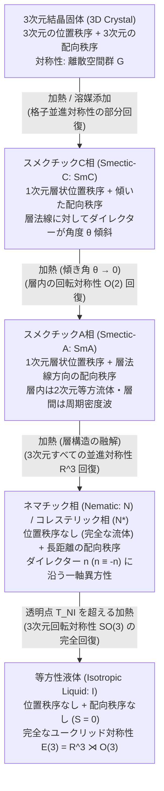
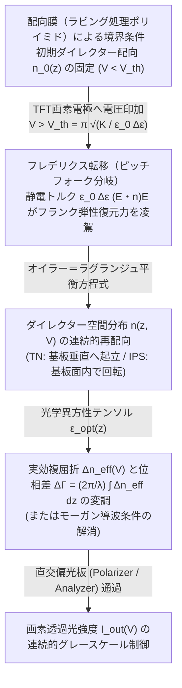

私たちが学校の理科で最初に学ぶ物質の三態——<strong>固体（結晶）・液体・気体</strong>——という分類は、日常的な直感によく合致している。氷を温めれば水になり、水をさらに温めれば水蒸気へと変わる。結晶固体においては、構成原子や分子が空間的な3次元周期格子の上に厳密に固定されており、<strong>位置の秩序（positional order）</strong>と<strong>配向の秩序（orientational order）</strong>の双方が巨視的なスケールで保たれている。一方、等方性液体（isotropic liquid）へと融解した瞬間、格子は完全に崩壊し、分子の重心位置も分子軸の向きも完全にランダムとなって、空間のどの方向も等価な並進・回転対称性が回復する。

ところが自然界には、この「すべてが凍りついた結晶」と「すべてが乱雑に流れる液体」という二項対立を根底から覆す<strong>第4の物質状態（中間相：メソフェーズ, mesophase）</strong>が存在する。それが<strong>液晶（Liquid Crystal）</strong>である。液晶は、液体のように容器の形に合わせて自在に流動し、ピペットで吸い上げることもできる流体でありながら、結晶のように偏光を回転させ、複屈折（birefringence）を示し、外部電場や磁場に対して鋭敏な異方的応答を示す。

なぜ「流れる結晶」などという一見矛盾した状態が熱力学的に安定して存在し得るのか？本稿では、1888年の植物学者による偶然の発見から出発し、連続対称性の破れとテンソル秩序変数、熱致性（サーモトロピック）および濃度致性（リオトロピック）相転移の統計力学、オセーン＝フランク（Oseen-Frank）連続体弾性理論と液晶ディスプレイ（LCD）を駆動するフレデリクス転移、実射影平面 $\mathbb{R}P^2$ のホモトピー群が支配する半整数トポロジカル欠陥（転傾：ディスクリネーション）、さらには超高強度アラミド繊維・人工筋肉エラストマー・細胞組織のアクティブ・マター物理学に至るまで、液晶という驚異のソフトマターが切り拓いた凝縮系物理学の深淵を体系的に解き明かす。

---

## 1. 「二重の融点」の発見とソフトマター物理学の誕生

### 1.1 ライニッツァーのニンジン抽出物とレーマンの偏光顕微鏡

液晶科学の扉が開かれたのは、1888年3月のことである。当時プラハ・ドイツ大学で植物生理学を研究していたオーストリアの植物学者<strong>フリードリヒ・ライニッツァー（Friedrich Reinitzer）</strong>は、植物中のコレステロールの化学構造と生理機能を解明するため、ニンジンの根から抽出したコレステロールに安息香酸を反応させた誘導体<strong>安息香酸コレステリル（cholesteryl benzoate, $\text{C}_{34}\text{H}_{50}\text{O}_2$）</strong>の精製結晶を加熱し、その融点を精密に測定していた。

純粋な有機結晶であれば、ただ一つの明確な融点において固体から透明な液体へと変化するはずである。しかしライニッツァーは、安息香酸コレステリルが<strong>「二つの融点（二重融点, double melting points）」</strong>を持つという奇妙な現象に遭遇した。

1. <strong>第1の転移点（$145.5\,^\circ\text{C}$）</strong>：固体の結晶を加熱していくと、$145.5\,^\circ\text{C}$ で突如として融解し、自由に流動する液体へと変化した。しかしその液体は透明ではなく、<strong>白濁した雲のような濁り（turbidity）</strong>を帯びていた。
2. <strong>第2の転移点（$178.5\,^\circ\text{C}$）</strong>：さらに加熱を続けると、$178.5\,^\circ\text{C}$ に達した瞬間に白濁が跡形もなく消え去り、水のように完全に<strong>透明な等方性液体</strong>へと変わった（今日この温度は<strong>透明点, clearing point</strong> と呼ばれる）。
3. <strong>冷却時の構造色</strong>：透明な液体を冷却していくと、$178.5\,^\circ\text{C}$ で再び白濁流体に戻る際に鮮やかな紫青色の閃光が現れ、さらに $145.5\,^\circ\text{C}$ で結晶化する直前にも再び青紫色の反射光が観測された。

不純物の混入を疑ったライニッツァーは何度も再結晶と精製を繰り返したが、この二重融点と色彩現象は決して消えなかった。物理学的な光学解析が必要だと判断した彼は、1888年3月14日、ドイツ・アーヘン工科大学の物理学者<strong>オットー・レーマン（Otto Lehmann）</strong>に試料と手紙を送った。レーマンは当時、独自に開発した<strong>加熱ステージ付き偏光顕微鏡</strong>を用いて結晶成長をリアルタイム観察する世界的権威であった。

レーマンが白濁した流体状態の安息香酸コレステリルを直交ニコル（クロスニコル）の偏光顕微鏡下で観察したところ、驚くべき事実が判明した。その液体は水飴や油のように合体・流動しているにもかかわらず、一軸性あるいは二軸性の鉱物結晶とまったく同じように<strong>強い光学的複屈折（optical birefringence）</strong>を示し、美しい干渉色と暗黒の消光ブラシ模様を浮かび上がらせたのである。レーマンは、流動性と結晶的光学異方性が同一の相に共存していることを確信し、1889年から1900年にかけてこの物質群に<strong>「流れる結晶 / 液晶（Flüssige Kristalle）」</strong>という衝撃的な名称を与えた。

### 1.2 古典熱力学者の懐疑からド・ジェンヌの統一理論へ

当初、レーマンの「液晶」という概念は、グスタフ・タンマン（Gustav Tammann）やヴァルター・ネルンスト（Walther Nernst）ら当時の主流派化学者・結晶学者から激しい批判を浴びた。古典的な結晶学のドグマでは、「固体結晶とは3次元空間格子を持つものであり、液体とは等方的な無秩序状態である。したがって『液体の結晶』などというものは論理的矛盾であり、微結晶が液体中に懸濁したコロイド分散系（エマルション）か不純物の見間違いにすぎない」とみなされたのである。

この論争に決定的な終止符を打ったのが、フランスの鉱物学者<strong>ジョルジュ・フリーデル（Georges Friedel）</strong>が1922年に発表した記念碑的論文であった。フリーデルは、「結晶でも通常の液体でもない真の熱力学的平衡相」という意味を込めて<strong>メソモルフィック状態（mesomorphic states / 中間相）</strong>という用語を提唱し、偏光顕微鏡に現れるトポロジカル欠陥の模様（組織：テクスチャ）に基づいて液晶を以下の3つの基本クラスへと明確に分類した。

- <strong>ネマチック相（Nematic phase）</strong>：ギリシャ語の「糸（$\nu\tilde{\eta}\mu\alpha$, nema）」に由来。顕微鏡下で黒い糸状の欠陥線（転傾線）が縦横に走る様子から命名された。
- <strong>スメクチック相（Smectic phase）</strong>：ギリシャ語の「石鹸（$\sigma\mu\tilde{\eta}\gamma\mu\alpha$, smegma）」に由来。石鹸の濃厚水溶液が示す層状の滑りやすい流体構造と同一の対称性を持つことから命名された。
- <strong>コレステリック相（Cholesteric phase）</strong>：ライニッツァーが発見したコレステロール誘導体に特有の、空間的ならせんねじれ構造を持つ相。

その後20世紀後半に入り、フランスの理論物理学者<strong>ピエール＝ジル・ド・ジェンヌ（Pierre-Gilles de Gennes）</strong>が、超伝導や磁性体の相転移理論（ランダウ理論・くりこみ群・ゲージ対称性）を液晶・高分子・コロイドへと鮮やかに拡張した。ド・ジェンヌは「液晶におけるネマチック相転移やスメクチック相転移は、強磁性体や超伝導体とまったく同じ<strong>普遍的な対称性の破れと秩序変数の物理学</strong>で記述できる」ことを証明し、1991年にノーベル物理学賞を受賞した。彼の業績によって、液晶は高分子・界面活性剤・生体膜と並ぶ<strong>ソフトマター物理学（Soft Condensed Matter Physics）</strong>の中核へと位置づけられたのである。

---

## 2. 位置の秩序と配向の秩序：メソフェーズの対称性と秩序変数

なぜある種の分子は、結晶から融解してもただちに等方性液体にならず、液晶相を経由するのか？その鍵は<strong>分子形状の強い異方性（anisometry）</strong>にある。液晶を形成する分子（<strong>メソゲン, mesogen</strong>）の代表例は、剛直な芳香環（ビフェニル環やベンゼン環など）からなる細長いコア部分と、柔軟なアルキル鎖の末端基を組み合わせた<strong>棒状分子（カラミチック液晶, calamitic liquid crystal）</strong>——たとえば室温ネマチック液晶として有名な <strong>5CB（4-シアノ-4'-ペンチルビフェニル）</strong>——や、平面状の多環芳香族コアを持つ<strong>円盤状分子（ディスコチック液晶, discotic liquid crystal）</strong>である。

結晶が融解するとき、「重心の3次元格子（位置の秩序）」と「分子軸の揃い（配向の秩序）」という2種類の秩序が同じ温度で同時に失われる必然性はない。棒状分子の重心間の束縛が熱運動で解けても、細長い棒同士が互いにぶつかり合わずにパッキングするためには、向きを揃えて並んでいたほうがエネルギー的・エントロピー的に有利である。こうして<strong>「位置の秩序は融解して液体となったが、配向の秩序は結晶のように生き残っている状態」</strong>が生まれる。

### 2.1 ネマチック相（Nematic Phase）と四重極テンソル秩序変数 $Q_{ij}$

最も基本的かつ工学的に重要な液晶相が<strong>ネマチック相（$N$相）</strong>である。ネマチック相において、分子の重心位置の相関関数 $g(\mathbf{r})$ は数分子距離で減衰し、巨視的には<strong>3次元すべての並進対称性 $\mathbb{R}^3$ が保たれている</strong>。そのため、分子は空間内を自由に拡散・流動できる。

一方で、3次元回転群 $SO(3)$ の対称性は自発的に破れており、棒状分子の長軸（単位ベクトル $\mathbf{u}_\alpha$）は統計平均としてある特定の方向へと揃う傾向を持つ。この平均的な配向方向を表す単位ベクトルを<strong>ダイレクター（director, 配向子）$\hat{\mathbf{n}}$</strong> と呼ぶ（$|\hat{\mathbf{n}}| = 1$）。

ここで極めて重要な物理的性質がある。多くのネマチック液晶分子は、分子構造として頭（たとえばシアノ基 $-\text{CN}$）と尾（アルキル鎖 $-\text{C}_5\text{H}_{11}$）の非対称性（電気双極子）を持っているにもかかわらず、ネマチック相全体としては上向きの分子と下向きの分子がまったく同じ確率（$50\% : 50\%$）で混ざり合っている。したがって、巨視的な極性（強誘電性）は存在せず、<strong>ダイレクターの向きを反転させた状態は物理的に完全に同一である</strong>：

$$\hat{\mathbf{n}} \equiv -\hat{\mathbf{n}}$$

この<strong>頭尾反転対称性（無極性：apolar symmetry）</strong>のため、強磁性体の磁化ベクトル $\mathbf{M}$ のような1階のベクトル量を秩序変数として選ぶと、$\langle \mathbf{u}_\alpha \rangle = \mathbf{0}$ となってしまい、等方性液体とネマチック相を区別できない。

そこでド・ジェンヌは、$\mathbf{u}_\alpha \to -\mathbf{u}_\alpha$ の反転に対して不変であり、かつ等方性液体でゼロとなる最小次数のテンソルとして、<strong>対称かつトレースレス（跡がゼロ）な2階の四重極テンソル秩序変数（quadrupolar tensor order parameter）$Q_{ij}$</strong> を導入した：

$$Q_{ij} = \left\langle u_{\alpha, i} u_{\alpha, j} - \frac{1}{3}\delta_{ij} \right\rangle$$

ここで $i, j \in \{x, y, z\}$ は空間座標の添字、$\delta_{ij}$ はクロネッカーのデルタである。ダイレクター $\hat{\mathbf{n}}$ の周りに軸対称性（一軸性：uniaxiality, $D_{\infty h}$ 対称性）がある通常のネマチック相では、このテンソル $Q_{ij}$ はただ一つのスカラー量 $S$ を用いて次のように書ける：

$$Q_{ij} = S \left( n_i n_j - \frac{1}{3}\delta_{ij} \right)$$

この係数 $S$ こそが、<strong>マイヤー＝ザウペ（Maier-Saupe）のスカラー秩序変数（scalar order parameter）</strong>であり、各分子の長軸 $\mathbf{u}_\alpha$ とダイレクター $\hat{\mathbf{n}}$ がなす角度を $\theta_\alpha$（$\cos\theta_\alpha = \mathbf{u}_\alpha \cdot \hat{\mathbf{n}}$）としたとき、ルジャンドル多項式の第2項 $P_2(\cos\theta)$ の熱統計平均として定義される：

$$S = \langle P_2(\cos\theta) \rangle = \left\langle \frac{3\cos^2\theta - 1}{2} \right\rangle = \int_0^\pi f(\theta) \frac{3\cos^2\theta - 1}{2} \sin\theta \, d\theta$$

ここで $f(\theta)$ は分子配向の確率分布関数である。スカラー秩序変数 $S$ の物理的意味を確認しておこう。

- <strong>完全な結晶的平行配向（$\theta = 0$ または $\pi$）</strong>：すべての分子が $\hat{\mathbf{n}}$ に完全に平行であれば $\cos^2\theta = 1$ となり、<strong>$S = 1$</strong> となる。
- <strong>等方性液体（完全なランダム配向）</strong>：球面上の全方位に一様分布するとき、$\langle \cos^2\theta \rangle = \frac{1}{2}\int_0^\pi \cos^2\theta \sin\theta \, d\theta = \frac{1}{3}$ となるため、<strong>$S = 0$</strong> となる。
- <strong>垂直平面内ランダム配向（$\theta = \pi/2$）</strong>：すべての分子が $\hat{\mathbf{n}}$ に垂直な平面内に寝ているとき $\cos^2\theta = 0$ となり、<strong>$S = -1/2$</strong> となる。
- <strong>現実のネマチック液晶</strong>：熱揺らぎが存在するため、典型的なネマチック相では <strong>$S \approx 0.3 \sim 0.8$</strong> の値をとる。等方性液体から冷却していくと、透明点 $T_{NI}$ において $S = 0$ から $S \approx 0.43$ へと不連続にジャンプする（一次相転移）。

### 2.2 スメクチック相（Smectic Phase：$\text{SmA}, \text{SmC}$）と1次元密度波

ネマチック相をさらに冷却すると、多くの液晶物質は配向秩序を保ったまま、1次元方向だけ位置の並進対称性を破って層状構造を形成する<strong>スメクチック相（Smectic phase）</strong>へと転移する。

スメクチック相では、分子の重心が等間隔 $d$（ほぼ分子1個の長さ $L \sim 2\text{--}4\text{ nm}$ に相当）の平行な層（レイヤー）をなして積み重なる。層に垂直な方向を $z$ 軸にとると、重心密度 $\rho(\mathbf{r})$ は一様密度 $\rho_0$ の周りに1次元周期的な<strong>密度波（density wave）</strong>として変調を受ける：

$$\rho(\mathbf{r}) = \rho_0 + \text{Re}\left[ \psi(\mathbf{r}) \, e^{i q_0 z} \right] = \rho_0 + |\psi| \cos(q_0 z + \phi)$$

ここで $q_0 = \frac{2\pi}{d}$ は層の波数、$\psi(\mathbf{r}) = |\psi(\mathbf{r})| e^{i\phi(\mathbf{r})}$ は密度波の振幅 $|\psi|$ と層の位置位相 $\phi = -q_0 u_z$（$u_z$ は層の $z$ 方向変位）を合わせた<strong>複素スメクチック秩序変数</strong>である。各層の内部（$xy$ 平面内）では分子の重心位置に周期性はなく、<strong>2次元的な液体</strong>として自由に流動できる。すなわちスメクチック液晶とは、<strong>「1次元の結晶であり、かつ2次元の液体である」</strong>というハイブリッド物質なのである。

ダイレクター $\hat{\mathbf{n}}$ と層法線単位ベクトル $\hat{\mathbf{k}}$ の幾何学的関係によって、スメクチック相はさらに細かく分類される。

1. <strong>スメクチックA相（$\text{SmA}$ 相）</strong>：分子長軸の平均方向 $\hat{\mathbf{n}}$ が層法線 $\hat{\mathbf{k}}$ と平行（$\hat{\mathbf{n}} \parallel \hat{\mathbf{k}}$）である相。各層内は面内等方的（$D_{\infty h}$ 対称性）な2次元流体である。ド・ジェンヌは1972年、$\text{SmA}$ 相の複素秩序変数 $\psi = |\psi|e^{i\phi}$ とダイレクターのゆらぎ $\delta\mathbf{n}$ の結合が、ギンツブルグ＝ランダウ理論における<strong>超伝導体のクーパー対波動関数 $\Psi$ とベクトルポテンシャル $\mathbf{A}$ のゲージ結合と数学的に完全に同型である</strong>ことを発見した。超伝導体が磁場 $\mathbf{B} = \nabla \times \mathbf{A}$ を排除するマイスナー効果（Meissner effect）とまったく同じ機構により、$\text{SmA}$ 相では層間隔を一定に保つ制約から<strong>ねじれ（twist: $\hat{\mathbf{n}}\cdot(\nabla\times\hat{\mathbf{n}}) = 0$）と曲がり（bend: $\hat{\mathbf{n}}\times(\nabla\times\hat{\mathbf{n}}) = \mathbf{0}$）の変形が完全に排除される</strong>！
2. <strong>スメクチックC相（$\text{SmC}$ 相）とキラル強誘電性 $\text{SmC}^*$ 相</strong>：分子長軸 $\hat{\mathbf{n}}$ が層法線 $\hat{\mathbf{k}}$ に対して一定の傾き角（チルト角）$\theta_t \neq 0$ だけ一様に傾いた相（単斜晶系の $C_{2h}$ 対称性）。ここでロバート・マイヤー（Robert B. Meyer, 1975）は対称性の議論から驚くべき予言を行った。もし $\text{SmC}$ 相を構成する分子が鏡像異性体（キラル分子）であれば（<strong>キラルスメクチックC相：$\text{SmC}^*$</strong>）、鏡映対称性が失われて点群が $C_2$ に低下するため、層面に平行でかつ傾き方向に垂直な方向（$\hat{\mathbf{k}} \times \hat{\mathbf{n}}$ 方向）に<strong>自発分極（spontaneous polarization）$\mathbf{P}_s$ が必然的に発生する</strong>というのである。クラークとラガーウォール（Clark & Lagerwall, 1980）は、この $\text{SmC}^*$ 相を薄いガラスセルに閉じ込めてらせんを解いた<strong>表面安定化強誘電性液晶（SSFLC）</strong>を開発し、ネマチック液晶より1,000倍も速いマイクロ秒オーダーの双安定高速スイッチングを実現した。

### 2.3 コレステリック相（Cholesteric / Chiral Nematic Phase, $N^*$）とブラッグ選択反射

ネマチック相を構成する分子自身が光学活性（キラリティ：右手系と左手系の鏡像非対称性）を持つか、あるいは通常のネマチック液晶に少量のキラルドーパントを添加すると、隣接する分子同士がわずかな角度ずつねじれて並ぶ方がファンデルワールス相互作用エネルギーが低くなる。これがライニッツァーが最初に観察した<strong>コレステリック相（キラルネマチック相, $N^*$ 相）</strong>である。

らせん軸を $z$ 軸にとると、ダイレクター $\hat{\mathbf{n}}(z)$ は $xy$ 平面内に保たれたまま、$z$ 座標に沿って空間的に連続的ならせん回転を描く：

$$\hat{\mathbf{n}}(z) = \begin{pmatrix} \cos(q_0 z + \phi_0) \\ \sin(q_0 z + \phi_0) \\ 0 \end{pmatrix}, \quad q_0 = \frac{2\pi}{p}$$

ここで $p$ はダイレクターが $360^\circ$（$2\pi$ ラジアン）回転するのに要する距離であり、<strong>らせんピッチ（helical pitch）</strong>と呼ばれる。ただし、ネマチック相と同様に頭尾反転対称性 $\hat{\mathbf{n}} \equiv -\hat{\mathbf{n}}$ が成り立つため、ダイレクターが $180^\circ$（$\pi$ ラジアン）回転した時点で物理的・光学的な状態は元に戻る。したがって、<strong>コレステリック相の実効的な空間周期（光学周期）は $p/2$</strong> である。

ピッチ $p$ が可視光の波長と同程度（数百ナノメートル）であるとき、この周期的な誘電率テンソル構造は1次元フォトニック結晶として働き、特定の波長と円偏光成分だけを強く反射する<strong>ブラッグ選択反射（Bragg selective reflection）</strong>を引き起こす。常光屈折率を $n_o$、異常光屈折率を $n_e$、平均屈折率を $\bar{n} = (n_o + n_e)/2$、複屈折を $\Delta n = n_e - n_o$ とすると、らせん軸に平行に入射した光に対して反射帯域の中心波長 $\lambda_0$ とバンド幅 $\Delta\lambda$ は次式で与えられる：

$$\lambda_0 = \bar{n} \, p, \quad \Delta\lambda = \Delta n \, p$$

しかも、右巻きらせんのコレステリック液晶は<strong>右円偏光のみを $100\%$ 反射し、左円偏光はそのまま透過させる</strong>という極めてユニークな円偏光選択性を持つ。ライニッツァーが安息香酸コレステリルで見た神秘的な紫青色の閃光も、プラチナコガネ（*Chrysina gloriosa*）などの甲虫のクチクラ外骨格が放つ金属光沢の構造色も、そして温度によってピッチ $p(T)$ が変化して色が変わる液晶温度計シートも、すべてこのコレステリック相のブラッグ選択反射そのものなのである。

| 物質相 | 位置の秩序（並進対称性） | 配向の秩序（回転対称性） | 点群・空間対称性 | 代表的な秩序変数 | 光学的・レオロジー的特徴 |
| :--- | :--- | :--- | :--- | :--- | :--- |
| <strong>等方性液体 ($I$)</strong> | なし（3次元並進不変 $\mathbb{R}^3$） | なし（3次元回転不変 $O(3)$） | $E(3) = \mathbb{R}^3 \rtimes O(3)$ | $S = 0, \psi = 0$ | 光学的等方性（複屈折なし）、ニュートン流体 |
| <strong>ネマチック相 ($N$)</strong> | なし（完全な流体 $\mathbb{R}^3$） | 1軸長距離配向秩序（$\hat{\mathbf{n}} \equiv -\hat{\mathbf{n}}$） | $\mathbb{R}^3 \rtimes D_{\infty h}$ | 四重極テンソル $Q_{ij}$（スカラー $S \neq 0$） | 強い一軸性複屈折 $\Delta n$、シュリーレン組織、低粘度 |
| <strong>コレステリック相 ($N^*$)</strong> | なし（局所的にはネマチック） | 空間らせん配向（周期 $p/2$） | $\mathbb{R}^2 \rtimes D_\infty$（鏡映破れ） | $Q_{ij}(\mathbf{r})$ + らせん波数 $q_0 = 2\pi/p$ | 円偏光ブラッグ選択反射、巨大な旋光性 |
| <strong>スメクチックA相 ($\text{SmA}$)</strong> | 1次元周期密度波（層間隔 $d$） | 層法線に平行（$\hat{\mathbf{n}} \parallel \hat{\mathbf{k}}$） | $(\mathbb{R}^2 \times \mathbb{Z}) \rtimes D_{\infty h}$ | $S \neq 0$ + 複素密度波振幅 $\psi = |\psi|e^{i\phi}$ | フォーカルコニック（扇状）組織、ねじれ・曲がり排除 |
| <strong>スメクチックC相 ($\text{SmC} / \text{SmC}^*$)</strong> | 1次元周期密度波（層間隔 $d\cos\theta_t$） | 層法線から角度 $\theta_t$ 傾斜 | $C_{2h}$（キラル $\text{SmC}^*$ は $C_2$） | $\psi \neq 0$ + 傾斜ベクトル $\mathbf{c}$（$\text{SmC}^*$ は自発分極 $\mathbf{P}_s$） | 二軸性複屈折、$\text{SmC}^*$ はマイクロ秒強誘電スイッチング |
| <strong>ディスコチックカラムナー相 ($\text{Col}$)</strong> | 2次元格子（六方・正方柱状配列） | 円盤法線がカラム軸に整列 | $(\mathbb{Z}^2 \times \mathbb{R}) \rtimes D_{6h}$ 等 | 2次元逆格子フーリエ振幅 $\rho_{\mathbf{G}}$ | 柱軸に沿う1次元電荷輸送（有機半導体としての応用） |
| <strong>3次元結晶固体 ($\text{Cr}$)</strong> | 3次元周期格子（$\mathbb{Z}^3$） | 3次元完全配向秩序 | 230種の3次元空間群 | 全逆格子ベクトル $\mathbf{G}$ に対する $\rho_{\mathbf{G}} \neq 0$ | 剛性率（剪断弾性率 $\mu > 0$）を持ち流動しない |

---

## 3. 相転移の統計熱力学：ランダウ＝ド・ジェンヌ理論とオンサーガーの剛体棒理論

液晶相を発現させる駆動力には大きく分けて2つのルートがある。一つは<strong>温度 $T$</strong> の変化によって相転移を起こす<strong>サーモトロピック液晶（Thermotropic liquid crystal：熱致性液晶）</strong>であり、もう一つは溶媒中の溶質<strong>濃度 $\phi$</strong> の変化によって相転移を起こす<strong>リオトロピック液晶（Lyotropic liquid crystal：濃度致性液晶）</strong>である。この2つは、統計力学において極めて対照的かつ美しい理論体系を生み出した。

### 3.1 サーモトロピック液晶とランダウ＝ド・ジェンヌ自由エネルギー

サーモトロピック液晶における等方性液体（$I$ 相, $S=0$）からネマチック相（$N$ 相, $S \neq 0$）への相転移を考えよう。強磁性体のキュリー点における常磁性—強磁性転移（磁化 $\mathbf{M}$ が連続的にゼロから立ち上がる二次相転移）とは異なり、<strong>一軸性ネマチック相転移は常に（弱い）一次相転移（first-order phase transition）</strong>となり、潜熱の放出と秩序変数 $S$ の不連続なジャンプを伴う。なぜだろうか？

ド・ジェンヌは、ランダウの相転移理論を2階の対称トレースレステンソル秩序変数 $\mathbf{Q}$ に適用し、自由エネルギー密度 $f_{\text{LdG}}$ を回転不変なスカラー組み合わせ（$\text{Tr}(\mathbf{Q}^2), \text{Tr}(\mathbf{Q}^3), (\text{Tr}(\mathbf{Q}^2))^2, \dots$）のべき級数として展開した（<strong>ランダウ＝ド・ジェンヌ自由エネルギー, Landau-de Gennes free energy</strong>）：

$$f_{\text{LdG}}(\mathbf{Q}, T) = f_0 + \frac{1}{2} A(T) \, \text{Tr}(\mathbf{Q}^2) - \frac{1}{3} B \, \text{Tr}(\mathbf{Q}^3) + \frac{1}{4} C \left( \text{Tr}(\mathbf{Q}^2) \right)^2 + \mathcal{O}(\mathbf{Q}^5)$$

ここで $A(T) = a (T - T^*)$（$a > 0$、$T^*$ は等方性相の過冷却限界温度）であり、$B > 0, C > 0$ は温度にほとんど依存しない正の定数である。

強磁性体のベクトル秩序変数 $\mathbf{M}$ では反転対称性 $\mathbf{M} \to -\mathbf{M}$ のため奇数次の項（$M^3$）が禁止される。しかし、ネマチックのテンソル秩序変数 $Q_{ij} = S(n_i n_j - \frac{1}{3}\delta_{ij})$ においては、<strong>3次のトレース不変量 $\text{Tr}(\mathbf{Q}^3)$ が恒等的にゼロにならない</strong>！実際、一軸性テンソルの成分を代入してトレースを計算すると、

$$\text{Tr}(\mathbf{Q}^2) = Q_{ij}Q_{ji} = \frac{2}{3} S^2, \qquad \text{Tr}(\mathbf{Q}^3) = Q_{ij}Q_{jk}Q_{ki} = \frac{2}{9} S^3$$

が得られる。なぜなら、$S > 0$ の状態（分子が $\hat{\mathbf{n}}$ に平行に揃った棒状配向）と、$S < 0$ の状態（分子が $\hat{\mathbf{n}}$ に垂直な平面内にバラバラに寝た状態）は、物理的にまったく異なる状態であり、$f(S) \neq f(-S)$ だからである。これらを上式に代入すると、スカラー秩序変数 $S$ に関する自由エネルギー関数は次式となる：

$$f_{\text{LdG}}(S, T) = f_0 + \frac{1}{3} a (T - T^*) S^2 - \frac{2}{27} B S^3 + \frac{1}{9} C S^4$$

この3次項 $-\frac{2}{27} B S^3$ の存在により、温度 $T$ を下げていくと、$S=0$ の極小値が不安定化する温度 $T^*$ よりも高い温度 $T_{NI}$ において、$S > 0$ の位置に第2の極小値が現れ、その深さが $S=0$ の極小値と等しくなる。連立方程式 $f_{\text{LdG}}(S_{NI}, T_{NI}) = f_0$ および $\frac{\partial f_{\text{LdG}}}{\partial S}\big|_{S_{NI}, T_{NI}} = 0$ を解くと、<strong>相転移温度（透明点）$T_{NI}$</strong> とその瞬間の<strong>秩序変数の不連続ジャンプ $S_{NI}$</strong> が解析的に求まる：

$$T_{NI} = T^* + \frac{B^2}{27 a C}, \qquad S(T_{NI}) = S_{NI} = \frac{B}{3C}$$

マイヤー＝ザウペの平均場分子理論（分子間の異方的分散力を平均場近似で解くモデル）においても同様に一次相転移が導かれ、転移点での普遍的なジャンプ値は $S_{NI} \approx 0.429$ と予言される。これは多くの低分子ネマチック液晶（5CBやMBBAなど）の実測値と驚くほどよく一致している。

### 3.2 リオトロピック液晶とオンサーガーの剛体棒エントロピー理論（1949年）

一方、石鹸分子のミセル、タバコモザイクウイルス（TMV）、DNA断片、セルロースナノクリスタルなどを水に分散させた<strong>リオトロピック液晶</strong>では、温度ではなく<strong>体積分率（濃度）$\phi$</strong> を上げていくことで等方性相からネマチック相へと転移する。

1949年、後にノーベル化学賞を受賞する理論物理学者<strong>ラルス・オンサーガー（Lars Onsager）</strong>は、この現象に対して当時の物理学界の常識を覆す記念碑的論文を発表した。通常、相転移とは「分子間引力によるエネルギー低下 $\Delta U < 0$（秩序化を促進）」と「熱運動によるエントロピー増大 $T\Delta S > 0$（無秩序化を促進）」の競合によって起こると考えられていた。しかしオンサーガーは、<strong>分子間引力が一切存在せず（$\Delta U = 0$）、互いに重なり合わないという剛体斥力（ハードコア排除体積効果）のみを持つ長さ $L$、直径 $D$（アスペクト比 $L/D \gg 1$）の剛体円柱棒（hard rods）の気体であっても、濃度を高めるだけで純粋にエントロピーの力によって自発的にネマチック配向秩序が生じる</strong>ことを厳密な統計力学で証明したのである。

「エントロピーは乱雑さの尺度なのだから、エントロピーを最大化すれば必ずバラバラな等方性相になるはずではないか？」という疑問が生じるだろう。オンサーガーの洞察の核心は、全エントロピー $S_{\text{total}}$ が<strong>「配向エントロピー（orientational entropy）$S_{\text{orient}}$」</strong>と<strong>「並進エントロピー（translational / packing entropy）$S_{\text{trans}}$」</strong>の和から成るという点にある。

2本の剛体棒が相対角度 $\gamma$ をなして接近するとき、一方の棒の重心がもう一方の棒の内部に入り込めない<strong>排除体積（excluded volume）$v_{\text{excl}}(\gamma)$</strong> は、漸近的（$L \gg D$）に次式で与えられる：

$$v_{\text{excl}}(\gamma) = 2 L^2 D |\sin\gamma| + \mathcal{O}(L D^2)$$

- もし2本の棒が互いに直交（$\gamma = \pi/2$）していれば、$|\sin\gamma| = 1$ となり、排除体積は $2 L^2 D$ という巨大な値になる（自分の体積 $v_0 = \frac{\pi}{4} L D^2$ の約 $\frac{8}{\pi}\frac{L}{D}$ 倍もの空間を他の分子から奪ってしまう！）。
- 逆に、2本の棒がほぼ平行（$\gamma \to 0$）に並んでいれば、$\sin\gamma \to 0$ となり、排除体積は $\mathcal{O}(L D^2)$ へと劇的に縮小する。

棒の数密度を $c = N/V$（体積分率 $\phi = c v_0 = \frac{\pi}{4} c L D^2$）とし、配向分布関数を $f(\Omega)$（$\int f(\Omega) d\Omega = 1$）とすると、第2ビリアル展開によるヘルムホルツ自由エネルギー $F = -T S_{\text{total}}$ は次式の汎関数となる：

$$\frac{F[f]}{N k_B T} = \ln(c \Lambda^3) - 1 + \underbrace{\int f(\Omega) \ln\left[4\pi f(\Omega)\right] d\Omega}_{\text{配向エントロピー損失 } (-\Delta S_{\text{orient}}/k_B)} + \underbrace{\frac{1}{2} c \iint f(\Omega) f(\Omega') \, 2 L^2 D |\sin\gamma(\Omega, \Omega')| \, d\Omega d\Omega'}_{\text{排除体積による並進エントロピー損失 } (-\Delta S_{\text{trans}}/k_B)}$$

低濃度（$c \to 0$）では第2項の排除体積項が無視できるため、第1項の配向エントロピーを最大化する一様分布 $f(\Omega) = \frac{1}{4\pi}$（等方性液体）が選ばれる。しかし濃度 $\phi$ がある臨界値を超えると、分子がバラバラの向きを向いたままでは互いに引っかかり合って身動きが取れなくなり（並進自由体積の枯渇）、<strong>「少しだけ配向エントロピー $S_{\text{orient}}$ を犠牲にして棒の向きを揃え（$|\sin\gamma|$ を小さくし）、その見返りとして圧倒的に大きな並進エントロピー $S_{\text{trans}}$（重心運動の自由空間）を獲得する」</strong>方が、系全体の総エントロピー $S_{\text{total}} = S_{\text{orient}} + S_{\text{trans}}$ が大きくなるのである！

オンサーガーの変分計算によれば、等方性相が限界を迎える体積分率 $\phi_I$ とネマチック相が出現する体積分率 $\phi_N$ はアスペクト比 $D/L$ に反比例し、

$$\phi_I \approx 3.34 \, \frac{D}{L}, \qquad \phi_N \approx 4.49 \, \frac{D}{L}$$

となる。たとえば $L/D = 100$ の細長い生体ナノロッド（ウイルスやカーボンナノチューブなど）であれば、わずか $3.3\% \sim 4.5\%$ という極めて希薄な体積分率で自発的にネマチック液晶へと相転移する。この<strong>「エントロピーが駆動する秩序形成（Entropy-driven ordering）」</strong>は、ソフトマターおよび生物物理学における最も深遠なパラダイムシフトの一つである。

---

## 4. 連続体弾性理論と電気光学応答：オセーン＝フランク自由エネルギーとフレデリクス転移

### 4.1 オセーン＝フランク弾性自由エネルギー（Oseen-Frank Free Energy）

ネマチック相において連続的な回転対称性 $SO(3)$ が自発的に破れると、南部＝ゴールドストーンの定理（Nambu-Goldstone theorem）により、空間全体に一様なダイレクター $\hat{\mathbf{n}}$ を一斉に回転させてもエネルギーは変化しない。しかし、ダイレクターが空間座標 $\mathbf{r}$ に依存してゆっくりと変化する長波長変形 $\hat{\mathbf{n}}(\mathbf{r})$ に対しては、元の平行配向へ戻そうとする<strong>復元弾性エネルギー</strong>が生じる。

カール・ヴィルヘルム・オセーン（Carl Wilhelm Oseen）とフレデリック・チャールズ・フランク（Frederick Charles Frank, 1958）は、単位ベクトル条件 $|\hat{\mathbf{n}}|^2 = 1$（したがって $\hat{\mathbf{n}} \cdot \partial_i \hat{\mathbf{n}} = 0$）と頭尾反転対称性 $\hat{\mathbf{n}} \equiv -\hat{\mathbf{n}}$ を満たす空間微分の2次形式を分類し、ネマチック液晶のバルク変形が<strong>3つの独立な基本変形モード</strong>に完全に分解されることを示した。これが<strong>オセーン＝フランク弾性自由エネルギー密度 $f_{\text{Frank}}$</strong> である：

$$f_{\text{Frank}} = \frac{1}{2} K_1 \left( \nabla \cdot \hat{\mathbf{n}} \right)^2 + \frac{1}{2} K_2 \left( \hat{\mathbf{n}} \cdot (\nabla \times \hat{\mathbf{n}}) \right)^2 + \frac{1}{2} K_3 \left( \hat{\mathbf{n}} \times (\nabla \times \hat{\mathbf{n}}) \right)^2$$

（コレステリック相の場合は第2項が $\frac{1}{2} K_2 (\hat{\mathbf{n}} \cdot (\nabla \times \hat{\mathbf{n}}) + q_0)^2$ となり、さらに境界表面積分に帰着する鞍型広がり弾性項 $-\frac{1}{2}K_{24}\nabla\cdot[\hat{\mathbf{n}}(\nabla\cdot\hat{\mathbf{n}}) + \hat{\mathbf{n}}\times(\nabla\times\hat{\mathbf{n}})]$ が加わる）。

ここに現れる3つの係数 $K_1, K_2, K_3$ は<strong>フランクの弾性定数（Frank elastic constants）</strong>と呼ばれ、力の次元（$\text{N} = \text{J}/\text{m}$）を持つ。

1. <strong>広がり変形（Splay, スプレイ弾性定数 $K_1$）</strong>：$\nabla \cdot \hat{\mathbf{n}} \neq 0$。扇を広げるように、あるいはハリネズミの針のようにダイレクター流線が放射状に広がる・収束する変形。
2. <strong>ねじれ変形（Twist, ツイスト弾性定数 $K_2$）</strong>：$\hat{\mathbf{n}} \cdot (\nabla \times \hat{\mathbf{n}}) \neq 0$。ダイレクターに垂直な軸に沿って、分子の向きがらせん階段のように少しずつ回転していく変形。
3. <strong>曲がり変形（Bend, ベンド弾性定数 $K_3$）</strong>：$\hat{\mathbf{n}} \times (\nabla \times \hat{\mathbf{n}}) \neq 0$。ダイレクターの接線（流線）そのものが弓なりに湾曲する変形。

分子スケールのエネルギー $k_B T \approx 4 \times 10^{-21}\text{ J}$ を分子サイズ $a \approx 1\text{ nm}$ で割ると、フランク弾性定数のオーダーは $K_i \sim \frac{k_B T}{a} \sim 10^{-11}\text{ N}$（数ピコニュートン：$\text{pN}$）と見積もられる。たとえば室温（$25\,^\circ\text{C}$）の5CBでは、$K_1 \approx 6.2\text{ pN}$、$K_2 \approx 3.9\text{ pN}$、$K_3 \approx 8.2\text{ pN}$ であり、一般に棒状ネマチック液晶ではねじれが最も起こりやすく、曲がりが最も硬い（<strong>$K_2 < K_1 < K_3$</strong>）という普遍的傾向がある。

また、この弾性定数 $K \sim 10^{-11}\text{ N}$ が通常の固体結晶の弾性率に比べて極めて柔らかいことから、ライニッツァーを悩ませた<strong>「なぜバルクのネマチック液晶は白濁して見えるのか？」</strong>という謎も即座に解ける。波数 $\mathbf{q}$ の熱的なダイレクター揺らぎモード $\delta\mathbf{n}(\mathbf{q})$ の振幅の2乗平均は、エネルギー等分配則により

$$\left\langle |\delta\mathbf{n}(\mathbf{q})|^2 \right\rangle = \frac{k_B T}{V K q^2}$$

と $1/q^2$ で発散的に大きくなる（質量ゼロのゴールドストーン・ボソン）。その結果、可視光の波長スケール（$q^{-1} \sim 500\text{ nm}$）で屈折率テンソルが激しく熱揺らぎを起こし、等方性液体の密度揺らぎ（レーリー散乱）の<strong>約100万倍もの強烈な光散乱</strong>を引き起こすため、配向処理をしていないバルク液晶は牛乳や雲のように白濁して見えるのである。

### 4.2 光学的複屈折 $\Delta n$ と誘電率異方性 $\Delta \varepsilon$

ネマチック液晶の巨視的な異方性は、光（高周波電磁波）に対する応答と、低周波・静電場に対する応答の2つのテンソルに端的に現れる。

まず光周波数領域において、ダイレクター $\hat{\mathbf{n}}$ に平行な偏光成分（異常光, extraordinary ray）は分子の長軸方向の高い電子分極率を感じるため大きな<strong>異常光屈折率 $n_e = n_\parallel$</strong> を持ち、$\hat{\mathbf{n}}$ に垂直な偏光成分（常光, ordinary ray）は小さな<strong>常光屈折率 $n_o = n_\perp$</strong> を持つ。両者の差である<strong>光学的複屈折（optical birefringence）$\Delta n$</strong> は

$$\Delta n = n_e - n_o$$

と定義される。水晶の複屈折が $\Delta n \approx 0.009$ であるのに対し、ネマチック液晶の複屈折は $\Delta n \approx 0.05 \sim 0.25$（5CBでは $\Delta n \approx 0.18$）と<strong>桁違いに大きい</strong>。そのため、わずか厚さ $d \sim 4\,\mu\text{m}$ の極薄液晶層を通過させるだけで、2つの直交偏光成分の間に半波長（$\Delta \Gamma = \frac{2\pi}{\lambda}\Delta n \, d = \pi$）もの位相差（リターデーション）を与え、偏光状態を自在に変換することができる。

一方、静電場やキロヘルツ帯の交流電場 $\mathbf{E}$ に対しては、分子の永久双極子モーメントと誘起分極によって誘電率テンソル $\varepsilon_{ij}$ が決定される：

$$\varepsilon_{ij} = \varepsilon_\perp \delta_{ij} + \Delta \varepsilon \, n_i n_j, \qquad \Delta \varepsilon \equiv \varepsilon_\parallel - \varepsilon_\perp$$

ここで $\Delta \varepsilon$ は<strong>誘電率異方性（dielectric anisotropy）</strong>である。電場 $\mathbf{E}$ を印加したときの静電自由エネルギー密度 $f_{\text{elec}} = -\frac{1}{2}\mathbf{D}\cdot\mathbf{E}$ を計算すると、

$$f_{\text{elec}} = -\frac{1}{2}\varepsilon_0 \varepsilon_\perp E^2 - \frac{1}{2}\varepsilon_0 \Delta \varepsilon (\mathbf{E} \cdot \hat{\mathbf{n}})^2$$

となる。第2項の符号に注目しよう。

- <strong>正の誘電率異方性（$\Delta \varepsilon > 0$：p型液晶）</strong>：分子長軸方向に強いシアノ基（$-\text{CN}$）などを持つ液晶（5CBでは $\Delta \varepsilon \approx +11.5$）。$(\mathbf{E}\cdot\hat{\mathbf{n}})^2$ が最大になるとき自由エネルギー $f_{\text{elec}}$ が最小となるため、<strong>ダイレクター $\hat{\mathbf{n}}$ は電場 $\mathbf{E}$ と平行になろうとするトルク</strong>を受ける。
- <strong>負の誘電率異方性（$\Delta \varepsilon < 0$：n型液晶）</strong>：分子の側面（短軸方向）にフッ素原子（$-\text{F}$）などの極性基を導入した液晶。$(\mathbf{E}\cdot\hat{\mathbf{n}}) = 0$ のとき自由エネルギーが最小となるため、<strong>ダイレクター $\hat{\mathbf{n}}$ は電場 $\mathbf{E}$ と垂直になろうとするトルク</strong>を受ける。

### 4.3 フレデリクス転移（Fréedericksz Transition）の厳密導出と閾値電圧

液晶ディスプレイ（LCD）のすべての画素（ピクセル）を動かしている根本原理が、1927年にロシアの物理学者<strong>フセヴォロド・フレデリクス（Vsevolod Fréedericksz）</strong>が発見した<strong>フレデリクス転移</strong>である。これは「ガラス基板表面の配向規制力（アンカリング）によって固定された弾性エネルギー」と「外部電場による静電トルク」の競合によって引き起こされる弾性不安定化転移である。

具体例として、間隔 $d$ で平行に対向する2枚の透明電極付きガラス基板（$z = 0$ と $z = d$）の間に、$\Delta \varepsilon > 0$ のネマチック液晶を封入したセルを考えよう。基板表面にはポリイミド薄膜を塗布して一定方向（$x$ 軸方向）に布で擦る<strong>ラビング処理（rubbing alignment）</strong>が施されており、界面の液晶分子は $x$ 軸に平行（水平配向：homogeneous alignment）に強く固定（強アンカリング）されているとする。

電場がないとき（$E = 0$）、オセーン＝フランク弾性エネルギーを最小化する状態は、セル全体にわたって $\hat{\mathbf{n}}(z) = (1, 0, 0)$ で一様な状態である。ここに基板に垂直な $z$ 軸方向へ電場 $\mathbf{E} = (0, 0, E)$（印加電圧 $V = E d$）をかける。ダイレクターが $xz$ 平面内で $x$ 軸から角度 $\theta(z)$ だけ立ち上がったとすると、$\hat{\mathbf{n}}(z) = (\cos\theta(z), 0, \sin\theta(z))$ と表される。境界条件は

$$\theta(0) = \theta(d) = 0$$

である。単位面積あたりの全自由エネルギー汎関数 $\mathcal{F}[\theta(z)] = \int_0^d (f_{\text{Frank}} + f_{\text{elec}}) \, dz$ を書き下すと（定数項を除いて）、

$$\mathcal{F}[\theta(z)] = \int_0^d \left[ \frac{1}{2}\left( K_1 \cos^2\theta + K_3 \sin^2\theta \right) \left(\frac{d\theta}{dz}\right)^2 - \frac{1}{2}\varepsilon_0 \Delta \varepsilon E^2 \sin^2\theta \right] dz$$

となる。転移点近傍の微小変形（$|\theta(z)| \ll 1$）に着目し、$\sin\theta \approx \theta, \cos\theta \approx 1$ と2次まで展開すると、

$$\mathcal{F}[\theta(z)] \approx \frac{1}{2} \int_0^d \left[ K_1 \left(\frac{d\theta}{dz}\right)^2 - \varepsilon_0 \Delta \varepsilon E^2 \theta^2 \right] dz$$

境界条件 $\theta(0) = \theta(d) = 0$ を満たす最も波長の長い基本フーリエモードは $\theta(z) = \theta_m \sin\left(\frac{\pi z}{d}\right)$ である。これを代入して積分を実行すると、

$$\mathcal{F}(\theta_m) = \frac{d}{4} \left[ K_1 \left(\frac{\pi}{d}\right)^2 - \varepsilon_0 \Delta \varepsilon E^2 \right] \theta_m^2 + \mathcal{O}(\theta_m^4)$$

が得られる！大括弧の中の符号に注目してほしい。

- 電場 $E$ が小さいとき、第1項の弾性復元力 $K_1 (\pi/d)^2$ が勝り、$\theta_m^2$ の係数は正となるため、$\theta_m = 0$（変形なし）が唯一の安定解である。
- 電場 $E$ が<strong>臨界電場（閾値電場）$E_{\text{th}}$</strong> を超えた瞬間、$\theta_m^2$ の係数が負に転じ（ピッチフォーク分岐）、$\theta_m \neq 0$ へと分子が一斉に立ち上がる！

この条件 $K_1 (\pi/d)^2 = \varepsilon_0 \Delta \varepsilon E_{\text{th}}^2$ から、フレデリクス転移の<strong>閾値電場 $E_{\text{th}}$</strong> と<strong>閾値電圧 $V_{\text{th}} = E_{\text{th}} d$</strong> が導かれる：

$$E_{\text{th}} = \frac{\pi}{d} \sqrt{\frac{K_1}{\varepsilon_0 \Delta \varepsilon}}, \qquad V_{\text{th}} = E_{\text{th}} d = \pi \sqrt{\frac{K_1}{\varepsilon_0 \Delta \varepsilon}}$$

（ねじれモードの場合は $K_1 \to K_2$、垂直配向からの曲がりモードの場合は $K_1 \to K_3$ となる）。

この $V_{\text{th}}$ の式には、ディスプレイ工学上の奇跡とも呼べる性質が秘められている。<strong>閾値電圧 $V_{\text{th}}$ にはセル厚 $d$ が一切含まれていない</strong>のである！もし閾値電圧がセル厚 $d$ に比例していたなら、大画面テレビのガラス基板間隔にサブミクロンのわずかなムラがあるだけで画面全体の輝度がバラバラになってしまっただろう。また、典型的な数値（$K_1 \approx 10\text{ pN}, \Delta \varepsilon \approx 10$）を代入すると、

$$V_{\text{th}} = \pi \sqrt{\frac{10 \times 10^{-12}}{8.854 \times 10^{-12} \times 10}} \approx 1.05\text{ V}$$

となり、CMOS半導体トランジスタ（TFT）で直接駆動できる<strong>わずか $1\text{ V}$ 前後の超低電圧</strong>で巨視的な光学状態を切り替えることができる。これこそが、液晶が世界のフラットパネルディスプレイを制覇した物理的理由である。

### 4.4 主要な液晶ディスプレイ（LCD）駆動モードの物理比較

フレデリクス転移における3つの弾性モード（Splay $K_1$, Twist $K_2$, Bend $K_3$）と初期配向の組み合わせにより、現代のLCDパネルの駆動方式が設計されている。

- <strong>TN（Twisted Nematic：ねじれネマチック）方式（Schadt & Helfrich, 1971）</strong>：上下基板のラビング方向を $90^\circ$ 直交させ、分子を $90^\circ$ ねじれ配向させる。電圧オフ時（$V < V_{\text{th}}$）には、<strong>モーガン導波領域（Mauguin regime：$\Delta n \cdot p \gg \lambda$）</strong>の原理により、入射した直線偏光の偏光面が液晶のらせんねじれに沿って $90^\circ$ 回転して導波されるため、直交偏光板（クロスニコル）を透過して白表示（ノーマリーホワイト）となる。電圧オン時（$V > V_{\text{th}} = \pi\sqrt{(K_1 + \frac{1}{4}(K_3 - 2K_2))/(\varepsilon_0 \Delta \varepsilon)}$）には、分子が基板に対して垂直に立ち上がり、ねじれ導波が失われて黒表示となる。
- <strong>IPS（In-Plane Switching：面内スイッチング）方式（Soref / 大江・近藤, 1995）</strong>：TN方式では分子が斜めに立ち上がるため、画面を見る角度によって実効複屈折 $\Delta n_{\text{eff}}$ が大きく変わり、階調反転（視野角依存性）が起きるという弱点があった。IPS方式では、片側の基板上に櫛歯状電極を配置して<strong>基板に平行な横電場</strong>を印加し、水平配向した分子を基板面内だけで純粋にねじれ回転（$K_2$ モード）させる。どの方向から見ても分子が立ち上がらないため、圧倒的に広い視野角と正確な色再現を実現した。
- <strong>VA（Vertical Alignment：垂直配向）方式</strong>：負の誘電率異方性（$\Delta \varepsilon < 0$）を持つ液晶を、電圧オフ時に基板に対して完全に垂直（ホメオトロピック配向, homeotropic alignment）に立たせておく。電圧オフ時には法線方向の光に対して複屈折が完全にゼロ（$\Delta n_{\text{eff}} = 0$）となるため、直交偏光板によって光が完璧に遮断され、TNやIPSを凌駕する<strong>究極の漆黒（超高コントラスト比）</strong>が得られる。電圧印加時（$V > V_{\text{th}} = \pi\sqrt{K_3/(\varepsilon_0|\Delta\varepsilon|)}$）には分子が基板面内方向へ倒れ込み、複屈折が生じて光を透過する。

| LCD駆動方式 | 初期配向（$V=0$）と $\Delta\varepsilon$ の符号 | 支配的なフランク弾性定数 $K_{\text{eff}}$ | 電場方向と分子の運動 | 光学的メリットと主な用途 |
| :--- | :--- | :--- | :--- | :--- |
| <strong>TN (Twisted Nematic)</strong> | 水平 $90^\circ$ ねじれ配向、$\Delta\varepsilon > 0$ | $K_1 + \frac{1}{4}(K_3 - 2K_2)$ | 縦電場（基板垂直）で分子が垂直に起立 | 低電圧・高開口率・高速応答（ゲーミングモニター、電卓・時計） |
| <strong>IPS (In-Plane Switching)</strong> | 水平一様配向、$\Delta\varepsilon > 0$ または $<0$ | $K_2$（純粋な面内ツイスト変形） | 横電場（基板平行）で分子が面内回転 | 極めて広い視野角・押圧耐性（スマートフォン、医療・デザイン用モニター） |
| <strong>VA (Vertical Alignment)</strong> | 垂直（ホメオトロピック）配向、$\Delta\varepsilon < 0$ | $K_3$（ベンド変形から傾斜） | 縦電場（基板垂直）で分子が面内へ傾斜 | 黒表現が極めて深く高コントラスト（大画面液晶テレビ） |
| <strong>SSFLC (強誘電性 $\text{SmC}^*$)</strong> | ブックシェルフ層構造、自発分極 $\mathbf{P}_s$ | スメクチック層内のコーン上回転 | $\mathbf{P}_s \cdot \mathbf{E}$ の線形トルク（極性反転で切替） | マイクロ秒の超高速応答・メモリ性（高速シャッター、マイクロディスプレイ） |

---

## 5. トポロジカル欠陥の幾何学：転傾（ディスクリネーション）と実射影平面 $\mathbb{R}P^2$

配向処理をしていないネマチック液晶を偏光顕微鏡で覗くと、四方に黒いブラシ（消光帯）が伸びる特異点と、それらを結ぶ糸状の線が織りなす<strong>シュリーレン組織（Schlieren texture）</strong>が現れる。これは単なる汚れや傷ではなく、現代物理学において宇宙論の宇宙ひも（cosmic strings）や超流動ヘリウムの量子渦と全く同じ数学で記述される<strong>トポロジカル欠陥（topological defects）</strong>——液晶においてはフランクが命名した<strong>転傾（disclination：ディスクリネーション, 傾斜の不連続）</strong>——である。

### 5.1 秩序変数多様体 $\mathcal{M} = \mathbb{R}P^2$ と半整数巻き数 $s = \pm 1/2$

なぜネマチック液晶のトポロジカル欠陥は、磁性体や超流動体には決して現れない<strong>「半整数（$s = \pm 1/2$）」のトポロジカルチャージ（巻き数, winding number）</strong>を持つことができるのか？その答えは、秩序変数が住んでいる多様体（manifold）$\mathcal{M}$ のトポロジー（ホモトピー群）にある。

まず簡単のため、2次元平面（$xy$ 平面）内にダイレクター $\hat{\mathbf{n}} = (\cos\phi, \sin\phi)$ が拘束されている場合を考えよう。欠陥の中心（特異点）の周りを反時計回りに1周する閉曲線 $\Gamma$（方位角 $\varphi$ が $0$ から $2\pi$ まで変化）に沿ってダイレクターの角度 $\phi(\varphi)$ を追跡する。

もし秩序変数が通常の極性ベクトル（矢印のあるベクトル $\mathbf{M}$）であれば、閉曲線 $\Gamma$ を1周して元の場所に戻ったとき、ベクトルも同じ向きに戻るためには角度の変化量 $\Delta \phi$ は $2\pi$ の整数倍（$\Delta\phi = 2\pi s, \; s \in \mathbb{Z} = \{0, \pm 1, \pm 2, \dots\}$）でなければならない（円周 $S^1$ の基本群 $\pi_1(S^1) = \mathbb{Z}$）。

ところが、ネマチック液晶のダイレクターには<strong>頭尾反転対称性 $\hat{\mathbf{n}} \equiv -\hat{\mathbf{n}}$（すなわち $\phi \equiv \phi + \pi$）</strong>がある！そのため、欠陥の周りを $2\pi$ だけ1周して元の位置に戻ったとき、ダイレクターは必ずしも $2\pi$（$360^\circ$）回転している必要はなく、<strong>半回転である $\pi$（$180^\circ$）の整数倍だけ回転していれば、物理的にまったく同じ状態に滑らかにつながる</strong>ことができるのである！

$$\Delta \phi = \oint_\Gamma \nabla \phi \cdot d\mathbf{l} = 2\pi s, \qquad s = \pm \frac{1}{2}, \pm 1, \pm \frac{3}{2}, \pm 2, \dots$$

この $s$ を転傾の<strong>強さ（strength）またはトポロジカル巻き数（winding number）</strong>と呼ぶ。

- <strong>$s = +1/2$ の転傾</strong>：特異点の周りを反時計回りに $360^\circ$ 回ると、ダイレクターは同じ向きに $180^\circ$（半回転）だけ回転する。流線を描くと、U字型のヘアピンカーブ（彗星のようなコメット型）の非対称な幾何学構造となる。
- <strong>$s = -1/2$ の転傾</strong>：特異点の周りを反時計回りに $360^\circ$ 回ると、ダイレクターは逆向きに $180^\circ$ 回転する。流線は三つ葉のクローバーのような3回対称（三叉路）構造となる。
- <strong>$s = +1$ の転傾</strong>：特異点の周りを1周するとダイレクターも $360^\circ$ 回転する（放射状のハリネズミ型、同心円状の渦型、または対数らせん型）。
- <strong>$s = -1$ の転傾</strong>：双曲線が四方から集まる鞍点（四叉路）構造となる。

さらに3次元空間において、単位球面 $S^2$ 上の反対側の点（対蹠点 $\hat{\mathbf{n}}$ と $-\hat{\mathbf{n}}$）を同一視して貼り合わせた多様体は、幾何学において<strong>実射影平面（real projective plane）$\mathbb{R}P^2 = S^2 / \mathbb{Z}_2$</strong> と呼ばれる。3次元ネマチック液晶における線欠陥（転傾線）のトポロジカルな分類は、$\mathbb{R}P^2$ の第1ホモトピー群（基本群）$\pi_1(\mathbb{R}P^2)$ によって決定される：

$$\pi_1(\mathbb{R}P^2) = \mathbb{Z}_2 = \{0, 1\}$$

整数群 $\mathbb{Z}$ ではなく、2元の巡回群 $\mathbb{Z}_2$ であるという数学的事実は、驚くべき物理的帰結をもたらす。3次元空間のネマチック液晶においては、<strong>真にトポロジカルに安定で消滅できない線欠陥は半整数欠陥（$s = \pm 1/2$、すべて $\mathbb{Z}_2$ の非自明な元 $1$ に属する）ただ1種類しか存在しない</strong>！しかも $\mathbb{Z}_2$ では $+1/2$ と $-1/2$ が同じトポロジー類に属するため、3次元的な回転操作によって $+1/2$ 転傾断面と $-1/2$ 転傾断面は1本の連続した転傾ループの上で滑らかに移り変わることができる。

では、整数巻き数 $s = \pm 1$ の線欠陥はどうなるのか？$\mathbb{Z}_2$ において $1 + 1 \equiv 0 \pmod 2$ であるため、$s = \pm 1$ の線欠陥はトポロジカルには「欠陥のない一様状態（元 $0$）」と等価である。実際、ロバート・マイヤー（1973）とクラディス＆クレマン（Cladis & Kléman）が発見したように、太い毛細管の中に作られた $s = +1$ の線欠陥は、中心の特異コアでエネルギーが発散するのを嫌い、中心付近のダイレクターが3次元目の方向（欠陥線の軸方向）へと滑らかに立ち上がることで特異点を完全に消し去ってしまう！この現象は<strong>「第3次元への逃避（escape into the third dimension）」</strong>として知られる。ただし、3次元空間内の点欠陥（ヘッジホッグ, hedgehog）については第2ホモトピー群 $\pi_2(\mathbb{R}P^2) = \mathbb{Z}$ に支配されるため、整数電荷を持つ安定な点欠陥として存在し続ける。

### 5.2 転傾の弾性エネルギーとシュリーレン組織の4本ブラシ・2本ブラシ則

1定数近似（$K_1 = K_2 = K_3 = K$）のもとで、$z$ 軸に沿う直線状の転傾線の周りのオセーン＝フランク自由エネルギー密度を計算してみよう。$\hat{\mathbf{n}} = (\cos\phi, \sin\phi, 0)$ を代入すると、$f_{\text{Frank}} = \frac{1}{2} K (\nabla \phi)^2$ となり、オイラー＝ラグランジュ方程式は2次元ラプラス方程式 $\nabla^2 \phi = 0$ に帰着する。巻き数 $s$ の特異解は極座標 $(r, \varphi)$ を用いて直ちに

$$\phi(\varphi) = s \varphi + \phi_0$$

と求まる。このとき勾配の2乗は $(\nabla \phi)^2 = \left(\frac{1}{r}\frac{\partial \phi}{\partial \varphi}\right)^2 = \frac{s^2}{r^2}$ となるから、ミクロな欠陥コア半径 $r_c$（数ナノメートル、この内部ではネマチック秩序 $S$ 自体が融解して $S \to 0$ となる）から系の外径 $R$ まで積分すると、転傾線の単位長さあたりの弾性エネルギー $E_{\text{line}}$ が得られる：

$$E_{\text{line}} = \int_{r_c}^R \int_0^{2\pi} \frac{1}{2} K \frac{s^2}{r^2} \, r \, d\varphi \, dr + E_{\text{core}} = \pi K s^2 \ln\left(\frac{R}{r_c}\right) + E_{\text{core}}$$

ここで重要なのは、<strong>欠陥の弾性エネルギーが巻き数の2乗 $s^2$ に比例する（$E_{\text{line}} \propto s^2$）</strong>という事実である。もし $s = +1$ の欠陥が1個あると $s^2 = 1$ のエネルギーがかかるが、それが2個の $s = +1/2$ 欠陥に分裂すれば、エネルギーの和は $(1/2)^2 + (1/2)^2 = 1/2$ と<strong>半分に激減する</strong>！また、同じ符号の欠陥同士には $1/r$ のクーロン型反発力が働き、異符号の $+1/2$ と $-1/2$ の欠陥同士には引力が働いて対消滅（annihilation）を起こす。

直交偏光板（偏光子 $P$ が $\phi = 0$、検光子 $A$ が $\phi = \pi/2$）を用いた偏光顕微鏡で観察すると、ダイレクターの角度 $\phi(\varphi) = s\varphi + \phi_0$ が $0, \pi/2, \pi, 3\pi/2$（すなわち $\pi/2$ の整数倍）となる方位角 $\varphi$ の場所では、偏光が回転を受けずに検光子で完全に遮断されるため、欠陥コアから放射状に伸びる<strong>黒い消光ブラシ（dark brushes）</strong>として観察される。特異点の周りを $\varphi: 0 \to 2\pi$ まで1周する間に $\phi$ は $2\pi |s|$ だけ変化するため、$\pi/2$ の倍数を横切る回数——すなわち<strong>特異点から出る黒いブラシの本数 $B$</strong>——は次式で与えられる：

$$B = \frac{2\pi |s|}{\pi / 2} = 4 |s|$$

- <strong>2本ブラシの欠陥（$B = 2$）</strong>：$|s| = 1/2$ の<strong>半整数転傾</strong>の決定的な証拠である。
- <strong>4本ブラシの欠陥（$B = 4$）</strong>：$|s| = 1$ の<strong>整数転傾</strong>に対応する。

実は1922年にフリーデルが顕微鏡観察だけで「液晶は分子が一定方向に配向した流体である」と見抜いた最大の根拠の一つが、この2本ブラシと4本ブラシが織りなすシュリーレン組織の幾何学的法則だったのである。

---

## 6. ディスプレイを超えて：超高強度繊維・人工筋肉・生命のアクティブ・マターへ

「液晶＝テレビやスマートフォンの画面」というイメージが強いかもしれないが、現代の科学技術において液晶の配向秩序と相転移は、構造材料、ソフトロボティクス、フォトニクス、さらには生命現象そのものを理解・制御する普遍的なプラットフォームへと進化している。

### 6.1 高分子液晶とケブラー（Kevlar）・ザイロン（Zylon）の超高強度科学

通常の柔軟な高分子（ポリエチレンやナイロンなど）は、溶融状態や溶液中ではランダムコイル状に絡まり合った等方性液体であり、そのまま繊維に紡糸しても分子鎖が揃っていないため強度が低い。ところが、デュポン社の化学者<strong>ステファニー・クウォレック（Stephanie Kwolek）</strong>が1965年に発明した芳香族ポリアミド（アラミド）——<strong>ポリパラフェニレンテレフタルアミド（PPTA、商品名：ケブラー, Kevlar）</strong>——は、ベンゼン環とアミド結合が一直線に連なった極めて剛直な棒状高分子である。

PPTAを濃硫酸に高濃度で溶解させると、第3節で解説した<strong>オンサーガーの剛体棒エントロピー転移</strong>によって、溶液自体が白濁した<strong>リオトロピック・ネマチック液晶相</strong>を形成する！この液晶溶液を細いノズル（紡糸口金）から押し出すと、剪断流動によってネマチック・ドメインのダイレクター $\hat{\mathbf{n}}$ が繊維軸方向にほぼ完璧（$S \to 0.95$ 以上）に一斉配向する。そのまま水浴中で凝固させると、欠陥のない伸びきり鎖結晶構造がそのまま固定され、<strong>同じ重さの鋼鉄の5倍以上の引張強度</strong>を持つ黄金色の超高強度繊維が生まれる。防弾チョッキ、航空宇宙構造材、光ファイバー補強材、さらには溶融状態でサーモトロピック液晶となる芳香族ポリエステル（ベクトラ等の<strong>LCP：液晶ポリマー</strong>、5G/6Gミリ波アンテナ基板の必須材料）は、すべて液晶相の自己組織化配向が生み出した構造材料なのである。

### 6.2 液晶エラストマー（LCE）とトポロジカル人工筋肉

ド・ジェンヌが1975年に理論予言し、ワーナーとテレンチェフ（Warner & Terentjev）が体系化した<strong>液晶エラストマー（Liquid Crystal Elastomers: LCE）</strong>は、「ゴム弾性（架橋高分子ネットワーク）」と「液晶の配向秩序」を分子レベルで融合させた究極のスマートマテリアルである。

LCEの内部では、高分子鎖の立体配座（慣性半径テンソル）がメソゲンのネマチック秩序変数 $Q_{ij}$ と強く結合している。ネマチック相（$T < T_{NI}$）では高分子鎖がダイレクター $\hat{\mathbf{n}}$ 方向に引き伸ばされているが、加熱や光照射（アゾベンゼン骨格の `trans` 棒状 $\to$ `cis` 屈曲型の光異性化反応）によって等方性相（$S \to 0$）へと相転移させると、高分子鎖が一気にランダムコイルへと収縮し、<strong>巨視的な材料全体が自発的に $30\% \sim 400\%$ もの巨大な可逆伸縮変形</strong>を起こす！その単位体積あたりの仕事密度は生体の骨格筋を上回る。

さらに近年では、LCEシートの初期配向に $s = +1$ の渦状・放射状トポロジカル欠陥を光配向技術であらかじめ書き込んでおくことで、加熱時にシート内の異方的収縮がガウス曲率（Gaussian curvature）を自発的に誘起し、<strong>平面のシートが自らの重さの何千倍もの物体を持ち上げる円錐（コーン）や複雑な3次元折り紙構造へと自律変形するソフトアクチュエータ</strong>が実現している。

### 6.3 空間光変調器（SLM）・メタマテリアル・コレステリックレーザー

ディスプレイ以外のフォトニクス分野でも、液晶の巨大な電気光学効果（$\Delta n \sim 0.2$）は代替不可能な役割を果たしている。

- <strong>LCoS型空間光変調器（Liquid Crystal on Silicon Spatial Light Modulator: SLM）</strong>：シリコンCMOSチップ上の数百万個の微小ミラー電極の上に液晶層を配置し、画素ごとに電圧でリターデーション $\Delta\Gamma(x, y)$ を独立制御することで、光の強度ではなく<strong>波面（位相分布 $\Phi(x, y)$）をリアルタイムに自在に彫刻する</strong>デバイス。ノーベル物理学賞を受賞した光ピンセット（ホログラフィック光トラップによる複数細胞の同時3次元操作）、天体望遠鏡の大気ゆらぎ補償光学（adaptive optics）、光通信網の波長選択スイッチ（WSS）、さらには軌道角運動量（OAM）を持つ光渦（optical vortex）レーザービームの生成（液晶の $s = 1/2, 1$ 転傾を利用した<strong>qプレート</strong>）の中核を担っている。
- <strong>ミラーレス・コレステリック液晶レーザー</strong>：コレステリック相の自己組織化らせん構造が作る1次元フォトニックバンドギャップに蛍光色素をドープすると、反射帯域の端（バンドエッジ）で光の群速度がゼロに近づく定在波が生じ、外部共振器ミラーを一切必要としない微小レーザー発振が起こる。電場や温度でピッチ $p$ を変えるだけで、レーザー波長を可視全域にわたって連続チューニングできる。

### 6.4 生命という液晶と「アクティブ・ネマチック（Active Nematics）」の物理学

最後に、私たち自身の身体に目を向けてみよう。実は<strong>生命現象そのものが液晶状態の上に成り立っている</strong>と言っても過言ではない。

1. <strong>細胞膜（リン脂質二重層）</strong>：すべての生体細胞を包む細胞膜は、親水基と疎水鎖を持つリン脂質分子が水中で自己組織化した<strong>リオトロピック・スメクチック（ラメラ）液晶</strong>である。もし細胞膜が固体結晶であれば膜タンパク質は動けず物質輸送や情報伝達が停止し、逆に単なる等方性液体であれば膜構造自体が崩壊してしまう。「層構造の秩序を保ちながら、膜面内では2次元液体としてタンパク質が自在に拡散できる」というスメクチック液晶の性質こそが、生命の境界を可能にしている。
2. <strong>DNAと生体構造材</strong>：長大な二重らせん高分子であるDNAは、ウイルス（バクテリオファージ）の狭いカプシド内部や精子頭部、染色体の中で高密度にパッキングされる際、オンサーガー機構によって<strong>コレステリック液晶相や六方晶カラムナー液晶相</strong>を形成し、絡まり合うことなく秩序正しく収納・展開される。また、クモの糸が紡糸管内で超強靭な繊維へと変わるプロセスも、甲虫の外骨格やカニの甲羅（キチン質）、さらには人間の緻密骨（コラーゲン線維）が破壊靭性を最大化する<strong>ブーリガン構造（Bouligand structure：らせん積層構造）</strong>も、すべてコレステリック液晶の自己組織化が鋳型となっている。

そして今、現代物理学の最前線で最も熱い注目を集めているのが、熱平衡状態の液晶理論を生命の非平衡状態へと拡張した<strong>「アクティブ・ネマチック（Active Nematics：能動的ネマチック液晶）」</strong>である。

微小管（microtubules）とモータータンパク質（キネシン）の混合系、細長いバクテリアの群れ、あるいは私たちの皮膚や臓器を覆う<strong>上皮細胞シート（epithelial tissues）</strong>は、細長い要素がネマチック配向秩序 $Q_{ij}$ を形成すると同時に、ATPの加水分解エネルギーを消費して自ら周囲に双極子的な能動応力（active stress）

$$\sigma_{ij}^{\text{active}} = -\zeta \, Q_{ij}$$

を発生させる（$\zeta$ はアクティビティ係数）。この非平衡項がオセーン＝フランク弾性および流体力学方程式（エリクセン＝レスリー方程式）に加わると、驚くべき現象が起きる。

熱平衡のネマチック液晶では静止していた半整数トポロジカル欠陥（$s = +1/2$ と $s = -1/2$）のうち、前後非対称な彗星型（コメット型）の幾何学を持つ <strong>$s = +1/2$ 転傾では空間勾配 $\nabla \cdot \mathbf{Q} \neq \mathbf{0}$ が内部推進力へと変換され、$+1/2$ 欠陥自体がまるで生き物のように自律的に泳ぎ回る「自己推進準粒子（self-propelled quasiparticle）」と化す</strong>のである（一方、3回対称な $s = -1/2$ 欠陥は推進力を持たず受動的に漂う）。

さらに近年の生物物理学の実験により、このトポロジカル欠陥が生命の形態形成（morphogenesis）を直接支配していることが明らかになった。

- <strong>上皮細胞の死細胞排除（Apoptosis & Cell Extrusion）</strong>：単層の上皮細胞シート内で老化・損傷した細胞が押し出されて排除される場所は、ランダムではなく、細胞のネマチック配向場に現れる <strong>$s = +1/2$ トポロジカル欠陥の頭部</strong>（高い圧縮応力が集中する特異点）と厳密に一致していた（Saw et al., *Nature* 2017）。
- <strong>ヒドラ（*Hydra*）の全身再生と形態形成</strong>：驚異的な再生能力を持つ刺胞動物ヒドラの体表を走るアクチン細胞骨格繊維のネマチック配向を観察すると、体幹の周りに現れる <strong>$s = +1$ トポロジカル欠陥が「口（頭部）」と「足（基部）」の形成位置を、$s = -1/2$ 欠陥が「触手」の分岐位置を幾何学的に決定する生体組織化センターとして機能している</strong>ことが実証された（Maroudas-Sacks et al., *Nature Physics* 2021）。

---

## 7. おわりに：秩序と流動性のあわいに宿る普遍原理

1888年、ライニッツァーがニンジンから抽出した白い結晶の中に見た「二重の融点」と紫青色の輝きは、当時の科学者たちには奇妙な例外現象としか映らなかった。しかしその小さな違和感の背後には、<strong>「結晶（完全な秩序）」と「液体（完全な無秩序）」の間には、対称性が段階的に破れる豊かなメソフェーズの階層が広がっている</strong>という自然界の深遠な真理が隠されていた。

四重極テンソル秩序変数 $Q_{ij}$、ランダウ＝ド・ジェンヌの3次不変量、オンサーガーの排除体積エントロピー、オセーン＝フランクの3つの弾性定数（$K_1, K_2, K_3$）とフレデリクス転移、そして実射影平面 $\mathbb{R}P^2$ が生み出す半整数トポロジカル欠陥 $s = \pm 1/2$。これらの一見抽象的な数理物理学の概念は、今この瞬間もあなたが読んでいるディスプレイの1つ1つのピクセルの中で $1\text{ V}$ の電圧に応答して光を制御し、防弾チョッキの繊維の中で鋼鉄を超える強度を支え、そしてあなた自身の細胞膜と組織の中で生命の形を編み上げ続けている。「硬い結晶」でも「単なる液体」でもない、<strong>柔らかさと秩序が共存する液晶の世界</strong>こそ、物理学と化学と生物学が最も美しく交差する交差点なのである。
