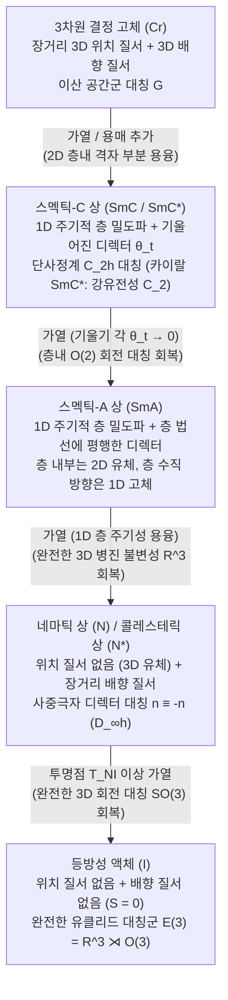

기초 물리학에서 물질은 고체, 액체, 기체의 세 가지 상태로 구분됩니다. 결정 고체는 장거리 <strong>위치 질서(Positional order)</strong>와 장거리 <strong>배향 질서(Orientational order)</strong>를 동시에 유지하며, 녹는점을 넘으면 격자가 무너지며 3차원 유클리드 대칭군 $E(3) = \mathbb{R}^3 \rtimes O(3)$를 완전히 회복한 등방성 액체가 됩니다. 그러나 자연계에는 단단한 결정과 무질서한 유체 사이의 이분법을 허무는 제4의 물질 상태가 존재합니다. 바로 <strong>액정(Liquid Crystals / 중간상 Mesophases)</strong>입니다. 액정은 액체처럼 흐르고 방울을 형성하면서도 결정처럼 광학적 복굴절, 탄성 복원 토크, 양자화된 위상학적 결함을 동시에 나타냅니다. 본 글에서는 액정의 대칭성 깨짐과 통계역학, 연속체 탄성 및 위상수학을 체계적으로 유도합니다.

---

## 1. '이중 녹는점'의 발견과 연성물질 물리학의 탄생

1888년 3월, 오스트리아의 식물학자 <strong>프리드리히 라이니처(Friedrich Reinitzer)</strong>는 당근에서 추출한 <strong>콜레스테릴 벤조에이트($\text{C}_{34}\text{H}_{50}\text{O}_2$)</strong>의 녹는점을 측정하다가 기이한 <strong>'이중 녹는점(Double melting)'</strong>을 발견했습니다: (1) $145.5\,^\circ\text{C}$에서 고체 결정이 녹아 흐르지만 우윳빛의 뿌연(탁한) 액체가 되었고, (2) $178.5\,^\circ\text{C}$(투명점 $T_{NI}$)까지 더 가열하자 탁함이 즉시 사라지며 완전히 투명한 등방성 액체가 되었습니다. 독일 물리학자 <strong>오토 레만(Otto Lehmann)</strong>은 직교 편광 가열 현미경으로 이 탁한 유체를 관찰하여 광물 결정과 같은 <strong>광학적 복굴절(Birefringence)</strong>을 확인하고 1889년 <strong>'액정(Flüssige Kristalle)'</strong>이라 명명했습니다.

1922년 프랑스 광물학자 <strong>조르주 프리델(Georges Friedel)</strong>은 이를 <strong>네마틱(Nematic, 그리스어 '실')</strong>, <strong>스멕틱(Smectic, 그리스어 '비누')</strong>, <strong>콜레스테릭(Cholesteric)</strong>의 세 가지 중간상(Mesophases)으로 분류했습니다. 이후 프랑스의 이론물리학자 <strong>피에르질 드젠(Pierre-Gilles de Gennes, 1991년 노벨 물리학상 수상)</strong>은 액정과 고분자가 초전도체 및 강자성체와 동일한 <strong>자발적 대칭성 깨짐, 질서 매개변수, 스케일링 법칙</strong>을 따름을 증명하며 <strong>연성 응집물질 물리학(Soft Matter Physics)</strong>을 창시했습니다.

---

## 2. 위치 질서 대 배향 질서: 네마틱, 스멕틱, 콜레스테릭 상

액정을 형성하는 분자(<strong>메소겐 Mesogens</strong>)는 막대 모양(Calamitic, 예: 상온 네마틱 분자 <strong>5CB</strong>, 종횡비 약 $4:1$)이나 원반 모양(Discotic)의 강한 형상 비등방성을 가집니다. 막대 분자 결정을 가열하면 질량중심의 병진 운동 장벽이 먼저 무너지지만, 빽빽한 막대들이 서로 충돌하지 않고 회전하기는 어려우므로 <strong>위치 질서는 녹고 배향 질서는 살아남습니다</strong>:

### 2.1 네마틱 상($N$)과 사중극자 텐서 질서 매개변수 $Q_{ij}$, 스칼라 질서 매개변수 $S$
단축 <strong>네마틱 상(Nematic phase)</strong>은 완전한 3차원 병진 불변성 $\mathbb{R}^3$을 가지지만, 분자 장축 단위벡터 $\mathbf{u}_\alpha$가 공통 축인 <strong>디렉터(Director) $\hat{\mathbf{n}}$</strong>($|\hat{\mathbf{n}}|=1$)을 따라 정렬됩니다. 위아래 방향의 분자 수가 같으므로 거시적으로 <strong>머리-꼬리 대칭(무극성, Apolar)</strong>이며, 디렉터는 <strong>실사영평면 $\mathbb{R}P^2 = S^2/\mathbb{Z}_2$</strong> 위의 의사벡터입니다. 따라서 1차 쌍극자 평균 $\langle \mathbf{u}_\alpha \rangle = \mathbf{0}$이 되며, 드젠은 대칭 무대각합(traceless) <strong>2차 사중극자 텐서 질서 매개변수 $Q_{ij}$</strong>를 도입했습니다:

$$\hat{\mathbf{n}} \equiv -\hat{\mathbf{n}}, \qquad Q_{ij} = \left\langle u_{\alpha, i} u_{\alpha, j} - \frac{1}{3}\delta_{ij} \right\rangle = S \left( n_i n_j - \frac{1}{3}\delta_{ij} \right)$$

여기서 <strong>Maier-Saupe 스칼라 질서 매개변수 $S$</strong>는 2차 르장드르 다항식 $P_2(\cos\theta)$의 앙상블 평균입니다:

$$S = \langle P_2(\cos\theta) \rangle = \left\langle \frac{3\cos^2\theta - 1}{2} \right\rangle = \int_0^\pi f(\theta) \left(\frac{3\cos^2\theta - 1}{2}\right) \sin\theta \, d\theta$$

완벽한 평행 정렬일 때 $S = 1$, 등방성 액체에서는 $\langle\cos^2\theta\rangle = 1/3$이므로 $S = 0$, 실제 네마틱 액정에서는 $S \approx 0.3\text{–}0.8$입니다.

### 2.2 스멕틱 상($\text{SmA}, \text{SmC}^*$)의 초전도체 유추와 콜레스테릭($N^*$) 브래그 반사
* <strong>스멕틱 상(Smectic)</strong>: 분자들이 층간 간격 $d \approx 2\text{–}4\,\text{nm}$의 층상 구조를 이루어 1차원 질량 밀도파 $\rho(\mathbf{r})$를 형성합니다. 드젠(1972)은 <strong>네마틱-스멕틱A($\text{SmA}$) 상전이가 초전도체의 Ginzburg-Landau 이론과 수학적으로 동형</strong>임을 밝혔습니다: 일정한 층 두께를 유지하려는 성질이 초전도체의 마이스너 효과처럼 비틀림($K_2 \to \infty$)과 굽힘($K_3 \to \infty$) 변형을 완전히 밀어냅니다! 또한 카이랄 기울어진 스멕틱 상($\text{SmC}^*$)에서 Meyer(1975)는 $C_2$ 대칭성에 의해 자발적 강유전 분극 $\mathbf{P}_s \propto \hat{\mathbf{k}} \times \hat{\mathbf{n}}$이 발생함을 증명하여 마이크로초 고속 스위칭(SSFLC)의 길을 열었습니다.
* <strong>콜레스테릭 상(Cholesteric, $N^*$)</strong>: 카이랄 분자들이 디렉터를 나선축 방향으로 회전시켜 피치 $p$(광학 주기 $p/2$)의 나선을 그리며, 가시광선 파장 대역에서 <strong>원편광 선택적 브래그 반사</strong>를 일으킵니다:

$$\rho(\mathbf{r}) = \rho_0 + |\psi(\mathbf{r})| \cos\left(q_0 z - q_0 u_z(\mathbf{r})\right), \qquad \lambda_0 = \bar{n} \, p \cos\theta_{\text{inc}}$$

---

## 3. 상전이 통계역학: Landau-de Gennes 이론 대 Onsager 강체 막대 엔트로피 이론

1. <strong>열방성 액정과 Landau-de Gennes 자유 에너지</strong>: 3차원 등방성-네마틱($I\text{–}N$) 상전이가 왜 항상 <strong>약한 1차(불연속) 상전이</strong>일까요? $Q_{ij} \to -Q_{ij}$($S>0$ 막대 정렬과 $S<0$ 평면 정렬)가 물리적으로 비동등하므로 자유 에너지 전개에서 <strong>3차 불변량 $\text{Tr}(\mathbf{Q}^3) = \frac{2}{9}S^3$</strong>이 사라지지 않기 때문입니다:

$$f_{\text{LdG}}(S, T) = f_0 + \frac{1}{3} a (T - T^*) S^2 - \frac{2}{27} B S^3 + \frac{1}{9} C S^4$$

$$T_{NI} = T^* + \frac{B^2}{27 a C}, \qquad S_{NI} = \frac{B}{3C}, \qquad \Delta H = \frac{a B^2 T_{NI}}{27 C^2}$$

   음의 3차 항으로 인해 투명점 $T_{NI}$에서 질서 매개변수가 $0$에서 $S_{NI} = B/(3C) \approx 0.43$으로 불연속 점프하며 잠열 $\Delta H$를 수반합니다.
2. <strong>유방성 액정과 Onsager의 엔트로피 강체 막대 이론(1949)</strong>: 라르스 온사거(Lars Onsager)는 인력이 전혀 없는($\Delta U = 0$) 가느다란 강체 막대($L/D \gg 1$) 유체가 오직 입체 반발력만으로 네마틱 상전이를 일으킴을 증명했습니다. 사잇각 $\gamma$를 이루는 두 막대의 <strong>배제 부피(Excluded volume) $v_{\text{excl}}(\gamma)$</strong>는 $|\sin\gamma|$에 비례합니다:

$$v_{\text{excl}}(\gamma) = 2 L^2 D |\sin\gamma|, \qquad \phi_I = \frac{3.340}{L/D}, \qquad \phi_N = \frac{4.486}{L/D}$$

   부피 분율 $\phi$가 임계값을 넘으면 막대들이 평행하게 정렬($\gamma \to 0$)함으로써 약간의 배향 엔트로피 손실($\Delta S_{\text{orient}} < 0$)을 감수하는 대신 배제 부피를 극적으로 줄여 훨씬 큰 <strong>병진 패킹 엔트로피 이득($\Delta S_{\text{trans}} \gg |\Delta S_{\text{orient}}|$)</strong>을 얻습니다.

---

## 4. 연속체 탄성과 전기광학: Oseen-Frank 이론과 Fréedericksz 전이

디렉터 장 $\hat{\mathbf{n}}(\mathbf{r})$의 공간적 미소 변형에 대한 <strong>Oseen-Frank 탄성 자유 에너지 밀도</strong>는 세 가지 직교 변형 모드인 <strong>퍼짐(Splay, $K_1$)</strong>, <strong>비틀림(Twist, $K_2$)</strong>, <strong>굽힘(Bend, $K_3$)</strong>으로 구성됩니다:

$$f_{\text{Frank}} = \frac{1}{2} K_1 \left( \nabla \cdot \hat{\mathbf{n}} \right)^2 + \frac{1}{2} K_2 \left( \hat{\mathbf{n}} \cdot (\nabla \times \hat{\mathbf{n}}) + q_0 \right)^2 + \frac{1}{2} K_3 \left( \hat{\mathbf{n}} \times (\nabla \times \hat{\mathbf{n}}) \right)^2$$

차원 해석에 의해 탄성 상수는 $K_i \sim k_B T / a \sim 10\,\text{pN}$ 수준으로 매우 작으며, 이로 인한 거대한 열적 디렉터 요동 $\langle|\delta\mathbf{n}(\mathbf{q})|^2\rangle = k_B T / (V K q^2)$이 빛을 강하게 산란시켜 라이니처가 관찰한 우윳빛 탁함을 만들어냅니다.

두께 $d$인 액정 셀에 전기장 $\mathbf{E}$를 가하면 유전 비등방성 $\Delta\varepsilon = \varepsilon_\parallel - \varepsilon_\perp > 0$에 의한 전기 토크가 탄성 복원력과 경쟁합니다. 푸리에 기본 모드($n=1$) 안정성 해석을 통해 구한 임계 <strong>프레데릭스 전이(Fréedericksz transition)</strong> 전압은 다음과 같습니다:

$$E_{\text{th}} = \frac{\pi}{d} \sqrt{\frac{K_1}{\varepsilon_0 \Delta\varepsilon}} \quad \Longrightarrow \quad V_{\text{th}} = E_{\text{th}} d = \pi \sqrt{\frac{K_1}{\varepsilon_0 \Delta\varepsilon}}$$

셀 두께 $d$가 완벽히 상쇄되어 임계 전압 $V_{\text{th}} \approx 1\,\text{V}$는 순수 물질 상수에만 의존하며, 이는 현대 <strong>TN(Twisted Nematic)</strong>, <strong>IPS(In-Plane Switching)</strong>, <strong>VA(Vertical Alignment)</strong> LCD 패널의 핵심 동작 원리입니다.

---

## 5. 위상학적 결함(Disclinations)과 $\pi_1(\mathbb{R}P^2) = \mathbb{Z}_2$ 호모토피 분류

머리-꼬리 동등성 $\hat{\mathbf{n}} \equiv -\hat{\mathbf{n}}$ 덕분에 결함 코어 주위를 한 바퀴($2\pi$) 돌 때 디렉터는 $\pi$($180^\circ$)의 정수배만 회전해도 원래 상태로 돌아옵니다. 따라서 2차원에서는 <strong>반정수 감김수(Winding number $s = \pm 1/2$)</strong> 결함(혜성 모양 $+1/2$, 세잎클로버 모양 $-1/2$)이 허용됩니다. 3차원 공간에서 질서 매개변수 다양체는 실사영평면 $\mathbb{R}P^2$이며 기본 호모토피 군은 다음과 같습니다:

$$\pi_1(\mathbb{R}P^2) = \mathbb{Z}_2 = \{0, 1\}, \qquad E_{\text{line}} = \pi K s^2 \ln\left(\frac{R}{r_c}\right) + E_{\text{core}}, \qquad B = 4|s|$$

따라서 3차원에서는 반정수 결함선($s = \pm 1/2$, 비자명 원소 $1 \in \mathbb{Z}_2$)만 위상학적으로 안정하며, 정수 결함($s = \pm 1$, 자명 원소 $0 \in \mathbb{Z}_2$)은 축 근처에서 디렉터가 제3의 차원으로 기울어지며 특이점을 없애는 <strong>'3차원으로의 탈출(Escape into the third dimension)'</strong>을 겪습니다. 편광 현미경의 <strong>슐리렌 조직(Schlieren texture)</strong>에서 어두운 소광 브러시 개수 $B = 4|s|$를 통해 반정수 결함($B=2$)과 정수 결함($B=4$)을 즉시 식별할 수 있습니다.

---

## 6. 중간상 물리적 특성 비교 및 첨단 응용(Kevlar, 인공 근육, 활성 물질)

| 중간상 / 물질 상태 | 위치 질서 (병진 대칭) | 배향 질서 (회전 대칭) | 점군 / 공간군 대칭 | 주요 질서 매개변수 | 광학적 및 유변학적 특징 |
| :--- | :--- | :--- | :--- | :--- | :--- |
| <strong>등방성 액체 ($I$)</strong> | 없음 (3D $\mathbb{R}^3$ 불변) | 없음 (3D $O(3)$ 불변) | $E(3) = \mathbb{R}^3 \rtimes O(3)$ | $S = 0, \; \psi = 0$ | 광학적 등방성 ($\Delta n = 0$), 뉴턴 유체 |
| <strong>네마틱 ($N$)</strong> | 없음 (3D 유체 $\mathbb{R}^3$) | 장거리 단축 배향 ($\hat{\mathbf{n}} \equiv -\hat{\mathbf{n}}$) | $\mathbb{R}^3 \rtimes D_{\infty h}$ | 사중극자 텐서 $Q_{ij}$ ($S \neq 0$) | 높은 복굴절 $\Delta n$, 슐리렌 브러시 ($B=2,4$), 낮은 점도 |
| <strong>콜레스테릭 ($N^*$)</strong> | 없음 (국소 네마틱 유체) | 축 방향 나선 비틀림 ($q_0 = 2\pi/p$) | $\mathbb{R}^2 \rtimes D_\infty$ (카이랄) | $Q_{ij}(\mathbf{r})$, 나선 피치 $p$ | 원편광 선택적 브래그 반사 ($\lambda_0 = \bar{n}p$), 거대 선광성 |
| <strong>스멕틱-A ($\text{SmA}$)</strong> | 1D 주기적 층 밀도파 ($d \approx L$) | 층 법선에 평행 ($\hat{\mathbf{n}} \parallel \hat{\mathbf{k}}$) | $(\mathbb{R}^2 \times \mathbb{Z}) \rtimes D_{\infty h}$ | $S \neq 0$, 복소 밀도파 $\psi = |\psi|e^{i\phi}$ | 초점 원추 조직, 비틀림·굽힘 배제 ($K_2, K_3 \to \infty$, 초전도체 유추) |
| <strong>카이랄 스멕틱-C ($\text{SmC}^*$)</strong> | 1D 주기적 층 ($d = L\cos\theta_t$) | 층 법선에서 각도 $\theta_t$ 기울어짐 | 단사정계 $C_2$ (극성 축) | $\psi \neq 0$, 자발 강유전 분극 $\mathbf{P}_s$ | 이축 광학, 마이크로초 쌍안정 강유전 스위칭 (SSFLC) |

디스플레이를 넘어 액정 물리학은 네 가지 첨단 분야를 선도하고 있습니다: (1) <strong>액정 고분자(LCP)</strong>: 강체 아라미드 사슬의 Onsager 유방성 네마틱 정렬을 이용해 강철보다 단위 중량당 인장 강도가 5~8배 높은 <strong>케블라(Kevlar)</strong> 방탄 섬유를 제조합니다. (2) <strong>액정 엘라스토머(LCE) 인공 근육</strong>: 고무 네트워크와 결합된 메소겐이 $T_{NI}$를 넘을 때 $30\%\text{–}400\%$의 가역적 수축을 일으킵니다. (3) <strong>LCoS 공간 광변조기 및 위상 Q-Plate</strong>: 홀로그램 광학 집게 및 궤도 각운동량(OAM) 소용돌이 빔 생성에 활용됩니다. (4) <strong>생체 액정 및 활성 네마틱(Active Nematics)</strong>: 세포막 인지질 이중층은 2차원 $\text{SmA}$ 액정이며, ATP 대사 에너지로 구동되는 세포골격 미세소관과 상피세포 단층은 $Q_{ij}$에 비례하는 <strong>활성 응력 텐서</strong>를 생성합니다:

$$\sigma_{ij}^{\text{active}} = -\zeta \, Q_{ij}, \qquad \mathbf{f}^{\text{active}} = -\zeta \nabla \cdot \mathbf{Q}$$

앞뒤 대칭이 깨진 혜성 모양의 $+1/2$ 결함은 <strong>자가 추진 준입자</strong>처럼 움직이며 활성 난류(Active turbulence)를 일으키고, 상피세포 사멸 압출(Saw et al., *Nature* 2017) 및 히드라(*Hydra*) 재생 과정(입과 발은 $+1$ 결함에서, 촉수는 $-1/2$ 결함에서 재생)의 생체역학적 조직 중심 역할을 합니다.
