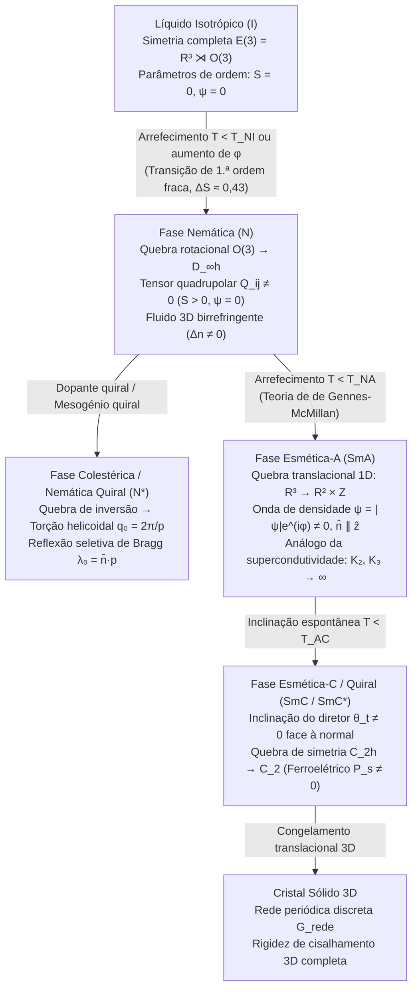

## 1. O Quarto Estado da Matéria Clássica: Quebra Espontânea de Simetria em Etapa

Em 1888, o botânico e químico austríaco <strong>Friedrich Reinitzer</strong> observou um fenómeno surpreendente ao aquecer cristais de <strong>benzoato de colesterilo</strong> extraídos de cenouras: o composto apresentava <strong>dois pontos de fusão distintos</strong>. A $145{,}5\,^\circ\text{C}$, o sólido cristalino fundia-se num fluido turvo e opalescente que fluía livremente, mas mantinha uma intensa birrefringência óptica; apenas a $178{,}5\,^\circ\text{C}$ este fluido turvo se transformava num líquido completamente transparente e opticamente isotrópico. O físico alemão <strong>Otto Lehmann</strong> examinou esta fase intermédia sob um microscópio de luz polarizada com platina aquecida e cunhou o termo <strong>«cristal líquido» (Flüssige Kristalle)</strong>. Em 1922, o cristalógrafo francês <strong>Georges Friedel</strong> estabeleceu a classificação moderna das <strong>mesofases</strong> em três classes fundamentais: <strong>nemática</strong>, <strong>colestérica</strong> e <strong>esmética</strong>.

Do ponto de vista da física moderna da matéria condensada (<strong>Pierre-Gilles de Gennes</strong>, Prémio Nobel da Física de 1991), os cristais líquidos não são uma mera curiosidade química, mas o paradigma da <strong>quebra espontânea de simetria (Spontaneous Symmetry Breaking, SSB) em etapas</strong> do grupo euclidiano tridimensional:

$$\mathcal{G} = E(3) = \mathbb{R}^3 \rtimes O(3)$$

Num líquido isotrópico ($I$), tanto a invariância translacional contínua $\mathbb{R}^3$ como a invariância rotacional contínua $O(3)$ estão intactas. Num cristal sólido tridimensional, ambas as simetrias quebram-se simultaneamente numa rede discreta. Os cristais líquidos separam estas duas transições:

1. <strong>Fase nemática ($N$)</strong>: A invariância translacional contínua $\mathbb{R}^3$ permanece completamente intacta — o centro de massa das moléculas flui como num líquido comum sem ordem posicional de longo alcance — mas a simetria rotacional contínua $O(3)$ quebra-se espontaneamente para o grupo diedral cilíndrico $D_{\infty h}$. As moléculas em forma de bastonete ou disco (<strong>mesogénios</strong>) alinham estatisticamente os seus eixos longos ao longo de um eixo unitário comum, o <strong>diretor $\hat{\mathbf{n}}$</strong> ($|\hat{\mathbf{n}}| = 1$).
2. <strong>Fase colestérica / nemática quiral ($N^*$)</strong>: Quando os mesogénios são quirais (carecem de simetria de inversão espelhada, reduzindo $O(3) \to SO(3)$), o diretor torce-se espontaneamente no espaço formando uma hélice macroscópica de passo $p = 2\pi / |q_0|$, gerando uma banda fotónica unidimensional que reflete seletivamente luz circularmente polarizada no comprimento de onda de Bragg $\lambda_0 = \bar{n}\,p$.
3. <strong>Fases esméticas ($\text{SmA}, \text{SmC}$)</strong>: Além da ordem orientacional nemática, a simetria translacional contínua $\mathbb{R}^3$ quebra-se parcialmente ao longo de <strong>uma única direção espacial</strong> ($\mathbb{R}^3 \to \mathbb{R}^2 \times \mathbb{Z}$). O sistema forma uma onda de densidade unidimensional — uma pilha periódica de camadas bidimensionais líquidas — onde cada camada flui internamente como um líquido 2D enquanto mantém periodicidade 1D sólida ao longo da normal às camadas.

---

## 2. O Tensor Parâmetro de Ordem Nemático $Q_{ij}$ e a Simetria $\hat{\mathbf{n}} \equiv -\hat{\mathbf{n}}$

Por que razão o estado nemático não pode ser descrito simplesmente por um vetor de polarização $\mathbf{P} = \langle \mathbf{u} \rangle$, como na transição ferromagnética de Heisenberg? Na grande maioria dos cristais líquidos nemáticos, mesmo quando uma molécula individual possui um momento dipolar elétrico permanente, a configuração de equilíbrio macroscópica apresenta <strong>simetria apolar cabeça-cauda</strong>: a orientação $+\hat{\mathbf{n}}$ e a orientação oposta $-\hat{\mathbf{n}}$ são fisicamente indistinguíveis ($\hat{\mathbf{n}} \equiv -\hat{\mathbf{n}}$). Assim, a distribuição de probabilidade orientacional $f(\mathbf{u})$ satisfaz $f(-\mathbf{u}) = f(\mathbf{u})$, pelo que todos os momentos ímpares (dipolares) se anulam identicamente: $\langle u_i \rangle = 0$.

O primeiro momento multipolar não nulo que distingue a fase nemática anisotrópica do líquido isotrópico é o <strong>momento quadrupolar de segunda ordem</strong>. Para que o parâmetro de ordem se anule identicamente na fase isotrópica ($\langle u_i u_j \rangle_{\text{iso}} = \frac{1}{3}\delta_{ij}$), define-se o <strong>tensor parâmetro de ordem de de Gennes $Q_{ij}$</strong>, simétrico e de traço nulo ($\text{Tr}\,\mathbf{Q} = 0$):

$$\hat{\mathbf{n}} \equiv -\hat{\mathbf{n}}, \qquad Q_{ij} = \left\langle u_{\alpha, i} u_{\alpha, j} - \frac{1}{3}\delta_{ij} \right\rangle = S \left( n_i n_j - \frac{1}{3}\delta_{ij} \right)$$

Num nemático uniaxial, onde existe simetria rotacional em torno de $\hat{\mathbf{n}}$, a biaxialidade $P$ anula-se e toda a amplitude do ordenamento orientacional é capturada pelo <strong>parâmetro de ordem escalar de Maier-Saupe $S$</strong>, igual à média térmica do segundo polinómio de Legendre $P_2(\cos\theta)$:

$$S = \langle P_2(\cos\theta) \rangle = \left\langle \frac{3\cos^2\theta - 1}{2} \right\rangle = \int_0^\pi f(\theta) \left(\frac{3\cos^2\theta - 1}{2}\right) \sin\theta \, d\theta$$

No líquido isotrópico, $\langle \cos^2\theta \rangle = 1/3 \implies S = 0$. Num alinhamento paralelo perfeito, $\theta = 0 \implies S = 1$. Nos cristais líquidos termotrópicos reais (como o <strong>5CB</strong>, 4-ciano-4'-pentilbifenilo, ou o <strong>MBBA</strong>), $S$ salta descontinuamente em $T_{NI}$ para $S \approx 0{,}3\text{–}0{,}45$ e aumenta até $S \approx 0{,}6\text{–}0{,}8$ a temperaturas mais baixas.

Na <strong>fase esmética-A ($\text{SmA}$)</strong>, emerge um parâmetro de ordem translacional adicional. Expandindo a densidade numérica molecular $\rho(\mathbf{r})$ em série de Fourier ao longo da normal às camadas $\hat{\mathbf{z}}$ com vetor de onda $q_0 = 2\pi / d$ ($d \approx L$, o comprimento molecular):

$$\rho(\mathbf{r}) = \rho_0 + |\psi(\mathbf{r})| \cos\left(q_0 z - q_0 u_z(\mathbf{r})\right), \qquad \lambda_0 = \bar{n} \, p \cos\theta_{\text{inc}}$$

Como formulado por <strong>Pierre-Gilles de Gennes (1972)</strong> e <strong>William L. McMillan</strong>, este parâmetro de ordem complexo $\psi(\mathbf{r}) = |\psi|e^{i\phi(\mathbf{r})}$ estabelece um <strong>isomorfismo exato entre a transição $\text{N–SmA}$ e a transição metal normal–supercondutor na teoria de Ginzburg-Landau</strong>: $\psi$ corresponde à função de onda macroscópica dos pares de Cooper, as flutuações transversais do diretor $\delta\mathbf{n}_\perp$ atuam como o potencial vetor eletromagnético $\mathbf{A}$, e a expulsão das deformações de torção ($K_2$) e flexão ($K_3$) do interior do esmético corresponde exatamente ao <strong>efeito Meissner</strong> (expulsão do campo magnético $\mathbf{B} = \nabla \times \mathbf{A} = \mathbf{0}$).

---

## 3. Termodinâmica da Transição Isótropo-Nemático: Landau-de Gennes vs. Onsager

Existem duas grandes famílias de cristais líquidos: os <strong>termotrópicos</strong> (transição controlada pela temperatura $T$ através de forças de dispersão anisotrópicas de van der Waals / Maier-Saupe) e os <strong>liotrópicos</strong> (transição controlada pela concentração ou fração volúmica $\phi$ num solvente através da repulsão estérica de volume excluído).

### 3.1 Expansão de Landau-de Gennes e o Invariante Cúbico de Primeira Ordem

Expandindo a densidade de energia livre $f_{\text{LdG}}$ em potências de invariantes rotacionais do tensor $Q_{ij}$, como $\text{Tr}(\mathbf{Q}) = 0$, não existe termo linear, mas — ao contrário do modelo de Ising ou do ferromagnetismo onde a simetria $\mathbf{m} \to -\mathbf{m}$ proíbe potências ímpares — para um tensor $3\times 3$ de traço nulo, $Q_{ij}$ e $-Q_{ij}$ representam estados físicos distintos ($S > 0$ de bastonetes alinhados vs. $S < 0$ de orientação planar em disco). Consequentemente, o <strong>invariante cúbico $\text{Tr}(\mathbf{Q}^3)$ é permitido pela simetria</strong>:

$$f_{\text{LdG}}(S, T) = f_0 + \frac{1}{3} a (T - T^*) S^2 - \frac{2}{27} B S^3 + \frac{1}{9} C S^4$$

$$T_{NI} = T^* + \frac{B^2}{27 a C}, \qquad S_{NI} = \frac{B}{3C}, \qquad \Delta H = \frac{a B^2 T_{NI}}{27 C^2}$$

A presença de $-B\,S^3$ ($B > 0$) gera uma barreira de energia livre entre $S = 0$ e $S > 0$, garantindo que a transição isótropo-nemático ($I\text{–}N$) em 3D seja rigorosamente uma <strong>transição de primeira ordem (embora fracamente de primeira ordem)</strong>: na temperatura de clareamento $T_{NI} = T^* + \frac{2B^2}{9a_0 C}$, o parâmetro de ordem sofre um salto descontínuo universal $S(T_{NI}) = \frac{2B}{3C} \approx 0{,}43$, acompanhado por um pequeno calor latente ($\Delta H \approx 1\text{–}2\,\text{kJ/mol}$).

### 3.2 Teoria de Volume Excluído de Onsager (1949): Ordem Criada pela Entropia

Em 1949, <strong>Lars Onsager</strong> demonstrou um resultado contraintuitivo para uma suspensão de cilindros rígidos de comprimento $L$ e diâmetro $D$ ($L \gg D$) sem qualquer atração energética ($\Delta U = 0$): <strong>a transição para a fase nemática ordenada é impulsionada exclusivamente pela maximização da entropia total</strong>. O volume excluído mútuo entre dois bastonetes com ângulo relativo $\gamma$ é $V_{\text{excl}}(\gamma) = 2 L^2 D |\sin\gamma|$. Na expansão virial exata no limite $L/D \to \infty$:

$$v_{\text{excl}}(\gamma) = 2 L^2 D |\sin\gamma|, \qquad \phi_I = \frac{3.340}{L/D}, \qquad \phi_N = \frac{4.486}{L/D}$$

Acima da fração volúmica crítica $\phi_{\text{iso}} \approx 3{,}29\,(D/L)$, o sistema sacrifica uma pequena quantidade de <strong>entropia orientacional</strong> ($\sigma_{\text{rot}} < 0$) alinhando os bastonetes ($\langle|\sin\gamma|\rangle \ll \pi/4$), o que reduz drasticamente o volume excluído mútuo e produz um ganho muito maior de <strong>entropia translacional (de empacotamento)</strong> ($\sigma_{\text{pack}}$). A fase nemática coexistente surge em $\phi_{\text{nem}} \approx 4{,}19\,(D/L)$ com $S \approx 0{,}79$.

---

## 4. Elasticidade Contínua de Frank-Oseen e a Transição de Fréedericksz nos LCD

Na fase nemática, variações espaciais suaves do diretor $\hat{\mathbf{n}}(\mathbf{r})$ sobre escalas muito maiores que o tamanho molecular ($|\nabla\hat{\mathbf{n}}| \ll a^{-1}$) custam energia elástica. <strong>C. W. Oseen (1933)</strong> e <strong>F. C. Frank (1958)</strong> demonstraram que qualquer deformação de volume se decompõe em três modos fundamentais com constantes elásticas $K_1, K_2, K_3 \sim 10^{-11}\,\text{N}$ ($10\,\text{pN}$):

1. <strong>Espalhamento (Splay, $K_1$)</strong>: divergência radial das linhas do diretor, medida por $(\nabla \cdot \hat{\mathbf{n}})^2$.
2. <strong>Torção (Twist, $K_2$)</strong>: rotação helicoidal de $\hat{\mathbf{n}}$ perpendicularmente a si próprio, medida por $(\hat{\mathbf{n}} \cdot \nabla \times \hat{\mathbf{n}})^2$.
3. <strong>Flexão (Bend, $K_3$)</strong>: curvatura longitudinal das linhas do diretor, medida por $(\hat{\mathbf{n}} \times \nabla \times \hat{\mathbf{n}})^2$.

A densidade de energia livre elástica e dielétrica total (para anisotropia dielétrica $\Delta\varepsilon = \varepsilon_\parallel - \varepsilon_\perp > 0$) escreve-se:

$$f_{\text{Frank}} = \frac{1}{2} K_1 \left( \nabla \cdot \hat{\mathbf{n}} \right)^2 + \frac{1}{2} K_2 \left( \hat{\mathbf{n}} \cdot (\nabla \times \hat{\mathbf{n}}) + q_0 \right)^2 + \frac{1}{2} K_3 \left( \hat{\mathbf{n}} \times (\nabla \times \hat{\mathbf{n}}) \right)^2$$

Quando uma camada nemática de espessura $d$ com ancoragem planar forte ($\theta(0) = \theta(d) = 0$) é submetida a um campo elétrico perpendicular $\mathbf{E} = (V/d)\hat{\mathbf{z}}$, a competição entre o binário elástico restaurador $\sim K_1(\pi/d)^2$ e o binário dielétrico desestabilizador $\sim \varepsilon_0 \Delta\varepsilon (V/d)^2$ desencadeia uma bifurcação de forquilha supercrítica — a <strong>transição de Fréedericksz (1927)</strong> — exatamente quando o modo fundamental $\sin(\pi z / d)$ se torna instável:

$$E_{\text{th}} = \frac{\pi}{d} \sqrt{\frac{K_1}{\varepsilon_0 \Delta\varepsilon}} \quad \Longrightarrow \quad V_{\text{th}} = E_{\text{th}} d = \pi \sqrt{\frac{K_1}{\varepsilon_0 \Delta\varepsilon}}$$

Notavelmente, a espessura da célula $d$ cancela-se por completo! O limiar de comutação depende exclusivamente da <strong>tensão elétrica $V_{\text{th}} \approx 1\,\text{V}$</strong> e não do campo elétrico, permitindo que transístores de película fina (TFT) de baixa tensão controlem milhares de milhões de píxeis nas três grandes arquiteturas de ecrãs LCD modernos: <strong>TN (Twisted Nematic)</strong>, <strong>IPS (In-Plane Switching)</strong> (governado por $K_2$, oferecendo ângulos de visão amplos) e <strong>VA (Vertical Alignment)</strong> (governado por $K_3$ com $\Delta\varepsilon < 0$, proporcionando taxas de contraste nativas extremas).

---

## 5. Defeitos Topológicos (Disclinações) e o Grupo de Homotopia $\pi_1(\mathbb{R}P^2) = \mathbb{Z}_2$

Porque a física nemática é invariante sob $\hat{\mathbf{n}} \leftrightarrow -\hat{\mathbf{n}}$, a variedade do parâmetro de ordem em 3D não é a esfera unitária $S^2$, mas sim o <strong>plano projetivo real $\mathcal{M} = S^2 / \mathbb{Z}_2 = \mathbb{R}P^2$</strong> (a esfera com pontos antípodas identificados). Ao percorrer um contorno fechado $\Gamma$ em torno de uma linha de singularidade (uma <strong>disclinação</strong>), o diretor só precisa de rodar por um múltiplo inteiro de $\pi$ ($180^\circ$) para regressar ao mesmo estado físico. Em geometria planar 2D ($\mathcal{M}_{2\text{D}} = S^1/\mathbb{Z}_2 = \mathbb{R}P^1 \cong S^1$), a carga topológica de enrolamento é $s = \frac{\Delta\phi}{2\pi} \in \{0, \pm\frac{1}{2}, \pm 1, \pm\frac{3}{2}, \dots\}$, permitindo <strong>defeitos semi-inteiros $s = +1/2$</strong> (geometria polar em forma de cometa) e <strong>$s = -1/2$</strong> (geometria tripla em forma de trevo).

Contudo, em três dimensões completas, a estabilidade topológica das linhas de defeito é classificada pelo primeiro grupo de homotopia de $\mathbb{R}P^2$:

$$\pi_1(\mathbb{R}P^2) = \mathbb{Z}_2 = \{0, 1\}, \qquad E_{\text{line}} = \pi K s^2 \ln\left(\frac{R}{r_c}\right) + E_{\text{core}}, \qquad B = 4|s|$$

Ao contrário de $\mathbb{Z}$, o grupo cíclico $\mathbb{Z}_2 = \{0, 1\}$ tem apenas <strong>duas classes de equivalência topológica</strong>:
- <strong>Classe não trivial ($1 \in \mathbb{Z}_2$)</strong>: Todas as disclinações semi-inteiras ($s = \pm 1/2, \pm 3/2, \dots$) correspondem a caminhos na esfera $S^2$ que ligam dois polos antípodas ($\hat{\mathbf{n}} \to -\hat{\mathbf{n}}$); estes caminhos não podem ser contraídos para um ponto e são <strong>topologicamente protegidos</strong>.
- <strong>Classe trivial ($0 \in \mathbb{Z}_2$)</strong>: As disclinações de carga inteira ($s = \pm 1$) correspondem a laços fechados em $S^2$, que são sempre contráteis! Como demonstrado por <strong>R. B. Meyer (1973)</strong> e <strong>P. E. Cladis & M. Kléman (1972)</strong>, uma linha singular $s = +1$ elimina o seu núcleo divergente inclinando suavemente o diretor para o eixo $z$ no centro — o célebre <strong>«escape para a terceira dimensão» (escape into the third dimension)</strong>.

Sob polarizadores cruzados ($\mathbf{P} \perp \mathbf{A}$), a transmitância $I \propto \sin^2(2\phi)\sin^2(\pi\Delta n\,d/\lambda)$ anula-se sempre que $\phi(\varphi) = 0, \pi/2, \pi, 3\pi/2$. Na <strong>textura Schlieren</strong>, cada defeito de carga $s$ exibe exatamente <strong>$B = 4|s|$ pincéis escuros de extinção</strong>: <strong>2 pincéis</strong> para disclinações semi-inteiras ($s = \pm 1/2$) e <strong>4 pincéis</strong> para centros inteiros ($s = \pm 1$).

---

## 6. Comparação das Mesofases e Fronteiras Tecnológicas (Kevlar, Músculos Artificiais e Matéria Ativa)

| Mesofase / Estado | Ordem Posicional (Translação) | Ordem Orientacional (Rotação) | Simetria Pontual / Espacial | Parâmetros de Ordem Primários | Assinaturas Ópticas e Reológicas |
| :--- | :--- | :--- | :--- | :--- | :--- |
| <strong>Líquido Isotrópico ($I$)</strong> | Nenhuma (invariância 3D $\mathbb{R}^3$) | Nenhuma (invariância 3D $O(3)$) | $E(3) = \mathbb{R}^3 \rtimes O(3)$ | $S = 0, \; \psi = 0$ | Opticamente isotrópico ($\Delta n = 0$), fluido newtoniano |
| <strong>Nemático ($N$)</strong> | Nenhuma (fluido 3D $\mathbb{R}^3$) | Uniaxial de longo alcance ($\hat{\mathbf{n}} \equiv -\hat{\mathbf{n}}$) | $\mathbb{R}^3 \rtimes D_{\infty h}$ | Tensor quadrupolar $Q_{ij}$ ($S \neq 0$) | Forte birrefringência $\Delta n$, textura Schlieren ($B=2,4$), baixa viscosidade |
| <strong>Colestérico ($N^*$)</strong> | Nenhuma (fluido localmente nemático) | Torção helicoidal ($q_0 = 2\pi/p$) | $\mathbb{R}^2 \rtimes D_\infty$ (quiral) | $Q_{ij}(\mathbf{r})$, passo helicoidal $p$ | Reflexão de Bragg circular ($\lambda_0 = \bar{n}p$), poder rotatório gigante |
| <strong>Esmético-A ($\text{SmA}$)</strong> | Onda de densidade 1D em camadas ($d \approx L$) | Paralela à normal ($\hat{\mathbf{n}} \parallel \hat{\mathbf{k}}$) | $(\mathbb{R}^2 \times \mathbb{Z}) \rtimes D_{\infty h}$ | $S \neq 0$, onda complexa $\psi = |\psi|e^{i\phi}$ | Texturas focais-cónicas, expulsão de torção e flexão ($K_2, K_3 \to \infty$) |
| <strong>Esmético-C Quiral ($\text{SmC}^*$)</strong> | Camadas periódicas 1D ($d = L\cos\theta_t$) | Inclinada por um ângulo $\theta_t$ | Monoclínica $C_2$ (polar) | $\psi \neq 0$, polarização $\mathbf{P}_s$ | Óptica biaxial, comutação ferroelétrica em microssegundos (SSFLC) |

Para além dos ecrãs planos, a física dos cristais líquidos sustenta quatro grandes fronteiras científicas: (1) <strong>Polímeros de Cristal Líquido (LCP) e fibras de aramida como o Kevlar</strong> (inventado por <strong>Stephanie Kwolek</strong> em 1965), onde cadeias rígidas de poli(p-fenileno tereftalamida) formam uma fase nemática liotrópica de Onsager em ácido sulfúrico concentrado antes da fiação húmida, alcançando uma resistência específica à tração 5 a 8 vezes superior à do aço; (2) <strong>Elastómeros de Cristal Líquido (LCE)</strong> (previstos por de Gennes em 1975), onde o acoplamento entre a rede polimérica reticulada e $Q_{ij}$ produz <strong>músculos artificiais</strong> capazes de contrações térmicas ou fotoinduzidas reversíveis de $30\%\text{–}400\%$ ao atravessar $T_{NI}$; (3) <strong>Moduladores espaciais de luz LCoS e placas Q topológicas</strong> baseadas na fase geométrica de Pancharatnam-Berry ($\Phi_{\text{PB}} = \pm 2\alpha(\mathbf{r})$) para pinças ópticas holográficas e feixes de vórtice óptico; e (4) <strong>Cristalinidade líquida biológica e nemáticos ativos</strong>: bicamadas lipídicas celulares ($\text{SmA}$ 2D), condensados de ADN *in vivo*, redes de microtúbulos impulsionadas por ATP e tecidos epiteliais geram um <strong>tensor de tensão ativa</strong> proporcional a $Q_{ij}$:

$$\sigma_{ij}^{\text{active}} = -\zeta \, Q_{ij}, \qquad \mathbf{f}^{\text{active}} = -\zeta \nabla \cdot \mathbf{Q}$$

Como os defeitos $+1/2$ em forma de cometa quebram a simetria polar frente-trás ($\nabla\cdot\mathbf{Q} \neq \mathbf{0}$), qualquer gradiente de tensão ativa gera uma força motriz interna $\mathbf{f}_{\text{ativa}} = -\zeta\,\nabla\cdot\mathbf{Q} \neq \mathbf{0}$ que transforma as disclinações $+1/2$ em <strong>quasipartículas autopropulsadas</strong> num estado de turbulência ativa, governando a extrusão de células apoptóticas no epitélio (Saw et al., *Nature* 2017) e a morfogénese regenerativa da *Hydra* (onde defeitos $+1$ atuam como centros organizadores da cabeça e do pé).
