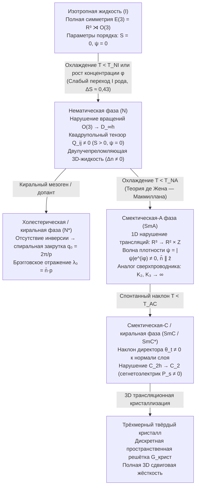

## 1. Четвёртое классическое состояние вещества: ступенчатое спонтанное нарушение симметрии

В 1888 году австрийский ботаник и химик <strong>Фридрих Рейнитцер (Friedrich Reinitzer)</strong> при изучении кристаллов <strong>холестерилбензоата</strong>, выделенных из моркови, обнаружил поразительную аномалию: вещество обладало <strong>двумя чёткими точками плавления</strong>. При $145{,}5\,^\circ\text{C}$ твёрдый кристалл плавился в мутную опалесцирующую жидкость, которая свободно текла, но сохраняла сильное оптическое двулучепреломление; лишь при $178{,}5\,^\circ\text{C}$ эта мутная среда превращалась в полностью прозрачную, оптически изотропную жидкость. Немецкий физик <strong>Отто Леман (Otto Lehmann)</strong> исследовал эту промежуточную фазу под поляризационным микроскопом с нагревательным столиком и ввёл термин <strong>«жидкие кристаллы» (Flüssige Kristalle)</strong>. В 1922 году французский кристаллограф <strong>Жорж Фридель (Georges Friedel)</strong> предложил строгую классификацию <strong>мезофаз</strong>, разделив их на три фундаментальных класса: <strong>нематические</strong>, <strong>холестерические</strong> и <strong>смектические</strong>.

С точки зрения современной физики конденсированного состояния (<strong>Пьер-Жиль де Жен</strong>, Нобелевская премия по физике 1991 года), жидкие кристаллы представляют собой образцовую реализацию <strong>ступенчатого спонтанного нарушения симметрии (Spontaneous Symmetry Breaking, SSB)</strong> полной трёхмерной евклидовой группы:

$$\mathcal{G} = E(3) = \mathbb{R}^3 \rtimes O(3)$$

В изотропной жидкости ($I$) сохраняются как непрерывная трансляционная инвариантность $\mathbb{R}^3$, так и непрерывная вращательная (ориентационная) инвариантность $O(3)$. В трёхмерном твёрдом кристалле обе эти непрерывные симметрии нарушаются одновременно до дискретной пространственной группы решётки. Жидкие кристаллы разделяют эти два фазовых перехода:

1. <strong>Нематическая фаза ($N$)</strong>: Непрерывная трансляционная симметрия $\mathbb{R}^3$ остаётся полностью ненарушенной — центры масс молекул диффундируют и текут как в обычной жидкости без дальнего позиционного порядка, — однако непрерывная вращательная симметрия $O(3)$ спонтанно нарушается до цилиндрической диэдральной группы $D_{\infty h}$. Палочкообразные (каламитaрные) или дискообразные молекулы (<strong>мезогены</strong>) статистически выстраивают свои длинные оси вдоль единого макроскопического направления — единичного вектора <strong>директора $\hat{\mathbf{n}}$</strong> ($|\hat{\mathbf{n}}| = 1$).
2. <strong>Холестерическая / киральная нематическая фаза ($N^*$)</strong>: Если молекулы киральны (отсутствует зеркальная инвариантность, $O(3) \to SO(3)$), директор спонтанно закручивается в пространстве в макроскопическую спираль с шагом $p = 2\pi / |q_0|$, формируя одномерный фотонный кристалл с селективным брэгговским отражением циркулярно поляризованного света на длине волны $\lambda_0 = \bar{n}\,p$.
3. <strong>Смектические фазы ($\text{SmA}, \text{SmC}$)</strong>: Помимо ориентационного нематического порядка, непрерывная трансляционная симметрия $\mathbb{R}^3$ частично нарушается вдоль <strong>одного пространственного направления</strong> ($\mathbb{R}^3 \to \mathbb{R}^2 \times \mathbb{Z}$). Возникает одномерная волна плотности — периодическая стопка двумерных жидких слоёв, где молекулы свободно текут внутри каждого слоя как 2D-жидкость, но образуют 1D-периодическую решётку вдоль нормали к слоям.

---

## 2. Квадрупольный тензор параметра порядка $Q_{ij}$ и симметрия $\hat{\mathbf{n}} \equiv -\hat{\mathbf{n}}$

Почему ориентационный порядок нематика нельзя описать обычным вектором поляризации $\mathbf{P} = \langle \mathbf{u} \rangle$, как в гейзенберговском ферромагнетике? В подавляющем большинстве нематических жидких кристаллов даже при наличии у отдельной молекулы постоянного электрического дипольного момента макроскопическое равновесное состояние обладает <strong>неполярной симметрией «голова — хвост»</strong>: направления $+\hat{\mathbf{n}}$ и $-\hat{\mathbf{n}}$ физически неразличимы ($\hat{\mathbf{n}} \equiv -\hat{\mathbf{n}}$). Одночастичная функция ориентационного распределения удовлетворяет условию $f(-\mathbf{u}) = f(\mathbf{u})$, вследствие чего все нечётные мультипольные моменты (включая дипольный) тождественно равны нулю: $\langle u_i \rangle = 0$.

Первым нетривиальным мультипольным моментом, отличающим анизотропный нематик от изотропной жидкости, является <strong>квадрупольный момент второго ранга</strong>. Вычитая изотропное среднее $\langle u_i u_j \rangle_{\text{iso}} = \frac{1}{3}\delta_{ij}$, получаем симметричный бесследный ($\text{Tr}\,\mathbf{Q} = 0$) <strong>тензор параметра порядка де Жена $Q_{ij}$</strong>:

$$\hat{\mathbf{n}} \equiv -\hat{\mathbf{n}}, \qquad Q_{ij} = \left\langle u_{\alpha, i} u_{\alpha, j} - \frac{1}{3}\delta_{ij} \right\rangle = S \left( n_i n_j - \frac{1}{3}\delta_{ij} \right)$$

В одноосном нематике, обладающем цилиндрической симметрией вокруг директора $\hat{\mathbf{n}}$, двуосность $P = 0$, и степень ориентационного упорядочения полностью определяется <strong>скалярным параметром порядка Майера — Заупе $S$</strong> — тепловым средним второго полинома Лежандра $P_2(\cos\theta)$:

$$S = \langle P_2(\cos\theta) \rangle = \left\langle \frac{3\cos^2\theta - 1}{2} \right\rangle = \int_0^\pi f(\theta) \left(\frac{3\cos^2\theta - 1}{2}\right) \sin\theta \, d\theta$$

В изотропной жидкости $\langle \cos^2\theta \rangle = 1/3 \implies S = 0$. При идеальном параллельном выстраивании $\theta = 0 \implies S = 1$. В реальных термотропных жидких кристаллах (таких как <strong>5CB</strong> — 4-циано-4'-пентилбифенил или <strong>MBBA</strong>) в точке просветления $T_{NI}$ параметр порядка скачком возрастает до $S \approx 0{,}3\text{–}0{,}45$ и при дальнейшем охлаждении достигает $S \approx 0{,}6\text{–}0{,}8$.

В <strong>смектической-A фазе ($\text{SmA}$)</strong> возникает дополнительный трансляционный параметр порядка. Разлагая молекулярную плотность $\rho(\mathbf{r})$ в ряд Фурье вдоль нормали к слоям $\hat{\mathbf{z}}$ с волновым вектором $q_0 = 2\pi / d$ ($d \approx L$ — длина молекулы), получаем:

$$\rho(\mathbf{r}) = \rho_0 + |\psi(\mathbf{r})| \cos\left(q_0 z - q_0 u_z(\mathbf{r})\right), \qquad \lambda_0 = \bar{n} \, p \cos\theta_{\text{inc}}$$

Как показали <strong>Пьер-Жиль де Жен (1972)</strong> и <strong>Уильям Макмиллан</strong>, комплексный параметр порядка $\psi(\mathbf{r}) = |\psi|e^{i\phi(\mathbf{r})}$ задаёт <strong>точный изоморфизм между переходом $\text{N–SmA}$ и переходом нормальный металл — сверхпроводник в теории Гинзбурга — Ландау</strong>: $\psi$ играет роль макроскопической волновой функции куперовских пар, поперечные отклонения директора $\delta\mathbf{n}_\perp$ выступают калибровочным векторным потенциалом $\mathbf{A}$, а вытеснение деформаций кручения ($K_2$) и продольного изгиба ($K_3$) из объёма смектика в точности соответствует <strong>эффекту Мейсснера</strong> (вытеснению магнитного поля $\mathbf{B} = \nabla \times \mathbf{A} = \mathbf{0}$).

---

## 3. Термодинамика перехода изотропная жидкость — нематик: Ландау — де Жен и Онсагер

Существуют два фундаментальных класса жидких кристаллов: <strong>термотропные</strong> (переход управляется температурой $T$ за счёт анизотропного дисперсионного притяжения Ван-дер-Ваальса / Майера — Заупе) и <strong>лиотропные</strong> (переход управляется объёмной долей частиц $\phi$ в растворителе за счёт стерического отталкивания исключённого объёма).

### 3.1 Разложение Ландау — де Жена и кубический инвариант переходов первого рода

Разлагая плотность свободной энергии $f_{\text{LdG}}$ по степеням вращательных инвариантов бесследного тензора $Q_{ij}$, замечаем, что линейный член $\text{Tr}(\mathbf{Q}) = 0$ отсутствует, однако — в отличие от модели Изинга или ферромагнетика, где симметрия $\mathbf{m} \to -\mathbf{m}$ запрещает все нечётные степени — для бесследного тензора $3\times 3$ состояния $Q_{ij}$ и $-Q_{ij}$ физически неэквивалентны ($S > 0$ отвечает выстраиванию стержней вдоль $\hat{\mathbf{n}}$, а $S < 0$ — укладке в плоскости, перпендикулярной $\hat{\mathbf{n}}$). Поэтому <strong>кубический инвариант $\text{Tr}(\mathbf{Q}^3)$ разрешён симметрией</strong>:

$$f_{\text{LdG}}(S, T) = f_0 + \frac{1}{3} a (T - T^*) S^2 - \frac{2}{27} B S^3 + \frac{1}{9} C S^4$$

$$T_{NI} = T^* + \frac{B^2}{27 a C}, \qquad S_{NI} = \frac{B}{3C}, \qquad \Delta H = \frac{a B^2 T_{NI}}{27 C^2}$$

Наличие члена $-B\,S^3$ ($B > 0$) формирует энергетический барьер между $S = 0$ и $S > 0$, гарантируя, что переход изотропная жидкость — нематик ($I\text{–}N$) в 3D всегда является <strong>фазовым переходом первого рода (слабого первого рода)</strong>: при температуре просветления $T_{NI} = T^* + \frac{2B^2}{9a_0 C}$ параметр порядка совершает универсальный скачок $S(T_{NI}) = \frac{2B}{3C} \approx 0{,}43$ с выделением малой скрытой теплоты ($\Delta H \approx 1\text{–}2\,\text{кДж/моль}$).

### 3.2 Теория исключённого объёма Онсагера (1949): порядок, рождённый чистой энтропией

В 1949 году <strong>Ларс Онсагер</strong> доказал парадоксальную теорему для раствора абсолютно жёстких стержней длины $L$ и диаметра $D$ ($L \gg D$) без какого-либо притяжения ($\Delta U = 0$): <strong>переход в упорядоченную нематическую фазу вызывается исключительно максимизацией полной энтропии</strong>. Взаимный исключённый объём двух стержней, пересекающихся под углом $\gamma$, равен $V_{\text{excl}}(\gamma) = 2 L^2 D |\sin\gamma|$. В точном втором вириальном приближении при $L/D \to \infty$:

$$v_{\text{excl}}(\gamma) = 2 L^2 D |\sin\gamma|, \qquad \phi_I = \frac{3.340}{L/D}, \qquad \phi_N = \frac{4.486}{L/D}$$

При превышении критической объёмной доли $\phi_{\text{iso}} \approx 3{,}29\,(D/L)$ системе выгоднее пожертвовать частью <strong>ориентационной энтропии</strong> ($\sigma_{\text{rot}} < 0$), выстроив стержни почти параллельно ($\langle|\sin\gamma|\rangle \ll \pi/4$), что резко уменьшает исключённый объём и даёт гораздо больший выигрыш в <strong>трансляционной энтропии упаковки</strong> ($\sigma_{\text{pack}}$). Сосуществующая нематическая фаза образуется при $\phi_{\text{nem}} \approx 4{,}19\,(D/L)$ со скачком параметра порядка до $S \approx 0{,}79$.

---

## 4. Континуальная теория упругости Франка — Озеена и переход Фредерикса в ЖК-дисплеях

В нематической фазе плавные пространственные неоднородности поля директора $\hat{\mathbf{n}}(\mathbf{r})$ на масштабах, много больших молекулярного размера ($|\nabla\hat{\mathbf{n}}| \ll a^{-1}$), требуют затрат упругой энергии. <strong>К. В. Озеен (1933)</strong> и <strong>Ф. Ч. Франк (1958)</strong> показали, что любая объёмная деформация директора раскладывается на три фундаментальные моды с константами упругости $K_1, K_2, K_3 \sim 10^{-11}\,\text{Н}$ ($10\,\text{пН}$):

1. <strong>Поперечный изгиб — веерная деформация (Splay, $K_1$)</strong>: расхождение линий директора, измеряемое $(\nabla \cdot \hat{\mathbf{n}})^2$.
2. <strong>Кручение (Twist, $K_2$)</strong>: спиральный поворот $\hat{\mathbf{n}}$ перпендикулярно самому себе, измеряемый $(\hat{\mathbf{n}} \cdot \nabla \times \hat{\mathbf{n}})^2$.
3. <strong>Продольный изгиб (Bend, $K_3$)</strong>: искривление линий директора вдоль их направления, измеряемое $(\hat{\mathbf{n}} \times \nabla \times \hat{\mathbf{n}})^2$.

Полная плотность упругой и диэлектрической свободной энергии (при диэлектрической анизотропии $\Delta\varepsilon = \varepsilon_\parallel - \varepsilon_\perp > 0$) имеет вид:

$$f_{\text{Frank}} = \frac{1}{2} K_1 \left( \nabla \cdot \hat{\mathbf{n}} \right)^2 + \frac{1}{2} K_2 \left( \hat{\mathbf{n}} \cdot (\nabla \times \hat{\mathbf{n}}) + q_0 \right)^2 + \frac{1}{2} K_3 \left( \hat{\mathbf{n}} \times (\nabla \times \hat{\mathbf{n}}) \right)^2$$

Когда нематическая ячейка толщины $d$ с жёстким планарным сцеплением на границах ($\theta(0) = \theta(d) = 0$) помещается в перпендикулярное электрическое поле $\mathbf{E} = (V/d)\hat{\mathbf{z}}$, конкуренция между возвращающим упругим моментом $\sim K_1(\pi/d)^2$ и ориентирующим диэлектрическим моментом $\sim \varepsilon_0 \Delta\varepsilon (V/d)^2$ приводит к суперкритической бифуркации типа вилки — <strong>переходу Фредерикса (В. К. Фредерикс, 1927)</strong> — как только основная мода $\sin(\pi z / d)$ теряет устойчивость:

$$E_{\text{th}} = \frac{\pi}{d} \sqrt{\frac{K_1}{\varepsilon_0 \Delta\varepsilon}} \quad \Longrightarrow \quad V_{\text{th}} = E_{\text{th}} d = \pi \sqrt{\frac{K_1}{\varepsilon_0 \Delta\varepsilon}}$$

Толщина ячейки $d$ полностью сокращается! Порог переключения определяется исключительно <strong>электрическим напряжением $V_{\text{th}} \approx 1\,\text{В}$</strong>, а не напряжённостью поля, что позволяет низковольтным тонкоплёночным транзисторам (TFT) управлять миллиардами пикселей в трёх ключевых архитектурах современных ЖК-дисплеев: <strong>TN (Twisted Nematic)</strong>, <strong>IPS (In-Plane Switching)</strong> (управляется модой кручения $K_2$ в плоскости подложки, обеспечивая широкие углы обзора) и <strong>VA (Vertical Alignment)</strong> (управляется модой продольного изгиба $K_3$ при $\Delta\varepsilon < 0$, обеспечивая сверхвысокую нативную контрастность).

---

## 5. Топологические дефекты (дисклинации) и фундаментальная группа гомотопии $\pi_1(\mathbb{R}P^2) = \mathbb{Z}_2$

Вследствие неполярной эквивалентности $\hat{\mathbf{n}} \leftrightarrow -\hat{\mathbf{n}}$ многообразием параметра порядка одноосного нематика в 3D является не двумерная сфера $S^2$, а <strong>вещественная проективная плоскость $\mathcal{M} = S^2 / \mathbb{Z}_2 = \mathbb{R}P^2$</strong> (сфера с отождествлёнными диаметрально противоположными точками). При обходе по замкнутому контуру $\Gamma$ вокруг линии сингулярности (<strong>дисклинации</strong>) директору достаточно повернуться на целое кратное угла $\pi$ ($180^\circ$), чтобы вернуться в исходное физическое состояние. В двумерной планарной геометрии ($\mathcal{M}_{2\text{D}} = S^1/\mathbb{Z}_2 = \mathbb{R}P^1 \cong S^1$) топологический индекс вращения равен $s = \frac{\Delta\phi}{2\pi} \in \{0, \pm\frac{1}{2}, \pm 1, \pm\frac{3}{2}, \dots\}$, что порождает <strong>полуцелые дисклинации $s = +1/2$</strong> (кометообразная полярная геометрия) и <strong>$s = -1/2$</strong> (трилистниковая геометрия с симметрией третьего порядка).

Однако в полном трёхмерном пространстве топологическая устойчивость линейных дефектов определяется первой (фундаментальной) группой гомотопии $\mathbb{R}P^2$:

$$\pi_1(\mathbb{R}P^2) = \mathbb{Z}_2 = \{0, 1\}, \qquad E_{\text{line}} = \pi K s^2 \ln\left(\frac{R}{r_c}\right) + E_{\text{core}}, \qquad B = 4|s|$$

В отличие от бесконечной группы $\mathbb{Z}$, циклическая группа второго порядка $\mathbb{Z}_2 = \{0, 1\}$ содержит лишь <strong>два класса топологической эквивалентности</strong>:
- <strong>Нетривиальный класс ($1 \in \mathbb{Z}_2$)</strong>: Все полуцелые дисклинации ($s = \pm 1/2, \pm 3/2, \dots$) соответствуют путям на сфере $S^2$, соединяющим противоположные полюса ($\hat{\mathbf{n}} \to -\hat{\mathbf{n}}$); такие контуры невозможно стянуть в точку, поэтому линии $s = \pm 1/2$ <strong>топологически защищены</strong>.
- <strong>Тривиальный класс ($0 \in \mathbb{Z}_2$)</strong>: Целочисленные дисклинации ($s = \pm 1$) соответствуют замкнутым петлям на сфере $S^2$, которые всегда стягиваемы! Как показали <strong>Р. Б. Мейер (1973)</strong> и <strong>П. Э. Кладис и М. Клеман (1972)</strong>, сингулярная линия $s = +1$ спонтанно устраняет сингулярное ядро, плавно разворачивая директор вдоль третьей оси $z$ в центре дефекта — знаменитое <strong>«вытекание в третье измерение» (escape into the third dimension)</strong>.

В скрещенных поляризаторах ($\mathbf{P} \perp \mathbf{A}$) пропускание $I \propto \sin^2(2\phi)\sin^2(\pi\Delta n\,d/\lambda)$ обращается в нуль при $\phi(\varphi) = 0, \pi/2, \pi, 3\pi/2$. В <strong>шлирен-текстуре (Schlieren texture)</strong> из каждого ядра дефекта индекса $s$ выходят ровно <strong>$B = 4|s|$ тёмных ветвей (щёток) погасания</strong>: <strong>2 щётки</strong> у полуцелых дисклинаций ($s = \pm 1/2$) и <strong>4 щётки</strong> у целых центров ($s = \pm 1$).

---

## 6. Сравнение мезофаз и передовые рубежи (кевлар, искусственные мышцы, активные нематики)

| Мезофаза / Состояние | Позиционный порядок (Трансляции) | Ориентационный порядок (Вращения) | Точечная / пространственная симметрия | Первичные параметры порядка | Оптические и реологические свойства |
| :--- | :--- | :--- | :--- | :--- | :--- |
| <strong>Изотропная жидкость ($I$)</strong> | Отсутствует (3D инвариантность $\mathbb{R}^3$) | Отсутствует (3D инвариантность $O(3)$) | $E(3) = \mathbb{R}^3 \rtimes O(3)$ | $S = 0, \; \psi = 0$ | Оптически изотропна ($\Delta n = 0$), ньютоновская жидкость |
| <strong>Нематик ($N$)</strong> | Отсутствует (3D жидкость $\mathbb{R}^3$) | Дальний одноосный ($\hat{\mathbf{n}} \equiv -\hat{\mathbf{n}}$) | $\mathbb{R}^3 \rtimes D_{\infty h}$ | Квадрупольный тензор $Q_{ij}$ ($S \neq 0$) | Сильное двулучепреломление $\Delta n$, шлирен-текстура ($B=2,4$), низкая вязкость |
| <strong>Холестерик ($N^*$)</strong> | Отсутствует (локально нематическая жидкость) | Спиральная закрутка ($q_0 = 2\pi/p$) | $\mathbb{R}^2 \rtimes D_\infty$ (киральная) | $Q_{ij}(\mathbf{r})$, шаг спирали $p$ | Селективное брэгговское отражение ($\lambda_0 = \bar{n}p$), гигантское вращение поляризации |
| <strong>Смектик-A ($\text{SmA}$)</strong> | 1D волна плотности слоёв ($d \approx L$) | Параллельно нормали ($\hat{\mathbf{n}} \parallel \hat{\mathbf{k}}$) | $(\mathbb{R}^2 \times \mathbb{Z}) \rtimes D_{\infty h}$ | $S \neq 0$, комплексная волна $\psi = |\psi|e^{i\phi}$ | Конфокальные домены Дюпена, вытеснение кручения и изгиба ($K_2, K_3 \to \infty$) |
| <strong>Киральный смектик-C ($\text{SmC}^*$)</strong> | 1D периодические слои ($d = L\cos\theta_t$) | Наклон под углом $\theta_t$ к нормали | Моноклинная $C_2$ (полярная) | $\psi \neq 0$, спонтанная поляризация $\mathbf{P}_s$ | Двуосная оптика, микросекундное сегнетоэлектрическое переключение (SSFLC) |

Помимо дисплеев, физика жидких кристаллов лежит в основе четырёх передовых областей: (1) <strong>жидкокристаллические полимеры (LCP) и арамидные волокна Кевлар (Kevlar)</strong> (открытые <strong>Стефани Кволек</strong> в 1965 году), где жёсткие цепи полипарафенилентерефталамида образуют лиотропную нематическую фазу Онсагера в концентрированной серной кислоте перед мокрым формованием, обеспечивая удельную прочность в 5–8 раз выше стали; (2) <strong>жидкокристаллические эластомеры (LCE)</strong> (предсказанные де Женом в 1975 году), где связь сшитой полимерной сетки с $Q_{ij}$ создаёт <strong>искусственные мышцы</strong> с обратимым сокращением на $30\%\text{–}400\%$ при переходе через $T_{NI}$; (3) <strong>пространственные модуляторы света LCoS и топологические Q-пластинки</strong> на основе геометрической фазы Панчаратнама — Берри ($\Phi_{\text{PB}} = \pm 2\alpha(\mathbf{r})$) для голографических оптических пинцетов и вихревых пучков с орбитальным угловым моментом; и (4) <strong>биологические жидкие кристаллы и активные нематики</strong>: клеточные мембраны (2D-бислои $\text{SmA}$), конденсированная ДНК *in vivo*, активный цитоскелет и эпителиальные ткани генерируют <strong>активный тензор напряжений</strong>, пропорциональный $Q_{ij}$:

$$\sigma_{ij}^{\text{active}} = -\zeta \, Q_{ij}, \qquad \mathbf{f}^{\text{active}} = -\zeta \nabla \cdot \mathbf{Q}$$

Поскольку кометообразные дефекты $+1/2$ нарушают полярную симметрию «вперёд — назад» ($\nabla\cdot\mathbf{Q} \neq \mathbf{0}$), градиент активного напряжения создаёт внутреннюю движущую силу $\mathbf{f}_{\text{active}} = -\zeta\,\nabla\cdot\mathbf{Q} \neq \mathbf{0}$, превращая дисклинации $+1/2$ в <strong>самодвижущиеся квазичастицы</strong> в режиме активной турбулентности, что управляет экструзией апоптотических клеток в эпителии (Saw et al., *Nature* 2017) и регенеративным морфогенезом гидры (*Hydra*, где дефекты $+1$ задают положение головы и подошвы).
