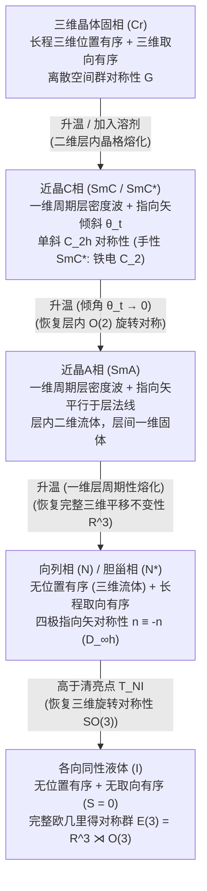

在基础物理学中，物质通常被划分为固态、液态和气态。三维晶体同时具备长程<strong>位置有序（Positional order）</strong>与长程<strong>取向有序（Orientational order）</strong>；而当加热超过熔点时，晶格瞬间瓦解为各向同性液体，完全恢复三维欧几里得对称群 $E(3) = \mathbb{R}^3 \rtimes O(3)$。然而自然界存在第四种迷人的物质范式——<strong>液晶（Liquid Crystals / 介晶相 Mesophases）</strong>。液晶既能像普通流体一样流动、形成液滴，又同时展现光学双折射、弹性恢复力矩以及量子化的拓扑缺陷。本文将系统推导液晶的对称性破缺、统计力学、连续介质弹性与拓扑物理学。

---

## 1. “双熔点”的发现与软物质物理学的诞生

1888年3月，奥地利植物学家<strong>弗里德里希·莱尼泽（Friedrich Reinitzer）</strong>在测定胡萝卜提取物衍生物<strong>苯甲酸胆固醇酯（$\text{C}_{34}\text{H}_{50}\text{O}_2$）</strong>纯度时，发现了奇特的<strong>“双熔点”现象</strong>：（1）加热至 $145.5\,^\circ\text{C}$ 时，晶体熔化为浑浊的乳白色流体；（2）继续加热至 $178.5\,^\circ\text{C}$（清亮点 $T_{NI}$）时，浑浊瞬间消失，变为完全透明的各向同性液体。德国物理学家<strong>奥托·雷曼（Otto Lehmann）</strong>利用正交偏振加热显微镜观察该浑浊流体，发现它具有矿物晶体般的<strong>光学双折射（Birefringence）</strong>和消光刷，遂于1889年提出“<strong>液晶（Flüssige Kristalle）</strong>”一词。

1922年，法国矿物学家<strong>乔治·弗里德尔（Georges Friedel）</strong>确立了<strong>介晶态（Mesophases）</strong>分类体系，将其划分为<strong>向列相（Nematic，源于希腊语“丝线”）</strong>、<strong>近晶相（Smectic，源于“肥皂”）</strong>和<strong>胆甾相（Cholesteric）</strong>。半个世纪后，法国理论物理学家<strong>皮埃尔-吉勒·德热纳（Pierre-Gilles de Gennes，1991年诺贝尔物理学奖得主）</strong>证明液晶、高分子与胶体遵循与超导体和铁磁体完全相同的<strong>自发对称性破缺、序参量与标度律</strong>数学框架，创立了<strong>软凝聚态物理学（Soft Matter Physics）</strong>。

---

## 2. 位置有序与取向有序：向列相、近晶相与胆甾相

形成液晶的分子（<strong>介晶基元 Mesogens</strong>）具有显著的形状各向异性，例如棒状（Calamitic，如室温向列相分子 <strong>5CB</strong>，长径比约 $4:1$）或盘状（Discotic）。加热棒状分子晶体时，质心平动势垒先被热运动 $k_B T$ 克服，但棒间的空间位阻仍限制长轴旋转，导致<strong>位置有序融化而取向有序保留</strong>：

### 2.1 向列相（$N$）与四极张量序参量 $Q_{ij}$、标量序参量 $S$
在单轴<strong>向列相（Nematic phase）</strong>中，分子质心具有完整的三维平移不变性 $\mathbb{R}^3$，但长轴单位矢量 $\mathbf{u}_\alpha$ 沿共同的宏观破缺轴——<strong>指向矢（Director）$\hat{\mathbf{n}}$</strong>（$|\hat{\mathbf{n}}|=1$）择优取向。由于正反取向概率相等，向列相具有宏观<strong>头尾反演等价性（无极性，Apolar）</strong>，指向矢生活在<strong>实射影平面 $\mathbb{R}P^2 = S^2/\mathbb{Z}_2$</strong> 上。因此一阶偶极矩 $\langle \mathbf{u}_\alpha \rangle = \mathbf{0}$，德热纳引入了对称无迹的<strong>二阶四极张量序参量 $Q_{ij}$</strong>：

$$\hat{\mathbf{n}} \equiv -\hat{\mathbf{n}}, \qquad Q_{ij} = \left\langle u_{\alpha, i} u_{\alpha, j} - \frac{1}{3}\delta_{ij} \right\rangle = S \left( n_i n_j - \frac{1}{3}\delta_{ij} \right)$$

其中<strong>Maier-Saupe标量序参量 $S$</strong> 是二阶勒让德多项式 $P_2(\cos\theta)$ 的系综平均（$\theta$ 为分子长轴与 $\hat{\mathbf{n}}$ 的夹角）：

$$S = \langle P_2(\cos\theta) \rangle = \left\langle \frac{3\cos^2\theta - 1}{2} \right\rangle = \int_0^\pi f(\theta) \left(\frac{3\cos^2\theta - 1}{2}\right) \sin\theta \, d\theta$$

完全平行排列时 $S = 1$；各向同性液体中 $\langle\cos^2\theta\rangle = 1/3$，故 $S = 0$；实际热致向列相中 $S \approx 0.3\text{–}0.8$。

### 2.2 近晶相（$\text{SmA}, \text{SmC}^*$）与胆甾相（$N^*$）布拉格反射
* <strong>近晶相（Smectic）</strong>：分子在保持取向有序的同时排列成间距 $d \approx 2\text{–}4\,\text{nm}$ 的层状结构，沿层法线 $z$ 破坏平移对称性，形成一维质量密度波 $\rho(\mathbf{r})$。德热纳发现<strong>向列相-近晶A相（$\text{SmA}$）转变与超导体的 Ginzburg-Landau 理论在数学上完全同构</strong>：层间距恒定迫使 $\text{SmA}$ 相像超导体迈斯纳效应排斥磁通一样，完全排斥扭曲（$K_2 \to \infty$）与弯曲（$K_3 \to \infty$）形变！而在手性倾斜近晶相（$\text{SmC}^*$）中，Meyer（1975）证明 $C_2$ 对称性允许层内自发铁电极化 $\mathbf{P}_s \propto \hat{\mathbf{k}} \times \hat{\mathbf{n}}$，实现了微秒级表面稳定铁电液晶（SSFLC）开关。
* <strong>胆甾相（Cholesteric, $N^*$）</strong>：手性分子使指向矢沿螺旋轴旋转，螺距为 $p$（光学周期为 $p/2$）。当 $p$ 与可见光波长相当时，产生<strong>手性选择性圆偏振布拉格反射</strong>：

$$\rho(\mathbf{r}) = \rho_0 + |\psi(\mathbf{r})| \cos\left(q_0 z - q_0 u_z(\mathbf{r})\right), \qquad \lambda_0 = \bar{n} \, p \cos\theta_{\text{inc}}$$

---

## 3. 相变统计力学：Landau-de Gennes 理论与 Onsager 硬棒熵驱动理论

1. <strong>热致液晶与 Landau-de Gennes 自由能</strong>：为什么三维各向同性-向列相（$I\text{–}N$）相变总是<strong>弱一级（不连续）相变</strong>？因为 $Q_{ij} \to -Q_{ij}$（即长椭球排列 $S>0$ 与扁椭球平面排列 $S<0$）在物理上不等价，自由能展开中含有非零的<strong>三次方不变量 $\text{Tr}(\mathbf{Q}^3) = \frac{2}{9}S^3$</strong>：

$$f_{\text{LdG}}(S, T) = f_0 + \frac{1}{3} a (T - T^*) S^2 - \frac{2}{27} B S^3 + \frac{1}{9} C S^4$$

$$T_{NI} = T^* + \frac{B^2}{27 a C}, \qquad S_{NI} = \frac{B}{3C}, \qquad \Delta H = \frac{a B^2 T_{NI}}{27 C^2}$$

   三次项使清亮点 $T_{NI}$ 处序参量从 $0$ 跃变至 $S_{NI} = B/(3C) \approx 0.43$，并伴随微小潜热 $\Delta H \approx 1\text{–}2\,\text{J/cm}^3$。
2. <strong>溶致液晶与 Onsager 纯熵硬棒模型（1949）</strong>：拉斯·昂萨格（Lars Onsager）证明，即使没有任何吸引势（$\Delta U = 0$），细长刚性硬棒（长 $L$、直径 $D$，$L/D \gg 1$）仅凭空间排斥也能自发进入向列相！两根夹角为 $\gamma$ 的硬棒之间的<strong>排除体积 $v_{\text{excl}}(\gamma)$</strong> 正比于 $|\sin\gamma|$：

$$v_{\text{excl}}(\gamma) = 2 L^2 D |\sin\gamma|, \qquad \phi_I = \frac{3.340}{L/D}, \qquad \phi_N = \frac{4.486}{L/D}$$

   当体积分数 $\phi$ 超过临界值时，硬棒通过平行排列（$\gamma \to 0$）牺牲少量取向熵（$\Delta S_{\text{orient}} < 0$），大幅减小排除体积，从而获得巨大的<strong>平动堆积熵增益（$\Delta S_{\text{trans}} \gg |\Delta S_{\text{orient}}|$）</strong>，确立了软物质中<strong>熵驱动自组装</strong>的基石。

---

## 4. 连续介质弹性与光电效应：Oseen-Frank 理论与 Fréedericksz 转变

当指向矢场 $\hat{\mathbf{n}}(\mathbf{r})$ 在空间缓慢变化时，满足 $|\hat{\mathbf{n}}|=1$ 和 $\hat{\mathbf{n}} \equiv -\hat{\mathbf{n}}$ 的二次<strong>Oseen-Frank 弹性自由能密度</strong>由三种基本几何形变构成：<strong>展曲（Splay, $K_1$）</strong>、<strong>扭曲（Twist, $K_2$）</strong>和<strong>弯曲（Bend, $K_3$）</strong>：

$$f_{\text{Frank}} = \frac{1}{2} K_1 \left( \nabla \cdot \hat{\mathbf{n}} \right)^2 + \frac{1}{2} K_2 \left( \hat{\mathbf{n}} \cdot (\nabla \times \hat{\mathbf{n}}) + q_0 \right)^2 + \frac{1}{2} K_3 \left( \hat{\mathbf{n}} \times (\nabla \times \hat{\mathbf{n}}) \right)^2$$

量纲分析给出弹性常数 $K_i \sim k_B T / a \sim 10\,\text{pN}$（$10^{-11}\,\text{N}$）。由于恢复力微弱且无质量能隙，长波热涨落 $\langle|\delta\mathbf{n}(\mathbf{q})|^2\rangle = k_B T / (V K q^2)$ 造成强烈瑞利光散射，解释了莱尼泽观察到的乳白色浑浊。

在厚度为 $d$ 的液晶盒中施加电场 $\mathbf{E}$，介电各向异性 $\Delta\varepsilon = \varepsilon_\parallel - \varepsilon_\perp > 0$ 产生静电力矩 $-\frac{1}{2}\varepsilon_0\Delta\varepsilon(\mathbf{E}\cdot\hat{\mathbf{n}})^2$ 与表面锚定弹性恢复力竞争。通过欧拉-拉格朗日变分与傅里叶基模（$n=1$）稳定性分析，当外加电压超过临界阈值时发生自发屈曲——即<strong>弗雷德里克兹转变（Fréedericksz transition）</strong>：

$$E_{\text{th}} = \frac{\pi}{d} \sqrt{\frac{K_1}{\varepsilon_0 \Delta\varepsilon}} \quad \Longrightarrow \quad V_{\text{th}} = E_{\text{th}} d = \pi \sqrt{\frac{K_1}{\varepsilon_0 \Delta\varepsilon}}$$

注意液晶盒厚度 $d$ 完全约去！阈值电压 $V_{\text{th}} \approx 1\,\text{V}$ 仅取决于材料常数，与 CMOS 薄膜晶体管（TFT）完美兼容，支撑起现代<strong>扭曲向列（TN）</strong>、<strong>面内转换（IPS）</strong>与<strong>垂直配向（VA）</strong>三大液晶显示（LCD）架构。

---

## 5. 拓扑缺陷（向错）与 $\pi_1(\mathbb{R}P^2) = \mathbb{Z}_2$ 同伦分类

由于头尾等价性 $\hat{\mathbf{n}} \equiv -\hat{\mathbf{n}}$，绕缺陷核心一周（$2\pi$），指向矢只需旋转 $\pi$ 的整数倍即可回到同一物理状态。因此在二维平面中允许<strong>半整数拓扑荷（绕数 $s = \pm 1/2$）</strong>：彗星状 $s = +1/2$ 向错与三叶草状 $s = -1/2$ 向错。而在三维空间中，序参量流形为实射影平面 $\mathcal{M} = \mathbb{R}P^2$，其基本同伦群为二元循环群：

$$\pi_1(\mathbb{R}P^2) = \mathbb{Z}_2 = \{0, 1\}, \qquad E_{\text{line}} = \pi K s^2 \ln\left(\frac{R}{r_c}\right) + E_{\text{core}}, \qquad B = 4|s|$$

这意味着在三维向列相中，只有半整数向错线（$s = \pm 1/2$，对应非平凡类 $1 \in \mathbb{Z}_2$）是拓扑稳定的；而整数向错（$s = \pm 1$，能量正比于 $s^2$，是半整数向错的 4 倍）属于平凡同伦类 $0 \in \mathbb{Z}_2$，会通过指向矢向第三维倾斜而消除奇异核——即著名的<strong>“向第三维逃逸（Escape into the third dimension）”</strong>。在正交偏振显微镜的<strong>纹影织构（Schlieren texture）</strong>中，缺陷核周围发出的暗消光刷数目严格满足 $B = 4|s|$（半整数缺陷呈现 2 条暗刷，整数缺陷呈现 4 条暗刷）。

---

## 6. 各介晶相物理特性对比与前沿应用（Kevlar、人工肌肉与活性物质）

| 介晶相 / 物质状态 | 位置有序（平移对称性） | 取向有序（旋转对称性） | 点群 / 空间群对称性 | 核心序参量 | 光学与流变学特征 |
| :--- | :--- | :--- | :--- | :--- | :--- |
| <strong>各向同性液体 ($I$)</strong> | 无（三维 $\mathbb{R}^3$ 平移不变） | 无（三维 $O(3)$ 旋转不变） | $E(3) = \mathbb{R}^3 \rtimes O(3)$ | $S = 0, \; \psi = 0$ | 光学各向同性（$\Delta n = 0$），牛顿流体 |
| <strong>向列相 ($N$)</strong> | 无（三维流体 $\mathbb{R}^3$） | 长程单轴取向（$\hat{\mathbf{n}} \equiv -\hat{\mathbf{n}}$） | $\mathbb{R}^3 \rtimes D_{\infty h}$ | 四极张量 $Q_{ij}$（$S \neq 0$） | 强双折射 $\Delta n$，纹影丝状缺陷（$B=2,4$），低粘度 |
| <strong>胆甾相 ($N^*$)</strong> | 无（局域向列型流体） | 沿螺旋轴周期扭曲（$q_0 = 2\pi/p$） | $\mathbb{R}^2 \rtimes D_\infty$（手性） | $Q_{ij}(\mathbf{r})$，螺距 $p$ | 圆偏振选择性布拉格反射（$\lambda_0 = \bar{n}p$），巨旋光性 |
| <strong>近晶A相 ($\text{SmA}$)</strong> | 一维周期层密度波（$d \approx L$） | 平行于层法线（$\hat{\mathbf{n}} \parallel \hat{\mathbf{k}}$） | $(\mathbb{R}^2 \times \mathbb{Z}) \rtimes D_{\infty h}$ | $S \neq 0$，复密度波 $\psi = |\psi|e^{i\phi}$ | 焦锥扇形织构，排斥扭曲与弯曲（$K_2, K_3 \to \infty$，超导模拟） |
| <strong>手性近晶C相 ($\text{SmC}^*$)</strong> | 一维周期层（$d = L\cos\theta_t$） | 相对层法线倾斜角 $\theta_t$ | 单斜 $C_2$（手性极性轴） | $\psi \neq 0$，自发铁电极化 $\mathbf{P}_s$ | 双轴光学，微秒级双稳态铁电光电开关（SSFLC） |

超越平板显示，液晶物理正引领四大前沿：（1）<strong>高强液晶高分子（LCP）</strong>：杜邦公司的 Stephanie Kwolek 利用刚性芳纶链在浓硫酸中的 Onsager 溶致向列相自组装，纺制出比强度达钢材 5–8 倍的<strong>凯夫拉（Kevlar）</strong>防弹纤维；（2）<strong>液晶弹性体（LCE）人工肌肉</strong>：将介晶基元交联入橡胶网络，当加热或光照跨越 $T_{NI}$ 使 $S \to 0$ 时，产生 $30\%\text{–}400\%$ 的可逆宏观收缩；（3）<strong>硅基液晶（LCoS）空间光调制器与拓扑 Q-Plate</strong>：用于全息光镊、自适应光学与轨道角动量（OAM）涡旋光束生成；（4）<strong>生物液晶与活性向列相（Active Nematics）</strong>：细胞膜磷脂双分子层本质上是二维 $\text{SmA}$ 液晶，而由 ATP 驱动的细胞骨架微管与上皮细胞层产生正比于 $Q_{ij}$ 的<strong>活性应力张量</strong>：

$$\sigma_{ij}^{\text{active}} = -\zeta \, Q_{ij}, \qquad \mathbf{f}^{\text{active}} = -\zeta \nabla \cdot \mathbf{Q}$$

由于彗星状 $+1/2$ 拓扑缺陷打破前后反演对称性（$\nabla\cdot\mathbf{Q} \neq \mathbf{0}$），它们会化身为<strong>自推进准粒子</strong>在零雷诺数下产生“活性湍流”，并在哺乳动物上皮细胞凋亡挤压（Saw et al., *Nature* 2017）及水螅（*Hydra*）再生形态发生（头部在 $+1$ 缺陷处再生，触手在 $-1/2$ 缺陷处萌发）中充当生物力学组织中心。
