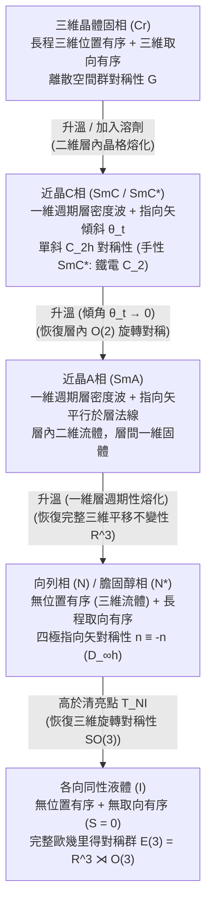

在基礎物理學中，物質通常被劃分為固態、液態和氣態。三維晶體同時具備長程<strong>位置有序（Positional order）</strong>與長程<strong>取向有序（Orientational order）</strong>；而當加熱超過熔點時，晶格瞬間瓦解為各向同性液體，完全恢復三維歐幾里得對稱群 $E(3) = \mathbb{R}^3 \rtimes O(3)$。然而自然界存在第四種迷人的物質範式——<strong>液晶（Liquid Crystals / 介晶相 Mesophases）</strong>。液晶既能像普通流體一樣流動、形成液滴，又同時展現光學雙折射、彈性恢復力矩以及量子化的拓撲缺陷。本文將系統推導液晶的對稱性破缺、統計力學、連續介質彈性與拓撲物理學。

---

## 1. 「雙熔點」的發現與軟物質物理學的誕生

1888年3月，奧地利植物學家<strong>弗里德里希·萊尼澤（Friedrich Reinitzer）</strong>在測定胡蘿蔔萃取物衍生物<strong>苯甲酸膽固醇酯（$\text{C}_{34}\text{H}_{50}\text{O}_2$）</strong>純度時，發現了奇特的<strong>「雙熔點」現象</strong>：（1）加熱至 $145.5\,^\circ\text{C}$ 時，晶體熔化為渾濁的乳白色流體；（2）繼續加熱至 $178.5\,^\circ\text{C}$（清亮點 $T_{NI}$）時，渾濁瞬間消失，變為完全透明的各向同性液體。德國物理學家<strong>奧托·雷曼（Otto Lehmann）</strong>利用正交偏振加熱顯微鏡觀察該渾濁流體，發現它具有礦物晶體般的<strong>光學雙折射（Birefringence）</strong>和消光刷，遂於1889年提出「<strong>液晶（Flüssige Kristalle）</strong>」一詞。

1922年，法國礦物學家<strong>喬治·弗里德爾（Georges Friedel）</strong>確立了<strong>介晶態（Mesophases）</strong>分類體系，將其劃分為<strong>向列相（Nematic，源於希臘語「絲線」）</strong>、<strong>近晶相（Smectic，源於「肥皂」）</strong>和<strong>膽固醇相（Cholesteric）</strong>。半個世紀後，法國理論物理學家<strong>皮埃爾-吉勒·德熱納（Pierre-Gilles de Gennes，1991年諾貝爾物理學獎得主）</strong>證明液晶、高分子與膠體遵循與超導體和鐵磁體完全相同的<strong>自發對稱性破缺、序參量與標度律</strong>數學框架，創立了<strong>軟凝聚態物理學（Soft Matter Physics）</strong>。

---

## 2. 位置有序與取向有序：向列相、近晶相與膽固醇相

形成液晶的分子（<strong>介晶基元 Mesogens</strong>）具有顯著的形狀各向異性，例如棒狀（Calamitic，如室溫向列相分子 <strong>5CB</strong>，長徑比約 $4:1$）或盤狀（Discotic）。加熱棒狀分子晶體時，質心平動勢壘先被熱運動 $k_B T$ 克服，但棒間的空間位阻仍限制長軸旋轉，導致<strong>位置有序融化而取向有序保留</strong>：

### 2.1 向列相（$N$）與四極張量序參量 $Q_{ij}$、純量序參量 $S$
在單軸<strong>向列相（Nematic phase）</strong>中，分子質心具有完整的三維平移不變性 $\mathbb{R}^3$，但長軸單位向量 $\mathbf{u}_\alpha$ 沿共同的巨觀破缺軸——<strong>指向矢（Director）$\hat{\mathbf{n}}$</strong>（$|\hat{\mathbf{n}}|=1$）擇優取向。由於正反取向機率相等，向列相具有巨觀<strong>頭尾反演等價性（無極性，Apolar）</strong>，指向矢生活在<strong>實射影平面 $\mathbb{R}P^2 = S^2/\mathbb{Z}_2$</strong> 上。因此一階偶極矩 $\langle \mathbf{u}_\alpha \rangle = \mathbf{0}$，德熱納引入了對稱無跡的<strong>二階四極張量序參量 $Q_{ij}$</strong>：

$$\hat{\mathbf{n}} \equiv -\hat{\mathbf{n}}, \qquad Q_{ij} = \left\langle u_{\alpha, i} u_{\alpha, j} - \frac{1}{3}\delta_{ij} \right\rangle = S \left( n_i n_j - \frac{1}{3}\delta_{ij} \right)$$

其中<strong>Maier-Saupe純量序參量 $S$</strong> 是二階勒讓德多項式 $P_2(\cos\theta)$ 的系綜平均（$\theta$ 為分子長軸與 $\hat{\mathbf{n}}$ 的夾角）：

$$S = \langle P_2(\cos\theta) \rangle = \left\langle \frac{3\cos^2\theta - 1}{2} \right\rangle = \int_0^\pi f(\theta) \left(\frac{3\cos^2\theta - 1}{2}\right) \sin\theta \, d\theta$$

完全平行排列時 $S = 1$；各向同性液體中 $\langle\cos^2\theta\rangle = 1/3$，故 $S = 0$；實際熱致向列相中 $S \approx 0.3\text{–}0.8$。

### 2.2 近晶相（$\text{SmA}, \text{SmC}^*$）與膽固醇相（$N^*$）布拉格反射
* <strong>近晶相（Smectic）</strong>：分子在保持取向有序的同時排列成間距 $d \approx 2\text{–}4\,\text{nm}$ 的層狀結構，沿層法線 $z$ 破壞平移對稱性，形成一維質量密度波 $\rho(\mathbf{r})$。德熱納發現<strong>向列相-近晶A相（$\text{SmA}$）轉變與超導體的 Ginzburg-Landau 理論在數學上完全同構</strong>：層間距恆定迫使 $\text{SmA}$ 相像超導體邁斯納效應排斥磁通一樣，完全排斥扭曲（$K_2 \to \infty$）與彎曲（$K_3 \to \infty$）形變！而在手性傾斜近晶相（$\text{SmC}^*$）中，Meyer（1975）證明 $C_2$ 對稱性允許層內自發鐵電極化 $\mathbf{P}_s \propto \hat{\mathbf{k}} \times \hat{\mathbf{n}}$，實現了微秒級表面穩定鐵電液晶（SSFLC）開關。
* <strong>膽固醇相（Cholesteric, $N^*$）</strong>：手性分子使指向矢沿螺旋軸旋轉，螺距為 $p$（光學週期為 $p/2$）。當 $p$ 與可見光波長相當時，產生<strong>手性選擇性圓偏振布拉格反射</strong>：

$$\rho(\mathbf{r}) = \rho_0 + |\psi(\mathbf{r})| \cos\left(q_0 z - q_0 u_z(\mathbf{r})\right), \qquad \lambda_0 = \bar{n} \, p \cos\theta_{\text{inc}}$$

---

## 3. 相變統計力學：Landau-de Gennes 理論與 Onsager 硬棒熵驅動理論

1. <strong>熱致液晶與 Landau-de Gennes 自由能</strong>：為什麼三維各向同性-向列相（$I\text{–}N$）相變總是<strong>弱一級（不連續）相變</strong>？因為 $Q_{ij} \to -Q_{ij}$（即長橢球排列 $S>0$ 與扁橢球平面排列 $S<0$）在物理上不等價，自由能展開中含有非零的<strong>三次方不變量 $\text{Tr}(\mathbf{Q}^3) = \frac{2}{9}S^3$</strong>：

$$f_{\text{LdG}}(S, T) = f_0 + \frac{1}{3} a (T - T^*) S^2 - \frac{2}{27} B S^3 + \frac{1}{9} C S^4$$

$$T_{NI} = T^* + \frac{B^2}{27 a C}, \qquad S_{NI} = \frac{B}{3C}, \qquad \Delta H = \frac{a B^2 T_{NI}}{27 C^2}$$

   三次項使清亮點 $T_{NI}$ 處序參量從 $0$ 躍變至 $S_{NI} = B/(3C) \approx 0.43$，並伴隨微小潛熱 $\Delta H \approx 1\text{–}2\,\text{J/cm}^3$。
2. <strong>溶致液晶與 Onsager 純熵硬棒模型（1949）</strong>：拉斯·昂薩格（Lars Onsager）證明，即使沒有任何吸引勢（$\Delta U = 0$），細長剛性硬棒（長 $L$、直徑 $D$，$L/D \gg 1$）僅憑空間排斥也能自發進入向列相！兩根夾角為 $\gamma$ 的硬棒之間的<strong>排除體積 $v_{\text{excl}}(\gamma)$</strong> 正比於 $|\sin\gamma|$：

$$v_{\text{excl}}(\gamma) = 2 L^2 D |\sin\gamma|, \qquad \phi_I = \frac{3.340}{L/D}, \qquad \phi_N = \frac{4.486}{L/D}$$

   當體積分數 $\phi$ 超過臨界值時，硬棒透過平行排列（$\gamma \to 0$）犧牲少量取向熵（$\Delta S_{\text{orient}} < 0$），大幅減小排除體積，從而獲得巨大的<strong>平動堆積熵增益（$\Delta S_{\text{trans}} \gg |\Delta S_{\text{orient}}|$）</strong>，確立了軟物質中<strong>熵驅動自組裝</strong>的基石。

---

## 4. 連續介質彈性與光電效應：Oseen-Frank 理論與 Fréedericksz 轉變

當指向矢場 $\hat{\mathbf{n}}(\mathbf{r})$ 在空間緩慢變化時，滿足 $|\hat{\mathbf{n}}|=1$ 和 $\hat{\mathbf{n}} \equiv -\hat{\mathbf{n}}$ 的二次<strong>Oseen-Frank 彈性自由能密度</strong>由三種基本幾何形變構成：<strong>展曲（Splay, $K_1$）</strong>、<strong>扭曲（Twist, $K_2$）</strong>和<strong>彎曲（Bend, $K_3$）</strong>：

$$f_{\text{Frank}} = \frac{1}{2} K_1 \left( \nabla \cdot \hat{\mathbf{n}} \right)^2 + \frac{1}{2} K_2 \left( \hat{\mathbf{n}} \cdot (\nabla \times \hat{\mathbf{n}}) + q_0 \right)^2 + \frac{1}{2} K_3 \left( \hat{\mathbf{n}} \times (\nabla \times \hat{\mathbf{n}}) \right)^2$$

量綱分析給出彈性常數 $K_i \sim k_B T / a \sim 10\,\text{pN}$（$10^{-11}\,\text{N}$）。由於恢復力微弱且無質量能隙，長波熱漲落 $\langle|\delta\mathbf{n}(\mathbf{q})|^2\rangle = k_B T / (V K q^2)$ 造成強烈瑞利光散射，解釋了萊尼澤觀察到的乳白色渾濁。

在厚度為 $d$ 的液晶盒中施加電場 $\mathbf{E}$，介電各向異性 $\Delta\varepsilon = \varepsilon_\parallel - \varepsilon_\perp > 0$ 產生靜電力矩 $-\frac{1}{2}\varepsilon_0\Delta\varepsilon(\mathbf{E}\cdot\hat{\mathbf{n}})^2$ 與表面錨定彈性恢復力競爭。透過歐拉-拉格朗日變分與傅立葉基模（$n=1$）穩定性分析，當外加電壓超過臨界閾值時發生自發屈曲——即<strong>弗雷德里克茲轉變（Fréedericksz transition）</strong>：

$$E_{\text{th}} = \frac{\pi}{d} \sqrt{\frac{K_1}{\varepsilon_0 \Delta\varepsilon}} \quad \Longrightarrow \quad V_{\text{th}} = E_{\text{th}} d = \pi \sqrt{\frac{K_1}{\varepsilon_0 \Delta\varepsilon}}$$

注意液晶盒厚度 $d$ 完全約去！閾值電壓 $V_{\text{th}} \approx 1\,\text{V}$ 僅取決於材料常數，與 CMOS 薄膜電晶體（TFT）完美相容，支撐起現代<strong>扭曲向列（TN）</strong>、<strong>面內切換（IPS）</strong>與<strong>垂直配向（VA）</strong>三大液晶顯示（LCD）架構。

---

## 5. 拓撲缺陷（向錯）與 $\pi_1(\mathbb{R}P^2) = \mathbb{Z}_2$ 同倫分類

由於頭尾等價性 $\hat{\mathbf{n}} \equiv -\hat{\mathbf{n}}$，繞缺陷核心一圈（$2\pi$），指向矢只需旋轉 $\pi$ 的整數倍即可回到同一物理狀態。因此在二維平面中允許<strong>半整數拓撲荷（繞數 $s = \pm 1/2$）</strong>：彗星狀 $s = +1/2$ 向錯與三葉草狀 $s = -1/2$ 向錯。而在三維空間中，序參量流形為實射影平面 $\mathcal{M} = \mathbb{R}P^2$，其基本同倫群為二元循環群：

$$\pi_1(\mathbb{R}P^2) = \mathbb{Z}_2 = \{0, 1\}, \qquad E_{\text{line}} = \pi K s^2 \ln\left(\frac{R}{r_c}\right) + E_{\text{core}}, \qquad B = 4|s|$$

這意味著在三維向列相中，只有半整數向錯線（$s = \pm 1/2$，對應非平凡類 $1 \in \mathbb{Z}_2$）是拓撲穩定的；而整數向錯（$s = \pm 1$，能量正比於 $s^2$，是半整數向錯的 4 倍）屬於平凡同倫類 $0 \in \mathbb{Z}_2$，會透過指向矢向第三維傾斜而消除奇異核——即著名的<strong>「向第三維逃逸（Escape into the third dimension）」</strong>。在正交偏振顯微鏡的<strong>紋影織構（Schlieren texture）</strong>中，缺陷核周圍發出的暗消光刷數目嚴格滿足 $B = 4|s|$（半整數缺陷呈現 2 條暗刷，整數缺陷呈現 4 條暗刷）。

---

## 6. 各介晶相物理特性對比與前沿應用（Kevlar、人工肌肉與活性物質）

| 介晶相 / 物質狀態 | 位置有序（平移對稱性） | 取向有序（旋轉對稱性） | 點群 / 空間群對稱性 | 核心序參量 | 光學與流變學特徵 |
| :--- | :--- | :--- | :--- | :--- | :--- |
| <strong>各向同性液體 ($I$)</strong> | 無（三維 $\mathbb{R}^3$ 平移不變） | 無（三維 $O(3)$ 旋轉不變） | $E(3) = \mathbb{R}^3 \rtimes O(3)$ | $S = 0, \; \psi = 0$ | 光學各向同性（$\Delta n = 0$），牛頓流體 |
| <strong>向列相 ($N$)</strong> | 無（三維流體 $\mathbb{R}^3$） | 長程單軸取向（$\hat{\mathbf{n}} \equiv -\hat{\mathbf{n}}$） | $\mathbb{R}^3 \rtimes D_{\infty h}$ | 四極張量 $Q_{ij}$（$S \neq 0$） | 強雙折射 $\Delta n$，紋影絲狀缺陷（$B=2,4$），低黏度 |
| <strong>膽固醇相 ($N^*$)</strong> | 無（局域向列型流體） | 沿螺旋軸週期扭曲（$q_0 = 2\pi/p$） | $\mathbb{R}^2 \rtimes D_\infty$（手性） | $Q_{ij}(\mathbf{r})$，螺距 $p$ | 圓偏振選擇性布拉格反射（$\lambda_0 = \bar{n}p$），巨旋光性 |
| <strong>近晶A相 ($\text{SmA}$)</strong> | 一維週期層密度波（$d \approx L$） | 平行於層法線（$\hat{\mathbf{n}} \parallel \hat{\mathbf{k}}$） | $(\mathbb{R}^2 \times \mathbb{Z}) \rtimes D_{\infty h}$ | $S \neq 0$，複密度波 $\psi = |\psi|e^{i\phi}$ | 焦錐扇形織構，排斥扭曲與彎曲（$K_2, K_3 \to \infty$，超導模擬） |
| <strong>手性近晶C相 ($\text{SmC}^*$)</strong> | 一維週期層（$d = L\cos\theta_t$） | 相對層法線傾斜角 $\theta_t$ | 單斜 $C_2$（手性極性軸） | $\psi \neq 0$，自發鐵電極化 $\mathbf{P}_s$ | 雙軸光學，微秒級雙穩態鐵電光電開關（SSFLC） |

超越平板顯示，液晶物理正引領四大前沿：（1）<strong>高強液晶高分子（LCP）</strong>：杜邦公司的 Stephanie Kwolek 利用剛性芳綸鏈在濃硫酸中的 Onsager 溶致向列相自組裝，紡製出比強度達鋼材 5–8 倍的<strong>凱夫拉（Kevlar）</strong>防彈纖維；（2）<strong>液晶彈性體（LCE）人工肌肉</strong>：將介晶基元交聯入橡膠網路，當加熱或光照跨越 $T_{NI}$ 使 $S \to 0$ 時，產生 $30\%\text{–}400\%$ 的可逆巨觀收縮；（3）<strong>矽基液晶（LCoS）空間光調制器與拓撲 Q-Plate</strong>：用於全像光鑷、自適應光學與軌道角動量（OAM）渦旋光束生成；（4）<strong>生物液晶與活性向列相（Active Nematics）</strong>：細胞膜磷脂雙分子層本質上是二維 $\text{SmA}$ 液晶，而由 ATP 驅動的細胞骨架微管與上皮細胞層產生正比於 $Q_{ij}$ 的<strong>活性應力張量</strong>：

$$\sigma_{ij}^{\text{active}} = -\zeta \, Q_{ij}, \qquad \mathbf{f}^{\text{active}} = -\zeta \nabla \cdot \mathbf{Q}$$

由於彗星狀 $+1/2$ 拓撲缺陷打破前後反演對稱性（$\nabla\cdot\mathbf{Q} \neq \mathbf{0}$），它們會化身為<strong>自推進準粒子</strong>在零雷諾數下產生「活性湍流」，並在哺乳動物上皮細胞凋亡擠壓（Saw et al., *Nature* 2017）及水螅（*Hydra*）再生形態發生（頭部在 $+1$ 缺陷處再生，觸手在 $-1/2$ 缺陷處萌發）中充當生物力學組織中心。
