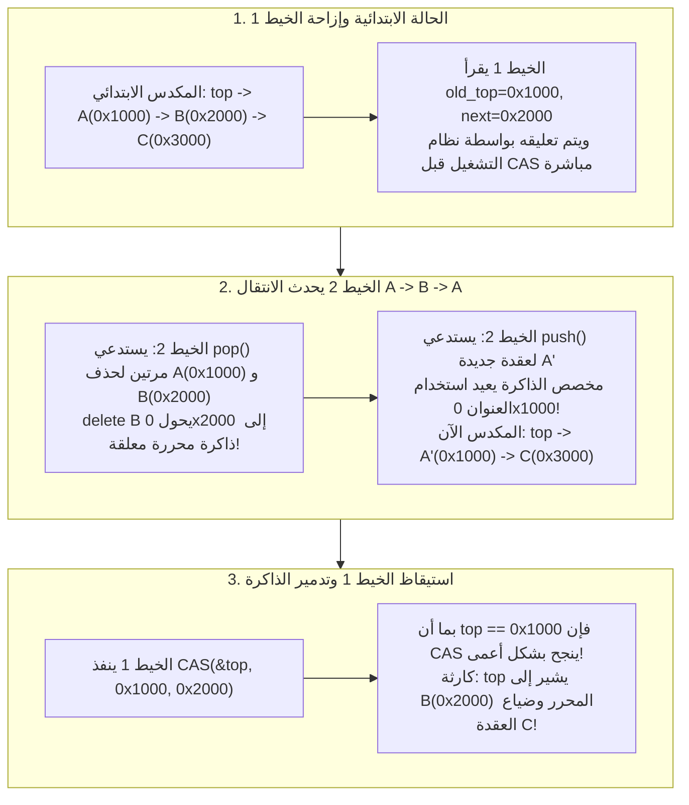
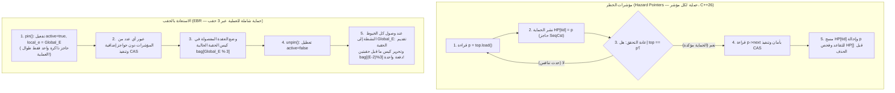

تُعد معالجات الخوادم الحديثة آلات متوازية ضخمة ذات ذاكرة مشتركة؛ إذ يحتوي الخادم ثنائي المقبس عادةً على 128 إلى 256 نواة فيزيائية — وما يصل إلى 512 خيطاً عتادياً (Hardware Threads) عبر تقنية تعدد الخيوط المتزامن (SMT) — تتنافس جميعها على نفس فضاء العناوين المتسق مع الذاكرة المخبئية (ccNUMA). عند تصميم مجدولات نوى أنظمة التشغيل، أو محركات مطابقة الأوامر في التداول عالي التردد (HFT)، أو دوال الاستدعاء لمعالجة الإشارات الرقمية الصوتية (DSP) في الوقت الفعلي، تتحول أداة المزامنة التقليدية — <strong>قفل الاستبعاد المتبادل (`mutex`)</strong> — من آلية حماية إلى عنق زجاجة كارثي يشل النظام بأكمله.

تخيل ما يحدث عندما يقوم 128 خيطاً بإدخال وسحب المهام في آنٍ واحد من طابور مشترك محمي بواسطة `std::mutex`. إن تحديث المؤشر نفسه لا يستغرق سوى 15 نانوثانية. ولكن إذا تعرض الخيط الوحيد $T_1$ الذي يمسك بالقفل للإزاحة (Preemption) من قِبل مجدول نظام التشغيل لانتهاء حصته الزمنية، أو واجه خطأ صفحة ذاكرة (Page Fault)، فإن تلك الـ 15 نانوثانية تتضخم فوراً إلى عدة ملي ثوانٍ. وخلال هذه الفترة بالكامل، <strong>تتوقف جميع النوى الـ 127 المتبقية عن العمل تماماً</strong> في انتظار استيقاظ خيط نائم.

لكسر هذا الارتباط القاتل، ظهر علم <strong>المزامنة غير الحاجزة (Non-Blocking Synchronization)</strong>: الخوارزميات <strong>الخالية من الأقفال (Lock-Free)</strong> و<strong>الخالية من الانتظار (Wait-Free)</strong>. غير أننا بمجرد التخلي عن الأقفال وتعديل المؤشرات مباشرةً باستخدام التعليمات الذرية العتادية مثل `Compare-And-Swap` (`CAS`)، نصطدم بواحدة من أخطر وأذكى الثغرات في علوم الحاسوب: <strong>مشكلة ABA (ABA Problem)</strong>، مقترنةً بمشكلة <strong>الاستعادة الآمنة للذاكرة (Safe Memory Reclamation, SMR)</strong> في اللغات التي لا تمتلك جامع قمامة (C وC++ وRust).

---

## الفصل الأول: لماذا يفشل قفل الاستبعاد المتبادل (`mutex`) في الأنظمة ذات زمن الاستجابة المنخفض جداً؟

حتى أكثر تطبيقات الأقفال كفاءةً مثل `futex` في نواة لينكس تعاني من أربع علل هيكلية ناتجة عن طبيعتها الحاجزة:

1. <strong>الإزاحة وتأثير القافلة (Lock Convoying)</strong>: إذا تم تعليق الخيط الحامل للقفل داخل القسم الحرج، تتراكم جميع الخيوط الأخرى في طابور انتظار النواة. وحتى بعد تحرير القفل، فإن إيقاظ الخيوط واحداً تلو الآخر مع تبديل السياق (Context Switch) وارتداد خطوط الكاش (Cache Line Bouncing) عبر عقد NUMA يخلق ازدحاماً متسلسلاً يُعرف بـ «قافلة الأقفال».
2. <strong>انقلاب الأولوية غير المحدود (Priority Inversion) — درس مسبار المريخ Mars Pathfinder (1997)</strong>: في يوليو 1997، تعرض مسبار وكالة ناسا *Mars Pathfinder* على سطح المريخ لإعادة تشغيل متكررة وغامضة. ففي نظام التشغيل الفوري VxWorks، استحوذت مهمة أرصاد جوية منخفضة الأولوية $T_{\text{low}}$ على قفل الناقل؛ ثم حاولت مهمة إدارة الناقل الحرجة عالية الأولوية $T_{\text{high}}$ الحصول على نفس القفلفتوقفت؛ وفي تلك الأثناء، قامت مهام اتصالات متوسطة الأولوية $T_{\text{med}}$ (لا تحتاج إلى القفل أصلاً!) بإزاحة $T_{\text{low}}$ عن المعالج، مما أدى إلى تجويع $T_{\text{high}}$ بشكل غير مباشر حتى قام مؤقت الحراسة (Watchdog Timer) بإعادة تشغيل المركبة الفضائية.
3. <strong>التوقف التام (Deadlock) وغياب القابلية للتركيب (Lack of Composability)</strong>: لا يمكن دمج جدولَي تجزئة $A$ و$B$ محميين بأقفال داخلية في عملية ذرية واحدة `transfer(A, B)` دون فرض ترتيب عالمي للأقفال لتجنب التوقف المتبادل AB-BA.
4. <strong>الحظر المطلق داخل معالجات الإشارات ومقاطعات العتاد (ISR) والصوت في الوقت الفعلي</strong>: يؤدي استدعاء `mutex_lock` داخل معالج إشارات POSIX (`SIGINT` أو `SIGSEGV`) إلى <strong>توقف ذاتي تام (Self-Deadlock)</strong> إذا كان الخيط المقاطَع يحمل القفل بالفعل. وفي معالجة الصوت الفوري ($48\,\text{kHz}$، مخزن من 64 عينة $\implies$ مهلة صارمة قدرها $1.33\,\text{ms}$)، يؤدي أي نوم في النواة إلى نفاد المخزن المؤقت وحدوث تشويش صوتي مسموع.

---

## الفصل الثاني: الخطية (Linearizability) وضمانات التقدم الثلاثة غير الحاجزة

### 2.1 معيار الصحة: الخطية (Herlihy & Wing, 1990)
في التنفيذ المتزامن، تمتد كل عملية $op_i$ على فترة زمنية $[t_{\text{inv}}(op_i), t_{\text{resp}}(op_i)]$. يكون الكائن المتزامن <strong>قابلاً للخطية (Linearizable)</strong> إذا أمكن تعيين لحظة زمنية ذرية واحدة لكل عملية $op_i$ — تُسمى <strong>نقطة الخطية (Linearization Point)</strong> $t_{\text{lin}}(op_i) \in [t_{\text{inv}}(op_i), t_{\text{resp}}(op_i)]$ — بحيث يشكل ترتيب جميع العمليات وفق $t_{\text{lin}}$ تنفيذاً تسلسلياً صحيحاً. وتتميز الخطية بأنها <strong>خاصية محلية قابلة للتركيب (Composable)</strong>.

### 2.2 المستويات الثلاثة لضمان التقدم غير الحاجز (Liveness)
1. <strong>خالٍ من الإعاقة (Obstruction-Free)</strong>: يضمن الخيط إكمال عمليته في عدد منتهٍ من الخطوات <strong>بشرط أن يعمل في النهاية بمعزل عن غيره</strong> (دون تداخل متزامن). قد يعاني من التوقف الحي (*Livelock*) عند التنافس، لذا يتطلب مدير تنافس مع تراجع أسي (*Exponential Backoff*).
2. <strong>خالٍ من الأقفال (Lock-Free)</strong>: بغض النظر عن سرعة الخيوط الأخرى أو إزاحتها أو توقفها الدائم (*Crash-Stop*)، <strong>يُضمن أن خيطاً واحداً على الأقل من بين جميع الخيوط النشطة سيكمل عمليته في عدد منتهٍ من الخطوات</strong>. إن فشل تعليمة `CAS` لخيط ما يعني رياضياً أن تعليمة `CAS` لخيط *آخر* قد نجحت ودفعت حالة النظام بأكمله إلى الأمام!
3. <strong>خالٍ من الانتظار (Wait-Free)</strong>: يضمن <strong>كل خيط على حدة</strong> إكمال عمليته في عدد منتهٍ ومحدود من خطواته ($O(1)$ أو $O(P)$)، مما يقضي تماماً على التجويع (*Zero Starvation*). ويتحقق ذلك عبر <strong>آلية المساعدة التعاونية (Helping)</strong>: ينشر الخيط البطيء توصيف عمليته في مصفوفة إعلان عامة `announce[i]`، وتقوم الخيوط السريعة بالمساعدة في إتمام العمليات المعلقة للخيوط البطيئة قبل إنهاء عملياتها الخاصة.

| ضمان التقدم | حاجز (Blocking)؟ | ضمان تقدم النظام ككل؟ | الحماية من تجويع الخيط الفردي؟ | الأمان في الإشارات / المقاطعات / الوقت الفعلي؟ | تعقيد الحالة الأسوأ | أمثلة قياسية |
| :--- | :--- | :--- | :--- | :--- | :--- | :--- |
| <strong>Blocking (`mutex`)</strong> | نعم | لا (يتوقف إذا نام حامل القفل) | لا (Deadlock وانقلاب الأولوية) | <strong>محظور / غير آمن</strong> | $\infty$ (نوم غير محدود في النظام) | `std::mutex`, `pthread_mutex_t` |
| <strong>Obstruction-Free</strong> | غير حاجز | فقط عند العمل المنفرد (خطر Livelock) | لا (يتطلب تراجعاً أسياً) | آمن | $\infty$ عند التنافس | الذاكرة المعاملاتية البرمجية (STM) |
| <strong>Lock-Free</strong> | غير حاجز | <strong>نعم (خيط واحد على الأقل ينجح)</strong> | لا (إعادة المحاولة عند التنافس الشديد) | <strong>آمن تماماً</strong> | المتوقع $O(1)$ | مكدس تريبر، طابور مايكل-سكوت |
| <strong>Wait-Free</strong> | غير حاجز | <strong>نعم (جميع الخيوط تنجح)</strong> | <strong>نعم (انعدام التجويع تماماً)</strong> | <strong>وقت فعلي صارم</strong> | <strong>محدود بصرامة $O(1)$ أو $O(P)$</strong> | طابور كوغان-بيترانك، مخزن SPSC، قارئات RCU |

---

## الفصل الثالث: التعليمات الذرية العتادية وهرمية الإجماع لموريس هيرليهي (1991)

في ورقته البحثية الشهيرة *"Wait-Free Synchronization"* (عام 1991، الحائزة على جائزتَي غودل ودايكسترا)، صنف موريس هيرليهي القدرة الحسابية لأي أداة مزامنة $\mathcal{O}$ من خلال <strong>رقم الإجماع (Consensus Number) $C(\mathcal{O})$</strong>: وهو الحد الأقصى لعدد الخيوط $N$ التي يمكنها حل مسألة الإجماع الخالي من الانتظار (الاتفاق، الصحة، والانتهاء) باستخدام كائنات من النوع $\mathcal{O}$ وسجلات القراءة/الكتابة الذرية.

- <strong>$C = 1$: سجلات القراءة/الكتابة الذرية (`MOV` + حاجز ذاكرة)</strong>: <strong>عاجزة عن حل الإجماع حتى لخيطين فقط ($N = 2$)!</strong>
  *برهان الثنائية التكافؤية (Bivalence)*: انطلاقاً من حالة ابتدائية ثنائية التكافؤ (حيث القراران 0 و1 كلاهما ممكن)، لا بد أن يصل البروتوكول إلى <strong>حالة ثنائية تكافؤ حرجة $S_{\text{crit}}$</strong> حيث تؤدي الخطوة التالية $e_A$ للخيط $A$ إلى حالة أحادية التكافؤ (0-valent) $S_0$، وتؤدي الخطوة التالية $e_B$ للخيط $B$ إلى حالة (1-valent) $S_1$. وفي الحالة الحاسمة التي يكتب فيها الخيطان في نفس السجل $R$، إذا كتب $A$ أولاً ثم كتب $B$ بعده مباشرةً، فإن كتابة $B$ <strong>تطمس وتمحو بالكامل</strong> ما كتبه $A$! وبالنسبة للخيط $B$، تصبح الحالة الصفرية $e_B(e_A(S_{\text{crit}}))$ <strong>غير قابلة للتمييز إطلاقاً (Indistinguishable)</strong> عن الحالة الواحدية $e_B(S_{\text{crit}})$، مما يولد تناقضاً رياضياً عند تشغيل $B$ بمفرده حتى النهاية.
- <strong>$C = 2$: تعليمات `Test-and-Set` (`TAS`) و`Swap` (`XCHG`) و`Fetch-and-Add` (`LOCK XADD`) والمكدسات والطوابير</strong>: تحل الإجماع لخيطين، لكنها <strong>تفشل رياضياً لثلاثة خيوط فأكثر ($N \ge 3$)!</strong> ففي `Fetch-and-Add`، إذا أضاف $A$ و$B$ القيمة 1 إلى نفس السجل، فإن خاصية الإبدال في الجمع تعطي النتيجة $r+2$ بغض النظر عمن سبق الآخر؛ فلا يستطيع الخيط الثالث $C$ معرفة الفائز. نتيجة حاسمة: <strong>يستحيل رياضياً بناء طابور أو مكدس Lock-Free عام لـ $\ge 3$ خيوط باستخدام `Fetch-and-Add` أو `Swap` فقط!</strong>
- <strong>$C = \infty$ (الأدوات الكونية الشاملة): `Compare-And-Swap` (`CAS`) و`Load-Linked / Store-Conditional` (`LL/SC`)</strong>: عند تنفيذ `CAS(&decision, UNDECIDED, my_val)`، ينجح الخيط الأول فقط في تعديل السجل بينما تفشل جميع الخيوط الـ $N-1$ الأخرى <strong>دون أن تطمس قيمة الفائز أبداً</strong>. ولذلك فإن `CAS` و`LL/SC` أدوات شاملة قادرة على بناء أي هيكل بيانات لأي عدد $N \to \infty$ من الخيوط.

---

## الفصل الرابع: مكدس تريبر (1986) وتشريح مشكلة ABA

لنفحص التنفيذ البسيط لدالة `pop()` في المكدس الخالي من الأقفال الذي ابتكره آر. كينت تريبر (1986):

```cpp
// دالة pop() البسيطة في مكدس تريبر — معرضة لمشكلة ABA وثغرة Use-After-Free!
bool pop(T& result) {
    Node* old_top = top.load(std::memory_order_acquire);
    while (old_top != nullptr) {
        Node* next_node = old_top->next; // نقطة الخطر 1: قراءة مؤشر قد يكون تم تحريره
        if (top.compare_exchange_weak(   // نقطة الخطر 2: CAS يفحص تطابق قيمة العنوان فقط
                old_top, next_node,
                std::memory_order_acquire, std::memory_order_relaxed)) {
            result = old_top->data;
            delete old_top;              // إعادة العقدة إلى مخصص الذاكرة (شرارة الكارثة!)
            return true;
        }
    }
    return false;
}
```

### 4.1 التسلسل الزمني من 5 خطوات لفساد الذاكرة (Heap Corruption) بسبب مشكلة ABA
لنفترض أن الحالة الابتدائية للمكدس هي: $\text{top} \longrightarrow A(\texttt{0x1000}) \longrightarrow B(\texttt{0x2000}) \longrightarrow C(\texttt{0x3000})$.

1. <strong>[الخطوة 1] الخيط 1 يبدأ `pop()` ويتعرض للإزاحة قبل `CAS` مباشرةً</strong>: يقرأ الخيط 1 العنوان `old_top = 0x1000` ($A$) والعنوان التالي `next_node = 0x2000` ($B$)، لكن مجدول نظام التشغيل يوقفه مؤقتاً قبل تنفيذ تعليمة `CAS(&top, 0x1000, 0x2000)` بلحظة.
2. <strong>[الخطوة 2] الخيط 2 يسحب $A$ و$B$ ويحرر ذاكرتهما</strong>: يستدعي الخيط 2 دالة `pop()` مرتين: يزيل $A(\texttt{0x1000})$ (`delete A`)، ثم يزيل $B(\texttt{0x2000})$ ويستدعي <strong>`delete B`</strong>. أصبح العنوان `0x2000` الآن ذاكرة محررة (مؤشراً معلقاً Dangling Pointer)، وأصبح المكدس $\text{top} \to C(\texttt{0x3000})$.
3. <strong>[الخطوة 3] الخيط 2 ينفذ `push()` ومخصص الذاكرة يعيد استخدام العنوان `0x1000`</strong>: ينشئ الخيط 2 عقدة جديدة $A'$. تقوم مخصصات الذاكرة الحديثة (`jemalloc` و`tcmalloc` و`ptmalloc`) بإعادة تدوير الكتل المحررة حديثاً فوراً بترتيب LIFO لتعظيم كفاءة الكاش L1، فتمنح العقدة الجديدة $A'$ <strong>نفس العنوان القديم تماماً `0x1000`</strong>! وبعد دفعها يصبح المكدس: $\text{top} \longrightarrow A'(\texttt{0x1000}) \longrightarrow C(\texttt{0x3000})$.
4. <strong>[الخطوة 4] الخيط 1 يستيقظ وينفذ تعليمة `CAS(&top, 0x1000, 0x2000)` القديمة</strong>: يقارن المعالج قيمة `top` الحالية (`0x1000`) مع `old_top` (`0x1000`). ولأن العنوان عاد كما كان ($A \to B \to A$)، <strong>تنجح تعليمة `CAS` بشكل أعمى!</strong>
5. <strong>[الخطوة 5] انهيار كامل للذاكرة الديناميكية (Heap)</strong>: يشير `top` الآن إلى `0x2000` (العقدة $B$ المحررة سابقاً!)، وتضيع العقدة $C(\texttt{0x3000})$ للأبد (تسرب ذاكرة)، وأي عملية لاحقة تسبب خطأ Use-After-Free أو انهيار `SIGSEGV`.



---

## الفصل الخامس: المعماريات الأربع للقضاء على مشكلة ABA والاستعادة الآمنة للذاكرة (SMR)

### 5.1 الحل الأول: المؤشرات الموسومة (Tagged Pointers) وتعليمة CAS مزدوجة العرض (`DWCAS` / `CMPXCHG16B`)
يدمج المؤشر ذو 64 بت `ptr` مع عداد أجيال رتيب التزايد ذي 64 بت `tag` في بنية بحجم 128 بت `(ptr, tag)` يزداد بمقدار $+1$ مع كل تعديل: $(\texttt{0x1000}, 42) \to (\texttt{0x2000}, 43) \to (\texttt{0x1000}, 44)$. وباستخدام تعليمة x86-64 `LOCK CMPXCHG16B`، تكتشف عملية `DWCAS` أن `tag 42 != 44` فترفض التعديل بأمان. ويتطلب ذلك مجمع ذاكرة مستقر النوع (*Type-Stable Freelist*) لضمان عدم حدوث `SIGSEGV` أثناء قراءة `old_top->next`.

### 5.2 الحل الثاني: مؤشرات الخطر (Hazard Pointers — Maged Michael 2004, C++26 `<hazard_pointer>`)
ينشر كل خيط قارئ $i$ العنوان `p = top.load()` في خانة ذرية عامة `HP[i].store(p, memory_order_seq_cst)` ثم <strong>يعيد التحقق فوراً</strong> `if (top.load(memory_order_seq_cst) != p) retry;`. وطالما أن `HP[i] == p` معلن، لا يحق لأي خيط تحرير العنوان `p` أو إعادة تدويره. توضع العقد المسحوبة في قائمة تقاعد محلية (`retired_list`) ولا تُحذف فعلياً عبر `delete` إلا بعد فحص جميع خانات `HP[]` والتأكد من عدم حمايتها. يضمن هذا الحل سقفاً صارماً للذاكرة المهدرة $O(P^2)$، مقابل تكلفة حاجز ذاكرة `SeqCst` (`MFENCE`) لكل مؤشر يتم عبوره.

### 5.3 الحل الثالث: الاستعادة القائمة على الحقب الزمنية (EBR — Keir Fraser 2004, Rust `crossbeam-epoch`)
للتخلص من حواجز الذاكرة عند كل مؤشر، تستخدم تقنية EBR عداد حقب عالمياً $E$ وثلاثة أكياس مهملات `bag[0..2]`. عند بدء العملية (`pin()`)، يضبط الخيط `active = true` ويسجل `local_e = E` (<strong>حاجز ذاكرة واحد فقط للعملية بأكملها!</strong>). توضع العقد المفصولة في `bag[E % 3]`. وعندما تلحق جميع الخيوط النشطة بالحقبة $E$، يتقدم العداد العالمي؛ وبمجرد الوصول إلى الحقبة $E+2$، يستحيل أن يحتفظ أي خيط نشط بمؤشر من الحقبة $E$، فيتم تحرير الكيس `bag[E % 3]` بالكامل دفعةً واحدة.



### 5.4 الحل الرابع: القراءة والنسخ والتحديث (RCU — نواة لينكس و`liburcu`)
في أعباء العمل التي تطغى عليها القراءة (جداول التوجيه، مخزن الملفات `dcache` في VFS)، تحقق تقنية RCU <strong>قراءات خالية من الانتظار (Wait-Free) بتكلفة صفرية تماماً</strong> (تُترجم `rcu_read_lock()` إلى صفر من تعليمات الآلة في النوى غير القابلة للإزاحة، وتمنع فقط تبديل السياق). يقوم الكاتب بإنشاء نسخة جديدة (*Copy-on-Write*) وتحديث المؤشر ذرياً، ثم ينتظر عبر `synchronize_rcu()` انتهاء <strong>فترة السماح (Grace Period)</strong> — أي مرور كل نواة معالج بحالة سكون واحدة على الأقل (*Quiescent State*) — قبل تحرير العقدة القديمة بأمان.

| تقنية SMR / مكافحة ABA | تكلفة مسار القراءة | هل الذاكرة محدودة عند توقف خيط؟ | مرونة هياكل البيانات | أبرز الاستخدامات في الإنتاج |
| :--- | :--- | :--- | :--- | :--- |
| <strong>المؤشرات الموسومة (`DWCAS` + مجمع)</strong> | <strong>ضئيلة جداً</strong> (تحميل ذري فقط) | مجمع ثابت (لا يعيد الصفحات للنظام) | محصور في هياكل المؤشر الواحد | مخصص `SLUB` في نواة لينكس |
| <strong>مؤشرات الخطر (Hazard Pointers)</strong> | <strong>مرتفعة</strong> (حاجز `SeqCst` لكل مؤشر) | <strong>نعم — محدودة بـ $O(P^2)$ (Lock-Free بالكامل)</strong> | <strong>عالية جداً</strong> (قوائم، أشجار، رسوم بيانية) | <strong>معيار C++26 `<hazard_pointer>`</strong>، مكتبة `Folly` |
| <strong>الاستعادة بالحقب الزمنية (EBR)</strong> | <strong>منخفضة</strong> (حاجز واحد لكل `pin()`) | لا (توقف خيط داخل `pin` يؤخر التحرير) | <strong>عالية جداً</strong> (مثالي للعبور العميق) | <strong>مكتبة Rust `crossbeam-epoch`</strong>، أشجار Bw-Tree |
| <strong>القراءة والنسخ والتحديث (RCU)</strong> | <strong>صفر (0 تعليمة، Wait-Free)</strong> | محكومة بفترة السماح (Grace Period) | مخصص للقراءة الكثيفة (Read-Mostly) | <strong>نواة لينكس (VFS، الشبكات)</strong>، مكتبة `liburcu` |
