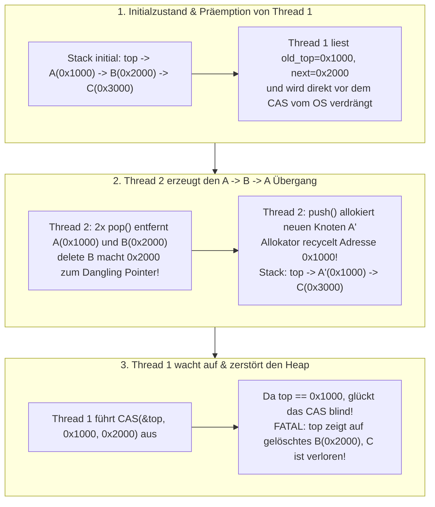
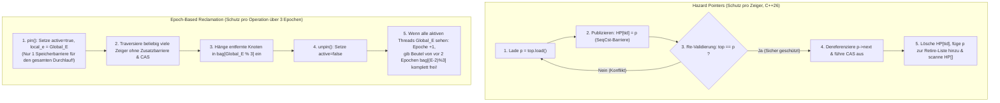

Moderne Serverprozessoren sind massiv parallele Shared-Memory-Maschinen: Ein einzelner Dual-Socket-Server vereint heute problemlos 128 bis 256 physische Kerne – und über Simultaneous Multithreading (SMT) bis zu 512 Hardware-Threads –, die alle auf denselben Cache-kohärenten Adressraum (ccNUMA) zugreifen. Wenn Systemarchitekten Betriebssystem-Scheduler, Matching-Engines für den Hochfrequenzhandel (HFT), Echtzeit-Audio-DSP-Callbacks oder hochparallele Datenbankkerne entwickeln, verwandelt sich das bekannteste Synchronisationsprimitiv der Informatik – der <strong>Mutual Exclusion Lock (`mutex`)</strong> – von einem Sicherheitsmechanismus in einen katastrophalen Flaschenhals.

Was geschieht, wenn 128 Hardware-Threads gleichzeitig Elemente in eine durch `std::mutex` geschützte Warteschlange einfügen und entnehmen? Das eigentliche Umhängen eines Zeigers dauert kaum 15 Nanosekunden. Wird jedoch genau der Thread $T_1$, der gerade den Lock hält, durch ein Zeitscheiben-Interrupt des OS-Schedulers verdrängt (Preemption) oder durch einen Seitenfehler (Page Fault) blockiert, dehnen sich diese 15 Nanosekunden auf mehrere Millisekunden aus. Während dieser gesamten Zeitspanne <strong>kommen alle übrigen 127 CPU-Kerne vollständig zum Erliegen</strong>, weil sie auf einen schlafenden Thread warten müssen.

Um diese strukturelle Geiselhaft – bei der die Verzögerung eines einzigen Threads den Fortschritt des Gesamtsystems blockiert – zu durchbrechen, entstand die Wissenschaft der <strong>nicht-blockierenden Synchronisation (Non-Blocking Synchronization)</strong>: <strong>Lock-Free</strong>- und <strong>Wait-Free</strong>-Algorithmen. Doch sobald wir Locks aufgeben und Zeiger direkt mit atomaren Hardware-Instruktionen wie `Compare-And-Swap` (`CAS`) manipulieren, stoßen wir auf einen der heimtückischsten Fehler der Informatik: das <strong>ABA-Problem</strong> sowie das Problem der <strong>sicheren Speicherbereinigung (Safe Memory Reclamation, SMR)</strong> in Sprachen ohne Garbage Collector wie C, C++ und Rust.

---

## Kapitel 1: Warum Mutexe in Ultra-Low-Latency-Systemen versagen

Selbst hochoptimierte Mutex-Implementierungen wie Linux `futex` (Fast Userspace Mutex) leiden aufgrund ihrer blockierenden Natur unter vier fundamentalen Pathologien:

1. <strong>Präemption und Lock Convoying (Geleitzug-Effekt)</strong>: Wird ein Lock-Halter im kritischen Abschnitt descheduliert, stauen sich alle nachfolgenden Threads in der Kernel-Warteschlange. Selbst nach der Freigabe des Locks verursacht das schrittweise Aufwecken, verbunden mit Kontextwechseln, TLB-Flushes und Cache-Line-Bouncing über NUMA-Knoten hinweg, einen minutenlangen Rückstau.
2. <strong>Unbeschränkte Prioritätsinversion (Priority Inversion) – Die Lehre der Mars Pathfinder (1997)</strong>: Im Juli 1997 erlebte die NASA-Sonde *Mars Pathfinder* auf dem Mars wiederholte System-Resets. Ein niedrigpriorisierter Wetter-Task $T_{\text{low}}$ hielt einen Bus-Mutex; der hochpriorisierte Bus-Management-Task $T_{\text{high}}$ blockierte beim Versuch, denselben Mutex zu erwerben. Dazwischen verdrängten mittelpriorisierte Kommunikations-Tasks $T_{\text{med}}$ (die den Mutex gar nicht benötigten!) den Task $T_{\text{low}}$, sodass $T_{\text{high}}$ indirekt ausgehungert wurde und der Watchdog-Timer das Raumfahrzeug neu startete.
3. <strong>Deadlocks und fehlende Komponierbarkeit (Lack of Composability)</strong>: Zwei jeweils intern durch eigene Locks geschützte Hashtabellen $A$ und $B$ lassen sich nicht ohne globale Sperrordnung zu einer atomaren Operation `transfer(A, B)` kombinieren, ohne AB-BA-Deadlocks zu riskieren.
4. <strong>Striktes Verbot in Signal-Handlern, Interrupt-Routinen (ISRs) und Echtzeit-Audio-Callbacks</strong>: Ein `mutex_lock` innerhalb eines asynchronen POSIX-Signal-Handlers (`SIGINT`, `SIGSEGV`) führt zum sofortigen <strong>Selbst-Deadlock</strong>, falls der unterbrochene Thread den Lock bereits hielt. In einem Echtzeit-Audio-DSP-Callback ($48\,\text{kHz}$, 64 Samples Puffer $\implies 1{,}33\,\text{ms}$ harte Deadline) führt jeder `futex`-Kernel-Sleep sofort zu Puffer-Underruns (hörbaren Audio-Glitches).

---

## Kapitel 2: Linearisierbarkeit und die drei nicht-blockierenden Fortschrittsgarantien

### 2.1 Korrektheitskriterium: Linearisierbarkeit (Herlihy & Wing, 1990)
In nebenläufigen Systemen erstreckt sich jeder Methodenaufruf $op_i$ über ein Zeitintervall $[t_{\text{inv}}(op_i), t_{\text{resp}}(op_i)]$. Ein nebenläufiges Objekt heißt <strong>linearisierbar (Linearizable)</strong>, wenn jeder Operation $op_i$ ein exakter atomarer Zeitpunkt – der <strong>Linearisierungspunkt (Linearization Point)</strong> $t_{\text{lin}}(op_i) \in [t_{\text{inv}}(op_i), t_{\text{resp}}(op_i)]$ – zugeordnet werden kann, sodass die Ordnung aller Operationen entlang $t_{\text{lin}}$ eine gültige sequenzielle Ausführung bildet. Linearisierbarkeit ist <strong>komponierbar</strong>: Das Zusammensetzen linearisierbarer Objekte ergibt ohne Zusatzaufwand wieder ein linearisierbares Gesamtsystem.

### 2.2 Die drei Hierarchiestufen nicht-blockierender Liveness
1. <strong>Obstruction-Free (Hindernisfrei)</strong>: Ein Thread schließt seine Operation in endlich vielen Schritten ab, <strong>sofern er irgendwann isoliert (ohne gleichzeitige Störung durch andere Threads) ausgeführt wird</strong>. Unter starker Konkurrenz sind Livelocks möglich, weshalb Contention-Manager mit Exponential Backoff eingesetzt werden.
2. <strong>Lock-Free (Sperrfrei)</strong>: Unabhängig davon, wie schnell andere Threads laufen, ob sie verdrängt werden oder dauerhaft abstürzen, <strong>schließt unter allen aktiven Threads garantiert „mindestens ein Thread“ seine Operation in endlich vielen Schritten ab</strong>. Wenn das `CAS` eines Threads fehlschlägt, bedeutet dies zwingend, dass das `CAS` eines *anderen* Threads erfolgreich war und den Systemzustand vorangebracht hat.
3. <strong>Wait-Free (Wartefrei)</strong>: <strong>„Jeder einzelne Thread“</strong> schließt seine Operation garantiert in einer beschränkten, endlichen Anzahl eigener Schritte ($O(1)$ oder $O(P)$) ab – völlig frei von Aushungerung (Zero Starvation). Erreicht wird dies durch den <strong>Helping-Mechanismus</strong>: Langsame Threads veröffentlichen ihren Operationsdeskriptor in einem globalen Array `announce[i]`, und schnelle Threads helfen mit, diese ausstehenden Operationen abzuschließen, bevor sie ihre eigene beenden.

| Fortschrittsgarantie | Blockierend? | Systemweiter Fortschritt? | Schutz vor Thread-Starvation? | Sicher in Signalen / ISRs / Audio-RT? | Worst-Case-Komplexität | Typische Beispiele |
| :--- | :--- | :--- | :--- | :--- | :--- | :--- |
| <strong>Blocking (`mutex`)</strong> | Ja | Nein (Halt bei Ausfall des Halters) | Nein (Deadlock & Priority Inversion) | <strong>Verboten / Unsicher</strong> | $\infty$ (Unbeschränkter OS-Sleep) | `std::mutex`, `pthread_mutex_t` |
| <strong>Obstruction-Free</strong> | Nicht-blockierend | Nur bei Solo-Lauf (Livelock möglich) | Nein (Backoff erforderlich) | Sicher | $\infty$ bei Konflikten | Software Transactional Memory (STM) |
| <strong>Lock-Free</strong> | Nicht-blockierend | <strong>Ja (Mindestens 1 Thread fertig)</strong> | Nein (Retries bei hoher Last) | <strong>Vollkommen sicher</strong> | Erwartet $O(1)$ | Treiber-Stack, Michael-Scott-Queue |
| <strong>Wait-Free</strong> | Nicht-blockierend | <strong>Ja (Jeder aktive Thread fertig)</strong> | <strong>Ja (Null Starvation)</strong> | <strong>Hart echtzeitfähig</strong> | <strong>Strikt beschränkt $O(1)$ oder $O(P)$</strong> | Kogan-Petrank-Queue, SPSC-Ringpuffer, RCU-Leser |

---

## Kapitel 3: Hardware-Atomics und Maurice Herlihys Konsenszahlen-Hierarchie (1991)

Welche Hardware-Instruktionen benötigt ein Prozessor, um allgemeine Lock-Free-Datenstrukturen für $N$ Threads zu konstruieren? In seiner mit dem Gödel- und Dijkstra-Preis ausgezeichneten Arbeit *"Wait-Free Synchronization"* (1991) klassifizierte Maurice Herlihy jedes Synchronisationsprimitiv $\mathcal{O}$ durch seine <strong>Konsenszahl (Consensus Number) $C(\mathcal{O})$</strong>: die maximale Anzahl von Threads $N$, für die mittels beliebig vieler Instanzen von $\mathcal{O}$ und atomaren Lese-/Schreibregistern das wartefreie Konsensproblem (Agreement, Validity, Wait-Free Termination) gelöst werden kann.

- <strong>$C = 1$: Atomare Lese-/Schreibregister (`MOV` + Speicherbarriere)</strong>: <strong>Kann nicht einmal den Konsens für $N = 2$ Threads lösen!</strong>
  *Beweisskizze über Bivalenz*: Angenommen, es gäbe ein wartefreies Protokoll für 2 Threads $A$ (Startwert 0) und $B$ (Startwert 1). Ausgehend vom bivalenten Startzustand (beide Ausgänge 0 und 1 noch möglich) muss das System einen <strong>kritischen bivalenten Zustand $S_{\text{crit}}$</strong> erreichen, in dem der nächste Schritt $e_A$ von $A$ in einen 0-valenten Zustand $S_0$ und der nächste Schritt $e_B$ von $B$ in einen 1-valenten Zustand $S_1$ führt. Da nur Lesen und Schreiben existieren, überschreibt im kritischen Fall, dass beide in dasselbe Register $R$ schreiben, der Schreibvorgang $e_B$ im Zustand $e_B(e_A(S_{\text{crit}}))$ (der 0-valent sein muss!) den Schreibvorgang von $A$ restlos. Für Thread $B$ ist dieser 0-valente Zustand somit <strong>unkenntlich identisch (Indistinguishable)</strong> zum 1-valenten Zustand $e_B(S_{\text{crit}})$ – ein Widerspruch!
- <strong>$C = 2$: `Test-and-Set` (`TAS`), `Swap` (`XCHG`), `Fetch-and-Add` (`LOCK XADD`), Stacks & FIFO-Queues</strong>: Löst Konsens für 2 Threads, <strong>scheitert aber mathematisch zwingend ab $N = 3$ Threads!</strong> Führen bei `Fetch-and-Add` die Threads $A$ und $B$ nacheinander `+1` aus, ist das Ergebnis $r+2$ wegen der Kommutativität der Addition identisch, egal wer zuerst kam; ein dritter Thread $C$ kann nicht mehr rekonstruieren, ob $A$ oder $B$ gewonnen hat. Folglich <strong>kann man allein mit `Fetch-and-Add` oder `Swap` niemals eine allgemeine Lock-Free-Queue für $\ge 3$ Threads bauen!</strong>
- <strong>$C = \infty$ (Universelle Primitive): `Compare-And-Swap` (`CAS`) und `Load-Linked / Store-Conditional` (`LL/SC`)</strong>: Bei `CAS(&decision, UNDECIDED, my_val)` überschreibt nur der allererste Thread den Initialwert, während alle nachfolgenden $N-1$ Threads scheitern, <strong>ohne die Entscheidung des Siegers zu zerstören</strong>. Damit sind `CAS` und `LL/SC` universell für beliebig viele Threads $N \to \infty$.

---

## Kapitel 4: Der Treiber-Stack (1986) und die Anatomie des ABA-Problems

Betrachten wir R. Kent Treibers klassischen Lock-Free-Stack in C++:

```cpp
// Naives Lock-Free pop() im Treiber-Stack — anfällig für das ABA-Problem & Use-After-Free!
bool pop(T& result) {
    Node* old_top = top.load(std::memory_order_acquire);
    while (old_top != nullptr) {
        Node* next_node = old_top->next; // Gefahrenpunkt 1: Dereferenzierung von old_top
        if (top.compare_exchange_weak(   // Gefahrenpunkt 2: Wertbasiertes CAS auf die Adresse
                old_top, next_node,
                std::memory_order_acquire, std::memory_order_relaxed)) {
            result = old_top->data;
            delete old_top;              // Rückgabe an den Heap-Allokator (Auslöser der Katastrophe!)
            return true;
        }
    }
    return false;
}
```

### 4.1 Die 5-Schritte-Timeline der Heap-Korruption durch das ABA-Problem
Initialer Zustand des Stacks: $\text{top} \longrightarrow A(\texttt{0x1000}) \longrightarrow B(\texttt{0x2000}) \longrightarrow C(\texttt{0x3000})$.

1. <strong>[Schritt 1] Thread 1 startet `pop()` und wird vor dem `CAS` verdrängt</strong>: Thread 1 liest `old_top = 0x1000` ($A$) sowie `next_node = 0x2000` ($B$) in seine CPU-Register. Unmittelbar vor der Ausführung von `CAS(&top, 0x1000, 0x2000)` unterbricht ihn der OS-Scheduler.
2. <strong>[Schritt 2] Thread 2 entfernt $A$ und $B$ und gibt beide frei</strong>: Thread 2 ruft zweimal `pop()` auf, entnimmt $A(\texttt{0x1000})$ (`delete A`) und anschließend $B(\texttt{0x2000})$ (<strong>`delete B`</strong>). Die Speicheradresse `0x2000` ist nun freigegebener Speicher (Dangling Pointer); der Stack lautet $\text{top} \to C(\texttt{0x3000})$.
3. <strong>[Schritt 3] Thread 2 führt `push()` aus und der Allokator recycelt Adresse `0x1000`</strong>: Thread 2 allokiert einen neuen Knoten $A'$. Moderne Allokatoren (`jemalloc`, `tcmalloc`, `ptmalloc`) verwalten kürzlich freigegebene Blöcke in LIFO-Freelists für maximale L1-Cache-Lokalität und weisen $A'$ <strong>exakt dieselbe Adresse `0x1000`</strong> wieder zu! Nach dem Push lautet der Stack: $\text{top} \longrightarrow A'(\texttt{0x1000}) \longrightarrow C(\texttt{0x3000})$.
4. <strong>[Schritt 4] Thread 1 wacht auf und führt sein veraltetes `CAS(&top, 0x1000, 0x2000)` aus</strong>: Die Hardware prüft, ob `top == 0x1000` gilt. Da die Adresse wieder `0x1000` lautet ($A \to B \to A$), <strong>ist das `CAS` blindlings erfolgreich!</strong>
5. <strong>[Schritt 5] Vollständige Heap-Korruption</strong>: `top` zeigt nun auf `0x2000` (den bereits gelöschten Knoten $B$!), Knoten $C(\texttt{0x3000})$ geht als Speicherleck verloren, und der nächste Zugriff führt unweigerlich zu Use-After-Free oder `SIGSEGV`.



---

## Kapitel 5: Die vier Architekturlösungen gegen ABA und für sichere Speicherbereinigung (SMR)

### 5.1 Lösung 1: Tagged Pointers & Double-Width CAS (`DWCAS` / `CMPXCHG16B`)
Man kombiniert den 64-Bit-Zeiger `ptr` mit einem monoton steigenden 64-Bit-Generationenzähler `tag` zu einem 128-Bit-Paar `(ptr, tag)`. Jede Änderung inkrementiert `tag`: $(\texttt{0x1000}, 42) \to (\texttt{0x2000}, 43) \to (\texttt{0x1000}, 44)$. Mit der x86-64-Instruktion `LOCK CMPXCHG16B` erkennt das `DWCAS` von Thread 1 sofort `tag 42 != 44` und schlägt fehl. Um ein Use-After-Free beim Lesen von `old_top->next` vor dem `DWCAS` zu verhindern, müssen Knoten in einem typstabilen Objektpool (Type-Stable Freelist) gehalten werden.

### 5.2 Lösung 2: Hazard Pointers (Maged Michael 2004, C++26 `<hazard_pointer>`)
Jeder Leser-Thread $i$ besitzt einen global sichtbaren atomaren Slot `HP[i]`. Vor dem Dereferenzieren eines Zeigers `p = top.load()` trägt der Leser `HP[i].store(p, memory_order_seq_cst)` ein und <strong>validiert anschließend erneut</strong> `if (top.load(memory_order_seq_cst) != p) retry;`. Solange `HP[i] == p` gesetzt ist, darf kein anderer Thread `p` freigeben oder dessen Adresse recyceln (wodurch auch ABA unmöglich wird!). Entfernte Knoten landen in einer lokalen `retired_list` und werden erst per `delete` freigegeben, wenn ein Scan über alle `HP[]` bestätigt, dass kein Thread sie mehr schützt. Vorteil: Strikt beschränkter Speicher $O(P^2)$; Nachteil: Eine teure `SeqCst`-Speicherbarriere (`MFENCE`) pro gelesenem Zeiger.

### 5.3 Lösung 3: Epoch-Based Reclamation (EBR — Keir Fraser 2004, Rust `crossbeam-epoch`)
EBR vermeidet zeigerweise Speicherbarrieren durch drei rotierende Epochen ($0, 1, 2 \pmod 3$). Beim Eintritt in eine Operation ruft der Thread `pin()` auf, setzt `active = true` und speichert die globale Epoche `local_e = Global_E` (<strong>nur eine einzige Barriere für die gesamte Operation!</strong>). Gelöschte Knoten kommen in den Beutel `bag[Global_E % 3]`. Sobald alle aktiven Threads die Epoche $E$ erreicht haben, rückt `Global_E` weiter; erreicht das System Epoche $E+2$, hält garantiert kein aktiver Thread mehr Referenzen aus Epoche $E$, und `bag[E % 3]` wird komplett freigegeben.



### 5.4 Lösung 4: Read-Copy-Update (RCU — Linux-Kernel & `liburcu`)
Für leseintensive Strukturen (Routing-Tabellen, VFS `dcache`) bietet RCU <strong>wartefreie Lesezugriffe mit exakt null Overhead</strong> (`rcu_read_lock()` kompiliert im nicht-präemptiven Kernel zu null Maschineninstruktionen und verbietet lediglich Kontextwechsel). Schreiber erstellen eine Kopie (Copy-on-Write), biegen den Zeiger atomar um und warten über `synchronize_rcu()` eine <strong>Grace Period</strong> ab – d. h. bis jeder CPU-Kern mindestens einen Kontextwechsel (Quiescent State) durchlaufen hat –, bevor der alte Knoten gelöscht wird.

| SMR- / ABA-Verfahren | Lese-Overhead (Fast Path) | Speicherbeschränkung bei blockiertem Thread | Flexibilität der Datenstrukturen | Bekannte Produktivsysteme |
| :--- | :--- | :--- | :--- | :--- |
| <strong>Tagged Pointers (`DWCAS` + Pool)</strong> | <strong>Minimal</strong> (Atomarer Load) | Fester Pool (Keine Rückgabe an OS) | Nur für einfache Einzelzeiger-Strukturen | Linux-Kernel `SLUB`, Embedded-Pools |
| <strong>Hazard Pointers</strong> | <strong>Hoch</strong> (`SeqCst`-Fence je Zeiger) | <strong>Strikt beschränkt $O(P^2)$ (100% Lock-Free)</strong> | <strong>Sehr hoch</strong> (Listen, Bäume, Skip-Lists) | <strong>C++26 `<hazard_pointer>`</strong>, Meta `Folly` |
| <strong>Epoch-Based Reclamation (EBR)</strong> | <strong>Niedrig</strong> (1 Fence pro `pin()`) | Unbeschränkt (hängender Thread blockiert GC) | <strong>Sehr hoch</strong> (Ideal für tiefe Traversierungen) | <strong>Rust `crossbeam-epoch`</strong>, Bw-Tree |
| <strong>Read-Copy-Update (RCU)</strong> | <strong>Null (0 Instruktionen, Wait-Free)</strong> | Durch Grace Period begrenzt (Schreiben teuer) | Spezialisiert auf Read-Mostly-Workloads | <strong>Linux-Kernel (VFS, Netzwerk)</strong>, `liburcu` |
